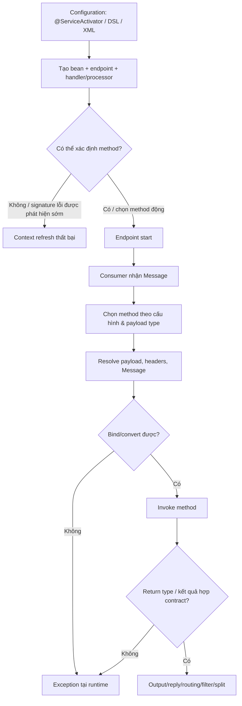

# Method signature không hợp lệ và lỗi khởi tạo

## 1. Vấn đề trong handler adapter của Spring Integration

Trong Spring Integration, rất nhiều endpoint nhận một **POJO method** và biến nó thành hàm xử lý message: `@ServiceActivator`, `@Transformer`, `@Filter`, `@Router`, `@Splitter`, `@Aggregator` hoặc cấu hình Java DSL như `.handle(bean, "methodName")`. Lập trình viên chỉ thấy một phương thức Java; runtime phải tự quyết định **phương thức nào được gọi**, **tham số nào lấy từ payload/header/message**, **cần chuyển đổi kiểu gì** và **giá trị trả về được sử dụng ra sao**.

Khi chữ ký phương thức (*method signature*) vi phạm quy ước hoặc mơ hồ, application có thể không khởi động được; cũng có trường hợp khởi động thành công nhưng **thất bại khi message đầu tiên đến**. Chủ đề này thuộc chương **Handler adapter** của module `SPRING_INTEGRATION_RUNTIME`: tìm hiểu cách Spring Integration chạy và điều phối flow qua channel, endpoint, consumer, poller và executor, đồng thời chẩn đoán lỗi, transaction, retry, correlation và trạng thái runtime.

> **Phạm vi:** Bài viết tập trung vào *method-based message handling*, tức việc adapter ánh xạ message vào phương thức người dùng viết. Đây không phải `HandlerAdapter` trong Spring MVC; cả hai framework có cơ chế xử lý tham số nhưng contract khác nhau. Ví dụ và quy tắc được đối chiếu với tài liệu Spring Integration 6.5; tên lỗi cụ thể và thời điểm phát hiện có thể thay đổi theo phiên bản/cấu hình.

### Sau bài này, bạn cần làm được

- Chỉ ra chữ ký nào hợp lệ và trường hợp nào gây mơ hồ về payload, header hoặc overload.
- Phân biệt lỗi tạo bean/endpoint khi refresh context với lỗi binding/invocation khi message chạy.
- Viết signature rõ ràng bằng `@Payload`, `@Header`, `@Headers` và chọn kiểu trả về đúng EIP.
- Đọc stack trace để định vị adapter, phương thức đích, message gây lỗi và ranh giới thread.
- Sửa chữ ký và kiểm chứng flow mà không nhầm lỗi signature với lỗi channel, transaction hay reply routing.

## 2. Adapter ánh xạ message vào method như thế nào?



Một cách hiểu hữu ích:

1. **Cấu hình** chọn endpoint và bean đích (annotation, DSL hoặc XML), có thể chỉ rõ tên method.
2. **Handler/processor** như `MethodInvokingMessageProcessor` hoặc helper liên quan xử lý ánh xạ; trong Java DSL lambda có những cơ chế adapter khác nhưng cùng vấn đề contract đầu vào/đầu ra.
3. **Consumer** nối handler với `SubscribableChannel` hoặc `PollableChannel`. Consumer quyết định message đến khi nào; handler adapter quyết định lời gọi Java nhận gì.
4. **Method invocation** giải tham số và thực thi; đầu ra được endpoint diễn giải theo EIP: service activator tạo reply, filter quyết định pass/drop, router quyết định channel, transformer trả payload mới, v.v.

Chỉ nhìn câu lệnh `@ServiceActivator(inputChannel = "orders.in")` chưa đủ để biết chữ ký bên dưới hợp lệ. Ngược lại, một method Java biên dịch được không có nghĩa Spring Integration có thể suy ra mapping của nó.

### Hai mốc phát sinh lỗi

| Mốc | Lỗi thường gặp | Triệu chứng |
|---|---|---|
| **Khởi tạo Spring context** | Method được chỉ định không tìm thấy, bean đích không hợp lệ, cấu hình endpoint xung đột hoặc signature bị xác định là mơ hồ ngay lúc thiết lập | `ApplicationContext` không refresh; log có thể bọc nguyên nhân trong `BeanCreationException` hoặc `BeanInitializationException`. |
| **Khi message được xử lý** | Payload không khớp kiểu, conversion thất bại, thiếu header bắt buộc, overload không phân giải được với payload thực tế, kết quả trái contract hoặc method tự ném lỗi | Endpoint có thể đã start; phát sinh `MessagingException` hoặc exception liên quan khi dispatch/invoke. |

**Không có quy luật “mọi signature sai đều fail lúc startup”.** Với method selection động, framework có thể chỉ biết message payload thực tế khi xử lý; khi đó lỗi chỉ xuất hiện sau khi flow chạy. Việc dùng bean lazy hoặc khởi tạo endpoint động cũng ảnh hưởng thời điểm thấy lỗi.

## 3. Quy tắc ánh xạ tham số: cái gì hợp lệ?

Theo *Message Mapping Rules and Conventions*, Spring Integration có quy tắc mặc định; annotation làm mapping rõ ràng hơn:

| Signature/đầu vào | Cách adapter diễn giải |
|---|---|
| `String handle(String sku)` | Tham số duy nhất là **payload**; có thể dùng conversion service nếu cần. |
| `String handle(Message<?> message)` | Tham số là **toàn bộ Message**: payload + headers. |
| `String handle()` | Message là tín hiệu kích hoạt, không cần truyền data vào method. Hợp lệ đối với service activator event-style. |
| `String handle(String sku, @Header("tenant") String tenant)` | `sku` là payload, `tenant` lấy từ header có tên `tenant`. |
| `String handle(@Payload String sku, @Headers Map<String,Object> headers)` | Mapping tường minh payload và toàn bộ header map. |
| `String handle(String sku, Map<String,Object> headers)` | Quy ước đặc biệt có thể ánh xạ tham số `Map` thành headers khi có tham số khác rõ là payload; dùng `@Headers` để tránh phụ thuộc suy luận. |
| `String handle(Map<String,Object> value)` | **Dễ hiểu nhầm:** nếu payload là `Map`, framework ưu tiên nó; nếu không, có thể ánh xạ sang headers. |

### Case 1 — Hai tham số không annotation gây mơ hồ

**Sai:**

```java
import org.springframework.integration.annotation.ServiceActivator;

public class OrderHandler {
    @ServiceActivator(inputChannel = "orders.in")
    public String accept(String sku, int quantity) {
        return sku + ":" + quantity;
    }
}
```

Cả `sku` lẫn `quantity` có thể được xem là payload; không có căn cứ để chọn tham số nào là header. Java compiler chấp nhận, nhưng mapping của Spring Integration không đủ rõ và có thể gây exception khi xác định invocation.

**Đúng:**

```java
import org.springframework.integration.annotation.ServiceActivator;
import org.springframework.messaging.handler.annotation.Header;
import org.springframework.messaging.handler.annotation.Payload;
import org.springframework.stereotype.Component;

@Component
public class OrderHandler {
    @ServiceActivator(inputChannel = "orders.in", requiresReply = "true")
    public String accept(
            @Payload String sku,
            @Header("quantity") Integer quantity) {
        if (quantity <= 0) {
            throw new IllegalArgumentException("quantity must be positive");
        }
        return "accepted:" + sku + ":" + quantity;
    }
}
```

Đã ghi rõ `sku` lấy từ payload, `quantity` lấy từ header. Vì `@Header` mặc định `required=true`, nếu message không có header `quantity`, lỗi xảy ra khi resolve tham số **trước khi** thân hàm `accept()` chạy. Điều này khác với exception `IllegalArgumentException` do business logic ném ra khi `quantity <= 0`.

**Không dùng annotation nhầm framework.** Ví dụ `@RequestParam`, `@PathVariable` của Spring MVC không dùng để map tham số handler trong integration flow. Với handler adapter của Spring Integration, ưu tiên `@Payload`, `@Header` và `@Headers`.

### Case 2 — Hai tham số Map không có chú thích

**Sai/mơ hồ:**

```java
public String accept(Map<String, Object> left,
                     Map<String, Object> right) {
    return "done";
}
```

Cả hai `Map` đều có khả năng được hiểu là payload hay headers; thứ tự tham số không phải là hợp đồng mapping.

**Sửa khi business payload vốn là Map:**

```java
public String accept(@Payload Map<String, Object> order,
                     @Headers Map<String, Object> headers) {
    Object region = headers.get("region");
    return order.get("sku") + "@" + region;
}
```

**Sửa khi chỉ cần một header:** Dùng `@Header("region") String region` để contract dữ liệu chặt chẽ hơn việc nhận cả map.

### Case 3 — Overloaded methods có nhiều ứng viên hợp lệ

Giả sử cấu hình chỉ định tên `handle` nhưng bean có:

```java
public String handle(String sku) {
    return "one:" + sku;
}

public String handle(String sku, Map<String, Object> headers) {
    return "two:" + sku;
}
```

Cả hai method cùng tên và đều có thể nhận payload `String`, nên overload có thể gây **ambiguous method**. Nếu có thể phân biệt bằng payload type, framework đôi khi chọn động được; nhưng không nên dựa vào thứ tự khai báo, tên tham số hoặc hy vọng JVM tự chọn đúng.

**Cách sửa ưu tiên:** dùng một method đích duy nhất cho một endpoint hoặc đặt tên khác rồi chỉ định method rõ ràng:

```java
public String acceptSku(String sku) {
    return "accepted:" + sku;
}

public String auditSku(String sku, @Headers Map<String, Object> headers) {
    return "audited:" + sku;
}
```

```java
@Bean
IntegrationFlow orderFlow(OrderService orderService) {
    return IntegrationFlow.from("orders.in")
            .handle(orderService, "acceptSku")
            .get();
}
```

Ở đây `OrderService` là bean có method `acceptSku`. Đừng đồng thời đăng ký một `@ServiceActivator(inputChannel="orders.in")` khác xử lý cùng request mà không có chủ ý: nhiều consumer trên một channel point-to-point có thể khiến message đến endpoint khác dự kiến.

### Case 4 — Header, conversion và payload thực tế

Ngay cả signature rõ ràng vẫn có thể **fail khi nhận message**:

```java
@ServiceActivator(inputChannel = "orders.in")
public String accept(@Payload OrderRequest request,
                     @Header("tenant") String tenant) {
    return tenant + ":" + request.sku();
}
```

Giả sử `OrderRequest` là record Java:

```java
public record OrderRequest(String sku, int quantity) {}
```

Trường hợp cần phân biệt:

- Payload là `OrderRequest` và header `tenant` tồn tại: mapping bình thường.
- Payload là `String`, không có converter tương ứng từ `String` sang `OrderRequest`: có thể xảy ra lỗi chuyển đổi/giải tham số trước khi chạy method.
- Header `tenant` bị thiếu: `@Header` mặc định bắt buộc; lỗi binding.
- Header `tenant` không đúng kiểu mà không thể chuyển sang `String`/kiểu khai báo: conversion có thể thất bại.
- Business method tự ném exception: resolution đã thành công, lỗi nằm trong method hoặc dependency của nó.

Để header tùy chọn, dùng `@Header(value = "tenant", required = false) String tenant` và xử lý `null` một cách rõ ràng; hoặc dùng `Optional<String>` theo contract cần thiết. Đừng biến một trường bắt buộc về nghiệp vụ thành optional chỉ để tránh exception.

## 4. Đúng signature nhưng sai contract của từng adapter

**Mapping tham số** và **kiểu kết quả** là hai lớp kiểm tra khác nhau. Phương thức có thể nhận tham số hợp lệ nhưng return không đúng vai trò endpoint.

| EIP / annotation | Contract đầu vào/đầu ra đáng chú ý | Ví dụ dễ sai |
|---|---|---|
| `@ServiceActivator` | Có thể nhận payload, `Message`, header; `void` hoặc `null` hợp lệ với xử lý một chiều; bật `requiresReply=true` khi bắt buộc có reply | `void process(...)` trong flow request–reply cần phản hồi; cấu hình `requiresReply` mâu thuẫn với `void` có thể khiến khởi tạo/selector thất bại tùy cách cấu hình. |
| `@Transformer` | Trả giá trị khác `null` hoặc `Message<?>`; transformer phải tạo được message đầu ra | `return null;` làm phát sinh `MessageTransformationException` trong lúc xử lý. |
| `@Filter` | Method chọn message phải trả `boolean` hoặc `Boolean` | `String accept(String sku)` không thỏa contract filter. |
| `@Router` | Trả `MessageChannel` hoặc tên channel `String`, có thể một giá trị hoặc collection | Trả một object nghiệp vụ tùy ý hoặc tên channel không resolve được. |
| `@InboundChannelAdapter` | Method source không nhận tham số và có kiểu trả về khác `void` | `@InboundChannelAdapter String read(String id)`: inbound source không có message input để bind `id`. |
| `@Aggregator` / `@Splitter` | Signature và return phải hợp ngữ cảnh **group** hoặc **split** riêng | Dùng cùng một POJO signature như service activator mà không xem contract aggregator/splitter. |

**Minh họa về filter:**

```java
// SAI: return String, trong khi @Filter cần boolean/Boolean.
@Filter(inputChannel = "orders.filter", outputChannel = "orders.valid")
public String valid(String sku) {
    return sku;
}

// ĐÚNG: trả quyết định cho qua/loại bỏ.
@Filter(inputChannel = "orders.filter", outputChannel = "orders.valid")
public boolean valid(String sku) {
    return sku != null && !sku.isBlank();
}
```

Đây là **hai phiên bản minh họa thay thế nhau**, không khai báo cả hai filter trong cùng cấu hình ứng dụng.

**Minh họa về inbound source:**

```java
// SAI: source không có request message để lấy id.
@InboundChannelAdapter(value = "source.out", poller = @Poller(fixedDelay = "1000"))
public String next(String id) {
    return id;
}

// ĐÚNG: không có tham số; giá trị được poll từ trạng thái/dịch vụ nguồn.
@InboundChannelAdapter(value = "source.out", poller = @Poller(fixedDelay = "1000"))
public String next() {
    return fetchNextItem();
}
```

`fetchNextItem()` là hàm nguồn do ứng dụng định nghĩa. Endpoint kiểu source do `SourcePollingChannelAdapter` và poller kích hoạt, không có payload đầu vào như service activator.

**Lưu ý về `@Transformer` và `@ServiceActivator`:** Với transformer, `null` là lỗi vì nó phải biến message thành message hợp lệ. Với service activator, `null` có thể mang nghĩa “không reply” nếu `requiresReply=false`. Khi caller là gateway đang chờ kết quả, kiểu return và `requiresReply` phải phản ánh chính xác contract nghiệp vụ.

## 5. Lỗi khởi tạo: tìm nguyên nhân thật trong stack trace

Một lỗi startup có thể hiện ở lớp ngoài như:

```text
ApplicationContext failed to start
  BeanCreationException: Error creating bean 'orderHandler...'
    ... nested exception / cause ...
      IllegalArgumentException: method mapping is ambiguous
```

Đây là **sơ đồ biểu diễn** chuỗi nguyên nhân, không phải thông điệp exception bắt buộc của Spring Integration. Tên bean và kiểu lỗi bên trong phụ thuộc implementation/version.

### Quy trình điều tra khi context không start

1. Tìm **ngoại lệ gốc** sâu nhất (*root cause*) trong `Caused by`, đừng dừng ở `BeanCreationException`.
2. Xác định bean và endpoint nào liên quan. Với annotation EIP, framework thường đặt tên endpoint theo mẫu `componentName.methodName.serviceActivator` và handler kèm hậu tố `.handler`; có thể tùy chỉnh bằng `@EndpointId`.
3. Mở đúng phương thức bean đích: tên, access modifier, overload, annotation, return type, parameter annotations và proxy method.
4. Đối chiếu với contract EIP. Trường hợp mơ hồ nhiều tham số, hãy thêm mapping tường minh; trường hợp nhiều overload cùng match payload, chọn method riêng.
5. Nếu bean phụ thuộc vào bean khác, kiểm tra chính xác exception do dependency đó tạo ra. Không quy mọi `BeanCreationException` thành “signature sai”.
6. Sau khi sửa, **khởi tạo lại context** để chắc chắn endpoint được tạo; tiếp đó mới gửi message mẫu kiểm chứng đường chạy động.

Các lỗi *không thuộc signature* có thể xuất hiện cùng giai đoạn: bean name không tồn tại, circular dependency, cấu hình channel sai, hai endpoint đòi dùng chung một handler mutable, hoặc SpEL expression lỗi. Cần xem root cause thay vì sửa chữ ký một cách ngẫu nhiên.

### Vì sao lỗi có thể “chỉ fail khi deploy”?

- Dev mới test cấu hình bean riêng, chưa tải đủ package chứa `@MessageEndpoint` / `@Component`.
- Bean bị lazy và chỉ khởi tạo khi flow động được đăng ký.
- Một phiên bản thư viện/proxy khác thay đổi cách introspect method (vd. method trên interface khác với implementation).
- Runtime mới thực sự nhận payload gây mơ hồ overload hoặc không convert được.
- Header có trong test nhưng thiếu ở upstream production.

Hãy tách điều tra **khởi tạo context**, **endpoint đã start**, và **message được handler invoke** bằng bằng chứng log/metrics tương ứng.

## 6. Lỗi xảy ra sau startup: không phải mọi lỗi là lỗi khởi tạo

Khi message đầu tiên tới method, Spring Integration có thể gặp exception ở một trong ba điểm:

1. **Chọn method:** không có overload thích hợp cho payload, hoặc nhiều overload đều khớp.
2. **Resolve/bind tham số:** `@Header` required thiếu, payload chuyển kiểu thất bại, cấu trúc `Message<?>` không như contract.
3. **Thực thi/hậu xử lý:** method ném exception; `@Transformer` trả `null`; `@Router` trả channel không resolve; reply routing thất bại.

Các tên thường gặp trong stack trace (không phải mọi trường hợp đều có đủ):

| Dấu hiệu | Ý nghĩa sơ bộ | Kiểm tra tiếp |
|---|---|---|
| `MethodArgumentResolutionException` hoặc lỗi resolve argument | Không bind được tham số của method đích | `@Payload`, `@Header`, `@Headers`, header bắt buộc và payload type. |
| `ConversionFailedException` / `MessageConversionException` | Không chuyển được giá trị nguồn sang kiểu tham số | Payload thật, content type, `integrationConversionService`, converter đăng ký. |
| `IllegalArgumentException` / lỗi ambiguous mapping | Method mapping không hợp lệ hoặc không chọn duy nhất | Các overload, annotation và method name đã cấu hình. |
| `MessageHandlingException` | Lỗi trong giai đoạn xử lý message; thường bọc cause | Xem `failedMessage` và cause, không sửa theo tên exception ngoài cùng. |
| `ReplyRequiredException` | Handler được yêu cầu trả reply nhưng kết quả `null` | Nhánh trả về, `requiresReply` và contract gateway. |
| `MessageTransformationException` | Transformer không tạo kết quả hợp lệ hoặc ném lỗi | Đảm bảo transformer trả giá trị khác `null`. |
| Gateway timeout | Không có reply đúng hạn | Có thể do method không reply, mất route, chậm poller hoặc executor; timeout không tự chứng minh signature sai. |

### Thread, transaction, poller và error channel làm lỗi lộ ra khác nhau

- **`DirectChannel`:** thông thường dispatch đồng bộ trên thread của sender; ngoại lệ của handler có thể truyền ngược tới caller.
- **`ExecutorChannel`:** dispatch qua executor; caller có thể đã hoàn tất `send` trước khi handler lỗi. Error handling và thread-local transaction phải xem ở thread xử lý.
- **`QueueChannel` + `PollingConsumer`:** lỗi chỉ xuất hiện khi poller lấy được message. Nếu poller chưa start hoặc backlog lớn, không thấy log gọi method không có nghĩa chữ ký hợp lệ.
- **`errorChannel`:** có thể xử lý exception được chuyển thành `ErrorMessage` theo điểm bắt lỗi, thường trong luồng async/poller phù hợp. Nó không sửa lỗi lúc bean khởi tạo và không mặc nhiên nhận mọi exception ở mọi thread.
- **Retry advice:** hữu ích với lỗi tạm thời như kết nối I/O, nhưng retry nhiều lần một signature mơ hồ hoặc header bắt buộc thiếu **không làm lỗi tự hết**. Sửa mapping hoặc contract message trước.

Nếu nghiệp vụ có side effect (ghi DB, gửi sự kiện), mỗi lần retry có thể lặp tác động; cân nhắc idempotency key và transaction boundary. Đừng bật retry vô hạn chỉ để “đỡ lỗi” khi root cause là configuration.

## 7. Bài thực hành: tái hiện lỗi và sửa trong một request–reply flow

### Bước A — Viết method bị mơ hồ

```java
import org.springframework.integration.annotation.ServiceActivator;
import org.springframework.stereotype.Component;

@Component
class ShippingService {
    @ServiceActivator(inputChannel = "shipping.requests")
    public String ship(String orderId, int priority) {
        return orderId + "-priority-" + priority;
    }
}
```

**Dự đoán:** Hai tham số không annotate; mapper không biết `orderId` hay `priority` là payload. Việc lỗi được báo ở thời điểm khởi tạo hay invocation cần kiểm tra trên chính phiên bản Spring Integration đang chạy.

### Bước B — Sửa signature và làm rõ contract

Thay method ở bước A bằng:

```java
import org.springframework.integration.annotation.ServiceActivator;
import org.springframework.messaging.handler.annotation.Header;
import org.springframework.messaging.handler.annotation.Payload;
import org.springframework.stereotype.Component;

@Component
class ShippingService {
    @ServiceActivator(inputChannel = "shipping.requests", requiresReply = "true")
    public String ship(@Payload String orderId,
                       @Header("priority") int priority) {
        return orderId + "-priority-" + priority;
    }
}
```

**Input minh họa:**

```text
Channel: shipping.requests
Payload (String): "ORD-123"
Headers: priority=2
Expected reply payload: "ORD-123-priority-2"
```

Đối với một request–reply flow, sender hoặc gateway phải có `replyChannel` phù hợp. Ví dụ sử dụng `MessagingTemplate` gửi message đến channel sau khi context đã khởi tạo và service activator đã được đăng ký:

```java
import org.springframework.context.ApplicationContext;
import org.springframework.messaging.Message;
import org.springframework.messaging.MessageChannel;
import org.springframework.messaging.core.MessagingTemplate;
import org.springframework.messaging.support.MessageBuilder;

// context: ApplicationContext đang chạy, có endpoint ShippingService.
MessageChannel requestChannel =
        context.getBean("shipping.requests", MessageChannel.class);

Message<String> request = MessageBuilder.withPayload("ORD-123")
        .setHeader("priority", 2)
        .build();

MessagingTemplate template = new MessagingTemplate();
Message<?> reply = template.sendAndReceive(requestChannel, request);

System.out.println(reply == null ? "<no reply>" : reply.getPayload());
// ORD-123-priority-2 nếu endpoint và reply routing được cấu hình đúng.
```

`MessagingTemplate.sendAndReceive(...)` hỗ trợ request–reply bằng một temporary reply channel, nên code gọi không phải tự khai báo `replyChannel`. Trong một ứng dụng Spring Boot, cần có bean `ShippingService` được scan và Spring Integration annotation processing được bật (ví dụ cấu hình phù hợp với `@EnableIntegration`). Ví dụ minh họa có thể đặt trong command runner/test nơi `context` sẵn có.

### Bước C — Ba thử nghiệm để phân biệt lỗi

**Thử 1 — Header thiếu:** bỏ `.setHeader("priority", 2)`. Với `@Header("priority")` required, handler không nhận được tham số bắt buộc; đọc exception gốc và xác nhận method body chưa thực thi.

**Thử 2 — Header sai kiểu:** gắn `priority="urgent"` trong khi method cần `int`. Nếu không có converter phù hợp, lỗi xảy ra khi chuyển đổi; hãy xác định contract phía producer thay vì ép kiểu đại trà.

**Thử 3 — Method trả `null`:** đổi return thành `null` nhưng giữ `requiresReply="true"`. Resolution có thể hoàn toàn thành công, song service activator phát sinh `ReplyRequiredException`. Đây là **lỗi hợp đồng reply**, không phải lỗi tham số.

### Bước D — Thử ranh giới thực thi

Thay input channel đồng bộ bằng một channel dùng executor hoặc queue + poller **trong môi trường thực hành tách biệt**. Giữ nguyên lỗi thiếu header và quan sát: stack trace xuất hiện ở thread nào, caller có nhận exception trực tiếp hay không, và có `ErrorMessage` nào trên error flow đã cấu hình. Việc khác thread làm thay đổi đường phát hiện lỗi, nhưng không làm signature trở nên hợp lệ.

## 8. Checklist điều tra khi thấy “method signature invalid”

Đi theo một chuỗi kiểm tra cố định để tránh chữa nhầm nguyên nhân:

1. **Lỗi xuất hiện khi nào?** Context refresh, start IntegrationFlow, lần gửi message đầu tiên, hay sau khi poller chạy?
2. **Bean/endpoint nào?** Lấy tên bean từ stack trace, tra `@EndpointId` hoặc tên bean sinh ra từ annotation; xác nhận class thực tế nếu có proxy.
3. **Method nào được chọn?** Có chỉ định tên method trong `.handle(bean, "name")` / XML hay dùng annotation tự tìm? Có overload cùng tên hoặc nhiều method nhận cùng payload?
4. **Signature có đủ annotation chưa?** Chỉ một payload source; đặt `@Payload` cho payload, `@Header` cho header cụ thể, `@Headers` cho cả map; không suy từ tên tham số.
5. **Payload và headers thật là gì?** Ghi kiểu Java, không chỉ giá trị `toString()`; kiểm tra required header, `contentType` và conversion service.
6. **Contract của EIP có đúng?** `@Filter` trả boolean, `@Transformer` không trả `null`, inbound source không nhận tham số, `@Router` trả destination hợp lệ.
7. **Exception gốc?** Tìm `Caused by`, `failedMessage`, method signature và channel; đừng sửa theo exception wrapper.
8. **Thread/error path/transaction?** Xác nhận channel là direct/executor/queue, endpoint started, poller hoạt động và lỗi có được route tới error flow không.
9. **Sửa và kiểm chứng?** Test startup + một message hợp lệ + message thiếu header + message sai kiểu; bảo đảm lỗi mới được phát hiện tại đúng điểm và reply được trả về nếu cần.

### Điều nên tránh

- Chuyển mọi tham số thành `Object` để hết lỗi resolution: điều này đánh mất kiểm tra contract và đẩy lỗi xuống business logic.
- Xóa `@Header(required=true)` khi header thực sự bắt buộc: khiến lỗi data contract khó phát hiện.
- Thêm thêm một overload có cùng khả năng nhận payload: thường làm tình huống ambiguous nặng hơn.
- Chỉ tăng gateway timeout khi thực tế method không bao giờ được invoke hoặc trả reply.
- Bật retry cho lỗi cấu hình tĩnh: tốn tài nguyên, có thể lặp side effect và không sửa root cause.

## 9. Câu hỏi tự đánh giá

**Câu 1.** `public String process(String id, int size)` nhận một request payload `String` và một header `size`. Vì sao signature này mơ hồ?  
**Đáp án:** Cả hai tham số không có mapping, framework không xác định duy nhất tham số nào đại diện payload. Sửa thành `process(@Payload String id, @Header("size") int size)`.

**Câu 2.** `@Filter` trả một chuỗi `"true"`. Chương trình Java có compile được không, và lỗi ở đâu?  
**Đáp án:** Java có thể compile; nhưng method filter không thỏa contract boolean/Boolean. Sửa kiểu trả về và biểu thức thành `boolean`. Thời điểm framework báo lỗi phụ thuộc cách khởi tạo/invoke.

**Câu 3.** Context start thành công, nhưng một message payload `Map` được gửi đến handler có signature `handle(Map value)`. Adapter chắc chắn lấy headers?  
**Đáp án:** Không. Mapping rule ưu tiên payload nếu payload là `Map`; cần `@Headers Map<...>` nếu muốn chắc chắn lấy headers.

**Câu 4.** `@ServiceActivator` trả `null` với `requiresReply=true` sau khi xử lý thành công. Có phải lỗi binding?  
**Đáp án:** Không. Đó là lỗi yêu cầu reply (`ReplyRequiredException`); input binding và method invocation có thể đã thành công.

**Câu 5.** Handler chạy sau `ExecutorChannel` ném exception vì thiếu `@Header`. Vì sao caller không nhất thiết thấy exception trực tiếp?  
**Đáp án:** Handler chạy ở thread executor khác. Cần kiểm tra error handling theo ranh giới dispatch và error channel đã cấu hình, đồng thời sửa header contract.

## 10. Tài liệu tham khảo

- [Spring Integration 6.5 — Message Mapping Rules and Conventions](https://docs.spring.io/spring-integration/reference/6.5/configuration/message-mapping-rules.html): quy tắc mapping, Map, overload và ambiguity.
- [Spring Integration 6.5 — Annotation Support](https://docs.spring.io/spring-integration/reference/6.5/configuration/annotations.html): `@Payload`, `@Header`, `@Headers`, bean/endpoint và lifecycle.
- [Spring Integration 6.5 — Service Activator](https://docs.spring.io/spring-integration/reference/6.5/service-activator.html): lựa chọn method, `requiresReply` và output.
- [Spring Integration 6.5 — Filter](https://docs.spring.io/spring-integration/reference/6.5/filter.html): contract boolean.
- [Spring Integration 6.5 — Transformer](https://docs.spring.io/spring-integration/reference/6.5/transformer.html): contract khác `null`.
- [Spring Integration 6.5 — Router with Annotations](https://docs.spring.io/spring-integration/reference/6.5/router/annotation.html): loại return được phép dùng để route.
- [Spring Integration 6.5 API — MethodInvokingMessageProcessor](https://docs.spring.io/spring-integration/docs/6.5.x/api/org/springframework/integration/handler/MethodInvokingMessageProcessor.html): cơ chế gọi method trong `MessageProcessor`.
