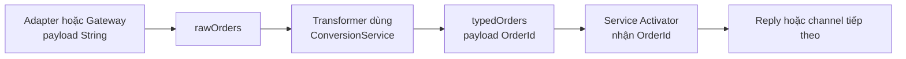
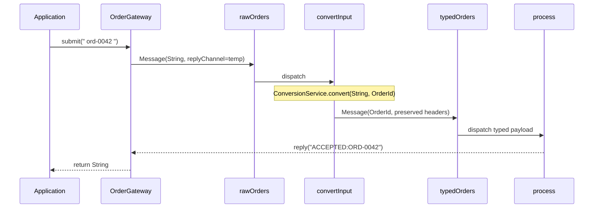
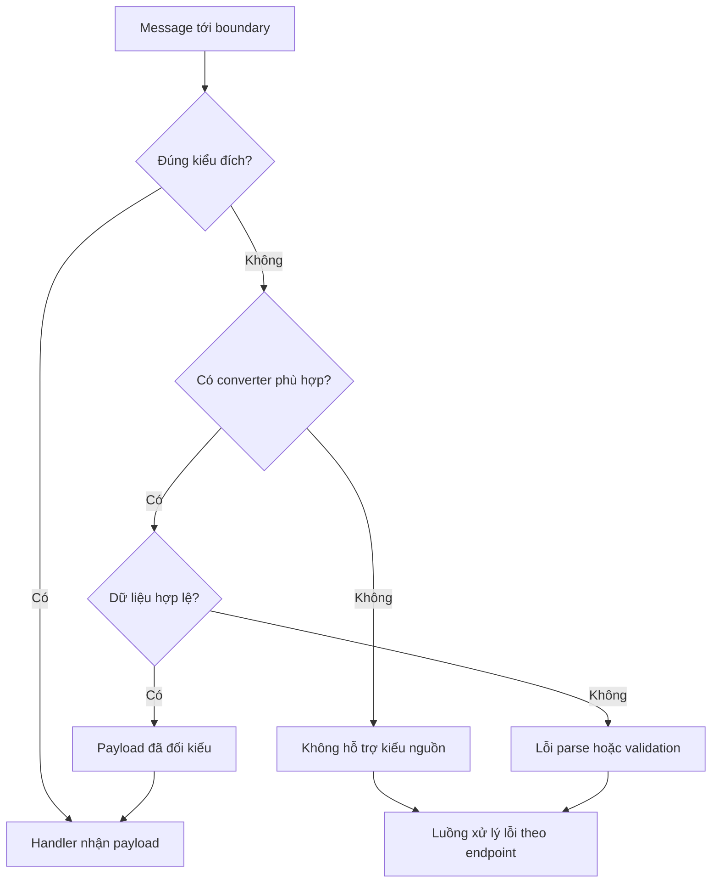

# ConversionService tại message boundary trong Spring Integration

## 1. Mục tiêu và tình huống thực tế

Trong `SPRING_INTEGRATION_RUNTIME`, message di chuyển qua **channel**, được **endpoint/consumer** xử lý, có thể chuyển thread nhờ **executor** hoặc chờ **poller** lấy từ hàng đợi. Giữa các thành phần đó, `payload` thường không có cùng kiểu Java: adapter nhận chuỗi từ HTTP hoặc file, bước nghiệp vụ muốn một `OrderId` hay `OrderCommand`, còn hệ thống bên ngoài cần JSON hoặc byte array. **Message boundary** là ranh giới mà một thành phần gửi `Message<?>` cho thành phần kế tiếp, và tại đó cần xác định rõ **kiểu dữ liệu được chấp nhận**.

Bài này giải thích vai trò của Spring `ConversionService` tại các ranh giới như vậy, cách phối hợp với transformer, converter và contract của handler, đồng thời gắn chúng với vấn đề **reply, lỗi, transaction, retry và threading** trong runtime Spring Integration.

Sau khi học, bạn có thể:

- Phân biệt `ConversionService`, `Converter`, `GenericConverter`, `MessageConverter`, transformer và codec/serialization.
- Xác định đúng chỗ đặt chuyển đổi kiểu để handler nhận payload theo hợp đồng đã công bố.
- Viết converter tùy chỉnh và dùng `ConversionService` trong `@Transformer` để tạo một boundary rõ ràng.
- Phân biệt chuyển đổi thành công, kiểu không hỗ trợ và dữ liệu sai định dạng; xử lý lỗi mà không để flow âm thầm mất message.
- Giải thích tác động của conversion lên headers, channel, gateway, executor, poller, transaction và retry.

**Tình huống xuyên suốt:** gateway nhận `" ord-0042 "` ở dạng `String`; bước nghiệp vụ chỉ chấp nhận `OrderId("ORD-0042")`. Ta chuyển đổi tại ranh giới `rawOrders → typedOrders` để bước nghiệp vụ không cần tự trim, kiểm tra định dạng và parse lại ở mỗi nơi.

## 2. `ConversionService` giải quyết việc gì?

`org.springframework.core.convert.ConversionService` là API chuyển đổi **giá trị Java từ kiểu nguồn sang kiểu đích**. Hai thao tác thường gặp:

```java
boolean supported = conversionService.canConvert(String.class, OrderId.class);
OrderId id = conversionService.convert(" ord-0042 ", OrderId.class);
```

`ConversionService` tìm quy tắc chuyển đổi đã đăng ký, chạy quy tắc phù hợp và trả về đối tượng đích. Những quy tắc đó thường được triển khai dưới dạng `Converter<S, T>`; các bài toán phức tạp hơn có thể dùng `ConverterFactory` hoặc `GenericConverter`. `DefaultConversionService` là triển khai có sẵn nhiều converter phổ biến của Spring Framework; ta có thể đăng ký converter nghiệp vụ bằng `addConverter(...)`.

### So sánh các lớp trách nhiệm

| Cơ chế | Đầu vào và đầu ra chủ yếu | Chọn khi nào? |
|---|---|---|
| `ConversionService` + `Converter<S,T>` | **Giá trị Java** `S → T` | Chuẩn hóa kiểu nội bộ: `String → OrderId`, `String → Enum`, kiểu số, thời gian... |
| `MessageConverter` | **Message/payload** và ngữ cảnh message | Thành phần cần chuyển đổi với hiểu biết về `Message<?>`, headers hoặc loại nội dung của giao thức. |
| Spring Integration `Transformer` | **Message tại một bước trong flow → message đầu ra** | Muốn một bước chuyển đổi có input/output channel, log, metrics, retry và kiểm thử riêng. |
| Serialization / codec (JSON, XML, Avro...) | **Biểu diễn bên ngoài** (bytes/text) ↔ đối tượng | Đọc/ghi giao thức, schema, charset, content type; cần serializer/deserializer phù hợp. |
| Handler method argument conversion | Payload → tham số phương thức | Có thể được framework thực hiện nếu resolver/message converter của endpoint hỗ trợ và được cấu hình. |

**Điểm then chốt:** `ConversionService` tự nó **không gửi message** và không quyết định `replyChannel` hay `errorChannel`. Nó nhận **giá trị** cần đổi kiểu. Việc trích payload từ message, giữ headers, chọn channel tiếp theo và phát lỗi thuộc về endpoint/adapter/transformer dùng nó.

Ví dụ, chỉ vì một message có header `contentType: application/json` **không có nghĩa** Spring tự động dùng `ConversionService` để parse bất kỳ JSON nào thành DTO. Để làm việc đó, cần một JSON `MessageConverter`, transformer hoặc bộ giải mã được cấu hình đúng; `ConversionService` chỉ làm được nếu bạn chủ động đăng ký quy tắc tương ứng.

## 3. `ConversionService` nằm ở đâu trong message flow?



Một message thông thường gồm **payload và headers**. Ở sơ đồ trên, `ConversionService` chỉ tham gia bước `String → OrderId`; `@Transformer` là endpoint nhận message từ `rawOrders`, gọi converter, tạo message kết quả rồi gửi tới `typedOrders`. Các header định tuyến như `replyChannel`, `errorChannel` và thông tin tracing cần được duy trì theo hợp đồng của transformer để bước cuối trả kết quả về đúng nơi.

**Không phải mọi channel đều tự động gọi converter.** `DirectChannel` mặc định chủ yếu làm nhiệm vụ dispatch message đến subscriber; `ExecutorChannel` chuyển việc xử lý qua executor; `QueueChannel` giữ message để polling consumer lấy. Khi muốn đảm bảo chuyển kiểu, bạn có ba chiến lược rõ ràng:

1. **Boundary tường minh bằng transformer**: phù hợp nhất khi cần kiểm soát validation, lỗi và quan sát tại một ranh giới nghiệp vụ.
2. **Chuyển đổi khi ánh xạ tham số handler**: thuận tiện với endpoint hỗ trợ chuyển kiểu đầu vào, nhưng phụ thuộc cấu hình message converter/argument resolver; đừng ngầm dựa vào nó khi contract quan trọng.
3. **Kiểm tra kiểu trên channel**: một số channel Spring Integration hỗ trợ ràng buộc `datatype` và có thể dùng conversion service để đổi sang kiểu được chấp nhận nếu có converter phù hợp. Đây là cơ chế bảo vệ channel; phạm vi áp dụng và hành vi khi chuyển đổi thất bại cần kiểm tra cho channel và cấu hình cụ thể.

Spring Integration có khái niệm conversion service dùng chung cho hạ tầng, thường được nhận diện bằng bean name **`integrationConversionService`**. Việc đăng ký một converter vào service đó giúp các thành phần **được thiết kế để sử dụng nó** có thể chuyển đổi; nó không làm tất cả adapter/channel/handler trong ứng dụng tự động gọi converter. Trong ví dụ dưới đây ta dùng một service chuyên biệt và gọi tường minh để hành vi tại boundary dễ kiểm chứng, tránh tác động ngoài ý muốn lên conversion toàn ứng dụng.

## 4. Ví dụ hoàn chỉnh: `String → OrderId` tại boundary

Ví dụ dùng **Spring Integration 6.x và Java 17+**, `spring-integration-core`, cùng Spring Context. Chia mỗi đoạn dưới thành một file Java trong package `example.integration`. Gateway trả về kết quả cuối; transformer và handler trung gian dùng `DirectChannel` nên mặc định luồng xử lý là đồng bộ.

### Bước 1 — Khai báo kiểu nghiệp vụ

**`OrderId.java`**

```java
package example.integration;

public record OrderId(String value) { }
```

`OrderId` giúp phần nghiệp vụ không phải nhận mọi chuỗi bất kỳ. Định dạng có thể kiểm tra ngay trong converter hoặc trong constructor của value object nếu muốn bảo vệ invariant từ mọi đường tạo đối tượng.

### Bước 2 — Cấu hình channel và conversion service

**`OrderFlowConfiguration.java`**

```java
package example.integration;

import java.util.Locale;
import org.springframework.context.annotation.Bean;
import org.springframework.context.annotation.ComponentScan;
import org.springframework.context.annotation.Configuration;
import org.springframework.core.convert.ConversionService;
import org.springframework.core.convert.support.DefaultConversionService;
import org.springframework.integration.annotation.IntegrationComponentScan;
import org.springframework.integration.channel.DirectChannel;
import org.springframework.integration.config.EnableIntegration;
import org.springframework.messaging.MessageChannel;

@Configuration
@EnableIntegration
@ComponentScan(basePackageClasses = OrderBoundary.class)
@IntegrationComponentScan(basePackageClasses = OrderGateway.class)
public class OrderFlowConfiguration {

    @Bean
    public MessageChannel rawOrders() {
        return new DirectChannel();
    }

    @Bean
    public MessageChannel typedOrders() {
        return new DirectChannel();
    }

    @Bean("orderBoundaryConversionService")
    public ConversionService orderBoundaryConversionService() {
        DefaultConversionService service = new DefaultConversionService();

        service.addConverter(String.class, OrderId.class, source -> {
            String normalized = source.trim().toUpperCase(Locale.ROOT);
            if (!normalized.matches("ORD-[0-9]{4}")) {
                throw new IllegalArgumentException(
                    "Order ID must match ORD- followed by 4 digits"
                );
            }
            return new OrderId(normalized);
        });

        return service;
    }
}
```

`DefaultConversionService` đã có nhiều chuyển đổi cơ bản; converter mới định nghĩa cách chuyển `String` sang `OrderId`. Việc chuẩn hóa bằng `Locale.ROOT` giúp kết quả không phụ thuộc locale của server. Regex được dùng như ví dụ contract; hệ thống thực có thể yêu cầu rule chặt hơn.

### Bước 3 — Đặt transformer tại boundary

**`OrderBoundary.java`**

```java
package example.integration;

import java.util.Objects;
import org.springframework.beans.factory.annotation.Qualifier;
import org.springframework.core.convert.ConversionService;
import org.springframework.integration.annotation.MessageEndpoint;
import org.springframework.integration.annotation.ServiceActivator;
import org.springframework.integration.annotation.Transformer;

@MessageEndpoint
public class OrderBoundary {

    private final ConversionService conversionService;

    public OrderBoundary(
            @Qualifier("orderBoundaryConversionService")
            ConversionService conversionService) {
        this.conversionService = conversionService;
    }

    @Transformer(inputChannel = "rawOrders", outputChannel = "typedOrders")
    public OrderId convertInput(String raw) {
        OrderId id = conversionService.convert(raw, OrderId.class);
        return Objects.requireNonNull(id, "Converter returned null OrderId");
    }

    @ServiceActivator(inputChannel = "typedOrders", requiresReply = "true")
    public String process(OrderId id) {
        return "ACCEPTED:" + id.value();
    }
}
```

Ở đây `@Transformer` nhận payload dạng `String`, gọi `ConversionService`, rồi gửi payload `OrderId` sang `typedOrders`. `@ServiceActivator` chỉ nhận `OrderId` và xử lý logic nghiệp vụ. `requiresReply = "true"` yêu cầu handler cuối tạo kết quả; nếu trả `null`, Spring Integration báo lỗi thay vì im lặng chờ gateway.

### Bước 4 — Gọi qua messaging gateway

**`OrderGateway.java`**

```java
package example.integration;

import org.springframework.integration.annotation.Gateway;
import org.springframework.integration.annotation.MessagingGateway;

@MessagingGateway
public interface OrderGateway {

    @Gateway(requestChannel = "rawOrders", replyTimeout = 5000)
    String submit(String rawOrderId);
}
```

Gọi trong ứng dụng Spring:

```java
String reply = orderGateway.submit(" ord-0042 ");
// "ACCEPTED:ORD-0042"
```

**Vì sao reply vẫn về gateway?** Gateway gắn return address vào request. Transformer đưa kết quả tới `typedOrders`, đồng thời cơ chế tạo reply của endpoint duy trì các request header phù hợp. Handler cuối không cấu hình `outputChannel`, nên kết quả có thể quay lại `replyChannel` của request. Nếu một bước tự tạo message, serialize qua hệ thống ngoài hoặc lọc header, cần kiểm tra `replyChannel` có còn hợp lệ sau ranh giới đó hay không.



## 5. Những gì `ConversionService` không tự giải quyết

### Type conversion khác validation nghiệp vụ

`canConvert(String.class, OrderId.class)` trả `true` khi service tìm được converter có khả năng xử lý **cặp kiểu**. Nó **không kiểm tra giá trị** `"ORD-ABC"` có hợp lệ hay không. Giá trị đó vẫn có thể gây `ConversionFailedException` khi converter thực thi vì dữ liệu sai định dạng. Nếu converter trả `null` khi không thể parse, cần phân biệt rõ quy ước đó với việc ném exception; với boundary bắt buộc có `OrderId`, fail-fast thường dễ chẩn đoán hơn.

```java
boolean knownType = conversionService.canConvert(String.class, OrderId.class);
// true, vì đã đăng ký converter String -> OrderId.

OrderId valid = conversionService.convert("ord-0042", OrderId.class);
// OrderId("ORD-0042")

OrderId invalid = conversionService.convert("unparseable", OrderId.class);
// Converter ném lỗi; ConversionService có thể bọc thành ConversionFailedException.
```

### Chuyển đổi payload khác chuyển đổi toàn message

`Message<OrderId>` còn có `headers`. `ConversionService` nhận `String` và trả `OrderId`, không có trách nhiệm sao chép headers; **transformer** bao quanh nó chịu trách nhiệm tạo message gửi tiếp. Header `replyChannel`, `errorChannel`, `correlationId` và trace context chỉ tồn tại nếu pipeline bảo toàn hoặc ánh xạ có chủ đích.

Không nên lưu một temporary `MessageChannel` Java object để trao đổi qua broker như một trường dữ liệu thông thường. Đối với ranh giới xuyên tiến trình, cần adapter phù hợp, reply destination có thể định địa chỉ, tương quan request–reply và chính sách hết hạn/khôi phục riêng. Chuyển `String` thành DTO **không** giải quyết vấn đề tương quan message.

### Chuyển đổi kiểu khác serialization

Xem ba payload sau:

| Payload thực tế | Kiểu Java | Muốn thành `OrderId` cần gì? |
|---|---|---|
| `"ord-0042"` | `String` | `Converter<String, OrderId>` như ví dụ. |
| `{"id":"ORD-0042"}` | `String` chứa JSON | JSON parser/converter phù hợp, ánh xạ object, sau đó (nếu cần) conversion nghiệp vụ. |
| Byte array của JSON | `byte[]` | Giải mã bytes và charset/content type, deserialize rồi kiểm tra object. |

Spring Integration sử dụng nhiều loại adapter và component có `MessageConverter` riêng. Ví dụ nơi đọc dữ liệu HTTP/JMS/AMQP có thể phải xử lý header `contentType`, encoding, type mapping hoặc định dạng của bên gửi. Đừng gộp tất cả thành một `Converter<String, Object>` bắt mọi kiểu đầu vào; hãy tách **giải mã giao thức**, **chuyển kiểu nghiệp vụ** và **validation** thành các trách nhiệm có thể kiểm thử.

### Kiểu tổng quát có thể mất thông tin phần tử

Chuyển sang `List.class` chỉ mô tả kiểu raw `List`; kiểu `List<OrderId>` không còn được biểu diễn trong `Class<List>`. Với conversion tổng quát theo từng phần tử, Spring hỗ trợ `TypeDescriptor` để mô tả cả container và kiểu phần tử. Tại boundary quan trọng, định nghĩa DTO có kiểu mạnh hoặc truyền thông tin generic đầy đủ để tránh danh sách chứa phần tử sai kiểu mà chỉ phát hiện muộn.

## 6. Tích hợp conversion với channel và handler

**Channel boundary.** Một channel có thể khai báo tập kiểu payload được chấp nhận (`datatype`) trong những cấu hình Spring Integration hỗ trợ. Nếu payload không đúng kiểu mà có converter hợp lệ, runtime có thể chuyển đổi; nếu không chuyển đổi được, việc gửi message có thể bị từ chối. Cần hiểu rằng đây là **kiểm tra/đổi kiểu tại channel**, khác với transformer tường minh, và không phải thuộc tính mặc định của mọi channel.

**Handler boundary.** Các endpoint dựa trên phương thức POJO có hệ thống argument resolver và message converter. Một phương thức khai báo `process(OrderId)` chỉ rõ contract, nhưng cách framework có thể đổi một `String` thành `OrderId` để gọi phương thức tùy thuộc vào cơ chế được cấu hình. Nếu ứng dụng có thể nhận nhiều input format hoặc cần xử lý lỗi parse theo cách nhất quán, bước transformer trước handler giúp giảm tính ngầm định.

**Adapter boundary.** Adapter là chỗ định dạng dữ liệu bên ngoài gặp message model. Với adapter HTTP, JMS, AMQP, Kafka hay file, hãy quyết định parse bytes/JSON ở adapter hoặc transformer ngay sau adapter. Cần phân biệt lỗi chuyển đổi trước khi message vào channel với lỗi trong một transformer đã được nhận vào flow: vị trí lỗi quyết định kênh báo lỗi, logging và phạm vi retry.

**Gateway boundary.** Messaging gateway ánh xạ lời gọi Java sang request message và reply message. Nếu gọi `String submit(String)` trong ví dụ, payload gửi đi ban đầu vẫn là `String`; gateway không tự động biết ý định muốn `OrderId` nếu bạn chưa cấu hình conversion ở nơi phù hợp. Với gateway request–reply, converter không được đánh mất return address giữa các bước.

## 7. Xử lý lỗi chuyển đổi trong runtime

Lỗi có thể phát sinh theo ba nhóm khác nhau:

| Tình huống | Ví dụ | Hướng xử lý |
|---|---|---|
| Không có quy tắc phù hợp | `byte[] → OrderId` nhưng chưa đăng ký converter | Bổ sung decode/MessageConverter hoặc đăng ký converter hợp lý; xác minh cặp source/target. |
| Có converter nhưng dữ liệu sai | `"ORDER-XYZ"` không khớp `ORD-[0-9]{4}` | Trả lỗi validation có cấu trúc, ghi nhận input invalid; retry cùng payload thường không hữu ích. |
| Conversion đúng nhưng định tuyến reply/headers sai | Handler xử lý xong mà gateway timeout | Kiểm tra `outputChannel`, `replyChannel`, thread, poller, timeout; đây không nhất thiết là lỗi converter. |

Với API Spring Framework, lỗi thiếu converter có thể xuất hiện dưới dạng `ConverterNotFoundException`; lỗi trong lúc thực thi conversion thường là `ConversionFailedException` (có nguyên nhân gốc). Khi chạy bên trong endpoint Spring Integration, exception còn có thể được **bọc trong `MessagingException` hoặc exception của handler**. Vì vậy hãy xem cả **root cause** và endpoint phát lỗi, đừng chỉ lọc theo một tên exception duy nhất.

### Đồng bộ và bất đồng bộ khác nhau thế nào?

- **`DirectChannel` đồng bộ:** transformer chạy trong call stack dispatch; lỗi chuyển đổi có thể truyền ngược về caller/gateway. Nếu bên ngoài bao transaction và exception lan truyền tới transactional boundary, transaction có thể rollback theo quy tắc đã cấu hình.
- **`ExecutorChannel` hoặc polling consumer:** conversion chạy trên thread khác hoặc ở một lượt poll. Caller có thể đã trả quyền điều khiển; lỗi cần được quan sát qua **error handling của endpoint** và `errorChannel` thích hợp. Không mặc định mọi lỗi async đều được ném trực tiếp về thread gọi gateway.
- **Retry:** đặt advice/retry đúng đoạn có thể phát lỗi. Lỗi dữ liệu cố định như mã sai định dạng nên được phân loại là **không retry** hoặc đưa về nhánh lỗi nghiệp vụ; retry vô hạn chỉ làm nghẽn queue. Lỗi phụ thuộc nguồn cấu hình tạm thời mới có thể đáng retry, tùy hợp đồng thực tế.

Đối với flow lấy message từ queue/broker, cách ack, rollback hoặc tái phát phụ thuộc giao dịch của listener/poller và adapter. `ConversionService` không tự rollback hay requeue message. Nếu retry làm chạy lại những bước đã có side effect, cần idempotency để tránh xử lý đơn hàng hai lần.

## 8. Threading, hiệu năng và quan sát conversion

Trong flow `rawOrders → transformer → typedOrders` dùng `DirectChannel`, mỗi message được chuyển đổi **trên thread đang dispatch**. Converter parse dữ liệu tốn 100 ms sẽ cộng trực tiếp vào độ trễ của gateway đồng bộ. Nếu thay bằng `ExecutorChannel` hoặc `QueueChannel` và poller, conversion có thể chạy ở thread khác; năng lực xử lý và queue backlog lúc đó tác động đến latency, timeout, thứ tự message và áp lực bộ nhớ.



Để chẩn đoán conversion chậm hoặc lỗi sporadic, nên quan sát:

1. **Kiểu trước/sau:** class của payload ở cửa vào và ra của transformer, cùng loại đích mong muốn.
2. **Thời gian chuyển đổi:** latency của transformer riêng biệt so với chờ queue/poller, thời gian handler và thời gian gateway đợi reply.
3. **Tỷ lệ lỗi theo nguyên nhân:** thiếu converter, sai schema/format, dữ liệu nghiệp vụ invalid, lỗi dịch vụ ngoài.
4. **Đường đi runtime:** tên channel, id/correlation nghiệp vụ phù hợp, thread/executor, thời điểm xảy ra lỗi và `errorChannel` nhận lỗi (nếu có).

Không nên log toàn bộ payload nhạy cảm, token hoặc message headers có thông tin xác thực. Thay vào đó, log **kiểu**, **schema/version**, mã lỗi parse, mã correlation an toàn và một biểu diễn dữ liệu đã che thông tin. Các converter thường được dùng lại nhiều lần; ưu tiên tạo bean singleton, tránh khởi tạo parser/validator nặng cho từng message, nhưng chỉ chia sẻ converter có trạng thái nếu triển khai bảo đảm an toàn thread.

## 9. Thực hành và kiểm chứng

Thử trực tiếp với ví dụ trên hoặc viết test tích hợp qua `AnnotationConfigApplicationContext`:

```java
import org.springframework.context.annotation.AnnotationConfigApplicationContext;

try (var context = new AnnotationConfigApplicationContext(
        OrderFlowConfiguration.class)) {
    OrderGateway gateway = context.getBean(OrderGateway.class);
    String result = gateway.submit(" ord-0042 ");
    assert "ACCEPTED:ORD-0042".equals(result);
}
```

Lưu ý câu lệnh `assert` của Java chỉ được thực thi khi JVM bật assertions (`-ea`); trong test thực tế nên dùng JUnit `assertEquals(...)` để kiểm tra không phụ thuộc cờ JVM.

Các tình huống cần thử:

| Input hoặc thay đổi | Kết quả dự kiến | Điều cần quan sát |
|---|---|---|
| `" ord-0042 "` | `OrderId("ORD-0042")`, reply `ACCEPTED:ORD-0042` | Conversion chạy một lần ở transformer; handler nhận kiểu mạnh. |
| `"ORD-X"` | Lỗi chuyển đổi/validation | Root cause nêu sai định dạng; handler nghiệp vụ không được gọi. |
| Bỏ converter `String → OrderId` | Không có quy tắc phù hợp | Đường đi lỗi và khả năng phát hiện thiếu cấu hình. |
| Thay `typedOrders` bằng channel có executor | Handler chạy ở thread khác | Kiểm tra thời gian gateway chờ, thread names và header `replyChannel`. |
| Transformer trả một message mới nhưng làm mất return address | Gateway có thể không nhận reply | Đối chiếu header trước/sau boundary, không đổ lỗi nhầm cho conversion. |

**Bài tập phân tích:** một adapter nhận `byte[]` JSON, handler chờ `OrderId`, queue có backlog và gateway timeout. Hãy chỉ ra ba phép đo khác nhau: (1) thời gian deserialize bytes/JSON, (2) thời gian `String/DTO → OrderId`, (3) thời gian chờ queue/poller. Nêu lý do vì sao chỉ tăng `replyTimeout` không thể chữa dữ liệu sai schema hoặc converter bị thiếu.

## 10. Nguyên tắc thiết kế một conversion boundary tốt

- **Khóa contract kiểu ở ranh giới.** Định rõ `source type`, `target type`, quy tắc xử lý `null` và chuẩn validation; tránh để handler nghiệp vụ phải đoán kiểu payload.
- **Dùng công cụ đúng trách nhiệm.** `ConversionService` cho type conversion, `MessageConverter`/codec cho định dạng bên ngoài, transformer cho một bước chuyển đổi trong flow.
- **Giữ metadata cần thiết.** Kiểm tra `replyChannel`, `errorChannel` và correlation khi message đi qua nhiều bước hoặc băng qua tiến trình.
- **Phân loại lỗi theo khả năng phục hồi.** Thiếu cấu hình converter, dữ liệu không hợp lệ và lỗi hạ tầng cần cách xử lý khác nhau; không áp dụng retry vô điều kiện.
- **Đo tại từng boundary.** Runtime Spring Integration là tổng của thời gian chuyển đổi, handler, channel dispatch, executor queue và poller; nhìn riêng method converter thường không đủ.

### Tài liệu chính thức để học tiếp

- [Spring Framework — Spring Type Conversion](https://docs.spring.io/spring-framework/reference/core/validation/convert.html): `ConversionService`, `Converter`, `ConverterFactory`, `GenericConverter`, `TypeDescriptor`.
- [Spring Framework — Spring Messaging](https://docs.spring.io/spring-framework/reference/integration.html): message, headers và các cơ chế messaging cơ bản.
- [Spring Integration Reference](https://docs.spring.io/spring-integration/reference/): message flow, transformer, message channels, endpoint và cơ chế xử lý lỗi.
