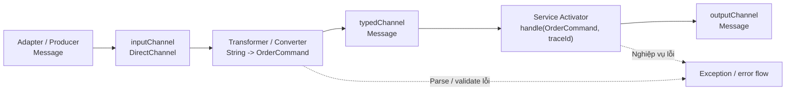
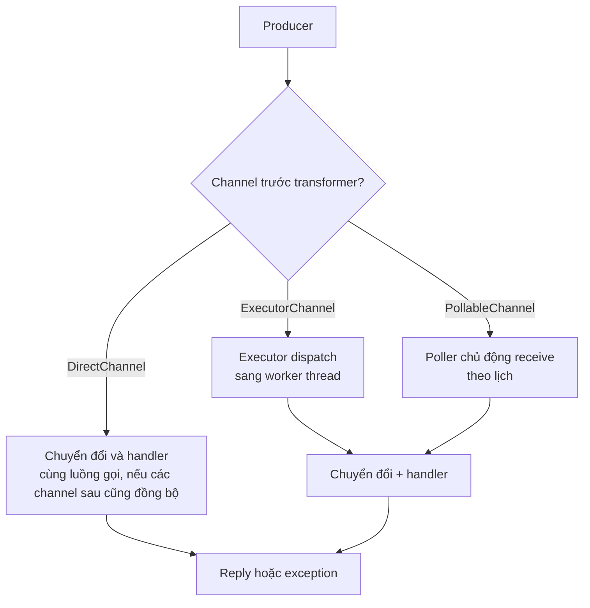

# Payload type converter và handler input

## 1. Vấn đề cần giải quyết tại runtime

Một message trong Spring Integration gồm **payload** (dữ liệu cần xử lý) và **headers** (metadata đi kèm). Channel chuyển message đến consumer endpoint; endpoint sau đó gọi một handler, thường là transformer, filter, service activator hoặc phương thức nghiệp vụ trên bean. Thách thức xuất hiện khi **kiểu payload mà handler nhận được không trùng kiểu tham số handler mong đợi**.

Chẳng hạn, HTTP adapter nhận JSON dưới dạng `String`, nhưng phương thức xử lý đơn hàng mong đợi `OrderCommand`. Hoặc một adapter đã giải mã message thành `byte[]`, trong khi handler cần `String`. Không có quy tắc chung bảo đảm mọi payload đều được tự động chuyển thành kiểu Java bất kỳ.

Trong phạm vi **SPRING_INTEGRATION_RUNTIME**, cần phân biệt rõ ba công việc:

1. **Chuyển kiểu payload** từ kiểu đầu vào sang kiểu mà nghiệp vụ cần.
2. **Gắn tham số đầu vào của handler**: lấy payload, header hoặc toàn bộ message để truyền vào method.
3. **Điều phối tại runtime**: xác định bước chuyển đổi chạy ở thread nào, lỗi phát sinh ở đâu, retry có chạy lại cả nghiệp vụ hay không, các metadata correlation có còn nguyên hay không.

> Chủ đề này thuộc chương **Conversion**. Mục tiêu là kiểm soát hợp đồng kiểu dữ liệu giữa channel và handler để tránh lỗi chỉ xuất hiện khi có message thực sự đi qua flow.

## 2. Nhìn toàn bộ đường đi dữ liệu



**Payload type converter** là logic chuyển dữ liệu từ kiểu này sang kiểu khác. Chuyển đổi có thể được thực hiện **tường minh** bằng transformer trong flow hoặc **ngầm định** qua cơ chế chuyển đổi đã cấu hình cho lời gọi handler. **Handler input** là cách framework chọn giá trị để truyền cho từng tham số khi gọi method.

Ví dụ một message trước bước chuyển đổi:

```text
payload = "ORD-2026,3"          // String
headers.traceId = "req-71"
headers.correlationId = "batch-8"
```

Sau bước chuyển đổi mong muốn:

```text
payload = OrderCommand("ORD-2026", 3)
headers.traceId = "req-71"
headers.correlationId = "batch-8"
```

Payload đổi từ `String` sang `OrderCommand`, còn headers nghiệp vụ cần thiết phải được giữ đúng. Framework thường hỗ trợ chuyển tiếp headers với các transformer tiêu chuẩn, nhưng handler tự tạo message mới vẫn phải xác minh chính sách sao chép header.

## 3. Phân biệt các cơ chế dễ bị nhầm

| Cơ chế | Giải quyết việc gì? | Khi nào nên dùng? |
| --- | --- | --- |
| **Transformer trong IntegrationFlow** | Chuyển `Message<P>` thành message có payload kiểu khác tại một bước rõ ràng | Muốn parse, kiểm tra, chuẩn hóa hoặc ghi nhận lỗi chuyển đổi như một bước độc lập. |
| **Spring `ConversionService` / `Converter<S,T>`** | Chuyển đổi giữa các kiểu Java khi có converter được đăng ký và ngữ cảnh gọi yêu cầu chuyển kiểu | Chuyển kiểu dùng lại nhiều nơi, ví dụ chuỗi số thành số hoặc một kiểu miền thành kiểu khác. |
| **`MessageConverter`** | Chuyển đổi giữa message và đối tượng đích dựa vào payload/headers, tùy converter | Xử lý payload dạng JSON, văn bản, byte array hoặc format theo protocol. |
| **Method argument resolution** | Gắn `@Payload`, `@Header`, `@Headers`, `Message<?>` vào tham số của handler | Khi Spring Integration gọi method có nhiều nguồn dữ liệu đầu vào. |
| **Channel có ràng buộc kiểu dữ liệu** | Kiểm tra hoặc hỗ trợ chuyển kiểu theo chính sách của channel, tùy cấu hình | Khi cần đặt hợp đồng kiểu ở ranh giới channel; không thay thế việc validate nghiệp vụ. |

Hai lưu ý:

- **`@Payload` không phải lệnh parse JSON hay mapper tùy ý**. Nó chỉ định payload làm nguồn tham số. Chuyển kiểu tự động thành công hay không còn phụ thuộc resolver, converter và cấu hình thực tế.
- **Header `contentType` không tự chuyển payload thành POJO**. Đây là thông tin giúp converter tương thích quyết định cách đọc message, khi converter đó thực sự được sử dụng.

Trong hệ thống có nhiều adapter, nên chủ động xác định kiểu payload ở từng ranh giới thay vì dựa vào suy đoán rằng framework sẽ luôn chuyển đúng.

## 4. Handler input: Spring lấy tham số từ đâu?

Spring Integration hỗ trợ gọi **POJO method** qua service activator, transformer và các endpoint hỗ trợ method invocation. Các chữ ký thường dùng:

```java
// Chỉ nhận payload; phương thức xử lý nên khai báo kiểu thật sự cần.
public AcceptedOrder handle(@Payload OrderCommand command) { /* ... */ }

// Nhận payload và một header.
public AcceptedOrder handle(
        @Payload OrderCommand command,
        @Header(name = "traceId", required = false) String traceId) { /* ... */ }

// Nhận toàn bộ message khi cần kiểm tra headers và payload cùng lúc.
public AcceptedOrder handle(Message<OrderCommand> message) { /* ... */ }

// Nhận tập hợp headers.
public AcceptedOrder handle(
        @Payload OrderCommand command,
        @Headers Map<String, Object> headers) { /* ... */ }
```

Các annotation `@Payload`, `@Header` và `@Headers` ở `org.springframework.messaging.handler.annotation`; `Message<?>` ở `org.springframework.messaging`.

| Đầu vào handler | Giá trị cung cấp | Điều cần kiểm tra |
| --- | --- | --- |
| `@Payload OrderCommand command` | Payload của message | Payload đã là `OrderCommand` hoặc có cơ chế conversion phù hợp. |
| `@Header("traceId") String traceId` | Header tên `traceId` | Header có tồn tại, kiểu có chuyển được không; `required=false` nếu được phép thiếu. |
| `@Headers Map<String,Object> headers` | Bản đồ các header | Không giả định mọi header đều là `String`. |
| `Message<OrderCommand> message` | Toàn bộ message | Cần dùng `getPayload()`, `getHeaders()` và tự quyết định nghiệp vụ. |

Nếu chỉ cần payload, **ưu tiên method nhận kiểu nghiệp vụ cụ thể**; nếu cần truy vết/correlation, bổ sung những header được sử dụng. Việc nhận toàn bộ `Message<?>` có ích khi phải tạo reply hoặc kiểm tra metadata, nhưng làm handler phụ thuộc sâu hơn vào cơ chế messaging.

## 5. Ví dụ Java DSL: chuyển payload tường minh trước khi gọi handler

Bài toán: nhận text dạng `ORD-2026,3`, chuyển thành đơn hàng gồm mã và số lượng; service activator chấp nhận đơn hàng rồi gửi kết quả đến một queue để quan sát.

```java
import org.springframework.context.annotation.Bean;
import org.springframework.context.annotation.Configuration;
import org.springframework.integration.annotation.ServiceActivator;
import org.springframework.integration.channel.DirectChannel;
import org.springframework.integration.channel.QueueChannel;
import org.springframework.integration.config.EnableIntegration;
import org.springframework.integration.dsl.IntegrationFlow;
import org.springframework.messaging.MessageChannel;
import org.springframework.messaging.PollableChannel;
import org.springframework.messaging.handler.annotation.Header;
import org.springframework.messaging.handler.annotation.Payload;

@Configuration
@EnableIntegration
public class OrderConversionFlow {

    public record OrderCommand(String orderId, int quantity) {}
    public record AcceptedOrder(String orderId, int quantity, String traceId) {}

    @Bean("orders.raw")
    MessageChannel rawOrders() {
        return new DirectChannel();
    }

    @Bean("orders.typed")
    MessageChannel typedOrders() {
        return new DirectChannel();
    }

    @Bean("orders.accepted")
    PollableChannel acceptedOrders() {
        // Dùng queue in-memory để minh họa; không phải lưu trữ bền vững.
        return new QueueChannel(100);
    }

    @Bean
    IntegrationFlow convertIncomingOrder() {
        return IntegrationFlow.from("orders.raw")
            .transform(String.class, this::parseOrder)
            .channel("orders.typed")
            .get();
    }

    private OrderCommand parseOrder(String raw) {
        String[] parts = raw.split(",", -1);
        if (parts.length != 2) {
            throw new IllegalArgumentException(
                "Dinh dang hop le: <orderId>,<quantity>");
        }

        String orderId = parts[0].trim();
        if (!orderId.matches("ORD-\\d{4}")) {
            throw new IllegalArgumentException("Ma don hang khong hop le");
        }

        int quantity = Integer.parseInt(parts[1].trim());
        if (quantity <= 0) {
            throw new IllegalArgumentException("So luong phai duong");
        }
        return new OrderCommand(orderId, quantity);
    }

    @ServiceActivator(
        inputChannel = "orders.typed",
        outputChannel = "orders.accepted"
    )
    public AcceptedOrder accept(
            @Payload OrderCommand order,
            @Header(name = "traceId", required = false) String traceId) {
        return new AcceptedOrder(order.orderId(), order.quantity(), traceId);
    }
}
```

Ở ví dụ này:

1. Message vào `orders.raw` có payload `String`.
2. Transformer `parseOrder` chuyển payload thành `OrderCommand` hoặc ném exception nếu sai định dạng.
3. Output của transformer đi qua `orders.typed` đến service activator.
4. Resolver lấy `OrderCommand` từ payload và `traceId` từ header.
5. Method trả `AcceptedOrder`, được gửi tới `orders.accepted`.

Đây là **chuyển kiểu tường minh**: hợp đồng đầu vào của handler rõ ràng và việc parse có một vị trí xác định trong integration graph. Nếu adapter ban đầu đã tạo `OrderCommand` hợp lệ thì có thể bỏ transformer; không cần chuyển đổi hai lần.

### Gửi message và nhận kết quả

Đoạn kiểm chứng sau giả định `context` là `ApplicationContext` đã khởi động với cấu hình ở trên:

```java
import org.springframework.messaging.Message;
import org.springframework.messaging.MessageChannel;
import org.springframework.messaging.PollableChannel;
import org.springframework.messaging.support.MessageBuilder;

MessageChannel input = context.getBean("orders.raw", MessageChannel.class);
PollableChannel output = context.getBean(
    "orders.accepted", PollableChannel.class);

input.send(MessageBuilder.withPayload("ORD-2026,3")
    .setHeader("traceId", "req-71")
    .build());

Message<?> reply = output.receive(1_000);
if (reply == null) {
    throw new AssertionError("Khong nhan duoc reply");
}

OrderConversionFlow.AcceptedOrder accepted =
    (OrderConversionFlow.AcceptedOrder) reply.getPayload();
// accepted.orderId() = "ORD-2026"
// accepted.quantity() = 3
// accepted.traceId() = "req-71"
```

Thử gửi `"ORD-2026,abc"`. Bước `parseOrder` sẽ ném `NumberFormatException`; với hai channel đồng bộ kiểu `DirectChannel` như cấu hình hiện tại, exception có thể lan ngược về lời gọi `input.send(...)`. Không có `AcceptedOrder` mới được tạo cho message lỗi này.

Ví dụ sử dụng Java `record` (Java 16+). Nếu hệ thống dùng Java cũ hơn, thay record bằng POJO có constructor và getters.

## 6. Khi nào dùng converter được đăng ký thay cho transformer?

Hãy tách hai câu hỏi:

**Câu hỏi A — Ta có muốn thay đổi payload tại một bước của flow không?** Dùng transformer sẽ dễ đọc: input là `String`, output là `OrderCommand`, lỗi nằm ở bước chuyển đổi. Nơi đặt transformer cũng cho phép đo riêng thời gian parse và áp chính sách lỗi tại ranh giới thích hợp.

**Câu hỏi B — Hệ thống đã có một quy tắc chuyển kiểu chung chưa?** Ví dụ chuyển chuỗi `"42"` thành `Integer` hoặc chuyển giá trị enum theo quy ước. Một `ConversionService` có các `Converter<S,T>` được đăng ký có thể tái sử dụng quy tắc này khi framework thực sự yêu cầu chuyển kiểu.

Ví dụ converter thuần Spring:

```java
import org.springframework.core.convert.converter.Converter;

public final class StringToOrderCommand
        implements Converter<String, OrderConversionFlow.OrderCommand> {
    @Override
    public OrderConversionFlow.OrderCommand convert(String source) {
        String[] fields = source.split(",", -1);
        if (fields.length != 2) {
            throw new IllegalArgumentException("Invalid order format");
        }
        String id = fields[0].trim();
        int quantity = Integer.parseInt(fields[1].trim());
        if (!id.matches("ORD-\\d{4}") || quantity <= 0) {
            throw new IllegalArgumentException("Invalid order data");
        }
        return new OrderConversionFlow.OrderCommand(id, quantity);
    }
}
```

Đây là **định nghĩa converter**, chưa phải cấu hình tự động áp dụng converter ở mọi handler. Để framework tự sử dụng nó, phải đăng ký converter vào `ConversionService` mà cơ chế xử lý thực tế tham chiếu (trong Spring Integration có integration conversion service và cơ chế tích hợp converter). Nếu không cấu hình đúng, việc khai báo class `Converter` đơn lẻ không thay đổi message flow.

Không nên đăng ký converter toàn cục chỉ để “sửa” một handler đang nhận sai payload. Khi quy tắc parse phụ thuộc nghiệp vụ, validation, nguồn gửi hoặc version schema, transformer riêng thường cho khả năng quan sát và kiểm soát tốt hơn.

### `MessageConverter` dành cho định dạng message

`MessageConverter` (ví dụ converter hỗ trợ JSON) thường cần thêm thông tin về định dạng message, có thể gồm header `contentType`. Những trường hợp đáng chú ý:

- `byte[]` và `String` cần quy ước charset.
- JSON cần schema/kiểu đích và thư viện parse phù hợp; JSON hợp lệ về cú pháp chưa chắc hợp lệ về nghiệp vụ.
- Header `contentType: application/json` hỗ trợ chọn converter khi được cấu hình nhưng **không tự động biến String thành đối tượng miền**.
- Converter cho message inbound/outbound trên từng transport có thể khác converter dùng khi Spring gọi một POJO handler.

Với JSON đa dạng hoặc tương tác qua nhiều transport, nên khai báo rõ conversion tại adapter hoặc transformer, có kiểm tra schema/version và ghi nhận lỗi ngay ở boundary.

## 7. Kiểu payload và hợp đồng giữa các endpoint

Thử phân loại flow thành các bước sau:

| Điểm trong flow | Kiểu đầu vào | Kiểu đầu ra | Hợp đồng cần kiểm chứng |
| --- | --- | --- | --- |
| Inbound adapter | HTTP body, Kafka record hoặc file bytes | `String` / `byte[]` / POJO | Charset, contentType, serialization. |
| Transformer | `String` | `OrderCommand` | Cấu trúc dữ liệu, số lượng, mã hợp lệ. |
| Service activator | `OrderCommand` và headers | `AcceptedOrder` | Quy tắc nghiệp vụ, khóa idempotency. |
| Outbound adapter | `AcceptedOrder` | JSON / bytes / record | Định dạng đích và metadata phải gửi đi. |

**Generics không tạo bảo đảm runtime tuyệt đối** cho payload ở một `MessageChannel`. Nếu một producer khác gửi `String` thẳng vào `orders.typed`, handler mong đợi `OrderCommand` có thể gặp lỗi chuyển kiểu hoặc lỗi invocation. Ràng buộc kiểu của channel, nếu sử dụng, cần được cấu hình và thử nghiệm; nó không thay thế validation chi tiết.

Cũng cần phân biệt **kiểu thiếu tương thích** với **giá trị không hợp lệ**:

- `ClassCastException` hoặc `MessageConversionException` thường gợi ý payload không phù hợp với tham số/convertor.
- `NumberFormatException` gợi ý nội dung có định dạng số không đọc được.
- `IllegalArgumentException` do nghiệp vụ ném có thể mang nghĩa một quy tắc validation thất bại.
- Lỗi do parser JSON có thể được bọc thành exception khác tùy thư viện/adapter.

Khi rà soát log, đọc cả **root cause** và **message gây lỗi**, thay vì coi mọi lỗi là “message conversion failed”.

## 8. Thread, transaction, retry và xử lý lỗi

Conversion không quyết định mô hình thread: **channel và endpoint** quyết định bước xử lý chạy ở đâu.



**Đường đồng bộ:** Khi producer gửi đến `DirectChannel` và các bước tiếp theo cũng đồng bộ, parse và handler chạy trên thread của bên gọi. Nếu parse lỗi và không có logic xử lý exception khác, lỗi có thể quay trở lại producer ngay trong `send(...)` hoặc gateway call.

**Đường bất đồng bộ:** Khi có `ExecutorChannel` hoặc poller, exception có thể được xử lý trong worker/poller và được chuyển thành `ErrorMessage` trên error channel theo cấu hình. Đừng mặc định bên gọi `send` luôn nhìn thấy lỗi khi thread đã được chuyển giao.

**Transaction:** Conversion và handler có thể cùng tham gia transaction hiện tại nếu cùng thread và thao tác tương thích transaction manager. Bản thân transformer/converter không tạo transaction; chuyển qua executor có thể làm mất transaction theo thread. Validation lỗi trước khi ghi dữ liệu giúp tránh side effect không cần thiết.

**Retry:** Nếu retry advice được áp lên endpoint chứa cả parse lẫn nghiệp vụ hoặc lên một đoạn flow, các bước nằm trong phạm vi advice có thể chạy lại. Nếu chỉ lỗi parse không thể sửa bằng retry (ví dụ văn bản `"abc"` không phải số), retry nhiều lần chỉ tăng tải. Phân biệt lỗi **không thể phục hồi do dữ liệu sai** và lỗi **tạm thời** như timeout tới dịch vụ ngoài; áp retry có giới hạn cho nhóm lỗi phù hợp.

**Message store:** Một `QueueChannel` thông thường lưu trong bộ nhớ; việc chuyển payload thành POJO không đồng nghĩa message được lưu bền vững. Nếu cần khôi phục sau restart, phải thiết kế queue/message store bền vững hoặc broker hỗ trợ persistence và lưu ý khả năng serialize kiểu payload đã chuyển đổi.

## 9. Headers, correlation và reply sau conversion

Các header thường cần quan tâm khi quan sát runtime:

| Header | Ý nghĩa thường gặp | Sai sót cần tránh |
| --- | --- | --- |
| `id`, `timestamp` | Định danh và thời điểm của từng Spring message | Không giả định ID không đổi sau mọi lần tạo message mới. |
| `replyChannel` | Địa chỉ trả lời cho request/reply | Đừng xóa nếu gateway đang chờ reply. |
| `errorChannel` | Đích xử lý lỗi của message/flow khi có cơ chế định tuyến lỗi tương ứng | Không giả định mọi exception đều tự động tới đây. |
| `correlationId` | Nhóm các message liên quan | Giữ đúng khi có splitter, aggregator hoặc nhiều nhánh. |
| `sequenceNumber`, `sequenceSize` | Thứ tự, kích thước chuỗi message | Không sửa tùy tiện khi aggregator dựa vào chúng. |
| `traceId` (tự định nghĩa) | Theo dõi hành trình nghiệp vụ | Truyền tiếp qua các boundary và log nhất quán. |

Một transformer trả object thường có cơ chế hỗ trợ sao chép các header được phép từ request message sang reply message. Khi tự tạo `Message<?>`, không nên giả định toàn bộ header gốc sẽ tự có lại. Ví dụ khi chuyển kiểu rồi cần tạo message:

```java
Message<OrderConversionFlow.OrderCommand> converted =
    MessageBuilder.withPayload(parsedOrder)
        .copyHeaders(incoming.getHeaders())
        .build();
```

Cách này sao chép các header phù hợp từ `incoming` khi tạo message có payload mới; các header do framework quản lý như message ID/timestamp cần được hiểu theo chính sách của builder. Ngược lại, `new GenericMessage<>(parsedOrder)` tạo message mới và không tự lấy custom headers từ message cũ. Khi cần correlation/reply, việc mất header có thể khiến request chờ mãi hoặc aggregator không ghép được message.

## 10. Chẩn đoán lỗi chuyển kiểu và handler input

| Triệu chứng | Nguyên nhân khả dĩ | Hướng kiểm tra |
| --- | --- | --- |
| Handler không được gọi | Transformer trước đó ném exception; filter loại message; channel không có consumer | Xác nhận từng boundary và xác định endpoint cuối cùng nhận message. |
| `MessageConversionException` | Không có converter tương thích hoặc cấu hình converter sai | In kiểu thật của `payload.getClass()`, kiểu tham số method và cấu hình converter. |
| `ClassCastException` | Ép kiểu sớm hoặc message được đưa sai channel | Không cast trước khi kiểm tra kiểu; dùng transformer rõ ràng. |
| `NumberFormatException` | Dữ liệu số sai định dạng | Log dữ liệu đã che thông tin nhạy cảm và quy tắc parse, trả về lỗi validation thích hợp. |
| `@Header` không tìm được giá trị | Header thiếu hoặc tên sai | Xem header thực tế; dùng `required=false` khi optional. |
| JSON parse được nhưng handler báo sai | POJO/schema không phù hợp hoặc validation nghiệp vụ chưa đúng | Kiểm tra schema, kiểu trường, version và chính sách null/default. |
| Conversion thành công nhưng không có reply | Handler trả `null`, không có output channel hoặc không có consumer | Phân biệt handler một chiều và request/reply, quan sát output. |
| Lỗi chỉ xuất hiện khi chuyển sang executor | Lỗi được xử lý ở thread khác, metadata/transaction không còn như cũ | Kiểm tra error channel, executor logs và transaction boundary. |
| Correlation bị mất sau transform | Message mới không giữ header cần thiết | Đối chiếu headers trước/sau bước convert. |
| Throughput giảm mạnh | Parser/validation nặng, blocking call hoặc quá nhiều bản sao dữ liệu | Đo latency/concurrency; profiler và queue depth giúp xác định nút thắt. |

Một quy trình chẩn đoán ngắn:

1. Ghi lại **channel đầu vào**, **payload class**, các header cần thiết và **handler method signature**.
2. Xác nhận có transformer/converter được cấu hình ở đúng vị trí trước handler.
3. Thử một payload hợp lệ, một payload sai cấu trúc và một payload sai quy tắc nghiệp vụ; quan sát lỗi khác nhau.
4. Kiểm tra lỗi xuất hiện trên thread producer, poller hay worker executor.
5. Nếu flow dùng retry, xác định chính xác bước nào được chạy lại và message có bị phát lại sau restart không.

## 11. Bài thực hành và câu hỏi tự kiểm tra

**Bài tập 1 – Nhận đúng kiểu:** Dùng ví dụ ở phần 5 với `"ORD-2026,3"` và header `traceId=req-71`. Xác nhận handler nhận `OrderCommand` thay vì `String`, reply chứa `AcceptedOrder`, và traceId không bị mất.

**Bài tập 2 – Phân loại lỗi:** Lần lượt gửi `"ORD-2026,abc"`, `"BAD-2026,3"`, `"ORD-2026,-1"` và `"ORD-2026,3,extra"`. Dự đoán exception nào xuất hiện ở bước parse, giải thích vì sao không nên retry vô hạn.

**Bài tập 3 – Quan sát thread:** Chạy flow qua `DirectChannel`, đo thời gian `send` và tên thread đang parse. Sau đó đặt `ExecutorChannel` trước transformer với executor được cấu hình rõ, ghi lại khác biệt về thread, thời điểm `send` trả về và nơi xử lý exception.

**Bài tập 4 – Giữ correlation:** Thêm header `correlationId=batch-8` và thử viết một transformer tự tạo message mới. So sánh output trước/sau khi dùng `MessageBuilder.withPayload(parsedOrder).copyHeaders(incoming.getHeaders())`.

**Câu hỏi tự kiểm tra:**

1. Khi nào `@Payload OrderCommand` hoạt động dù inbound payload ban đầu là `String`? Các điều kiện nào bắt buộc phải có?
2. Vì sao `contentType=application/json` chưa đủ để bảo đảm handler nhận được POJO?
3. Điểm khác nhau giữa transformer tường minh, converter được đăng ký và argument resolver là gì?
4. Conversion lỗi xảy ra trước hay sau side effect của handler trong ví dụ? Điều này giúp thiết kế retry thế nào?
5. Khi chuyển từ `DirectChannel` sang `ExecutorChannel`, những giả định nào về exception, transaction và latency thay đổi?

**Nguyên tắc vận hành:** Xác định rõ kiểu payload tại từng ranh giới channel–endpoint, chuyển đổi và validate trước khi đi vào nghiệp vụ có side effect, giữ những headers phục vụ reply/correlation, rồi chọn cơ chế conversion theo nhu cầu quan sát, tái sử dụng và phục hồi lỗi.
