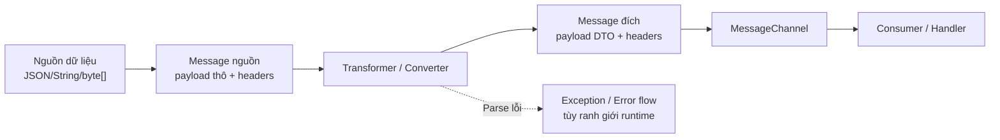
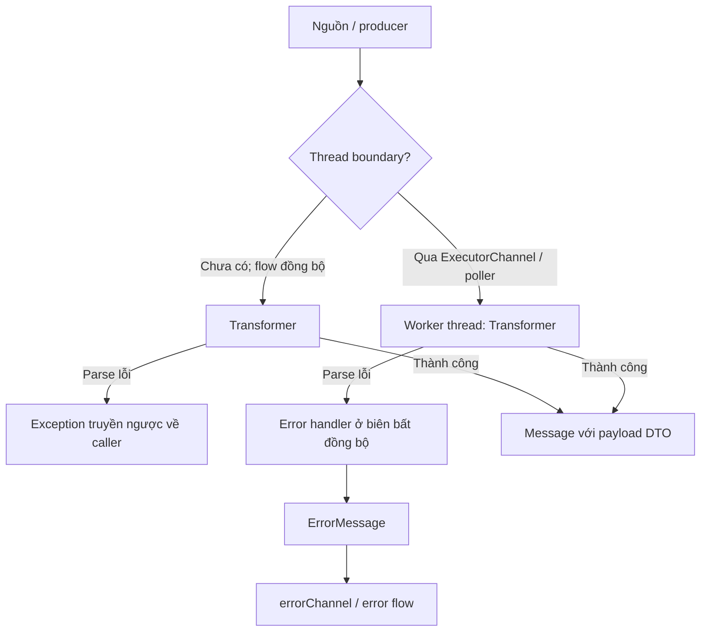

# GenericMessage với payload đã chuyển đổi trong Spring Integration

## Mục tiêu học tập

Trong Spring Integration, một message không chỉ là dữ liệu được chuyển qua channel. Nó gồm **payload** và **headers**; các endpoint đọc, biến đổi và chuyển tiếp message trong suốt thời gian chạy của integration flow. Khi dữ liệu đến ở dạng `String` hoặc `byte[]` và được chuyển thành DTO, số, thời gian hoặc kiểu nghiệp vụ, kết quả thường là một `Message<T>` mới, có thể được hiện thực bằng `GenericMessage<T>`.

Bài học thuộc chương **Conversion** của module **SPRING_INTEGRATION_RUNTIME**, tập trung vào chủ đề **GenericMessage với payload đã chuyển đổi**. Bên cạnh cách tạo message, chúng ta sẽ xét đường đi qua channel, transformer, consumer, error flow và executor: chuyển đổi thành công nghĩa là gì, headers nào cần giữ lại và làm sao chứng minh downstream thực sự nhận đúng kiểu.

Sau bài học, bạn có thể:

- Phân biệt `GenericMessage<T>`, `Message<T>`, payload và cơ chế chuyển đổi dữ liệu.
- Tạo `GenericMessage` chứa payload đã chuyển đổi, giữ các header nghiệp vụ cần thiết và tránh tái sử dụng nhầm định danh message.
- Nhận diện khi nào Spring Integration tự xây dựng message đầu ra từ transformer, khi nào phải chủ động tạo `GenericMessage`.
- Xử lý lỗi chuyển đổi và theo dõi correlation, reply/error channel, transaction, threading và hiệu năng tại runtime.
- Kiểm chứng kiểu payload thật ở consumer và chẩn đoán các tình huống chuyển đổi sai hoặc bị lặp.

## 1. Từ payload thô đến message đã chuyển đổi

Ví dụ một hệ thống nhận JSON qua HTTP/JMS và cần chuyển thành đơn hàng:

```json
{
  "orderId": "ORD-42",
  "amount": 120000
}
```

Ban đầu, một message có thể mang toàn bộ JSON dưới dạng `String`:

```text
Message<String>
  payload = "{\"orderId\":\"ORD-42\",\"amount\":120000}"
  headers = {
    correlationId = "corr-42",
    contentType   = "application/json",
    id            = <id của message đầu vào>,
    timestamp     = <thời điểm tạo>
  }
```

Sau bước parse, payload trở thành đối tượng `OrderCommand`; message mới chứa đối tượng ấy:

```text
Message<OrderCommand>
  payload = OrderCommand(orderId="ORD-42", amount=120000)
  headers = {
    correlationId = "corr-42",
    id            = <id của message mới>,
    timestamp     = <thời điểm tạo message mới>
  }
```



**Điểm cốt lõi:** `GenericMessage` **không tự parse hoặc ép kiểu payload**. Nó là một cách hiện thực giao diện `Message<T>` để đóng gói payload và headers. Công đoạn chuyển đổi xảy ra **trước khi** khởi tạo message mới, hoặc do một transformer/converter trong pipeline thực hiện rồi đóng gói kết quả.

### 1.1. Bốn khái niệm dễ nhầm

| Thành phần | Chức năng chính | Ví dụ |
| --- | --- | --- |
| `Message<T>` | Hợp đồng biểu diễn payload và headers | `Message<OrderCommand>` |
| `GenericMessage<T>` | Cài đặt `Message<T>` phổ biến | `new GenericMessage<>(order, headers)` |
| `MessageConverter` hoặc `ConversionService` | Chuyển đổi giá trị từ kiểu/định dạng này sang kiểu khác khi được cấu hình và gọi | `String` → `Integer`, giá trị chuyên biệt theo converter đăng ký |
| Transformer / `@Transformer` | Một endpoint trong integration flow biến đổi message/payload rồi phát kết quả downstream | JSON `String` → `OrderCommand` |

Một transformer có thể sử dụng `ObjectMapper`, `ConversionService` hoặc logic ứng dụng để chuyển đổi payload. Ngược lại, một `MessageConverter` có thể được framework gọi ở điểm có cơ chế chuyển đổi kiểu phù hợp. Không nên giả định mọi channel đều tự động parse JSON hoặc đổi `String` thành DTO chỉ vì generic type của consumer là `Message<OrderCommand>`.

### 1.2. Generic type có giới hạn gì tại runtime?

`Message<OrderCommand>` giúp người viết Java biểu đạt kiểu dự kiến và nhận kiểm tra kiểu tại thời điểm biên dịch. Tuy nhiên, generic type bị xóa phần lớn ở runtime (*type erasure*). Không có phép chuyển đổi nào xảy ra nếu chỉ cast:

```java
Message<String> raw = new GenericMessage<>("{\"orderId\":\"ORD-42\"}");

// Sai: chỉ né kiểm tra kiểu biên dịch, KHÔNG parse JSON.
@SuppressWarnings("unchecked")
Message<OrderCommand> wrong = (Message<OrderCommand>) (Message<?>) raw;

// Đến đây payload thực tế vẫn là String, có thể ném ClassCastException.
OrderCommand order = wrong.getPayload();
```

Kiểu thật phải được xác định trên **đối tượng payload**: `message.getPayload().getClass()`, hoặc `instanceof` với DTO đã mong đợi. Ngoài `GenericMessage`, hệ thống còn có thể tạo `ErrorMessage` hoặc các hiện thực `Message` khác; code downstream nên ưu tiên kiểu `Message<T>` trừ khi cần API đặc thù.

## 2. Tạo GenericMessage chứa payload đã chuyển đổi

### 2.1. Tạo message từ DTO có sẵn

```java
import java.math.BigDecimal;
import java.util.Map;
import org.springframework.messaging.Message;
import org.springframework.messaging.support.GenericMessage;

record OrderCommand(String orderId, BigDecimal amount) {}

OrderCommand order = new OrderCommand(
        "ORD-42",
        new BigDecimal("120000")
);

Message<OrderCommand> message = new GenericMessage<>(
        order,
        Map.of("correlationId", "corr-42", "sourceSystem", "checkout")
);

System.out.println(message.getPayload().orderId()); // ORD-42
System.out.println(message.getPayload().getClass()); // class ...OrderCommand
System.out.println(message.getHeaders().get("correlationId")); // corr-42
```

Trong snippet, đối tượng `OrderCommand` đã được tạo trước; constructor `GenericMessage` chỉ đóng gói đối tượng và map header. Không có bước JSON conversion nào trong constructor.

Những thuộc tính quan trọng:

- `new GenericMessage<>(payload)` nhận payload và tạo headers cần thiết.
- `new GenericMessage<>(payload, headers)` nhận thêm map chứa headers; message sử dụng cấu trúc `MessageHeaders` không cho sửa trực tiếp sau khi xây dựng.
- Payload phải **khác `null`**; `GenericMessage` không dùng `null` để biểu diễn nội dung không có dữ liệu. Cách xử lý kết quả rỗng của transformer/gateway phụ thuộc hợp đồng từng endpoint.
- `MessageHeaders` là bất biến theo API, nhưng **đối tượng payload có thể vẫn mutable**. Nếu dùng `List`, `Map` hoặc DTO mutable và nhiều thread cùng tham chiếu, bản thân `GenericMessage` không tự bảo vệ khỏi race condition.

### 2.2. Chuyển từ JSON String sang DTO rồi tạo GenericMessage

Ví dụ sử dụng Jackson `ObjectMapper` (cần dependency Jackson và một `ObjectMapper` đã được cấu hình trong ứng dụng):

```java
import com.fasterxml.jackson.core.JsonProcessingException;
import com.fasterxml.jackson.databind.ObjectMapper;
import java.math.BigDecimal;
import java.util.HashMap;
import java.util.Map;
import org.springframework.messaging.Message;
import org.springframework.messaging.MessageHeaders;
import org.springframework.messaging.support.GenericMessage;
import org.springframework.messaging.support.MessageBuilder;
import org.springframework.util.MimeTypeUtils;

record OrderCommand(String orderId, BigDecimal amount) {}

static Message<OrderCommand> convert(
        Message<String> incoming,
        ObjectMapper mapper) throws JsonProcessingException {

    // 1. Chuyển đổi giá trị thực sự: String JSON -> DTO.
    OrderCommand parsed = mapper.readValue(
            incoming.getPayload(), OrderCommand.class);

    // 2. Chọn headers cần chuyển tiếp.
    Map<String, Object> headers = new HashMap<>(incoming.getHeaders());

    // 3. Định danh/thời điểm của message mới do MessageHeaders sinh.
    headers.remove(MessageHeaders.ID);
    headers.remove(MessageHeaders.TIMESTAMP);

    // 4. Payload không còn là JSON String: tránh metadata gây hiểu nhầm.
    headers.remove(MessageHeaders.CONTENT_TYPE);

    // 5. Trả về message với payload đã có kiểu OrderCommand.
    return new GenericMessage<>(parsed, headers);
}

static void demo(ObjectMapper mapper) throws JsonProcessingException {
    Message<String> incoming = MessageBuilder
            .withPayload("{\"orderId\":\"ORD-42\",\"amount\":120000}")
            .setHeader("correlationId", "corr-42")
            .setHeader(MessageHeaders.CONTENT_TYPE, MimeTypeUtils.APPLICATION_JSON)
            .build();

    Message<OrderCommand> converted = convert(incoming, mapper);

    System.out.println(converted.getPayload().amount()); // 120000
    System.out.println(converted.getHeaders().get("correlationId")); // corr-42
    System.out.println(converted.getHeaders().getId()); // id mới
}
```

`GenericMessage` được tạo **sau khi** `ObjectMapper.readValue(...)` đã trả về đối tượng `OrderCommand`. Nếu JSON lỗi cú pháp hoặc không ánh xạ được DTO, `readValue` sẽ ném exception và hàm không tạo message đích.

Ở đây chúng ta sao chép map headers rồi bỏ `id`, `timestamp` để message mới nhận định danh/thời điểm mới; giữ `correlationId` vì nó gắn với giao dịch nghiệp vụ xuyên suốt flow. Đừng lấy `MessageHeaders.ID` của message nguồn làm correlation ID bền vững: một request nghiệp vụ có thể sinh nhiều message khác nhau.

Việc bỏ `contentType` là lựa chọn có chủ đích của ví dụ: payload không còn là chuỗi JSON; downstream cần chuyển DTO thành JSON để gửi ra ngoài thì hãy gắn metadata phù hợp ở bước serialize/outbound. Tùy quy ước của integration adapter, `contentType` có thể mang nghĩa “định dạng wire mong muốn”, nên quyết định giữ/sửa phải dựa vào contract thực tế.

### 2.3. Khi nào dùng MessageBuilder?

Với chỉ một vài header cần giữ, `MessageBuilder` diễn đạt ý định rõ ràng hơn việc copy tất cả:

```java
import org.springframework.messaging.Message;
import org.springframework.messaging.support.MessageBuilder;

Message<OrderCommand> converted = MessageBuilder
        .withPayload(order)
        .setHeader("correlationId", incoming.getHeaders().get("correlationId"))
        .setHeader("sourceSystem", incoming.getHeaders().get("sourceSystem"))
        .build();
```

Đây cũng là một `Message<OrderCommand>` mới. Với `MessageBuilder` mặc định của Spring Messaging, message thông thường được xây bằng `GenericMessage`. Tuy nhiên, downstream nên dựa trên giao diện `Message`, vì framework/adapter có thể sử dụng hiện thực khác.

Nếu một flow có splitter/aggregator, reply channel, error channel hoặc trình điều phối riêng, **đừng vô tình loại bỏ** các header có ý nghĩa. Ngược lại, đừng sao chép mù mọi header nguồn từ bên ngoài vào hệ thống tin cậy. Hãy thiết kế danh sách header cho phép qua mỗi ranh giới.

## 3. Payload đã chuyển đổi khác message gốc ở đâu?

| Thuộc tính | Trước bước parse | Sau bước parse trong ví dụ | Cần lưu ý |
| --- | --- | --- | --- |
| Kiểu payload thực | `String` | `OrderCommand` | Kiểm tra với `instanceof`/`getClass()`, không chỉ generic khai báo |
| Giá trị payload | JSON text | Java record/DTO | DTO có thể đã qua validation hoặc chưa; parse thành công không đồng nghĩa hợp lệ nghiệp vụ |
| `id` / `timestamp` | Của message nguồn | Tạo mới khi đã bỏ hai header cũ | Truy vết chuỗi message bằng correlation/business key |
| `correlationId` | `corr-42` | `corr-42` | Duy trì để ghép log, error record và các message liên quan |
| `contentType` | `application/json` | Bỏ trong ví dụ | Bảo đảm metadata nhất quán với cách downstream hiểu payload |
| `replyChannel` / `errorChannel` | Có thể được gắn bởi gateway/producer | Giữ lại nếu copy header và contract yêu cầu | Thận trọng khi vượt trust boundary hoặc qua channel/broker khác |
| `sequenceNumber` / `sequenceSize` | Có thể có sau splitter | Có thể giữ lại nếu copy | Quan trọng khi nhóm message cần aggregator đối chiếu |

Trong thực tế, một *logical business event* có thể đi qua nhiều lớp message. Phân biệt hai định danh:

- **Message ID:** nhận diện một message instance; thường phục vụ tracking trong phạm vi framework.
- **Business key/correlation ID:** do hệ thống định nghĩa để liên kết các bước và phát lại an toàn, ví dụ `ORD-42`, `corr-42`.

Không nên giả định tất cả transformer/framework đều luôn sao chép chính xác cùng một bộ headers. Cách trả về payload hay trả về hẳn `Message<?>`, chính sách header của transformer, component tạo message và những interceptor liên quan đều có thể ảnh hưởng kết quả.

## 4. GenericMessage xuất hiện như thế nào trong IntegrationFlow?

### 4.1. Transformer trả về payload: framework xây dựng message cho downstream

Cách thông dụng là transformer trả **giá trị đã chuyển đổi** thay vì tự tạo `GenericMessage`:

```java
import com.fasterxml.jackson.core.JsonProcessingException;
import com.fasterxml.jackson.databind.ObjectMapper;
import java.math.BigDecimal;
import org.springframework.context.annotation.Bean;
import org.springframework.context.annotation.Configuration;
import org.springframework.integration.channel.DirectChannel;
import org.springframework.integration.config.EnableIntegration;
import org.springframework.integration.dsl.IntegrationFlow;
import org.springframework.messaging.Message;
import org.springframework.messaging.MessageChannel;

record OrderCommand(String orderId, BigDecimal amount) {}

@Configuration
@EnableIntegration
class OrderFlowConfig {

    @Bean("ordersRaw")
    MessageChannel ordersRaw() {
        return new DirectChannel();
    }

    @Bean
    IntegrationFlow orderFlow(ObjectMapper mapper) {
        return IntegrationFlow.from("ordersRaw")
                .transform(String.class, json -> {
                    try {
                        return mapper.readValue(json, OrderCommand.class);
                    } catch (JsonProcessingException ex) {
                        throw new IllegalArgumentException("Invalid order JSON", ex);
                    }
                })
                .handle((Message<?> message) -> {
                    // Ở đây payload là giá trị từ transformer: OrderCommand.
                    OrderCommand order = (OrderCommand) message.getPayload();
                    System.out.println("Received order: " + order.orderId());
                    System.out.println("correlationId="
                            + message.getHeaders().get("correlationId"));
                })
                .get();
    }
}
```

Đường đi logic:

```text
send(Message<String>)
   -> ordersRaw (DirectChannel)
   -> transformer: String -> OrderCommand
   -> message được xây/điều chỉnh bởi Spring Integration
   -> handler nhận Message<?> với payload OrderCommand
```

Với cơ chế transformer thông thường, framework có thể tạo message đầu ra và chuyển tiếp các header cần thiết. Không nên phụ thuộc vào việc `message.getClass() == GenericMessage.class`: điều nghiệp vụ cần là **payload đúng kiểu và headers đúng contract**.

Trong ví dụ `DirectChannel`, transformer và handler thường chạy trên thread của caller. Nếu transformer ném exception, lỗi có thể truyền ngược về phía `send()` thay vì tự động phát thành `ErrorMessage`.

### 4.2. Transformer trả về Message<OrderCommand>: điều khiển headers rõ ràng

Khi cần chủ động quyết định message mới mang headers nào, có thể dùng `@Transformer` và trả về `GenericMessage`:

```java
import com.fasterxml.jackson.core.JsonProcessingException;
import com.fasterxml.jackson.databind.ObjectMapper;
import java.util.HashMap;
import java.util.Map;
import org.springframework.integration.annotation.Transformer;
import org.springframework.messaging.Message;
import org.springframework.messaging.MessageHeaders;
import org.springframework.messaging.support.GenericMessage;
import org.springframework.stereotype.Component;

@Component
class OrderParser {
    private final ObjectMapper mapper;

    OrderParser(ObjectMapper mapper) {
        this.mapper = mapper;
    }

    @Transformer(inputChannel = "ordersRaw", outputChannel = "ordersTyped")
    public Message<OrderCommand> parseOrder(Message<String> input) {
        try {
            OrderCommand order = mapper.readValue(
                    input.getPayload(), OrderCommand.class);

            Map<String, Object> headers = new HashMap<>(input.getHeaders());
            headers.remove(MessageHeaders.ID);
            headers.remove(MessageHeaders.TIMESTAMP);
            headers.remove(MessageHeaders.CONTENT_TYPE);

            return new GenericMessage<>(order, headers);
        } catch (JsonProcessingException ex) {
            throw new IllegalArgumentException("Malformed order message", ex);
        }
    }
}
```

`ordersRaw` và `ordersTyped` là hai channel trong ứng dụng; cần cấu hình để transformer có input và output consumer hợp lệ. Đây là **cách triển khai thay thế** cho ví dụ Java DSL ở mục 4.1, không đăng ký cả hai transformer trên cùng input trong một flow thử nghiệm. Ví dụ này cố ý trả hẳn `Message<OrderCommand>` để header policy do code quyết định. Đối với flow bình thường, trả về payload trực tiếp thường gọn hơn và phù hợp hơn.

Nếu chọn `@ServiceActivator(inputChannel = "ordersTyped")` và khai báo tham số `Message<OrderCommand>`, hãy nhớ đó là một **kỳ vọng kiểu** đối với consumer. Lỗi upstream có thể khiến payload vẫn là `String` nếu transformer bị bỏ qua hoặc producer khác gửi trực tiếp vào `ordersTyped`. Kiểm chứng tại runtime và thiết kế ranh giới dữ liệu rõ ràng.

### 4.3. Channel datatype và conversion service

Spring Integration hỗ trợ cấu hình ràng buộc kiểu payload tại channel và có thể dùng conversion service/message converter để thử chuyển dữ liệu trước khi message được dispatch. Tuy nhiên:

1. Channel chỉ kiểm tra/chuyển kiểu theo **cấu hình thực tế** của nó; `DirectChannel` bình thường không mặc định parse mọi payload JSON.
2. Cơ chế chuyển kiểu trong Spring `ConversionService` cần converter phù hợp cho cặp kiểu nguồn/đích. Không phải cứ có `String` và một Java record bất kỳ là framework tự biết JSON schema.
3. JSON serialization/deserialization cần transformer hoặc converter JSON tương ứng, chẳng hạn component tích hợp Jackson được cấu hình.
4. Nếu việc chuyển đổi chỉ xảy ra khi framework ánh xạ **tham số phương thức** của consumer, không thể mặc nhiên kết luận upstream message ban đầu đã đổi payload thành DTO. Hãy kiểm tra vị trí thực tế nơi message đầu ra được tạo.

Do đó, khi đọc code, hãy tìm chính xác vị trí biến đổi: transformer, adapter/converter, channel được khai báo datatype hay binder của method, rồi mới xác định ai tạo `GenericMessage`.

## 5. Những lỗi phổ biến khi thao tác với GenericMessage sau conversion

### 5.1. Nhầm ép kiểu với chuyển đổi

```java
Message<String> input = new GenericMessage<>("{\"orderId\":\"ORD-42\"}");

// Không chuyển JSON thành DTO:
Message<OrderCommand> unsafe = (Message<OrderCommand>) (Message<?>) input;
```

Phải gọi parser/converter thực sự. Nếu cần runtime validation, kiểm tra:

```java
Object payload = incoming.getPayload();
if (!(payload instanceof OrderCommand order)) {
    throw new IllegalArgumentException(
            "Expected OrderCommand but got " + payload.getClass().getName());
}
```

### 5.2. Payload mutable làm nhiều consumer quan sát dữ liệu khác nhau

```java
List<String> items = new ArrayList<>(List.of("A"));
Message<List<String>> msg = new GenericMessage<>(items);

items.add("B"); // Payload bên trong msg cũng thấy thay đổi.
```

Nếu message được phân phối cho nhiều subscriber hoặc sang `ExecutorChannel`, kiểu dữ liệu mutable khiến việc điều tra race condition khó hơn. Ưu tiên DTO bất biến, `record`, immutable collections và không thay đổi một payload sau khi publish.

### 5.3. Mất header làm đứt correlation hoặc reply/error flow

```java
// Payload đổi đúng, nhưng mọi header nghiệp vụ của incoming bị mất:
Message<OrderCommand> output = new GenericMessage<>(parsed);
```

Điều này không sai với một flow độc lập, nhưng có thể sai nếu message được gửi từ gateway có `replyChannel`, đi qua splitter/aggregator hoặc cần route lỗi qua `errorChannel`. Hãy xác định contract: giữ header correlation, reply/error channel hay sequence ở phạm vi nào; hạn chế vô tình chuyển các header nhạy cảm ra hệ thống bên ngoài.

### 5.4. Giữ metadata định dạng cũ sau khi payload đã đổi

Ví dụ incoming ghi `contentType=application/json` nhưng payload downstream là `OrderCommand`. Nếu consumer hiểu header là mô tả **dạng dữ liệu đang có**, nó có thể cố deserialize lần nữa hoặc áp dụng converter sai. Giữ, đổi hoặc bỏ `contentType` phải nhất quán với hợp đồng của từng adapter.

### 5.5. Xử lý exception rồi trả giá trị rỗng

Một converter có thể ném `JsonProcessingException`, `ConversionFailedException` hoặc exception khác tùy thư viện. Nếu bắt lỗi rồi trả `null` mà không xác định contract, transformer có thể không phát message tiếp hoặc gateway chờ reply đến timeout. Nếu cần bỏ qua một message không hợp lệ, phải có chính sách discard/recovery rõ ràng và ghi nhận được số message đã bỏ.

### 5.6. Trộn lẫn validate cú pháp và validate nghiệp vụ

JSON `{"orderId":"ORD-42","amount":-10}` có thể parse thành `OrderCommand` thành công nhưng không hợp lệ đối với nghiệp vụ thanh toán. Conversion chỉ xác nhận dữ liệu biểu diễn được ở kiểu đích; bước validation nghiệp vụ phải kiểm tra `orderId`, `amount`, quy tắc trạng thái và các điều kiện bổ sung.

## 6. Lỗi chuyển đổi đi đâu trong runtime?

Vị trí conversion so với ranh giới thread quyết định người quan sát exception:



- **Flow đồng bộ** qua `DirectChannel`: converter/transformer ném exception, caller của `send()` thường thấy exception theo call stack, có thể được bọc bằng `MessagingException` hoặc exception từ transformer.
- **Flow có executor/poller**: lỗi xảy ra sau ranh giới thread thường được xử lý bởi error handler của môi trường đó, có thể tạo `ErrorMessage` và gửi sang error channel được chỉ định hoặc channel mặc định.
- **Flow với gateway**: cần kiểm tra `replyChannel`, `errorChannel`, reply timeout và chính sách chuyển lỗi thành reply/exception. Parse thất bại không tự đảm bảo caller nhận một lỗi đồng bộ ngay lập tức.

Ví dụ bắt `ErrorMessage` trong error flow:

```java
import org.springframework.messaging.Message;
import org.springframework.messaging.MessagingException;
import org.springframework.messaging.support.ErrorMessage;

void onConversionError(ErrorMessage error) {
    Throwable failure = error.getPayload();

    Message<?> original = error.getOriginalMessage();
    if (original == null && failure instanceof MessagingException ex) {
        original = ex.getFailedMessage();
    }

    Object correlationId = original == null
            ? "unknown"
            : original.getHeaders().get("correlationId");

    System.err.printf("correlation=%s error=%s%n",
            correlationId, failure.toString());
}
```

`ErrorMessage.getOriginalMessage()` và `MessagingException.getFailedMessage()` có thể không có hoặc phản ánh hai vị trí khác nhau trong flow. Trong production, error record nên chứa business key/correlation ID, tên endpoint, loại lỗi, nguyên nhân gốc, thời điểm, trạng thái retry và tham chiếu an toàn đến payload; tránh log nguyên văn dữ liệu nhạy cảm.

**Quyết định retry:** lỗi kết nối tạm thời đến hệ thống schema/lookup ngoài có thể đáng retry; JSON sai cú pháp hoặc kiểu trường không hợp lệ thường không thể sửa chỉ bằng cách thử lại. Nếu retry được cấu hình cả trong handler lẫn tại broker/poller, số lượt thực thi tăng và có thể phát sinh tác dụng phụ lặp. Dùng idempotency key cho tác vụ ghi dữ liệu hoặc gọi dịch vụ ngoài.

**Quyết định rollback:** conversion diễn ra trong transaction đồng bộ có thể khiến exception đi ngược ra biên transaction và trigger rollback theo policy. Khi conversion chạy sau `ExecutorChannel`, transaction của caller thường không đi theo sang thread worker; hãy xác định transaction thật của worker/poller và cơ chế xác nhận/đọc lại từ nguồn. Một error flow ghi log thành công không chứng minh message nguồn đã rollback hoặc có thể replay.

## 7. Kiểm chứng payload đã thực sự chuyển kiểu

Đừng chỉ nhìn chữ ký `Message<OrderCommand>`. Tại endpoint tiêu thụ, kiểm chứng kiểu và dữ liệu quan trọng:

```java
void consume(Message<?> message) {
    Object payload = message.getPayload();

    if (!(payload instanceof OrderCommand order)) {
        throw new IllegalStateException(
                "Expected OrderCommand, got " + payload.getClass().getName());
    }

    if (order.orderId() == null || order.orderId().isBlank()) {
        throw new IllegalArgumentException("orderId is required");
    }

    System.out.printf("messageId=%s correlation=%s orderId=%s%n",
            message.getHeaders().getId(),
            message.getHeaders().get("correlationId"),
            order.orderId());
}
```

Dưới đây là ma trận thử nghiệm tối thiểu:

| Trường hợp | Payload đầu vào | Mong đợi sau conversion | Điều cần quan sát |
| --- | --- | --- | --- |
| Hợp lệ | JSON đủ `orderId`, `amount` | `OrderCommand` chứa giá trị đúng | `getPayload().getClass()`, header correlation |
| JSON lỗi | Chuỗi JSON thiếu dấu ngoặc | Không tạo message đích | Exception đi tới caller hay error flow |
| Không đúng schema | `amount` là một object trái schema | Parser báo lỗi hoặc policy validation quyết định | Exception gốc, failed message |
| Hợp lệ cú pháp nhưng sai nghiệp vụ | `amount=-10` | Có thể tạo DTO rồi bị validator từ chối | Phân biệt lỗi parse và lỗi validation |
| Header cần giữ | Có `correlationId`, `replyChannel` | Header được giữ theo contract | Gateway nhận reply và trace đúng |
| Header cần loại bỏ | `contentType` mô tả JSON String cũ | Header bị xóa/cập nhật khi chuyển thành DTO | Consumer không dùng converter sai |
| Bất đồng bộ | Message được đẩy qua executor trước parser | DTO ở worker hoặc `ErrorMessage` | Thread name, error channel và queue depth |

Đối với kiểm thử tự động, nên kiểm tra cả **giá trị payload**, **kiểu payload**, **các header được bảo toàn/loại bỏ** và **đường đi của lỗi**. Ví dụ với logic `convert(...)` ở mục 2:

```java
Message<String> input = MessageBuilder.withPayload(
        "{\"orderId\":\"ORD-42\",\"amount\":120000}")
        .setHeader("correlationId", "corr-42")
        .build();

Message<OrderCommand> result = convert(input, new ObjectMapper());

assert result.getPayload() instanceof OrderCommand;
assert "ORD-42".equals(result.getPayload().orderId());
assert "corr-42".equals(result.getHeaders().get("correlationId"));
assert !result.getHeaders().getId().equals(input.getHeaders().getId());
```

Trong dự án thực, thay Java `assert` bằng assertion của JUnit/AssertJ để kiểm tra luôn chạy ngay cả khi JVM không bật `-ea`.

## 8. Threading, hiệu năng và vòng đời flow

Conversion nhìn đơn giản nhưng đôi khi là bước tốn CPU/bộ nhớ nhất của luồng:

- **Kích thước payload:** parse JSON/XML lớn làm tăng cấp phát object và áp lực GC; đo dung lượng đầu vào và thời gian parse, tránh tạo nhiều bản sao `byte[]`/`String` không cần thiết.
- **Threading:** transformer nằm trước `ExecutorChannel` sẽ chạy ở thread phía trước; nằm sau sẽ chạy ở worker. Chọn vị trí dựa vào khả năng chịu tải và yêu cầu phản hồi, đồng thời kiểm soát queue capacity, active threads và rejected tasks.
- **Thread safety:** `ObjectMapper` thường dùng chung được sau khi cấu hình xong; không thay đổi cấu hình của instance dùng chung trong lúc xử lý. DTO bất biến an toàn hơn khi chia sẻ giữa các subscriber.
- **Backpressure:** nếu convert nhanh nhưng downstream chậm, queue có thể đầy; nếu convert chậm ở `DirectChannel`, caller bị chặn lâu. Theo dõi throughput, thời gian xử lý và executor saturation.
- **Lifecycle:** khi khởi động/dừng hoặc đăng ký/hủy một `IntegrationFlow` động, xác nhận transformer và consumer đã được start, channel có subscriber, không còn message đang xử lý dở trước khi thay schema. Thay DTO/schema trong một flow đang hoạt động cần quy định tương thích với producer và các message tồn đọng trong queue/store.

Trong hệ thống có message store, chỉ lưu payload đã chuyển kiểu khi serialization tương ứng được hỗ trợ và các phiên bản schema có thể đọc lại. Việc đưa một DTO Java vào `GenericMessage` không tự làm message trở nên bền vững qua restart; điều đó phụ thuộc persistence adapter, serializer, broker và cấu hình transaction.

Các chỉ số nên có cho một flow chuyển đổi gồm: số input, số convert thành công, lỗi parse, lỗi validation, độ trễ convert theo percentile, queue depth, thread active/rejected, số retry và DLQ count. Gắn correlation/business key vào log/tracing; hạn chế dùng message ID làm khóa liên kết duy nhất.

## 9. Tình huống thực hành

### Bài A — Chuyển String JSON thành GenericMessage<OrderCommand>

1. Tạo `Message<String>` chứa JSON đơn hàng, `correlationId` và `contentType`.
2. Dùng `ObjectMapper` parse DTO `OrderCommand`.
3. Tạo `GenericMessage<OrderCommand>` với header policy rõ ràng: giữ correlation, tạo message ID mới, bỏ content type cũ.
4. Kiểm tra kiểu payload thật, giá trị `amount`, correlation ID và hai message ID khác nhau.

**Mong đợi:** downstream có thể gọi `order.amount()` mà không parse lại JSON; dữ liệu trace nghiệp vụ vẫn theo message mới.

### Bài B — So sánh hai cách viết transformer

Triển khai hai flow nhận cùng JSON: flow thứ nhất trả `OrderCommand` từ transformer để framework tạo message; flow thứ hai trả trực tiếp `GenericMessage<OrderCommand>`. Với mỗi flow, ghi lại payload type, headers, message ID và đường đi của exception khi JSON sai.

**Mong đợi:** cả hai cho payload có kiểu nghiệp vụ; cơ chế quản lý headers phụ thuộc cách tạo message và cấu hình transformer.

### Bài C — Di chuyển ranh giới executor

Đo thời gian `send()` và thread name với hai bố cục:

```text
Bố cục 1: producer -> transformer -> ExecutorChannel -> handler
Bố cục 2: producer -> ExecutorChannel -> transformer -> handler
```

Cho parser ném exception khi JSON lỗi. Xác định caller nào nhìn thấy lỗi, error channel nào nhận lỗi, và thread nào tốn CPU để parse.

**Mong đợi:** thay vị trí executor làm đổi thread thực thi conversion và đường đi của exception; không có chuyện một `GenericMessage` tự quản lý threading.

### Bài D — Xử lý schema thay đổi và replay

Đưa một message `v1` thiếu trường mới vào queue/store; triển khai consumer `v2` yêu cầu thêm trường. Thiết kế cách nhận biết `schemaVersion`, giá trị mặc định hợp lệ hoặc nhánh DLQ cho message không tương thích. Chứng minh replay không tạo đơn hàng trùng bằng business key/idempotency key.

**Mong đợi:** chuyển đổi payload, lưu trữ bền vững và tương thích schema được thiết kế cùng nhau.

## 10. Câu hỏi tự kiểm tra

1. Tại sao `new GenericMessage<>(jsonString)` chưa thể tạo một payload `OrderCommand`?
2. `Message<OrderCommand>` ở chữ ký biến có đảm bảo payload runtime là DTO hay không? Tại sao?
3. Khi tạo message mới từ payload đã parse, header nào thường nên giữ để correlation và header nào nên cân nhắc bỏ để sinh message ID mới?
4. Điểm khác nhau giữa transformer trả DTO và transformer trả `GenericMessage<DTO>` là gì?
5. Nếu lỗi parse xảy ra trước hoặc sau `ExecutorChannel`, caller và error flow quan sát exception khác nhau như thế nào?
6. Vì sao `GenericMessage` có headers bất biến nhưng vẫn có thể xuất hiện lỗi do payload mutable?
7. Khi lưu `GenericMessage<OrderCommand>` vào message store, có những yêu cầu nào về serializer, version schema và replay?
8. Parse JSON thành DTO thành công có đảm bảo DTO hợp lệ nghiệp vụ và transaction đã commit không?

**Ghi nhớ:** `GenericMessage` là **vỏ message** mang payload đã chuyển đổi cùng headers. Thành công thực sự của conversion phải được chứng minh bằng **đối tượng payload đúng kiểu**, **header đúng contract**, **downstream nhận được message**, và **chính sách lỗi/transaction/correlation phù hợp** với runtime của Spring Integration.

