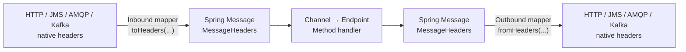
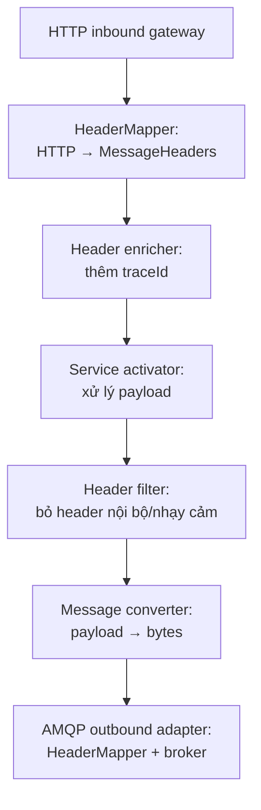
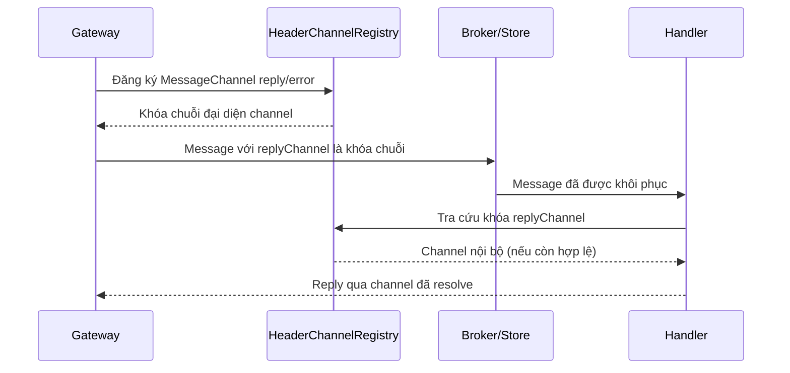

# Header type và header mapper trong Spring Integration

## 1. Mục tiêu và vị trí trong runtime

Trong **Spring Integration Runtime**, một `Message<T>` gồm **payload** mang dữ liệu nghiệp vụ và **headers** mang metadata phục vụ xử lý, định tuyến và trao đổi giữa các hệ thống. Header có thể chứa correlation ID, loại nội dung, thông tin truy vết, channel trả lời hoặc những thuộc tính đặc thù HTTP, JMS, AMQP, Kafka.

Một message di chuyển trong JVM có thể giữ header dưới dạng đối tượng Java. Nhưng khi đi qua HTTP, broker hoặc message store, hệ thống đích có thể chỉ hỗ trợ chuỗi, byte array hoặc một tập kiểu dữ liệu hẹp hơn. **Header mapper** chịu trách nhiệm chuyển metadata qua ranh giới ấy theo quy tắc của từng adapter.

Sau bài học, bạn có thể:

- Hiểu ý nghĩa của **header name** và **header value type**, kể cả các header hệ thống đặc biệt.
- Đọc/khởi tạo header đúng kiểu bằng `MessageHeaders`, `MessageBuilder` và `@Header`.
- Giải thích `HeaderMapper<T>`, chiều inbound/outbound và cách lọc header cần đi qua protocol boundary.
- Phân biệt header mapping với payload conversion, header enrichment và header filtering.
- Hiểu các ví dụ HTTP, JMS, AMQP, Kafka và ảnh hưởng tới correlation, reply/error channel, retry, message store.
- Chẩn đoán header biến mất, đổi kiểu, bị từ chối bởi transport hoặc làm sai luồng request–reply.

Chủ đề thuộc chương **Conversion**, nhưng giới hạn ở **header type và header mapper**. Các khái niệm endpoint, consumer, poller, executor và transaction sẽ xuất hiện khi chúng làm thay đổi hành vi runtime của message; header mapper không thay thế những thành phần đó.

## 2. Header type thực chất là gì?

`MessageHeaders` biểu diễn metadata như một ánh xạ `Map<String, Object>`:

- **Tên header** (`String`): ví dụ `"traceId"`, `"contentType"`, `"replyChannel"`.
- **Giá trị header** (`Object`): có thể là `String`, `UUID`, `Long`, `Integer`, `MimeType`, `MessageChannel` hoặc một object do ứng dụng định nghĩa.
- **Kiểu header** trong ngữ cảnh bài này là **kiểu Java của giá trị**, không phải tên header và cũng không tự động là loại dữ liệu của payload.

Ví dụ `"attempt" → Integer(2)` khác với `"attempt" → String("2")`. Hai giá trị có vẻ giống khi log nhưng consumer đọc kiểu `Integer` sẽ không thể coi `String` là cùng một contract nếu không có bước chuyển đổi.

| Header | Kiểu thường gặp bên trong Spring Message | Vai trò |
| --- | --- | --- |
| `id` (`MessageHeaders.ID`) | `UUID` | Định danh một message instance; do framework quản lý. |
| `timestamp` (`MessageHeaders.TIMESTAMP`) | `Long` | Thời điểm tạo message; do framework quản lý. |
| `replyChannel` (`MessageHeaders.REPLY_CHANNEL`) | `MessageChannel` hoặc `String` | Đích gửi phản hồi khi không có output channel ưu tiên hơn. |
| `errorChannel` (`MessageHeaders.ERROR_CHANNEL`) | `MessageChannel` hoặc `String` | Đích xử lý lỗi khi runtime có cơ chế gửi error message tương ứng. |
| `priority` | `Integer` | Được sử dụng trong các thành phần có xét ưu tiên, ví dụ `PriorityChannel`. |
| `contentType` | Phụ thuộc thành phần/adapter; thường `MimeType`, `MediaType` hoặc biểu diễn khác | Gợi ý kiểu nội dung khi chuyển đổi và trao đổi payload. |
| `correlationId` | Phụ thuộc producer/flow, thường `UUID` hoặc `String` | Liên hệ những message thuộc cùng một chuỗi xử lý/nhóm. |
| `traceId`, `tenantId` (tự định nghĩa) | Theo contract do ứng dụng thống nhất | Truy vết, phân vùng xử lý, rule nghiệp vụ. |

Lưu ý: **`contentType` không phải cơ chế tự suy đoán mọi kiểu Java của payload**. Nó là metadata; converter/transformer đọc metadata đó theo khả năng và cấu hình của mình. Tương tự, có header tên `correlationId` không làm framework tự aggregate message — vẫn cần aggregator/release strategy khi muốn gom nhóm.

### Message headers gần như bất biến

`MessageHeaders` có API tương tự `Map`, nhưng không hỗ trợ `put`, `remove` hoặc `clear` trực tiếp. Muốn thay header, tạo **message mới** bằng `MessageBuilder` hoặc endpoint chuyên trách. Bản thân đối tượng được tham chiếu bởi một header vẫn có thể là mutable object, vì vậy nên ưu tiên giá trị immutable và nhỏ gọn.

```java
import java.util.UUID;
import org.springframework.messaging.Message;
import org.springframework.messaging.MessageHeaders;
import org.springframework.messaging.support.MessageBuilder;

public class HeaderTypesDemo {
    public static void main(String[] args) {
        Message<String> message = MessageBuilder.withPayload("order-42")
                .setHeader("traceId", "tr-42")
                .setHeader("attempt", 2)
                .setHeader("batchKey", UUID.randomUUID())
                .build();

        String traceId = message.getHeaders().get("traceId", String.class);
        Integer attempt = message.getHeaders().get("attempt", Integer.class);
        UUID messageId = message.getHeaders().getId();
        Long createdAt = message.getHeaders().getTimestamp();

        System.out.println(traceId + " / " + attempt + " / " + messageId);

        // Sửa metadata bằng cách tạo message mới.
        Message<String> next = MessageBuilder.fromMessage(message)
                .setHeader("attempt", 3)
                .build();

        // message.getHeaders().put("attempt", 3); // UnsupportedOperationException
    }
}
```

Truy xuất `get(name, Class<T>)` giúp thể hiện kiểu mà consumer mong đợi; nếu giá trị không tương thích thì không nên dùng phép ép kiểu tùy tiện. Khi đi qua adapter ngoài JVM, hãy xác nhận kiểu **sau khi nhận về** thay vì giả định giống hệt kiểu ban đầu.

## 3. Header mapper hoạt động ở ranh giới nào?

`org.springframework.integration.mapping.HeaderMapper<T>` là chiến lược ánh xạ giữa `MessageHeaders` và kiểu metadata gốc (`T`) của một hệ thống khác:

```java
public interface HeaderMapper<T> {
    void fromHeaders(MessageHeaders headers, T target);
    Map<String, Object> toHeaders(T source);
}
```

Tên API cần đọc từ góc nhìn **Spring Integration message**:

| Phương thức | Hướng | Kết quả |
| --- | --- | --- |
| `toHeaders(T source)` | Native headers/properties → Spring Integration | Trả `Map<String,Object>` để bổ sung vào message nội bộ. |
| `fromHeaders(MessageHeaders headers, T target)` | Spring Integration → Native headers/properties | Điền metadata vào đối tượng native đã có. |

Trong nhiều giao thức request–reply, class mapper có API chuyên biệt cho request và reply (ví dụ `RequestReplyHeaderMapper<T>`), bởi header request và response không hoàn toàn giống nhau.



**Header mapper chạy ở boundary của adapter**, không tự chạy ở từng `DirectChannel`, `ExecutorChannel` hay `QueueChannel`. Khi message chỉ đi giữa các endpoint nội bộ, nó có thể giữ trực tiếp các giá trị header dạng Java object. Việc chọn channel/poller/executor quyết định thread và nhịp xử lý; còn mapper quyết định những header nào và dưới dạng gì được chuyển vào/ra giao thức.

### Ba câu hỏi phải trả lời khi map header

1. **Tên nào được phép map?** Ví dụ chỉ `X-Trace-Id`, `contentType`, `correlationId` hay tất cả trừ header nội bộ?
2. **Biểu diễn dữ liệu ra sao?** Ví dụ `UUID` → `String` trong JMS, `Object` → JSON/`byte[]` trong Kafka, `String/List<String>` trong HTTP.
3. **Map theo chiều nào?** HTTP request inbound khác HTTP response outbound; JMS/AMQP còn có property chỉ đọc hoặc do broker quản lý.

Đừng coi phép chuyển từ message nội bộ ra transport rồi quay lại là **round trip bảo toàn mọi tên và mọi kiểu**. Mapper có thể chủ động lọc, đổi tên, gộp giá trị hoặc chuyển kiểu.

## 4. Phân biệt bốn cơ chế liên quan đến header

| Cơ chế | Mục đích | Ví dụ |
| --- | --- | --- |
| `HeaderMapper` | Đối chiếu metadata giữa Spring Message và một giao thức/hệ thống khác | `X-Trace-Id` ↔ HTTP header; `jms_correlationId` ↔ JMS property. |
| `MessageConverter` hoặc transformer | Chuyển payload/body giữa các biểu diễn | Object → JSON bytes; JMS message body → object. |
| Header enricher | Thêm/đặt lại metadata **bên trong flow** | Gán `traceId` khi thiếu; thêm `tenantId`. |
| Header filter | Loại metadata không muốn truyền tiếp | Xóa `Authorization`, `Cookie` hoặc header nội bộ trước outbound adapter. |

Một flow thực tế có thể cần cả bốn:



`HeaderMapper` không thực hiện mọi chuyển đổi payload, và `MessageConverter` không tự quyết định toàn bộ chính sách header. Phân ranh này giúp tìm đúng nơi sửa khi một thuộc tính biến mất hoặc payload sai định dạng.

## 5. Ví dụ 1 — Chọn header cho HTTP outbound

`DefaultHttpHeaderMapper` trong module Spring Integration HTTP map giữa `org.springframework.http.HttpHeaders` và `MessageHeaders`. Factory `outboundMapper()` phù hợp với outbound HTTP adapter/gateway; `inboundMapper()` phù hợp với inbound HTTP adapter/gateway. Chúng xử lý request/response theo hướng của endpoint.

Giả sử một flow cần gửi request đến dịch vụ ngoài, kèm dấu vết `X-Trace-Id` nhưng không chuyển `tenantInternalKey`:

```java
import org.springframework.http.HttpHeaders;
import org.springframework.integration.http.support.DefaultHttpHeaderMapper;
import org.springframework.messaging.Message;
import org.springframework.messaging.support.MessageBuilder;

public class HttpHeadersMappingDemo {

    public static void main(String[] args) {
        Message<String> request = MessageBuilder.withPayload("request body")
                .setHeader("X-Trace-Id", "tr-42")
                .setHeader("tenantInternalKey", "do-not-send")
                .build();

        DefaultHttpHeaderMapper mapper = DefaultHttpHeaderMapper.outboundMapper();

        // Danh sách tường minh được cấu hình để mang header đã chọn
        // và các HTTP request header chuẩn.
        mapper.setOutboundHeaderNames("HTTP_REQUEST_HEADERS", "X-Trace-Id");

        HttpHeaders wireHeaders = new HttpHeaders();
        mapper.fromHeaders(request.getHeaders(), wireHeaders);

        System.out.println(wireHeaders.getFirst("X-Trace-Id")); // tr-42
        System.out.println(wireHeaders.containsKey("tenantInternalKey")); // false
    }
}
```

Điểm quan trọng:

- `setOutboundHeaderNames(...)` quy định header được xét để map từ message sang HTTP request; có thể chỉ rõ tên hoặc dùng wildcard mà API hỗ trợ.
- Khi **thay thế** danh sách mặc định, nếu vẫn cần các header HTTP chuẩn phải bổ sung shortcut pattern tương ứng như `HTTP_REQUEST_HEADERS`.
- Danh sách inbound và outbound là hai chính sách riêng. Với inbound HTTP, dùng `setInboundHeaderNames(...)` để kiểm soát header nào được nhận vào flow.
- Đây là demo trực tiếp của mapper. Trong ứng dụng, adapter/gateway được gắn mapper cụ thể hoặc cấu hình các thuộc tính mapping tương đương; không cần tự gọi `fromHeaders(...)` mỗi lần gửi HTTP.

Đọc thêm: [Spring Integration — HTTP Header Mappings](https://docs.spring.io/spring-integration/reference/http/header-mapping.html).

### Trường hợp HTTP inbound

Một dịch vụ nhận HTTP request có header:

```http
POST /orders HTTP/1.1
Content-Type: application/json
X-Trace-Id: tr-42
```

Sau bước inbound mapping, flow có thể đọc `X-Trace-Id` như một giá trị header trong `MessageHeaders`. Thực tế tên/giá trị nhận được phụ thuộc mapper, chính sách mapped headers và quy tắc chuẩn hóa của HTTP framework. Nếu downstream không nhìn thấy header này, kiểm tra **cấu hình inbound mapper** trước khi sửa business handler.

Ví dụ trong service activator:

```java
import org.springframework.integration.annotation.MessageEndpoint;
import org.springframework.integration.annotation.ServiceActivator;
import org.springframework.messaging.handler.annotation.Header;
import org.springframework.messaging.handler.annotation.Payload;

@MessageEndpoint
public class OrderHandler {

    @ServiceActivator(inputChannel = "ordersIn")
    public void handle(@Payload String orderJson,
                       @Header(name = "X-Trace-Id", required = false) String traceId) {
        System.out.println("traceId=" + traceId);
        // Xử lý orderJson ở tầng nghiệp vụ.
    }
}
```

Annotation `@Header` lấy header từ **Spring Message đã được tạo**. Nó không điều khiển HTTP header mapper và không tự thay thế một giá trị byte array hay object bất kỳ thành kiểu Java mong muốn. Hãy xác định rõ hợp đồng kiểu của producer–consumer.

## 6. Ví dụ 2 — JMS: kiểu header bị giới hạn bởi giao thức

JMS có hai nhóm metadata:

- **JMS API headers** như `JMSCorrelationID` và `JMSReplyTo`, có API/ý nghĩa riêng.
- **Message properties** do ứng dụng khai báo, nhưng chỉ hỗ trợ tập kiểu theo JMS specification (thường primitive, wrapper và `String`).

`DefaultJmsHeaderMapper` ánh xạ giữa metadata JMS và Spring Message. Vì JMS không cho phép đưa mọi Java object tùy ý vào property, một header nội bộ kiểu `UUID` hoặc object phức tạp có thể cần được chuyển sang `String` hay định dạng khác trước khi gửi.

Phân biệt hai khái niệm:

| Spring header | Quan hệ với JMS | Ý nghĩa |
| --- | --- | --- |
| `correlationId` | Mapper có thể chuyển sang dạng property kiểu chuỗi | Dùng cho correlation/aggregation của flow; kiểu sau inbound có thể khác ban đầu. |
| `jms_correlationId` | Tương ứng `JMSCorrelationID` | Thường dùng ghép request với reply ở JMS gateway. |

Nếu caller dùng `UUID` làm `correlationId` trong JVM rồi nhận lại `String` sau JMS boundary, code `get("correlationId", UUID.class)` sẽ không phù hợp. Có thể chuẩn hóa thành `String` ngay từ đầu hoặc chuyển đổi có kiểm soát ở phía nhận.

**Không gửi bừa `replyChannel` dạng `MessageChannel` qua JMS.** Đó là đối tượng trong JVM, không phải địa chỉ reply trên broker. Với request–reply phân tán, dùng cấu hình JMS gateway/reply destination/correlation. Nếu cần lưu/khôi phục channel nội bộ qua serialization boundary, tìm hiểu `HeaderChannelRegistry` ở mục 9.

Xem [Spring Integration — JMS Support](https://docs.spring.io/spring-integration/reference/jms.html).

## 7. Ví dụ 3 — AMQP: mapping properties và header do broker quản lý

AMQP message có `MessageProperties` và một tập header riêng. Spring Integration cung cấp `DefaultAmqpHeaderMapper` để nối chúng với `MessageHeaders`.

Cần quan tâm:

1. Metadata như content type, correlation ID, routing key hoặc delivery state có thể được biểu diễn bằng header `amqp_*`; không nên tự đồng nhất tất cả với header ứng dụng cùng tên.
2. Header do broker gắn khi **nhận** (ví dụ thông tin received exchange/routing key, delivery tag) không nhất thiết có nghĩa khi gửi message **ra**.
3. Mapping wildcard quá rộng có thể vô tình phát lại header nội bộ hoặc header broker đặc thù; chính sách mặc định và danh sách bị loại trừ khác nhau giữa mapper/adapter/phiên bản.
4. Khi chuyển một HTTP request thành AMQP message, nên có contract rõ ràng cho trace/correlation header, tránh giả định mọi HTTP header đều được copy nguyên vẹn sang broker.

Ví dụ cấu hình định hướng trong một flow:

```text
HTTP inbound
  headers: X-Trace-Id, Authorization, Content-Type
       |
       v
Header enricher: correlationId = "SO-42"
       |
       v
Header filter: bỏ Authorization và header HTTP không cần thiết
       |
       v
AMQP outbound: map các header được phép + AMQP properties
```

Đừng dùng `*` để chuyển toàn bộ header nếu chưa hiểu loại header nào sẽ đi ra và broker xử lý chúng ra sao. Xem [Spring Integration — AMQP Message Headers](https://docs.spring.io/spring-integration/reference/6.2/amqp/message-headers.html).

## 8. Ví dụ 4 — Kafka: metadata kiểu Java và `byte[]` trên wire

Header của Kafka record về cơ bản là cặp `String key` và `byte[] value`. Trong khi đó, header ở Spring Message có thể là `Object`. Vì vậy type conversion trở nên rõ rệt hơn.

Spring for Apache Kafka cung cấp `KafkaHeaderMapper`/các triển khai như `JsonKafkaHeaderMapper`, `SimpleKafkaHeaderMapper` (thuộc **Spring Kafka**; không phải interface `HeaderMapper<T>` của Spring Integration Core). Các bridge/adapter dùng chúng tùy cấu hình messaging converter.

- **Simple mapper:** dữ liệu có thể trở về `byte[]`; consumer phải hiểu charset/format.
- **JSON mapper:** có thể ghi metadata kiểu trong header kỹ thuật `spring_json_header_types` để khôi phục những kiểu dữ liệu tương ứng khi đọc về.
- **Trust boundary:** type metadata nhận từ bên ngoài không được coi là bằng chứng an toàn để deserialize mọi class. Nên cấu hình trusted packages hẹp và thống nhất schema giữa producer–consumer.

Ví dụ diễn giải (không phải một record dump bất biến cho mọi cấu hình):

```text
Trong JVM (Spring Message):
    traceId  -> String("tr-42")
    attempt  -> Integer(2)

Trên Kafka:
    traceId  -> byte[] UTF-8 hoặc JSON-encoded bytes (tùy mapper)
    attempt  -> byte[] chứa biểu diễn do mapper chọn
    spring_json_header_types -> metadata kiểu (nếu dùng JSON mapper)

Quay về Spring Message:
    attempt -> có thể là Integer, String hoặc byte[]
               tùy header mapper và type metadata nhận được
```

Không được giả định `KafkaHeaders.CORRELATION_ID`, `jms_correlationId` và header `correlationId` do ứng dụng tự định nghĩa có cùng namespace hay cùng nghĩa. Nếu flow đi qua nhiều transport, nên có lớp chuẩn hóa tên và kiểu ở mỗi boundary. Xem [Spring Kafka — Message Headers](https://docs.spring.io/spring-kafka/reference/kafka/headers.html).

## 9. `replyChannel`, `errorChannel` và HeaderChannelRegistry

Hai header `replyChannel` và `errorChannel` có thể giữ tham chiếu `MessageChannel` thực tế trong JVM. Đây là metadata đặc biệt của runtime: một service activator hoặc gateway có thể dựa vào chúng để trả phản hồi hoặc gửi lỗi.

Vấn đề nảy sinh khi message phải **lưu bền vững** hoặc **đi qua transport có serialization**: một tham chiếu channel trong memory không phải địa chỉ network và có thể không serialize được.

`HeaderChannelRegistry` là cơ chế chuyển header channel thành **chuỗi tra cứu** và lưu ánh xạ trong registry, để runtime có thể resolve channel về sau trong cùng môi trường phù hợp:



Điều kiện và giới hạn:

- Registry giải quyết bài toán **tham chiếu channel trong runtime có registry tương ứng**; nó không thay thế địa chỉ reply destination của một hệ thống phân tán tùy ý.
- Ánh xạ có cơ chế hết hạn/dọn dẹp. Reply đến muộn sau khi entry hết hiệu lực có thể không resolve được.
- Nếu cần phục hồi sau restart hoặc giao tiếp giữa nhiều instance, phải thiết kế reply routing và correlation theo đặc tính của broker/gateway; không mặc định local registry giải quyết được.

Chỉ chuyển channel header sang chuỗi bằng cơ chế chính thức khi thực sự cần và hiểu điều kiện sống của registry. Xem [Spring Integration — Header Channel Registry](https://docs.spring.io/spring-integration/reference/content-enrichment.html).

## 10. Correlation, retry, transaction và message store phụ thuộc header như thế nào?

Header mapping thay đổi *dữ liệu điều khiển* mà những endpoint khác dựa vào. Một lỗi ở đây có thể bộc lộ rất xa nguồn:

**Correlation và aggregation:** nếu `correlationId` từ `UUID` chuyển thành `String`, hai bên có thể không còn tính là cùng một khóa. Aggregator cần correlation strategy thống nhất tên/kiểu qua từng adapter.

**Request–reply:** nếu mapper loại `replyChannel` hoặc service trả về một header không resolve được, gateway có thể timeout dù method đã chạy xong. Với broker, cấu hình reply destination/JMSCorrelationID hoặc correlation của adapter mới là yếu tố quyết định.

**Retry và idempotency:** một event được nhận lại nhiều lần vẫn có thể mang cùng business key nhưng `id` của Spring Message mới khác. Dùng business/event ID ổn định (ở payload/header theo contract) để chống xử lý lặp, không mặc định `MessageHeaders.ID` sống mãi xuyên transport.

**Transaction và threading:** mapper chỉ biến đổi metadata, không giữ transaction context của thread. Khi qua `ExecutorChannel`, poller hoặc broker, transaction cần được cấu hình đúng boundary; đừng dựa vào header tùy ý để ngầm “chuyển” transaction sang thread khác.

**Message store:** trước khi serialize vào JDBC/Redis/queue, xác nhận header types phù hợp với serializer, schema và class loader; cân nhắc loại bỏ Java object nặng hoặc không bền vững. Nếu dùng channel header, đánh giá `HeaderChannelRegistry`, thời gian chờ và khả năng khôi phục.

**Error flow:** error handler có thể cần trace/correlation ID để nối exception với message gốc. Nếu header chứa PII/secret, chỉ log các giá trị đã được cho phép.

## 11. Nguyên tắc thiết kế header contract

Một header contract nên mô tả rõ:

| Thuộc tính | Ví dụ contract | Lý do |
| --- | --- | --- |
| Tên | `traceId` nội bộ, `X-Trace-Id` ở HTTP | Nắm được quy tắc đổi tên từng boundary. |
| Kiểu trong JVM | `String` | Tránh thay đổi giữa `UUID`, `String`, `byte[]`. |
| Biểu diễn trên wire | UTF-8 string | Các ứng dụng khác ngôn ngữ dễ giải mã. |
| Bắt buộc hay tùy chọn | `traceId` tùy chọn khi inbound, tự phát sinh nếu thiếu | Hạn chế lỗi do thiếu metadata. |
| Quyền tin cậy | Không nhận header định tuyến nội bộ từ client ngoài | Tránh header injection và lỗi điều khiển flow. |
| Hạn sử dụng | Gắn trong một request hoặc một transaction nghiệp vụ | Kiểm soát retention và logging. |
| Propagation | Chỉ mang sang dịch vụ cần trace; không mang token bí mật | Giới hạn lan truyền dữ liệu. |

Ưu tiên những kiểu bền vững qua hệ thống: `String`, số nguyên, cờ và identifier có format rõ ràng. Tránh gửi nguyên đối tượng domain, Spring bean, database session, connection, exception lớn hoặc channel reference ra khỏi JVM.

Chỉ cho phép các header có nghiệp vụ rõ ràng đi qua boundary. Đặc biệt thận trọng với `Authorization`, `Cookie`, user identity chưa xác thực, `replyChannel`, `errorChannel`, các header broker nội bộ, thông tin định tuyến hệ thống và metadata type dành cho deserialization. Nếu cần giá trị tùy biến, giới hạn kích thước và validate input.

## 12. Chẩn đoán lỗi khi chạy message flow

| Triệu chứng | Điểm cần kiểm tra | Cách xử lý phù hợp |
| --- | --- | --- |
| Handler không thấy `traceId` | Inbound mapper có map header? Tên/chữ hoa có đúng không? Header filter có xóa không? | Kiểm tra dữ liệu native ngay tại inbound rồi so với `MessageHeaders`; thêm mapping được phép. |
| Method đòi `Integer` nhưng nhận `String`/`byte[]` | Producer contract; JMS/Kafka header mapper; charset/JSON type metadata | Chuẩn hóa kiểu tại boundary, validate format rồi mới gọi handler. |
| HTTP outbound thiếu custom header | `setOutboundHeaderNames`; mapper được gắn đúng gateway? | Chỉ rõ tên hoặc wildcard được phép; giữ shortcut pattern cho header chuẩn nếu cần. |
| Bị lỗi JMS property type | Header chứa `UUID` hoặc object không được JMS hỗ trợ | Chuyển thành `String`/kiểu JMS hỗ trợ; dùng mapper phù hợp. |
| Broker từ chối hoặc tự đổi metadata | Đang truyền header broker-managed/transport-specific | Bỏ header không hợp lệ, phân biệt inbound delivery metadata và outbound properties. |
| Reply đến nhưng gateway timeout | `replyChannel` bị mất, registry hết hạn, correlation/reply destination sai | Theo trace từ gateway đến reply, kiểm tra thời hạn registry và protocol reply mapping. |
| Correlation/aggregation không ghép được | Khóa group đổi tên hoặc đổi kiểu | Chuẩn hóa correlation key trước aggregator; kiểm tra `UUID` vs `String`. |
| Log thấy dữ liệu nhạy cảm trong headers | Mapper wildcard quá rộng, log toàn bộ message | Áp allowlist, filter trước outbound và redact khi log. |
| Message store không serialize được | Header có object runtime hoặc class không hỗ trợ serializer | Lọc/chuyển kiểu header trước lưu, tránh local channel reference. |
| Header “biến mất” sau một endpoint | Cơ chế propagation/suppression của endpoint, transformer trả toàn bộ message | Kiểm tra endpoint nào tạo message mới và policy copy/filter headers. |

Quy trình kiểm tra hiệu quả:

1. **Chụp trạng thái ở hai bên boundary:** native headers trước mapper và `MessageHeaders` sau mapper; dùng logging an toàn hoặc test với fixture.
2. **Xác nhận chiều mapping:** inbound/outbound, request/reply, tên channel và endpoint thực sự sử dụng mapper.
3. **So sánh tên, kiểu, giá trị:** không chỉ so sánh chuỗi in ra log; ví dụ `Integer(2)` và `String("2")` khác contract.
4. **Tìm bước biến đổi tiếp theo:** enricher, filter, transformer, handler tạo reply, message converter, protocol adapter.
5. **Kiểm tra runtime sau ranh giới async:** correlation, reply destination, error channel, poller/executor, timeout, retry và message store.

Trong production, theo dõi số lỗi mapping/conversion, thời gian xử lý adapter, kích thước headers, tỉ lệ gateway timeout, số lần retry và backlog. Header lớn bất thường có thể tăng chi phí serialize, network, lưu trữ và log dù payload nhỏ.

## 13. Bài thực hành và câu hỏi tự kiểm tra

### Thực hành: kiểm tra kiểu và chính sách map

1. Tạo `Message<String>` mang `traceId = "tr-42"`, `attempt = 2` (`Integer`), `tenantInternalKey = "do-not-send"`.
2. Dùng `DefaultHttpHeaderMapper.outboundMapper()` như ở mục 5 để chỉ map `X-Trace-Id`. Xác minh trong `HttpHeaders` có trace ID nhưng không có tenant internal key.
3. Tạo một đoạn code đọc `attempt` thành `Integer`, sau đó mô phỏng đi qua transport bằng cách thay thành `"2"` hoặc `byte[]`. Viết bước parse/validation tường minh trước khi gọi nghiệp vụ.
4. Thêm inbound flow đi qua `QueueChannel` và poller, kiểm tra rằng khác biệt thread không tự làm thay đổi hợp đồng kiểu header; bước mapper/serialization ở boundary mới cần được xem xét.
5. Thử reply flow có correlation ID rõ ràng; quan sát sự cố khi cố tình đổi kiểu hoặc lọc nhầm correlation header.

### Tự kiểm tra

1. Header tên `contentType` có nhất thiết là Java `Class<?>` của payload hay không? Vì sao?
2. `toHeaders(...)` và `fromHeaders(...)` có chiều nào theo góc nhìn Spring Integration?
3. Tại sao `setOutboundHeaderNames(...)` có thể làm một HTTP header chuẩn biến mất nếu cấu hình không đầy đủ?
4. Header nào trong request–reply không nên tự serialize như một Java object để gửi qua JMS?
5. Vì sao `correlationId` kiểu `UUID` trước khi gửi có thể trở thành `String` sau JMS?
6. Header type metadata trong Kafka hỗ trợ gì, và vì sao không nên tin mọi Java class do dữ liệu ngoài chỉ định?
7. Nếu message đã đến service activator nhưng gateway timeout, bạn sẽ kiểm tra mapping, channel registry và correlation ở đâu?
8. Khi header bị mất sau transformer, tại sao chưa thể kết luận rằng outbound header mapper làm rơi header?

## 14. Tài liệu tham khảo

- [Spring Integration Reference — Message, MessageHeaders và Header Propagation](https://docs.spring.io/spring-integration/reference/message.html)
- [Spring Integration API — HeaderMapper](https://docs.spring.io/spring-integration/docs/6.1.7/api/org/springframework/integration/mapping/HeaderMapper.html)
- [Spring Integration Reference — HTTP Header Mappings](https://docs.spring.io/spring-integration/reference/http/header-mapping.html)
- [Spring Integration API — DefaultHttpHeaderMapper](https://docs.spring.io/spring-integration/docs/6.4.2/api/org/springframework/integration/http/support/DefaultHttpHeaderMapper.html)
- [Spring Integration Reference — JMS Support](https://docs.spring.io/spring-integration/reference/jms.html)
- [Spring Integration Reference — AMQP Message Headers](https://docs.spring.io/spring-integration/reference/6.2/amqp/message-headers.html)
- [Spring Kafka Reference — Message Headers](https://docs.spring.io/spring-kafka/reference/kafka/headers.html)
- [Spring Integration Reference — Header Channel Registry](https://docs.spring.io/spring-integration/reference/content-enrichment.html)
