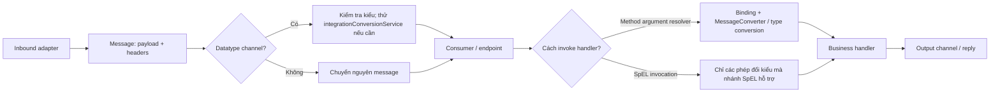

# Giới hạn implicit conversion trong Spring Integration runtime

## 1. Implicit conversion là gì, và vì sao phải biết giới hạn?

Trong Spring Integration, **implicit conversion** (chuyển đổi ngầm) là việc framework thử đổi một giá trị sang kiểu mà thành phần tiếp theo cần, dù flow không có bước `transform()` hiển thị rõ ràng. Ví dụ, message có payload `String "42"` đi vào endpoint nhận `Integer`, hoặc đi qua một channel chỉ chấp nhận `Integer`. Nếu có cơ chế chuyển đổi phù hợp tại **đúng vị trí**, runtime có thể đổi payload và tiếp tục xử lý.

Điều quan trọng: **Spring Integration không có một bộ máy tự động chuyển đổi mọi message ở mọi channel**. Việc đổi kiểu phụ thuộc vào vị trí trong flow, cấu hình converter, kiểu dữ liệu thực, metadata như `contentType`, cách gọi method và phiên bản thư viện. Một conversion thành công về mặt Java cũng chưa bảo đảm dữ liệu đúng về mặt nghiệp vụ.

Chủ đề này nằm trong phần **Conversion** của module **SPRING_INTEGRATION_RUNTIME**. Nó giúp giải thích vì sao message chạy qua channel/consumer/endpoint đôi khi bị từ chối, xử lý lỗi ở thread nào, và cách thiết kế ranh giới chuyển đổi rõ ràng để giảm lỗi, retry vô ích và chi phí runtime.

Sau bài học, bạn nên trả lời được:

1. Runtime đang convert **ở channel, ở lời gọi method, hay trong adapter**?
2. Những giá trị nào được đổi nhờ `ConversionService`, những giá trị nào cần `MessageConverter` hoặc transformer?
3. Khi conversion thất bại, lỗi nổi lên ở `send()`, trong poller/executor, hay trên error channel?
4. Khi nào phải khai báo conversion tường minh và validate dữ liệu đầu vào?

## 2. Bốn lớp conversion thường bị nhầm với nhau

| Lớp | Vị trí | Động cơ chuyển đổi | Giới hạn chính |
| --- | --- | --- | --- |
| Java language conversion | Trong code Java, lúc compile hoặc runtime | Widening/boxing/unboxing, cast | Không parse JSON hay đổi đối tượng nghiệp vụ tùy ý; không phải cơ chế của Spring Integration. |
| Spring `ConversionService` | Khi một thành phần chủ động gọi converter | Quy tắc `Converter`, `ConverterFactory`, `GenericConverter` | Chỉ đổi được cặp kiểu đã hỗ trợ; các `ConversionService` ở các ngữ cảnh khác nhau không tự là một. |
| Spring Messaging `MessageConverter` | Tại nơi xử lý một `Message<?>`, ví dụ argument resolver hoặc adapter | Payload, kiểu đích và có thể cả header `contentType` | Phải được **đúng thành phần** sử dụng; không phải cứ có `contentType` là mọi channel đổi payload. |
| Integration transformer | Một bước rõ ràng trong flow (`@Transformer`, DSL `.transform(...)`) | Logic bạn viết: parse, normalize, map schema, validate | Có chi phí và cần xử lý lỗi; bù lại luồng dữ liệu dễ quan sát, có hợp đồng đầu vào/đầu ra. |

**Hai `ConversionService` cần phân biệt:**

- `conversionService` của Spring application thường phục vụ binding/cấu hình bean hoặc các nhu cầu ứng dụng khác.
- `integrationConversionService` là bean được Spring Integration dùng tại các điểm runtime có hỗ trợ conversion, ví dụ datatype channel và payload type conversion. Có thể đăng ký converter bằng `@IntegrationConverter`/namespace; Spring Integration có thể tạo service này khi cần. **Không mặc định coi mọi converter đăng ký cho bean binding đã sẵn sàng cho message runtime.** Có thể cấu hình dùng chung/alias nếu thực sự chủ đích và đã đánh giá ảnh hưởng.

Sơ đồ sau nhấn mạnh các vị trí **có thể** thực hiện conversion:



Các bước ở đây mang tính minh họa: không phải flow nào cũng dùng datatype channel, SpEL, hoặc converter. Adapter như HTTP, JMS, AMQP cũng có thể convert trước khi message đến flow và dùng cấu hình converter **riêng**.

## 3. Các giới hạn thật sự của implicit conversion

### 3.1. Đúng kiểu đích chưa đủ: phải có đường chuyển đổi phù hợp

`"42"` có thể trở thành `Integer` nếu điểm xử lý có converter `String -> Integer`. Nhưng `"42kg"` không trở thành `Integer` chỉ nhờ khai báo tham số `Integer`. Tương tự, `String` chứa JSON không tự biến thành `Order` nếu không có converter JSON phù hợp với kiểu đích, metadata và cấu hình.

| Payload đầu vào | Nơi nhận | Khả năng xảy ra | Không được mặc định suy ra |
| --- | --- | --- | --- |
| `Integer(42)` | Tham số `Number` | Có thể dùng trực tiếp vì `Integer` là `Number`. | Không cần converter nào chạy. |
| `String "42"` | Tham số `Integer` | Có thể chuyển nếu resolver/conversion service hỗ trợ. | Không phải mọi endpoint đều tự parse số. |
| `String "abc"` | Tham số `Integer` | Có thể có converter nhưng parse vẫn thất bại. | Có converter nghĩa là mọi giá trị hợp lệ. |
| `String "{...}"` | Tham số `Order` | Có thể chuyển qua JSON `MessageConverter` và `contentType` tương thích. | Chỉ cần thêm header `contentType` là đủ. |
| `Map<String,Object>` | Tham số `Order` | Cần mapper hoặc converter thích hợp. | Framework mặc định hiểu schema và tạo mọi POJO từ `Map`. |
| `List<Map<...>>` | `List<Order>` | Phụ thuộc resolver/converter và generic type. | Mọi phần tử sẽ được map hoặc validate đúng. |
| `byte[]` | Tham số `String` | Phụ thuộc charset/converter và MIME type. | Bytes luôn là UTF-8 hoặc text. |

**Kiểu tương thích (assignable)** khác với **đổi kiểu (convertible)**. `Number.class.isAssignableFrom(Integer.class)` là đúng; `Integer.class.isAssignableFrom(String.class)` là sai. Bước converter chỉ xuất hiện khi thành phần đó *hỗ trợ và cần* chuyển đổi.

### 3.2. `contentType` là thông tin, không phải lệnh chuyển đổi toàn cục

Header `contentType=application/json` giúp một số `MessageConverter` quyết định cách đọc payload. Nó **không** tự thêm Jackson, không bảo đảm JSON hợp lệ, không khai báo schema phiên bản, và không có nghĩa `MessageChannel.send()` phải tự deserialize.

Một JSON có cấu trúc đúng cú pháp vẫn có thể sai nghiệp vụ: `amount=-100`, `currency` không hỗ trợ, `eventVersion` cũ hoặc trường định danh bị thiếu. Những điều này cần validation/logic rõ ràng ở ranh giới ứng dụng.

### 3.3. Không có lời hứa về chuỗi chuyển đổi vô hạn

Giả sử có converter `A -> B` và `B -> C`. Không nên dựa vào việc mọi điểm trong Spring Integration đều tự tìm được đường `A -> C`, dù một `ConversionService` cụ thể có thể hỗ trợ chuyển đổi nhiều chặng trong một số tình huống. Thứ tự converter, `canConvert`, kiểu đích, null/exception và cấu hình cùng quyết định kết quả. Kiểm tra đúng conversion path thực tế thay vì suy đoán từ danh sách bean.

### 3.4. Generic type, overload, `Map` và nhiều tham số có thể mơ hồ

Chữ ký `handle(String payload, int priority)` có hai tham số không annotation; runtime không biết tham số nào lấy từ payload, tham số nào từ headers. Đừng mong converter chọn hộ ý định nghiệp vụ. Hãy ghi rõ:

```java
import org.springframework.messaging.handler.annotation.Header;
import org.springframework.messaging.handler.annotation.Payload;

public String handle(@Payload String payload,
                     @Header("priority") int priority) {
    return priority + ":" + payload;
}
```

Tương tự, `Map` không annotation có quy tắc ánh xạ đặc biệt: nó có thể biểu diễn payload nếu payload là `Map`, hoặc headers trong ngữ cảnh khác. Đây là **method argument mapping**, không đơn giản là phép chuyển kiểu. Dùng `@Payload`, `@Header`, `@Headers` để xác định đúng nguồn dữ liệu và tránh ambiguity.

### 3.5. Cấu hình ở một adapter không tự áp dụng cho nơi khác

Một HTTP inbound gateway có thể dùng `HttpMessageConverter`, còn một Service Activator dùng argument resolver và converter của handler. Consumer JMS/AMQP cũng có converter và định dạng transport riêng. Tương tự, kiểu Java đã được convert trong memory **không** bảo đảm message có thể serialize, lưu trong persistent `MessageStore`, hoặc gửi qua broker mà không cấu hình codec tương ứng.

**Quy tắc thiết kế:** đừng coi một phép convert thành công ở adapter đầu vào là bằng chứng rằng cùng payload sẽ được convert tự động sau khi qua queue, poller, gateway khác hoặc producer bên ngoài.

## 4. Giới hạn tại datatype channel

Datatype channel áp dụng một *hợp đồng kiểu payload* ngay tại channel. Ví dụ sau chỉ cho phép `Integer`, bằng cách cấu hình `setDatatypes(Integer.class)`:

```java
import org.springframework.context.annotation.Bean;
import org.springframework.context.annotation.Configuration;
import org.springframework.integration.channel.QueueChannel;
import org.springframework.messaging.PollableChannel;

@Configuration
class NumberChannelConfig {
    @Bean
    PollableChannel integersOnly() {
        QueueChannel channel = new QueueChannel();
        channel.setDatatypes(Integer.class);
        return channel;
    }
}
```

Nếu gửi `new GenericMessage<>(42)`, payload đã hợp lệ. Nếu gửi `new GenericMessage<>("42")`, kết quả phụ thuộc `integrationConversionService` được đăng ký trong context và có converter phù hợp hay chưa. Khi không có, channel từ chối kiểu `String`; khi có, nó *có thể* đổi sang `Integer` **trước khi** đưa message vào queue.

Đăng ký một converter runtime có chủ đích (ví dụ trong configuration của ứng dụng):

```java
import org.springframework.context.annotation.Bean;
import org.springframework.core.convert.converter.Converter;
import org.springframework.integration.annotation.IntegrationConverter;

final class DecimalTextToInteger implements Converter<String, Integer> {
    @Override
    public Integer convert(String text) {
        return Integer.valueOf(text.trim());
    }
}

@Bean
@IntegrationConverter
Converter<String, Integer> decimalTextToInteger() {
    return new DecimalTextToInteger();
}
```

`@IntegrationConverter` ở ví dụ này phải nằm trên method `@Bean` trong class `@Configuration` được Spring quản lý. Khi infrastructure nhận diện converter và tạo/sử dụng `integrationConversionService`, nó có thể cho datatype channel convert `"42"` thành `Integer(42)`. Gửi `"42kg"` vẫn thất bại do `NumberFormatException` hoặc ngoại lệ được bọc thêm. Nếu `String` do nguồn gửi tạo ra có locale khác (`"1.000,50"`), converter này không hiểu định dạng đó: phải đưa quy tắc định dạng vào hợp đồng và xử lý tường minh.

```java
import org.springframework.messaging.Message;
import org.springframework.messaging.PollableChannel;
import org.springframework.messaging.support.GenericMessage;

void demo(PollableChannel integersOnly) {
    integersOnly.send(new GenericMessage<>("42"));
    Message<?> accepted = integersOnly.receive(0);
    if (accepted != null) {
        // Với converter hoạt động: accepted.getPayload() instanceof Integer
    }
}
```

Đừng diễn giải `setDatatypes(Integer.class)` là cơ chế kiểm tra `@Valid`, schema JSON hay range của số. Channel chỉ xét kiểu được chấp nhận và có thể gọi converter theo cấu hình, không biết `42` có phải số lượng hợp lệ của nghiệp vụ.

**Converter ở channel khác với converter ở lời gọi method.** Datatype channel mặc định sử dụng `DefaultDatatypeChannelMessageConverter` và `integrationConversionService` nếu có. Có thể đặt `MessageConverter` riêng cho channel để xét cả headers, nhưng phải chủ động cấu hình. Tạo `MessageConverter` cho endpoint nhận JSON không tự đảm bảo datatype channel dùng converter đó.

## 5. Giới hạn tại Service Activator và method argument resolver

Với lời gọi method POJO dựa trên `InvocableHandlerMethod`, `HandlerMethodArgumentResolver` có thể dùng `MessageConverter` để chuyển payload thành kiểu tham số. Spring Integration cung cấp `ConfigurableCompositeMessageConverter`, duyệt một danh sách converter; theo tài liệu Spring Integration 6.5, danh sách mặc định (theo thứ tự) gồm:

1. `MappingJackson2MessageConverter` **nếu** có Jackson thích hợp trên classpath.
2. `ByteArrayMessageConverter`.
3. `ObjectStringMessageConverter`.
4. `GenericMessageConverter`.

Ví dụ một method có thể được gọi với payload đã chuyển sang đối tượng đích:

```java
import org.springframework.integration.annotation.ServiceActivator;
import org.springframework.messaging.handler.annotation.Payload;

record Order(String id, long amount) {}

class OrderHandler {
    @ServiceActivator(inputChannel = "ordersIn")
    public void receive(@Payload Order order) {
        // Tại đây: order đã là Order nếu binding/conversion thành công.
    }
}
```

Nếu `ordersIn` nhận payload JSON dạng `byte[]` với `contentType` tương thích và có Jackson converter được sử dụng trong nhánh gọi method, payload **có thể** trở thành `Order`. Nhưng không thể kết luận tương tự cho mọi endpoint; cần xét kiểu payload ban đầu, cách chọn method, converter, MIME type và dữ liệu JSON thực tế. Method đã nhận `Order` cũng không có nghĩa dữ liệu bên trong đã qua kiểm tra nghiệp vụ.

**Ngoại lệ quan trọng:** tài liệu Spring Integration ghi rõ `MessageConverter` dựa trên `contentType` **không có hiệu lực với lời gọi method theo nhánh SpEL**; nhánh này chỉ có cơ chế đổi kiểu giữa các class như đã mô tả ở phần payload type conversion. Nếu một method đổi từ cách invocation mặc định sang biểu thức SpEL, conversion behavior có thể đổi ngay cả khi message và chữ ký method giống nhau.

**Thứ tự converter có ý nghĩa:** composite thường thử lần lượt và lấy kết quả khác `null`; một converter không hỗ trợ có thể bỏ qua, nhưng một converter ném lỗi khi parse không được bảo đảm sẽ tự chuyển sang converter tiếp theo. Vì vậy, nội dung `contentType` và thứ tự đăng ký cần kiểm chứng bằng test, không chỉ bằng việc xem danh sách converter.

## 6. Chọn explicit transformer tại ranh giới dữ liệu nghiệp vụ

Khi dữ liệu đến từ hệ thống ngoài hoặc có định dạng/validation nghiêm ngặt, hãy đổi kiểu trong một bước rõ ràng. Ví dụ dòng thanh toán chỉ chấp nhận chuỗi tiền dương với dấu `.` thập phân và tối đa hai chữ số sau dấu thập phân. Không dựa vào implicit `String -> BigDecimal`, vì converter kiểu tổng quát không thể quyết định các quy tắc nghiệp vụ này.

```java
import java.math.BigDecimal;
import org.springframework.integration.annotation.ServiceActivator;
import org.springframework.integration.annotation.Transformer;
import org.springframework.messaging.handler.annotation.Payload;

class AmountEndpoints {
    @Transformer(inputChannel = "rawAmounts", outputChannel = "typedAmounts")
    public BigDecimal parse(@Payload String raw) {
        String normalized = raw.trim();
        if (!normalized.matches("[0-9]+(\\.[0-9]{1,2})?")) {
            throw new IllegalArgumentException("Invalid amount format: expected 0..2 decimals");
        }
        BigDecimal amount = new BigDecimal(normalized);
        if (amount.signum() <= 0) {
            throw new IllegalArgumentException("Amount must be positive");
        }
        return amount;
    }

    @ServiceActivator(inputChannel = "typedAmounts", outputChannel = "amountReceipts")
    public String record(BigDecimal amount) {
        return "ACCEPTED:" + amount.toPlainString();
    }
}
```

```java
import java.math.BigDecimal;
import org.springframework.context.annotation.Bean;
import org.springframework.context.annotation.Configuration;
import org.springframework.integration.annotation.EnableIntegration;
import org.springframework.integration.channel.DirectChannel;
import org.springframework.integration.channel.QueueChannel;
import org.springframework.messaging.MessageChannel;
import org.springframework.messaging.PollableChannel;

@Configuration
@EnableIntegration
class AmountFlowConfig {
    @Bean
    AmountEndpoints amountEndpoints() {
        return new AmountEndpoints();
    }

    @Bean
    MessageChannel rawAmounts() {
        return new DirectChannel();
    }

    @Bean
    MessageChannel typedAmounts() {
        DirectChannel channel = new DirectChannel();
        channel.setDatatypes(BigDecimal.class);
        return channel;
    }

    @Bean
    PollableChannel amountReceipts() {
        return new QueueChannel();
    }
}
```

Gửi thử bằng ứng dụng đã khởi tạo context chứa cấu hình trên:

```java
import org.springframework.context.ApplicationContext;
import org.springframework.messaging.Message;
import org.springframework.messaging.MessageChannel;
import org.springframework.messaging.PollableChannel;
import org.springframework.messaging.support.MessageBuilder;

void sendExample(ApplicationContext context) {
    MessageChannel input = context.getBean("rawAmounts", MessageChannel.class);
    PollableChannel output = context.getBean("amountReceipts", PollableChannel.class);

    input.send(MessageBuilder.withPayload("125.50")
            .setHeader("correlationId", "payment-007")
            .build());

    Message<?> reply = output.receive(1_000);
    if (reply == null) {
        throw new IllegalStateException("No amount receipt");
    }
    // reply.getPayload().equals("ACCEPTED:125.50")
}
```

**Đường chạy:** `rawAmounts` → `@Transformer` (parse/validate) → `typedAmounts` (chỉ chấp nhận `BigDecimal`) → `@ServiceActivator` (xử lý) → `amountReceipts` (queue chứa reply). Nếu gửi `"125,50"`, bước `parse()` từ chối **trước khi** message đi qua `typedAmounts`; nếu gửi một số âm, validator từ chối; nếu sửa output transformer trả nhầm `String`, datatype channel sẽ phát hiện lệch kiểu. Có thể gắn thêm `errorChannel`/advice tùy nhu cầu, nhưng lỗi này không tự sinh ra retry chính sách nghiệp vụ.

Điểm quan trọng của ví dụ là tách rõ **chuyển đổi cú pháp**, **kiểm tra quy tắc tiền**, và **hợp đồng kiểu sau khi chuyển đổi**. Nếu nhiều nguồn dùng format khác nhau, cho mỗi nguồn một adapter/transformer thích hợp; đừng làm converter chung âm thầm chấp nhận mọi locale.

## 7. Giới hạn liên quan đến channel, threading, transaction và message store

Converter chạy ở nơi thành phần nhận/đẩy message yêu cầu, do đó **thời điểm lỗi** phụ thuộc cấu trúc flow:

| Thành phần runtime | Conversion thường diễn ra lúc nào? | Caller quan sát lỗi ra sao? |
| --- | --- | --- |
| Datatype `DirectChannel` | Khi gửi vào channel, trước khi dispatch/hoặc trong quá trình tạo message hợp lệ. | Thường có exception ngay trong `send()` nếu convert/kiểm tra kiểu thất bại. |
| `DirectChannel` + Service Activator | Khi consumer resolve tham số lúc nhận message. | Với handler đồng bộ, exception có thể truyền lại thread gọi `send()`. |
| `ExecutorChannel` | Khi gửi vào channel và khi handler chạy là các thời điểm khác nhau; mỗi conversion gắn với thành phần tương ứng. | Lỗi bên trong handler thường xảy ra trên thread executor; bên gửi có thể đã hoàn tất `send()`. |
| `QueueChannel` + polling consumer | Channel có thể kiểm tra kiểu lúc `send()`; handler có thể convert sau khi poller lấy message. | Lỗi ở bước poll thường thuộc poller/advice/error handling, không nhất thiết về caller ban đầu. |
| Inbound adapter/gateway | Có thể convert trong adapter trước khi gửi vào Spring Integration channel. | Tùy protocol, converter, cơ chế ack/response và cấu hình retry của adapter. |
| Persistent `MessageStore` / broker | Có thể cần serializer/codec lúc lưu hoặc phục hồi. | Parse thành POJO trong RAM không bảo đảm lưu/khôi phục được cùng kiểu; tùy cơ chế lưu và schema. |

**Transaction:** với chuỗi `DirectChannel` đồng bộ, một transaction đã mở có thể bao phủ việc chuyển đổi, handler và ghi dữ liệu trong cùng call stack. Khi chuyển qua `ExecutorChannel` hay poller, transaction của thread gửi không tự lan sang thread nhận. Lỗi conversion ở consumer bất đồng bộ cần chính sách rollback/redelivery riêng nếu hệ thống yêu cầu.

**Retry:** retry chỉ hợp lý cho lỗi tạm thời (I/O, timeout, thiếu tài nguyên); JSON sai, định dạng số không hợp lệ, thiếu trường bắt buộc thường không tự sửa sau lần thử tiếp theo. Retry lặp lỗi conversion vĩnh viễn có thể tạo poison message, tốn CPU và làm nghẽn queue. Tách loại lỗi và thiết kế dead-letter/quarantine phù hợp với transport.

**Correlation:** các header như `correlationId`, `sequenceNumber`, `replyChannel`, `errorChannel` không tự được biến thành giá trị nghiệp vụ. Khi một converter hoặc transformer tự tạo `Message` mới thay vì trả payload, cần kiểm tra việc giữ/copy headers để tránh mất dấu tương quan hoặc đích reply. Việc đổi kiểu payload tự nó không thay thế cơ chế correlation/aggregation.

**Hiệu năng:** parse JSON, tạo object, xử lý chuỗi và validation là CPU/allocation cost; việc converter thử nhiều loại có thể tăng chi phí. Đo latency tại adapter, channel, converter/transformer, hàng đợi và handler. Không tăng số thread chỉ để chữa lỗi parse hoặc mismatch datatype. Khi có message store, đo thêm kích thước payload và chi phí serialization.

## 8. Chẩn đoán khi implicit conversion không hoạt động

Một thứ tự điều tra thực dụng:

1. **Lấy kiểu thật của payload:** log an toàn `message.getPayload().getClass().getName()` và kích thước/đặc điểm payload, tránh log token, thông tin cá nhân hoặc toàn bộ JSON nhạy cảm.
2. **Xác định điểm lỗi:** datatype channel, method argument resolver, converter của adapter, transformer, serializer hay logic bên trong handler?
3. **Kiểm tra kỳ vọng kiểu:** `setDatatypes(...)`, `@Payload`, `Message<T>`, method overload, generic type và header `@Header`.
4. **Xác nhận converter đang được sử dụng:** `integrationConversionService` hay `MessageConverter` của endpoint/adapter? Bean có đúng context/tên, đúng classpath và đúng thứ tự không?
5. **Kiểm tra metadata/định dạng:** `contentType`, charset, JSON shape, locale, định dạng số/ngày, schema version, null/missing fields và size limits.
6. **Nhìn exception cause và thread:** exception gốc (parse, `ConversionFailedException`, `MessageConversionException`, v.v.) có thể bị bọc trong `MessageDeliveryException`/`MessagingException`. Nếu qua executor/poller, xem error channel và thread xử lý, không chỉ log của producer.
7. **Tạo kiểm tra nhỏ có tính quyết định:** gửi một payload đúng kiểu, một payload khác kiểu nhưng hợp lệ để convert, và một payload không hợp lệ; khẳng định giá trị/kết quả mong đợi ở từng bước.

Ví dụ bảng triệu chứng:

| Triệu chứng | Nguyên nhân thường gặp | Cách sửa đúng tầng |
| --- | --- | --- |
| `expected ... datatypes ... but received ...` | Datatype channel nhận payload không hợp lệ và không convert được. | Sửa nguồn hoặc thêm converter cho channel; cân nhắc transformer rõ ràng. |
| `No converter found` / `ConversionFailedException` | Thiếu cặp converter hoặc giá trị đầu vào không hợp lệ. | Kiểm tra `integrationConversionService`, classpath, kiểu đích và giá trị thực. |
| Lỗi bind `Order` từ JSON | `contentType`/Jackson/target type không tương thích hoặc payload không phải JSON hợp lệ. | Cấu hình đúng `MessageConverter`; dùng converter/transformer rõ ràng nếu có schema phức tạp. |
| Method có nhiều tham số và lỗi ambiguity | Không rõ payload/header sẽ bind vào đâu. | `@Payload`, `@Header`, `@Headers`, chọn đúng method. |
| Không thấy lỗi trong `send()` | Flow có executor/poller, lỗi xảy ra ở worker thread. | Kiểm tra error channel, advice, poller, retry, logs theo correlation. |
| Message convert thành công nhưng handler từ chối | Cấu trúc đúng kiểu nhưng sai quy tắc nghiệp vụ. | Validate schema và business invariant ở ranh giới domain. |

## 9. Tiêu chí lựa chọn implicit hay explicit conversion

Chỉ dùng implicit conversion khi rủi ro thấp và hành vi được kiểm chứng: cặp kiểu rõ ràng, format ổn định, không có yếu tố locale/schema, converter nằm đúng vị trí và lỗi được xử lý có dự đoán. Ví dụ `String "42"` thành `Integer` trong một pipeline nội bộ có kiểm soát.

Ưu tiên **explicit transformer** khi tích hợp bên ngoài, JSON/XML/Avro có schema, format tiền/ngày giờ, dữ liệu có version, validation nghiệp vụ, kiểm soát precision hoặc cần quan sát conversion metrics. Khi có nhiều producer, thiết lập hợp đồng `payloadType`, `contentType`, version, trường bắt buộc, locale/time zone và chính sách lỗi rõ ràng ở đầu mỗi nguồn.

Checklist trước khi đưa flow vào vận hành:

- Xác định ai sở hữu ranh giới parse/validate và kiểu payload sau ranh giới.
- Giữ converter có phạm vi hẹp; tránh converter toàn cục khiến các flow không liên quan thay đổi âm thầm.
- Viết test cho giá trị hợp lệ, invalid syntax, overflow/precision, missing headers, schema evolution và message vượt giới hạn kích thước.
- Ghi nhận tỷ lệ conversion failure theo source/schema/version; phân biệt lỗi dữ liệu vĩnh viễn với lỗi hạ tầng có thể retry.
- Với async/polling flow, kiểm chứng error channel, message store, redelivery, dead-letter và bảo toàn correlation headers.

## 10. Bài tập và câu hỏi tự kiểm tra

**Bài tập 1 — Datatype channel:** tạo `QueueChannel` chỉ chấp nhận `Integer`, gửi ba payload: `Integer(7)`, `String "7"`, `String "seven"`. Chạy trong context không có converter runtime và context có `@IntegrationConverter`. Ghi lại kết quả/exception của từng trường hợp.

**Bài tập 2 — Method binding:** viết Service Activator với method `handle(@Payload String name, @Header("priority") int priority)`. Gửi message có `priority` là số nguyên, chuỗi số và chuỗi không hợp lệ. Quan sát conversion header và exception cause; giải thích vì sao không nên dùng hai tham số không annotation.

**Bài tập 3 — JSON:** gửi cùng JSON tới method nhận `Order` trong hai cấu hình: có và không có converter JSON thích hợp. Thử `contentType=application/json`, header thiếu, và JSON thiếu trường bắt buộc. Phân biệt *deserialization* với *business validation*.

**Bài tập 4 — Explicit boundary:** mở rộng `AmountEndpoints.parse()` để chấp nhận đồng tiền `VND` không có phần lẻ và `USD` tối đa hai chữ số thập phân. Lưu currency dưới dạng enum trong object kết quả. Chứng minh `BigDecimal` được tạo đúng scale và dữ liệu sai bị từ chối.

**Bài tập 5 — Thread và retry:** thay `rawAmounts` bằng flow có executor hoặc chèn `QueueChannel` + poller. Ghi log tên thread trước và sau transformer, gửi một message sai format, xác định lỗi xuất hiện ở đâu. Thử retry có giới hạn và giải thích tại sao cùng payload sai không nên retry vô hạn.

Câu hỏi tự kiểm tra:

1. `integrationConversionService` khác `conversionService` dùng trong bean binding ở điểm nào?
2. Vì sao thêm `contentType=application/json` vào message chưa bảo đảm handler nhận được POJO?
3. Datatype channel kiểm tra dữ liệu nghiệp vụ hay kiểu Java của payload?
4. Khi dùng SpEL method invocation, conversion theo `MessageConverter` có còn áp dụng như nhánh `InvocableHandlerMethod` không?
5. Vì sao `send()` có thể trả về trước khi lỗi conversion của handler xuất hiện ở `ExecutorChannel`?

## 11. Tài liệu chính thức để đối chiếu

- Spring Integration 6.5 — [Message Endpoints: Payload Type Conversion, Content Type Conversion](https://docs.spring.io/spring-integration/reference/6.5/endpoint.html).
- Spring Integration 6.5 — [Configuring Message Channels: Datatype Channel Configuration](https://docs.spring.io/spring-integration/reference/6.5/channel/configuration.html).
- Spring Integration 6.5 — [Message Mapping Rules and Conventions](https://docs.spring.io/spring-integration/reference/6.5/configuration/message-mapping-rules.html).
- Spring Integration 6.5 — [Service Activator](https://docs.spring.io/spring-integration/reference/6.5/service-activator.html).
- Spring Framework — [`ConversionService` API](https://docs.spring.io/spring-framework/docs/current/javadoc-api/org/springframework/core/convert/ConversionService.html).

