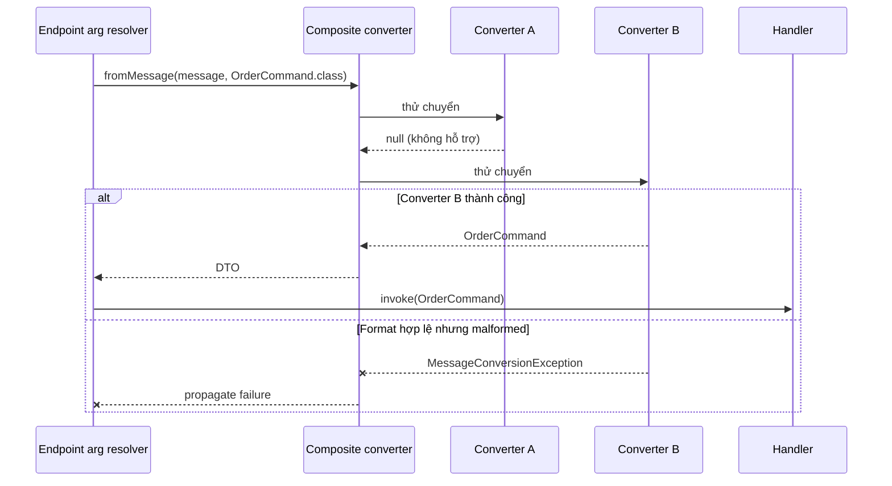
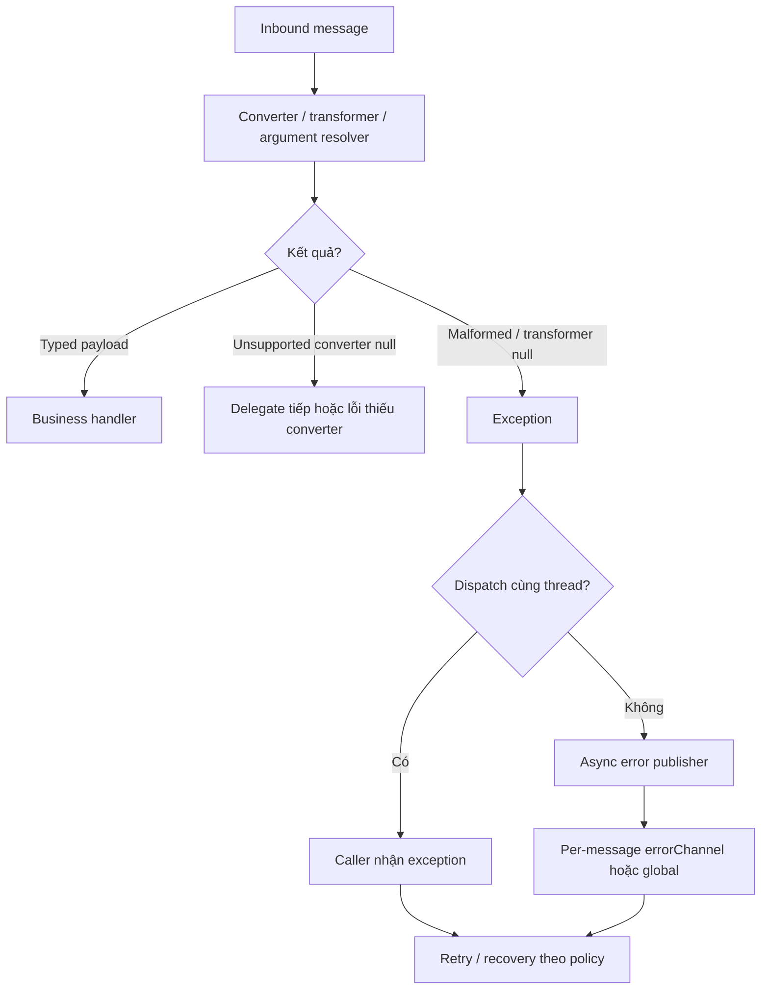

# Kiểm thử converter theo payload type và null trong Spring Integration

## 1. Vì sao conversion phải được kiểm thử tại runtime?

Trong chương **Conversion** của module `SPRING_INTEGRATION_RUNTIME`, message được truyền qua channel, endpoint, consumer, poller và executor; payload có thể đổi dạng trước khi tới business handler. Một inbound adapter có thể tạo `Message<byte[]>`, nhưng service activator mong đợi `OrderCommand`. Một gateway có thể gửi `String` chứa dữ liệu JSON, trong khi một transformer trả ra DTO. Nếu chỉ kiểm tra đường thành công, các lỗi quan trọng dễ lọt qua: sai payload type, sai header `contentType`, mã hóa ký tự không khớp, chuỗi rỗng, dữ liệu sai định dạng hoặc hàm trả `null`.

Điểm dễ nhầm nhất là **`null` không có một ý nghĩa duy nhất**. Trong Spring Messaging/Spring Integration:

- Một `Message<?>` thông thường **không được có payload Java `null`**; việc xây `GenericMessage<>(null)` bị từ chối.
- Phương thức `MessageConverter.fromMessage(...)` có thể **trả về `null`** để báo *converter này không xử lý được* loại payload/target/content type đang yêu cầu.
- Một **transformer** được kỳ vọng tạo kết quả; transformer trả `null` là lỗi `MessageTransformationException`.
- Một **service activator** trả `null` hoặc `void` có thể hợp lệ khi không yêu cầu reply, nhưng nếu `requiresReply=true` thì đó là lỗi.
- Một **filter** loại message bằng quyết định false và `nullChannel` bỏ message được gửi tới nó; chúng **không** biến payload thành Java `null`.

Bài này hướng tới khả năng thiết kế **test matrix theo kiểu payload, header và null boundary**, rồi áp dụng vào Spring Integration flow để không biến lỗi conversion thành “message biến mất” hoặc retry vô hạn.

### Mục tiêu học tập

Sau bài này, bạn có thể:

1. Phân biệt `MessageConverter`, Spring `ConversionService`, transformer và cơ chế chọn tham số của handler.
2. Viết test cho `String`, `byte[]`, DTO, unsupported type, `contentType` đúng/sai, payload rỗng và malformed.
3. Xác minh chính xác khi nào converter được phép trả `null` và khi nào cần throw `MessageConversionException`.
4. Kiểm thử transformer/service activator trả `null` bằng endpoint thật, không chỉ gọi POJO trực tiếp.
5. Phân biệt conversion failure đồng bộ với error handling ở executor/poller.
6. Giữ message ID/correlation/business key qua những bước cần thiết và kiểm soát dữ liệu lỗi khi log.
7. Thiết kế bộ kiểm thử phù hợp với transaction, retry, message store và khả năng khôi phục sau restart.

## 2. Bốn lớp conversion cần nhận diện

| Lớp | API / component | Đầu vào → đầu ra | Ngữ nghĩa lỗi/null |
|---|---|---|---|
| **Message conversion** | `org.springframework.messaging.converter.MessageConverter` | `Message<?>` ↔ giá trị/`Message<?>` đã serialize | `fromMessage` hoặc `toMessage` trả `null` khi không hỗ trợ; có thể throw nếu dữ liệu được nhận diện nhưng sai |
| **Type conversion thông thường** | `org.springframework.core.convert.ConversionService` | Object thuộc kiểu Java A → Object kiểu B | Có thể throw `ConversionFailedException`/`ConverterNotFoundException`; contract phụ thuộc converter |
| **Message transformation** | Spring Integration `Transformer` / `@Transformer` | Message → payload hoặc Message mới | Transformer trả `null` bị xem là lỗi, không phải filter |
| **Handler argument resolution** | `@ServiceActivator`, `@Transformer` annotated methods, `PayloadArgumentResolver` | Message đến → tham số Java của method | Có thể sử dụng conversion service/message converter; nếu không resolve được, handler không chạy đúng như mong đợi |

Spring Integration 5.0+ hỗ trợ chuyển đổi khi bind argument cho method handler qua infrastructure `InvocableHandlerMethod`. `ConfigurableCompositeMessageConverter` thử các delegate theo thứ tự, thường gồm Jackson (nếu có trên classpath), `ByteArrayMessageConverter`, `ObjectStringMessageConverter` và `GenericMessageConverter`. Danh sách/chính sách cụ thể phụ thuộc cấu hình và phiên bản dự án; việc thêm một dependency Jackson hoặc custom converter có thể làm một input trước đây thất bại nay được chuyển đổi theo cách khác.

**Đừng nhầm việc gọi `converter.fromMessage(...)` thủ công trong unit test với việc Spring Integration đã tự dùng converter đó cho mọi handler.** Để kiểm thử method argument conversion thực, phải đăng ký đúng converter vào infrastructure argument resolver hoặc đặt một conversion boundary tường minh trong flow, rồi gửi message qua channel thật.

### Đường đi điển hình

```mermaid
flowchart LR
    A[Inbound adapter: byte[] / String] --> B[Message headers: contentType, eventId]
    B --> C{Conversion boundary}
    C -->|Hợp lệ| D[OrderCommand typed payload]
    C -->|Unsupported| E[Converter trả null / composite thử delegate tiếp]
    C -->|Malformed được nhận diện| F[MessageConversionException]
    D --> G[Service activator / business handler]
    E --> H{Còn converter khác?}
    H -- Có --> C
    H -- Không --> I[Reject / error handling rõ ràng]
    F --> I
```

Kết quả `null` của **một converter delegate** không có nghĩa cả endpoint “đã xử lý xong” hoặc message cần bị drop. Composite có thể thử tiếp. Nếu hết lựa chọn, tầng gọi cần quyết định reject/error rõ ràng.

## 3. Ma trận kiểm thử payload type và null

Dùng ma trận sau để thiết kế testcase trước khi viết implementation. Tránh dựa vào kết quả bất ngờ của một converter mặc định khi business contract cần format rõ ràng.

| Payload đầu vào | Target type | `contentType` | Oracle nên có |
|---|---|---|---|
| `String` đúng format | DTO | Hợp lệ, ví dụ `text/x-order` | DTO đúng trường và business ID |
| `String` đúng format | Kiểu không hỗ trợ, ví dụ `Long` | Hợp lệ | Converter chuyên dụng trả `null` |
| `byte[]` | DTO | Hợp lệ nhưng converter chỉ xử lý String | `null` hoặc delegate byte[] riêng xử lý theo contract |
| DTO đã đúng kiểu | DTO | Thích hợp | Không bị parse sai/chuyển lại không cần thiết |
| `String` nhưng MIME sai | DTO | `application/json` hoặc thiếu | Không âm thầm parse bằng parser khác |
| `String` có field trống | DTO | Hợp lệ | Lỗi validation/conversion có thông tin |
| `String` malformed | DTO | Hợp lệ | `MessageConversionException`, không phải silent drop |
| `""` hoặc `"   "` | DTO | Hợp lệ | Phân biệt empty, blank và token thiếu; test không để NPE |
| Giá trị `"null"` hoặc JSON text `"null"` | DTO | Tùy contract | Không nhầm chuỗi literal với Java `null` |
| Payload Java `null` | `Message<?>` | Bất kỳ | Message construction bị từ chối |
| Converter trả Java `null` | Method handler | Bất kỳ | Xác minh contract fallback vs conversion failure |
| Transformer trả Java `null` | Output message | Bất kỳ | `MessageTransformationException` |
| Service activator trả Java `null` | Reply | `requiresReply=false` | Không gửi reply; không phải message payload null |
| Service activator trả Java `null` | Reply | `requiresReply=true` | `ReplyRequiredException` |

Ma trận này cho thấy hai nhóm kiểm thử riêng: **khả năng chuyển đổi dữ liệu** và **ngữ nghĩa xử lý khi component trả null**. Không chỉ tạo một test `null` rồi xem như đã bao phủ cả hai.

## 4. Payload của Spring Message không thể là Java null

`MessageHeaders` có thể không chứa một header cụ thể; nhưng `Message.getPayload()` với `GenericMessage` phải khác `null`.

Ví dụ JUnit 5:

```java
import org.junit.jupiter.api.Test;
import org.springframework.messaging.support.GenericMessage;
import org.springframework.messaging.support.MessageBuilder;

import static org.junit.jupiter.api.Assertions.*;

class MessageNullContractTest {

    @Test
    void rejectsActualNullPayload() {
        assertThrows(IllegalArgumentException.class,
                () -> new GenericMessage<>(null));

        assertThrows(IllegalArgumentException.class,
                () -> MessageBuilder.withPayload((String) null).build());
    }

    @Test
    void emptyStringIsStillARealPayload() {
        var message = MessageBuilder.withPayload("").build();

        assertNotNull(message.getPayload());
        assertEquals("", message.getPayload());
    }

    @Test
    void optionalEmptyIsNotJavaNull() {
        var message = MessageBuilder
                .withPayload(java.util.Optional.empty())
                .build();

        assertNotNull(message.getPayload());
    }
}
```

**Điều cần chứng minh:** empty string, empty byte array, `Optional.empty()` và JSON literal `"null"` đều là **giá trị payload thực** nếu được dùng để tạo message. Chúng không phải payload Java `null`. Việc một serializer muốn biểu diễn “không có giá trị” phải được định nghĩa ở format/DTO/envelope chứ không phá hợp đồng của Spring `Message<?>`.

`NullChannel` cũng không phải “message có payload null”. Nó là channel đặc biệt nhận và bỏ message; sử dụng khi bạn cố ý không cần downstream reply. Nếu muốn loại message dựa trên điều kiện, dùng `Filter` thay vì để transformer trả `null`.

## 5. Thiết kế converter có contract xác định

Thay vì phụ thuộc một JSON mapper chưa biết cấu hình, ta xây **converter nhỏ chỉ hỗ trợ một wire format** để nhìn rõ từng nhánh test.

Hợp đồng minh họa:

- Business payload: `OrderCommand(eventId, quantity)`.
- Representation trên channel: `String` với format `eventId|quantity`, ví dụ `"evt-301|4"`.
- Content type: `text/x-order`.
- Hỗ trợ chuyển **String → OrderCommand** và **OrderCommand → String Message**.
- Nếu target type hoặc content type không thuộc phạm vi converter: **trả `null`** để delegate khác có thể xử lý.
- Nếu đúng format được nhận diện nhưng value sai: **throw `MessageConversionException`**; không thay lỗi bằng một `OrderCommand` nửa hợp lệ.
- `eventId` không được blank/chứa `|` và `quantity` phải là số nguyên dương.

### 5.1. Model

File `OrderCommand.java`:

```java
package example.integration;

public record OrderCommand(String eventId, int quantity) {}
```

### 5.2. Implementation MessageConverter

File `PipeOrderMessageConverter.java`, dùng Spring Messaging và Spring Core:

```java
package example.integration;

import org.springframework.messaging.Message;
import org.springframework.messaging.MessageHeaders;
import org.springframework.messaging.converter.MessageConversionException;
import org.springframework.messaging.converter.MessageConverter;
import org.springframework.messaging.support.MessageBuilder;
import org.springframework.util.MimeType;
import org.springframework.util.MimeTypeUtils;

public final class PipeOrderMessageConverter implements MessageConverter {

    private static final MimeType WIRE_TYPE =
            MimeTypeUtils.parseMimeType("text/x-order");

    @Override
    public Object fromMessage(Message<?> message, Class<?> targetClass) {
        if (targetClass != OrderCommand.class
                || !(message.getPayload() instanceof String raw)
                || !supported(message.getHeaders().get(
                        MessageHeaders.CONTENT_TYPE))) {
            // Converter này không chịu trách nhiệm với input đó.
            return null;
        }

        String[] parts = raw.split("\\|", -1);

        if (parts.length != 2
                || parts[0].isBlank()
                || parts[0].contains("|")) {
            throw new MessageConversionException(
                    message, "Invalid order wire format");
        }

        try {
            int quantity = Integer.parseInt(parts[1]);

            if (quantity <= 0) {
                throw new MessageConversionException(
                        message, "Quantity must be positive");
            }

            return new OrderCommand(parts[0], quantity);
        } catch (NumberFormatException invalidNumber) {
            throw new MessageConversionException(
                    message, "Quantity is not an integer", invalidNumber);
        }
    }

    @Override
    public Message<?> toMessage(Object payload, MessageHeaders headers) {
        if (!(payload instanceof OrderCommand command)) {
            return null;
        }

        if (headers != null
                && headers.containsKey(MessageHeaders.CONTENT_TYPE)
                && !supported(headers.get(MessageHeaders.CONTENT_TYPE))) {
            return null;
        }

        if (command.eventId() == null
                || command.eventId().isBlank()
                || command.eventId().contains("|")
                || command.quantity() <= 0) {
            throw new MessageConversionException(
                    "OrderCommand cannot be serialized");
        }

        MessageBuilder<String> builder = MessageBuilder.withPayload(
                command.eventId() + "|" + command.quantity());

        if (headers != null) {
            builder.copyHeaders(headers);
        }

        return builder
                .setHeader(MessageHeaders.CONTENT_TYPE, WIRE_TYPE)
                .build();
    }

    private boolean supported(Object contentTypeHeader) {
        if (contentTypeHeader instanceof MimeType mimeType) {
            return WIRE_TYPE.isCompatibleWith(mimeType);
        }

        if (contentTypeHeader instanceof String text) {
            try {
                return WIRE_TYPE.isCompatibleWith(
                        MimeTypeUtils.parseMimeType(text));
            } catch (IllegalArgumentException invalidMimeType) {
                return false;
            }
        }

        return false;
    }
}
```

**Giải thích phạm vi:**

1. `fromMessage` chỉ xử lý `targetClass == OrderCommand.class` và `payload instanceof String`. Với `byte[]` hay `Map`, converter trả `null` để lớp khác xử lý hoặc để endpoint báo “không có converter”.
2. `contentType` có thể được cung cấp dạng `MimeType` hoặc chuỗi; ví dụ xử lý hai dạng, nhưng **không tự đoán format khi header thiếu**.
3. Chuỗi `"evt-301|x"` là input được converter nhận diện nhưng sai nội dung nên throw. Với `"evt-301|0"`, kiểm tra nghiệp vụ reject quantity.
4. `toMessage` chỉ nhận `OrderCommand`; dữ liệu phải hợp lệ trước khi build `Message<?>`.
5. Converter **không log raw payload** trong exception; thông báo lỗi có thể được ghi trong error channel mà không lộ thông tin nhạy cảm.
6. Khi `headers` đã có `contentType` khác, converter từ chối; khi thiếu, nó **ghi rõ** `text/x-order` trên output.
7. `copyHeaders` giữ các header ứng dụng cần khi tạo message mới, nhưng không được suy ra mọi header sẽ được phép gửi sang broker hoặc giữa các process. Các header nội bộ chứa channel object có lifecycle riêng.

Đây là ví dụ **custom wire format dùng để học test**; không phải khuyến nghị phát minh protocol mới khi hệ thống đã chuẩn hóa JSON/Avro/Protobuf. Khi triển khai thực, nên dùng serializer/schema phù hợp, version, validation và compatibility tests.

## 6. JUnit 5: kiểm thử từng payload type

Test cần phản ánh **hợp đồng converter** chứ không lẫn các hành vi mặc định của Jackson hay của endpoint. Ví dụ yêu cầu JUnit Jupiter; không cần khởi động Spring ApplicationContext.

File `PipeOrderMessageConverterTest.java`:

```java
package example.integration;

import java.util.Map;
import java.util.stream.Stream;

import org.junit.jupiter.api.BeforeEach;
import org.junit.jupiter.api.Test;
import org.junit.jupiter.params.ParameterizedTest;
import org.junit.jupiter.params.provider.Arguments;
import org.junit.jupiter.params.provider.MethodSource;
import org.junit.jupiter.params.provider.ValueSource;
import org.springframework.messaging.Message;
import org.springframework.messaging.MessageHeaders;
import org.springframework.messaging.converter.MessageConversionException;
import org.springframework.messaging.support.MessageBuilder;
import org.springframework.util.MimeTypeUtils;

import static org.junit.jupiter.api.Assertions.*;

class PipeOrderMessageConverterTest {

    private PipeOrderMessageConverter converter;

    @BeforeEach
    void setup() {
        converter = new PipeOrderMessageConverter();
    }

    private static Message<?> raw(Object payload, Object contentType) {
        return MessageBuilder.withPayload(payload)
                .setHeader(MessageHeaders.CONTENT_TYPE, contentType)
                .build();
    }

    @Test
    void stringPayloadToTypedOrder() {
        Message<?> message = raw("evt-301|4", "text/x-order");

        OrderCommand order = assertInstanceOf(
                OrderCommand.class,
                converter.fromMessage(message, OrderCommand.class));

        assertEquals("evt-301", order.eventId());
        assertEquals(4, order.quantity());
    }

    @Test
    void acceptsMimeTypeObjectAsContentType() {
        Message<?> message = raw("evt-302|1",
                MimeTypeUtils.parseMimeType("text/x-order"));

        assertEquals(new OrderCommand("evt-302", 1),
                converter.fromMessage(message, OrderCommand.class));
    }

    static Stream<Arguments> unsupportedInputs() {
        return Stream.of(
                Arguments.of(raw("evt-303|3", "application/json"),
                        OrderCommand.class),
                Arguments.of(raw("evt-303|3", "text/x-order"),
                        Integer.class),
                Arguments.of(raw(new byte[] {1, 2, 3}, "text/x-order"),
                        OrderCommand.class),
                Arguments.of(raw(Map.of("id", "evt-303"),
                        "text/x-order"), OrderCommand.class),
                Arguments.of(raw("evt-303|3", "not a mime type"),
                        OrderCommand.class)
        );
    }

    @ParameterizedTest
    @MethodSource("unsupportedInputs")
    void returnsNullForUnsupportedConversion(
            Message<?> message, Class<?> targetClass) {
        assertNull(converter.fromMessage(message, targetClass));
    }

    @ParameterizedTest
    @ValueSource(strings = {
            "", "   ", "|3", "evt-303", "evt-303|",
            "evt-303|x", "evt-303|0", "evt-303|-2",
            "evt-303|1|extra"
    })
    void rejectsMalformedDataInSupportedFormat(String payload) {
        Message<?> message = raw(payload, "text/x-order");

        assertThrows(MessageConversionException.class,
                () -> converter.fromMessage(
                        message, OrderCommand.class));
    }

    @Test
    void toMessageRoundTripPreservesAllowedHeader() {
        MessageHeaders headers = new MessageHeaders(
                Map.of("traceId", "trace-301"));

        Message<?> serialized = converter.toMessage(
                new OrderCommand("evt-301", 4), headers);

        assertNotNull(serialized);
        assertEquals("evt-301|4", serialized.getPayload());
        assertEquals("trace-301", serialized.getHeaders().get("traceId"));
        assertEquals(new OrderCommand("evt-301", 4),
                converter.fromMessage(serialized, OrderCommand.class));
    }

    @Test
    void unsupportedOutboundTypeOrContentTypeReturnsNull() {
        assertNull(converter.toMessage(
                Map.of("eventId", "evt-301"), null));

        MessageHeaders jsonHeaders = new MessageHeaders(
                Map.of(MessageHeaders.CONTENT_TYPE,
                        MimeTypeUtils.APPLICATION_JSON));

        assertNull(converter.toMessage(
                new OrderCommand("evt-301", 4), jsonHeaders));
    }

    @Test
    void invalidTypedPayloadFailsExplicitly() {
        assertThrows(MessageConversionException.class,
                () -> converter.toMessage(
                        new OrderCommand("", 2), null));

        assertThrows(MessageConversionException.class,
                () -> converter.toMessage(
                        new OrderCommand("evt-301", 0), null));
    }

    @Test
    void missingContentTypeIsUnsupportedByThisConverter() {
        Message<?> message = MessageBuilder
                .withPayload("evt-304|2").build();

        assertNull(converter.fromMessage(
                message, OrderCommand.class));
    }

    @Test
    void emptyByteArrayIsNonNullButUnsupportedHere() {
        Message<?> message = raw(new byte[0], "text/x-order");

        assertNotNull(message.getPayload());
        assertNull(converter.fromMessage(
                message, OrderCommand.class));
    }

    @Test
    void literalNullTextIsNotJavaNull() {
        Message<?> message = raw("null", "text/x-order");

        assertThrows(MessageConversionException.class,
                () -> converter.fromMessage(
                        message, OrderCommand.class));
    }
}
```

### Kết quả mong đợi

- **Đường thành công:** parsed DTO đúng `eventId` và `quantity`, outbound round-trip vẫn đọc lại được; header `traceId` minh họa việc giữ context.
- **Không hỗ trợ:** converter trả Java `null` cho wrong target, wrong payload type, wrong MIME. Đó là kết quả **có chủ đích** của `MessageConverter`.
- **Sai dữ liệu trong format được nhận diện:** converter throw `MessageConversionException`; test bảo đảm không biến sai format thành một object “default” nguy hiểm.
- **Null literal:** `"null"` là chuỗi bốn ký tự, không phải Java `null`; chỉ parser cụ thể quyết định ý nghĩa.
- **Không khởi tạo Spring context:** các test này xác nhận implementation thuần, chưa chứng minh adapter/argument resolver đã dùng converter.

**Lưu ý:** các import và test trên được thiết kế cho Spring Messaging trên Spring Framework 6.x/7.x và JUnit Jupiter. Kiểm tra compatibility với BOM của ứng dụng; khi project quản lý dependency, không hardcode kết hợp nhiều dòng Spring khác nhau.

## 7. Kiểm thử composite và thứ tự converter

Trong Spring Integration, argument resolver có thể dùng `ConfigurableCompositeMessageConverter`. Composite thử các delegate; một delegate trả `null` cho phép thử delegate kế tiếp. Nếu một converter **throw exception**, đó không giống “không hỗ trợ”, và có thể chặn chain ngay tại lỗi.



### Tối thiểu cần test

| Điều kiện | Oracle |
|---|---|
| Converter chuyên dụng được đặt **trước** generic fallback | Input format riêng được converter chuyên dụng xử lý |
| Converter chuyên dụng trả `null` cho MIME khác | Delegate kế tiếp có cơ hội xử lý nếu hỗ trợ |
| Converter chuyên dụng throw với dữ liệu malformed | Error không bị biến thành “không hỗ trợ” và bỏ qua |
| Thêm Jackson vào classpath | Kiểm tra converter order và output trên input JSON thật |
| Message payload đã là DTO đúng kiểu | Không serialize/deserialize thêm ngoài ý muốn |
| Content type thiếu | Đường fallback theo policy đã chọn, không tự gán JSON |
| Content type sai | Không silently chấp nhận dữ liệu không tương thích |

Một source code sample đơn giản để minh họa lớp composite của Spring Messaging:

```java
import java.util.List;
import org.springframework.messaging.converter.CompositeMessageConverter;
import org.springframework.messaging.converter.MessageConverter;
import org.springframework.messaging.converter.StringMessageConverter;

MessageConverter composite = new CompositeMessageConverter(
        List.of(new PipeOrderMessageConverter(),
                new StringMessageConverter()));
```

Với ví dụ này, `StringMessageConverter` xử lý một số kiểu/`contentType` của riêng nó; không mặc định một input bất kỳ sẽ được chuyển sang `OrderCommand`. Nếu cần **default converters của Spring Integration** cộng custom, cấu hình `ConfigurableCompositeMessageConverter`/bean argument resolver theo đúng version của dự án thay vì tự thay hoàn toàn danh sách mà không hiểu tác động.

## 8. Test conversion trong một endpoint thực

Unit test converter có thể PASS nhưng pipeline vẫn sai vì converter chưa được đăng ký hoặc endpoint gọi method khác. Để tránh điều này, ta có thể đặt conversion boundary **tường minh** trong một `@ServiceActivator` rồi gửi message qua `DirectChannel`.

### 8.1. Cấu hình Spring Integration

File `ConversionFlowConfig.java`:

```java
package example.integration;

import java.util.concurrent.atomic.AtomicInteger;

import org.springframework.context.annotation.Bean;
import org.springframework.context.annotation.Configuration;
import org.springframework.integration.annotation.ServiceActivator;
import org.springframework.integration.channel.DirectChannel;
import org.springframework.integration.config.EnableIntegration;
import org.springframework.messaging.Message;
import org.springframework.messaging.MessageChannel;
import org.springframework.messaging.converter.MessageConversionException;

@Configuration
@EnableIntegration
public class ConversionFlowConfig {

    @Bean("rawOrdersIn")
    public MessageChannel rawOrdersIn() {
        return new DirectChannel();
    }

    @Bean
    public PipeOrderMessageConverter pipeOrderMessageConverter() {
        return new PipeOrderMessageConverter();
    }

    @Bean
    public ReceivedOrders receivedOrders(
            PipeOrderMessageConverter converter) {
        return new ReceivedOrders(converter);
    }

    public static final class ReceivedOrders {
        private final PipeOrderMessageConverter converter;
        private final AtomicInteger accepted = new AtomicInteger();

        public ReceivedOrders(PipeOrderMessageConverter converter) {
            this.converter = converter;
        }

        @ServiceActivator(inputChannel = "rawOrdersIn")
        public void receive(Message<?> message) {
            Object converted = converter.fromMessage(
                    message, OrderCommand.class);

            if (!(converted instanceof OrderCommand order)) {
                throw new MessageConversionException(
                        message, "Unsupported order payload/contentType");
            }

            accepted.incrementAndGet();
            // Demo: gọi business service với order nếu cần.
        }

        public int acceptedCount() {
            return accepted.get();
        }
    }
}
```

Trong code này, converter được gọi chủ động ở một điểm dễ kiểm thử, không phải tự động áp vào mọi `@ServiceActivator`. Với method argument conversion tự động, sử dụng cấu hình argument resolver và `ConfigurableCompositeMessageConverter` đúng tên bean/version như tài liệu Spring Integration.

### 8.2. JUnit test đường channel thật

```java
package example.integration;

import org.junit.jupiter.api.Test;
import org.springframework.context.annotation.AnnotationConfigApplicationContext;
import org.springframework.messaging.MessageChannel;
import org.springframework.messaging.MessagingException;
import org.springframework.messaging.MessageHeaders;
import org.springframework.messaging.support.MessageBuilder;

import static org.junit.jupiter.api.Assertions.*;

class ConversionFlowTest {

    @Test
    void acceptsRecognizedPayloadAndRejectsWrongMime() {
        try (var context = new AnnotationConfigApplicationContext(
                ConversionFlowConfig.class)) {

            var input = context.getBean(
                    "rawOrdersIn", MessageChannel.class);
            var recorder = context.getBean(
                    ConversionFlowConfig.ReceivedOrders.class);

            assertTrue(input.send(MessageBuilder
                    .withPayload("evt-501|2")
                    .setHeader(MessageHeaders.CONTENT_TYPE, "text/x-order")
                    .build()));

            assertEquals(1, recorder.acceptedCount());

            assertThrows(MessagingException.class, () -> input.send(
                    MessageBuilder.withPayload("evt-502|2")
                            .setHeader(MessageHeaders.CONTENT_TYPE,
                                    "application/json")
                            .build()));

            // Không gọi business handler thành công ở lần thứ hai.
            assertEquals(1, recorder.acceptedCount());
        }
    }
}
```

Tại `DirectChannel`, exception của handler thường đi ngược về lời gọi `send(...)`, có thể dưới một `MessagingException` bọc nguyên nhân thực. Test nên kiểm tra **cause chain** khi cần phân biệt `MessageConversionException` với lỗi khác, thay vì bắt buộc mọi cấu hình đều throw đúng một class wrapper cố định.

**Điểm không được suy diễn:** `acceptedCount()` là bộ đếm demo. Nó không xác nhận database đã commit hoặc broker đã ack. Trong hệ thống có transaction/retry thật, phải kiểm chứng business state cuối cùng và idempotency theo event ID.

## 9. Null từ transformer và null từ service activator khác nhau

Spring Integration quy định transformer luôn phải tạo một kết quả. Khi `@Transformer` trả `null`, framework ném `MessageTransformationException`. Điều này bảo vệ người dùng khỏi việc vô ý dùng transformer để lọc message.

Service activator khác: nếu `requiresReply=false` (mặc định), method trả `null` có thể biểu diễn **không có reply**. Khi `requiresReply=true`, `null` gây `ReplyRequiredException`. Đây là **hợp đồng endpoint**, không phải hợp đồng của `MessageConverter`.

### 9.1. Fixture test qua endpoint

File `NullBoundaryConfig.java`:

```java
package example.integration;

import org.springframework.context.annotation.Bean;
import org.springframework.context.annotation.Configuration;
import org.springframework.integration.annotation.ServiceActivator;
import org.springframework.integration.annotation.Transformer;
import org.springframework.integration.channel.DirectChannel;
import org.springframework.integration.channel.QueueChannel;
import org.springframework.integration.config.EnableIntegration;

@Configuration
@EnableIntegration
public class NullBoundaryConfig {

    @Bean("transformIn")
    public DirectChannel transformIn() {
        return new DirectChannel();
    }

    @Bean("transformOut")
    public QueueChannel transformOut() {
        return new QueueChannel();
    }

    @Bean("optionalReplyIn")
    public DirectChannel optionalReplyIn() {
        return new DirectChannel();
    }

    @Bean("optionalReplyOut")
    public QueueChannel optionalReplyOut() {
        return new QueueChannel();
    }

    @Bean("requiredReplyIn")
    public DirectChannel requiredReplyIn() {
        return new DirectChannel();
    }

    @Bean("requiredReplyOut")
    public QueueChannel requiredReplyOut() {
        return new QueueChannel();
    }

    @Bean
    public NullEndpoints nullEndpoints() {
        return new NullEndpoints();
    }

    public static final class NullEndpoints {

        @Transformer(
                inputChannel = "transformIn",
                outputChannel = "transformOut")
        public String brokenTransformer(String text) {
            return null;
        }

        @ServiceActivator(
                inputChannel = "optionalReplyIn",
                outputChannel = "optionalReplyOut")
        public String noReplyNeeded(String text) {
            return null;
        }

        @ServiceActivator(
                inputChannel = "requiredReplyIn",
                outputChannel = "requiredReplyOut",
                requiresReply = "true")
        public String replyRequired(String text) {
            return null;
        }
    }
}
```

### 9.2. Assertions tường minh

```java
package example.integration;

import org.junit.jupiter.api.Test;
import org.springframework.context.annotation.AnnotationConfigApplicationContext;
import org.springframework.integration.channel.QueueChannel;
import org.springframework.messaging.MessagingException;
import org.springframework.messaging.support.MessageBuilder;

import static org.junit.jupiter.api.Assertions.*;

class NullBoundaryTest {

    @Test
    void transformerNullIsErrorButOptionalReplyCanBeAbsent() {
        try (var context = new AnnotationConfigApplicationContext(
                NullBoundaryConfig.class)) {

            var transformIn = context.getBean(
                    "transformIn",
                    org.springframework.messaging.MessageChannel.class);
            var transformOut = context.getBean(
                    "transformOut", QueueChannel.class);

            assertThrows(MessagingException.class,
                    () -> transformIn.send(
                            MessageBuilder.withPayload("value").build()));
            assertNull(transformOut.receive(0));

            var optionalIn = context.getBean(
                    "optionalReplyIn",
                    org.springframework.messaging.MessageChannel.class);
            var optionalOut = context.getBean(
                    "optionalReplyOut", QueueChannel.class);

            assertTrue(optionalIn.send(
                    MessageBuilder.withPayload("value").build()));
            assertNull(optionalOut.receive(0));

            var requiredIn = context.getBean(
                    "requiredReplyIn",
                    org.springframework.messaging.MessageChannel.class);

            assertThrows(MessagingException.class,
                    () -> requiredIn.send(
                            MessageBuilder.withPayload("value").build()));
        }
    }
}
```

Các test tạo context/endpoint thật. Gọi trực tiếp `brokenTransformer("value")` chỉ chứng minh Java method trả null, **không chứng minh** Spring Integration ném `MessageTransformationException`. Việc gửi qua channel là phần quyết định của test runtime.

Trong log, `MessageTransformationException`/`ReplyRequiredException` có thể được bọc bởi lớp `MessagingException` khác khi đi qua dispatcher/proxy. Nếu muốn assertion chính xác, duyệt root cause/`MessagingException.getFailedMessage()` một cách phòng thủ. Không so nguyên thông điệp lỗi vì wording có thể thay đổi giữa phiên bản.

### Lựa chọn đúng khi cần “không có message”

| Nhu cầu | Component/phương án | Vì sao |
|---|---|---|
| Loại một message dựa trên điều kiện | `Filter` | Hợp đồng từ chối/cho qua rõ ràng |
| Không cần reply sau một tác dụng | `ServiceActivator` trả `void` hoặc `null`, `requiresReply=false` | Không giả vờ tạo payload null |
| Cần reply nhưng không có kết quả | `requiresReply=true` và xử lý lỗi, hoặc trả một DTO kết quả có trạng thái | Tránh gateway timeout khó hiểu |
| Cố ý bỏ reply đã tạo | Gửi đến `nullChannel` | Channel chuyên bỏ message, không thay payload |
| Payload nghiệp vụ tùy chọn | Envelope/DTO có field nullable hay `Optional` được hỗ trợ có chủ đích | Message object bên ngoài vẫn có payload non-null |
| Transformer không chuyển đổi được | Ném lỗi rõ ràng hoặc phân nhánh/filter trước transformer | Transformer không nên trả null như filter |

## 10. Null, JSON, byte[] và nội dung thực trên adapter

Những test trên dùng format `text/x-order` để cô lập hành vi. Trong sản phẩm thật, các nguồn thường có `byte[]` hoặc `String` chứa JSON. Có thêm các boundary quan trọng:

### 10.1. Nội dung `"null"` trong JSON

`"null"` dưới dạng chuỗi JSON là 4 byte/ký tự biểu diễn một JSON null literal, **không phải Java null của Spring `Message<?>`**. Một JSON mapper có thể trả `null` ở tầng parse; lúc đó ứng dụng cần quyết định: object mục tiêu bắt buộc hay chấp nhận envelope báo “không có dữ liệu”? Không tự tạo `MessageBuilder.withPayload(null)`.

### 10.2. Empty byte array và empty string

`new byte[0]` không phải `null`, nhưng một parser JSON thông thường có thể không parse được dữ liệu rỗng. `""` khác `"{}"`, `"[]"`, `"null"` và một object đủ trường. Với một DTO record, trường JSON có thể thiếu hoặc null. Test nên phân biệt:

| Nội dung | Oracle cần xác định |
|---|---|
| `byte[0]` | Reject empty hoặc có protocol riêng cho empty; không mặc định DTO trống |
| `""` | Reject blank, hoặc chấp nhận nếu business contract cho phép |
| `"{}"` | Parser có thể tạo DTO có trường mặc định/null; cần bean validation |
| `"[]"` | Target scalar DTO hay collection DTO? Không được âm thầm đổi loại |
| `"null"` | Parser có thể cho kết quả null; không gửi thành `Message<?>` payload null |
| `{"id":null}` | Xác minh field required/nullable, không chỉ deserialize thành công |
| Invalid UTF-8 | Thất bại rõ, không thay bằng ký tự khác âm thầm nếu hợp đồng nghiêm ngặt |
| MIME/charset mismatch | Kiểm tra decoder và contentType thực của message |

### 10.3. Charset và contentType

Đối với `byte[] → String`, charset phải được xác định bằng protocol/header hoặc một default được công bố; không dùng `new String(bytes)` phụ thuộc default charset khi dữ liệu có dấu tiếng Việt và cần tương thích xuyên môi trường.

Ví dụ explicit:

```java
import java.nio.charset.StandardCharsets;

byte[] raw = "đơn-hàng".getBytes(StandardCharsets.UTF_8);
String decoded = new String(raw, StandardCharsets.UTF_8);

assertEquals("đơn-hàng", decoded);
```

Trong ví dụ này, `assertEquals` thuộc JUnit; test thực tế nên đồng thời kiểm tra byte[] từ adapter/broker và header `contentType`, ví dụ `application/json;charset=UTF-8`. Nếu source có charset không hỗ trợ hoặc header không nhất quán, phải reject/quarantine với thông tin đủ điều tra.

### 10.4. Generic type và schema evolution

Converter vào `List<OrderCommand>` không giống converter vào `OrderCommand.class`. Khi cần type generic, dùng API/metadata như `ResolvableType`, type hint hoặc converter hỗ trợ loại đích; không chỉ truyền `List.class` rồi tin rằng phần tử được khởi tạo đúng kiểu.

Khi triển khai phiên bản mới, lưu message cũ trong `JdbcMessageStore` hoặc broker rồi dùng bản mới đọc lại. Bài test compatibility cần bao phủ:

1. Version cũ gửi thêm trường mới, bản mới phải xử lý theo chính sách.
2. Version mới đổi tên/loại field, dữ liệu backlog của phiên bản cũ còn đọc được không?
3. Missing field và explicit JSON null có khác nhau không?
4. Content type hoặc schema ID bị thiếu/sai, error flow có giữ lại business ID và raw payload an toàn không?
5. Dữ liệu thật có PII, error logs/`failedMessage` có bị lộ khi converter throw không?

## 11. Khi conversion failure đi qua channel và error channel

Converter throw không tự đồng nghĩa message đã vào global `errorChannel`. Đường lỗi phụ thuộc **ràng giới dispatch**:

| Topology | Lỗi có thể xuất hiện | Test nên assert |
|---|---|---|
| `DirectChannel` + service activator đồng bộ | Exception truyền ngược về `send()`, thường dạng `MessagingException`/cause | `assertThrows` ở caller và kết quả nghiệp vụ chưa thay đổi |
| `ExecutorChannel` hoặc xử lý async | Lỗi ở worker thread; error publisher có thể tạo `ErrorMessage` | Gửi message có header `errorChannel`/consumer lỗi, dùng timeout hữu hạn |
| Poller + transactional store | Exception qua advice/transaction/poller error handling | Rollback business state, message còn/retry theo store contract |
| Gateway có `requiresReply=true` | Chuyển đổi thất bại hoặc endpoint thiếu reply | Caller nhận lỗi/reply theo contract, không chỉ “không có message” |
| Broker adapter | Nack/requeue/DLQ theo adapter và ack mode | Khả năng redelivery và poison message control |
| Transformer trả null | `MessageTransformationException` | Không có output; đường lỗi chính xác theo sync/async |



**Tác động lên transaction:** nếu conversion xảy ra **trước** khi transaction của business service mở, lỗi có thể không bắt đầu transaction đó. Nếu conversion xảy ra trong poller advice, exception có thể rollback việc lấy message khỏi một persistent queue theo contract. Chỉ có transaction manager đúng resource mới cho bảo đảm này.

**Tác động lên retry:** malformed payload thường là **permanent error**, không nên retry giống timeout DB tạm thời. Một message poison nằm mãi trong durable queue có thể khiến poller lặp vô hạn. Hãy classify lỗi, giới hạn số attempt, đưa vào DLQ/quarantine và giữ metadata bảo mật.

## 12. Kiểm thử retry và idempotency quanh conversion

Chia pipeline thành hai phần:

```text
Payload validation/conversion -> business effect -> ack/reply
```

Nếu converter thất bại do schema/malformed, retry nhiều lần với **cùng bytes** thường vô ích. Nếu business service thất bại tạm thời sau khi conversion thành công, retry có thể hợp lý nhưng cần giữ business event ID ổn định.

| Điểm thất bại | Hướng xử lý | Test cần chứng minh |
|---|---|---|
| Wrong MIME/unsupported type | Reject với mã lỗi rõ hoặc thử converter phù hợp theo composite contract | Không gọi business handler |
| Malformed protocol | Quarantine/DLQ, không tight-loop | Một final recovery event, không nhân log vô hạn |
| Missing required field | Validation lỗi, phản hồi rõ | Không tạo DTO “default” gây side effect |
| Transient DB timeout sau conversion | Retry với backoff hữu hạn | DTO/eventId ổn định, commit tối đa một lần |
| Crash sau business commit trước source ack | Broker redelivery | Idempotency ledger nhận diện event trùng |
| Converter/serializer version đổi trong lúc backlog còn dữ liệu | Compatibility test và migration | Message cũ còn đọc/replay được |

### Vì sao không dùng message UUID làm idempotency key?

Một message được tái tạo bởi converter/transformer có thể có `MessageHeaders.ID` mới. Broker redelivery hoặc replay lại payload cũ cũng có thể tạo message instance mới. Vì vậy business idempotency key nên là `eventId` từ producer, không phải `MessageHeaders.ID` của từng lần gửi.

### Không retry exception chỉ vì thấy `MessageConversionException`

Retry classification cần dựa vào **tính tạm thời của nguyên nhân**. `MessageConversionException` thường chỉ ra dữ liệu không hợp lệ hoặc protocol mismatch; chỉ retry khi có lý do rõ (ví dụ schema registry tạm thời unavailable) và có cơ chế phân biệt lỗi tạm với lỗi vĩnh viễn. Giữ raw payload trong store được phân quyền/quarantine nếu cần đối soát, nhưng đừng log cả byte[] lên console.

## 13. Concurrency, mutable payload và thread boundary

Một converter có state mutable có thể gây race khi nhiều message vào `ExecutorChannel` hoặc poller đa thread. Test cần kiểm tra:

- Converter có **thread-safe** khi là singleton bean không? `ObjectMapper` đã cấu hình ổn định thường dùng chung được, nhưng không thay đổi cấu hình mapper trong khi đang chạy.
- Converter có giữ “lastPayload” hoặc buffer mutable dùng chung không? Nếu có, hai worker có thể ghi đè dữ liệu.
- Payload `byte[]` có bị sửa bởi handler khác hoặc wire tap không? Nếu payload dùng chung reference, converter chạy muộn có thể đọc dữ liệu đã bị thay.
- Adapter phát message trong thread A, conversion/handler xảy ra thread B; transaction `ThreadLocal` từ A không tự truyền sang B.
- Một message lớn được deserialize nhiều lần có gây GC/backpressure không? Đo payload size, số in-flight, latency, memory.

Ví dụ phản mẫu:

```java
// KHÔNG NÊN: buffer mutable chia sẻ giữa các lần convert.
class UnsafeDecoder {
    private final StringBuilder buffer = new StringBuilder();

    String decode(String raw) {
        buffer.setLength(0);
        buffer.append(raw);
        return buffer.toString();
    }
}
```

Trong concurrency test, cùng `UnsafeDecoder` có thể bị hai thread dùng đồng thời. Cách đúng là tạo state local cho mỗi lời gọi, hoặc dùng converter/stateless parser có contract thread safety rõ ràng.

**Lưu ý về filter/transformer:** chuyển một message thành DTO không nên làm thay đổi payload object của bản message cũ nếu payload mutable còn được dùng ở nhánh khác. Khi cần “chỉ đọc”, tạo DTO immutable và tránh mutate source.

## 14. Cách viết test không flaky

Test conversion thuần thường nên là **synchronous unit test** không cần sleep. Khi lên integration test:

- `DirectChannel` giúp assert ngay vì handler chạy trong call stack.
- `QueueChannel.receive(timeout)` dùng để đợi kết quả hoặc `ErrorMessage` khi có async consumer.
- `CountDownLatch.await(timeout)` hoặc polling assertion có deadline cho executor/poller.
- Test mỗi case trong context riêng hoặc reset đúng state; tránh sharing singleton mutable/test counters.
- Không so nguyên stack trace/error text; kiểm tra class của root cause và business event ID.
- Không assert cố định message UUID qua transformer; chỉ assert header **do ứng dụng chủ ý giữ**.
- Với database/broker, kiểm tra **trạng thái cuối sau commit/retry**, không chỉ số lần gọi converter.
- Khi inject lỗi, dùng input cụ thể, barrier/latch hoặc fake converter deterministic; tránh lỗi ngẫu nhiên.

Một test lifecycle dùng `QueueChannel` có thể theo mẫu:

```java
Message<?> result = outputChannel.receive(2_000);
assertNotNull(result, "Expected one converted message");
assertEquals(OrderCommand.class, result.getPayload().getClass());

assertNull(outputChannel.receive(0), "No duplicate reply");
```

Đoạn trên giả định `outputChannel` là `QueueChannel` đã được cấu hình trong test. `receive(0)` là phép kiểm tra không chờ; kết quả có thể đến muộn ở flow async, vì thế với yêu cầu “không có duplicate trong một cửa sổ” phải theo dõi thêm trạng thái/counter hoặc chờ đủ thời gian kiểm thử có giới hạn, không suy luận từ một lần peek.

## 15. Bộ test matrix tối thiểu trước khi deploy

- [ ] `MessageBuilder` từ chối payload Java `null`; empty string/empty byte[] được phân biệt.
- [ ] String hợp lệ với `contentType` đúng chuyển được thành DTO đúng trường.
- [ ] Wrong target type trả `null` ở custom converter đúng contract.
- [ ] Wrong payload type (`byte[]`/`Map`) không bị ép kiểu sai hoặc `ClassCastException` vô nghĩa.
- [ ] Missing/wrong/invalid `contentType` có hành vi rõ; không parse format khác tùy tiện.
- [ ] Malformed value (trống, thiếu trường, sai số, negative, thêm delimiter) gây exception được phân loại.
- [ ] Outbound DTO → serialized Message round-trip; kiểm tra content type và header ứng dụng.
- [ ] Composite thử converter kế tiếp khi delegate trả `null`; có test precedence/order.
- [ ] Conversion theo method argument thực hoạt động khi đã đăng ký argument resolver converter đúng.
- [ ] Transformer trả null gây lỗi, không âm thầm drop message.
- [ ] Service activator trả null khi `requiresReply=false` không có reply, khi true thì lỗi.
- [ ] Filter drop/`nullChannel` được dùng thay vì phát `Message<?>` payload null.
- [ ] DirectChannel conversion failure truyền lỗi về caller; async path có error handling được test.
- [ ] Retry phân biệt lỗi malformed vĩnh viễn với lỗi transient; không poison loop.
- [ ] Business event ID/correlation được giữ qua convert/retry/replay; idempotency bảo vệ side effect.
- [ ] UTF-8, JSON null, missing fields, schema version và dữ liệu backlog cũ được kiểm thử.
- [ ] Log lỗi không in raw payload, token, PII hoặc toàn bộ failedMessage.
- [ ] Đo conversion latency, kích thước message, GC khi concurrency và payload tăng.
- [ ] Context/executor/DB/broker được cleanup giữa các test; không có thread treo.

## 16. Bài thực hành mở rộng

1. **Thêm support byte[]:** sửa `PipeOrderMessageConverter` để nhận UTF-8 byte[] khi header thích hợp. Viết test chống invalid UTF-8 và dữ liệu rỗng. Không dùng default charset của host.
2. **MIME dạng String vs MimeType:** làm bảng test parameterized cho `"text/x-order"`, `"text/plain"`, `"application/json"`, null header và malformed header.
3. **Jackson DTO:** thay format pipe bằng JSON và cấu hình Jackson converter. Kiểm tra `"{}"`, `"null"`, missing `eventId`, null `quantity` và unknown field.
4. **Method argument resolution:** đăng ký custom converter vào `ConfigurableCompositeMessageConverter` của Spring Integration, tạo `@ServiceActivator` nhận trực tiếp `OrderCommand` rồi gửi `Message<String>`. Chứng minh converter được gọi qua endpoint chứ không phải gọi thủ công.
5. **Transformer vs filter:** dùng `NullBoundaryConfig`, viết test cho một `@Filter` từ chối message, so kết quả với transformer trả null và service activator trả null.
6. **Async error:** thay `rawOrdersIn` từ `DirectChannel` thành `ExecutorChannel`, gửi message malformed với header `errorChannel` trỏ `QueueChannel`, rồi dùng `receive(timeout)` assert `ErrorMessage`.
7. **Retry classification:** đặt `RequestHandlerRetryAdvice` ở handler, loại `MessageConversionException` khỏi retry; đo attempts của malformed và transient lỗi.
8. **Persistent backlog:** lưu các message serialized của phiên bản cũ trong `JdbcChannelMessageStore`/broker thử nghiệm rồi khởi động version mới; bảo đảm chúng vẫn chuyển được đúng type.
9. **Concurrency:** gửi 1000 message song song vào một singleton converter (có giới hạn test load) và kiểm tra không có contamination giữa event IDs.
10. **Security:** đưa token/email giả lập vào payload malformed, kiểm tra log/error channel không chứa raw value; chỉ giữ event ID/validation code an toàn.

Bảng ghi kết quả:

| Trường | Ý nghĩa |
|---|---|
| `payload.getClass()` | Kiểu runtime thực, không chỉ kiểu khai báo |
| `targetClass` / generic hint | Đích chuyển đổi cần có |
| `contentType` / charset | Format đang yêu cầu |
| Converter selected / order | Delegate nào đã xử lý |
| Outcome | Value, `null` unsupported, exception hay no reply |
| Channel/thread | Conversion chạy trước/sau executor/poller |
| Business result | Handler có chạy, commit hay rollback |
| Error destination | Caller exception, per-message errorChannel, global, DLQ |
| Correlation/event ID | Còn giữ để retry/recovery không |
| Version | Dependency/serializer/schema compatibility |

## 17. Ghi nhớ

- Một Spring `Message<?>` **phải có payload Java non-null**; `"null"`, empty string và empty collection vẫn là các payload khác biệt.
- `MessageConverter` được phép trả `null` khi **không hỗ trợ** một kiểu/`contentType`; nhưng lỗi dữ liệu đã nhận diện nên được xử lý rõ theo contract. Trả null **không phải** một cách universal để bỏ message.
- `@Transformer` trả null là **MessageTransformationException**. `@ServiceActivator` có thể không reply khi `requiresReply=false`; khi true, null là lỗi.
- `ConfigurableCompositeMessageConverter` và argument resolver có thể thử converter theo thứ tự; hãy test integration chứ không chỉ unit converter.
- Kiểm thử phải phủ **payload type × contentType × null/empty/malformed × endpoint boundary × error flow**, có expected outcome cho từng ô.
- Conversion không tự thực hiện transaction, retry, persistence hay idempotency. Những điều đó cần test trên **tài nguyên và topology thực**.
- Khi log lỗi, chỉ giữ metadata an toàn và định danh nghiệp vụ; không in toàn bộ payload/failedMessage.

### Tài liệu tham khảo chính thức

- [Spring Framework Messaging — MessageConverter](https://docs.spring.io/spring-framework/docs/current/javadoc-api/org/springframework/messaging/converter/MessageConverter.html): hợp đồng `fromMessage`/`toMessage`, target type, `contentType` và kết quả `null` khi không hỗ trợ.
- [Spring Framework Messaging — GenericMessage](https://docs.spring.io/spring-framework/docs/current/javadoc-api/org/springframework/messaging/support/GenericMessage.html): payload không được `null`.
- [Spring Integration Reference — Message Endpoints / Content Type Conversion](https://docs.spring.io/spring-integration/reference/endpoint.html): argument resolver, `ConfigurableCompositeMessageConverter` và thứ tự delegate.
- [Spring Integration Reference — Transformer](https://docs.spring.io/spring-integration/reference/transformer.html): transformer không được trả `null` và khác với message filter.
- [Spring Integration Reference — Service Activator](https://docs.spring.io/spring-integration/reference/service-activator.html): `requiresReply`, method argument và semantics của `null` reply.
- [Spring Integration Reference — Error Handling](https://docs.spring.io/spring-integration/reference/error-handling.html): lỗi đồng bộ/bất đồng bộ, `ErrorMessage` và `errorChannel`.
- [Spring Integration Reference — Testing Support](https://docs.spring.io/spring-integration/reference/testing.html): kiểm thử channel, endpoint và công cụ Spring Integration Test.
