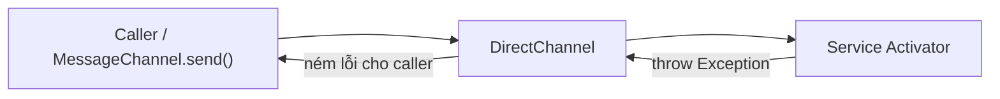
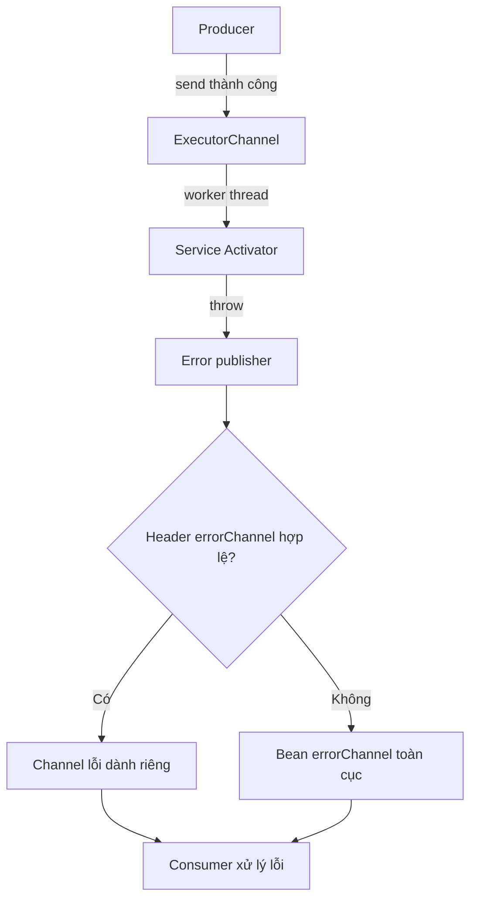

# ErrorMessage và ErrorChannel trong Spring Integration

## 1. Vì sao xử lý lỗi trong message flow khác lời gọi hàm thông thường?

Ở ứng dụng Java thuần, một lời gọi `service.process(order)` phát sinh exception thì caller có thể dùng `try/catch` trên **cùng call stack**. Spring Integration tách producer và consumer bằng `MessageChannel`; khi có `ExecutorChannel`, `QueueChannel` hoặc poller, consumer thường xử lý ở thread khác. Khi đó, bên gửi có thể đã nhận kết quả `send()` thành công từ lâu trước lúc handler gặp lỗi.

Spring Integration giải quyết tình huống này bằng cách chuyển lỗi thành **một message có thể đi qua channel**:

- `ErrorMessage`: kiểu message chuyên mang lỗi; `payload` là một `Throwable`.
- `errorChannel`: tên header quy định nơi gửi lỗi của một message, đồng thời là tên bean của channel xử lý lỗi **toàn cục**.
- Error handler: thành phần bắt exception trong các ngữ cảnh do framework điều phối và xuất bản `ErrorMessage` đến channel thích hợp.
- Error consumer: endpoint nhận `ErrorMessage` để ghi log, đo chỉ số, chuyển hướng, tạo phản hồi nghiệp vụ hoặc kích hoạt quy trình khôi phục.

Bài học nằm trong chương **Error runtime** của module **SPRING_INTEGRATION_RUNTIME**: mục tiêu không chỉ nhận biết hai API, mà còn hiểu **consumer nào ném lỗi**, **thread nào bắt lỗi**, **channel nào thực sự nhận lỗi** và **lỗi đó ảnh hưởng thế nào đến retry, transaction và trạng thái hệ thống**.

> **Quy tắc cần nhớ:** Không phải mọi exception trong ứng dụng Spring đều tự đi vào `errorChannel`. Phải xác định **ranh giới thực thi** và **thành phần Spring Integration chịu trách nhiệm bắt/publish exception**.

## 2. So sánh hai đường đi của lỗi

### Luồng đồng bộ: exception truyền ngược theo call stack



Với `DirectChannel`, consumer thường chạy trên chính thread gửi message. Nếu service activator ném `IllegalStateException`, exception đi ngược về nơi gọi `send()`; caller có thể bắt nó bằng `try/catch`. **Việc gắn header `errorChannel` không tự biến mọi lỗi đồng bộ thành `ErrorMessage`.**

### Luồng bất đồng bộ: gửi một ErrorMessage qua channel



Với `ExecutorChannel`, handler có thể ném lỗi trên thread thuộc pool. Lúc này caller ban đầu **không thể** catch trực tiếp lỗi từ worker bằng `try/catch` bao quanh `send()`. Spring Integration có thể đóng gói exception thành `ErrorMessage` và gửi nó qua error channel.

| Ngữ cảnh | Handler chạy ở đâu? | Hành vi lỗi điển hình | Caller có bắt trực tiếp được? |
| --- | --- | --- | --- |
| `DirectChannel` | Thread của người gửi | Exception đi ngược qua `send()` | Có |
| `ExecutorChannel` | Thread trong `TaskExecutor` | `ErrorMessage` được publish từ tác vụ integration | Thường không |
| `QueueChannel` + poller | Thread chạy poller | Lỗi từ poller task được publish theo cơ chế error handler | Không qua lệnh `send()` trước đó |
| Gateway đồng bộ | Trong luồng request/reply do gateway quản lý | Theo mặc định lỗi được ném về gateway caller; có thể cấu hình gateway error flow | Tùy cấu hình |
| Code `@Async` độc lập / thread tự tạo | Thread không nhất thiết do Spring Integration quản lý | Phụ thuộc error handler của chính tác vụ | Không được mặc định đi qua `errorChannel` |

Việc đổi channel từ `DirectChannel` sang `ExecutorChannel` vì lý do hiệu năng kéo theo thay đổi rất lớn về **ngữ nghĩa lỗi và ranh giới transaction**.

## 3. Cấu trúc của ErrorMessage

`org.springframework.messaging.support.ErrorMessage` triển khai giao diện `Message<Throwable>`. `ErrorMessage` dùng payload là exception; đó là lý do một error consumer có thể xem stack trace và lần ra message gây thất bại.

Các nguồn dữ liệu thường dùng:

| Thuộc tính | Cách truy xuất | Ý nghĩa |
| --- | --- | --- |
| Lỗi | `error.getPayload()` | `Throwable` được công bố qua error channel |
| Message gốc, nếu có | `error.getOriginalMessage()` | Message mà publisher đưa vào ngữ cảnh tạo `ErrorMessage` |
| Message thất bại | `((MessagingException) cause).getFailedMessage()` | Message framework gắn với `MessagingException` |
| Header của ErrorMessage | `error.getHeaders()` | Header của **ErrorMessage**; không tự đồng nhất với header của message gốc |
| Cause sâu bên trong | `throwable.getCause()` | Root exception nghiệp vụ, IO, validation, v.v. |
| Correlation | `original.getHeaders().get("correlationId")` | Nhận diện yêu cầu/nhóm, nếu upstream đã gắn header |

Một số exception sẽ được framework bọc trong `MessagingException`, `MessageHandlingException` hoặc loại `MessagingException` khác. Vì vậy, `error.getPayload()` có thể là một wrapper; dùng `getCause()` để đi đến lỗi nghiệp vụ phù hợp.

```java
import org.springframework.messaging.Message;
import org.springframework.messaging.MessagingException;
import org.springframework.messaging.support.ErrorMessage;

public void inspect(ErrorMessage error) {
    Throwable failure = error.getPayload();

    // Có thể null nếu ErrorMessage do code tự tạo
    // hoặc publisher không có ngữ cảnh message ban đầu.
    Message<?> original = error.getOriginalMessage();

    if (original == null && failure instanceof MessagingException messagingFailure) {
        original = messagingFailure.getFailedMessage();
    }

    String exceptionType = failure.getClass().getSimpleName();
    Object correlationId = original == null
            ? null
            : original.getHeaders().get("correlationId");

    System.out.println("Error type: " + exceptionType);
    System.out.println("Correlation: " + correlationId);
}
```

**Phân biệt `originalMessage` với `failedMessage`:** một flow có nhiều transformer có thể tạo message mới ở mỗi bước. Message do error publisher biết đến, message thất bại mà `MessagingException` giữ và message đầu tiên của request **không luôn là cùng một object**. Nếu cần lần vết end-to-end, chủ động truyền `correlationId` hoặc một `traceId` ổn định, thay vì chỉ dựa vào message ID.

### Tự tạo ErrorMessage khi thực sự cần

Trong một số adapter hoặc cơ chế xử lý tùy biến, ứng dụng có thể chủ động tạo và publish lỗi:

```java
Message<?> request = MessageBuilder.withPayload("order-101").build();
Throwable exception = new IllegalArgumentException("Invalid order");

ErrorMessage error = new ErrorMessage(exception, request);
errorChannel.send(error);
```

Đây là **publish thủ công**. Nó hữu ích khi tự xây adapter/tác vụ ngoài framework, nhưng không nên dùng để vừa publish vừa ném lại exception một cách vô thức, vì có thể báo lỗi hai lần.

## 4. Channel lỗi được chọn bằng cách nào?

Đối với thành phần framework đang publish `ErrorMessage` trong ngữ cảnh bất đồng bộ, thứ tự giải quyết channel phổ biến là:

1. Đọc header `MessageHeaders.ERROR_CHANNEL`, tương đương tên `"errorChannel"`, của message đang được xử lý khi lỗi xảy ra.
2. Nếu message **không có header `errorChannel`**, tìm channel toàn cục có **bean name `errorChannel`**. Header tồn tại nhưng trỏ sai đích có thể làm publish thất bại; không mặc định coi đó là fallback an toàn.
3. Nếu gửi đến channel được chọn thất bại, ví dụ không tìm thấy destination, không có subscriber theo cấu hình bắt buộc hoặc consumer lỗi tiếp, đó là **một lỗi publish/dispatch khác** cần xử lý.

Header có thể trỏ đến một `MessageChannel` hoặc tham chiếu tên channel mà hệ thống có thể resolve. Ví dụ message cần xử lý lỗi riêng theo nghiệp vụ:

```java
import org.springframework.messaging.Message;
import org.springframework.messaging.MessageChannel;
import org.springframework.messaging.MessageHeaders;
import org.springframework.messaging.support.MessageBuilder;

// "orderRequests" và "orderErrors" phải là các bean/channel đã cấu hình.
Message<String> order = MessageBuilder.withPayload("invalid-101")
        .setHeader(MessageHeaders.ERROR_CHANNEL, "orderErrors")
        .setHeader("correlationId", "checkout-101")
        .build();

boolean accepted = orderRequests.send(order);
```

`accepted == true` chỉ xác nhận channel chấp nhận message theo hợp đồng `send()`, **không chứng minh worker đã xử lý thành công**. Trên `ExecutorChannel`, exception có thể xuất hiện sau đó.

Với các flow đi qua adapter, filter, router, gateway hoặc poller, cần kiểm tra header `errorChannel` có được giữ lại/ghi đè hay không và thành phần nào thực sự publish lỗi. Việc chỉ thêm header rồi dùng `DirectChannel` thuần không bảo đảm lỗi tự chuyển sang channel này.

## 5. errorChannel toàn cục: mặc định có gì?

Spring Integration tạo sẵn một channel toàn cục tên **`errorChannel`** khi dùng hạ tầng Integration thông thường. Mặc định, đó là `PublishSubscribeChannel` và có một `LoggingHandler` đăng ký nhận để log lỗi ở mức `ERROR`.

Điều này có một số hệ quả:

- Một `ErrorMessage` có thể được chuyển cho **nhiều subscriber** của `PublishSubscribeChannel`. Không nên hiểu mặc định `errorChannel` là queue có một consumer duy nhất.
- `PublishSubscribeChannel` mặc định dispatch đồng bộ đến subscriber trên thread đang publish, trừ khi nó được cấu hình executor. Xử lý lỗi quá chậm có thể làm chậm worker đang báo lỗi.
- Logging mặc định tạo khả năng quan sát ban đầu; **log không đồng nghĩa đã retry, đã persist hay đã gửi dead-letter queue**.
- Các bản Spring Integration hiện đại đặt `requireSubscribers=true` cho error channel mặc định để tránh im lặng làm mất lỗi khi channel không có subscriber. Một error dispatch thất bại vì không có subscriber có thể làm thay đổi rollback/nack ở inbound adapter, tùy integration cụ thể.

Có thể đăng ký thêm endpoint nhận lỗi toàn cục:

```java
import org.springframework.integration.annotation.MessageEndpoint;
import org.springframework.integration.annotation.ServiceActivator;
import org.springframework.messaging.support.ErrorMessage;

@MessageEndpoint
public class GlobalErrorObserver {

    @ServiceActivator(inputChannel = "errorChannel")
    public void observe(ErrorMessage message) {
        Throwable problem = message.getPayload();
        // Ghi metric / event an toàn, tránh log dữ liệu nhạy cảm.
        System.err.println(problem.getClass().getSimpleName());
    }
}
```

Trong ví dụ này, `GlobalErrorObserver` phải được component scanning phát hiện. Nếu tùy biến bean tên `errorChannel` thành một `QueueChannel`, cách tiêu thụ, độ bền và hành vi khi quá tải **sẽ khác** mặc định; phải cấu hình poller cho consumer đọc queue và quyết định capacity/timeout.

> **Thực hành tốt:** Chỉ override bean `errorChannel` khi có yêu cầu rõ ràng về dispatch, buffering hoặc durability. Khi thêm consumer, không giả định logging và subscriber order luôn giữ hành vi như trước nếu bạn thay thế hoàn toàn channel mặc định.

## 6. Ví dụ hoàn chỉnh: ExecutorChannel và ErrorMessage theo từng message

Tình huống: ứng dụng nhận mã đơn hàng; worker xử lý bất đồng bộ. Mã bắt đầu bằng `invalid-` tạo exception. Lỗi được gửi tới `orderErrors` nhờ header; các message không khai báo header có thể dùng channel lỗi toàn cục.

### 6.1. Cấu hình channel, executor và flow

```java
import org.springframework.context.annotation.Bean;
import org.springframework.context.annotation.Configuration;
import org.springframework.integration.channel.DirectChannel;
import org.springframework.integration.channel.PublishSubscribeChannel;
import org.springframework.integration.config.EnableIntegration;
import org.springframework.integration.dsl.IntegrationFlow;
import org.springframework.integration.dsl.MessageChannels;
import org.springframework.messaging.MessageChannel;
import org.springframework.scheduling.concurrent.ThreadPoolTaskExecutor;

@Configuration
@EnableIntegration
public class OrderFlowConfig {

    @Bean
    public MessageChannel orderRequests() {
        return new DirectChannel();
    }

    @Bean
    public MessageChannel orderErrors() {
        return new PublishSubscribeChannel();
    }

    @Bean
    public ThreadPoolTaskExecutor orderWorkerPool() {
        ThreadPoolTaskExecutor pool = new ThreadPoolTaskExecutor();
        pool.setCorePoolSize(2);
        pool.setMaxPoolSize(4);
        pool.setQueueCapacity(50);
        pool.setThreadNamePrefix("order-worker-");
        return pool;
    }

    @Bean
    public IntegrationFlow orderFlow(
            MessageChannel orderRequests,
            ThreadPoolTaskExecutor orderWorkerPool) {

        return IntegrationFlow.from(orderRequests)
                .channel(MessageChannels.executor(orderWorkerPool))
                .handle(String.class, (orderId, headers) -> {
                    if (orderId.startsWith("invalid-")) {
                        throw new IllegalArgumentException("Order rejected");
                    }

                    System.out.println(
                            "Processed: " + orderId
                            + ", thread: " + Thread.currentThread().getName());
                    return null; // Endpoint một chiều; không sinh reply.
                })
                .get();
    }
}
```

Ở đây, `@EnableIntegration` kích hoạt hạ tầng framework. `orderRequests` là `DirectChannel` đầu vào, nhưng `MessageChannels.executor(...)` chuyển việc thực thi các bước **sau nó** sang `ThreadPoolTaskExecutor`. Spring sẽ quản lý vòng đời `ThreadPoolTaskExecutor` là bean.

Không cần tự viết `try/catch` quanh handler chỉ để chuyển lỗi sang channel: trường hợp exception xảy ra trong tác vụ Spring Integration đã được hỗ trợ bởi cơ chế publish lỗi của framework. Nếu handler **tự bắt rồi nuốt exception**, framework sẽ không nhìn thấy lỗi đó để tự publish.

### 6.2. Endpoint nhận ErrorMessage

```java
import org.slf4j.Logger;
import org.slf4j.LoggerFactory;
import org.springframework.integration.annotation.MessageEndpoint;
import org.springframework.integration.annotation.ServiceActivator;
import org.springframework.messaging.Message;
import org.springframework.messaging.MessagingException;
import org.springframework.messaging.support.ErrorMessage;

@MessageEndpoint
public class OrderErrorEndpoint {

    private static final Logger log =
            LoggerFactory.getLogger(OrderErrorEndpoint.class);

    @ServiceActivator(inputChannel = "orderErrors")
    public void onOrderError(ErrorMessage error) {
        Throwable failure = error.getPayload();

        Message<?> source = error.getOriginalMessage();
        if (source == null && failure instanceof MessagingException messagingException) {
            source = messagingException.getFailedMessage();
        }

        Object correlationId = source == null
                ? null
                : source.getHeaders().get("correlationId");

        log.error("Order failed; correlationId={}; errorType={}",
                correlationId,
                failure.getClass().getSimpleName(),
                failure);
    }
}
```

Đăng ký `OrderErrorEndpoint` trong phạm vi component scan của ứng dụng. `@ServiceActivator` nhận được **đối tượng `ErrorMessage`** (không phải một payload dữ liệu đơn hàng) nên lấy được `Throwable` và ngữ cảnh liên quan. Trong sản phẩm thực tế, có thể thay `log.error` bằng ghi audit event, metric, routing tới lỗi nghiệp vụ hoặc cơ chế dead-letter phù hợp.

### 6.3. Gửi message kiểm chứng

```java
import org.springframework.messaging.MessageChannel;
import org.springframework.messaging.MessageHeaders;
import org.springframework.messaging.support.MessageBuilder;

// Chạy trong ứng dụng khi đã có ApplicationContext.
MessageChannel requests =
        applicationContext.getBean("orderRequests", MessageChannel.class);

requests.send(MessageBuilder.withPayload("invalid-101")
        .setHeader(MessageHeaders.ERROR_CHANNEL, "orderErrors")
        .setHeader("correlationId", "checkout-101")
        .build());

requests.send(MessageBuilder.withPayload("ok-102")
        .setHeader("correlationId", "checkout-102")
        .build());
```

**Kỳ vọng:** Với `invalid-101`, worker ném `IllegalArgumentException`, một `ErrorMessage` được publish vào `orderErrors` và method `onOrderError` ghi sự kiện có `correlationId=checkout-101`. Với `ok-102`, worker ghi log xử lý thành công; không có error message tương ứng.

Đừng kiểm tra bằng `try/catch` quanh `requests.send(...)` để kết luận `invalid-101` thất bại, vì handler đang chạy bất đồng bộ. Thứ tự giữa hai log cũng có thể đổi vì nhiều worker chạy song song.

### 6.4. Thử thay ExecutorChannel bằng DirectChannel

Nếu bỏ dòng:

```java
.channel(MessageChannels.executor(orderWorkerPool))
```

thì endpoint tiếp theo vẫn có thể chạy đồng bộ theo call stack của `orderRequests.send(...)`. Lúc này cùng exception thường sẽ truyền ngược về caller, và error handler của executor **không còn** là nơi chuyển nó thành `ErrorMessage`. Sự khác biệt này là cách thực nghiệm tốt để nhận biết ranh giới lỗi.

## 7. ErrorMessage, gateway và phản hồi lỗi nghiệp vụ

Một `@MessagingGateway` cung cấp API giống phương thức Java cho client. Khi gọi gateway theo request/reply bình thường, Spring Integration mặc định đưa lỗi downstream trở lại gateway và ném exception cho caller. Gateway có thể gỡ lớp `MessagingException` để đưa ra exception nghiệp vụ phù hợp.

Nếu muốn đổi exception thành phản hồi nghiệp vụ (chẳng hạn `OrderReply(accepted=false, ...)`), có thể cấu hình error channel trên gateway:

```java
import org.springframework.integration.annotation.MessagingGateway;

@MessagingGateway(
    defaultRequestChannel = "checkoutRequests",
    errorChannel = "checkoutGatewayErrors")
public interface CheckoutGateway {
    CheckoutReply submit(CheckoutRequest request);
}
```

Một handler trên `checkoutGatewayErrors` có thể chuyển `ErrorMessage` thành `CheckoutReply`, rồi trả message đó theo reply path do gateway thiết lập. **Phải có reply hợp lệ** nếu giao diện yêu cầu return value; chỉ log lỗi mà không trả reply có thể khiến gateway đợi đến thời hạn `replyTimeout` hoặc kết thúc không có kết quả như mong đợi.

Trong luồng gateway **một chiều** (method trả `void`), cấu hình error channel còn có thể được đưa vào header `errorChannel`, nhờ đó lỗi phát sinh sau một `ExecutorChannel` vẫn có đích riêng thay vì dồn về channel toàn cục.

Nếu không khai báo `errorChannel` cho gateway, quy tắc mặc định là lỗi được truyền về caller khi gateway đang quản lý đường request/reply. **Không nên dự đoán hành vi chỉ qua tên channel**: hãy kiểm tra gateway method return type, `replyTimeout`, loại channel ở từng bước và cách error flow tạo reply.

## 8. Poller, scheduler và ErrorMessage

`QueueChannel` chỉ lưu message; nó không tự thực hiện business handler. Một `poller` sẽ chủ động lấy message từ queue rồi gọi consumer. Nếu consumer ném exception trong một scheduled poller task, Spring Integration có cơ chế publish `ErrorMessage` thông qua `MessagePublishingErrorHandler` được dùng bởi `taskScheduler` mặc định.

Ví dụ:

```java
import org.springframework.integration.annotation.MessageEndpoint;
import org.springframework.integration.annotation.Poller;
import org.springframework.integration.annotation.ServiceActivator;

@MessageEndpoint
public class QueueConsumer {

    @ServiceActivator(
        inputChannel = "queuedOrders",
        poller = @Poller(fixedDelay = "1000", maxMessagesPerPoll = "5"))
    public void process(String orderId) {
        if (orderId.startsWith("invalid-")) {
            throw new IllegalStateException("Cannot process " + orderId);
        }
    }
}
```

Ví dụ yêu cầu bean `queuedOrders` là một `QueueChannel` hoặc pollable channel tương đương. `fixedDelay` quyết định khoảng thời gian poll; `maxMessagesPerPoll` là giới hạn số message mỗi lần poll. Các thuộc tính này **không đồng nghĩa** với số lần retry.

Nếu tự thay `taskScheduler` hoặc quản lý tác vụ lịch riêng, cần kiểm tra có còn dùng `MessagePublishingErrorHandler` phù hợp (framework cung cấp bean `integrationMessagePublishingErrorHandler`) hay không. Exception từ `ScheduledExecutorService` hoặc mã `@Async` độc lập **không mặc nhiên** đi vào Spring Integration `errorChannel`.

Trường hợp poller kèm transaction, thứ tự bắt exception, rollback, message acknowledgment, publish lỗi và re-delivery còn phụ thuộc vào advice, transaction manager và inbound source. Không được khẳng định chỉ cần error channel là sẽ retry hoặc rollback thành công.

## 9. Retry, transaction, dead-letter và idempotency

`ErrorChannel` là **cơ chế vận chuyển thông tin lỗi**, không phải một chiến lược khôi phục hoàn chỉnh.

| Nhu cầu | Công cụ/cơ chế liên quan | Điều cần quyết định |
| --- | --- | --- |
| Retry lỗi tạm thời | `RequestHandlerRetryAdvice`, retry policy, backoff | Retry ở bước nào, tối đa mấy lần, lỗi nào được retry |
| Báo lỗi sau khi retry cạn | Recovery callback, ví dụ `ErrorMessageSendingRecoverer` | Gửi lỗi tới channel nào, có cần thông tin request gốc không |
| Rollback dữ liệu | `TransactionInterceptor` / transaction manager phù hợp | Transaction bao phủ chính xác những thao tác nào |
| Lưu lỗi lâu dài | Persistent queue/store, database, broker DLQ | Dữ liệu gì được lưu, retention, truy cập và replay |
| Tránh xử lý lặp | Idempotent receiver, business key, unique constraint | Lặp do retry, replay hay delivery của broker |
| Theo dõi và cảnh báo | Metric, tracing, log, alert | Phân loại severity và ngưỡng báo động |

Ví dụ một message gây lỗi sau khi đã ghi vào database: nếu database transaction đã commit rồi, việc publish `ErrorMessage` **không tự đảo ngược commit**. Tương tự, thêm `ExecutorChannel` cắt ranh giới thread; một transaction đang mở trên producer thread không tự chuyển sang worker thread.

`RequestHandlerRetryAdvice` thường retry ngay quanh một handler trước khi kết thúc bằng recovery callback hoặc ném exception tiếp. Dùng `ErrorMessageSendingRecoverer` khi cần xuất bản lỗi sau khi retry cạn, nhưng phải cấu hình advice và policy rõ ràng. **Đừng để retry của handler và redelivery của broker nhân nhau vô hạn**; nên có giới hạn, idempotency và chiến lược xử lý message không thể phục hồi.

Một error subscriber có thể gửi dữ liệu sang dead-letter destination để xử lý thủ công. Tuy nhiên **`errorChannel` mặc định không phải DLQ bền vững**: channel nội bộ có thể chỉ tồn tại trong memory và không đảm bảo message sống sót qua restart.

## 10. Chiến lược publish lỗi và mở rộng framework

Spring Integration cung cấp một số thành phần chuyên trách:

- `MessagePublishingErrorHandler`: bắt lỗi từ các tác vụ do framework giao và gửi `ErrorMessage` vào message channel; đặc biệt liên quan tới scheduler/poller và executor.
- `ErrorMessagePublisher`: cơ chế chung để publish lỗi, có thể dùng khi xây adapter hoặc chiến lược recovery tùy biến.
- `ErrorMessageStrategy`: tạo `ErrorMessage` từ exception và context.
- `DefaultErrorMessageStrategy`: có thể lấy request message trong context, dùng nó làm `originalMessage`.
- `ErrorMessageExceptionTypeRouter`: phân nhánh các message lỗi dựa trên loại exception, ví dụ tách validation, timeout và lỗi hệ thống.

`DefaultErrorMessageStrategy` có thể sử dụng `ErrorMessageUtils.INPUT_MESSAGE_CONTEXT_KEY` để lấy request message từ `AttributeAccessor`. Đây là lý do `ErrorMessage.getOriginalMessage()` hữu ích trong nhiều flow. Nhưng **không phải mọi error publisher đều có context đầy đủ**, vì thế code xử lý lỗi cần chấp nhận `null`.

Phân luồng lỗi nên dựa trên **lỗi có thể hành động được**:

- Lỗi validation: trả kết quả nghiệp vụ hoặc đưa sang channel không retry.
- Lỗi timeout/IO tạm thời: retry với backoff rồi báo lỗi nếu cạn.
- Lỗi dữ liệu/contract: cách ly, ghi ngữ cảnh và gửi cảnh báo.
- Lỗi cấu hình hoặc mất subscriber: ưu tiên cảnh báo vận hành vì có thể ảnh hưởng nhiều luồng.

Khi triển khai router theo exception type, chú ý loại exception nhận được có thể là `MessageHandlingException` chứa nguyên nhân thật ở `cause`. Hãy quyết định rõ router xử lý wrapper, root cause hay cause chain theo phiên bản/cấu hình; nếu không, toàn bộ lỗi có thể rơi vào một nhánh chung ngoài dự kiến.

## 11. Chẩn đoán runtime: lỗi đến đâu, mất ở đâu?

Khi một flow có lỗi nhưng không thấy handler trên `errorChannel` chạy, hãy kiểm tra theo thứ tự:

1. **Ranh giới thread:** Có `ExecutorChannel` hoặc consumer chạy trong poller task không? Nếu tất cả là `DirectChannel`, exception có thể đã quay về caller theo đường đồng bộ.
2. **Message header:** Message bị lỗi có header `errorChannel` không? Giá trị là reference tới channel hay tên bean có thể resolve? Header này có bị xóa/ghi đè ở transformer/router không?
3. **Ngữ cảnh thực thi:** Exception được ném ra khỏi handler hay đã bị một `try/catch`, advice hoặc interceptor xử lý trước đó?
4. **Channel đích:** Bean tồn tại không, có subscriber không, consumer có yêu cầu poller không? Nếu `PublishSubscribeChannel` được cấp executor tùy biến, có nguy cơ reject task không?
5. **Nội dung ErrorMessage:** `payload` là loại exception nào, `originalMessage` hoặc `failedMessage` có thông tin gì, correlation ID có còn không?
6. **Khả năng dispatch:** Có exception mới trong lúc publish lỗi hoặc trong error subscriber không? Lỗi nội bộ của error flow có đang che khuất lỗi ban đầu không?
7. **Nguồn message:** Hệ thống nguồn (JMS, RabbitMQ, Kafka, HTTP, file poller...) có ack/commit/requeue khác nhau; cần kiểm tra semantics của đúng inbound adapter.

Bảng triệu chứng thường gặp:

| Triệu chứng | Khả năng nguyên nhân | Kiểm chứng |
| --- | --- | --- |
| `send()` ném exception, không thấy ErrorMessage | Luồng chạy đồng bộ qua `DirectChannel` | Log thread hiện tại, thử bắt exception trực tiếp |
| `send()` trả thành công nhưng nghiệp vụ thất bại | Handler chạy ở executor sau thời điểm `send()` | Theo dõi worker thread và consumer error channel |
| Chỉ thấy log lỗi mặc định | Chưa đăng ký consumer riêng, hoặc error gửi vào `errorChannel` toàn cục | Kiểm tra bean channel và subscription |
| Không thấy lỗi trên channel riêng | Header `errorChannel` thiếu, sai tên hoặc không được giữ | In header ở ngay trước handler lỗi |
| ErrorMessage không có original message | Publisher không có context, hoặc ErrorMessage tự tạo | Dùng `MessagingException.failedMessage` khi có; truyền correlation ID |
| Lỗi bị báo nhiều lần | Retry/redelivery, error consumer phát lại, publish thủ công và rethrow | Theo dấu request ID + attempt number |
| Message lỗi biến mất sau restart | Dùng error channel in-memory, không có persistent store/DLQ | Kiểm tra cơ chế lưu trữ và ack của nguồn |
| Lỗi thứ cấp khi ghi log | Error consumer ném exception, subscriber sai kiểu, channel dispatch lỗi | Bắt/log lỗi nội bộ phù hợp; tránh vòng lặp publish |

### Logging và metric có thể hành động được

Nên log có cấu trúc cho mỗi lần lỗi được xử lý:

- `flowId` / component ID, `correlationId` hoặc `traceId`, message ID (nếu có).
- Loại exception, cause chain, thread name, retry attempt và thời điểm xảy ra lỗi.
- Channel đích (`orderErrors` hoặc `errorChannel`), kết quả xử lý lỗi, trạng thái DLQ/replay.
- Metrics: số lỗi theo flow và exception type; lỗi publish thất bại; số lần retry; error subscriber latency; executor queue/rejections; tuổi message chờ xử lý.

Không ghi toàn bộ payload, access token hay dữ liệu cá nhân vào log chỉ để lấy ngữ cảnh. Với message nhạy cảm, log **mã nghiệp vụ đã được phép**, hash/correlation ID hoặc thuộc tính đã được làm sạch.

## 12. Thực hành kiểm chứng

Một bài lab ngắn có thể thực hiện theo chuỗi sau:

1. Chạy ví dụ `orderFlow` và gửi `invalid-101` kèm `errorChannel=orderErrors`; kiểm tra endpoint lỗi nhận đúng `correlationId`.
2. Gửi message lỗi **không có** header `errorChannel`; kiểm tra lỗi đến consumer/logging toàn cục `errorChannel`.
3. Bỏ `ExecutorChannel`, chạy lại message lỗi và dùng `try/catch` quanh `send()` để quan sát hành vi đồng bộ.
4. Đổi handler để tự `catch` rồi chỉ log; xác minh framework không tạo thêm ErrorMessage nếu không có exception thoát ra hoặc logic publish chủ động.
5. Đổi `orderErrors` từ `PublishSubscribeChannel` sang một `QueueChannel` phù hợp và cấu hình poller; quan sát dispatch, backpressure và cách tiêu thụ.
6. Thêm retry có giới hạn cho lỗi tạm thời, tạo lỗi luôn thất bại, kiểm tra chỉ có một hành động cuối cùng sau khi retry cạn và bảo đảm operation idempotent.
7. Mô phỏng error subscriber bị lỗi; ghi nhận kết quả dispatch và ảnh hưởng đến worker, không lặp vô hạn giữa hai error flow.

**Tự hỏi trước khi đưa vào production:** Lỗi này có đến caller hay một message channel? Có bị nuốt ở lời gọi chuyển thread nào không? Ai sở hữu transaction và acknowledgment? Khi lỗi được publish nhưng không có consumer hoặc consumer thất bại, thông tin còn được giữ ở đâu?

## 13. Tổng kết kiến thức cần nhớ

`ErrorMessage` là message chứa `Throwable`, cho phép exception trở thành dữ liệu có thể chuyển qua channel. `errorChannel` vừa là header chỉ đích cho từng message vừa là tên của channel lỗi toàn cục; cơ chế publish mặc định đặc biệt quan trọng trong xử lý bất đồng bộ và poller.

Điểm quyết định thiết kế không nằm ở việc có đặt tên `errorChannel` hay không, mà nằm ở **call stack / thread**, **cách exception được bắt**, **cách channel được resolve** và **hậu quả giao dịch**. Để xây hệ thống bền vững, cần bổ sung retry có giới hạn, thông tin correlation, idempotency, observability và chiến lược lưu/replay phù hợp với message source.

## Tài liệu tham khảo

- [Spring Integration Reference — Error Handling](https://docs.spring.io/spring-integration/reference/error-handling.html)
- [Spring Integration Reference — Messaging Gateways](https://docs.spring.io/spring-integration/reference/gateway.html)
- [Spring Integration Reference — Special Channels](https://docs.spring.io/spring-integration/reference/channel/special-channels.html)
- [Spring Integration Reference — Request Handler Advice](https://docs.spring.io/spring-integration/reference/handler-advice.html)

