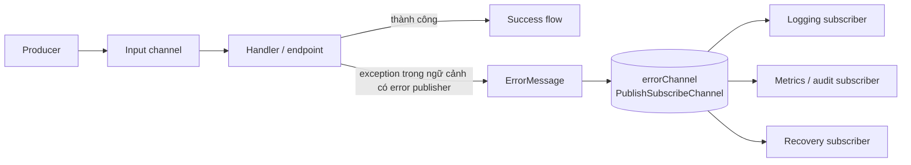
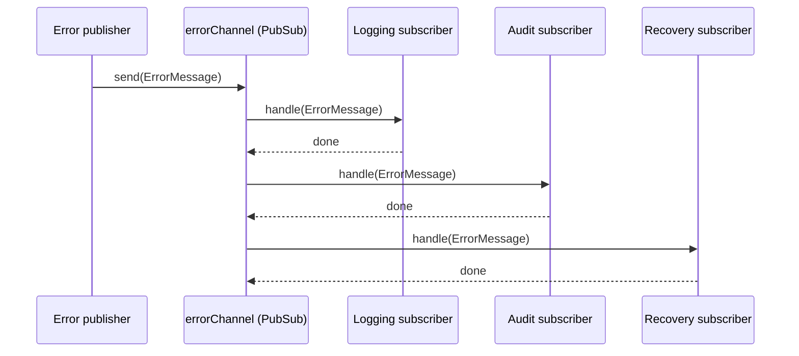
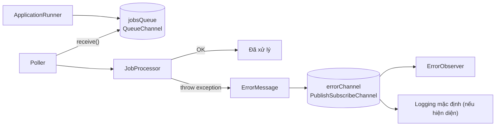
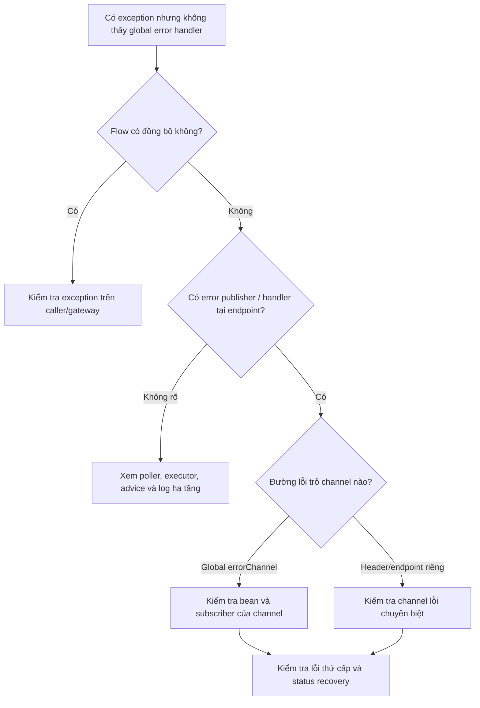

# Default error channel và PublishSubscribeChannel

Trong **Spring Integration runtime**, lỗi xử lý message có thể xảy ra ở handler, converter, router, gateway hoặc khi gọi hệ thống bên ngoài. Để chẩn đoán đúng, cần phân biệt **exception được ném ngược theo call stack** với **lỗi được chuyển thành message để xử lý bởi một error flow**. Spring Integration cung cấp một channel lỗi toàn cục có tên `errorChannel`. Với cấu hình hạ tầng mặc định, channel này là một `PublishSubscribeChannel`: một `ErrorMessage` gửi tới đó có thể được chuyển cho nhiều subscriber.

Bài thuộc chương **Error runtime** và tập trung vào câu hỏi: `errorChannel` mặc định tồn tại khi nào, `PublishSubscribeChannel` phát tán lỗi ra sao, khi nào framework thực sự gửi lỗi đến đó, và cách nối logging, cảnh báo, giám sát hoặc recovery mà không làm lệch semantics của transaction, retry và message delivery.

## 1. Bức tranh tổng thể của error flow

Một message nghiệp vụ có payload và headers. Khi endpoint thất bại, framework có thể tạo một message **mang exception** để một endpoint khác xử lý:



**Giới hạn quan trọng:** mũi tên từ exception sang `ErrorMessage` **không tồn tại một cách vô điều kiện**. Hành vi phụ thuộc endpoint, thread thực thi, error handler, advice và cấu hình. Chẳng hạn, lỗi trên `DirectChannel` đồng bộ thường được ném về bên gửi thay vì tự phát vào `errorChannel` toàn cục; lỗi phát sinh trong polling task hoặc một đoạn flow bất đồng bộ thường được xử lý bởi error handler của ngữ cảnh đó.

Hai con đường phổ biến:

| Ngữ cảnh thực thi | Nơi exception thường xuất hiện | Quan hệ với `errorChannel` |
| --- | --- | --- |
| `DirectChannel` với handler đồng bộ | Call stack đang gọi `send()` hoặc gateway | Thường ném ngược về caller; **không tự chuyển** mọi exception vào global channel |
| `QueueChannel` + polling consumer | Thread do poller/scheduler điều phối | Error handler có thể tạo và gửi `ErrorMessage` tới error channel |
| `ExecutorChannel` hoặc đoạn xử lý giao cho executor | Thread worker | Hạ tầng xử lý lỗi async có thể publish `ErrorMessage`; lỗi khi giao task có thể xuất hiện ngay ở caller |
| Endpoint có error handling riêng | Error handler/advice được cấu hình | Có thể dùng kênh lỗi khác hoặc recovery chuyên biệt |

Vì vậy, nếu một service activator ném exception nhưng subscriber của `errorChannel` không thấy gì, bước đầu tiên là xác định **lỗi đang chạy đồng bộ hay bất đồng bộ** và **ai chịu trách nhiệm bắt exception**.

## 2. `errorChannel` mặc định là gì?

Khi hạ tầng Spring Integration được bật (ví dụ qua `@EnableIntegration` hoặc Spring Boot auto-configuration tương ứng), framework cung cấp **global error channel** dưới tên bean `errorChannel` nếu ứng dụng chưa định nghĩa cách xử lý thay thế. Channel mặc định có dạng `PublishSubscribeChannel`, thường đi kèm một subscriber logging do framework đăng ký.

```text
Spring Integration infrastructure
└── bean: "errorChannel" (PublishSubscribeChannel)
    ├── subscriber mặc định: LoggingHandler (ghi log lỗi)
    ├── subscriber ứng dụng: ErrorAuditHandler (nếu đăng ký)
    └── subscriber ứng dụng: AlertHandler (nếu đăng ký)
```

Điều này mang ba ý nghĩa thực tế:

1. **Tên `errorChannel` là tên kênh được biết đến bởi hạ tầng**; không cần tự tạo channel cho ví dụ đơn giản nếu default configuration đã hoạt động.
2. **Một error message được phát cho các subscriber**, phù hợp với việc vừa ghi log vừa đo metrics, cảnh báo hoặc lưu thông tin phục hồi. Đây không phải hàng đợi phân phối mỗi lỗi cho đúng một consumer.
3. **Channel mặc định không phải kho lưu lỗi bền vững**. Nếu chỉ logging rồi bỏ qua, đó là hành vi quan sát lỗi, chưa phải cơ chế retry hay dead-letter đáng tin cậy.

Không nên nhầm `errorChannel` với channel đầu vào nghiệp vụ, `replyChannel`, hoặc `nullChannel`. `replyChannel` chuyển kết quả thành công; `errorChannel` biểu đạt đường nhận lỗi trong các tình huống có cơ chế publish error. `nullChannel` là điểm nhận để bỏ qua message, không phải hệ thống lưu và xử lý lỗi.

### 2.1. Subscriber logging mặc định

Với global error channel do framework cung cấp, Spring Integration thường đăng ký một `LoggingHandler` để lỗi không bị im lặng khi chưa có handler của ứng dụng. Khi thêm subscriber mới, cần **kiểm tra xem logging subscriber mặc định còn hoạt động hay không** theo phiên bản/cấu hình. Không mặc định rằng handler tự viết sẽ thay thế log mặc định, hoặc log tự động đồng nghĩa đã xử lý lỗi nghiệp vụ.

Nếu ứng dụng **tự định nghĩa bean `errorChannel`** hoặc thay cách cấu hình error infrastructure, subscriber và các thuộc tính dispatch có thể khác mặc định. Khi vận hành, hãy nhìn vào cấu hình thực tế thay vì chỉ dựa trên tên bean.

## 3. `ErrorMessage` mang thông tin nào?

`org.springframework.messaging.support.ErrorMessage` là một `Message<Throwable>`: **payload chính là exception**, không phải payload nghiệp vụ ban đầu.

```java
import org.springframework.messaging.Message;
import org.springframework.messaging.MessagingException;
import org.springframework.messaging.support.ErrorMessage;

void inspect(ErrorMessage errorMessage) {
    Throwable failure = errorMessage.getPayload();
    System.err.println("Error type: " + failure.getClass().getName());
    System.err.println("Reason: " + failure.getMessage());

    Message<?> failedMessage = null;
    if (failure instanceof MessagingException messagingException) {
        failedMessage = messagingException.getFailedMessage();
    }
    if (failedMessage == null) {
        failedMessage = errorMessage.getOriginalMessage();
    }
    if (failedMessage != null) {
        System.err.println("Failed message id: " + failedMessage.getHeaders().getId());
    }
}
```

Cần phân biệt:

| Thành phần | Ý nghĩa | Lưu ý |
| --- | --- | --- |
| `errorMessage.getPayload()` | `Throwable` mô tả lỗi | Có thể là `MessagingException` bao bên ngoài lỗi nghiệp vụ |
| `MessagingException.getFailedMessage()` | Message liên quan đến bước lỗi, nếu có | Có thể `null`; không phải mọi exception đều là `MessagingException` |
| `errorMessage.getOriginalMessage()` | Original message nếu publisher/strategy có cung cấp | Có thể `null`; không phải bảo đảm của mọi flow |
| `errorMessage.getHeaders()` | Headers của **error message** | Không mặc định giống headers của request gốc |
| `failure.getCause()` | Nguyên nhân bên dưới nếu exception được wrap | Có thể cần duyệt chuỗi cause để tìm lỗi gốc |

Ví dụ handler ném `IllegalStateException`, nhưng consumer có thể nhận một `MessageHandlingException` với `IllegalStateException` nằm trong `getCause()`. Khi phân loại lỗi, nên kiểm tra **toàn bộ chuỗi exception**; khi cần correlation, hãy đọc metadata từ message gốc hoặc failed message khi thông tin đó hiện diện.

## 4. Vì sao dùng `PublishSubscribeChannel`?

`PublishSubscribeChannel` triển khai `SubscribableChannel` và gửi cùng message đến **nhiều subscriber** theo cơ chế publish–subscribe. Với `errorChannel`, một lỗi có thể đồng thời phục vụ các mục đích khác nhau:

- **Logging:** ghi exception, endpoint, message ID và correlation key để điều tra.
- **Monitoring:** tăng bộ đếm lỗi theo loại, dịch vụ hoặc consumer.
- **Alerting:** thông báo có chọn lọc khi lỗi vượt ngưỡng nghiêm trọng.
- **Recovery:** lưu failed message vào kho có kiểm soát hoặc kích hoạt quy trình khắc phục thích hợp.



Sơ đồ thể hiện trường hợp **dispatch đồng bộ, không có subscriber nào ném lỗi**. Mặc định, `PublishSubscribeChannel` không cần một executor riêng: các subscriber được gọi trên thread gửi `ErrorMessage`. Nếu cấu hình channel với `TaskExecutor`, việc dispatch có thể chuyển sang thread khác; thứ tự hoàn tất và cách quan sát exception có thể thay đổi.

| Đặc tính | `PublishSubscribeChannel` | `QueueChannel` |
| --- | --- | --- |
| Mô hình consumer | Gửi đến tất cả subscriber đủ điều kiện | Các consumer gọi `receive()` cạnh tranh để lấy message |
| Tốc độ xử lý | Có thể chịu ảnh hưởng subscriber chậm nếu dispatch đồng bộ | Producer/consumer được tách nhịp bằng buffer |
| Khả năng lưu message | Mặc định không lưu bền vững | Có queue; mặc định in-memory, có thể cấu hình store phù hợp |
| Dùng cho global error flow | Cho phép log, metric, alert trên cùng lỗi | Thích hợp nếu chủ đích là phân công xử lý/đệm lỗi, nhưng semantics khác |

**Publish–subscribe không đồng nghĩa “gửi bảo đảm thành công cho mọi subscriber”.** Trong dispatch đồng bộ, exception từ một subscriber có thể ảnh hưởng việc gọi các subscriber khác tùy cấu hình xử lý lỗi của dispatcher. Khi dùng executor, cần kiểm soát cả cơ chế bắt lỗi, queue của executor và shutdown. Đặt nhiều subscriber cũng có nghĩa mỗi subscriber có thể tạo tác dụng phụ riêng; thao tác recovery vì vậy cần idempotent hoặc được điều phối rõ.

### 4.1. `PublishSubscribeChannel` không phải message broker lỗi

Một `ErrorMessage` đã dispatch qua global channel không tự tồn tại để “đọc lại sau” bằng `receive()`. `PublishSubscribeChannel` không phải `PollableChannel`. Khi yêu cầu bắt buộc giữ lại lỗi sau restart, hãy **ghi một bản ghi bền vững** (database, message store hoặc broker ngoài) trong một luồng recovery có kiểm soát, xác định retry policy và theo dõi trạng thái xử lý.

Không thể suy luận có cơ chế `dead-letter queue`, xác nhận xử lý (`ack`) hay `exactly-once` chỉ vì ứng dụng đã có bean `errorChannel`.

## 5. Đăng ký subscriber bằng `@ServiceActivator`

Cách đơn giản để xử lý global error flow là đăng ký một handler trên channel có tên `errorChannel`. Method có thể nhận nguyên `ErrorMessage`:

```java
import org.springframework.integration.annotation.ServiceActivator;
import org.springframework.messaging.Message;
import org.springframework.messaging.MessagingException;
import org.springframework.messaging.support.ErrorMessage;
import org.springframework.stereotype.Component;

@Component
public class ErrorAuditHandler {
    @ServiceActivator(inputChannel = "errorChannel")
    public void record(ErrorMessage errorMessage) {
        Throwable throwable = errorMessage.getPayload();

        Message<?> failed = null;
        if (throwable instanceof MessagingException exception) {
            failed = exception.getFailedMessage();
        }
        if (failed == null) {
            failed = errorMessage.getOriginalMessage();
        }

        String messageId = failed == null
                ? "unknown"
                : String.valueOf(failed.getHeaders().getId());
        Object traceId = failed == null
                ? null
                : failed.getHeaders().get("traceId");

        System.err.printf("messageId=%s traceId=%s error=%s%n",
                messageId, traceId, throwable.getClass().getSimpleName());
        // Ở production: gọi dịch vụ audit/metrics phù hợp.
    }
}
```

Các điểm quan trọng:

1. `@ServiceActivator(inputChannel = "errorChannel")` tạo một consumer endpoint cho channel đó khi Spring Integration khởi tạo context.
2. Vì channel là publish–subscribe, handler này **có thể nhận cùng lỗi với subscriber logging mặc định**, nếu logging subscriber vẫn được đăng ký.
3. `ErrorMessage` đã mang exception trong payload; không cần tự parse payload của message nghiệp vụ mới biết lỗi gì.
4. Handler ví dụ chỉ quan sát lỗi; **không tự làm cho message nghiệp vụ được retry**.
5. Method không trả reply nên không cần khai báo `outputChannel` cho tác vụ audit này.

Trong hệ thống thực, tránh ghi toàn bộ payload/header vào log vì có thể chứa token, thông tin cá nhân hoặc dữ liệu nghiệp vụ nhạy cảm. Dùng message ID, trace/correlation ID và mã lỗi được kiểm soát.

## 6. Ví dụ end-to-end: lỗi từ polling consumer đến global error channel

Ví dụ dưới đây dành cho ứng dụng **Spring Boot (Java 17+) có `spring-boot-starter-integration`**. Ứng dụng tạo `QueueChannel`, gửi hai công việc, trong đó một công việc cố ý thất bại. `@ServiceActivator` với poller lấy message khỏi queue và ném exception. Trong cấu hình polling thông thường của Spring Integration, hạ tầng error handling gửi `ErrorMessage` đến global `errorChannel`; subscriber ở phần dưới nhận thông tin để ghi nhận.



```java
import org.springframework.boot.ApplicationRunner;
import org.springframework.boot.SpringApplication;
import org.springframework.boot.autoconfigure.SpringBootApplication;
import org.springframework.context.annotation.Bean;
import org.springframework.integration.annotation.EnableIntegration;
import org.springframework.integration.annotation.Poller;
import org.springframework.integration.annotation.ServiceActivator;
import org.springframework.integration.channel.QueueChannel;
import org.springframework.messaging.Message;
import org.springframework.messaging.MessagingException;
import org.springframework.messaging.support.ErrorMessage;
import org.springframework.messaging.support.MessageBuilder;
import org.springframework.stereotype.Component;

@SpringBootApplication
@EnableIntegration
public class ErrorFlowDemo {
    public static void main(String[] args) {
        SpringApplication.run(ErrorFlowDemo.class, args);
    }

    @Bean
    QueueChannel jobsQueue() {
        return new QueueChannel(20);
    }

    @Bean
    ApplicationRunner publishSample(QueueChannel jobsQueue) {
        return args -> {
            jobsQueue.send(MessageBuilder.withPayload("JOB-OK")
                    .setHeader("traceId", "trace-ok").build());
            jobsQueue.send(MessageBuilder.withPayload("JOB-FAIL")
                    .setHeader("traceId", "trace-fail").build());
        };
    }
}

@Component
class JobProcessor {
    @ServiceActivator(
        inputChannel = "jobsQueue",
        poller = @Poller(fixedDelay = "300", maxMessagesPerPoll = "2")
    )
    public void process(Message<String> message) {
        String jobId = message.getPayload();
        System.out.println("Working on " + jobId);
        if ("JOB-FAIL".equals(jobId)) {
            throw new IllegalStateException("Simulated downstream failure");
        }
    }
}

@Component
class ErrorObserver {
    @ServiceActivator(inputChannel = "errorChannel")
    public void onError(ErrorMessage error) {
        Throwable throwable = error.getPayload();
        Message<?> failed = error.getOriginalMessage();
        if (throwable instanceof MessagingException messagingException
                && messagingException.getFailedMessage() != null) {
            failed = messagingException.getFailedMessage();
        }

        Object traceId = failed == null
                ? "unknown"
                : failed.getHeaders().get("traceId");
        System.err.printf("Error flow: traceId=%s, type=%s%n",
                traceId, throwable.getClass().getSimpleName());
    }
}
```

Khi chạy, kỳ vọng:

1. Producer đưa `JOB-OK` và `JOB-FAIL` vào `jobsQueue`; lời gọi `send()` chỉ chứng minh queue đã chấp nhận công việc.
2. Poller gọi `receive()` để lấy từng message và gọi `JobProcessor`.
3. `JOB-OK` hoàn tất; `JOB-FAIL` ném lỗi trên thread xử lý của poller.
4. Error handler của polling endpoint publish lỗi dưới dạng `ErrorMessage` đến error channel được chọn. Không có cấu hình riêng trong ví dụ nên điểm nhận thông thường là global `errorChannel`.
5. `ErrorObserver` đọc exception và cố truy lại failed/original message để lấy `traceId`; logging subscriber mặc định có thể cũng ghi lỗi.

Ví dụ minh họa **đường lỗi runtime**, không đưa ra bảo đảm retry, transaction hay durability. Với `QueueChannel` mặc định dùng RAM, message đã lấy ra có thể không còn trong queue sau exception; `ErrorObserver` nhận lỗi cũng không tương đương tự đưa message về queue.

## 7. Error channel riêng theo message hoặc endpoint

Global `errorChannel` là **điểm fallback chung**, không bắt buộc mọi lỗi đều phải đi qua nó. Spring Integration hỗ trợ chọn đường lỗi theo ngữ cảnh, chẳng hạn header `errorChannel` của message hoặc cấu hình error handler của endpoint.

Một message có thể mang header chỉ đến channel xử lý lỗi chuyên biệt:

```java
import org.springframework.messaging.Message;
import org.springframework.messaging.MessageHeaders;
import org.springframework.messaging.support.MessageBuilder;

Message<String> request = MessageBuilder.withPayload("JOB-42")
        .setHeader("traceId", "trace-42")
        .setHeader(MessageHeaders.ERROR_CHANNEL, "orderErrors")
        .build();
```

Nếu cơ chế error publisher của endpoint hỗ trợ đọc error-channel header trên failed/original message, lỗi của message này có thể được gửi tới channel `orderErrors` thay vì global `errorChannel`. Tên channel phải tham chiếu một channel tồn tại và được resolution đúng; có thể cấu hình trực tiếp bằng bean channel thay vì chuỗi tên khi API hỗ trợ.

Ví dụ đăng ký một error channel riêng và consumer của nó:

```java
import org.springframework.context.annotation.Bean;
import org.springframework.context.annotation.Configuration;
import org.springframework.integration.annotation.ServiceActivator;
import org.springframework.integration.channel.PublishSubscribeChannel;
import org.springframework.messaging.support.ErrorMessage;
import org.springframework.stereotype.Component;

@Configuration
class ErrorRoutingConfig {
    @Bean
    PublishSubscribeChannel orderErrors() {
        return new PublishSubscribeChannel();
    }
}

@Component
class OrderErrorHandler {
    @ServiceActivator(inputChannel = "orderErrors")
    public void handle(ErrorMessage message) {
        System.err.println("Order processing failed: "
                + message.getPayload().getMessage());
    }
}
```

**Không nên coi việc đặt header là “bắt được mọi exception”.** Lỗi đồng bộ vẫn có thể được ném trực tiếp về caller; một số nguồn/endpoint có error handling riêng; việc chọn channel và lấy header tùy thuộc publisher cụ thể. Hãy thử nghiệm cả đường success và failure bằng đúng kiểu channel, poller và executor đang dùng.

### 7.1. Chọn global hay channel riêng?

| Trường hợp | Thiết kế gợi ý |
| --- | --- |
| Audit/metrics chung cho toàn bộ ứng dụng | Subscriber của global `errorChannel` |
| Lỗi đơn hàng cần nhóm xử lý riêng | Dedicated `orderErrors`, có thể nhận qua header hoặc cấu hình endpoint |
| Lỗi tạm thời cần retry trước khi báo thất bại | Retry advice/recoverer tại bước xử lý, rồi phát lỗi sau khi đã hết lượt |
| Lỗi dữ liệu cần cách ly để sửa thủ công | Error flow ghi record bền vững và trạng thái xử lý |
| Không được phép làm chậm luồng chính khi cảnh báo | Thiết kế alert bất đồng bộ, kiểm soát overload và lỗi của chính alert subscriber |

## 8. Subscriber lỗi có thể gây ra lỗi thứ cấp

Do global channel mặc định phát tới nhiều subscriber, cần tính đến **failure trong chính error flow**. Ví dụ, một handler audit gọi database bị timeout:

```text
Handler nghiệp vụ thất bại
    -> publish ErrorMessage
        -> errorChannel (PublishSubscribeChannel)
            -> audit subscriber -> database timeout
            -> metrics subscriber
            -> logging subscriber
```

Với dispatch đồng bộ, nếu audit subscriber ném exception, tác động đến các subscriber tiếp theo phụ thuộc cách dispatcher xử lý lỗi và thứ tự đăng ký. `PublishSubscribeChannel` có các tùy chọn liên quan đến xử lý lỗi subscriber (như `ignoreFailures` ở những cấu hình được hỗ trợ), nhưng **bỏ qua lỗi subscriber** không giống như xử lý hay khôi phục lỗi nghiệp vụ gốc.

Gợi ý thiết kế:

- Subscriber **chỉ quan sát** nên ngắn, có timeout và chịu được lỗi tạm thời của hệ thống log/metrics.
- Nếu cần lưu failed message đáng tin cậy, coi bước ghi dữ liệu recovery như một công việc có SLA, retry và xác nhận trạng thái riêng.
- Tránh ném lại rồi tự gửi cùng lỗi vào `errorChannel` liên tục; rất dễ tạo **vòng lặp lỗi** hoặc log storm.
- Khi có nhiều subscriber mang side effect, xác định idempotency key, thứ tự yêu cầu và trách nhiệm khi một subscriber thành công nhưng subscriber khác thất bại.
- Việc dùng executor cho error channel có thể giảm block trên thread publisher, nhưng làm tăng yêu cầu giám sát saturation, lỗi task và shutdown.

Một channel phát tán lỗi phù hợp với **fan-out** quan sát; một cơ chế recovery đáng tin cậy thường cần trạng thái bền vững hoặc hàng đợi riêng để điều phối ai sẽ khắc phục message.

## 9. Tương tác với transaction, retry và message store

Error flow là **một nhánh xử lý khi thất bại**, không mặc nhiên quyết định kết quả giao dịch.

| Thành phần | Câu hỏi cần trả lời | Mối quan hệ với `errorChannel` |
| --- | --- | --- |
| Retry advice | Thử lại bao nhiêu lần, lỗi nào retry, delay/backoff ra sao? | Có thể chỉ publish sau khi cạn retry nếu recoverer được cấu hình phù hợp |
| Transaction interceptor | Bước nhận message và xử lý tài nguyên nào thuộc cùng transaction? | Việc gửi error message không mặc nhiên rollback hay commit tài nguyên |
| `QueueChannel` in-memory | Message có được giữ nếu handler ném lỗi hay tiến trình crash? | Error flow không tự đưa message đã dequeue trở lại queue |
| `MessageStore` hoặc broker bền vững | Có thể khôi phục message qua restart không? | Cần cấu hình persistence, acknowledgment và retry theo khả năng của store/broker |
| Idempotency | Một job chạy lại có tạo tác dụng phụ lặp không? | Recovery phải được thiết kế an toàn khi phát lại message |

Ví dụ thanh toán đã được ghi vào DB nhưng HTTP response thất bại: `ErrorMessage` có thể ghi nhận exception, nhưng hệ thống phải dùng transaction boundary và idempotency để tránh thu tiền hai lần khi retry. Trường hợp source là broker có ack/nack hoặc transaction, **quy tắc khôi phục phải dựa vào adapter và broker đó**, không suy ra từ global channel.

Một cách phân loại xử lý lỗi:

1. **Transient failure** (HTTP 503, timeout ngắn): thử lại có giới hạn, có backoff/jitter nếu cần.
2. **Permanent failure** (schema sai, thiếu thuộc tính bắt buộc): route đến error flow để ghi nhận và sửa dữ liệu; không retry vô hạn.
3. **Unknown/partial failure** (kết quả downstream không rõ): tra cứu trạng thái và dùng idempotency trước khi phát lại.

## 10. Correlation và quan sát runtime

Khi lỗi xuất hiện trên thread khác producer, một log stack trace thiếu ngữ cảnh thường không đủ để lần theo flow. Nên gắn một **correlation key ổn định** cho từng request hoặc nhóm sự kiện và giữ nó qua các bước chuyển đổi message.

Các tín hiệu cần quan sát:

| Nhóm | Tín hiệu | Dùng để phân biệt |
| --- | --- | --- |
| Producer / gateway | `send()` thành công/thất bại; timeout | Message được chấp nhận hay lỗi ngay khi gửi |
| Poller / executor | Số lần poll, backlog, active threads, rejected tasks | Lỗi đang chờ xử lý hay đã chạy trên worker |
| Handler | Endpoint name, handler latency, exception type | Bước nào thất bại |
| Error publisher | Có tạo `ErrorMessage` và gửi tới channel nào không | Exception có được chuyển sang error flow hay không |
| `errorChannel` | Số error message, số subscriber, lỗi subscriber | Lỗi được phát tán và được ghi nhận ra sao |
| Recovery | Số record chờ xử lý lại, số lần retry, trạng thái cuối | Lỗi có được khắc phục thực sự hay chỉ được log |

Chẩn đoán theo thứ tự:



**Đừng dùng “không có log trên `errorChannel`” để kết luận “không có lỗi”.** Có thể lỗi được ném về thread sender, được bắt và trả lỗi qua gateway, đã được retry rồi xử lý thành công, hoặc được đưa tới một channel lỗi riêng. Ngược lại, có log lỗi cũng không bảo đảm dữ liệu đã được khôi phục.

## 11. Các lỗi thiết kế thường gặp

| Sai lầm | Hệ quả | Cách sửa |
| --- | --- | --- |
| Mong `DirectChannel` đồng bộ tự đẩy mọi exception vào global channel | Handler lỗi hoạt động nhưng subscriber `errorChannel` không nhận gì | Bắt exception ở caller/gateway hoặc chủ động thiết kế error publisher |
| Dùng `PublishSubscribeChannel` như một queue để `receive()` | Không có receive semantics | Dùng `PollableChannel`/message store khi thực sự cần buffering |
| Đăng ký hai subscriber rồi nghĩ mỗi lỗi chỉ vào một subscriber | Một lỗi kích hoạt nhiều side effect | Thiết kế fan-out rõ ràng, dùng queue/dispatcher khác nếu cần competing consumers |
| Handler lỗi không kiểm tra `null` của failed/original message | Null pointer khi xử lý Throwable không kèm message | Null-safe và lấy correlation từ nơi có dữ liệu |
| Subscriber alert chậm hoặc ném exception | Có thể chặn error publisher, ảnh hưởng fan-out | Timeout, cách ly và giám sát subscriber |
| Chỉ log `ErrorMessage` rồi coi đã retry | Message hỏng không được khôi phục | Thiết kế retry/recoverer/durable record riêng |
| Đưa lỗi của error flow trở lại cùng `errorChannel` vô hạn | Vòng lặp và log storm | Cô lập lỗi thứ cấp, giới hạn retry, có điểm dừng |
| Tự định nghĩa bean `errorChannel` rồi vẫn giả định có default logger | Không thấy log hoặc thay đổi dispatch | Kiểm tra các subscriber thực tế và thêm logging khi cần |

## 12. Thực hành có thể tự kiểm chứng

### Bài 1 — Đồng bộ so với polling

Tạo hai flow với handler đều ném `IllegalStateException`: một flow dùng `DirectChannel`, flow còn lại dùng `QueueChannel` với `@Poller`. Đăng ký `@ServiceActivator(inputChannel = "errorChannel")`. Với từng flow, ghi nhận:

- Thread gọi `send()`, thread chạy handler và thread chạy error subscriber.
- Caller có nhận exception không?
- Subscriber global error channel có được gọi không?
- Failed/original message và `traceId` có xuất hiện không?

Giải thích tại sao hai flow dùng **cùng một handler lỗi** nhưng điểm quan sát exception lại khác nhau.

### Bài 2 — Fan-out của `PublishSubscribeChannel`

Đăng ký hai handler độc lập trên `errorChannel`: một handler ghi log rút gọn, một handler tăng bộ đếm. Làm phát sinh một lỗi qua polling endpoint. Quan sát mỗi subscriber nhận cùng `ErrorMessage`. Thử cho một subscriber ném exception trong môi trường thử nghiệm và kiểm tra đường lỗi thứ cấp, cách dispatch và thứ tự nhận thực tế.

### Bài 3 — Global và channel lỗi riêng

Tạo `orderErrors` kiểu `PublishSubscribeChannel` và consumer riêng. Với một endpoint có hỗ trợ error channel theo header, gửi message mang `MessageHeaders.ERROR_CHANNEL` chỉ đến `orderErrors`; so sánh với message không có header. Ghi nhận kênh nào thực sự nhận `ErrorMessage`. Giải thích vì sao không thể suy ra quy tắc routing của mọi endpoint chỉ từ tên header.

### Bài 4 — Recovery có kiểm soát

Mô phỏng lỗi HTTP tạm thời và lỗi schema vĩnh viễn. Thiết lập retry giới hạn cho lỗi tạm thời; sau khi hết lượt, ghi một record vào kho phục hồi với `messageId`, `correlationId`, loại lỗi và số lần thử. Kiểm tra khi chạy lại không tạo tác dụng phụ trùng lặp. Mục tiêu là phân biệt **ghi nhận lỗi** với **đã phục hồi message thành công**.

## 13. Câu hỏi tự kiểm tra

1. Channel lỗi toàn cục thường có tên gì và kiểu nào? → `errorChannel`, mặc định dùng `PublishSubscribeChannel` khi hạ tầng Spring Integration cung cấp cấu hình mặc định.
2. Payload của `ErrorMessage` là gì? → Một `Throwable`; message nghiệp vụ lỗi có thể truy qua `MessagingException.getFailedMessage()` hoặc `getOriginalMessage()` khi được cung cấp.
3. Hai subscriber của `errorChannel` có chia đôi số message như competing consumers không? → Không; publish–subscribe phát cùng message tới các subscriber.
4. Lỗi ở `DirectChannel` đồng bộ có chắc được publish lên global `errorChannel` không? → Không; thường exception truyền ngược về caller.
5. Một subscriber global channel đã log lỗi có đồng nghĩa message đã được retry hoặc rollback không? → Không; cần thiết kế transaction, retry và recovery độc lập.
6. Tại sao phải kiểm tra error channel header của message và error handler của endpoint? → Vì chúng có thể quyết định đường đến của lỗi thay vì global fallback.

**Kết luận:** Global `errorChannel` và `PublishSubscribeChannel` tạo một điểm tập trung để **phân phối và quan sát lỗi** trong các ngữ cảnh có cơ chế publish `ErrorMessage`. Muốn error handling đáng tin cậy phải hiểu đường chạy thực tế qua channel, endpoint, poller hoặc executor; kiểm soát exception trong chính error flow; rồi phối hợp thêm retry, transaction, lưu trữ bền vững, correlation và chính sách recovery.
