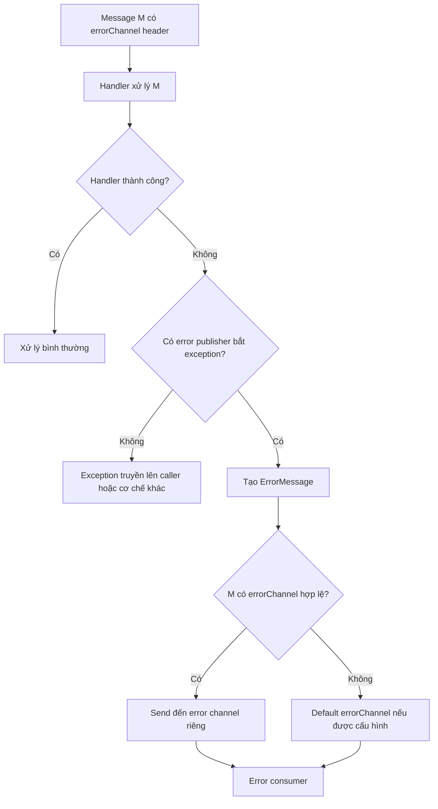
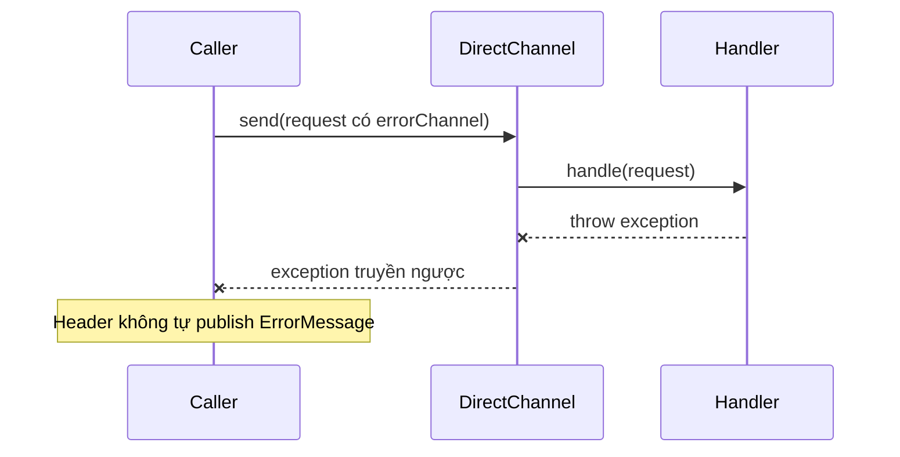
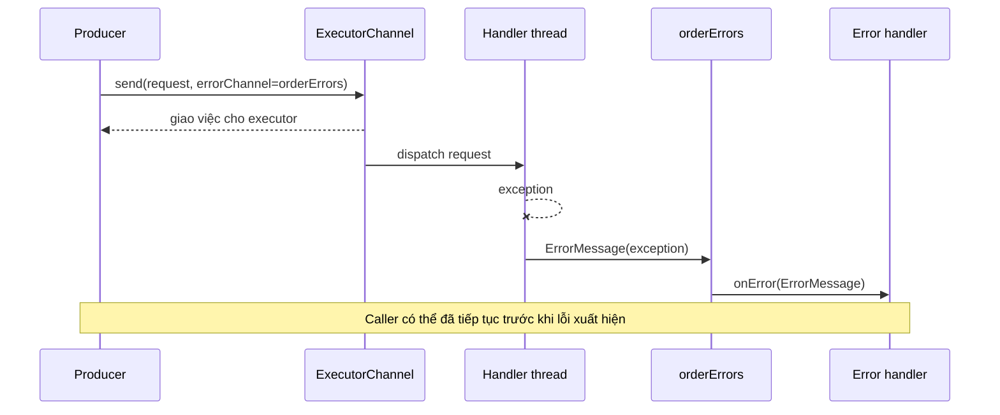

# Header `errorChannel` cho message cụ thể trong Spring Integration

## 1. Mục tiêu và bài toán runtime

Trong `SPRING_INTEGRATION_RUNTIME`, message có thể đi qua channel, endpoint, consumer, poller hoặc executor và thay đổi thread thực thi. Khi handler phát sinh exception, cách xử lý lỗi phụ thuộc vào **vị trí ngoại lệ xuất hiện**, **cơ chế bắt lỗi của endpoint** và **đích nhận lỗi**. Một cơ chế đặc biệt hữu ích là gắn header `errorChannel` vào **từng message** để chỉ định nơi nhận lỗi của riêng lần xử lý đó.

Giả sử cùng một flow `ordersIn` nhận đơn hàng của nhiều nguồn: yêu cầu thông thường muốn lỗi vào `orderErrors` để gửi thông báo, còn yêu cầu kiểm thử muốn lỗi vào `testErrors` để quan sát. Ta không cần tạo hai flow xử lý nghiệp vụ: có thể dùng **cùng input channel và handler**, nhưng mỗi request mang một `errorChannel` phù hợp.

Sau bài này, bạn cần làm được:

- Hiểu header `errorChannel` là địa chỉ nào, được ai đọc, và khác gì so với channel toàn cục có tên `errorChannel`.
- Gắn `MessageHeaders.ERROR_CHANNEL` bằng một đối tượng `MessageChannel` hoặc tên channel.
- Xác định lúc nào exception đi ngược về caller và lúc nào được đóng gói thành `ErrorMessage`.
- Truy tìm `failedMessage`, correlation và dữ liệu ngữ cảnh khi xử lý lỗi bất đồng bộ.
- Thiết kế luồng lỗi riêng cho message mà không làm thất lạc header hoặc làm mất ranh giới transaction.

## 2. Phân biệt header, error message và global channel

| Thành phần | Bản chất | Vai trò |
|---|---|---|
| Header `errorChannel` | Header trên **request message**, khóa `MessageHeaders.ERROR_CHANNEL` (giá trị chuỗi `"errorChannel"`) | Chỉ định địa chỉ xử lý lỗi cho message đó khi hạ tầng bắt lỗi và publish lỗi. |
| Bean/channel tên `errorChannel` | Channel lỗi **mặc định toàn cục** do ứng dụng/Spring Integration cung cấp | Điểm nhận lỗi chung nếu không xác định được kênh lỗi riêng phù hợp và publisher sử dụng fallback mặc định. |
| `ErrorMessage` | Một `Message<Throwable>` đặc biệt | Chứa exception ở payload; có thể giữ liên hệ tới message gây lỗi. |
| `MessagingException.getFailedMessage()` | Message liên quan đến exception, nếu có | Giúp đọc lại payload, header và mã theo dõi của request thất bại. |
| `replyChannel` | Header địa chỉ trả **kết quả bình thường** | Không phải kênh báo lỗi; muốn trả kết quả fallback cần thiết kế riêng. |

**Điểm cốt lõi:** header `errorChannel` chỉ là **chỉ dẫn định tuyến lỗi**. Bản thân việc gắn header không tự biến mọi exception thành `ErrorMessage`, cũng không bảo đảm exception được xử lý nếu không có thành phần bắt lỗi và gửi message lỗi.

Tên header có thể dùng qua constant:

```java
import org.springframework.messaging.MessageHeaders;

String headerName = MessageHeaders.ERROR_CHANNEL; // "errorChannel"
```

Còn `ErrorMessage` thuộc `org.springframework.messaging.support.ErrorMessage`. Đừng nhầm payload `Throwable` bên trong `ErrorMessage` với payload ban đầu của request.

## 3. Header `errorChannel` được áp dụng theo thứ tự nào?

Đối với **cơ chế publish error message của Spring Integration** có khả năng đọc message thất bại (chẳng hạn `MessagePublishingErrorHandler` trong ngữ cảnh xử lý bất đồng bộ), quy trình điển hình là:

1. Một consumer, handler hoặc poller gặp exception.
2. Cơ chế xử lý lỗi bắt exception và tạo `ErrorMessage`. Nếu có message gốc/thất bại, nó được gắn làm ngữ cảnh lỗi.
3. Error publisher tìm **`errorChannel` trong header của failed/request message**.
4. Nếu header xác định được một channel hợp lệ, publisher gửi `ErrorMessage` tới channel đó.
5. Nếu message không cung cấp kênh lỗi riêng, publisher có thể dùng **default error channel**, thông thường là bean có tên `errorChannel`.
6. Consumer của error channel nhận `ErrorMessage` để ghi log, phát cảnh báo, điều phối recovery hoặc thực hiện bù trừ.



**Phạm vi áp dụng quan trọng:** thứ tự trên mô tả cơ chế **message-specific error routing** của error publisher. Một endpoint/gateway có cấu hình xử lý lỗi riêng, một poller dùng custom error handler, hoặc retry/recovery advice có thể quyết định đường đi theo hợp đồng khác. Không nên suy rộng rằng header `errorChannel` luôn được ưu tiên trước mọi cấu hình của mọi component.

Header hỗ trợ hai kiểu giá trị phổ biến:

- **`MessageChannel`:** đối tượng channel thật, dùng trực tiếp trong cùng application context.
- **`String`:** tên channel để framework resolve, thường thông qua bean factory/channel resolver.

Nếu chỉ định tên không tồn tại, channel không có subscriber hoặc gửi message thất bại, **bản thân đường xử lý lỗi có thể thất bại**. Không nên giả định Spring Integration sẽ âm thầm bỏ qua channel lỗi cụ thể rồi chuyển sang global channel trong mọi trường hợp.

## 4. Vì sao ranh giới thread quyết định hành vi lỗi?

### 4.1. Xử lý đồng bộ qua `DirectChannel`

Với `DirectChannel`, lời gọi `send()` thường gọi handler trên **thread của bên gửi**. Nếu handler ném exception, exception thường được chuyển ngược lên call stack của người gọi ngay lúc gửi.



Điều đó có nghĩa: **chỉ gắn `errorChannel` cho request trên `DirectChannel` không có nghĩa exception sẽ tự xuất hiện ở channel lỗi ấy.** Đối với luồng đồng bộ, caller hoặc gateway có thể bắt lỗi trực tiếp; cấu hình xử lý lỗi ở gateway/advice mới thay đổi cách exception được đưa vào error flow.

### 4.2. Xử lý bất đồng bộ qua `ExecutorChannel`

Với `ExecutorChannel`, bên gửi thường giao request cho executor rồi tiếp tục, còn handler chạy trên thread khác. Exception trong handler không thể tự truyền ngược về stack đã rời đi của caller. Đây là lúc cơ chế `MessagePublishingErrorHandler` hữu ích: ngoại lệ được chuyển thành `ErrorMessage` và gửi đến kênh lỗi liên quan.



Tương tự, một `QueueChannel` với polling consumer thường xử lý request ở vòng poll khác thread gửi. Tuy nhiên, **poller phải được cấu hình và chạy**, error handler của poller phải publish lỗi theo cơ chế phù hợp, và message thất bại phải còn đủ thông tin header.

| Cấu trúc | Lỗi có thể xuất hiện ở đâu? | Vai trò của header `errorChannel` |
|---|---|---|
| `DirectChannel → handler` | Trực tiếp trên stack của caller | Không tự thay thế exception đồng bộ bằng `ErrorMessage`. |
| `ExecutorChannel → handler` | Thread executor sau khi enqueue/dispatch | Có thể được error publisher đọc để gửi `ErrorMessage` về kênh riêng của request. |
| `QueueChannel → polling consumer` | Thread poller sau khi dequeue | Phụ thuộc cơ chế bắt/publish lỗi của polling endpoint và ngữ cảnh message. |
| Nguồn scheduled task không có request message | Thread scheduler/poller | Có thể không có failed message chứa header riêng; sử dụng cấu hình của task/poller hoặc default. |

Một lỗi phát sinh **trước** khi giao được việc cho executor, chẳng hạn task bị từ chối vì pool/queue đầy, cũng có thể được trả trực tiếp từ bước gửi. Luôn xác định lỗi ở **giai đoạn gửi**, **giai đoạn handler chạy**, hay **giai đoạn gửi ErrorMessage**.

## 5. Ví dụ thực hành: lỗi của từng order đi vào channel được chỉ định

Ví dụ chạy trong một ứng dụng Spring có dependency `spring-integration-core`. Đặt các lớp dưới đây trong cùng package `example.integration`. Ta dùng `ExecutorChannel` để tạo ranh giới thread rõ ràng; handler xử lý đơn trả `void` vì ví dụ chỉ quan tâm tới **error routing**, không cần normal reply.

### 5.1. Khai báo input channel, error channel và executor

```java
package example.integration;

import org.springframework.context.annotation.Bean;
import org.springframework.context.annotation.ComponentScan;
import org.springframework.context.annotation.Configuration;
import org.springframework.integration.channel.DirectChannel;
import org.springframework.integration.channel.ExecutorChannel;
import org.springframework.integration.config.EnableIntegration;
import org.springframework.messaging.MessageChannel;
import org.springframework.scheduling.concurrent.ThreadPoolTaskExecutor;

@Configuration
@EnableIntegration
@ComponentScan(basePackageClasses = OrderHandlers.class)
public class ErrorFlowConfig {

    @Bean
    public ThreadPoolTaskExecutor orderExecutor() {
        ThreadPoolTaskExecutor executor = new ThreadPoolTaskExecutor();
        executor.setCorePoolSize(2);
        executor.setMaxPoolSize(4);
        executor.setQueueCapacity(50);
        executor.setThreadNamePrefix("order-flow-");
        return executor;
    }

    @Bean("ordersIn")
    public MessageChannel ordersIn(ThreadPoolTaskExecutor orderExecutor) {
        return new ExecutorChannel(orderExecutor);
    }

    @Bean("orderErrors")
    public MessageChannel orderErrors() {
        return new DirectChannel();
    }
}
```

`ThreadPoolTaskExecutor` được Spring khởi tạo theo lifecycle bean. `ordersIn` nhận các request thông thường và chuyển handler sang thread của executor. `orderErrors` là channel chuyên nhận lỗi của request được đánh dấu.

### 5.2. Handler nghiệp vụ và handler xử lý lỗi

```java
package example.integration;

import org.springframework.integration.annotation.MessageEndpoint;
import org.springframework.integration.annotation.ServiceActivator;
import org.springframework.messaging.Message;
import org.springframework.messaging.MessagingException;
import org.springframework.messaging.support.ErrorMessage;

@MessageEndpoint
public class OrderHandlers {

    @ServiceActivator(inputChannel = "ordersIn")
    public void validateOrder(String orderId) {
        if (orderId.startsWith("BAD-")) {
            throw new IllegalArgumentException("Invalid order: " + orderId);
        }
        // Thành công: ví dụ chỉ xử lý một chiều, không cần reply.
    }

    @ServiceActivator(inputChannel = "orderErrors")
    public void handleOrderError(ErrorMessage errorMessage) {
        Throwable failure = errorMessage.getPayload();

        Message<?> failed = failure instanceof MessagingException
                ? ((MessagingException) failure).getFailedMessage()
                : errorMessage.getOriginalMessage();

        Object traceId = failed == null
                ? "unknown"
                : failed.getHeaders().getOrDefault("traceId", "unknown");

        System.err.println("traceId=" + traceId
                + ", error=" + failure.getMessage());
    }
}
```

Ở luồng lỗi này, **error message** được gửi tới `orderErrors`, còn `traceId` đến từ **failed message** nếu exception mang thông tin về message thất bại. Trong sản phẩm thật, thay `System.err` bằng logger hoặc công cụ observability có cấu trúc; chỉ log thông tin không nhạy cảm.

### 5.3. Gắn `errorChannel` cho request cụ thể

Ví dụ bên dưới chạy từ thành phần đang có `ApplicationContext context`:

```java
import org.springframework.context.ApplicationContext;
import org.springframework.messaging.Message;
import org.springframework.messaging.MessageChannel;
import org.springframework.messaging.MessageHeaders;
import org.springframework.messaging.support.MessageBuilder;

MessageChannel ordersIn =
        context.getBean("ordersIn", MessageChannel.class);
MessageChannel orderErrors =
        context.getBean("orderErrors", MessageChannel.class);

Message<String> request = MessageBuilder.withPayload("BAD-42")
        .setHeader(MessageHeaders.ERROR_CHANNEL, orderErrors)
        .setHeader("traceId", "T-42")
        .build();

boolean accepted = ordersIn.send(request);
System.out.println("accepted=" + accepted);
```

**Điều mong đợi:** `send()` chấp nhận request để chuyển cho executor, method `validateOrder()` sau đó ném `IllegalArgumentException`; hạ tầng đóng gói lỗi vào `ErrorMessage` và handler trên `orderErrors` nhận được lỗi, có thể tìm lại `traceId = T-42`.

Đừng đồng nhất `accepted == true` với xử lý nghiệp vụ thành công. Nó chỉ cho biết bước gửi message đã được chấp nhận theo hợp đồng của channel. Nếu executor hoặc hệ thống ngừng trước khi chạy handler, hoặc error publishing gặp lỗi, quan sát sẽ khác.

Có thể dùng **tên bean** thay cho đối tượng channel:

```java
Message<String> request = MessageBuilder.withPayload("BAD-42")
        .setHeader(MessageHeaders.ERROR_CHANNEL, "orderErrors")
        .setHeader("traceId", "T-42")
        .build();
```

Cách dùng chuỗi thuận tiện hơn khi message đi qua ranh giới serialize, nhưng **tên channel phải resolve được tại nơi publish lỗi**. Chuỗi `"orderErrors"` không tự tạo channel mới.

### 5.4. Hai request, hai kênh lỗi khác nhau

Cùng một handler có thể nhận:

```text
Request A: payload=BAD-42, errorChannel=orderErrors, traceId=A
Request B: payload=BAD-99, errorChannel=testErrors,  traceId=B
```

Nếu `testErrors` tồn tại và có error consumer, lỗi A và lỗi B sẽ đi vào **hai điểm xử lý khác nhau**. Đây là routing theo từng message, không phải routing cứng theo từng handler. Khi dùng nhiều channel, cần đăng ký bean và consumer tương ứng cho từng đích.

## 6. ErrorMessage chứa những gì?

`ErrorMessage` là một `Message<Throwable>`, không phải chuỗi thông báo lỗi. Khi xử lý, thông thường cần phân biệt ba lớp dữ liệu:

1. **`errorMessage.getPayload()`:** exception đang được báo cáo; có thể là `MessageHandlingException` hoặc một `MessagingException` khác có nguyên nhân gốc.
2. **`((MessagingException) throwable).getFailedMessage()`:** message liên quan trực tiếp đến exception nếu publisher/handler đã gắn nó.
3. **`errorMessage.getOriginalMessage()`:** message ngữ cảnh gốc nếu chiến lược dựng `ErrorMessage` đã cung cấp.

Không phải mọi exception đều chứa `failedMessage`. Không phải mọi `ErrorMessage` đều có `originalMessage`. Trước khi ghi log hoặc trích header, luôn kiểm tra `null` và xem **chuỗi nguyên nhân** của exception khi cần phân tích lỗi thật.

Ví dụ hàm phụ để tìm nguyên nhân sâu nhất:

```java
private static Throwable rootCause(Throwable error) {
    Throwable current = error;
    while (current.getCause() != null && current.getCause() != current) {
        current = current.getCause();
    }
    return current;
}
```

**Trace và correlation:** `traceId` ở ví dụ là header nghiệp vụ do ứng dụng tự tạo. Header `correlationId` trong splitter/aggregator có ngữ nghĩa riêng; header `errorChannel` chỉ là địa chỉ nhận lỗi. Không dùng địa chỉ channel thay cho mã correlation khi đo đạc, tìm kiếm log hay ghép kết quả.

## 7. Header đi qua flow như thế nào và khi nào bị mất?

Nhiều endpoint chuẩn của Spring Integration chuyển tiếp request header phù hợp sang message đầu ra. Nhưng việc giữ header không phải một bảo đảm tuyệt đối xuyên qua mọi loại adapter, transformer, bộ lọc header, chuyển đổi định dạng và broker bên ngoài.

Ví dụ một bước tự tạo message rồi vô tình bỏ các header:

```java
Message<String> transformed = MessageBuilder
        .withPayload("normalized-" + incoming.getPayload())
        .build();
// Chỉ tạo payload mới; không chủ động sao chép errorChannel/traceId.
```

Nếu muốn giữ các header phù hợp trong code tự dựng message:

```java
Message<String> transformed = MessageBuilder
        .withPayload("normalized-" + incoming.getPayload())
        .copyHeadersIfAbsent(incoming.getHeaders())
        .build();
```

Hai snippet trên giả định `incoming` là một `Message<String>`. Trong thực tế, Spring Integration có thể tự bổ sung hoặc truyền header tại một số endpoint; cần nhìn **message sau ranh giới endpoint** trước khi kết luận header đã mất.

**Ranh giới transport:** giá trị `MessageChannel` là đối tượng nội bộ của JVM. Nếu message phải đi qua hệ thống lưu trữ, broker hoặc tiến trình khác, không nên mặc định có thể serialize đối tượng channel và dùng lại sau restart. Có thể sử dụng `HeaderChannelRegistry` và cơ chế chuyển channel header sang chuỗi khi kiến trúc hỗ trợ, hoặc thiết kế error destination bên nhận một cách tường minh.

**Thời gian sống:** một channel tạm, tên channel ánh xạ qua registry, hoặc instance ứng dụng cũ có thể hết hạn trước khi xử lý xong lỗi. Với message lưu lâu hoặc retry trễ, phải xác định cách phục hồi destination và chính sách đối với lỗi đến muộn.

## 8. Phân biệt header `errorChannel` với gateway `errorChannel`

Spring Integration có **messaging gateway** để nối lời gọi Java đồng bộ với message flow. Gateway có thể cung cấp cơ chế cấu hình error channel riêng; đừng nhầm cấu hình ấy với việc đặt một header cho message từ bất kỳ producer nào.

- **Request bình thường:** `replyChannel` của gateway đưa kết quả nghiệp vụ về lời gọi Java.
- **Ngoại lệ đồng bộ:** nếu không có cơ chế chuyển lỗi riêng, exception có thể quay thẳng về caller.
- **Gateway có error flow:** tùy cấu hình gateway, lỗi có thể được chuyển thành `ErrorMessage` cho error flow, và kết quả của error flow có thể được biến thành phản hồi/fallback theo hợp đồng gateway.
- **Header của message:** được cơ chế publish lỗi tương ứng dùng làm địa chỉ khi nó đang xử lý một thất bại gắn với request đó.

Một handler `void handleError(ErrorMessage error)` chỉ ghi log **không tự tạo reply** cho lời gọi gateway đang đợi. Nếu yêu cầu là “khách hàng nhận kết quả fallback”, cần thiết kế riêng hướng **error → recovery result → reply** và kiểm thử timeout/correlation. Nếu yêu cầu là “ghi nhận lỗi sau khi xử lý bất đồng bộ”, error handler một chiều như ví dụ ở trên phù hợp hơn.

## 9. Retry, transaction và recovery thay đổi điều gì?

Khi kết hợp với `RequestHandlerRetryAdvice` hoặc advice chain, exception có thể được **retry ngay trong endpoint**. Vì vậy, `ErrorMessage` không nhất thiết được publish ở lần lỗi đầu tiên. Nếu retry cuối cùng thành công, flow có thể không gửi lỗi; nếu hết lần thử và advice ném lại exception, lỗi mới đến cơ chế publish error của ranh giới tương ứng. Một recovery callback có thể xử lý lỗi mà không ném lại, dẫn đến đường đi khác.

Với transaction:

- Exception ném trong transaction có thể đánh dấu transaction rollback **nếu** còn trong phạm vi giao dịch đang hoạt động và cấu hình rollback phù hợp.
- Một error consumer chạy ở **thread khác** hoặc ngoài transaction ban đầu không tự động tham gia cùng transaction.
- “ErrorMessage đã được nhận” không đồng nghĩa transaction nghiệp vụ đã rollback, retry thành công hay dữ liệu đã được bù trừ.

Khi thiết kế recovery, cần xác định rõ trạng thái cuối của message: thất bại đã ghi log, đã retry, đã chuyển dead-letter, đã tạo response lỗi hay đã được bù trừ. Đừng dùng mỗi việc “có message đến error channel” làm bằng chứng xử lý lỗi toàn diện.

## 10. Chẩn đoán khi header có nhưng lỗi đi sai chỗ

| Triệu chứng | Khả năng cần kiểm tra | Thao tác chẩn đoán |
|---|---|---|
| Gắn `errorChannel` nhưng exception vẫn ném về caller | Handler chạy đồng bộ qua `DirectChannel`; không có error publisher chuyển exception thành `ErrorMessage`. | Xác định thread của handler và nơi bắt exception; thử flow async có kiểm soát. |
| Lỗi vào global `errorChannel` | Message gây lỗi không còn header riêng, lỗi không gắn failed message hoặc publisher dùng default. | Log header tại consumer gây lỗi; xem `MessagingException.getFailedMessage()`. |
| Không có message ở error consumer | Đã chọn channel sai, không có subscriber, channel gửi thất bại, retry vẫn đang diễn ra hoặc lỗi đã được recovery. | Kiểm tra bean name, subscriber, advice chain và log của error publisher. |
| `traceId` biến mất | Header không được truyền qua transformer, adapter hoặc transport. | Kiểm tra header ở từng ranh giới; xem quy tắc sao chép và serialization. |
| Reply của gateway timeout dù error handler đã ghi log | Error consumer xử lý một chiều, không tạo reply cho gateway. | Kiểm tra contract của gateway và error flow có trả fallback hợp lệ không. |
| Lỗi thứ cấp khi đang xử lý lỗi | Error consumer cũng ném exception hoặc kênh lỗi bị tắc. | Đơn giản hóa error consumer, log riêng lỗi thứ cấp, tránh vòng lặp xử lý lỗi. |

Trình tự điều tra nên là: **(1)** xác định thread và endpoint lỗi, **(2)** xác định thành phần nào bắt exception, **(3)** xem `failedMessage`/header ngay tại thời điểm publish, **(4)** xác định channel lỗi được resolve, **(5)** kiểm tra consumer nhận `ErrorMessage`, **(6)** đối chiếu retry, timeout và transaction.

Có thể dùng wire tap, channel interceptor, log có correlation/trace ID và metric trên channel/handler để ghép timeline. Hạn chế log payload, thông tin bí mật hoặc nguyên exception chứa dữ liệu nhạy cảm.

## 11. Bài thực hành tự kiểm chứng

Bắt đầu từ ví dụ `ErrorFlowConfig` và `OrderHandlers`:

1. Gửi `BAD-42` với header `errorChannel = orderErrors`; xác nhận error handler có thể lấy lại `traceId = T-42`.
2. Gửi `OK-42` với cùng header; handler hoàn tất và **không** tạo `ErrorMessage`.
3. Gửi `BAD-43` **không** có `errorChannel`; quan sát cách default global `errorChannel` xử lý (và đăng ký error consumer thích hợp nếu cần).
4. Đổi `ordersIn` từ `ExecutorChannel` sang `DirectChannel`; gọi `send()` trong `try/catch`. Giải thích vì sao đường đi của exception thay đổi.
5. Đặt header `errorChannel` bằng một tên bean không tồn tại; đối chiếu exception của business handler với lỗi phát sinh **khi định tuyến lỗi**.
6. Thêm một bước biến đổi message có và không sao chép header; ghi lại header ngay trước handler cuối để xác định chính xác lúc context bị mất.
7. Nếu hệ thống có retry, đặt số lần thử hữu hạn rồi kiểm tra số lần handler được gọi trước khi có `ErrorMessage`.

Với mỗi ca, ghi ít nhất: **thread**, **channel nhận request**, **header `errorChannel` tại thời điểm handler chạy**, **exception được bắt ở đâu**, **channel nhận `ErrorMessage`** và **trạng thái transaction/retry nếu có**. Những quan sát này giúp phân biệt lỗi định tuyến với lỗi nghiệp vụ.

## 12. Quy tắc thiết kế cần nhớ

- Gắn `MessageHeaders.ERROR_CHANNEL` khi **từng message cần tuyến xử lý lỗi riêng**; có thể dùng `MessageChannel` hoặc tên channel.
- Header chỉ có tác dụng khi cơ chế xử lý lỗi **publish được `ErrorMessage`** và có đủ ngữ cảnh message; exception đồng bộ thường đi thẳng về caller.
- Error consumer nhận **`ErrorMessage`**, payload của nó là **`Throwable`**. Đọc failed message nếu có để lấy header và correlation.
- Bảo toàn header khi qua transformer, queue, adapter, broker hoặc message store; đặc biệt kiểm tra ranh giới JVM và vòng đời channel.
- Kiểm tra retry, transaction, timeout và chính sách trả fallback **riêng biệt**. Error message được gửi thành công chưa đồng nghĩa caller đã nhận phản hồi hoặc nghiệp vụ đã được khôi phục.

### Tài liệu tham khảo

- [Spring Integration Reference — Error Handling](https://docs.spring.io/spring-integration/reference/error-handling.html): `ErrorMessage`, `errorChannel`, phân biệt lỗi đồng bộ/bất đồng bộ.
- [Spring Integration Reference — ExecutorChannel](https://docs.spring.io/spring-integration/reference/channel/implementations.html): channel có executor và ảnh hưởng đến thread xử lý.
- [Spring Integration Reference — Messaging Gateways](https://docs.spring.io/spring-integration/reference/gateway.html): reply/error flow ở ranh giới lời gọi Java.
- [Spring Integration Reference — Retry Advice](https://docs.spring.io/spring-integration/reference/handler-advice/classes.html): advice, retry và recovery cho handler.
