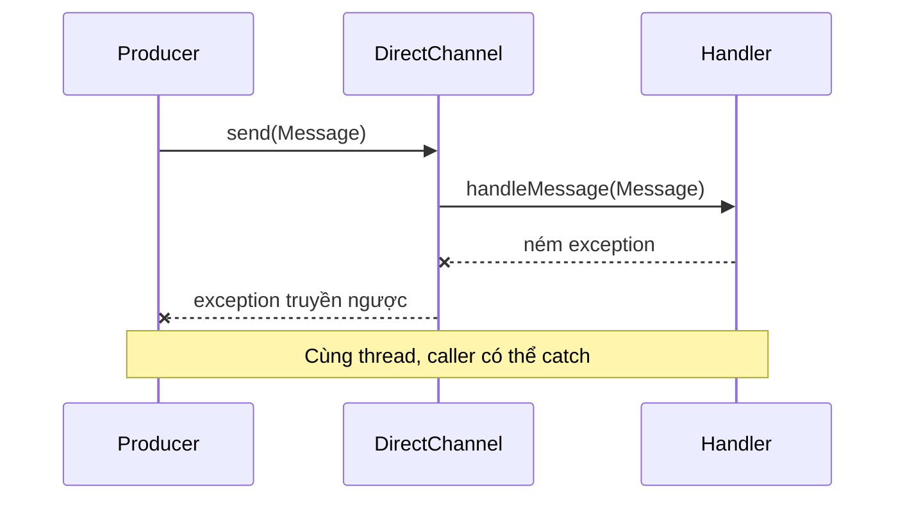
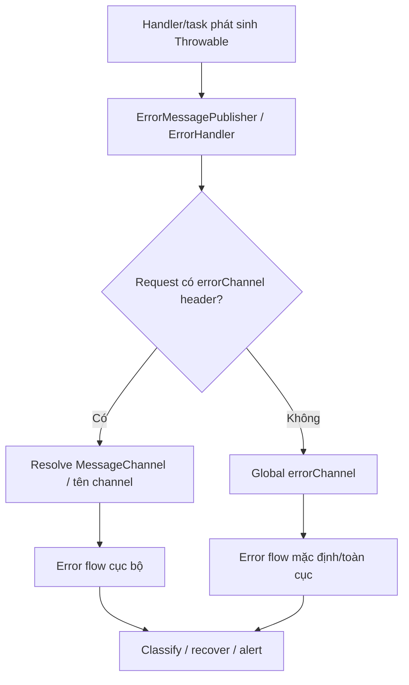
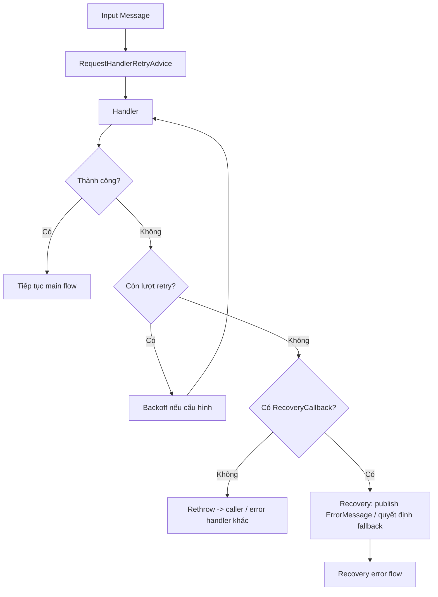

# Error flow và handler xử lý exception trong Spring Integration

## Mục tiêu bài học

Spring Integration điều phối message qua channel, endpoint, consumer, poller và executor. Khi một handler ném exception, cách lỗi xuất hiện tùy thuộc **thread đang xử lý**, loại endpoint và cơ chế xử lý lỗi được cấu hình. Trong module **SPRING_INTEGRATION_RUNTIME**, chương **Error runtime** tập trung vào cách biến sự cố thành một nhánh message flow có thể quan sát, định tuyến và khôi phục.

Sau bài này, bạn có thể:

- Giải thích sự khác biệt giữa exception được ném trực tiếp cho caller và lỗi được đóng gói thành `ErrorMessage`.
- Theo dõi cách runtime chọn `errorChannel` từ message header hoặc kênh global.
- Xây dựng handler xử lý lỗi và router theo loại exception, tránh bỏ sót hoặc xử lý trùng.
- Phối hợp error flow với retry, recovery, transaction, poller, executor, message store và correlation.
- Kiểm thử cả đường đồng bộ lẫn bất đồng bộ, đồng thời tìm nguyên nhân khi lỗi không đến kênh mong đợi.

Ví dụ sử dụng cú pháp Spring Integration Java configuration và Java 17+, phù hợp để học các API của nhánh Spring Integration 6.x. Một số chi tiết mặc định thay đổi giữa các phiên bản; khi triển khai thực tế cần đối chiếu phiên bản thư viện đang dùng.

## 1. Hai cách một exception rời khỏi message flow

Giả sử service activator xử lý đơn hàng:

```java
@ServiceActivator(inputChannel = "orders")
public void persist(String orderId) {
    if (orderId.startsWith("BAD")) {
        throw new IllegalArgumentException("Invalid order: " + orderId);
    }
    // Ghi đơn hàng vào cơ sở dữ liệu.
}
```

Có hai đường xử lý lỗi thường gặp.

### 1.1. Luồng đồng bộ: exception đi ngược call stack



Với `DirectChannel` mặc định, handler thường chạy ngay trên thread gửi. Nếu handler ném exception mà không có cơ chế bắt hoặc recovery khác, lời gọi `send()` nhận exception. **Chỉ đặt header `errorChannel` trên message không đủ để tự động chuyển lỗi đồng bộ sang kênh đó.** Khi cần chuyển cách xử lý, phải cấu hình một điểm bắt lỗi thích hợp, chẳng hạn gateway error flow hoặc advice có recovery.

### 1.2. Luồng bất đồng bộ: exception được gửi dưới dạng message

```mermaid
sequenceDiagram
    participant P as Producer
    participant Q as QueueChannel
    participant X as Poller / TaskExecutor
    participant H as Handler
    participant E as Error channel
    participant EH as Error handler
    P->>Q: send(Message)
    Q-->>P: nhận vào queue
    X->>Q: poll()
    Q-->>X: Message
    X->>H: handleMessage(Message)
    H--xX: ném exception
    X->>E: publish ErrorMessage
    E->>EH: handle(ErrorMessage)
    Note over P,EH: Caller đã rời send(); lỗi được xử lý ở nhánh riêng
```

Nếu lỗi xảy ra trong một tác vụ do framework quản lý qua `TaskExecutor` hoặc poller có error handler phù hợp, runtime có thể tạo `ErrorMessage` rồi gửi tới kênh xử lý lỗi. `ErrorMessage` có payload là `Throwable`. Caller của `send()` không trực tiếp bắt được lỗi xuất hiện sau đó trong thread khác.

Điều cần tránh là suy luận rằng **mọi** executor, thread tự tạo hoặc client ngoại vi đều tự phát `ErrorMessage`. Cơ chế đó phải được thành phần sinh/nhận message hoặc tác vụ của Spring Integration hỗ trợ và cấu hình.

### Bảng quyết định nhanh

| Bối cảnh | Lỗi thường được quan sát ở đâu? | Hướng xử lý |
|---|---|---|
| `DirectChannel`, handler ném lỗi | Caller của `send()` / gateway | Bắt exception ở boundary hoặc cấu hình gateway/advice. |
| `ExecutorChannel`, tác vụ được framework quản lý | Nhánh xử lý lỗi của executor/dispatcher | Kiểm tra `errorChannel` header, error handler và subscriber. |
| `QueueChannel` với poller | Error handler của poller/task scheduler | Đọc `ErrorMessage` tại kênh lỗi và kiểm tra cấu hình poller. |
| Inbound adapter nhận từ JMS/AMQP/Kafka | Adapter/container/broker cùng error flow tùy cấu hình | Xác định rõ ack, nack, rollback, redelivery, DLQ. |
| Handler tự tạo `new Thread(...)` rồi ném lỗi | Thread mới hoặc `UncaughtExceptionHandler` | Bổ sung cơ chế bắt/publish lỗi riêng; framework không tự phát hiện mọi thread tùy ý. |
| Lỗi ở error handler | Exception thứ cấp tại nhánh lỗi | Thiết kế nhánh lỗi đơn giản, có fallback và giám sát. |

**Thông điệp chính:** `errorChannel` là một phần của **message-based error handling**, chứ không phải cơ chế bắt toàn bộ exception trong JVM.

## 2. ErrorMessage chứa những gì?

`org.springframework.messaging.support.ErrorMessage` là một loại `Message<Throwable>`:

```java
ErrorMessage errorMessage = /* nhận từ một error channel */;

Throwable failure = errorMessage.getPayload();
Message<?> original = errorMessage.getOriginalMessage();

if (failure instanceof MessagingException messagingException) {
    Message<?> failed = messagingException.getFailedMessage();
    // failed có thể null: chỉ đọc khi thực sự tồn tại.
}
```

Các khái niệm cần phân biệt:

| Dữ liệu | Ý nghĩa | Có luôn tồn tại không? |
|---|---|---|
| `ErrorMessage.getPayload()` | `Throwable` đang được publish, có thể là wrapper như `MessageHandlingException`. | Có theo hợp đồng ErrorMessage. |
| `ErrorMessage.getOriginalMessage()` | Message đầu vào gắn với lỗi, nếu publisher/strategy đã cung cấp. | Không; có thể là `null`. |
| `MessagingException.getFailedMessage()` | Message liên quan khi lỗi xảy ra trong pipeline. | Không; một số lỗi không có context message. |
| `Throwable.getCause()` | Lỗi gốc bên trong một hay nhiều lớp wrapper. | Không; phụ thuộc exception. |
| Headers của chính `ErrorMessage` | Metadata của **message lỗi mới**, bao gồm message ID/timestamp của nó. | Không nhất thiết trùng headers message đầu vào. |

Ví dụ thực tế:

```text
Input Message:
  id: 7fc...
  payload: "BAD-42"
  headers:
    correlationId: "batch-9"
    errorChannel: "orderErrors"

ErrorMessage:
  payload: MessageHandlingException
      cause: IllegalArgumentException("Invalid order: BAD-42")
      failedMessage: Input Message (nếu có)
  originalMessage: Input Message (nếu có)
  headers:
      id: UUID mới
      timestamp: thời điểm publish lỗi
```

Không nên chỉ xem `errorMessage.getPayload().getClass()` rồi kết luận lỗi nghiệp vụ: đó có thể là `MessageHandlingException` bao quanh `IllegalArgumentException`, `MessagingException` bao quanh timeout, hoặc wrapper của thư viện mạng. Cần xem **cause chain**.

### Tránh làm mất context

Khi tự tạo exception trong custom handler, truyền message vào exception nếu có thể:

```java
@Override
protected void handleMessageInternal(Message<?> message) {
    try {
        persist(message.getPayload());
    } catch (IllegalArgumentException ex) {
        throw new MessageHandlingException(
                message,
                "Không thể xử lý payload đơn hàng",
                ex);
    }
}
```

Ở đây, `persist(...)` là service nghiệp vụ ứng dụng tự định nghĩa. Đoạn code minh họa việc bao lỗi, không bắt buộc bọc lại một `MessagingException` đã chứa đầy đủ context.

Cũng không nên giả định toàn bộ message gốc luôn có thể serialize hoặc lưu trực tiếp trong database: payload/header có thể chứa đối tượng không serializable hoặc dữ liệu nhạy cảm. Nếu cần audit bền vững, trích ra thông tin cần thiết theo hợp đồng riêng.

## 3. Runtime chọn kênh lỗi như thế nào?

Đối với error publisher hỗ trợ quy tắc chuẩn của Spring Integration:

1. Kiểm tra header `MessageHeaders.ERROR_CHANNEL` (tên chuỗi là `errorChannel`) trên request message đang xử lý.
2. Nếu có giá trị phù hợp, gửi `ErrorMessage` đến `MessageChannel` được chỉ định, hoặc resolve tên channel khi header là `String`.
3. Nếu không có header lỗi phù hợp, dùng channel global có bean name `errorChannel` (`IntegrationContextUtils.ERROR_CHANNEL_BEAN_NAME`).



Một header trỏ đến channel không tồn tại, channel không nhận message hoặc channel không có consumer phù hợp sẽ tạo **lỗi thứ cấp khi publish**. Đừng mặc định publisher luôn fallback sang global khi header được đặt nhưng resolve thất bại: hành vi cần kiểm tra theo publisher và cấu hình cụ thể.

Ví dụ đặt error channel cho từng message:

```java
Message<String> request =
        MessageBuilder.withPayload("BAD-42")
                .setHeader(MessageHeaders.ERROR_CHANNEL, "orderErrors")
                .setHeader("correlationId", "batch-9")
                .build();
```

Có thể đặt trực tiếp một bean `MessageChannel` làm giá trị header. Dùng tên channel thường thuận tiện hơn khi message đi qua thành phần có cơ chế serialize, nhưng vẫn phải bảo đảm resolver có thể tìm thấy tên đó trong context đích.

### Global errorChannel mặc định

Khi bật Spring Integration, framework cung cấp `errorChannel` global nếu ứng dụng chưa định nghĩa bean cùng tên. Trong cấu hình mặc định thông dụng, đó là `PublishSubscribeChannel` với `LoggingHandler` đăng ký để ghi log ở mức `ERROR`. Vì là publish-subscribe, bạn có thể thêm handler xử lý lỗi trong khi logger vẫn hoạt động.

Đối với `LoggingHandler` mặc định, thứ tự subscription được đặt ở mức thấp để các handler ứng dụng có cơ hội xử lý trước. Với `PublishSubscribeChannel` đồng bộ, exception từ một subscriber có thể ảnh hưởng đến các subscriber còn lại; nếu subscriber lỗi của bạn chỉ cần quan sát, hãy tránh ném exception không cần thiết.

Từ Spring Integration 5.4.3, global channel mặc định sử dụng `requireSubscribers=true` nhằm tránh im lặng bỏ qua error message khi không có subscriber (ví dụ context đang shutdown). Có thể thay đổi bằng integration property `spring.integration.channels.error.requireSubscribers` hoặc cấu hình channel riêng, nhưng việc bỏ lỗi âm thầm thường khiến vận hành khó kiểm soát.

Nếu tự khai báo:

```java
@Bean
public PollableChannel errorChannel() {
    return new QueueChannel(500);
}
```

thì bạn đã **thay thế** cấu hình kênh global, không còn mặc định semantics publish-subscribe và logger subscriber như trước. Với `QueueChannel`, phải có consumer/poller đọc hàng đợi, xác định capacity, persistence và chiến lược khi queue đầy.

## 4. Ví dụ end-to-end: cùng một lỗi, hai đường chạy

Ví dụ đầy đủ sau minh họa việc một handler ném lỗi trên `DirectChannel` và trên `QueueChannel` có poller. Chúng sử dụng cùng business rule, nhưng kết quả quan sát khác nhau.

```java
import org.springframework.context.annotation.AnnotationConfigApplicationContext;
import org.springframework.context.annotation.Bean;
import org.springframework.context.annotation.Configuration;
import org.springframework.integration.annotation.Poller;
import org.springframework.integration.annotation.ServiceActivator;
import org.springframework.integration.channel.DirectChannel;
import org.springframework.integration.channel.QueueChannel;
import org.springframework.integration.config.EnableIntegration;
import org.springframework.messaging.Message;
import org.springframework.messaging.MessageChannel;
import org.springframework.messaging.MessageHeaders;
import org.springframework.messaging.MessagingException;
import org.springframework.messaging.PollableChannel;
import org.springframework.messaging.support.ErrorMessage;
import org.springframework.messaging.support.MessageBuilder;

@Configuration
@EnableIntegration
public class ErrorFlowDemo {

    @Bean
    public MessageChannel syncOrders() {
        return new DirectChannel();
    }

    @Bean
    public PollableChannel queuedOrders() {
        return new QueueChannel(32);
    }

    @Bean
    public PollableChannel orderErrors() {
        return new QueueChannel(32);
    }

    @Bean
    public OrderProcessor orderProcessor() {
        return new OrderProcessor();
    }

    public static class OrderProcessor {

        @ServiceActivator(inputChannel = "syncOrders")
        public void processSync(String orderId) {
            validate(orderId);
        }

        @ServiceActivator(
                inputChannel = "queuedOrders",
                poller = @Poller(fixedDelay = "100", maxMessagesPerPoll = "1"))
        public void processQueued(String orderId) {
            validate(orderId);
        }

        private void validate(String orderId) {
            if (orderId.startsWith("BAD")) {
                throw new IllegalArgumentException("Invalid order: " + orderId);
            }
            System.out.println("ACCEPT " + orderId);
        }
    }

    public static void main(String[] args) {
        try (var context =
                new AnnotationConfigApplicationContext(ErrorFlowDemo.class)) {

            MessageChannel sync = context.getBean(
                    "syncOrders", MessageChannel.class);
            MessageChannel queued = context.getBean(
                    "queuedOrders", MessageChannel.class);
            PollableChannel errors = context.getBean(
                    "orderErrors", PollableChannel.class);

            // 1. Đồng bộ: exception truyền về caller.
            try {
                sync.send(MessageBuilder.withPayload("BAD-SYNC")
                        .setHeader(MessageHeaders.ERROR_CHANNEL, "orderErrors")
                        .build());
            } catch (MessagingException ex) {
                System.out.println("SYNC exception: "
                        + ex.getClass().getSimpleName());
            }

            // 2. Bất đồng bộ: poller nhận rồi xử lý message.
            queued.send(MessageBuilder.withPayload("BAD-QUEUED")
                    .setHeader(MessageHeaders.ERROR_CHANNEL, "orderErrors")
                    .setHeader("correlationId", "batch-9")
                    .build());

            Message<?> received = errors.receive(5_000);

            if (received instanceof ErrorMessage error) {
                Throwable failure = error.getPayload();
                System.out.println("ASYNC failure: "
                        + failure.getClass().getSimpleName());

                Message<?> original = error.getOriginalMessage();
                if (original == null && failure instanceof MessagingException ex) {
                    original = ex.getFailedMessage();
                }
                if (original != null) {
                    System.out.println("Original payload: "
                            + original.getPayload());
                    System.out.println("Correlation: "
                            + original.getHeaders().get("correlationId"));
                }
            } else {
                System.out.println("Không nhận được ErrorMessage đúng hạn");
            }
        }
    }
}
```

**Kết quả kỳ vọng** ở cấu hình polling/error handler chuẩn:

- `sync.send(...)` ném lỗi lên caller, dù input message có header `errorChannel`. Có thể thấy exception bọc ngoài như `MessageHandlingException`.
- `queued.send(...)` đưa message vào queue thành công; thread caller rời khỏi `send()`.
- Poller gọi `processQueued()`, gặp lỗi và publish một `ErrorMessage` đến `orderErrors`.
- `errors.receive(5_000)` lấy được lỗi; lớp Throwable bên ngoài và cách gắn `originalMessage` tùy đường tạo error message.
- Header `correlationId=batch-9` cần lấy từ **message gốc**, không dựa vào ID mới của `ErrorMessage`.

Bài thực hành giả định dùng scheduler mặc định của Spring Integration. Nếu bạn tự cung cấp `TaskScheduler` hoặc lớp polling không theo cơ chế chuẩn, cần kiểm tra error handler của scheduler đã được gắn đúng.

Thời gian chờ `5_000 ms` là thời gian tối đa ví dụ thử nhận lỗi, không phải cam kết mọi hệ thống xử lý xong trong khoảng này.

### Nhìn vào cấu trúc exception

Trong handler lỗi, tìm exception gốc với giới hạn độ sâu để tránh vòng lặp tùy biến ở cause chain:

```java
static Throwable rootCause(Throwable error) {
    Throwable current = error;
    int depth = 0;
    while (current.getCause() != null
            && current.getCause() != current
            && depth++ < 32) {
        current = current.getCause();
    }
    return current;
}
```

Khi phân loại routing, không nhất thiết chỉ dùng root cause: `MessageHandlingException`, `IOException` và exception nội bộ có thể mang ý nghĩa ở các tầng khác nhau. Nên ưu tiên các exception nghiệp vụ có kiểu rõ ràng; chỉ fallback sang root cause khi cần.

## 5. Xây dựng handler cho error flow

Một error handler dùng trong Spring Integration thường là một **message consumer** nhận `ErrorMessage` từ error channel. Nó có thể ghi log, tạo audit record, cảnh báo, gửi DLQ hoặc phát một command bù trừ.

Ví dụ khi có bean được Spring quản lý (đặt trong một `@Configuration` có `@Bean` hoặc lớp `@Component` được quét):

```java
import org.springframework.integration.annotation.ServiceActivator;
import org.springframework.messaging.Message;
import org.springframework.messaging.MessagingException;
import org.springframework.messaging.support.ErrorMessage;

public class ErrorAuditHandler {

    @ServiceActivator(inputChannel = "errorChannel")
    public void audit(ErrorMessage error) {
        Throwable failure = error.getPayload();
        Throwable cause = rootCause(failure);

        Message<?> failed = error.getOriginalMessage();
        if (failed == null && failure instanceof MessagingException ex) {
            failed = ex.getFailedMessage();
        }

        Object correlation = failed == null
                ? null
                : failed.getHeaders().get("correlationId");

        System.err.printf("type=%s correlation=%s reason=%s%n",
                cause.getClass().getName(),
                correlation,
                cause.getMessage());
    }

    private static Throwable rootCause(Throwable throwable) {
        Throwable current = throwable;
        while (current.getCause() != null
                && current.getCause() != current) {
            current = current.getCause();
        }
        return current;
    }
}
```

Đoạn handler trên là **minh họa lớp xử lý**; cần tạo bean `ErrorAuditHandler` trong context để annotation được đăng ký. Nó nhận lỗi **đã được publisher gửi tới errorChannel**; việc chỉ định annotation không làm mọi exception đồng bộ tự chuyển thành `ErrorMessage`.

### Nên ghi gì và không nên ghi gì?

- **Nên:** thời điểm, endpoint/handler ID, tên channel, exception class, error code, message ID/correlation ID, retry attempt, trace ID, outcome recovery.
- **Cẩn trọng:** payload, token, credentials, PII, thông điệp exception chứa query/URL bí mật.
- **Nên có fallback:** error handler mà ném exception liên tiếp có thể làm mất khả năng chẩn đoán. Nếu ghi audit lỗi, quy định rõ chính sách khi audit repository cũng lỗi.
- **Đối với DLQ:** đính kèm thông tin nghiệp vụ đủ để replay, không phụ thuộc vào khả năng serializable của toàn bộ `Throwable`.

### Handler cố gắng trả reply có thể gây hiểu nhầm

Một handler chỉ ghi log và trả `void` **không nhất thiết tạo reply** cho caller/gateway đang chờ. Nếu gateway có error flow với semantics request/reply, nhánh lỗi cần quyết định trả một kết quả thay thế, truyền exception tiếp, hay kết thúc có chủ đích. Trường hợp consumer dùng `requiresReply`, trả `null` có thể phát sinh lỗi khác (`ReplyRequiredException`).

Không nên tùy ý biến mọi lỗi thành response thành công: các caller, transaction manager và cơ chế acknowledgment có thể sẽ hiểu sai kết quả.

## 6. Định tuyến lỗi theo exception

Nếu một kênh lỗi tiếp nhận nhiều loại sự cố, dùng `ErrorMessageExceptionTypeRouter`. Router này kiểm tra kiểu `Throwable` trong payload và duyệt các nguyên nhân (`cause`) để tìm channel mapping phù hợp.

Ví dụ Java DSL cho một error flow riêng:

```java
import java.net.SocketTimeoutException;
import org.springframework.context.annotation.Bean;
import org.springframework.integration.dsl.IntegrationFlow;

@Bean
public IntegrationFlow classifyErrors() {
    return IntegrationFlow.from("errorChannel")
            .routeByException(r -> r
                    .channelMapping(
                            IllegalArgumentException.class, "invalidOrders")
                    .channelMapping(
                            SocketTimeoutException.class, "temporaryFailures")
                    .defaultOutputChannel("unexpectedFailures"));
}
```

Bạn cũng cần khai báo ba channel đích cùng các consumer tương ứng. Ví dụ sử dụng `routeByException(...)` của Java DSL (trong các bản Spring Integration hỗ trợ). Cơ chế router theo exception khác `PayloadTypeRouter`: nó không chỉ kiểm tra wrapper `MessageHandlingException` mà còn xét hierarchy và cause chain. Khi mapping giữa superclass và subclass chồng nhau, cần kiểm tra **thứ tự mapping** theo quy tắc router ở phiên bản sử dụng.

Phân loại lỗi theo quyết định nghiệp vụ:

| Nhóm lỗi | Ví dụ | Hành động ưu tiên |
|---|---|---|
| Dữ liệu không hợp lệ | `IllegalArgumentException`, schema/validation failure | Đưa vào invalid/dead-letter flow; không retry tự động với cùng input. |
| Lỗi tạm thời | HTTP 503, timeout, connection reset | Retry giới hạn với backoff và jitter, sau đó recovery/DLQ. |
| Lỗi cấu hình/wiring | Không resolve được channel, thiếu subscriber bắt buộc | Cảnh báo kỹ thuật và sửa cấu hình; retry mù thường vô ích. |
| Xung đột giao dịch | Deadlock hoặc optimistic lock | Retry có điều kiện theo transaction boundary và tính idempotent. |
| Lỗi không phân loại | Exception lạ hoặc wrapper không rõ | Ghi dấu vết, cảnh báo và đưa sang nhánh điều tra; tránh im lặng bỏ qua. |

Sử dụng tên channel cố định theo **loại hành động**, ví dụ `temporaryFailures`, thay vì tạo một channel mới theo mỗi customer/message. Cách này đơn giản hóa quản trị lifecycle và metrics.

### Khi nào dùng routing, khi nào xử lý trong một handler?

- Dùng **router** nếu mỗi nhóm lỗi cần một quy trình khác nhau (retry sau, lưu DLQ, báo nghiệp vụ, báo hạ tầng).
- Dùng **một error handler** nếu chỉ cần ghi log/audit với vài câu lệnh phân loại nhỏ.
- Dùng **service chuyên biệt** nếu mapping cần logic nghiệp vụ hoặc dữ liệu bên ngoài; đừng nhồi nhiều I/O vào router.

## 7. Error publisher, strategy và các nguồn lỗi ngoài handler

Đôi khi lỗi phát sinh ở adapter hoặc thư viện bên ngoài một consumer endpoint, nên Spring Integration cung cấp các thành phần hỗ trợ:

| Thành phần | Vai trò |
|---|---|
| `MessagePublishingErrorHandler` | `org.springframework.util.ErrorHandler` có thể gửi exception thành `ErrorMessage` tới channel. Dùng trong các tác vụ scheduler/executor phù hợp. |
| `ErrorMessagePublisher` | API chung để publish `ErrorMessage` trong ngữ cảnh tích hợp; được các thành phần khác kế thừa hoặc gọi. |
| `ErrorMessageStrategy` | Tạo `ErrorMessage` dựa trên `Throwable` và context. |
| `DefaultErrorMessageStrategy` | Cố gắng đưa request message từ context thành `ErrorMessage.originalMessage`. |
| `ErrorMessageUtils.INPUT_MESSAGE_CONTEXT_KEY` | Key dùng trong `AttributeAccessor` để giữ original input message khi publisher có context đó. |
| `ErrorMessageSendingRecoverer` | `RecoveryCallback` gửi lỗi cuối cùng vào error channel khi dùng retry advice. |

Tác vụ polling mặc định sử dụng `MessagePublishingErrorHandler` thông qua global `taskScheduler`. Nếu ứng dụng cung cấp `TaskScheduler` riêng, cần cấu hình error handler phù hợp để giữ đường error flow. Spring Integration cung cấp bean theo tên `integrationMessagePublishingErrorHandler` phục vụ trường hợp này.

**Không phải mọi lỗi đều được đưa vào `ErrorMessage` giống nhau.** Một gateway hoặc adapter có thể dùng strategy riêng, rollback transaction, rethrow cho transport, gửi sang DLQ do broker quản lý hoặc tự thực hiện recovery. Khi chẩn đoán, đọc cấu hình của **thành phần phát sinh lỗi** trước khi dự đoán đường đi.

## 8. Retry, recovery và error flow: tránh xử lý trùng

Retry thuộc một tầng khác với publish lỗi:



Spring Integration cung cấp `RequestHandlerRetryAdvice` và có thể gắn `ErrorMessageSendingRecoverer` để publish lỗi sau khi hết lượt thử.

Ví dụ cấu hình advice (cần dependency retry theo phiên bản được dùng):

```java
import org.springframework.context.annotation.Bean;
import org.springframework.integration.handler.advice.ErrorMessageSendingRecoverer;
import org.springframework.integration.handler.advice.RequestHandlerRetryAdvice;
import org.springframework.messaging.MessageChannel;

@Bean
public RequestHandlerRetryAdvice retryAdvice(
        MessageChannel recoveryErrors) {

    RequestHandlerRetryAdvice advice = new RequestHandlerRetryAdvice();
    advice.setRecoveryCallback(
            new ErrorMessageSendingRecoverer(recoveryErrors));
    return advice;
}
```

Áp dụng advice tại endpoint, ví dụ:

```java
@ServiceActivator(
        inputChannel = "ordersToPersist",
        adviceChain = "retryAdvice")
public void persist(String payload) {
    // Có thể throw khi DB/remote service tạm thời không hoạt động.
}
```

Các đoạn cấu hình này cần đặt trong bean/configuration phù hợp, định nghĩa channel `recoveryErrors`, bean `ordersToPersist` và business method thật. Số lượt retry, delay/backoff và ngoại lệ được phép retry phải được cấu hình theo SLA; đừng dựa vào mặc định khi yêu cầu vận hành nghiêm ngặt.

**Bẫy quan trọng:** Khi `RecoveryCallback` xử lý lỗi cuối cùng, nó có thể *tiêu thụ exception* và trả giá trị thay thế (thường là `null`). Vị trí trước đó trong flow có thể không còn nhận exception ban đầu. Với endpoint cần reply, `null` lại có thể gây `ReplyRequiredException` hoặc timeout ở gateway. Phải kiểm thử đúng contract reply và acknowledgment.

### Error flow khác với retry queue / DLQ

`ErrorMessage` là một message được publish theo cơ chế Spring Integration; điều đó **không** đồng nghĩa với:

- Retry vô hạn hoặc redelivery từ broker.
- Lưu trữ bền vững của toàn bộ lỗi và payload.
- Transaction giữa nguồn, handler và nơi lưu lỗi.
- Cơ chế exactly-once hay tự chống xử lý lại.

Muốn giữ message lỗi qua restart, dùng một kho bền vững hoặc DLQ/quarantine của nguồn/transport phù hợp. Nếu dùng `QueueChannel` với `MessageStore`, cần cấu hình message store và chính sách dọn dẹp riêng. Nếu chỉ dùng `QueueChannel` in-memory như ví dụ, message chờ có thể mất khi tiến trình dừng.

### Advice kiểm tra kết quả và xử lý exception

`ExpressionEvaluatingRequestHandlerAdvice` cho phép đánh giá biểu thức khi thành công hoặc thất bại; trên đường lỗi có biến `#exception` và có thể gửi thông điệp tới failure channel. Đây là **cơ chế advice ở handler**, không thay thế toàn bộ error channel của executor/poller.

Các tùy chọn `trapException` hoặc `returnFailureExpressionResult` thay đổi cách lỗi được ném/trả về. Cần dùng có chủ đích, bởi việc “nuốt” exception có thể khiến nguồn message ack/commit trong khi nghiệp vụ chưa thành công.

## 9. Transaction và acknowledgment trong error flow

Lỗi xử lý thường liên quan đến transaction, retry hoặc acknowledgment của adapter đầu vào.

Ví dụ: poller lấy một message từ hệ thống ngoài, handler ghi DB rồi throw exception, trong khi một nhánh khác muốn ghi DLQ. Có ít nhất hai giao dịch tiềm năng:

1. **Transaction xử lý chính**: có thể bao trùm việc lấy message, gọi handler và ghi DB, tùy inbound adapter/poller/advice.
2. **Transaction hoặc thao tác lưu lỗi**: việc publish `ErrorMessage` hoặc ghi DLQ có thể xảy ra trong cùng hoặc khác transaction, tùy cấu hình.

`ErrorMessage` được ghi log thành công **không chứng minh** transaction chính đã rollback, cũng không chứng minh broker sẽ redeliver message. Ngược lại, nếu recovery đã “nuốt” lỗi, một consumer có thể coi tác vụ thành công và acknowledge message.

| Câu hỏi | Cần kiểm tra |
|---|---|
| Đã rollback DB chưa? | Transaction manager, transaction boundary, loại exception và propagation. |
| Broker có redeliver không? | Ack mode, exception propagation, retry/requeue/DLQ policy của adapter/container. |
| Lỗi đã lưu bền vững chưa? | Store/DLQ transaction, publisher confirms và tính bền vững. |
| Có thể xử lý trùng không? | Idempotency key, message ID nghiệp vụ, outbox/inbox hoặc deduplication. |
| Error handler lỗi tiếp thì sao? | Rethrow/fallback/giám sát, trạng thái acknowledge và khả năng mất lỗi. |

Với `DirectChannel`, transaction gắn vào thread caller có thể bao trùm handler. `ExecutorChannel` tạo ranh giới thread: transaction và `ThreadLocal` của producer không tự đi theo. Với `QueueChannel` và poller, boundary đặt ở poller/task/handler mới là nơi cần xem. Metadata của `MessageHandler` không tự bật transaction.

### Ví dụ chiến lược an toàn

Một outbound call tạm thời lỗi sau khi ghi dữ liệu:

- Nếu tác vụ **có thể gọi lại an toàn**: dùng idempotency key ổn định như order ID/event ID, giới hạn retry và backoff.
- Nếu tác vụ **không dễ đảo ngược** (ví dụ thanh toán): ghi trạng thái giao dịch, dùng idempotency ở phía đối tác và tạo nghiệp vụ bù trừ có kiểm soát.
- Nếu **dữ liệu đầu vào vĩnh viễn sai**: phân loại invalid, không retry tự động; lưu lý do và context tối thiểu để điều tra.

Một error handler “thử gọi lại toàn bộ main flow” không có giới hạn dễ gây vòng lặp, nghẽn thread, đếm lỗi phình to và xử lý trùng.

## 10. Error flow và correlation

Message lỗi mang identity **khác** message gốc. Muốn đối chiếu request với lỗi:

1. Ưu tiên `ErrorMessage.getOriginalMessage()` khi có.
2. Nếu payload là `MessagingException`, có thể lấy `getFailedMessage()`.
3. Đọc business correlation key, trace ID, sequence headers từ **original/failed message**.
4. Nếu context không tồn tại, dùng thông tin sự kiện mà publisher/adapter cung cấp: source ID, endpoint ID, exception class, timestamp. Không tạo correlation ID giả rồi coi đó là correlation thật.

```java
static String correlationOf(ErrorMessage error) {
    Message<?> original = error.getOriginalMessage();

    if (original == null
            && error.getPayload() instanceof MessagingException ex) {
        original = ex.getFailedMessage();
    }

    if (original == null) {
        return "unavailable";
    }

    Object key = original.getHeaders().get("correlationId");
    return key == null ? "unavailable" : key.toString();
}
```

Một `correlationId` header giúp điều tra hoặc aggregator biết ghép message theo chiến lược đã cấu hình; nó không tự tạo quan hệ giữa hai sự kiện hoặc tự đánh dấu hoàn thành nhóm. Trong scatter-gather và aggregator, một nhánh lỗi cần quyết định có phát compensation/partial result, đưa lỗi vào nhóm, hay hủy phiên ghép. Nếu không, gateway phía trước có thể đợi reply đến timeout.

Không copy nguyên toàn bộ exception và payload vào header của message dùng để retry hoặc trả cho client: nguy cơ dữ liệu nhạy cảm, serialization failure và kích thước message lớn.

## 11. Error flow vận hành ở runtime

### 11.1. Vòng đời và thay đổi flow động

Nếu error consumer dừng nhưng producer vẫn phát error message:

- `DirectChannel` có thể báo không có subscriber hoặc ném exception từ dispatch.
- `PublishSubscribeChannel` với `requireSubscribers=true` có thể báo lỗi khi không có subscriber.
- `QueueChannel` có thể tiếp tục giữ message đến khi đầy hoặc đến khi consumer khởi động lại; nếu in-memory, message không tự bền vững qua restart.

Khi đăng ký/hủy `IntegrationFlow` động bằng `IntegrationFlowContext`, cần kiểm tra error channel và endpoint nhận lỗi còn tồn tại. Thay đổi ID/channel name có thể làm header `errorChannel` trỏ tới một tên cũ. Nếu có graph server, rebuild graph khi topology thay đổi để chẩn đoán.

### 11.2. Thread, hiệu năng và backpressure

Error flow cũng tiêu thụ tài nguyên. Khi downstream lỗi hàng loạt, số `ErrorMessage` có thể tăng nhanh hơn khả năng xử lý của error consumers.

Cần quan sát:
- Throughput của main flow và error flow, tỷ lệ lỗi theo component và loại exception.
- Chiều dài queue, thời gian chờ, tốc độ retry và số task executor đang chờ.
- Độ trễ ghi DLQ/audit, số lần publish lỗi thất bại, subscriber exceptions.
- Số message đang chờ reply/correlation và số transaction rollback.

Nếu dùng `PublishSubscribeChannel` mặc định, nhiều subscriber cùng nhận error message; mỗi subscriber có thể tạo side effect. Vì thế audit và alert nên idempotent, đừng ngầm giả định một `ErrorMessage` chỉ có đúng một consumer.

Đừng ghi toàn bộ stack trace cho mọi retry attempt trong luồng tải cao nếu không cần: phân biệt event “attempt thất bại” và “retries exhausted”, có sampling/rate limit và các chỉ số tổng hợp.

### 11.3. Logging, metrics và tracing

Một log lỗi hữu ích cần đủ context:

```text
time=...
flow=orderProcessing
handler=orderService
channel=queuedOrders
messageId=...
correlationId=batch-9
errorType=IllegalArgumentException
rootCause="Invalid order: BAD-QUEUED"
attempt=1
outcome=QUARANTINED
traceId=...
```

Trường `attempt` và `outcome` trong ví dụ là dữ liệu **ứng dụng phải tự cung cấp hoặc lấy từ retry/tracing context** khi có; không phải header luôn tự được Spring Integration thêm.

Metrics của Spring Integration/Micrometer có thể giúp so sánh thời gian handler, outcome và số lỗi theo component khi quản lý/observation được bật. Để nhận diện sự kiện cụ thể, dùng log/trace với ID có kiểm soát thay vì gắn order ID vào **metric tag**, tránh cardinality tăng vô hạn.

## 12. Chẩn đoán khi không thấy ErrorMessage

Làm theo thứ tự thay vì chỉ tìm lỗi cuối trong log:

| Triệu chứng | Kiểm tra đầu tiên | Giải thích/hướng xử lý |
|---|---|---|
| `send()` ném exception nhưng `errorChannel` trống | Có phải `DirectChannel` và cùng thread? | Đây thường là hành vi mong đợi; bắt lỗi tại caller hoặc cấu hình gateway/advice. |
| Poller lỗi mà chỉ thấy log scheduler | `TaskScheduler` có `MessagePublishingErrorHandler`? | Cần dùng error handler tương thích khi thay scheduler mặc định. |
| Header `errorChannel` có nhưng global lại nhận lỗi | Header có được giữ đến message đang lỗi? Publisher có original context? | Kiểm tra message headers sau các bước transform/bridge và publisher. |
| Không resolve được error channel | Giá trị header là bean name hay instance? | Sửa tên channel hoặc cung cấp `MessageChannel` đúng context. |
| Global error channel không có message | Channel có là `PublishSubscribeChannel`? Ai subscribe? | Nếu chỉ có logger, lỗi đã được log; không có queue để gọi `receive()`. |
| Error channel có queue nhưng không ai đọc | Có consumer/poller? Queue có đầy? | Thêm consumer, quản lý capacity và store. |
| Có lỗi `MessageDispatchingException` khi app dừng | `requireSubscribers` và lifecycle subscriber | Kiểm tra thứ tự stop/start; tránh bỏ lỗi âm thầm. |
| Lỗi bị xử lý nhiều lần | Có nhiều subscriber trên pub-sub? Có retry/redelivery? | Kiểm tra số consumer, retry advice và broker redelivery. |
| Gateway timeout dù error handler đã log | Error flow có trả response theo contract gateway? | Chỉ log không tạo reply; thiết kế fallback/exception response rõ ràng. |
| Sau khi recovery, broker không redeliver | Recovery có nuốt exception và ack không? | Kiểm tra transaction/ack chính xác, không suy từ việc đã gửi `ErrorMessage`. |

Đối với stack trace, xem `MessagingException.getFailedMessage()`, resource/source của `MessageHandlingException` khi có, ID endpoint và exception chain. Spring Integration 5.2+ đã cung cấp thêm metadata nguồn bean definition cho một số exception để giúp truy ngược điểm cấu hình.

## 13. Bài tập và tiêu chí kiểm thử

### Bài 1 — So sánh đồng bộ và poller

Chạy `ErrorFlowDemo`:

1. Gửi `BAD-SYNC` qua `DirectChannel`, xác nhận caller bắt exception.
2. Gửi `BAD-QUEUED` qua `QueueChannel`, xác nhận `send()` hoàn thành và `ErrorMessage` đến `orderErrors`.
3. Đổi `MessageHeaders.ERROR_CHANNEL` từ tên channel sang bean `MessageChannel` và xác nhận publisher resolve được.
4. Gửi `OK-001`: không phải message nào cũng phát `ErrorMessage`.

Mục đích: phân biệt nơi lỗi xuất hiện, không chỉ kiểm tra class của exception.

### Bài 2 — Định tuyến và recovery

1. Tạo `invalidOrders`, `temporaryFailures`, `unexpectedFailures` cùng consumer.
2. Dùng `routeByException(...)`, gây lỗi validation và timeout giả lập; xác nhận đến đúng nhánh.
3. Gắn `RequestHandlerRetryAdvice` cho một handler lỗi tạm thời, dùng backoff hữu hạn.
4. Khi hết retry, chuyển vào `recoveryErrors`; đo số lần handler chạy và xác nhận **không** retry vô hạn.
5. Kiểm tra hành vi của gateway khi recovery trả `null` và khi error flow phát một response thay thế.

### Bài 3 — Transaction, correlation và restart

1. Gửi hai message cùng một business correlation key nhưng gây hai lỗi độc lập. Đảm bảo mỗi `ErrorMessage` vẫn liên kết được với input tương ứng.
2. Mô phỏng handler ghi dữ liệu rồi ném lỗi: kiểm tra rollback thực tế, không suy từ error log.
3. Thử broker redelivery hoặc replay từ DLQ: áp dụng idempotency để không tạo bản ghi trùng.
4. Tắt consumer của một `QueueChannel` chứa error messages; xem queue tồn đọng. Restart ứng dụng để kiểm tra hệ thống có message store bền vững hay không.

### Gợi ý assertions cho integration test

```java
// Đồng bộ: assertThrows(MessagingException.class, () -> sync.send(badMessage));
// Bất đồng bộ:
// Message<?> error = orderErrors.receive(5000);
// assertThat(error).isInstanceOf(ErrorMessage.class);
// assertThat(((ErrorMessage) error).getPayload()).isInstanceOf(Throwable.class);
// Kiểm tra originalMessage/failedMessage khi publisher có context.
// Kiểm tra retry attempts, routing, no duplicate side effects và ack.
```

Đoạn trên mang tính hướng dẫn assertions; cần import JUnit/AssertJ và tạo context/channel/message tương ứng trong project test. Khi chạy trong CI, không phụ thuộc vào `Thread.sleep()` ngẫu nhiên: chờ message với timeout rõ ràng, có điều kiện kết thúc.

## 14. Checklist triển khai error flow

- [ ] Ghi rõ mỗi endpoint dùng xử lý đồng bộ hay bất đồng bộ; xác định ai bắt exception.
- [ ] Quy ước header `errorChannel`, fallback global và channel name ổn định.
- [ ] Handler nhận `ErrorMessage` kiểm tra payload Throwable, cause chain, failed/original message có thể null.
- [ ] Phân loại lỗi vĩnh viễn, tạm thời, cấu hình và không xác định với hành động rõ ràng.
- [ ] Retry có giới hạn, backoff, idempotency và recovery cuối cùng; không tạo vòng lặp lỗi.
- [ ] Transaction/ack/rollback/redelivery được kiểm thử trên adapter và broker thực tế.
- [ ] Error queues/stores có capacity, retention, dead-letter/replay policy và quyền truy cập phù hợp.
- [ ] Error consumers không làm phát sinh lỗi thứ cấp bị bỏ qua; có fallback và cảnh báo.
- [ ] Correlation/trace ID lấy từ message gốc khi có; không lấy nhầm ID mới của `ErrorMessage`.
- [ ] Quan sát rate lỗi, thời gian phục hồi, queue backlog, retry exhaustion và số sự kiện mất context.
- [ ] Có kiểm thử lỗi cho `DirectChannel`, executor/poller, gateway và các kịch bản shutdown.

## Tài liệu tham khảo

- [Spring Integration Reference — Error Handling](https://docs.spring.io/spring-integration/reference/error-handling.html).
- [Spring Integration Reference — Provided Advice Classes (Retry và Recovery)](https://docs.spring.io/spring-integration/reference/handler-advice/classes.html).
- [Spring Integration Reference — Messaging Gateways, Error Handling](https://docs.spring.io/spring-integration/reference/gateway.html).
- [Spring Integration Reference — Router Implementations, Routing and Error Handling](https://docs.spring.io/spring-integration/reference/6.4/router/implementations.html).
- [Spring Integration 6.5.x Javadoc — ErrorMessageExceptionTypeRouter](https://docs.spring.io/spring-integration/docs/6.5.x/api/org/springframework/integration/router/ErrorMessageExceptionTypeRouter.html).
- [Spring Integration 6.5.x Javadoc — MessagePublishingErrorHandler](https://docs.spring.io/spring-integration/docs/6.5.x/api/org/springframework/integration/channel/MessagePublishingErrorHandler.html).
- [Spring Framework Javadoc — ErrorMessage](https://docs.spring.io/spring-framework/docs/6.2.x/javadoc-api/org/springframework/messaging/support/ErrorMessage.html).

**Ghi nhớ:** Một exception trong Spring Integration không tự trở thành `ErrorMessage` trong mọi trường hợp. Hãy xác định thread và endpoint gây lỗi, quy tắc phát tới `errorChannel`, handler tiêu thụ, kết quả recovery và tác động lên transaction/ack. Khi nắm rõ các ranh giới này, error flow mới là một phần có thể kiểm chứng của runtime.

