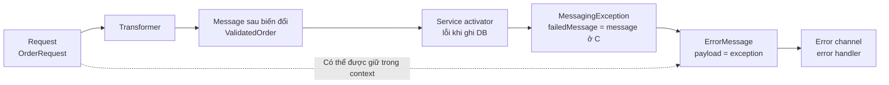
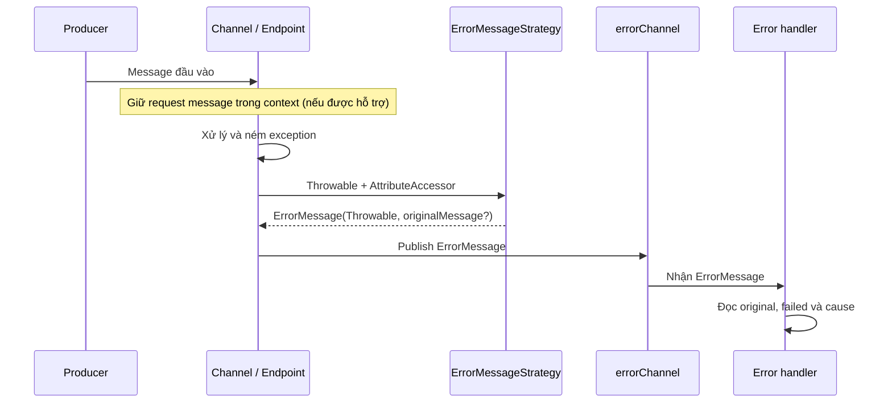

# Original message trong ErrorMessage của Spring Integration

## 1. Vì sao cần giữ message gốc khi xử lý lỗi runtime?

Trong **Spring Integration Runtime**, message đi qua channel, endpoint, consumer, poller và executor để thực thi các bước nghiệp vụ. Một lỗi có thể xuất hiện sau nhiều lần biến đổi payload, thêm/bớt header hoặc chuyển thread. Khi ấy, biết mỗi exception thường chưa đủ để trả lời: **request nào khởi phát chuỗi xử lý này?**

`ErrorMessage` cung cấp một cách mang thông tin lỗi qua message flow. Ngoài exception trong payload, nó **có thể** chứa `originalMessage`, cho phép error handler truy cập message còn tồn tại ở **điểm tạo ErrorMessage**. Đây là dữ liệu quan trọng để chẩn đoán correlation, định tuyến lỗi, retry và quyết định có cần bù trừ hay không.

Mục tiêu bài học:

- Hiểu quan hệ giữa `ErrorMessage`, `originalMessage` và `MessagingException.failedMessage`.
- Biết lúc nào `getOriginalMessage()` có giá trị, lúc nào có thể là `null`.
- Biết cách Spring Integration tạo `ErrorMessage` thông qua `ErrorMessageStrategy` và gửi qua `errorChannel`.
- Viết error handler đọc message liên quan đến lỗi một cách an toàn.
- Nhận diện khác biệt giữa lỗi trên `DirectChannel` và lỗi trong flow dùng executor/poller.
- Liên hệ original message với transaction, retry, message store, correlation, logging và xử lý sự cố trong production.

Phạm vi tập trung vào **`Original message trong ErrorMessage`** thuộc chương **Error runtime**. Những cơ chế khác được giải thích theo vai trò của chúng đối với vòng đời và nguồn gốc message khi có lỗi.

## 2. Ba đối tượng dễ bị nhầm lẫn

Giả sử request đầu vào chứa `OrderRequest`, một transformer chuyển nó thành `ValidatedOrder`, rồi handler ghi database thất bại.



Trong trường hợp strategy được cung cấp request ban đầu, error handler có thể thấy **hai mốc khác nhau**: message ở đầu đoạn xử lý đã được giữ trong context, và message tại nơi lỗi thực sự xảy ra.

| Đối tượng | Cách truy cập | Ý nghĩa |
| --- | --- | --- |
| `ErrorMessage` | Chính message gửi tới error flow | Một `Message<Throwable>` mới, có payload là exception. |
| `ErrorMessage.getPayload()` | `Throwable` | Lỗi được công bố, thường là `MessagingException` hoặc lớp con. |
| `ErrorMessage.getOriginalMessage()` | `Message<?>` hoặc `null` | Message mà **nơi tạo ErrorMessage** chọn ghi lại làm original; phụ thuộc context và strategy. |
| `MessagingException.getFailedMessage()` | `Message<?>` hoặc `null` | Message gắn với exception tại **điểm thất bại**, nếu exception có thông tin đó. |
| `ErrorMessage.getHeaders()` | `MessageHeaders` | Headers của **ErrorMessage mới**, không mặc nhiên là headers của request hoặc failed message. |

**Điểm then chốt:** `originalMessage` không được bảo đảm là message đầu tiên từ producer hay HTTP request ở rìa hệ thống. Nó là message có sẵn ở *điểm trong stack nơi ErrorMessage được tạo*. `failedMessage` là message gắn với exception. Chúng có thể cùng một object, mang dữ liệu khác nhau, hoặc một/both không tồn tại.

Định nghĩa này phản ánh đúng cách Spring Framework mô tả `ErrorMessage`: original là một thuộc tính **tùy chọn**; failed message thuộc về exception, đặc biệt khi exception là `MessagingException`.

## 3. API `ErrorMessage` và cách đọc original message

Class nằm ở `org.springframework.messaging.support.ErrorMessage` và kế thừa `GenericMessage<Throwable>`. Các constructor đáng chú ý:

```java
new ErrorMessage(throwable);
new ErrorMessage(throwable, originalMessage);
new ErrorMessage(throwable, errorHeaders, originalMessage);
```

Trong đó `errorHeaders` có thể là `Map<String, Object>` hoặc `MessageHeaders` theo overload tương ứng. Constructor chỉ nhận `Throwable` **không tự suy ra original message**; muốn có metadata này, người tạo lỗi hoặc strategy phải cung cấp đúng message.

### Ví dụ độc lập: original khác failed

Đoạn Java sau chủ động tạo hai message khác nhau để thấy rõ API. Đây là mô phỏng có kiểm soát, không phụ thuộc asynchronous error handler:

```java
import org.springframework.messaging.Message;
import org.springframework.messaging.MessageHandlingException;
import org.springframework.messaging.MessagingException;
import org.springframework.messaging.support.ErrorMessage;
import org.springframework.messaging.support.MessageBuilder;

public class OriginalVsFailedDemo {
    public static void main(String[] args) {
        // Message mà đầu đoạn xử lý nhận được.
        Message<String> input = MessageBuilder.withPayload("ORDER-42")
                .setHeader("traceId", "trace-123")
                .build();

        // Message sau một bước biến đổi, tại nơi nghiệp vụ bị lỗi.
        Message<Integer> transformed = MessageBuilder.withPayload(-1)
                .setHeader("traceId", "trace-123")
                .build();

        MessagingException failure = new MessageHandlingException(
                transformed,
                "quantity must be positive",
                new IllegalArgumentException("invalid quantity"));

        ErrorMessage error = new ErrorMessage(failure, input);

        Message<?> original = error.getOriginalMessage();
        Message<?> failed = ((MessagingException) error.getPayload())
                .getFailedMessage();

        System.out.println(original.getPayload()); // ORDER-42
        System.out.println(failed.getPayload());   // -1
        System.out.println(error.getPayload().getClass().getSimpleName());
        // MessageHandlingException
    }
}
```

Ở đây `original` do ứng dụng truyền vào constructor; trong runtime thực tế, chiến lược tạo ErrorMessage quyết định có truyền được message tương ứng hay không. Không nên viết code mặc định `error.getOriginalMessage().getPayload()`, vì `getOriginalMessage()` có thể trả `null`.

### Đọc header ở đúng message

```java
Message<?> original = error.getOriginalMessage();
Throwable failure = error.getPayload();

Object requestTrace = original == null
        ? null
        : original.getHeaders().get("traceId");

Object errorTrace = error.getHeaders().get("traceId");
```

`requestTrace` và `errorTrace` không nhất thiết bằng nhau. ErrorMessage có `id` và `timestamp` riêng, nên so sánh `error.getHeaders().getId()` với ID của request cũng không đủ để ghép sự kiện nghiệp vụ.

## 4. ErrorMessage được tạo như thế nào?

Spring Integration có các thành phần hỗ trợ công bố lỗi:

- `ErrorMessagePublisher`: cung cấp khả năng phát `ErrorMessage` tới channel xử lý lỗi.
- `ErrorMessageStrategy`: quyết định cách tạo `ErrorMessage` từ `Throwable` và context liên quan.
- `DefaultErrorMessageStrategy`: strategy mặc định có thể đọc request message từ context để đặt `originalMessage`.
- `MessagePublishingErrorHandler`: chuyển lỗi xảy ra trong các tác vụ tương ứng thành ErrorMessage, gửi qua error channel.
- `ErrorMessageSendingRecoverer`: recovery callback có thể công bố ErrorMessage sau khi retry thất bại, ví dụ với `RequestHandlerRetryAdvice`.

Một chi tiết quan trọng trong tài liệu Spring Integration: message đầu vào được đặt vào `AttributeAccessor` dưới khóa `ErrorMessageUtils.INPUT_MESSAGE_CONTEXT_KEY`. `DefaultErrorMessageStrategy` sử dụng giá trị này làm `originalMessage` **khi có**.



**Không có bảo đảm toàn cục** rằng mọi exception đều được framework chuyển thành ErrorMessage hay mọi ErrorMessage đều có original. Điều này phụ thuộc nơi exception được bắt, loại endpoint, error handler, strategy và context. Nếu code tự `new ErrorMessage(cause)` thì original mặc định là `null`.

## 5. Original message liên quan gì tới `errorChannel`?

`errorChannel` là **đích chuyển lỗi**, còn `originalMessage` là **nguồn gốc message được gắn kèm để phân tích**. Hai khái niệm này độc lập:

1. Khi cơ chế xử lý lỗi của Spring Integration công bố một ErrorMessage, nó thường ưu tiên header `errorChannel` trong request đang xử lý.
2. Nếu không có header đích và error handler hỗ trợ hành vi này, framework gửi đến channel toàn cục có bean name `errorChannel`.
3. Error flow được subscribe vào channel đó để đọc exception và message context.

Header `errorChannel` có thể chứa tên channel dạng `String` hoặc tham chiếu `MessageChannel` theo ngữ cảnh. **Một header errorChannel hợp lệ không bảo đảm `getOriginalMessage()` khác `null`.** Và ngược lại, original message có giá trị không có nghĩa mọi lỗi sẽ tự đi tới error channel nếu thực thi đang đồng bộ và exception lan ngược về caller.

### Lỗi đồng bộ và bất đồng bộ

| Tình huống | Thread xử lý consumer | Hành vi lỗi thường thấy |
| --- | --- | --- |
| `DirectChannel` | Thread gửi message | Exception thường truyền ngược về sender hoặc gateway; không mặc định phát ErrorMessage. |
| `ExecutorChannel` | Thread của executor | Sender đã đi tiếp; lỗi phát sinh cần cơ chế error handling trong thread xử lý. |
| `QueueChannel` kèm poller | Thread của poller | Poller có thể dùng `MessagePublishingErrorHandler` để công bố lỗi. |
| Async `PublishSubscribeChannel` | Executor thread của subscriber | Error handler của channel có thể công bố ErrorMessage; nếu không dùng executor, lỗi thường truyền trên thread caller. |

Khi dùng poller của Spring Integration, framework thường cấu hình `MessagePublishingErrorHandler` trong task scheduler tích hợp. Nếu thay bằng custom scheduler, cần kiểm tra error handler đang dùng. Với `DirectChannel` thuần, đừng viết kiểm thử mặc định đợi ErrorMessage xuất hiện; kiểm tra exception ở caller hoặc cấu hình error flow riêng cho gateway.

Điểm này đặc biệt quan trọng khi chẩn đoán threading: producer gửi vào `QueueChannel` thành công chỉ chứng minh message đã được đưa vào queue, **không** chứng minh consumer xử lý thành công.

## 6. Ví dụ thực tế: poller thất bại và đọc original trong error flow

Ví dụ sử dụng Spring Integration Java/annotation configuration, chia thành các file trong package `demo.errorflow`. Tình huống: producer gửi một order ID qua `QueueChannel`; poller lấy message và method xử lý ném exception; error handler nhận `ErrorMessage` nếu thành phần runtime phát ErrorMessage theo cấu hình.

**`ErrorFlowConfiguration.java`**

```java
package demo.errorflow;

import org.springframework.context.annotation.Bean;
import org.springframework.context.annotation.ComponentScan;
import org.springframework.context.annotation.Configuration;
import org.springframework.integration.channel.DirectChannel;
import org.springframework.integration.channel.QueueChannel;
import org.springframework.integration.config.EnableIntegration;
import org.springframework.messaging.MessageChannel;

@Configuration
@EnableIntegration
@ComponentScan(basePackageClasses = OrderEndpoints.class)
public class ErrorFlowConfiguration {
    @Bean("ordersQueue")
    public QueueChannel ordersQueue() {
        return new QueueChannel();
    }

    @Bean("ordersErrors")
    public MessageChannel ordersErrors() {
        return new DirectChannel();
    }
}
```

**`OrderEndpoints.java`**

```java
package demo.errorflow;

import org.springframework.integration.annotation.MessageEndpoint;
import org.springframework.integration.annotation.Poller;
import org.springframework.integration.annotation.ServiceActivator;
import org.springframework.messaging.Message;
import org.springframework.messaging.MessagingException;
import org.springframework.messaging.support.ErrorMessage;

@MessageEndpoint
public class OrderEndpoints {

    @ServiceActivator(
            inputChannel = "ordersQueue",
            poller = @Poller(fixedDelay = "250", maxMessagesPerPoll = "5"))
    public void process(Message<String> request) {
        // Giả lập sự cố khi poller đã nhận message.
        throw new IllegalStateException("Database unavailable");
    }

    @ServiceActivator(inputChannel = "ordersErrors")
    public void onError(ErrorMessage error) {
        Throwable failure = error.getPayload();
        Message<?> original = error.getOriginalMessage();

        Message<?> failed = null;
        if (failure instanceof MessagingException messagingFailure) {
            failed = messagingFailure.getFailedMessage();
        }

        Object traceId = original != null
                ? original.getHeaders().get("traceId")
                : failed != null
                    ? failed.getHeaders().get("traceId")
                    : null;

        System.err.println(
                "errorType=" + failure.getClass().getSimpleName()
                + ", traceId=" + traceId
                + ", hasOriginal=" + (original != null)
                + ", hasFailed=" + (failed != null));

        // Production: phân loại lỗi, ghi metric, gọi DLQ/recovery phù hợp.
        // Tránh ghi toàn bộ payload/headers nếu có dữ liệu nhạy cảm.
    }
}
```

**`Demo.java`**

```java
package demo.errorflow;

import org.springframework.context.annotation.AnnotationConfigApplicationContext;
import org.springframework.integration.channel.QueueChannel;
import org.springframework.messaging.MessageHeaders;
import org.springframework.messaging.support.MessageBuilder;

public class Demo {
    public static void main(String[] args) throws Exception {
        try (var context =
                     new AnnotationConfigApplicationContext(ErrorFlowConfiguration.class)) {
            QueueChannel queue = context.getBean("ordersQueue", QueueChannel.class);

            queue.send(MessageBuilder.withPayload("ORDER-42")
                    .setHeader("traceId", "trace-123")
                    .setHeader(MessageHeaders.ERROR_CHANNEL, "ordersErrors")
                    .build());

            // send() trả về sau khi đưa message vào queue.
            // Quan sát log/metric ở error handler để biết xử lý async đã diễn ra.
            Thread.sleep(1000); // Chỉ phục vụ minh họa trong chương trình demo.
        }
    }
}
```

Diễn tiến:

1. `Demo` gửi request vào `ordersQueue` với `traceId` và `errorChannel` trỏ tới `ordersErrors`.
2. Poller nhận message rồi gọi `OrderEndpoints.process(...)`; method ném `IllegalStateException`.
3. Cơ chế error handling của poller xây dựng `ErrorMessage` và chọn error channel.
4. `OrderEndpoints.onError(...)` đọc `Throwable` từ payload, thử lấy `originalMessage`, rồi kiểm tra `failedMessage` nếu cần.
5. Error handler quan sát thông tin để quyết định log, metric, retry hoặc dead-letter.

Mẫu trên thể hiện **cách xử lý đúng với dữ liệu tùy chọn**, chứ không hứa hẹn strategy luôn cung cấp original hoặc exception luôn có failedMessage. Cũng đừng lấy `Thread.sleep(...)` làm cách kiểm thử production; khi kiểm thử tự động, dùng synchronization phù hợp (ví dụ latch) và timeout hữu hạn.

## 7. Đọc lỗi vững vàng khi exception bị bọc nhiều tầng

Thông thường lỗi nghiệp vụ như `IllegalStateException` được bọc trong `MessageHandlingException`, `MessagingException` hoặc một exception khác của infrastructure. `ErrorMessage.getPayload()` vẫn là `Throwable`, không phải lúc nào cũng trực tiếp là business exception.

Khi cần tìm failed message ở nhiều tầng cause, có thể triển khai helper:

```java
import java.util.Collections;
import java.util.IdentityHashMap;
import java.util.Set;
import org.springframework.messaging.Message;
import org.springframework.messaging.MessagingException;

public final class FailedMessageLookup {
    private FailedMessageLookup() {}

    public static Message<?> find(Throwable error) {
        Set<Throwable> visited =
                Collections.newSetFromMap(new IdentityHashMap<>());

        for (Throwable current = error;
                current != null && visited.add(current);
                current = current.getCause()) {

            if (current instanceof MessagingException exception
                    && exception.getFailedMessage() != null) {
                return exception.getFailedMessage();
            }
        }
        return null;
    }
}
```

Ý nghĩa:

- Chỉ dùng `error.getOriginalMessage()` nếu đã kiểm tra `null`.
- Nếu original không có, có thể tra `MessagingException.getFailedMessage()` trong chuỗi cause như một **fallback cho chẩn đoán**.
- Không suy ra hai giá trị luôn tương đương. Khi transformer đã thay payload, chúng có thể chỉ cùng một request ở mức nghiệp vụ.
- Nếu cả hai đều không có, log exception class, endpoint, thread, timestamp và correlation context bên ngoài (nếu có), thay vì giả lập một message không tồn tại.

Khi nhiều tầng `MessagingException` cùng có failed message, việc chọn message nào cần căn cứ vào mục tiêu: outer exception có thể thể hiện lỗi ở tầng dispatch, trong khi inner exception phản ánh bước handler cụ thể. Ví dụ helper trên trả về **failed message đầu tiên tìm được**, phù hợp cho phân tích nhanh; công cụ chẩn đoán chuyên sâu có thể thu thập tất cả các mốc.

## 8. Original message được dùng để làm gì?

### 8.1. Trace và correlation

Trong error handler, `traceId` hoặc business ID lấy từ original message giúp nối lỗi với request trước khi flow tạo message trung gian. Nhưng:

- `MessageHeaders.ID` là ID của từng message; sau bước biến đổi có thể phát sinh message ID mới.
- `correlationId` là header do thành phần flow hoặc ứng dụng quản lý, không tự được bảo toàn qua mọi protocol adapter.
- Correlation chính xác giữa HTTP, AMQP, Kafka, JMS và message store cần **contract về tên/kiểu/propagation**.

Một error handler có thể ưu tiên ID ổn định như `orderId` hay `eventId`, sau đó kèm `traceId`, tên endpoint và exception type. Không dùng ngẫu nhiên ID của `ErrorMessage` làm business idempotency key.

### 8.2. Retry và dead-letter

`originalMessage` hữu ích để cân nhắc phát lại request hoặc gửi vào dead-letter queue, nhưng **không nên tự động resend chỉ vì có original**. Đầu vào có thể đã đi qua các bước side effect thành công trước khi lỗi, chẳng hạn đã gọi API thanh toán nhưng thất bại khi ghi audit.

Trước khi retry, cần xác định:

1. **Phạm vi retry:** chỉ lặp lại failed handler hay phát lại cả flow?
2. **Trạng thái transaction:** DB đã rollback hay đã commit một phần?
3. **Idempotency:** message có stable business key để chống xử lý trùng không?
4. **Backoff và retry budget:** có giới hạn số lần thử và thời gian chờ không?
5. **Poison message:** lỗi dữ liệu cố định cần dead-letter/validation thay vì retry mãi.

`ErrorMessageSendingRecoverer` có thể tham gia khi retry hết lượt và cần đưa lỗi sang một error flow. Việc “xử lý” ErrorMessage là một sự kiện trong cơ chế recovery; nó **không tự xác nhận** rằng giao dịch nguồn đã commit hoặc broker đã ack.

### 8.3. Transaction và threading

Khi xử lý đồng bộ qua `DirectChannel`, exception có thể đi ngược về cùng call stack và transaction đang mở (nếu có). Khi chuyển qua `ExecutorChannel` hoặc poller, thread khác có thể xử lý lỗi và transaction context của thread ban đầu thông thường không đi theo.

`originalMessage` chỉ mang dữ liệu tham chiếu, **không phải một transaction snapshot** hay đối tượng cho phép “rollback” toàn bộ nhánh xử lý. Muốn bảo đảm nguyên tử trên nhiều hệ thống phải dùng transaction boundary thích hợp, outbox, compensation hoặc saga theo yêu cầu nghiệp vụ.

### 8.4. Message store và lưu lỗi lâu dài

Nếu error message được lưu vào message store hoặc một broker, original message có thể chứa:

- Java object không hỗ trợ serializer;
- Header `replyChannel`/`errorChannel` tham chiếu local `MessageChannel`;
- Payload lớn hoặc dữ liệu nhạy cảm;
- Object đã có trạng thái mutable, không còn phản ánh dữ liệu lúc gửi ban đầu.

Không coi original như một bản sao bền vững, bất biến và đầy đủ của request đầu vào. Với audit/replay dài hạn, tốt hơn nên lưu **event envelope ổn định**: business ID, schema/version, thời gian nhận, dữ liệu đã được phép lưu, trạng thái và reason code. Nếu cần lưu channel headers, phải xem xét cơ chế `HeaderChannelRegistry` hoặc một kiến trúc reply riêng theo khả năng của transport.

## 9. Những sai lầm dễ gặp

| Quan niệm sai | Thực tế |
| --- | --- |
| “Cứ có exception là có ErrorMessage” | Exception trên caller thread có thể chỉ bị ném ra ngoài; cần thành phần công bố lỗi. |
| “ErrorMessage luôn chứa original message” | `originalMessage` là tùy chọn, có thể `null`. |
| “Original là request đầu tiên toàn hệ thống” | Original thuộc context tại nơi ErrorMessage được tạo; có thể là message trung gian. |
| “Failed message luôn bằng original” | Transformation, routing hoặc enrichment có thể khiến hai message khác nhau. |
| “Headers trên ErrorMessage giống headers của input” | ErrorMessage là message riêng, có headers riêng. |
| “ErrorMessage payload là payload nghiệp vụ lỗi” | Payload của `ErrorMessage` là `Throwable`; payload nghiệp vụ nằm trong original/failed message nếu có. |
| “Gửi vào errorChannel đồng nghĩa retry thành công” | Error flow nhận lỗi chưa nói gì về commit, ack hay recovery outcome. |
| “Có original thì replay an toàn” | Replay có thể trùng side effect và cần idempotency/transaction design. |
| “Có traceId trong original thì mọi downstream đều thấy” | Header có thể bị lọc, map khác kiểu, không được propagate hoặc được tạo mới. |

## 10. Chẩn đoán các sự cố runtime

| Triệu chứng | Khả năng cần kiểm tra | Hành động phù hợp |
| --- | --- | --- |
| Không thấy ErrorMessage trên `errorChannel` | Flow dùng `DirectChannel`, exception truyền về caller; wrong error channel; error handler thiếu subscriber | Xác định thread, channel, error handler, gateway config trước. |
| `getOriginalMessage() == null` | Strategy không có input message trong context; ErrorMessage được tự tạo mà không truyền original | Kiểm tra nơi xây dựng ErrorMessage và `ErrorMessageStrategy`; dùng failed message làm fallback nếu có. |
| Có original nhưng payload không giống failed | Transformer hoặc endpoint trước đó đã đổi payload | Vẽ chuỗi biến đổi, so sánh ID/header và bước xảy ra lỗi. |
| `getFailedMessage() == null` | Payload không phải `MessagingException`, exception không lưu failed message, hoặc wrapper khác | Kiểm tra cause chain và nơi exception được tạo. |
| Trace ID mất khi vào error handler | Header bị filter, mapper đổi tên/kiểu hoặc original thiếu | So sánh header tại từng boundary; dùng correlation contract tường minh. |
| Error handler ném `ClassCastException` | Ép payload Throwable thành business type; ép original về kiểu không đúng | Dùng `instanceof` và kiểm tra loại payload/header. |
| Gateway timeout dù đã thấy lỗi | Error flow không gửi reply đúng đích; lỗi thuộc nhánh async; reply/error channel khác nhau | Kiểm tra routing và thiết kế phản hồi lỗi cho gateway. |
| Retry gây ghi dữ liệu lặp | Replay quá rộng, transaction đã commit một phần, idempotency thiếu | Xác định retry scope, thêm business idempotency key, dùng outbox/compensation nếu cần. |
| Message store không serialize được error | Original/headers chứa local channel hoặc Java object không serializable | Lưu envelope nhỏ, lọc/chuyển header, thay cơ chế lưu nếu cần. |
| ErrorMessage mới cũng bị lỗi khi xử lý | Error subscriber ném exception; channel không nhận; error flow vòng lặp | Quan sát thứ tự consumer, error handler của error flow và policy fail-safe. |

Quy trình điều tra đề xuất:

1. **Xác định thời điểm lỗi:** producer send, channel dispatch, handler, poller hay broker adapter.
2. **Xác định thread:** cùng thread với caller hay worker/poller; có thành phần nào publish ErrorMessage?
3. **Kiểm tra đích lỗi:** header `errorChannel` tại request đang xử lý và bean `errorChannel` toàn cục.
4. **Đọc ba mốc:** exception payload, `originalMessage` và `failedMessage`; ghi nhận mốc nào thiếu.
5. **So sánh message contract:** payload type, business key, correlation ID, transport headers và bước transformer trước khi fail.
6. **Đánh giá hậu quả:** transaction rollback, retry đã xảy ra, broker ack/redelivery, side effect bên ngoài.
7. **Chọn hành động:** sửa cấu hình, retry có kiểm soát, dead-letter, compensation hoặc trả lỗi nghiệp vụ.

Trong production, metrics hữu ích gồm số ErrorMessage theo endpoint/type, thời gian xử lý error flow, số retry, số dead-letter, độ dài queue/poller backlog và gateway timeout. Không nên chỉ dựa vào số ErrorMessage để tính tổng số exception vì một số lỗi không đi qua error channel hoặc có thể được handler bắt và xử lý theo cách khác.

## 11. Bảo vệ dữ liệu khi sử dụng original message

Original message giúp điều tra, nhưng thường là nơi chứa nhiều dữ liệu nhất:

- Payload có thể là dữ liệu khách hàng, token, nội dung giao dịch hoặc thông tin cá nhân.
- Headers có thể chứa `Authorization`, `Cookie`, thông tin định tuyến nội bộ hoặc địa chỉ callback.
- Exception message và stack trace cũng có thể mang dữ liệu đầu vào.

Chỉ log **trường đã cho phép** như ID nghiệp vụ, trace/correlation ID, loại lỗi, endpoint và timestamp. Khi cần dead-letter hoặc audit, áp dụng data classification, retention và quyền truy cập tương ứng. Không dùng `System.err.println(original)` trong production vì có thể in ra toàn bộ payload và headers. Nếu flow có khả năng nhận dữ liệu từ bên ngoài, không tin giá trị header do client tự gán là danh tính hoặc quyền truy cập đã xác thực.

## 12. Câu hỏi kiểm tra và bài thực hành

**Câu hỏi:**

1. `ErrorMessage.getOriginalMessage()` khác `MessagingException.getFailedMessage()` thế nào khi flow có transformer?
2. Vì sao `ErrorMessage.getHeaders().getId()` không phải ID của request gây lỗi?
3. Một `DirectChannel` đồng bộ ném exception có chắc sinh ra ErrorMessage trên global `errorChannel` không? Vì sao?
4. `DefaultErrorMessageStrategy` nhận message nào qua `ErrorMessageUtils.INPUT_MESSAGE_CONTEXT_KEY` và dùng nó để làm gì?
5. Nếu original không có, bạn kiểm tra failed message như thế nào mà không gây `NullPointerException`?
6. Vì sao không nên tự động phát lại original message sau khi lỗi gọi một dịch vụ thanh toán?
7. Khi error flow nằm sau poller, điều gì khác với việc xử lý lỗi trên thread gateway?
8. Trong trường hợp original có header `replyChannel` tham chiếu local bean, nguy cơ khi serialize toàn bộ ErrorMessage là gì?

**Thực hành có hướng dẫn:**

1. Chạy `OriginalVsFailedDemo` ở mục 3 và chứng minh original/failed có payload khác nhau.
2. Đổi thành `new ErrorMessage(failure)` và kiểm tra `getOriginalMessage() == null`.
3. Chạy mẫu `QueueChannel` + poller ở mục 6, quan sát error handler và thử bỏ header `errorChannel` để xem cơ chế fallback global.
4. Tạo thêm một transformer trước handler rồi so sánh payload, headers và message ID ở ba vị trí.
5. Thiết kế logic phân loại lỗi: validation error → dead-letter; lỗi tạm thời của DB → retry có giới hạn; side effect đã commit → không tự phát lại cả flow. Đề xuất một business idempotency key.

## 13. Tài liệu tham khảo

- [Spring Integration Reference — Error Handling](https://docs.spring.io/spring-integration/reference/error-handling.html)
- [Spring Framework API — ErrorMessage](https://docs.spring.io/spring-framework/docs/current/javadoc-api/org/springframework/messaging/support/ErrorMessage.html)
- [Spring Framework API — MessagingException](https://docs.spring.io/spring-framework/docs/current/javadoc-api/org/springframework/messaging/MessagingException.html)
- [Spring Framework API — MessageHandlingException](https://docs.spring.io/spring-framework/docs/current/javadoc-api/org/springframework/messaging/MessageHandlingException.html)
- [Spring Integration Reference — Configuring Message Channels](https://docs.spring.io/spring-integration/reference/channel/configuration.html)
- [Spring Integration Reference — Message Publishing](https://docs.spring.io/spring-integration/reference/error-handling.html)
