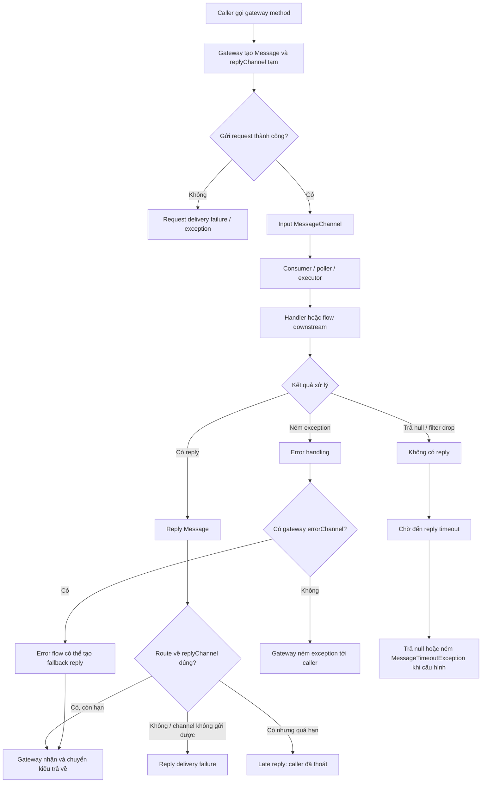
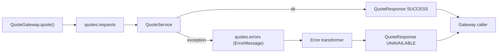

# Reply failure qua gateway

## 1. Reply failure là gì và xảy ra tại đâu?

Trong Spring Integration, **gateway** tạo hợp đồng *request–reply*: phía gọi gửi yêu cầu và mong nhận kết quả hoặc exception. Gateway che giấu hạ tầng message đối với caller, nhưng không đảm bảo mọi request đều sinh reply. Một flow có thể lọc bỏ message, trả `null`, xử lý chậm, bị lỗi kết nối hoặc gửi reply đến sai channel. Khi đó caller quan sát thấy **reply failure**: không có phản hồi, phản hồi quá hạn, lỗi được trả thay kết quả, hoặc phản hồi không thể giao tới bên gọi.

Trong module `SPRING_INTEGRATION_RUNTIME`, bài này thuộc chương **Error runtime**. Mục đích là hiểu đường đi qua channel, endpoint/consumer, poller, executor và gateway; đồng thời ứng dụng kiến thức về transaction, retry, lỗi, message store, correlation, threading và hiệu năng để truy vết sự cố.

Có ba ngữ cảnh dùng từ “gateway” cần phân biệt:

| Gateway | Ai gửi request? | Ai cần nhận reply? | Ví dụ |
|---|---|---|---|
| **POJO messaging gateway** (`@MessagingGateway`, `GatewayProxyFactoryBean`) | Java caller trong ứng dụng | Phương thức Java đang được gọi | `quoteGateway.calculate(order)` |
| **Inbound protocol gateway** | Client bên ngoài | HTTP/TCP/JMS/AMQP client | HTTP inbound gateway chờ flow nội bộ tạo response |
| **Outbound protocol gateway** | Message flow nội bộ | Endpoint nội bộ chờ phản hồi từ dịch vụ ngoài | HTTP outbound gateway gọi REST API |

Các timeout, error-channel và correlation cụ thể của HTTP, JMS, TCP… có tính chất riêng. Phần lõi dưới đây tập trung vào **POJO messaging gateway**; sau đó mở rộng cách chẩn đoán inbound/outbound gateway.

### Kết quả học tập

Sau bài học, bạn có thể:

1. Mô tả chính xác đường đi của một request, reply và error từ gateway qua message flow.
2. Phân biệt **không có reply**, **reply đến muộn**, **gửi reply thất bại** và **downstream exception**.
3. Dự đoán tác dụng của `replyTimeout`, `requestTimeout`, `errorOnTimeout` và `requiresReply`.
4. Cấu hình `errorChannel` để trả response lỗi phù hợp với hợp đồng của gateway.
5. Chẩn đoán timeout khi flow chạy trên `DirectChannel`, `ExecutorChannel`, `QueueChannel` và poller.
6. Thiết kế correlation, idempotency, retry và quan sát runtime để giảm rủi ro trả lời nhầm hoặc trùng.

## 2. Vòng đời request–reply và điểm thất bại



**Cơ chế chính:** `GatewayProxyFactoryBean` tạo proxy của interface; một lời gọi method được biến thành request `Message<?>`. Gateway thường tạo **temporary reply channel** kiểu point-to-point và đặt nó trong header `replyChannel` của request. Handler trong flow xử lý và trả một payload/`Message`; framework gửi reply qua channel mà gateway đang đợi. Gateway lấy payload hoặc message và chuyển thành kiểu return của method.

**Bốn câu hỏi điều tra đầu tiên:**

- Message đã **vào request channel** chưa?
- Có handler nào **tạo reply hoặc exception** không?
- Reply/error được gửi **tới channel nào**?
- Tại thời điểm đó, gateway **còn chờ reply** hay đã timeout?

Một exception trong business method và việc gateway không nhận reply là hai sự kiện khác nhau. Spring Integration có thể chuyển exception thành `ErrorMessage`; ngược lại, flow kết thúc bình thường mà không tạo reply vẫn khiến caller đợi đến timeout.

## 3. Các dạng reply failure thường gặp

| Biểu hiện bên caller | Nguyên nhân có thể | Bằng chứng cần tìm |
|---|---|---|
| Return `null` sau thời gian chờ | Service trả `null`; filter drop; route không có output; executor/poller chậm; reply bị lệch channel | Handler log, `replyChannel`, `replyTimeout`, queue depth, routing |
| `MessageTimeoutException` | `errorOnTimeout=true` và hết thời gian đợi reply | Thời gian request/reply; exception cause; handler có còn chạy không |
| Ngoại lệ nghiệp vụ (ví dụ `IllegalStateException`) | Downstream throw, gateway unwrap hoặc chuyển qua error flow | `MessagingException.failedMessage`, `cause`, tên endpoint |
| `ReplyRequiredException` | Handler `requiresReply=true` nhưng trả `null` | Nhánh return và cấu hình service activator |
| `DestinationResolutionException` | Reply channel bằng tên không resolve được hoặc route sai | Header `replyChannel` / output channel, bean names |
| `MessageDeliveryException` | Reply channel không nhận message (không subscriber, đầy, lỗi send) | Exception send, capacity/channel type, subscriber |
| Handler thành công nhưng caller vẫn timeout | Output channel tĩnh đã override reply header; reply đến muộn; correlation sai | Đích gửi reply, timestamp, id/correlation |
| HTTP client nhận lỗi/timeout | Inbound gateway không có response, lỗi mapping HTTP hoặc network client timeout | HTTP gateway logs, message flow, client/proxy timeout |

Không quy mọi trường hợp timeout thành `ReplyRequiredException`. Exception này chỉ xảy ra tại handler mà ta đã **bật `requiresReply`** và handler thật sự được gọi rồi trả `null`.

### 3.1. Reply bị “ăn mất” ở filter, router hoặc handler

- `@ServiceActivator` trả `null` hoặc method `void`: với handler cho phép không reply, flow kết thúc mà không có message gửi về.
- `@Filter` từ chối message: nếu chỉ cấu hình drop, gateway có thể tiếp tục đợi. Với trường hợp request–reply cần fail fast, cân nhắc `throwExceptionOnRejection=true` (tên cấu hình tùy DSL/annotation).
- `@Router` không resolve được destination hoặc rẽ vào nhánh một chiều: phải quyết định rõ có ném lỗi hay tạo response nghiệp vụ; với router cần fail fast, bật cơ chế bắt buộc resolve.
- `Aggregator` chưa đủ message để release group: gateway có thể timeout trong khi group nằm tại message store. Đây là tình huống **reply chưa sẵn sàng**, khác với xử lý hoàn toàn thất bại.

**Contract cần định nghĩa:** request sẽ có response thành công, response lỗi có cấu trúc, hay exception? Một quy trình “không tìm thấy dữ liệu” nên có response nghiệp vụ rõ thay vì ngầm dùng `null` nếu caller luôn mong trả lời.

### 3.2. Reply đi sai channel

Gateway chủ yếu dựa vào `replyChannel` của request. Tuy nhiên một handler/endpoint được cấu hình `outputChannel` cố định có thể gửi kết quả tới channel đó thay vì quay lại channel tạm của gateway. Header `replyChannel` cũng có thể bị mất khi xây message thủ công hoặc qua ranh giới serialization/truyền mạng.

```text
request:
  payload      = "ORD-17"
  replyChannel = temporary.gateway.reply

handler:
  outputChannel = "events.out"
  return        = "OK"

Kết quả:
  "OK" được gửi tới events.out.
  Gateway chỉ nhận được nếu có flow riêng quay reply về đúng nơi đang chờ.
```

**Cách sửa:** không đặt output channel tĩnh trên endpoint request–reply nếu muốn dùng `replyChannel` động; hoặc thiết kế một bridge/routing minh bạch và duy trì correlation. Nếu response đi qua broker/JMS/HTTP, channel object tạm **không thể giả định serialize được**; phải dùng cơ chế reply address + correlation chuyên biệt của adapter/protocol.

### 3.3. Reply đến sau khi gateway đã timeout

Với flow bất đồng bộ, gateway có thể trả `null`/exception timeout rồi handler mới hoàn thành. **Late reply** không tự biến lần gọi Java trước đó thành thành công; tùy triển khai channel, việc gửi late reply có thể bị bỏ qua hoặc thất bại vì consumer đã ngừng đợi.

Điều nguy hiểm hơn là **nghiệp vụ đã commit thành công** trong khi caller nghĩ operation thất bại. Caller retry có thể tạo đơn/giao dịch trùng. Phải có idempotency key, trạng thái nghiệp vụ truy vấn lại được, hoặc cơ chế reconciliation; chỉ tăng timeout không loại bỏ được bất định của mạng và concurrency.

## 4. Timeout của gateway: hai đồng hồ khác nhau

Một POJO gateway hỗ trợ:

- `requestTimeout` / `defaultRequestTimeout`: giới hạn thời gian **gửi request vào channel có thể block**, ví dụ `QueueChannel` đã đầy. Nó không đo toàn bộ thời gian business method chạy.
- `replyTimeout` / `defaultReplyTimeout`: thời gian **đợi nhận reply** sau giai đoạn gửi request; khi hết hạn thường trả `null`. Với `errorOnTimeout=true` (có từ Spring Integration 6.2 đối với messaging gateway), timeout có thể tạo `MessageTimeoutException`.
- `sendTimeout` trên handler phát reply: thời gian **gửi reply tới một channel có thể block**; không thay thế `replyTimeout` của gateway.
- Timeout của dịch vụ ngoài như HTTP/JDBC: giới hạn I/O của chính bước downstream; để khống chế thời gian thực thi business thật sự phải cấu hình tại đúng lớp I/O hoặc ứng dụng.

> Tài liệu và mặc định timeout có khác biệt giữa phiên bản/gateway type; hướng dẫn Spring Integration 6.5 nêu timeout 30 giây ở phần POJO gateway, trong khi các đoạn API/lịch sử mô tả khác nhau. Với hệ thống cần SLA, **khai báo timeout tường minh**, xác minh trên phiên bản runtime và phân biệt POJO gateway với inbound HTTP/TCP/JMS gateway.

### 4.1. DirectChannel: replyTimeout không thể ngắt business đang chạy cùng thread

```text
t=0 ms    caller gọi gateway
t=1 ms    gateway gửi request vào DirectChannel
t=2 ms    handler bắt đầu sleep / I/O chặn 5 giây
t=5000 ms handler trả reply
t=5001 ms gateway method hoàn thành

replyTimeout = 1000 ms không cắt ngắn 5 giây handler đồng bộ.
```

Lý do: việc gửi request trên `DirectChannel` **đang thực thi handler trong cùng call stack**. Lời gọi send chưa quay về để gateway bước sang giai đoạn chờ reply; timeout nhận reply không phải interrupt timer áp dụng vào mọi method.

Nếu muốn giới hạn I/O downstream, đặt timeout ở HTTP client, DB driver hoặc client tương ứng. Chuyển toàn bộ flow sang async chỉ để timeout không miễn phí: phải xử lý queue, thread pool và kết quả đến muộn.

### 4.2. ExecutorChannel/QueueChannel: replyTimeout có hiệu lực khi đã bàn giao công việc

```text
t=0 ms    caller gọi gateway
t=2 ms    request được chuyển sang ExecutorChannel; send quay về
t=3 ms    gateway bắt đầu chờ trên reply channel
t=1003 ms replyTimeout = 1000 ms => return null / timeout exception
t=2500 ms worker tạo reply muộn
```

Với `QueueChannel`, poller có thể lấy request sau nhiều mili giây hoặc giây tùy backlog và lịch poll. Thời gian đợi queue **nằm trong latency request–reply**. Một gateway có timeout 1 giây mà poller chỉ chạy 5 giây/lần là mismatch kiến trúc, không phải lỗi method xử lý.

### 4.3. So sánh hành vi

| Tình huống | DirectChannel đồng bộ | Chuyển qua executor/queue |
|---|---|---|
| Handler block lâu | Caller bị block cùng handler; `replyTimeout` không ngắt việc này | Caller có thể hết `replyTimeout` khi worker vẫn chạy |
| Handler throw | Exception có thể truyền theo call stack về gateway | Error được xử lý tại thread worker; framework có thể chuyển `ErrorMessage` trở lại gateway qua error path phù hợp |
| Handler trả `null` | Caller chờ reply đến hạn (trừ khi `requiresReply` ném sớm) | Tương tự, có thêm độ trễ dispatch/queue |
| Transaction theo thread | Có thể chia sẻ phạm vi nếu cấu hình đúng | Không tự truyền transaction từ caller sang worker |
| Reply đến sau caller timeout | Ít gặp khi xử lý hoàn toàn đồng bộ; vẫn có thể do flow không phản hồi | Dễ gặp; cần xử lý duplicate và late completion |

**Đừng đồng nhất:** reply timeout ≠ request timeout ≠ I/O timeout ≠ timeout của `Future.get()`. Chúng đo các đoạn khác nhau.

## 5. Downstream exception, ErrorMessage và errorChannel

### 5.1. Không cấu hình gateway errorChannel

Trong flow đồng bộ, service activator ném exception; Spring Integration có thể bọc nó trong `MessagingException` với `failedMessage`, sau đó gateway unwrap ngoại lệ thích hợp và ném về caller. Khi interface khai báo `throws MessagingException`, caller có thể nhận exception chứa ngữ cảnh message. Vì vậy *gateway method ném lỗi* là một phản hồi thất bại rõ ràng, **khác** với chờ reply đến timeout.

Với flow bất đồng bộ, exception không thể ném ngược qua stack của thread đã bàn giao. Hạ tầng Spring Integration có cơ chế phát `ErrorMessage`; nếu gateway còn chờ và lỗi được route đúng đường, nó có thể nhận lỗi và ném tới caller. Không phải mọi TaskExecutor tùy chỉnh hay code tự tạo thread đều tự có error bridge này.

### 5.2. ErrorMessage chứa gì?

- `ErrorMessage` là `Message<Throwable>`; payload thường là `MessagingException` hoặc exception thích hợp.
- `MessagingException.getFailedMessage()` (khi có) giúp xác định message tại nơi thất bại. Khi exception được bọc nhiều lớp, luôn xem `cause`.
- `ErrorMessage.getOriginalMessage()` có thể được thiết lập bởi error message strategy để giữ request gốc; **đừng mặc định trường này luôn có**.
- Header `errorChannel` có thể chỉ định kênh error riêng; nếu không có và framework đang ở error publishing path, thường dùng global `errorChannel`.
- Global `errorChannel` thông thường là `PublishSubscribeChannel` có logging handler. Nó phù hợp quan sát lỗi async, nhưng **không tự tạo response nghiệp vụ** cho mọi gateway call.

Một message mang payload `Throwable`, kể cả khi do downstream trả về như một “kết quả”, có thể được gateway diễn giải là **lỗi cần ném**. Nếu muốn trả *business error* như một response hợp lệ, nên dùng DTO `FailureResponse`/`Either` có cấu trúc; không gửi raw `Exception` làm payload thành công.

### 5.3. Cấu hình errorChannel để tạo phản hồi fallback

Có thể gắn `errorChannel` riêng cho gateway và đưa lỗi qua một error flow tạo response đúng kiểu return. Điều này hữu ích khi API nội bộ cần trả kết quả có trạng thái `UNAVAILABLE` thay cho việc ném exception.



**Điểm cần hiểu:** `errorChannel` của gateway không có nghĩa “chỉ log lỗi”. Nó có thể là **request–reply error flow**: transformer xử lý error message và trả một reply thay thế. Nếu error flow chỉ ghi log rồi kết thúc, caller có thể vẫn không có reply và chờ hết timeout. Nếu error flow trả tiếp một `ErrorMessage`/`Throwable`, gateway sẽ coi nó là lỗi, không phải dữ liệu thành công.

## 6. Ví dụ hoàn chỉnh: fail fast và trả lỗi có cấu trúc

Giả sử hệ thống định giá yêu cầu `QuoteRequest`, trả `QuoteResponse`. Ví dụ dựa trên Spring Integration 6.5, Java 17 và Spring Boot có `spring-boot-starter-integration`. Các class được tách thành file tương ứng, cùng package; imports và bean scan phù hợp.

### 6.1. Contract nghiệp vụ

```java
public record QuoteRequest(String sku, int amount) {}

public record QuoteResponse(String status, long price, String message) {
    public static QuoteResponse ok(long price) {
        return new QuoteResponse("OK", price, "");
    }

    public static QuoteResponse unavailable() {
        return new QuoteResponse("UNAVAILABLE", -1L,
                "Pricing service temporarily unavailable");
    }
}
```

DTO lỗi giúp caller phân biệt “không định giá được” với “không có reply”. Trong hệ thống thực tế, có thể dùng kiểu trạng thái enum, error code ổn định và correlation ID.

### 6.2. Gateway có timeout tường minh

```java
import org.springframework.integration.annotation.MessagingGateway;

@MessagingGateway(
        defaultRequestChannel = "quotes.requests",
        defaultRequestTimeout = "500",
        defaultReplyTimeout = "1500",
        errorChannel = "quotes.errors",
        errorOnTimeout = true
)
public interface QuoteGateway {
    QuoteResponse quote(QuoteRequest request);
}
```

Ý nghĩa:

- `defaultRequestTimeout="500"`: chờ gửi request tối đa 500 ms trong điều kiện channel có thể block.
- `defaultReplyTimeout="1500"`: chờ reply tối đa 1500 ms sau khi send đã trả quyền điều khiển.
- `errorOnTimeout=true`: chuyển tình huống timeout nhận reply thành lỗi timeout thay vì trả `null` trực tiếp. Khi có `errorChannel`, error flow có thể xử lý lỗi này thành response tùy đường xử lý.
- `errorChannel="quotes.errors"`: route exception được gateway xử lý sang flow ứng dụng có thể tạo fallback.

Trong hệ thống yêu cầu caller **phải thấy exception gốc**, bỏ `errorChannel` thay vì vô tình chuyển mọi lỗi thành `UNAVAILABLE`.

### 6.3. Handler trả reply hoặc throw exception

```java
import org.springframework.integration.annotation.ServiceActivator;
import org.springframework.stereotype.Component;

@Component
public class QuoteService {

    @ServiceActivator(inputChannel = "quotes.requests",
                      requiresReply = "true")
    public QuoteResponse quote(QuoteRequest request) {
        if (request.amount() <= 0) {
            throw new IllegalArgumentException("amount must be positive");
        }

        if ("BROKEN".equals(request.sku())) {
            throw new IllegalStateException("Upstream price lookup failed");
        }

        long price = 100L * request.amount();
        return QuoteResponse.ok(price);
    }
}
```

Trong ví dụ này, một request hợp lệ trả `QuoteResponse("OK", ...)`. Request mang `sku="BROKEN"` ném exception. `requiresReply="true"` cũng phát hiện sớm trường hợp một nhánh logic tương lai trả `null`. Không đặt `outputChannel` cố định trên handler, nên reply sẽ sử dụng đường `replyChannel` của gateway.

### 6.4. Error flow tạo fallback

```java
import org.springframework.integration.annotation.Transformer;
import org.springframework.messaging.support.ErrorMessage;
import org.springframework.stereotype.Component;

@Component
public class QuoteErrorHandler {

    @Transformer(inputChannel = "quotes.errors")
    public QuoteResponse toFallback(ErrorMessage errorMessage) {
        Throwable failure = errorMessage.getPayload();
        // Log với traceId / orderId, tránh log dữ liệu nhạy cảm.
        System.err.println("Quote failed: " + failure.getClass().getName());

        return QuoteResponse.unavailable();
    }
}
```

Một `ErrorMessage` mang exception được transformer chuyển thành **payload của reply**. Gateway có thể trả response thay thế nếu error flow hoàn tất đúng hạn và routing phù hợp. Ở production, thay `System.err` bằng logging có cấu trúc, mã lỗi phân loại và giám sát.

**Cảnh báo về semantics:** Ví dụ chuyển cả lỗi validation `IllegalArgumentException` thành `UNAVAILABLE` cho ngắn gọn. Trong thiết kế thực tế, nên tách **business/client error** (ví dụ `INVALID_AMOUNT`) khỏi **transient infrastructure error** (ví dụ upstream không sẵn sàng). Không che giấu nguyên nhân của lỗi lập trình và không retry tất cả exception.

### 6.5. Bật annotation infrastructure

Nếu dự án không sử dụng auto-configuration đăng ký sẵn Spring Integration, cần bật nó và quét interface gateway:

```java
import org.springframework.boot.SpringApplication;
import org.springframework.boot.autoconfigure.SpringBootApplication;
import org.springframework.integration.annotation.IntegrationComponentScan;
import org.springframework.integration.config.EnableIntegration;

@SpringBootApplication
@EnableIntegration
@IntegrationComponentScan
public class QuoteApp {
    public static void main(String[] args) {
        SpringApplication.run(QuoteApp.class, args);
    }
}
```

**Chỉ đăng ký một** component xử lý `quotes.requests` trong ví dụ. Nếu nhiều consumer cạnh tranh trên point-to-point channel, message có thể được dispatch đến endpoint khác và gây kết quả khó đoán.

### 6.6. Thử nghiệm dự đoán

| Input/điều kiện | Kỳ vọng |
|---|---|
| `new QuoteRequest("A", 2)` | Response có `status="OK"` và `price=200` |
| `new QuoteRequest("BROKEN", 2)` | Handler throw; error flow chuyển lỗi thành response `UNAVAILABLE` |
| `new QuoteRequest("A", 0)` | Handler throw validation; minh họa error flow hiện tại cũng trả `UNAVAILABLE`, cần phân loại tốt hơn |
| Handler trả `null` với `requiresReply=true` | `ReplyRequiredException` đi qua đường error handling |
| Handler chậm hơn 1500 ms **và** flow chuyển qua async channel | Có thể xảy ra timeout trước reply; với `errorOnTimeout=true` là lỗi timeout, error flow có thể biến thành fallback |
| Handler chặn 3 giây trên `DirectChannel` | `replyTimeout=1500` không tự ngắt handler đang chạy trên thread caller |

**Điểm thực hành:** Trước khi đổi input channel để thử async, hãy giữ cấu hình đồng bộ chạy được; khi chuyển sang `ExecutorChannel` hoặc `QueueChannel`, xác nhận error publisher và lifecycle của worker/poller, vì lỗi async cần error path phù hợp.

## 7. Bài thực hành thứ hai: phân biệt timeout và lỗi không có reply

Tạo gateway tối giản **không dùng error flow** để thấy kết quả gốc:

```java
import org.springframework.integration.annotation.MessagingGateway;

@MessagingGateway(
        defaultRequestChannel = "demo.requests",
        defaultReplyTimeout = "700",
        errorOnTimeout = true
)
interface DemoGateway {
    String echo(String value);
}
```

Handler:

```java
import org.springframework.integration.annotation.ServiceActivator;
import org.springframework.stereotype.Component;

@Component
class DemoHandler {
    @ServiceActivator(inputChannel = "demo.requests",
                      requiresReply = "false")
    public String echo(String value) {
        if ("DROP".equals(value)) {
            return null;
        }
        if ("FAIL".equals(value)) {
            throw new IllegalStateException("simulated failure");
        }
        return "echo:" + value;
    }
}
```

**Case A — `echo("OK")`:** có reply ngay, caller nhận `"echo:OK"`.

**Case B — `echo("DROP")`:** handler trả `null` và `requiresReply=false`, không có reply; sau khi bắt đầu giai đoạn chờ và hết timeout, gateway ném lỗi timeout (nếu cấu hình `errorOnTimeout=true`). Đổi `requiresReply` sang `true` để quan sát `ReplyRequiredException` thay cho chờ hạn.

**Case C — `echo("FAIL")`:** method ném exception; với flow direct đồng bộ và không có `errorChannel` riêng, gateway thường unwrap và ném `IllegalStateException` tới caller.

**Case D — thêm async:** chuyển `demo.requests` qua `ExecutorChannel` và cho handler sleep 1200 ms trước khi trả reply. Gateway có thể timeout ở 700 ms trong khi worker vẫn chạy. Thu thập log timestamp của request, handler start, handler end, gateway return và late reply.

Một kiểm tra tối giản có thể viết bằng JUnit trong ứng dụng thực tế:

```java
assertEquals("echo:OK", demoGateway.echo("OK"));

assertThrows(IllegalStateException.class,
        () -> demoGateway.echo("FAIL"));

// Với errorOnTimeout=true và không có error flow chuyển đổi:
assertThrows(org.springframework.integration.MessageTimeoutException.class,
        () -> demoGateway.echo("DROP"));
```

Các ví dụ trên là **kịch bản hướng dẫn** và cần đặt trong test class có JUnit imports, bean context đã khởi tạo. Khi kiểm thử lỗi timeout ở phiên bản cụ thể, nên assert exception theo contract public API mà ứng dụng thực nhận (kể cả possible wrapper/cause), rồi điều chỉnh test theo cấu hình gateway.

## 8. Gateway inbound và outbound: cùng vấn đề nhưng khác biên

### 8.1. Inbound gateway

HTTP/TCP/JMS inbound gateway nhận request từ client ngoài, đưa vào flow nội bộ rồi chờ response để gửi về network. Một số tình huống:

- Handler nội bộ trả `null` hoặc filter drop: inbound gateway không có response hợp lệ.
- Flow qua executor mất thời gian hơn reply timeout: inbound gateway timeout khi worker còn hoạt động.
- Lỗi trong flow có thể đi qua `errorChannel` của gateway, rồi một transformer tạo **compensation reply**.
- Với inbound gateway hỗ trợ `errorOnTimeout`, khi timeout có thể sinh `MessageTimeoutException` thay vì im lặng trả `null`; xử lý error flow để tạo response phù hợp.
- Protocol có timeout và trạng thái kết nối của riêng nó. HTTP client/proxy có thể timeout **trước** Spring Integration; TCP cần bảo toàn connection/correlation; JMS/AMQP có reply destination và correlation headers.

Không lấy thông số `replyTimeout` của POJO gateway gắn máy móc cho HTTP inbound gateway: thời điểm bắt đầu timeout, xử lý exception và mã phản hồi có thể khác. Khi xây HTTP API, mapping từ lỗi nội bộ sang HTTP status/body cần làm ở **đúng adapter** hoặc error flow, đồng thời tránh trả “200 OK” với payload lỗi ngoài ý muốn.

### 8.2. Outbound gateway

Outbound gateway trong flow gửi yêu cầu sang hệ thống ngoài (ví dụ HTTP outbound gateway), chờ response và phát một reply message về flow:

```text
App flow
  -> HTTP outbound gateway
  -> Remote HTTP service
  <- HTTP response hoặc IOException/timeout
  -> downstream reply/error path
  -> POJO gateway caller (nếu flow bên ngoài dùng request-reply)
```

Có ít nhất **hai lớp timeout**: timeout kết nối/đọc HTTP client và timeout của gateway nội bộ đang chờ reply. Nếu HTTP call đang block đồng bộ, giảm `replyTimeout` của gateway ngoài **không ngắt HTTP call** trên cùng thread. Hãy cấu hình connect/read/response timeout của HTTP client, đồng thời bảo đảm business retry phù hợp idempotency.

## 9. Correlation, message store, retry và transaction

### 9.1. Correlation: đừng nhầm ID nghiệp vụ với replyChannel tạm

Gateway request–reply trong cùng JVM có thể dựa vào reply channel tạm của mỗi invocation. Tuy nhiên flow có **splitter + aggregator**, broker hoặc serialization cần quan hệ tương ứng rõ hơn:

- `MessageHeaders.ID` là ID kỹ thuật của message, có thể thay đổi khi tạo reply mới.
- `replyChannel`/`errorChannel` là header điều phối và có thể không phù hợp để truyền thẳng qua network hoặc lưu bền.
- `correlationId` và `sequenceNumber` hữu ích với splitter/aggregator; chỉ dùng đúng khi EIP đó cần và các header được bảo toàn.
- Header riêng như `requestId`/`orderId` dùng cho logging, idempotency và truy vấn trạng thái nghiệp vụ; không nên để lộ secrets/PII trong log.
- Với broker/protocol, dùng reply-to/correlation ID của adapter thay vì chuyển trực tiếp Java `MessageChannel` qua wire.

**Ví dụ sự cố:** gateway chờ `requestId=R-2` nhưng aggregator gom group theo `correlationId=R-1` còn sót từ message khác. Group không release hoặc reply bị liên kết sai. Sửa logic correlation tại nơi tạo/split/group message, và có test bao gồm nhiều request concurrent.

### 9.2. Message store không tự cứu gateway timeout

`MessageGroupStore` giữ group state của aggregator, hoặc persistent channel lưu message để phục hồi xử lý. Tuy vậy nó **không giữ cho thread Java đang chờ gateway sống mãi**, cũng không tự gọi lại một gateway invocation đã timeout. Khi reply sẽ đến rất muộn, cân nhắc chuyển API sang mô hình **nhận job ID rồi tra cứu trạng thái** hoặc callback/event thay vì giữ request–reply đồng bộ.

### 9.3. Retry có thể khiến caller nghĩ thất bại dù side effect đã thành công

Giả sử handler:

1. Ghi đơn hàng vào DB, commit thành công.
2. Gửi reply qua channel nhưng reply không đến gateway.
3. Caller nhận timeout và retry tạo đơn hàng lần hai.

Nếu không có **idempotency key**, DB có thể ghi trùng. Một lựa chọn tốt hơn là đặt unique constraint trên `requestId` và trả lại kết quả của lần xử lý cũ khi nhận lại request tương đương.

`RequestHandlerRetryAdvice` chỉ bọc phạm vi xử lý handler/advice tương ứng; nó không đảm bảo toàn bộ flow hoặc hệ thống ngoài có exactly-once semantics. Khi dùng transaction, xác định rõ commit xảy ra trước hay sau khi publish reply; qua `ExecutorChannel`/poller là ranh giới thread nên transaction context không tự truyền. Với giao dịch đa hệ thống, cân nhắc outbox/inbox, compensation và reconciliation.

## 10. Chẩn đoán lỗi reply failure trên runtime

Một sự cố hữu hình là: gateway được gọi, business log “SUCCESS”, nhưng caller nhận timeout. Cần đo từng chặng thay vì chỉ xem stack trace cuối.

### 10.1. Các mốc thời gian tối thiểu

| Mốc | Ý nghĩa |
|---|---|
| `t0 gateway invoked` | Caller bắt đầu một request |
| `t1 request send returned` | Request đã được giao cho channel / worker (nếu async) |
| `t2 handler started` | Bắt đầu nghiệp vụ, sau queue/poller |
| `t3 handler finished` | Nghiệp vụ đã tạo kết quả/exception |
| `t4 reply send attempted` | Đang gửi reply; đích có thể full/sai |
| `t5 gateway returned` | Caller nhận response, exception hoặc timeout |

Phân rã latency:

```text
queue_wait    = t2 - t1
business_time = t3 - t2
reply_path    = t5 - t3 (chỉ có nghĩa khi gateway chưa timeout)
total_latency = t5 - t0
```

Nếu có retry, đo thêm số lần thử và backoff. Nếu gateway timeout trước `t3`, đừng dùng `t5-t3` làm số liệu vì t5 đã xảy ra trước.

### 10.2. Ma trận truy vết

| Quan sát | Kiểm tra ưu tiên | Hành động |
|---|---|---|
| Không thấy handler log | Input channel, endpoint state, consumer subscriber, poller running, queue backlog | Khởi động endpoint/poller, sửa channel route hoặc capacity |
| Handler log “return null” | `requiresReply`, filter/router contract, gateway method return type | Bật fail fast hoặc trả response nghiệp vụ |
| Handler log “SUCCESS”, gateway timeout | `replyChannel`, output channel tĩnh, header propagation, reply send log | Sửa route, bảo toàn correlation |
| Chỉ lỗi khi qua executor | Timeout có hiệu lực sớm hơn, thread context/error publisher thay đổi | Cấu hình error flow, context propagation và timeout theo SLO |
| Có `ErrorMessage` trên global `errorChannel`, gateway vẫn chờ | Error chưa quay đúng gateway, lỗi sinh ở thread khác | Kiểm tra `errorChannel` header và gateway error flow; không chỉ thêm global logger |
| Gateway trả response lỗi nhưng upstream thành công | Error flow fallback che cause thật | Phân loại lỗi, log cause/correlation, bổ sung business status |
| Nhiều request cùng ID tạo reply trùng | Retry/redelivery, store, idempotency và group release | Thêm deduplication, kiểm soát group và late reply |

### 10.3. Runtime observation

- Log có cấu trúc ở gateway boundary, handler, error flow và reply routing; lưu `requestId`, channel, endpoint, thread và timestamps.
- Theo dõi message received/sent, handler duration, channel error counts, executor queue occupancy, poller lag, aggregator group size và gateway timeout count.
- Bật Spring Integration management/Micrometer/observation theo phiên bản; không giả định mọi metric tự có nếu chưa bật instrumentation.
- Khi thấy `MessagingException`, tìm `failedMessage`, `cause` và bean/endpoint source; tránh dump toàn bộ payload nhạy cảm.
- Kiểm tra `IntegrationFlow`/endpoint đang **started**, đặc biệt flow được đăng ký động hoặc tạm dừng; flow không chạy thì reply cũng không đến.
- Nếu sử dụng circuit breaker hoặc bulkhead, ghi rõ khi nào request bị từ chối chủ động và trả response lỗi ngay để caller khỏi chờ vô nghĩa.

## 11. Checklist thiết kế một gateway ít lỗi hơn

1. **Chọn semantics rõ ràng:** mỗi request cần một success reply, business error reply hoặc exception; không dùng `null` như lỗi chung trong API cần kết quả.
2. **Khai báo timeout tường minh** tại các lớp: request channel send, gateway reply, I/O client, upstream client/proxy. Đồng bộ chúng theo ngân sách latency.
3. **Fail fast ở downstream**: `requiresReply=true` cho handler bắt buộc phản hồi; cấu hình filter/router theo contract cần thông báo lỗi.
4. **Giữ reply routing**: không override reply header nếu không cần, bảo toàn correlation và dùng cơ chế trả lời của adapter khi đi qua network.
5. **Xây error flow đúng kiểu**: `ErrorMessage` có thể được log, route hoặc chuyển thành DTO; nếu muốn caller nhận exception thì trả `Throwable`/ném exception theo contract đã thiết kế.
6. **Bảo vệ khỏi late reply và retry**: idempotency key, unique constraint, kiểm soát group store, reconciliation sau timeout.
7. **Kiểm thử ít nhất 6 đường**: success, `null`, filter drop, thrown exception, async slow reply, downstream send failure; thêm case gateway stop/restart nếu hệ thống chạy dynamic flow.
8. **Đo runtime thực tế**: trace từ caller đến reply/error channel theo cùng request ID; quan sát queue/poller/executor và transaction boundary.

## 12. Câu hỏi tự kiểm tra

**Câu 1.** Một gateway có `replyTimeout=1000`, handler đồng bộ chạy 5 giây trên `DirectChannel`. Gateway có nhất thiết trả timeout sau đúng 1 giây không?  
**Đáp án:** Không. Handler đang chạy trong lời gọi send cùng thread, reply timeout không ngắt được đoạn thực thi đó.

**Câu 2.** Handler trả `null`. Tại sao gateway có thể timeout dù không có exception?  
**Đáp án:** Nếu `requiresReply=false`, Spring Integration không sinh reply message; caller vẫn đang đợi. Bật `requiresReply=true` để ném `ReplyRequiredException` ngay tại handler, hoặc trả response nghiệp vụ hợp lệ.

**Câu 3.** Gateway có `errorChannel` nhưng error flow chỉ ghi log. Có đảm bảo caller nhận fallback không?  
**Đáp án:** Không. Error flow phải phát một reply đúng kiểu và đúng route. Chỉ ghi log rồi kết thúc không tạo response cho request–reply call.

**Câu 4.** Flow qua `ExecutorChannel`, business đã commit nhưng reply đến sau timeout. Caller retry gây tác hại gì?  
**Đáp án:** Có nguy cơ lặp side effect. Dùng business idempotency key, deduplication/unique constraint và tra cứu trạng thái của lần xử lý trước.

**Câu 5.** Reply của handler bị gửi vào `audit.out` vì đặt `outputChannel`, trong khi gateway chờ channel tạm. Đây là lỗi timeout hay routing?  
**Đáp án:** Gốc là **routing**; timeout chỉ là triệu chứng gateway không nhận reply.

**Câu 6.** `MessageTimeoutException` có xuất hiện với mọi gateway reply timeout mặc định không?  
**Đáp án:** Không. Với POJO gateway, `errorOnTimeout=true` làm timeout phát lỗi thay vì mặc định trả `null`; xác nhận flag và phiên bản/runtime configuration trước khi dự đoán.

## 13. Tài liệu tham khảo chính thức

- [Spring Integration 6.5 — Messaging Gateways](https://docs.spring.io/spring-integration/reference/6.5/gateway.html): proxy, temporary reply channel, gateway error handling, timeout, async và trường hợp không có response.
- [Spring Integration 6.5 — Error Handling](https://docs.spring.io/spring-integration/reference/6.5/error-handling.html): `ErrorMessage`, `errorChannel`, sync/async, poller và error publisher.
- [Spring Integration 6.5 — Integration Endpoints](https://docs.spring.io/spring-integration/reference/6.5/endpoint-summary.html): phân biệt inbound/outbound gateways và `errorOnTimeout`.
- [Spring Integration 6.5 — Service Activator](https://docs.spring.io/spring-integration/reference/6.5/service-activator.html): `requiresReply`, xử lý kết quả.
- [Spring Integration 6.5 — Messaging Channels](https://docs.spring.io/spring-integration/reference/6.5/channel.html): tính chất của các loại channel.
- [Spring Integration 6.5 — Transactions](https://docs.spring.io/spring-integration/reference/6.5/transactions.html): transaction boundary và lỗi.
- [Spring Integration 6.5 — Aggregator](https://docs.spring.io/spring-integration/reference/6.5/aggregator.html): group state, release và correlation.
