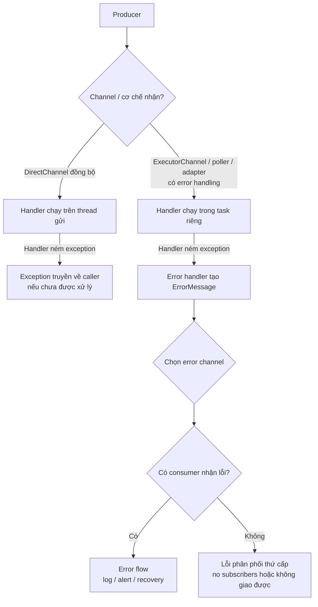

# Error channel không có subscriber

## 1. Triệu chứng và ý nghĩa trong Spring Integration runtime

Trong Spring Integration, lỗi xử lý message không nhất thiết quay về producer. Khi một consumer chạy **bất đồng bộ** qua `ExecutorChannel`, poller hoặc một adapter có cơ chế xử lý lỗi, framework có thể tạo một `ErrorMessage` rồi phát nó đến một **error channel**. Một flow khác phải tiếp nhận message lỗi này để ghi log, cảnh báo, lưu dữ liệu thất bại hoặc điều phối phục hồi.

Vấn đề **“error channel không có subscriber”** xuất hiện khi thông báo lỗi đã được gửi đến một channel cần có consumer đăng ký, nhưng tại thời điểm gửi **không có consumer nào đang nhận từ channel đó**. Triệu chứng thường gặp là thông báo dạng:

```text
org.springframework.messaging.MessageDeliveryException:
Dispatcher has no subscribers for channel '...orders.errors'
```

Thông báo này phản ánh **lỗi phân phối message lỗi**, chứ chưa chắc là nguyên nhân khiến nghiệp vụ ban đầu thất bại. Ví dụ, handler xử lý đơn hàng ném `IllegalStateException`; sau đó việc gửi `ErrorMessage` đến `orders.errors` lại thất bại vì endpoint xử lý lỗi chưa được khởi động. Nếu chỉ tìm dòng “no subscribers”, người vận hành có thể bỏ sót lỗi nghiệp vụ gốc.

Trong phạm vi **SPRING_INTEGRATION_RUNTIME**, mục tiêu là hiểu cách channel, endpoint, consumer, poller và executor điều phối message; nhận diện nhánh xử lý lỗi, kiểm tra vòng đời `IntegrationFlow`, lựa chọn retry/transaction/message store hợp lý và chẩn đoán threading, hiệu năng, correlation ID khi xảy ra sự cố.

> **Điểm cần phân biệt:** một `MessageChannel` có thể tồn tại như bean trong Spring context mà **chưa có subscriber hoạt động**. Việc tìm thấy bean tên `orders.errors` không chứng minh có ai đang xử lý `ErrorMessage` đi qua nó.

## 2. `ErrorMessage`, error channel và subscriber là gì?

Một `ErrorMessage` là message có **payload kiểu `Throwable`**. Payload thường là `MessagingException` chứa nguyên nhân gốc và, nếu được cung cấp, `failedMessage`. Error handler sử dụng thông tin này để xác định message nào lỗi, ở handler nào và có cần phục hồi không.

Các thành phần liên quan:

| Thành phần | Vai trò | Điều cần chú ý |
| --- | --- | --- |
| Handler/endpoint nghiệp vụ | Xử lý payload; có thể ném exception | Đây là nguồn lỗi ban đầu. |
| `ErrorMessage` | Gói một `Throwable` thành message | Không nhầm `ErrorMessage` với payload nghiệp vụ đã thất bại. |
| Error publisher / `ErrorHandler` | Gửi `ErrorMessage` đến channel xử lý lỗi | Chỉ phát sinh khi cơ chế lỗi của đường thực thi hiện tại hỗ trợ việc đó. |
| `errorChannel` header | Chỉ định đích xử lý lỗi gắn với message | Có thể chứa tham chiếu `MessageChannel` hoặc tên channel theo cơ chế resolve. |
| Global `errorChannel` | Đích xử lý lỗi dùng khi không có đích cụ thể thích hợp | Mặc định thường có logging subscriber trong cấu hình Spring Integration thông thường; cần kiểm tra ứng dụng thực tế. |
| Subscriber / consumer endpoint | Đăng ký handler nhận message từ subscribable channel | Có bean nhưng endpoint chưa start thì có thể chưa có consumer. |

### Message lỗi khác message thường ở điểm nào?

```java
import org.springframework.messaging.Message;
import org.springframework.messaging.MessagingException;
import org.springframework.messaging.support.ErrorMessage;

void inspect(ErrorMessage errorMessage) {
    Throwable failure = errorMessage.getPayload();

    if (failure instanceof MessagingException messagingFailure) {
        Message<?> original = messagingFailure.getFailedMessage();
        if (original != null) {
            Object correlationId =
                original.getHeaders().get("correlationId");
            System.out.println("Message lỗi: " + original.getHeaders().getId());
            System.out.println("Correlation: " + correlationId);
        }
    }

    System.out.println("Nguyên nhân: " + failure);
}
```

Một lỗi nghiệp vụ có thể được bọc bởi nhiều exception. Khi xử lý thật, cần đọc `cause` của `Throwable` và thông tin `failedMessage` (nếu có), đồng thời tránh in toàn bộ payload nhạy cảm ra log.

## 3. Đường đi của exception: đồng bộ và bất đồng bộ



**Đường đồng bộ:** Với `DirectChannel`, một lời gọi `send()` thường chuyển message vào handler ngay trên thread gửi. Nếu handler ném exception mà không có lớp xử lý trung gian, exception lan ngược về producer hoặc gateway. Không được mặc định rằng lỗi đồng bộ **luôn được xuất bản** lên global `errorChannel`.

**Đường bất đồng bộ:** Khi message qua executor hoặc poller, caller có thể đã trả về trước khi handler chạy. Khi handler lỗi, cơ chế xử lý lỗi của executor/poller hoặc adapter có thể phát `ErrorMessage`. Lúc đó, **lỗi nghiệp vụ** và **lỗi gửi ErrorMessage** thường được ghi ở worker thread, không nhất thiết xuất hiện trên stack của producer.

**Ví dụ chuỗi sự kiện:**

1. 10:00:00.001 — `orders.in` nhận message `ORD-42`.
2. 10:00:00.003 — Worker chạy handler; handler ném `IllegalStateException("DB timeout")`.
3. 10:00:00.004 — Error handler chọn `orders.errors` từ header.
4. 10:00:00.005 — `orders.errors` là `DirectChannel` nhưng chưa có subscriber; việc phát `ErrorMessage` thất bại.
5. 10:00:00.006 — Log ghi “Dispatcher has no subscribers”; nếu không đối chiếu `cause` và `failedMessage`, lỗi `DB timeout` có thể bị che khuất.

Các mốc chỉ mang tính minh họa; thứ tự và loại exception thực tế phụ thuộc channel, endpoint và phiên bản Spring Integration.

## 4. “Không có subscriber” phụ thuộc loại channel

Không phải mọi channel đều hoạt động giống nhau khi không có người nhận.

| Loại channel được dùng làm đích lỗi | Khi không có consumer/receiver | Hệ quả vận hành |
| --- | --- | --- |
| `DirectChannel` | Không có `MessageHandler` đăng ký để dispatch; thường dẫn đến exception “Dispatcher has no subscribers” | Việc phát lỗi thất bại ngay tại điểm dispatch. |
| `ExecutorChannel` | Vẫn cần subscriber; việc dispatch qua executor không tự tạo consumer | Có thể gặp lỗi dispatch trong đường worker, tùy cấu hình executor và error handler. |
| `PublishSubscribeChannel` | Có thể không giao cho ai, hoặc báo lỗi nếu được cấu hình bắt buộc phải có subscriber | Cần kiểm tra chính sách báo lỗi khi vắng subscriber; không suy luận chỉ từ `send()`. |
| `QueueChannel` | **Không dùng cơ chế subscribe**; message được đưa vào queue nếu còn dung lượng | Không có poller thì message nằm chờ; khi queue đầy có thể timeout hoặc gửi thất bại. |
| `NullChannel` | Bỏ message theo thiết kế | Hợp lý nếu cố ý loại bỏ, nguy hiểm nếu dùng để “giấu” lỗi quan trọng. |

Điểm tinh tế: “không có subscriber” là khái niệm trực tiếp của **subscribable channel**. Với `QueueChannel`, hãy điều tra **poller/receiver có đang chạy và queue có đang tăng hay không**, thay vì tìm subscriber count.

Trong một số cấu hình `PublishSubscribeChannel`, không có subscriber có thể khiến message lỗi không được xử lý mà không tạo lỗi dispatch tương tự `DirectChannel`. Vì vậy cần thiết kế chính sách quan sát và kiểm tra lỗi đúng với loại channel.

## 5. Phân biệt error channel cục bộ, global và đích bị sai

Spring Integration có nhiều cách xác định đích xử lý lỗi:

- **Header `errorChannel` trên message:** thường ưu tiên kênh xử lý lỗi gắn với message, khi cơ chế error publishing hỗ trợ. Có thể đặt bằng `MessageHeaders.ERROR_CHANNEL`.
- **Error channel được cấu hình trên adapter/endpoint/poller:** có thể quy định đích riêng cho nguồn nhận hoặc tác vụ đó.
- **Global `errorChannel`:** là lựa chọn fallback trong các cơ chế publishing hỗ trợ khi không có đích cụ thể.

Thứ tự chi tiết và cơ chế resolve tên channel phụ thuộc loại adapter/endpoint và phiên bản framework; **không nên giả định header luôn ghi đè mọi cấu hình**.

### Vì sao default global thường vẫn có người nhận?

Trong ứng dụng Spring Integration cấu hình thông thường, global `errorChannel` thường là một `PublishSubscribeChannel` có logging handler mặc định. Điều này giúp lỗi bất đồng bộ không biến mất hoàn toàn khi chưa có error flow riêng.

Tuy nhiên, khi ứng dụng **khai báo lại bean tên `errorChannel`**, tự cấu hình `PublishSubscribeChannel`, đặt đích lỗi vào `orders.errors` hoặc điều khiển flow động, cần kiểm chứng subscriber thật sự. Logging subscriber mặc định của global channel không bảo đảm tồn tại trên **mọi channel tùy biến**.

Những lỗi tên/kết nối điển hình:

| Cấu hình dự định | Cấu hình thật | Triệu chứng |
| --- | --- | --- |
| Handler nghe `orders.errors` | Message mang header trỏ `order.errors` | Error flow không nhận message dù đang chạy. |
| Error flow nhận từ `orders.errors` | Message lại gửi về global `errorChannel` | Error flow riêng không thấy lỗi; global có thể chỉ log. |
| Error channel là `DirectChannel` | Flow xử lý lỗi có `autoStartup=false` hoặc đã stop | Subscriber count có thể là 0 khi lỗi xảy ra. |
| Error handler cần `Throwable` | Handler giả định payload là `String` | Có subscriber nhưng tiếp tục lỗi khi xử lý `ErrorMessage`. |
| Header chứa tên string không resolve được | Không có channel bean tương ứng | Có thể lỗi định tuyến/tìm channel, khác lỗi “no subscribers”. |

Cần phân biệt **không tồn tại channel**, **tồn tại nhưng không có subscriber**, và **có subscriber nhưng handler xử lý lỗi lại ném exception**. Đây là ba sự cố khác nhau.

## 6. Tái hiện tối thiểu: `DirectChannel` chưa được subscribe

Đoạn Java độc lập dưới đây cố ý tạo một error channel không có consumer:

```java
import org.springframework.integration.channel.DirectChannel;
import org.springframework.messaging.MessagingException;
import org.springframework.messaging.support.ErrorMessage;

public class MissingErrorSubscriberDemo {
    public static void main(String[] args) {
        DirectChannel errors = new DirectChannel();

        // ErrorMessage bọc Throwable: lỗi gốc là IllegalStateException.
        ErrorMessage errorMessage =
            new ErrorMessage(new IllegalStateException("Xu ly don hang that bai"));

        try {
            errors.send(errorMessage);
        } catch (MessagingException dispatchFailure) {
            System.err.println(dispatchFailure.getMessage());
            // Thường thấy: Dispatcher has no subscribers ...
        }
    }
}
```

Ở đây, message được gửi **trực tiếp đến channel lỗi** để cô lập nguyên nhân. Chưa có nghiệp vụ, poller hay executor trong ví dụ. Lỗi phát sinh vì `DirectChannel` cần ít nhất một `MessageHandler` đăng ký để dispatch.

Thêm consumer bằng API `subscribe`:

```java
errors.subscribe(message -> {
    Throwable error = (Throwable) message.getPayload();
    System.out.println("Đã nhận lỗi: " + error.getMessage());
});

errors.send(new ErrorMessage(new IllegalStateException("Loi thu hai")));
```

Đoạn thứ hai minh họa cách sửa trong chương trình Java đơn giản; `errors` là biến từ ví dụ trên. Trong ứng dụng Spring Integration thật, nên đăng ký consumer endpoint bằng Java DSL hoặc annotation, để Spring quản lý lifecycle và cấu hình.

> Cách kiểm tra nhanh một `DirectChannel`: có thể quan sát `getSubscriberCount()` sau khi ứng dụng/flow đã khởi động. Đừng nhầm số bean được khai báo với số handler thực sự đăng ký vào dispatcher.

## 7. Ví dụ Java DSL: nghiệp vụ lỗi, kênh lỗi có và không có consumer

Ví dụ dùng `ExecutorChannel` cho đơn hàng; khi handler nghiệp vụ ném exception, cơ chế error publishing của nhánh bất đồng bộ có thể tìm đến channel được chỉ định trong header.

```java
import org.springframework.context.annotation.Bean;
import org.springframework.context.annotation.Configuration;
import org.springframework.integration.channel.DirectChannel;
import org.springframework.integration.channel.ExecutorChannel;
import org.springframework.integration.config.EnableIntegration;
import org.springframework.integration.dsl.IntegrationFlow;
import org.springframework.messaging.Message;
import org.springframework.messaging.MessageChannel;
import org.springframework.messaging.MessagingException;
import org.springframework.scheduling.concurrent.ThreadPoolTaskExecutor;

@Configuration
@EnableIntegration
public class OrderErrorFlowConfig {

    @Bean
    ThreadPoolTaskExecutor orderExecutor() {
        ThreadPoolTaskExecutor executor = new ThreadPoolTaskExecutor();
        executor.setCorePoolSize(2);
        executor.setMaxPoolSize(2);
        executor.setQueueCapacity(20);
        executor.setThreadNamePrefix("orders-worker-");
        return executor;
    }

    @Bean("orders.in")
    MessageChannel ordersIn(ThreadPoolTaskExecutor orderExecutor) {
        return new ExecutorChannel(orderExecutor);
    }

    @Bean("orders.errors")
    DirectChannel ordersErrors() {
        return new DirectChannel();
    }

    @Bean("orders.orphanErrors")
    DirectChannel ordersOrphanErrors() {
        // Cố ý chưa có consumer để minh họa tình huống lỗi.
        return new DirectChannel();
    }

    @Bean
    IntegrationFlow orderProcessing() {
        return IntegrationFlow.from("orders.in")
            .handle(String.class, (payload, headers) -> {
                throw new IllegalStateException(
                    "Khong xu ly duoc don hang " + payload);
            })
            .get();
    }

    @Bean
    IntegrationFlow orderErrorHandling() {
        return IntegrationFlow.from("orders.errors")
            .handle(Throwable.class, (failure, headers) -> {
                System.err.println("Lỗi nghiệp vụ: " + failure);

                if (failure instanceof MessagingException messagingError) {
                    Message<?> failed = messagingError.getFailedMessage();
                    if (failed != null) {
                        Object traceId = failed.getHeaders().get("traceId");
                        System.err.println("traceId=" + traceId);
                    }
                }
                // Đây là endpoint một chiều: sau khi xử lý không tạo reply.
                return null;
            })
            .get();
    }
}
```

Cấu hình minh họa có **hai channel lỗi**:

- `orders.errors` có consumer do flow `orderErrorHandling` đăng ký sau khi được khởi động.
- `orders.orphanErrors` là `DirectChannel` không có consumer; nếu gửi `ErrorMessage` tới đó, dispatcher không có nơi giao message.

Gửi message với header mang chính bean error channel, tránh phụ thuộc cơ chế resolve tên string:

```java
import org.springframework.context.ApplicationContext;
import org.springframework.messaging.MessageChannel;
import org.springframework.messaging.MessageHeaders;
import org.springframework.messaging.support.MessageBuilder;

void sendOrder(ApplicationContext context, boolean routeToOrphan) {
    MessageChannel input = context.getBean(
        "orders.in", MessageChannel.class);

    MessageChannel errorDestination = context.getBean(
        routeToOrphan ? "orders.orphanErrors" : "orders.errors",
        MessageChannel.class);

    input.send(MessageBuilder.withPayload("ORD-2026")
        .setHeader("traceId", "req-71")
        .setHeader(MessageHeaders.ERROR_CHANNEL, errorDestination)
        .build());
}
```

Nếu gọi `sendOrder(context, false)` khi các endpoint đã hoạt động, lỗi do handler nghiệp vụ phát sinh sẽ được chuyển đến flow xử lý lỗi, theo cơ chế của `ExecutorChannel`/error handler. Nếu gọi `sendOrder(context, true)`, việc phát `ErrorMessage` có thể ném `MessageDeliveryException` trên đường worker vì đích `orders.orphanErrors` không có subscriber. Đừng mong lỗi bất đồng bộ luôn xuất hiện như exception của lời gọi `input.send` bên producer.

Đây là minh họa đường lỗi; hệ thống thật cần chính sách retry, cảnh báo và phục hồi rõ ràng, tránh xử lý bằng `System.err` trong production.

## 8. Nguyên nhân từ vòng đời IntegrationFlow và endpoint

Một channel nhận lỗi có thể hoạt động ổn khi ứng dụng mới chạy, nhưng mất subscriber sau một thay đổi runtime. Các trường hợp cần kiểm tra:

1. **Flow chưa start:** endpoint xử lý lỗi được cấu hình `autoStartup=false` hoặc đang chờ start. Bean channel vẫn tồn tại nhưng endpoint chưa subscribe.
2. **Flow bị stop:** một consumer endpoint đã unsubscribe khỏi subscribable channel khi dừng; producer vẫn tiếp tục gửi lỗi.
3. **Flow động bị remove:** dùng `IntegrationFlowContext` để đăng ký/hủy đăng ký flow động; khi flow error handler bị gỡ, error channel không còn nơi nhận.
4. **Sai instance/channel:** consumer đăng ký vào bean channel khác dù tên hoặc cách tạo channel trông tương tự; gửi trực tiếp đến đối tượng `DirectChannel` khác không giúp flow kia nhận.
5. **Khởi động có thứ tự không phù hợp:** producer/adapter nhận message trước khi error flow sẵn sàng; lỗi chỉ xuất hiện trong cửa sổ startup/shutdown.
6. **Có subscriber nhưng xử lý lỗi thất bại:** lúc này nên xem lỗi của handler, cấu hình output/error flow và vòng lặp lỗi; không gán mọi sự cố cho subscriber count.

Nếu error handling là điều kiện bắt buộc trước khi nhận traffic, hãy thiết kế lifecycle/startup order và readiness phù hợp. Khi quản lý nhiều flow bằng `IntegrationFlowContext`, cần điều phối start/stop theo phụ thuộc thay vì chỉ kiểm tra “flow bean đã đăng ký”.

Đối với một `DirectChannel`, có thể kiểm tra runtime:

```java
DirectChannel errorChannel = context.getBean(
    "orders.errors", DirectChannel.class);

int subscribers = errorChannel.getSubscriberCount();
System.out.println("Số consumer error channel: " + subscribers);
```

Giá trị 0 là tín hiệu cần điều tra nếu kênh này phải có consumer; giá trị lớn hơn 0 **chỉ chứng minh có handler đăng ký**, không bảo đảm handler sẽ xử lý thành công hay lưu lỗi bền vững.

## 9. Chẩn đoán trên hệ thống đang chạy

Khi gặp log “Dispatcher has no subscribers”, nên điều tra **cả lỗi gốc và lỗi phân phối thứ cấp** theo trình tự:

| Bước | Câu hỏi cần trả lời | Bằng chứng cần thu thập |
| --- | --- | --- |
| 1. Xác định channel | Tên sau “channel” trong log là `errorChannel`, `orders.errors` hay một channel nghiệp vụ? | Tên bean, lớp channel, integration graph. |
| 2. Xác định nguồn lỗi | Exception nào khiến ErrorMessage được tạo? | Root cause, stack trace, `MessagingException.failedMessage`. |
| 3. Xác định thread | Lỗi xuất hiện trong producer, poller hay executor worker? | Thread name, thời điểm producer trả về, log task executor. |
| 4. Kiểm tra đích | Message mang header `errorChannel` nào; adapter có đích lỗi riêng không? | Header thực tế và cấu hình error publisher. |
| 5. Kiểm tra consumer | Endpoint nghe đúng channel chưa; có đang running không? | Subscriber count (nếu áp dụng), lifecycle, flow registration. |
| 6. Kiểm tra kiểu channel | Channel có dispatcher hay hàng đợi? | `DirectChannel` / `PublishSubscribeChannel` / `QueueChannel`, queue depth. |
| 7. Kiểm tra phục hồi | Message lỗi đã được log/lưu/đưa DLQ hay bị mất? | Log handler, message store/broker, retry count, xác nhận xử lý. |

Ví dụ log điều tra theo **traceId** hoặc **correlationId**:

```text
orders-worker-1 traceId=req-71 order=ORD-2026 exception=DB_TIMEOUT
orders-worker-1 traceId=req-71 errorChannel=orders.orphanErrors
orders-worker-1 ERROR Dispatcher has no subscribers ...
```

Hai dòng lỗi gần nhau có cùng traceId không nhất thiết cùng exception. Với `ErrorMessage`, tra `failedMessage` để biết payload business ban đầu; kiểm tra nested cause để tách lỗi nghiệp vụ và lỗi phân phối.

### Kiểm tra metric và trạng thái

- Đo số lượng message đến channel lỗi, số lượng message **được error handler nhận**, số lần error handler thất bại và độ trễ giữa thời điểm lỗi và thời điểm xử lý.
- Với `QueueChannel`, quan sát độ sâu queue, tốc độ poll, số poller và độ trễ chờ. Queue có message không có nghĩa message đã được xử lý.
- Với `ExecutorChannel`, theo dõi queue của executor, active threads, rejected tasks; không nhầm lỗi thiếu subscriber với lỗi thiếu worker hoặc thread pool bị từ chối task.
- Với flow có splitter/aggregator, giữ `correlationId`, `sequenceNumber` và `sequenceSize` thích hợp để xác định message bị lỗi trong nhóm. Không giả định ErrorMessage tự có tất cả custom headers của failed message.

## 10. Khắc phục đúng nguyên nhân và thiết kế phục hồi

### A. Error channel có subscriber thật sự

Với kênh lỗi có chức năng quan trọng, đăng ký **error handling flow** như ví dụ ở phần 7, gắn đúng input channel, khởi động endpoint trước khi producer nhận traffic. Nếu dùng channel tùy biến, quyết định rõ có chấp nhận **không người nhận** hay cần báo lỗi ngay. Kiểm tra end-to-end bằng cách cố ý phát sinh exception và xác nhận handler nhận `Throwable`.

### B. Chọn nơi lưu lỗi nếu không được phép mất message

Nếu phải phục hồi sau restart, cân nhắc lưu thông tin lỗi có cấu trúc (message ID, correlation, nguyên nhân, payload đã lọc dữ liệu nhạy cảm) vào kho bền vững hoặc đưa vào dead-letter queue/broker phù hợp. `QueueChannel` in-memory đơn thuần không đảm bảo durability qua restart, dù `send()` trả thành công. Với persistent message store, xác định khả năng serialize/deserialize payload và headers; không phải mọi đối tượng exception đều thích hợp để lưu trực tiếp.

### C. Giới hạn retry và bảo đảm idempotency

Retry xử lý lỗi phân phối (`ErrorMessage` không đến subscriber) không tự sửa được nghiệp vụ ban đầu. Phân biệt:

- **Lỗi nghiệp vụ tạm thời:** timeout database hoặc dịch vụ ngoài; có thể retry có giới hạn, backoff và idempotency.
- **Dữ liệu không hợp lệ:** lỗi parse/validation; thường nên reject, ghi lý do và chuyển sang kênh cần xử lý riêng.
- **Error flow mất subscriber:** thường là lỗi cấu hình/lifecycle; cần sửa routing hoặc bật endpoint, không retry vô hạn khi kênh vẫn không có người nhận.

Nếu một message bị thực thi lại, tác vụ đã chạy trước lỗi (ghi DB, gọi API, gửi thông báo) có thể bị lặp. Thiết kế idempotency key, ranh giới transaction và chính sách xác nhận message theo transport.

### D. Transaction và acknowledgement cần được đánh giá riêng

Một error flow đã log `ErrorMessage` **không có nghĩa** transaction nghiệp vụ đã commit hoặc message gốc đã được acknowledge đúng. Trong đường đồng bộ, transaction có thể rollback theo exception. Trong đường bất đồng bộ, executor thường tạo ranh giới thread và transaction riêng; poller hoặc inbound broker adapter có cơ chế transaction/ack riêng. Hãy xác định trạng thái cuối của message gốc (ack, requeue, rollback, DLQ), thay vì lấy kết quả `send(ErrorMessage)` làm quyết định nghiệp vụ.

### E. Tránh vòng lặp lỗi

Nếu handler trên `orders.errors` lại ném exception, cơ chế error handling có thể tạo thêm lỗi hoặc log thất bại thứ cấp, tùy topology. Tránh gửi lại `ErrorMessage` về chính channel gây lỗi mà không có giới hạn. Handler xử lý lỗi cần đơn giản, có thể quan sát, có fallback và giới hạn retry.

## 11. Những hiểu lầm cần tránh

| Nhận định sai | Cách hiểu đúng |
| --- | --- |
| “Không có subscriber” nghĩa là channel bean không tồn tại | Channel có thể tồn tại nhưng chưa có consumer đã start. |
| Cứ khai báo `errorChannel` là mọi lỗi sẽ đến đó | Lỗi đồng bộ có thể lan ngược cho caller; adapter/header có thể chọn đích khác. |
| Global `errorChannel` mặc định luôn có 0 subscriber | Thông thường có logging subscriber; cần kiểm tra cấu hình thật, nhất là khi override bean. |
| `send(ErrorMessage)` thành công tức là lỗi đã được khắc phục | Chỉ liên quan giao message đến channel; hiệu quả xử lý/khôi phục còn ở phía consumer. |
| Mọi channel đều ném “no subscribers” | `QueueChannel`, `PublishSubscribeChannel` và `NullChannel` có ngữ nghĩa khác. |
| Không thấy exception tại producer tức là không có lỗi | Lỗi có thể xảy ra trên executor/poller sau khi producer trả về. |
| Chỉ cần retry liên tục là hết lỗi | Sai nếu nguyên nhân là chưa start error endpoint, sai tên channel hoặc thiếu handler. |
| Có subscriber là error handling đủ an toàn | Consumer vẫn có thể lỗi, queue có thể không bền vững, hoặc xử lý lại gây side effect lặp. |

## 12. Bài thực hành có hướng dẫn

**Bài 1 — Tái hiện lỗi thiếu subscriber.** Chạy đoạn Java ở phần 6. Ghi lại loại exception và nội dung “no subscribers”; sau đó thêm `subscribe` rồi gửi lại. Giải thích vì sao lần sau không còn lỗi dispatch.

**Bài 2 — So sánh hai kênh lỗi.** Khởi động cấu hình ở phần 7; lần lượt gọi `sendOrder(context, false)` và `sendOrder(context, true)`. Theo dõi log trên `orders-worker-*`. Chỉ ra lỗi nghiệp vụ gốc và điều gì thay đổi khi đích là `orders.orphanErrors`.

**Bài 3 — Kiểm chứng vòng đời.** Dừng endpoint `orderErrorHandling` trong môi trường thử nghiệm theo cơ chế quản lý lifecycle của ứng dụng (không dừng toàn bộ app). Kiểm tra subscriber count và phát message lỗi. Khởi động lại endpoint, so sánh kết quả. Không cần thay đổi channel bean để tạo sự cố này.

**Bài 4 — So sánh channel.** Thay kênh lỗi trong bài thử bằng `PublishSubscribeChannel` và `QueueChannel` (có/không có receiver phù hợp). Quan sát giá trị trả về của `send`, queue depth và exception. Ghi rõ chính sách áp dụng với cấu hình/framework version đang sử dụng.

**Bài 5 — Thiết kế phục hồi.** Giả sử adapter đọc 100 message/giây, 2% lỗi nghiệp vụ; error endpoint bị dừng 5 phút. Ước tính số message lỗi cần lưu nếu muốn phục hồi đầy đủ: `100 × 0,02 × 300 = 600` message. Giải thích vì sao chỉ tăng thread count của executor không giải quyết vấn đề, và cần giám sát queue/broker, retention, retry, idempotency như thế nào.

**Câu hỏi tự kiểm tra:**

1. Vì sao một `DirectChannel` tồn tại vẫn có thể báo “Dispatcher has no subscribers”?
2. Lỗi ban đầu và lỗi publish `ErrorMessage` có quan hệ như thế nào? Đọc `failedMessage` để tìm gì?
3. Khi nào exception lan về `send()` của producer, khi nào phát sinh ở worker/poller?
4. Vì sao `QueueChannel` không phù hợp để chẩn đoán bằng subscriber count?
5. Vì sao chỉ nhìn thấy global `errorChannel` không đủ để kết luận mọi error flow đều đã hoạt động?
6. Nếu cần không mất message lỗi sau restart, phải bổ sung những đảm bảo nào ngoài việc tạo consumer?

**Nguyên tắc vận hành:** điều tra nguồn exception gốc trước, xác định chính xác channel nhận `ErrorMessage` và trạng thái consumer ở thời điểm lỗi, rồi chọn phương án sửa lifecycle/routing và chính sách phục hồi phù hợp. Khi cần xử lý lỗi đáng tin cậy, phải kiểm chứng cả delivery, xử lý, lưu trữ và retry của **message gốc**, không chỉ sự tồn tại của error channel.
