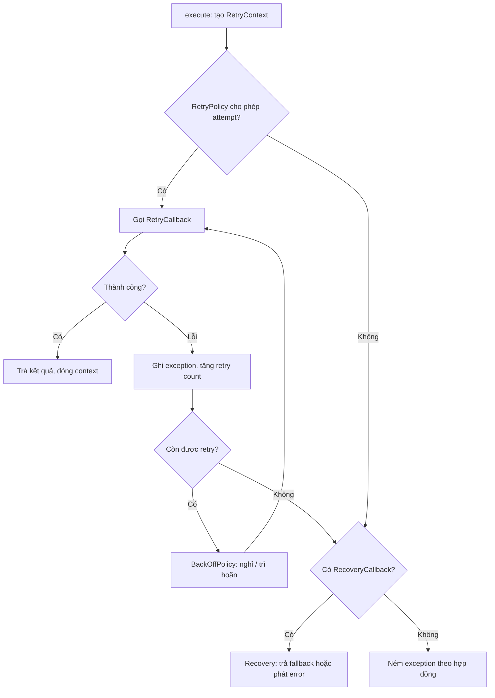
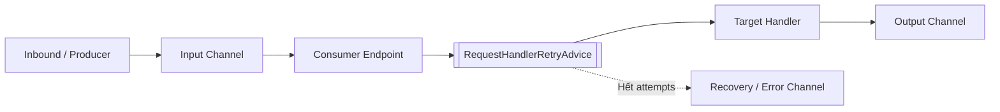

# RetryTemplate, RetryPolicy và BackOffPolicy trong Spring Integration runtime

## 1. Bối cảnh: retry tại điểm nào của message flow?

Một hệ thống tích hợp thường gặp lỗi tạm thời: REST API trả lỗi quá tải, kết nối cơ sở dữ liệu mất trong chốc lát, dịch vụ phía đối tác timeout, hoặc broker tạm ngắt kết nối. **Retry** là thực hiện lại một thao tác thất bại theo chính sách có giới hạn, với hy vọng nguyên nhân tạm thời đã biến mất. Retry sai cách lại có thể làm dịch vụ quá tải hơn, giữ thread quá lâu, phát sinh giao dịch trùng và tạo vòng lặp message lỗi.

Trong module **SPRING_INTEGRATION_RUNTIME**, cần đặt retry vào đúng đường chạy: **channel → consumer endpoint → message handler → downstream channel**. Ba thành phần quan trọng từ dự án *Spring Retry* (được Spring Integration 6.5 sử dụng) là:

| Thành phần | Câu hỏi nó trả lời | Vai trò |
| --- | --- | --- |
| `RetryTemplate` | **Thực hiện retry như thế nào?** | Điều phối callback nghiệp vụ, theo dõi `RetryContext`, gọi policy, đợi theo backoff, trả kết quả hoặc chuyển sang recovery. |
| `RetryPolicy` | **Có nên thử lại? Thử tối đa mấy lần?** | Quyết định dựa trên exception, số lần đã thử, thời gian hoặc trạng thái; các lựa chọn như `SimpleRetryPolicy`, `TimeoutRetryPolicy`. |
| `BackOffPolicy` | **Đợi bao lâu giữa hai lần thử?** | Quy định khoảng nghỉ giữa những lần retry: ngay lập tức, cố định, tăng dần, ngẫu nhiên. |

Đi kèm là `RecoveryCallback`: **làm gì sau khi không thể/không được retry nữa**. Trong Spring Integration, `RequestHandlerRetryAdvice` áp dụng `RetryTemplate` tại một handler cụ thể. Nó không mặc nhiên lặp lại toàn bộ IntegrationFlow hoặc gửi lại message tới đầu vào.

> **Phạm vi phiên bản:** Bài sử dụng API **Spring Integration 6.5.x + Spring Retry 2.x**, ví dụ các package `org.springframework.retry.*` và `RequestHandlerRetryAdvice.setRetryTemplate(...)`. Spring Integration 7.x đã có thay đổi về nền tảng retry; khi nâng cấp cần đối chiếu đúng tài liệu của phiên bản đang chạy thay vì sao chép cấu hình giữa các nhánh.

## 2. Vòng đời của một `RetryTemplate.execute(...)`

`RetryTemplate` nhận một `RetryCallback` chứa thao tác cần thử, một `RetryPolicy` và một `BackOffPolicy`. Mỗi lần gọi `execute(...)` có `RetryContext` riêng để lưu số lần thất bại và exception gần nhất.



Một số chi tiết cần ghi nhớ:

- `RetryContext.getRetryCount()` bắt đầu từ **0** trong lần thử đầu tiên; sau mỗi failure được ghi nhận, số này tăng.
- **`maxAttempts = 4` nghĩa là tổng cộng tối đa bốn lần gọi callback: 1 lần đầu + 3 lần thử lại.** Không phải bốn lần retry sau lần đầu.
- Backoff thường được gọi **giữa các lần thử**, không đợi trước lần đầu và không đợi thêm sau khi đã hết attempts.
- Mặc định `RetryTemplate` của Spring Retry 2.x thử tối đa **3 attempts** và **không có khoảng nghỉ**. Khi tích hợp production, nên tự khai báo chính sách thay vì phụ thuộc mặc định.
- Callback có thể thành công trong lần đầu, nên không có lý do để nghỉ đủ các khoảng backoff nếu không phát sinh lỗi.
- Nếu không khai báo `RecoveryCallback`, exception cuối cùng được ném lại; nếu có recovery, kết quả của recovery có thể thay đổi cách caller nhận biết thất bại.

## 3. Ví dụ Spring Retry thuần: cấu hình `RetryTemplate`

Ví dụ sau mô phỏng một thao tác đọc trạng thái giao dịch qua dịch vụ ngoài. Đây là đoạn Java dùng **Spring Retry 2.x**, độc lập với channel và endpoint.

```java
import java.io.IOException;
import org.springframework.retry.support.RetryTemplate;

interface RemoteStatusApi {
    String fetchStatus(String paymentId) throws IOException;
}

class PaymentStatusClient {
    private final RemoteStatusApi remote;

    PaymentStatusClient(RemoteStatusApi remote) {
        this.remote = remote;
    }

    String readStatus(String paymentId) {
        RetryTemplate retry = RetryTemplate.builder()
                .maxAttempts(4)                      // 1 lần đầu + 3 retries
                .exponentialBackoff(200L, 2.0, 1_000L) // milliseconds
                .retryOn(IOException.class)
                .build();

        return retry.execute(
                context -> remote.fetchStatus(paymentId),
                context -> {
                    throw new IllegalStateException(
                            "Cannot fetch status for " + paymentId,
                            context.getLastThrowable());
                });
    }
}
```

Nếu bốn attempts đều gặp `IOException`, thời gian nghỉ theo cấu hình lần lượt là **200 ms, 400 ms, 800 ms**. Tổng backoff được lên kế hoạch là **1.400 ms**, chưa tính thời gian gọi mạng, xử lý callback, scheduling và độ trễ thực tế. Nếu thành công ở attempt thứ hai, chỉ nghỉ 200 ms. Nếu lỗi là `IllegalArgumentException`, cấu hình `retryOn(IOException.class)` không xem đó là lỗi được retry; recovery vẫn có thể được gọi ngay theo hợp đồng của template.

Đối với yêu cầu có deadline, cần xem cả **network timeout**, thời gian mỗi attempt, tổng khoảng nghỉ và deadline của caller/gateway. Backoff **không** tự đặt timeout cho một HTTP call đang treo. Hãy cấu hình timeout ở client network trước, rồi mới cân nhắc giới hạn tổng retry.

### Cấu hình tách `RetryPolicy` và `BackOffPolicy` bằng setter

```java
import org.springframework.retry.backoff.ExponentialBackOffPolicy;
import org.springframework.retry.policy.SimpleRetryPolicy;
import org.springframework.retry.support.RetryTemplate;

SimpleRetryPolicy attempts = new SimpleRetryPolicy();
attempts.setMaxAttempts(4);

ExponentialBackOffPolicy delay = new ExponentialBackOffPolicy();
delay.setInitialInterval(200L);
delay.setMultiplier(2.0);
delay.setMaxInterval(1_000L);

RetryTemplate template = new RetryTemplate();
template.setRetryPolicy(attempts);
template.setBackOffPolicy(delay);
```

Đoạn này minh họa **hợp đồng riêng của từng thành phần**, không áp đặt chỉ retry `IOException`: `SimpleRetryPolicy` mặc định phân loại nhiều loại exception có thể retry. Để hạn chế kiểu lỗi, dùng builder `retryOn(...)` hoặc cấu hình bản đồ/phân loại exception cho policy.

## 4. Chọn `RetryPolicy`: số lần, ngoại lệ, thời gian

`RetryPolicy` trả lời xem thao tác còn được thực hiện tiếp hay không. Có nhiều chiến lược:

| Policy / lựa chọn | Cách quyết định | Trường hợp sử dụng |
| --- | --- | --- |
| `SimpleRetryPolicy` | Giới hạn attempts, phân loại exception. | Lỗi tạm thời có thể đoán trước như `IOException`, timeout. |
| `NeverRetryPolicy` | Không thử lại sau thất bại. | Thao tác không an toàn để lặp hoặc dữ liệu lỗi cố định. |
| `AlwaysRetryPolicy` | Cho phép tiếp tục retry. | Chỉ dùng với kiểm soát thời gian/huỷ/chặn phù hợp; rất nguy hiểm nếu không giới hạn. |
| `TimeoutRetryPolicy` | Cho phép retry trong khoảng thời gian nhất định. | Có ngân sách thời gian, nhưng không thay thế timeout của từng I/O call. |
| `CompositeRetryPolicy` | Kết hợp nhiều policy (ví dụ số lần và thời gian). | Cần nhiều điều kiện cùng được thoả; kiểm tra cờ optimistic/pessimistic khi cấu hình. |
| `ExceptionClassifierRetryPolicy` | Chọn policy theo kiểu exception. | Các nhóm lỗi có giới hạn retry khác nhau. |

Một chính sách hợp lý thường phân biệt:

- **Lỗi tạm thời:** HTTP 429/503 có điều kiện, kết nối bị reset, quá tải có thể phục hồi, database deadlock có chính sách thử lại rõ ràng. Có thể retry nhưng phải giới hạn.
- **Lỗi cố định:** JSON sai schema, thiếu trường bắt buộc, yêu cầu nghiệp vụ không hợp lệ, authentication do cấu hình sai, một số HTTP 4xx. Nên dừng sớm hoặc đưa sang luồng xử lý lỗi.
- **Lỗi không rõ:** không tùy tiện retry mọi `RuntimeException`. Phải phân loại dựa trên nguyên nhân thực và hợp đồng của hệ thống xa.

Khi Spring Integration gọi POJO handler, exception nghiệp vụ có thể được bọc trong `MessagingException`. Nếu policy chỉ `retryOn(IOException.class)` mà kiểm tra **exception ngoài cùng**, nó có thể không nhận ra `IOException` bên trong. Spring Retry 2.x cho phép bật duyệt chuỗi cause:

```java
RetryTemplate retryTemplate = RetryTemplate.builder()
        .maxAttempts(4)
        .retryOn(java.io.IOException.class)
        .traversingCauses()
        .fixedBackoff(250L)
        .build();
```

Với cấu hình này, policy tìm `IOException` ở chuỗi nguyên nhân (nếu có). Duyệt causes không có nghĩa mọi exception đều được retry; vẫn phải xét loại lỗi. Các lỗi không retryable vẫn có thể đi thẳng vào recovery nếu template có recovery callback.

**Kiểm tra convention đếm attempts:** trong Spring Retry 2.x, `SimpleRetryPolicy(3)` và builder `maxAttempts(3)` đều tính **cả lần gọi đầu tiên**. Một số thư viện/broker lại dùng tên `maxRetries` để chỉ *số lần thử thêm*; đây là nguồn gây lỗi off-by-one khi ghép nhiều lớp retry.

## 5. Chọn `BackOffPolicy`: khoảng nghỉ và hậu quả runtime

`BackOffPolicy` là chiến lược điều tiết thời gian giữa các attempts, không phân loại exception. Các lựa chọn phổ biến:

| Policy | Hành vi giữa các lần retry | Ưu/nhược điểm |
| --- | --- | --- |
| `NoBackOffPolicy` | Thử lại ngay. | Nhanh nếu lỗi thoáng qua cực ngắn, nhưng dễ dồn tải khi hệ thống xa đang lỗi. |
| `FixedBackOffPolicy` | Nghỉ một thời lượng cố định, ví dụ 250 ms. | Dễ dự đoán; nhiều client đồng bộ có thể retry cùng nhịp. |
| `ExponentialBackOffPolicy` | Tăng thời gian nghỉ theo cấp số nhân đến trần. | Giảm áp lực khi outage kéo dài, nhưng làm tăng latency và giữ worker. |
| `ExponentialRandomBackOffPolicy` | Tăng theo cấp số nhân có yếu tố ngẫu nhiên. | Giảm hiện tượng nhiều client đồng loạt retry, khó dự báo chính xác thời gian từng lần. |
| `UniformRandomBackOffPolicy` | Chọn nghỉ ngẫu nhiên trong khoảng min/max. | Giảm đồng bộ giữa các consumer, cần quan sát phân bố latency. |

Ví dụ cho exponential: `initialInterval = 100 ms`, `multiplier = 2`, `maxInterval = 800 ms`:

```text
Attempt 1: gọi ngay; nếu thất bại -> đợi 100 ms
Attempt 2: gọi lại; nếu thất bại -> đợi 200 ms
Attempt 3: gọi lại; nếu thất bại -> đợi 400 ms
Attempt 4: gọi lại; nếu thất bại -> đợi 800 ms
Attempt 5: gọi lại; nếu thất bại -> có thể kết thúc (nếu maxAttempts=5)
```

Với `maxAttempts=5`, chỉ có **4 lần nghỉ**. Trong Spring Retry 2.x, `BackOffPolicy.backOff(...)` thường trì hoãn **thread đang thực hiện retry**. Điều này có hậu quả:

1. Trên `DirectChannel`, sender có thể bị chặn trong toàn bộ khoảng retry; gateway đồng bộ có thể timeout trước khi handler hết attempts.
2. Trên `ExecutorChannel`, một worker thread có thể bị giữ để ngủ; số lượng tác vụ tồn chờ tăng khi nhiều message cùng retry.
3. Với `QueueChannel` và poller, thread polling có thể ngủ giữa các lần retry của handler, làm giảm số message xử lý mỗi giây.
4. Nếu transaction đã mở trong cùng phạm vi, giữ thread chờ có thể kéo dài thời gian giữ resource/lock; phải xét advice order và transaction boundary.

Khi throughput cao, có thể cần retry bất đồng bộ/scheduler, broker redelivery hoặc hàng đợi delay thay vì `Thread.sleep` bên trong stateless retry. Các giải pháp đó có semantics acknowledgement, ordering và message duplication khác nhau, cần thiết kế riêng.

## 6. Tích hợp Spring Integration: `RequestHandlerRetryAdvice`

`RequestHandlerRetryAdvice` là một **handler advice**. Nó bọc lời gọi của **handler được cấu hình**, không bọc mọi endpoint của flow. Ví dụ dưới đây sử dụng `@ServiceActivator(adviceChain = "paymentRetryAdvice")`, nghĩa là chỉ lệnh gọi method `submit(...)` được retry. Giả định ứng dụng dùng Spring Integration 6.5, Spring Retry 2.x và các dependencies thông dụng.

Định nghĩa message và một service mô phỏng lỗi theo mã thanh toán:

```java
import java.io.IOException;
import org.springframework.integration.annotation.ServiceActivator;
import org.springframework.messaging.handler.annotation.Payload;
import org.springframework.stereotype.Component;

record PaymentCommand(String paymentId, long amount) { }

@Component
class PaymentHandler {
    @ServiceActivator(
            inputChannel = "paymentCommands",
            adviceChain = "paymentRetryAdvice")
    public void submit(@Payload PaymentCommand command) throws IOException {
        if (command.paymentId().startsWith("fail-")) {
            throw new IOException("Simulated downstream outage");
        }
        // Trong ứng dụng thật: gọi API ngoài, có timeout và idempotency key.
    }
}
```

Cấu hình hai channel và advice. `paymentRecovery` là một `QueueChannel` dành riêng để quan sát kết quả recovery; trong production thường là consumer phát sự kiện lỗi, dead-letter/quarantine hoặc hệ thống xử lý thủ công:

```java
import org.springframework.beans.factory.annotation.Qualifier;
import org.springframework.context.annotation.Bean;
import org.springframework.context.annotation.Configuration;
import org.springframework.integration.annotation.EnableIntegration;
import org.springframework.integration.channel.DirectChannel;
import org.springframework.integration.channel.QueueChannel;
import org.springframework.integration.handler.advice.ErrorMessageSendingRecoverer;
import org.springframework.integration.handler.advice.RequestHandlerRetryAdvice;
import org.springframework.messaging.MessageChannel;
import org.springframework.messaging.PollableChannel;
import org.springframework.retry.support.RetryTemplate;

@Configuration
@EnableIntegration
class PaymentRetryConfiguration {
    @Bean
    MessageChannel paymentCommands() {
        return new DirectChannel();
    }

    @Bean
    PollableChannel paymentRecovery() {
        return new QueueChannel();
    }

    @Bean("paymentRetryAdvice")
    RequestHandlerRetryAdvice paymentRetryAdvice(
            @Qualifier("paymentRecovery") MessageChannel recoveryChannel) {

        RetryTemplate template = RetryTemplate.builder()
                .maxAttempts(4)                      // Tổng cộng 4 lần
                .retryOn(java.io.IOException.class)
                .traversingCauses()
                .exponentialBackoff(200L, 2.0, 1_000L)
                .build();

        RequestHandlerRetryAdvice advice = new RequestHandlerRetryAdvice();
        advice.setRetryTemplate(template);
        advice.setRecoveryCallback(
                new ErrorMessageSendingRecoverer(recoveryChannel));
        return advice;
    }
}
```

Gửi thử từ một đoạn integration test có `ApplicationContext` đã chạy:

```java
import org.springframework.context.ApplicationContext;
import org.springframework.messaging.Message;
import org.springframework.messaging.MessageChannel;
import org.springframework.messaging.PollableChannel;
import org.springframework.messaging.support.ErrorMessage;
import org.springframework.messaging.support.MessageBuilder;

void exercise(ApplicationContext context) {
    MessageChannel input =
            context.getBean("paymentCommands", MessageChannel.class);
    PollableChannel recovery =
            context.getBean("paymentRecovery", PollableChannel.class);

    input.send(MessageBuilder
            .withPayload(new PaymentCommand("fail-42", 100_000L))
            .setHeader("correlationId", "order-42")
            .build());

    Message<?> recovered = recovery.receive(3_000);
    if (!(recovered instanceof ErrorMessage error)) {
        throw new IllegalStateException("Expected retry recovery error");
    }
    Throwable cause = error.getPayload();
    // Kiểm tra cause, failedMessage/correlationId theo hợp đồng recovery.
}
```

Giải thích đường chạy:

1. `paymentCommands` là `DirectChannel` nên handler và các lần thử stateless thông thường chạy đồng bộ trong thread gọi `send()`.
2. `submit(...)` ném `IOException`; advice gọi lại method theo `RetryTemplate`. Với `maxAttempts=4` và exponential backoff, nếu vẫn thất bại sẽ có ba khoảng nghỉ dự kiến: 200, 400, 800 ms.
3. Sau khi hết attempts, `ErrorMessageSendingRecoverer` gửi `ErrorMessage` chứa exception và ngữ cảnh liên quan đến `paymentRecovery`.
4. Recovery callback có thể trả về `null` để đánh dấu đã xử lý failure theo cách riêng. Vì thế **`send()` có thể kết thúc mà không ném lỗi cuối cùng**; không được xem điều đó là bằng chứng thanh toán thành công.

Nếu **không** cấu hình `RecoveryCallback`, exception sau lần thử cuối thường được ném ngược lại caller trong flow đồng bộ hoặc được xử lý bởi error handling của endpoint nguồn. `errorChannel` đầu vào và `paymentRecovery` ở ví dụ **khác vai trò**: cái đầu thuộc cơ chế xuất bản lỗi khi endpoint/adapter nhận thất bại, cái sau là kênh được recovery callback chủ động gửi `ErrorMessage` vào.

> Không đặt thêm một `@ServiceActivator` khác cùng tiêu thụ `paymentCommands` để “xem lỗi”; với `DirectChannel` có nhiều subscriber, message thường được phân phối tới một consumer được chọn theo dispatcher, không phải broadcast. Quan sát lỗi qua `paymentRecovery` hoặc một channel phù hợp.

## 7. Recovery: chọn kết thúc bằng lỗi, fallback hay chuyển luồng

`RecoveryCallback<T>` nhận `RetryContext` để quyết định việc tiếp theo sau khi policy hết khả năng retry. Các lựa chọn:

| Recovery | Hành vi | Điểm cần cân nhắc |
| --- | --- | --- |
| Không có callback | Ném exception còn lại. | Caller/transaction/broker có cơ hội phát hiện lỗi; phải cấu hình xử lý phía trên. |
| Trả giá trị fallback | Tiếp tục như callback đã trả kết quả thay thế. | Dễ che lấp thất bại; chỉ dùng khi fallback thực sự hợp lệ về nghiệp vụ. |
| `ErrorMessageSendingRecoverer` | Phát một `ErrorMessage` sang channel. | Cần consumer, lưu giữ dữ liệu, cảnh báo; đừng lẫn “đã chuyển sang recovery” với “đã xử lý xong nghiệp vụ”. |
| Phát message đến dead-letter/quarantine | Lưu lỗi để kiểm tra và phát lại có kiểm soát. | Phải bảo đảm bền vững, idempotency và tránh retry-loop khi replay. |

Một callback phục hồi thuần Java có thể dùng kết quả dự phòng:

```java
String status = template.execute(
        context -> remote.fetchStatus("PAY-42"),
        context -> {
            // Chỉ hợp lệ nếu nghiệp vụ cho phép trạng thái dự phòng.
            return "UNKNOWN_REQUIRES_RECONCILIATION";
        });
```

Nhưng **không** nên biến một lệnh ghi tiền thất bại thành kết quả `"SUCCESS"`. Với thao tác có side effect, recovery nên giữ đủ ngữ cảnh để reconciliation: business key, correlation ID, số lần thử, loại lỗi, thời điểm lỗi và trạng thái đã biết của hệ thống xa.

Nếu lỗi **không retryable**, policy có thể từ chối retry sau lần đầu. Có recovery callback thì nó vẫn có thể xử lý lỗi ngay; điều đó khác với giả định “recovery chỉ xảy ra đúng sau N lần”. Hãy kiểm tra cả số attempts và nhánh kết thúc.

## 8. Stateless và stateful retry: hai hợp đồng khác nhau

**Stateless retry** thực hiện các attempts liên tiếp trong một lời gọi `RetryTemplate.execute(...)`. Backoff chặn thread trong thời gian nghỉ. Hành vi này phù hợp khi caller có thể đợi, thao tác thực hiện lại được và không cần nguồn message phát lại.

**Stateful retry** giữ trạng thái retry theo một **khóa ổn định**, ném exception về phía nguồn sau failure, rồi trông chờ nguồn/broker thực sự **redeliver cùng công việc** để tiếp tục. Spring Integration 6.5 hỗ trợ `RequestHandlerRetryAdvice.setRetryStateGenerator(...)`; một implementation có sẵn là `SpelExpressionRetryStateGenerator`. Minh hoạ cấu hình riêng cho một handler được nguồn JMS redeliver:

```java
import org.springframework.integration.handler.advice.RequestHandlerRetryAdvice;
import org.springframework.integration.handler.advice.SpelExpressionRetryStateGenerator;

RequestHandlerRetryAdvice stateful = new RequestHandlerRetryAdvice();
stateful.setRetryStateGenerator(
        new SpelExpressionRetryStateGenerator("headers['jms_messageId']"));
// Cần gắn advice vào handler thực sự có redelivery từ nguồn JMS.
// Có thể cấu hình retryTemplate và recoveryCallback tương tự như stateless.
```

Chỉ sử dụng khi **thực sự có cơ chế trả về lỗi, rollback/nack và redelivery** của nguồn. Những điểm dễ nhầm:

- Retry state được liên hệ qua **message identity ổn định** qua các lượt gửi lại; một `MessageHeaders.ID` được tái tạo ở mỗi lần gửi có thể không còn phù hợp làm key.
- `correlationId` có thể đại diện cả một nhóm message, không nhất thiết duy nhất cho từng công việc; chọn key theo semantics của nguồn, không tùy tiện gộp các message.
- Trạng thái retry có thể nằm trong cache và chịu giới hạn dung lượng/vòng đời; không nên coi cache mặc định là hệ thống lưu trữ bền vững sau restart.
- Nếu broker có retry/redelivery policy riêng, **tổng attempts thực tế** là kết quả tương tác giữa các lớp; cần thiết kế giới hạn nhất quán để tránh nhân lên số lần thực thi.
- Stateful retry không thay thế transaction/ack semantics của transport. Không có redelivery thì các lần retry tiếp theo **không tự xảy ra**.

Một bảng so sánh:

| Đặc điểm | Stateless | Stateful |
| --- | --- | --- |
| Ai gọi lần retry tiếp theo? | `RetryTemplate` trong cùng invocation. | Nguồn message redeliver, advice nhận diện cùng key. |
| Thread | Thường cùng thread; ngủ giữa các lần retry nếu có backoff. | Mỗi lần giao message có thể ở thread khác; lỗi được trả về cho nguồn sau từng lần. |
| Transaction | Nhiều attempts có thể nằm trong cùng một phạm vi transaction nếu bố trí như vậy. | Thường gắn với rollback/ack rồi một transaction mới khi message được nhận lại. |
| Khi nào phù hợp? | I/O ngắn, có timeout, caller cho phép đợi. | Message broker có redelivery và cần xử lý lại sau rollback. |
| Rủi ro | Giữ thread/lock, caller timeout, ghi lặp. | Key sai, cache mất, dead-letter sớm/muộn, redelivery trùng. |

## 9. Retry ảnh hưởng gì đến channel, poller, executor và transaction?

Retry được đặt ở đâu sẽ quyết định phạm vi lặp:



**Handler advice** thường chỉ lặp `Target Handler` (và các tác động phát sinh trong handler), **không tự lặp message source, channel trước đó hay toàn bộ chuỗi downstream**. Nếu chuyển handler lỗi sang endpoint sau, advice đặt ở endpoint trước cũng không bảo đảm bắt lỗi của endpoint sau. Điều này cực kỳ quan trọng khi đặt retry và logging/advice vào nhiều vị trí trong flow.

| Nơi thực thi | Hệ quả khi retry có delay |
| --- | --- |
| `DirectChannel` → handler | `send()` thường chờ toàn bộ retry; có thể làm caller timeout. Exception nếu không recovered có thể truyền ngược cùng call stack. |
| `ExecutorChannel` → handler | Retry diễn ra trên worker executor; producer có thể đã hoàn tất `send()` trước khi handler báo lỗi. Phải thu thập lỗi/metric ở worker. |
| `QueueChannel` → polling consumer | Retry trong handler giữ thread poller; backlog tăng, throughput giảm. Cần xem cấu hình poller và maxMessagesPerPoll. |
| Inbound JMS/AMQP/Kafka adapter | Transport có ack, nack, offset, rollback và redelivery riêng. Retry advice phải phối hợp với transport; handler recovery có thể thay đổi tín hiệu thành công/thất bại gửi về nguồn. |
| Transaction interceptor | Thứ tự advice và phạm vi transaction ảnh hưởng số transaction, rollback và việc giữ lock. Không mặc định mọi attempt là transaction mới. |

Ví dụ một transaction mở **bên ngoài** retry advice: attempt đầu có thể đánh dấu transaction là rollback-only; attempt tiếp thành công nhưng transaction cuối vẫn rollback. Nếu muốn mỗi attempt là một transaction độc lập, phải cấu hình advice order/propagation đúng và kiểm tra thực nghiệm. Ngược lại, ngủ backoff trong transaction có thể giữ connection/lock ngoài mong đợi.

**Retry không biến thao tác có side effect thành an toàn để gọi lặp.** Một HTTP request có thể đã ghi tiền thành công ở phía xa nhưng trả timeout, khiến caller thử lại và ghi lần thứ hai. Giải pháp là **idempotency key**, unique constraint, transactional outbox/inbox, hoặc reconciliation theo hợp đồng nghiệp vụ. `correlationId` hữu ích để truy vết nhưng không tự bảo đảm idempotency.

### Mối liên hệ với `MessageStore`

`QueueChannel` có thể lưu trong bộ nhớ hoặc sử dụng message store bền vững; aggregator cũng có message group store. Điều đó **khác** với retry state trong `RetryContext`. Store có message không đồng nghĩa replay đúng lần/đúng thứ tự sau recovery; retry state cache cũng không tự lưu vào message store. Khi dùng persistent transport, thiết kế rõ: message nào được ack, message nào được retry, message nào đi DLQ, và trạng thái được khôi phục như thế nào sau restart.

## 10. Giới hạn retry bằng một ngân sách thời gian

Chính sách chỉ `maxAttempts` là chưa đủ khi mỗi lần I/O có timeout dài. Gọi:

- `N`: số attempts tối đa, bao gồm lần đầu.
- `T_i`: thời gian thao tác attempt thứ `i` (bao gồm network timeout).
- `B_i`: khoảng backoff trước attempt tiếp theo, có `N - 1` khoảng tối đa.

Thời gian tổng quát:

```text
T_total ≈ sum(T_i, i = 1..N) + sum(B_i, i = 1..N-1) + overhead
```

Ví dụ `N = 4`, mỗi HTTP call timeout tối đa 2 giây, backoff `200/400/800 ms`, tổng thời gian tệ nhất xấp xỉ **9,4 giây** (4 × 2 giây + 1,4 giây), chưa tính scheduling. Nếu gateway chờ reply tối đa 5 giây, policy này không phù hợp dù `maxAttempts=4` nghe có vẻ ít.

Kiểm soát tốt thường cần cả **timeout của mỗi I/O call**, **tối đa attempts**, **backoff có trần và jitter**, **deadline tổng**, cùng chiến lược fallback phù hợp. `TimeoutRetryPolicy` đo ngân sách retry nhưng không tự ngắt được một thao tác I/O treo; mọi client vẫn cần timeout riêng.

Với backoff đồng bộ, Little's Law cho thấy số công việc đang chờ tăng khi thời gian phục vụ trung bình tăng. Ví dụ 100 message/s và mỗi message lỗi giữ thread chờ 3 giây có thể cần tới hàng trăm slot đang xử lý/chờ, vượt số worker hiện có. Chạy thử load phải đo queue depth, active threads, rejected executions và latency, không chỉ tổng số retries.

## 11. Quan sát và chẩn đoán retry tại runtime

Những thông tin hữu ích cho mỗi attempt: business message key, `correlationId`, tên integration endpoint, exception **root cause**, `retryCount`, thời gian attempt, backoff dự kiến, kết quả recovery. Tránh log payload chứa dữ liệu nhạy cảm và tránh tạo metric label có giá trị duy nhất trên mỗi message.

Một phép thử đơn giản, có thể chạy độc lập khi đã có dependency Spring Retry:

```java
import java.io.IOException;
import java.util.concurrent.atomic.AtomicInteger;
import org.springframework.retry.support.RetryTemplate;

AtomicInteger calls = new AtomicInteger();
RetryTemplate testRetry = RetryTemplate.builder()
        .maxAttempts(3)
        .retryOn(IOException.class)
        .noBackoff()
        .build();

String result = testRetry.execute(context -> {
    int n = calls.incrementAndGet();
    if (n <= 2) {
        throw new IOException("Transient failure " + n);
    }
    return "OK";
});

if (!"OK".equals(result) || calls.get() != 3) {
    throw new AssertionError("Expected exactly three attempts");
}
```

Kiểm tra này cho thấy `maxAttempts(3)` gồm cả lần đầu. Nên bổ sung kiểm tra một lỗi không retryable (ví dụ `IllegalArgumentException`), recovery path sau lần cuối, exception cause traversal và test retry advice của handler (để phân biệt retry thuần Java với retry trong message flow).

Nếu đang điều tra thực tế, theo trình tự:

1. **Xác định phạm vi retry:** `RetryTemplate` gọi trực tiếp, `RequestHandlerRetryAdvice` bọc handler, advice của poller hay broker redelivery? Có nhiều lớp retry chồng nhau không?
2. **Xem cấu hình policy:** maxAttempts có tính cả lần đầu không, exception đã unwrap đến root cause chưa, lỗi này có thực sự retryable không?
3. **Đối chiếu backoff:** trần interval, jitter, thread bị giữ, chiều dài queue, deadline của gateway và timeout từng request.
4. **Xem kết quả sau cùng:** exception truyền ngược, recovery callback trả fallback, `ErrorMessage` được gửi, hoặc broker đã ack/nack/dead-letter?
5. **Xem hiệu ứng nghiệp vụ:** idempotency key, log từ hệ thống xa, transaction rollback, record duplicate và việc giữ correlation giữa các lần thử.
6. **Xem trạng thái runtime:** poller còn hoạt động không, executor bị cạn worker không, message store có backlog không, có vòng lặp poison message hay không?

Các tín hiệu hay gặp và hướng xử lý:

| Triệu chứng | Nguyên nhân có thể | Hướng kiểm tra |
| --- | --- | --- |
| Method chỉ chạy một lần dù `maxAttempts=4` | Exception bị phân loại không retryable, bọc trong `MessagingException` hoặc advice chưa gắn đúng handler. | Kiểm tra `adviceChain`, root cause và `traversingCauses()`. |
| Có bốn attempts nhưng không có delay | Chưa cấu hình `BackOffPolicy`; mặc định no backoff. | Kiểm tra template thực sự được dùng bởi advice, không chỉ bean tồn tại. |
| `send()` không ném lỗi dù nghiệp vụ thất bại | Recovery callback đã gửi `ErrorMessage` rồi trả giá trị/null. | Kiểm tra recovery channel, consumer và trạng thái nghiệp vụ. |
| Throughput giảm, thread bị giữ lâu | Backoff đồng bộ trong executor/poller, timeout dài, nhiều attempt. | Đo wait time, queue depth, worker utilization; cân nhắc deferred redelivery. |
| Message bị xử lý nhiều hơn kỳ vọng | Retry ở handler cộng retry của broker/adapter, redelivery sau timeout. | Tính attempts của **mọi lớp**, xem ack, transaction và idempotency. |
| Stateful retry không tiếp tục đúng attempt | Key không ổn định, source không redeliver, cache bị thay/mất. | Kiểm tra message key, retry state, lifecycle và transport redelivery. |
| Recovery bị lặp liên tục | Lỗi không được kết thúc/ack, DLQ consumer tái gửi không giới hạn. | Tách quarantine và replay có kiểm soát; không tạo retry loop. |

## 12. Thực hành áp dụng: chọn chính sách cho từng loại lỗi

| Kịch bản | Retry? | Gợi ý chính sách |
| --- | --- | --- |
| REST API trả 503 tạm thời; lệnh đọc idempotent | Có giới hạn | 3–4 attempts, exponential backoff + jitter, timeout từng request, deadline tổng. |
| HTTP 400 do payload sai schema | Không | Validate, ghi lỗi/quarantine; không tốn retries. |
| API tạo thanh toán timeout sau khi gửi request | Chỉ khi có bảo đảm idempotency | Dùng idempotency key và reconciliation; retry không tự chứng minh giao dịch chưa hoàn tất. |
| JMS consumer lỗi tạm thời và nguồn hỗ trợ rollback | Có điều kiện | Stateful retry hoặc broker redelivery có giới hạn, sau đó DLQ. |
| Poller xử lý hàng triệu message/s, endpoint hay lỗi | Cẩn trọng | Tránh backoff giữ thread kéo dài; kiểm soát concurrency, backpressure và downstream health. |
| Lỗi ứng dụng như `NullPointerException` do bug | Thường không | Ghi lỗi, sửa logic, phân tích replay an toàn sau khi sửa. |

**Bài tập 1 — Đếm attempts:** thay `maxAttempts(3)` thành 1 và 4 trong ví dụ `AtomicInteger`. Xác định số lần gọi callback, số khoảng nghỉ và điều kiện recovery.

**Bài tập 2 — Phân loại exception:** viết callback lần đầu ném `IOException`, lần kế ném `IllegalArgumentException`. Cấu hình chỉ retry `IOException`; ghi lại attempt cuối và kết quả recovery. Bọc `IOException` trong `MessagingException` rồi thử bật/tắt `traversingCauses()`.

**Bài tập 3 — So sánh backoff:** thử `NoBackOffPolicy`, `FixedBackOffPolicy` và `ExponentialBackOffPolicy` với cùng số attempts. Đo thời gian bằng đồng hồ monotonic; đối chiếu thời gian dự kiến và thực tế.

**Bài tập 4 — Đường lỗi của flow:** gửi `PaymentCommand("fail-42", ...)` vào `paymentCommands`; khẳng định có đúng một `ErrorMessage` sau retry và rằng không có business success. Bỏ recovery callback để quan sát exception ở `DirectChannel`.

**Bài tập 5 — Thread và transaction:** chạy lại handler qua `ExecutorChannel` hoặc polling consumer, ghi lại tên thread ở producer/handler/recoverer. Thử transaction theo các advice order khác nhau, quan sát rollback-only và thời gian giữ connection.

**Bài tập 6 — Idempotency và redelivery:** tạo business key duy nhất cho lệnh thanh toán, mô phỏng timeout sau khi server ghi dữ liệu. Chứng minh gửi lại không tạo hai giao dịch và thiết kế đường xử lý khi status thực tế chưa rõ.

**Câu hỏi tự kiểm tra:**

1. `RetryPolicy` và `BackOffPolicy` có quyết định cùng một việc không?
2. `maxAttempts=4` dẫn đến tối đa bao nhiêu lần gọi callback và bao nhiêu lần backoff?
3. Khi nào cần `traversingCauses()` với Spring Integration?
4. Vì sao recovery callback có thể khiến `send()` hoàn tất dù handler thất bại?
5. Retry stateless và redelivery từ JMS/Kafka khác nhau ở đâu?
6. Vì sao retry một thanh toán timeout cần idempotency và reconciliation?
7. Tại sao tăng số thread chưa chắc giải quyết được throughput khi backoff đồng bộ?

## 13. Tham khảo chính thức

- Spring Integration **6.5** — [Provided Advice Classes: Retry Advice](https://docs.spring.io/spring-integration/reference/6.5/handler-advice/classes.html).
- Spring Integration **6.5** — [`RequestHandlerRetryAdvice` API](https://docs.spring.io/spring-integration/docs/6.5.0/api/org/springframework/integration/handler/advice/RequestHandlerRetryAdvice.html).
- Spring Integration **6.5** — [`ErrorMessageSendingRecoverer` API](https://docs.spring.io/spring-integration/docs/6.5.0/api/org/springframework/integration/handler/advice/ErrorMessageSendingRecoverer.html).
- Spring Integration **6.5** — [`@ServiceActivator` API (`adviceChain`)](https://docs.spring.io/spring-integration/docs/6.5.0/api/org/springframework/integration/annotation/ServiceActivator.html).
- Spring Retry **2.x** — [`RetryTemplate` API](https://docs.spring.io/spring-retry/docs/2.0.x/apidocs/spring.retry/org/springframework/retry/support/RetryTemplate.html).
- Spring Retry **2.x** — [`RetryTemplateBuilder` API](https://docs.spring.io/spring-retry/docs/2.0.x/apidocs/spring.retry/org/springframework/retry/support/RetryTemplateBuilder.html).
- Spring Retry **2.x** — [`SimpleRetryPolicy` API](https://docs.spring.io/spring-retry/docs/2.0.x/apidocs/spring.retry/org/springframework/retry/policy/SimpleRetryPolicy.html).
- Spring Retry **2.x** — [`BackOffPolicy` API](https://docs.spring.io/spring-retry/docs/2.0.x/apidocs/spring.retry/org/springframework/retry/backoff/BackOffPolicy.html).
