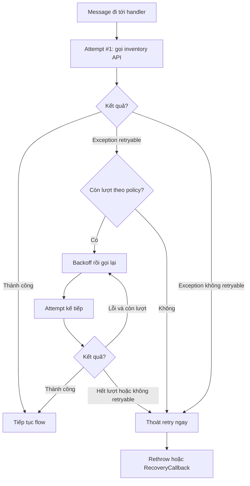
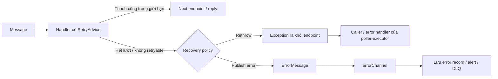

# Số lần thử và phân loại exception trong Spring Integration

## Mục tiêu bài học

Trong một luồng tích hợp, handler có thể thất bại vì API trả HTTP 503, database tạm mất kết nối, message sai schema hoặc lỗi lập trình. Nếu cứ retry tất cả lỗi, hệ thống sẽ lãng phí tài nguyên, tạo tải đột biến và có nguy cơ lặp tác dụng phụ. Nếu không retry một lỗi tạm thời, hệ thống có thể bỏ lỡ cơ hội xử lý thành công.

Bài **Số lần thử và phân loại exception** thuộc chương **Retry và recovery** của module **SPRING_INTEGRATION_RUNTIME**. Nội dung đặt trong bối cảnh Spring Integration thực thi message flow qua channel, endpoint, consumer, poller và executor; đồng thời xem xét ranh giới transaction, error flow, message store, correlation và khả năng chẩn đoán trạng thái runtime.

Sau khi học, bạn có thể:

- Phân biệt **attempt**, **retry**, **redelivery** và **replay**; tính chính xác số lần gọi handler/downstream.
- Xác định exception nào nên retry, exception nào phải thất bại ngay và cách xử lý exception bị framework bọc.
- Cấu hình `RequestHandlerRetryAdvice` với `RetryTemplate`, retry policy, backoff policy và recovery.
- Giải thích vì sao cùng một cấu hình retry nhưng hành vi lại khác nhau khi handler ở `DirectChannel`, `ExecutorChannel` hoặc poller.
- Kiểm tra ảnh hưởng của transaction, ack, idempotency, message store và correlation đến lỗi lặp.
- Thiết kế phép đo và tình huống kiểm thử để phát hiện retry vượt giới hạn hoặc retry nhầm loại lỗi.

## 1. Một message được “thử” bao nhiêu lần?

Trong Spring Retry, **một attempt là một lần gọi thao tác được bao quanh bởi retry policy**. Attempt đầu tiên cũng được tính vào giới hạn `maxAttempts`. Chỉ những lần gọi **sau thất bại đầu tiên** mới là retry theo nghĩa hẹp.

Ví dụ handler gọi một dịch vụ tồn kho:



Nếu cấu hình `maxAttempts = 3`:

| Kết quả từng lần gọi | Số attempt thực hiện | Số retry | Kết quả |
| --- | ---: | ---: | --- |
| Lần 1 thành công | 1 | 0 | Thành công |
| Lần 1 lỗi tạm thời; lần 2 thành công | 2 | 1 | Thành công |
| Lần 1–2 lỗi tạm thời; lần 3 thành công | 3 | 2 | Thành công |
| Cả ba lần đều lỗi tạm thời | 3 | 2 | Hết lượt; xử lý recovery hoặc ném lỗi |
| Lần 1 là lỗi không được retry | 1 | 0 | Thất bại ngay |
| Lần 1 tạm thời, lần 2 là lỗi không retryable | 2 | 1 | Dừng ngay ở lần 2 |

Vì vậy, `maxAttempts = 1` có nghĩa **chỉ gọi thao tác một lần, không thực hiện retry**. Đây là quy ước quan trọng khi cấu hình, đọc log hoặc viết kiểm thử. Không diễn giải `maxAttempts = 3` thành “ba lần retry cộng lần chạy đầu tiên”.

### 1.1. Retry tại handler khác redelivery ở nguồn

Giả sử inbound adapter đọc một message từ broker; trong mỗi lần xử lý, handler được retry tối đa ba attempt. Nếu adapter/broker giao lại chính message đó bốn lần, số lượt gọi downstream trong tình huống xấu nhất có thể đạt:

```text
4 lượt giao message × 3 attempts/lượt = 12 lần gọi downstream
```

**Retry** của `RequestHandlerRetryAdvice` là gọi lại handler trong một lượt xử lý. **Redelivery** là nguồn như JMS/AMQP/Kafka (tùy adapter và cấu hình) giao message thêm lượt xử lý khác sau lỗi/rollback/nack. **Replay** là vận hành chủ động đọc lại message từ error store, DLQ hoặc log lịch sử. Chúng là ba vòng lặp khác nhau, có thể cùng xuất hiện.

Vì thế, chính sách vận hành phải trả lời riêng: “Tối đa bao nhiêu attempt mỗi lần xử lý?” và “Nguồn có thể phát lại tối đa bao nhiêu lượt?”. Không có một con số `maxAttempts` duy nhất bao trùm cả ba tầng.

## 2. Phân loại exception trước khi quyết định retry

Mỗi exception cung cấp thông tin về **nguyên nhân**, nhưng quyết định retry là một **chính sách nghiệp vụ và hạ tầng**. Cùng một loại exception có thể được xử lý khác nhau ở hai flow nếu thao tác có mức an toàn/idempotency khác nhau.

| Nhóm | Ví dụ | Chính sách khởi đầu | Lý do |
| --- | --- | --- | --- |
| Lỗi tạm thời từ hạ tầng | API 502/503/504, mất kết nối trong chốc lát, `ConnectException` | Thường cho retry có giới hạn và backoff | Nguồn có khả năng tự phục hồi |
| Giới hạn tốc độ | HTTP 429 | Retry khi có ngân sách thời gian; tôn trọng `Retry-After` nếu phù hợp | Cố gọi dồn sẽ làm quá tải |
| Tranh chấp tài nguyên | Deadlock/lock timeout, optimistic conflict | Retry có điều kiện, thường phải làm lại **toàn bộ đơn vị transaction** | Trạng thái có thể thay đổi ở lần sau |
| Dữ liệu không hợp lệ | Thiếu `orderId`, sai kiểu, thiếu trường bắt buộc, validation fail | Không retry cùng payload chưa sửa | Dữ liệu không tự thay đổi chỉ vì gọi lại |
| Xác thực/phân quyền | HTTP 401/403 | Không retry mù; chỉ thử lại nếu đã có bước cấp lại credential hợp lệ | Lặp lại cùng token/cấu hình thường vô ích |
| Tài nguyên không tồn tại | HTTP 404 | Thường không retry; có ngoại lệ khi phụ thuộc eventual consistency đã biết | Cần hợp đồng rõ với nguồn |
| Lỗi lập trình/cấu hình | `NullPointerException`, `ClassCastException`, channel không cấu hình đúng | Dừng, ghi nhận và cảnh báo | Retry có thể che lỗi và tiêu hao CPU |
| Lỗi không xác định | `RuntimeException` lạ, exception không có trong danh sách | Mặc định không retry cho đến khi được phân loại | Tránh retry vô hạn vì policy quá rộng |

**Không nên bắt mọi `Exception` hoặc `Throwable` rồi retry**, đặc biệt tránh retry các `Error` của JVM. Cũng không nên phân loại chỉ bằng `exception.getMessage().contains("timeout")`: chuỗi thông báo có thể thay đổi theo client, phiên bản hoặc ngôn ngữ.

### 2.1. Phân loại theo exception gốc và ngữ cảnh

Spring Integration, adapter và HTTP/DB client có thể bọc lỗi ứng dụng trong `MessagingException`, `MessageHandlingException`, `MessageDeliveryException` hoặc wrapper riêng. Ví dụ:

```text
MessageHandlingException
  └── RemoteCallException
       └── SocketTimeoutException
```

Nếu retry policy chỉ kiểm tra class wrapper ngoài cùng, nó có thể bỏ qua `SocketTimeoutException` hoặc retry nhầm một `MessageHandlingException` do sai kiểu dữ liệu. Có hai lựa chọn:

1. **Chuẩn hóa exception tại ranh giới adapter:** bắt lỗi client cụ thể rồi ném exception nghiệp vụ được đặt tên rõ, chẳng hạn `TemporaryInventoryFailure` hoặc `InvalidOrderData`.
2. **Cho classifier duyệt chuỗi nguyên nhân:** nếu policy hỗ trợ `traverseCauses`, cấu hình duyệt `cause` phù hợp. Khi có cả dấu hiệu tạm thời và lỗi vĩnh viễn ở các lớp khác nhau, phải làm rõ quy tắc ưu tiên thay vì để classifier tình cờ quyết định.

Ví dụ:

```java
try {
    inventoryClient.reserve(orderId);
} catch (HttpServerErrorException ex) {
    throw new TemporaryInventoryFailure("Inventory API temporarily unavailable", ex);
} catch (HttpClientErrorException ex) {
    throw new InvalidOrderData("Inventory request rejected", ex);
}
```

Đoạn trên chỉ minh họa cách chuẩn hóa; HTTP 429 cũng thuộc nhóm 4xx và thường cần nhánh chính sách riêng, nên **không áp dụng nguyên xi** cách gộp 4xx thành permanent trong ứng dụng thật.

### 2.2. Phân loại dựa trên tính an toàn của thao tác

Một request `GET` chỉ đọc dữ liệu thường dễ retry hơn một thao tác chuyển tiền hoặc tạo đơn hàng. Khi client đã gửi request nhưng timeout trước khi nhận response, không thể mặc nhiên kết luận server chưa xử lý. Gọi lại một lệnh ghi có thể tạo dữ liệu trùng.

Đối với thao tác có side effect, cần ít nhất một trong các cơ chế: idempotency key ổn định; unique constraint theo business key; upsert hoặc kiểm tra trạng thái; API có hợp đồng chống lặp; hoặc workflow bù trừ được thiết kế riêng. Nếu không có bảo đảm này, phân loại exception là “tạm thời” **chưa đủ** để bật retry an toàn.

## 3. Retry policy quyết định ba điều gì?

Một retry policy cần trả lời:

1. **Có được thử lại không?** — Dựa trên exception, ngữ cảnh, giới hạn thời gian và trạng thái.
2. **Được thử tối đa bao nhiêu lần?** — `maxAttempts` tính cả lần đầu.
3. **Khi nào thử lại?** — Backoff cố định, tăng dần, exponential, jitter hoặc thời điểm nguồn cho phép.

Spring Retry tách **`RetryPolicy`** (điều kiện/số lượt), **`BackOffPolicy`** (khoảng đợi), **`RetryTemplate`** (vòng lặp thực thi) và các listener/recovery callback. Spring Integration dùng `RequestHandlerRetryAdvice` để đưa các cơ chế này vào endpoint.

### 3.1. Max attempts không phải timeout tổng

Ví dụ `maxAttempts=4`, mỗi lần gọi downstream có timeout 2 giây, và backoff trước ba lần thử lại lần lượt 200, 400, 800 ms:

```text
Attempt #1    timeout sau 2 s
Backoff       0,2 s
Attempt #2    timeout sau 2 s
Backoff       0,4 s
Attempt #3    timeout sau 2 s
Backoff       0,8 s
Attempt #4    timeout sau 2 s
--------------------------
Tổng gần 9,4 s (chưa tính overhead)
```

Khi gateway có reply timeout 5 giây, caller có thể timeout **trước khi** handler dùng hết retry budget. Do đó cần đồng bộ timeout của downstream, tổng retry duration, gateway request/reply timeout và deadline của nghiệp vụ. `maxAttempts` một mình không đặt giới hạn tổng thời gian.

### 3.2. Backoff giảm tải, nhưng cũng giữ thread bận

| Chính sách | Cách chờ | Phù hợp | Lưu ý |
| --- | --- | --- | --- |
| Không chờ | Retry ngay | Thao tác rất nhanh, số lượt ít, không liên quan quá tải | Có thể tạo retry storm |
| Fixed backoff | Mỗi lần đợi cùng khoảng | Lỗi nhẹ, dự đoán được | Nhiều worker có thể đồng loạt retry |
| Exponential backoff | Khoảng đợi tăng theo lần lỗi | API/hạ tầng đang phục hồi | Cần đặt khoảng đợi tối đa |
| Backoff có jitter | Thêm biến thiên vào lịch thử lại | Hệ thống nhiều instance gọi cùng nguồn | Giảm đồng bộ đám đông |
| Retry theo deadline | Dừng khi hết ngân sách thời gian | Request/reply có SLA, workflow có timeout | Phải phối hợp max attempts và timeout |

Với retry thông thường ở handler, backoff có thể **chặn thread đang xử lý** trong lúc đợi. Nếu hàng nghìn message đều ở trạng thái backoff trên pool nhỏ, throughput giảm và queue có thể đầy. Với khoảng đợi dài, cân nhắc chuyển sang cơ chế retry bất đồng bộ có lịch, hàng đợi retry hoặc scheduled redelivery, thay vì ngủ trong worker.

## 4. Cấu hình số lần thử tại MessageHandler

Ví dụ dưới đây minh họa Spring Integration 6.x với Spring Retry. Handler gọi một dịch vụ bên ngoài; chỉ exception `TemporaryRemoteFailure` được retry, tối đa 3 attempts, với backoff tăng dần. Các type `OrderClient`, `OrderCommand` và exception là ví dụ nghiệp vụ do ứng dụng định nghĩa.

```java
import java.util.Map;

import org.springframework.context.annotation.Bean;
import org.springframework.context.annotation.Configuration;
import org.springframework.integration.config.EnableIntegration;
import org.springframework.integration.dsl.IntegrationFlow;
import org.springframework.integration.handler.advice.RequestHandlerRetryAdvice;
import org.springframework.messaging.MessageHandler;
import org.springframework.retry.policy.SimpleRetryPolicy;
import org.springframework.retry.backoff.ExponentialBackOffPolicy;
import org.springframework.retry.support.RetryTemplate;

@Configuration
@EnableIntegration
class OrderRetryConfiguration {

    record OrderCommand(String orderId) {}

    interface OrderClient {
        void submit(OrderCommand order);
    }

    static class TemporaryRemoteFailure extends RuntimeException {
        TemporaryRemoteFailure(String message, Throwable cause) {
            super(message, cause);
        }
    }

    static class InvalidOrderData extends RuntimeException {
        InvalidOrderData(String message) {
            super(message);
        }
    }

    @Bean
    RequestHandlerRetryAdvice submitOrderRetryAdvice() {
        // Chỉ các exception được đánh dấu true mới được retry.
        // Exception không có trong map mặc định false.
        Map<Class<? extends Throwable>, Boolean> rules = Map.of(
                TemporaryRemoteFailure.class, true,
                InvalidOrderData.class, false
        );

        // 3 attempts TỔNG CỘNG, bao gồm lần gọi đầu tiên.
        // true: xét cả chuỗi cause khi phân loại exception.
        // false: exception không khớp rule sẽ không được retry.
        SimpleRetryPolicy retryPolicy =
                new SimpleRetryPolicy(3, rules, true, false);

        ExponentialBackOffPolicy backoff = new ExponentialBackOffPolicy();
        backoff.setInitialInterval(200L);
        backoff.setMultiplier(2.0);
        backoff.setMaxInterval(2_000L);

        RetryTemplate template = new RetryTemplate();
        template.setRetryPolicy(retryPolicy);
        template.setBackOffPolicy(backoff);

        RequestHandlerRetryAdvice advice = new RequestHandlerRetryAdvice();
        advice.setRetryTemplate(template);

        // Không gắn RecoveryCallback ở đây:
        // khi retry hết lượt, exception tiếp tục đi ra ranh giới gọi.
        return advice;
    }

    @Bean
    IntegrationFlow submitOrders(
            OrderClient client,
            RequestHandlerRetryAdvice submitOrderRetryAdvice) {

        MessageHandler handler = message ->
                client.submit((OrderCommand) message.getPayload());

        return IntegrationFlow.from("orders.input")
                .handle(handler, endpoint ->
                        endpoint.advice(submitOrderRetryAdvice))
                .get();
    }
}
```

Để chạy ví dụ, ứng dụng cần một bean hiện thực `OrderClient`, Spring Integration, Spring Retry và các dependency cấu hình thích hợp. Khi `client.submit(...)` ném `TemporaryRemoteFailure`, advice cho phép thực hiện lại handler. Khi `InvalidOrderData` xuất hiện, handler thoát ngay. Vì ví dụ **không cấu hình recovery callback**, lỗi cuối cùng đi ra ngoài endpoint theo quy tắc của flow.

**Giải thích các lựa chọn:**

- `RequestHandlerRetryAdvice` gắn vào **endpoint gọi handler**. Nó retry phép xử lý được bọc bởi advice; không tự làm lại toàn bộ flow upstream.
- `SimpleRetryPolicy(3, rules, true, false)` biểu diễn rõ giới hạn, quy tắc duyệt cause và mặc định “không retry nếu không nằm trong danh sách”.
- `ExponentialBackOffPolicy` quyết định khoảng đợi giữa những lần retry, nhưng không tăng số attempt.
- Một `Message` gửi vào flow không tự được thay thế bằng message mới qua từng attempt. Handler được gọi lại với ngữ cảnh xử lý tương ứng; logic có state bên trong phải tự bảo đảm an toàn.
- Bởi `orders.input` là điểm vào flow đồng bộ theo mặc định, producer dùng `send()` có thể bị chặn trong toàn bộ thời gian retry và nhận exception cuối cùng. Nếu thay channel/endpoint bằng executor hoặc poller, nơi quan sát exception sẽ khác.

### 4.1. Một cấu hình ngắn gọn cho một exception

Khi policy đơn giản, có thể dùng builder của `RetryTemplate`:

```java
RetryTemplate template = RetryTemplate.builder()
        .maxAttempts(3)
        .fixedBackoff(250)
        .retryOn(TemporaryRemoteFailure.class)
        .build();

RequestHandlerRetryAdvice advice = new RequestHandlerRetryAdvice();
advice.setRetryTemplate(template);
```

Builder giúp diễn đạt nhanh việc chỉ retry một nhóm exception đã biết. Nếu lỗi bị bọc qua nhiều tầng, hãy kiểm tra cách classifier xét cause trước khi dùng. Với nhiều quy tắc loại trừ/phân nhóm, dùng retry policy có classifier như ở ví dụ đầy đủ thường dễ đọc và dễ kiểm chứng hơn.

### 4.2. Vì sao advice cần được gắn đúng endpoint?

```text
input -> transformer -> handler A -> handler B -> output
                        [retry advice]
```

Khi gắn advice vào **handler A**, lỗi của handler A có thể khiến A thực thi nhiều lần; handler B chỉ chạy khi message thực sự đi tới nó. Retry handler A **không tự gọi lại transformer**, **không tự đọc lại inbound adapter** và **không tự thực hiện lại handler B**. Nếu muốn retry một tổ hợp thao tác như một đơn vị, cần đặt ranh giới phù hợp và đánh giá hệ quả với transaction/idempotency.

Nếu lỗi phát sinh trong transformer **trước** handler A, retry advice tại A không nhìn thấy lỗi đó. Khi điều tra “đã cấu hình retry mà không chạy”, hãy kiểm tra chính xác exception xuất hiện trước, trong hay sau endpoint được bọc.

## 5. Đếm attempt và diễn giải RetryContext

Spring Retry có `RetryContext` để theo dõi trạng thái một vòng retry. Tại thời điểm **đang vào một attempt**, `retryCount` biểu diễn số lần thất bại đã được ghi nhận trước đó trong context, nên có thể diễn giải attempt hiện tại là `retryCount + 1`.

Ví dụ minh họa trong một handler được `RequestHandlerRetryAdvice` bao quanh:

```java
import org.springframework.retry.RetryContext;
import org.springframework.retry.support.RetrySynchronizationManager;

void callDownstream(OrderCommand order) {
    RetryContext context = RetrySynchronizationManager.getContext();
    int currentAttempt = context == null ? 1 : context.getRetryCount() + 1;

    System.out.printf("order=%s attempt=%d%n",
            order.orderId(), currentAttempt);

    remoteClient.submit(order);
}
```

Trong cấu hình thông thường:

```text
attempt=1 -> lỗi tạm thời
attempt=2 -> lỗi tạm thời
attempt=3 -> thành công
```

`retryCount` **không tự trở thành một header tiêu chuẩn** của message và không đồng nghĩa với tổng số lần redelivery từ broker. Nếu ứng dụng cần tổng số attempt xuyên qua process restart hoặc broker delivery, hãy lưu retry metadata tại nơi bền vững, hoặc đọc delivery count của nguồn khi adapter cung cấp. Không chỉ dựa vào biến `AtomicInteger` của một JVM.

**Lưu ý:** `RetryContext` chỉ có ý nghĩa khi lời gọi hiện tại thực sự chạy trong vòng retry thích hợp; ngoài ngữ cảnh retry, `getContext()` có thể trả `null`. Nếu có retry lồng nhau, phải phân biệt context của từng tầng và ghi rõ phạm vi đo.

## 6. Recovery bắt đầu khi nào và thay đổi kết quả ra sao?

Recovery là **quyết định sau khi không còn khả năng/không còn được phép retry trong policy**. Một số tình huống kích hoạt recovery:

- Đã tiêu hết `maxAttempts` do các exception retryable.
- Exception không thuộc tập retryable, nên dừng ngay từ attempt hiện tại.
- Chính sách theo timeout hoặc điều kiện khác quyết định không thử thêm.

Có hai hành vi khác nhau cần tách bạch:

**Rethrow:** Không có recovery callback (như ví dụ ở mục 4), exception tiếp tục truyền ra ngoài lời gọi handler. Ở `DirectChannel`, caller có thể nhận lỗi; ở biên bất đồng bộ hoặc poller, error handler có thể đưa lỗi vào error channel; transaction/adapter có thể rollback hoặc redeliver tùy cấu hình.

**Recovery callback:** `RequestHandlerRetryAdvice` có thể được cấu hình `RecoveryCallback` để ghi error record, gửi `ErrorMessage`, trả kết quả thay thế hoặc thực hiện một chính sách khác. Một callback xử lý lỗi rồi **trả về bình thường** có thể khiến endpoint được coi là đã hoàn tất theo hợp đồng đang có. Điều này tác động trực tiếp đến rollback, ack hoặc gateway reply.

Ví dụ dùng `ErrorMessageSendingRecoverer` của Spring Integration:

```java
import org.springframework.integration.handler.advice.ErrorMessageSendingRecoverer;
import org.springframework.integration.handler.advice.RequestHandlerRetryAdvice;
import org.springframework.messaging.MessageChannel;

void configureRecovery(
        RequestHandlerRetryAdvice advice,
        MessageChannel orderErrorChannel) {

    advice.setRecoveryCallback(
            new ErrorMessageSendingRecoverer(orderErrorChannel));
}
```

`ErrorMessageSendingRecoverer` giúp chuyển lỗi sang một error channel khi recovery được gọi. Cần đăng ký consumer cho channel đó và thiết kế việc ghi nhận lỗi bền vững. Việc gửi được một error message **không tự chứng minh** nghiệp vụ ban đầu đã thành công hoặc source đã được bảo đảm phát lại.

Nếu recovery trả về kết quả bình thường, đừng mặc nhiên kỳ vọng broker sẽ redeliver sau đó. Nếu nghiệp vụ đòi hỏi rollback/redelivery, hãy đảm bảo exception hoặc tín hiệu transaction thích hợp thực sự đi qua biên transaction.

### 6.1. Retry → recovery → error flow



Đường vào `errorChannel` **không tự động có mặt ở mọi lỗi đồng bộ**. Việc biến exception thành `ErrorMessage` cần một thành phần bắt và publish lỗi, chẳng hạn recovery callback hoặc error handler tại biên bất đồng bộ.

## 7. Phân loại exception khi có wrapper và cause chain

Một lỗi có thể được bọc nhiều lần:

```text
MessageHandlingException
    caused by OrderSubmissionException
        caused by SocketTimeoutException
```

Các lựa chọn chính sách:

| Chiến lược | Ưu điểm | Rủi ro |
| --- | --- | --- |
| Phân loại class exception ngoài cùng | Rõ ràng nếu adapter đã chuẩn hóa lỗi | Dễ bỏ sót root cause sau wrapper |
| `traverseCauses=true` với rule rõ | Nhận diện transient cause qua wrapper | Cần hiểu ưu tiên khi nhiều loại lỗi xuất hiện trong chain |
| Chuẩn hóa lỗi thành domain exception | Contract ổn định cho policy | Phải ánh xạ lỗi tại biên adapter, tốn công duy trì |
| Kiểm tra context ngoài class | Xử lý HTTP 429, rate limit, deadline, idempotency | Classifier có thể phức tạp; phải kiểm thử các nhánh |

Giả sử API client ném `HttpServerErrorException` cho nhiều mã 5xx; việc retry tất cả 5xx có thể không đúng cho một nghiệp vụ. Đưa status code vào cách phân loại thông qua adapter hoặc classifier có ngữ cảnh; cân nhắc giới hạn thời gian và quota. Trường hợp exception nhãn “retryable” nhưng deadline đã hết cũng phải dừng.

Cần tránh một lỗi phổ biến: đặt `retryOn(MessagingException.class)` cho toàn bộ flow chỉ để xử lý lỗi đã bọc. Vì `MessagingException` có thể đại diện cho nhiều nguyên nhân, cách này có nguy cơ retry cả lỗi schema, routing và cấu hình. Hãy hướng policy vào exception nghiệp vụ tạm thời hoặc classifier có kiểm soát.

## 8. Transaction và giới hạn attempt

Retry tác động trực tiếp tới transaction khi mỗi attempt có thao tác ghi:

```text
Message -> RetryAdvice -> Transactional handler -> DB/API
                  |             |
                  |             +-- lỗi -> rollback attempt?
                  +-- retry lần sau -> transaction mới?
```

Vị trí advice, transaction interceptor và boundary của endpoint quyết định mỗi attempt có một transaction riêng hay nhiều attempt dùng chung một transaction.

- Nếu transaction được mở **bên trong từng attempt**, mỗi lần thất bại có thể rollback độc lập và lần sau bắt đầu với trạng thái transaction sạch, tùy propagation/configuration.
- Nếu toàn bộ retry chạy **bên trong một transaction đã mở** của caller, một exception có thể đánh dấu transaction `rollback-only`. Lần thử sau dù handler thành công vẫn có thể không commit được.
- Nếu handler chạy sau `ExecutorChannel`, transaction gắn với thread caller thường không tự truyền sang worker. Cần xác định transaction tạo tại worker và policy ack của nguồn.
- Với poller hoặc message-driven adapter có transaction, khi callback recovery nuốt exception, adapter có thể coi lượt xử lý đã hoàn tất và ack/commit. Điều này chỉ đúng nếu recovery đã ghi nhận lỗi theo hợp đồng, ví dụ lưu durable error record.

Đối với lỗi deadlock hoặc optimistic conflict, nên retry **cả đơn vị transaction phù hợp**, không chỉ lặp thao tác cuối mà bỏ qua những thay đổi trạng thái đã diễn ra trước nó. Nếu một attempt đã gọi thành công API bên ngoài nhưng DB rollback, retry ở tầng DB không thể tự hoàn tác side effect ngoài DB.

### 8.1. Stateless retry và stateful retry

**Stateless retry** thường hoàn thành mọi attempt trong một lần gọi advice; bộ đếm tồn tại trong phạm vi lần gọi. **Stateful retry** liên kết trạng thái giữa các lần invocation thông qua khóa và cache/context, hữu ích trong một số luồng mà nguồn redeliver sau rollback.

Chỉ bật stateful retry khi có hiểu biết rõ về khóa định danh message, cache/TTL và cách nguồn redeliver. Một `MessageHeaders.ID` mới tạo mỗi lần nhận có thể không phải khóa bền vững giữa các lần giao; dùng business key/delivery identity ổn định theo hợp đồng. Stateful retry không tự biến bộ nhớ trong JVM thành persistent retry log và cần cân nhắc khi chạy nhiều instance.

## 9. Threading và số lần retry trong message flow

| Vị trí handler | Ai chịu chi phí retry/backoff? | Caller nhìn thấy gì? | Điều cần quan sát |
| --- | --- | --- | --- |
| `DirectChannel` đồng bộ | Thread đang gửi message | Thời gian `send()` có thể kéo dài; lỗi cuối có thể truyền về caller | Latency producer, timeout upstream |
| Sau `ExecutorChannel` | Worker thread của executor | `send()` có thể trả về trước khi retry kết thúc | Active workers, queue depth, rejected tasks, error channel |
| Consumer chạy bằng poller | Thread poller/scheduler thực thi lượt xử lý | Không có caller đồng bộ ban đầu chờ trực tiếp | Poll interval, task scheduling, transaction, source ack/redelivery |
| Message-driven inbound adapter | Thread/container do adapter quản lý | Quy tắc ack/rollback phụ thuộc adapter và cấu hình | Delivery count, consumer concurrency, broker retry/DLQ |

Ví dụ một pool có 4 worker, mỗi message lỗi khiến worker chờ backoff 5 giây; chỉ cần 4 message cùng gặp sự cố, các worker có thể đều đang chờ. Dù CPU còn rảnh, queue vẫn tăng. Vì vậy tăng `maxAttempts` hay backoff là quyết định **dung lượng runtime**, không chỉ độ bền nghiệp vụ.

Việc retry trong handler khác với việc đưa message vào một retry queue có lịch. Retry queue có thể giúp giải phóng worker giữa hai lần thử nhưng cần xử lý ordering, deduplication, poison message, TTL và quản lý lại trạng thái attempt.

## 10. Correlation, idempotency và message store

Trong vận hành thực tế, hãy ghi thông tin đủ để tìm và giải thích một lần xử lý:

| Trường | Công dụng |
| --- | --- |
| `businessKey` (ví dụ `orderId`) | Chống tác dụng phụ lặp, đối chiếu trạng thái cuối |
| `correlationId` | Theo dấu flow qua transformer, channel, router và retry/error flow |
| `messageId` | Định danh instance message ở từng bước; có thể khác khi message được tái tạo |
| `endpointId` | Biết chính xác handler/advice nào thất bại |
| `exceptionType` và root cause | Kiểm tra retry classifier hoạt động đúng |
| `attemptInInvocation` | Số lần thử trong retry context hiện tại |
| `deliveryCount` (khi nguồn cung cấp) | Số lượt nguồn giao lại message |
| `firstSeenAt`, `lastFailedAt` | Kiểm soát retry deadline và điều tra độ trễ |
| `outcome` | Succeeded, retrying, exhausted, quarantined, replayed... |

`MessageStore` trong Spring Integration là hạ tầng lưu message/group theo cấu hình; **không mặc nhiên** là một bộ đếm retry bền vững hoặc một DLQ. Nếu cần phục hồi sau restart, định nghĩa rõ nơi lưu attempt metadata/error record, serializer, retention, version schema và chiến lược replay.

Khi gửi message sang hệ thống ngoài hoặc ghi lỗi vào error store, nên giữ `businessKey` và `correlationId`, loại bỏ hoặc ẩn dữ liệu nhạy cảm trong log. Các chỉ số như retry rate, exhausted count, attempts/message, transient vs permanent failures, DLQ age và queue depth nên được tổng hợp theo endpoint và exception class, tránh gắn correlation ID làm metric label có cardinality rất cao.

## 11. Thiết kế kịch bản thử nghiệm số lần thử và phân loại

Một bộ kiểm thử nhỏ cần phân biệt ít nhất các kịch bản dưới đây. Với `maxAttempts=3` và chỉ `TemporaryRemoteFailure` được retry:

| Kịch bản fake downstream | Số lần gọi dự kiến | Outcome |
| --- | ---: | --- |
| Thành công ngay | 1 | Handler thành công |
| Lần 1 transient, lần 2 thành công | 2 | Handler thành công |
| Hai lần transient, lần 3 thành công | 3 | Handler thành công |
| Ba lần transient | 3 | Hết lượt; exception hoặc recovery |
| Một lần `InvalidOrderData` | 1 | Dừng ngay; exception hoặc recovery |
| Lần 1 transient, lần 2 `InvalidOrderData` | 2 | Dừng ngay ở lần 2 |
| `NullPointerException` không trong policy | 1 | Dừng và báo lỗi cần điều tra |
| Transient nằm trong `cause` của wrapper | Tối đa 3 nếu policy duyệt cause phù hợp | Kiểm tra thứ tự và quy tắc classifier |

Ví dụ mô phỏng một dịch vụ tạm lỗi hai lần rồi thành công:

```java
import java.util.concurrent.atomic.AtomicInteger;

AtomicInteger callCount = new AtomicInteger();

OrderClient fake = order -> {
    int call = callCount.incrementAndGet();

    if (call <= 2) {
        throw new TemporaryRemoteFailure("503 on call " + call, null);
    }

    // Lần 3 thành công.
};
```

Khi `fake` được dùng làm dependency của handler có retry advice, số lượt gọi thành công mong đợi là **3**. Sau đó thay exception trên lần đầu bằng `InvalidOrderData`: số lượt mong đợi phải là **1**. Trong kiểm thử thực, dùng JUnit và fake/mock để kiểm tra đếm số lần gọi, kết quả, exception cuối và error flow; các đoạn code ở đây minh họa cấu hình/logic chứ không thay thế bộ test dự án.

### 11.1. Kiểm thử giới hạn retry của nhiều tầng

Thêm một nguồn có redelivery: cho mỗi lần giao, downstream luôn ném `TemporaryRemoteFailure`. Nếu nguồn được cấu hình tối đa 2 lượt giao và mỗi invocation cho 3 attempts, kiểm tra số lần gọi downstream có thể lên tới 6. Ghi đồng thời `correlationId`, delivery count của nguồn và số attempt trong `RetryContext`.

Nếu các con số không đúng, hãy tìm xem một retry khác đang tồn tại ở HTTP client, transaction layer, broker adapter, gateway hay một retry queue. Các cơ chế này có thể âm thầm nhân số attempt.

### 11.2. Kiểm thử lỗi sau side effect

Cho fake API ghi nhận thành công đơn hàng rồi **ném timeout giả** trước khi trả response. Quan sát nếu handler retry, cùng order có bị tạo hai lần không. Sau đó thêm idempotency key như `orderId` và kiểm chứng lần gọi thứ hai trả lại kết quả đã ghi hoặc không phát sinh side effect lặp.

Đây là kiểm thử quan trọng hơn việc chỉ chứng minh policy đã gọi handler đủ 3 lần, bởi số lần thử đúng vẫn có thể dẫn đến dữ liệu sai.

## 12. Chẩn đoán tình huống retry không như mong đợi

| Triệu chứng | Nguyên nhân thường gặp | Cách kiểm tra |
| --- | --- | --- |
| Cấu hình `maxAttempts=3` nhưng handler chỉ chạy một lần | Exception không nằm trong classifier; advice chưa gắn đúng endpoint | Log exception class/cause và endpoint advice chain |
| Handler chạy bốn lần khi tưởng chỉ có ba | Có retry/redelivery ở tầng khác hoặc hiểu sai “attempt” | Ghép delivery count của nguồn và `RetryContext` |
| Gateway timeout dù handler tiếp tục retry | Tổng duration vượt gateway timeout | So sánh timeout downstream + backoff + max attempts với reply timeout |
| Lỗi validation cũng bị retry | Policy quá rộng như `Exception.class`/`RuntimeException.class` | Thu hẹp classifier, thêm ca kiểm thử permanent error |
| Không thấy `ErrorMessage` khi retry hết | Flow đồng bộ không publish lỗi tự động; chưa cấu hình recoverer/error handler | Xem DirectChannel, recovery callback, errorChannel |
| Message biến mất khỏi queue sau lỗi | Recovery nuốt exception, adapter đã ack/commit | Kiểm tra transaction outcome và durable error store |
| Throughput giảm mạnh khi downstream chập chờn | Worker đang chờ backoff; pool/queue bị bão hòa | Active threads, queue depth, elapsed time của attempt |
| Một đơn hàng được tạo hai lần | Timeout sau side effect, broker redelivery, thiếu idempotency | Business key, ledger, external API idempotency |
| Retry dường như bỏ qua exception gốc | Wrapper làm classifier không nhận đúng type | In đầy đủ cause chain; kiểm tra traverseCauses |
| Sau restart retry count bắt đầu lại | Stateless context hoặc state cache trong bộ nhớ | Xác định trạng thái bền vững và chính sách replay |

Một trình tự điều tra hiệu quả:

1. Chọn một `businessKey` và `correlationId` của lần thất bại.
2. Xác định endpoint ném exception, vị trí `RequestHandlerRetryAdvice` và toàn bộ cause chain.
3. Ghi `attemptInInvocation`, số lượt broker delivery, số lượt gọi HTTP/DB client thực tế.
4. So sánh class exception với policy, các giới hạn số lượt, backoff và tổng thời gian.
5. Tìm ranh giới thread (`DirectChannel`, executor, poller) và transaction/ack thực tế.
6. Xác nhận outcome cuối: thành công, rollback, đã publish error, lưu DLQ/error store hoặc chờ replay.
7. Kiểm tra dữ liệu nghiệp vụ để phát hiện side effect lặp, sau đó điều chỉnh policy hoặc idempotency.

## 13. Bài thực hành

### Bài A — Đếm attempts chính xác

Tạo flow một handler có `RequestHandlerRetryAdvice`, `maxAttempts=3` và fixed backoff ngắn. Cho handler lần lượt thất bại một lần, hai lần, ba lần bằng exception retryable. Ghi số lần gọi, số lần retry, thời gian thực thi và outcome. Đảm bảo bạn phân biệt **số lần thử** với **số lần thử lại**.

**Kết quả mong đợi:** ba mẫu thành công ở lần 2, thành công ở lần 3 và exhausted ở lần 3 có số lần gọi lần lượt 2, 3 và 3; không trường hợp nào có 4 lần gọi trong một invocation.

### Bài B — So sánh exception classifier

Tạo ba exception: `TemporaryRemoteFailure`, `InvalidOrderData` và `UnexpectedBug`. Chỉ cho phép retry `TemporaryRemoteFailure`. Lần lượt ném từng loại trong handler, sau đó bọc `TemporaryRemoteFailure` trong một exception wrapper. So sánh policy có và không duyệt cause.

**Kết quả mong đợi:** lỗi tạm thời được retry trong giới hạn, lỗi validation/bug dừng ngay; trường hợp wrapper cho thấy lý do cần cấu hình phân loại nguyên nhân chính xác.

### Bài C — Ranh giới executor và error flow

Chạy cùng handler ở hai bố cục:

```text
Producer -> DirectChannel -> RetryAdvice -> Handler
Producer -> ExecutorChannel -> RetryAdvice -> Handler -> ErrorHandler
```

Cho handler luôn ném exception retryable; ghi thread name, thời gian `send()`, nơi nhận exception cuối và liệu `ErrorMessage` có được xuất bản hay không. Thử thêm recovery callback gửi vào error channel riêng và đăng ký consumer ghi error record.

**Kết quả mong đợi:** thread/caller quan sát lỗi khác nhau, nhưng attempt count ở endpoint vẫn phải tuân theo policy. Recoverer có thể thay đổi cách exception được xử lý và kết quả ack/commit.

### Bài D — Retry trong transaction và broker redelivery

Tạo handler ghi DB rồi gọi downstream có thể timeout. Đặt retry advice trước/sau transaction boundary trong các cấu hình có kiểm soát, đồng thời thử adapter có thể redeliver. Theo dõi transaction outcome, DB state, delivery count và số lần gọi downstream. Thử thêm idempotency key và error store bền vững.

**Kết quả mong đợi:** chứng minh được retry trong transaction không đồng nghĩa với xử lý exactly-once; một attempt thất bại có thể đã tạo side effect, và callback xử lý lỗi có thể thay đổi ack/rollback.

## 14. Câu hỏi tự kiểm tra

1. `maxAttempts=5` nghĩa là tối đa bao nhiêu lần gọi handler và bao nhiêu lần retry?
2. Một handler lỗi validation ở attempt #2 sau một lỗi transient ở attempt #1. Policy nên thử attempt #3 hay dừng? Vì sao?
3. Tại sao retry `MessagingException.class` không phải chính sách phù hợp cho mọi lỗi Spring Integration?
4. `traverseCauses` giúp gì khi HTTP client exception bị nhiều lớp wrapper bọc lại?
5. Vì sao timeout có thể xảy ra sau khi server đã tạo đơn hàng, và việc retry lúc đó rủi ro như thế nào?
6. Retry trong `RequestHandlerRetryAdvice` và redelivery từ broker khác nhau ở phạm vi nào?
7. Khi `RecoveryCallback` xuất bản `ErrorMessage` rồi trả về, điều gì có thể thay đổi ở transaction hoặc ack?
8. Tại sao tăng backoff có thể làm hệ thống nghẽn dù CPU và băng thông mạng chưa đạt ngưỡng?
9. `RetryContext.getRetryCount()` có phản ánh tổng số lần giao lại message sau process restart không?
10. Những thông tin nào phải gắn với business key/correlation để chứng minh số attempt và kết quả cuối của một đơn hàng?

**Ghi nhớ:** Một chính sách retry đúng có **giới hạn attempt rõ ràng, phân loại exception có kiểm soát, backoff phù hợp, ranh giới transaction/thread được hiểu chính xác và cơ chế recovery an toàn**. Luôn đo riêng attempt trong handler, redelivery của nguồn và replay vận hành; xác minh trạng thái nghiệp vụ bền vững trước khi kết luận message đã được xử lý thành công.

