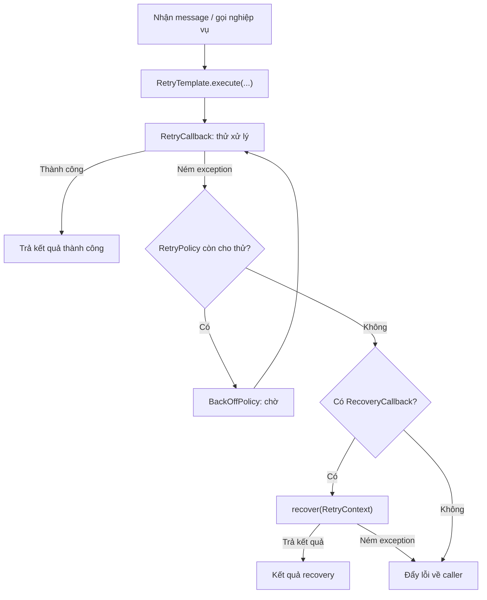
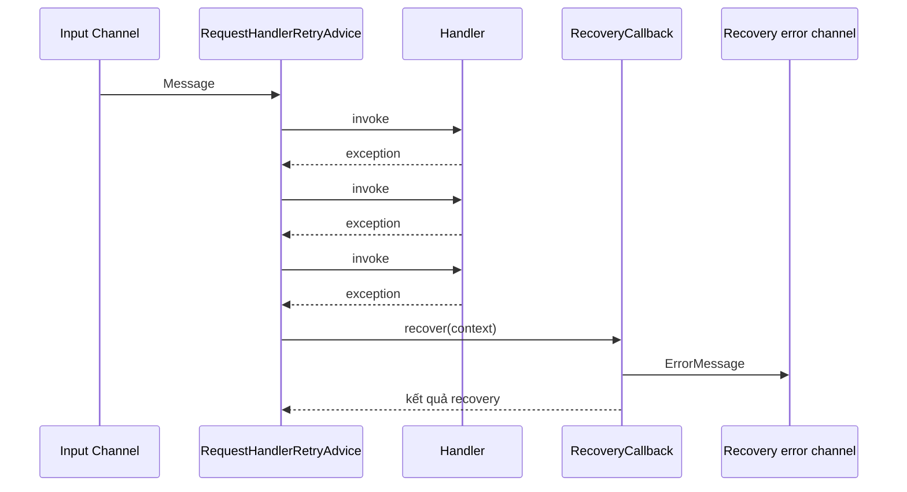
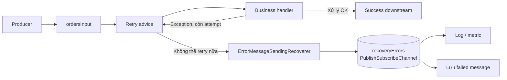
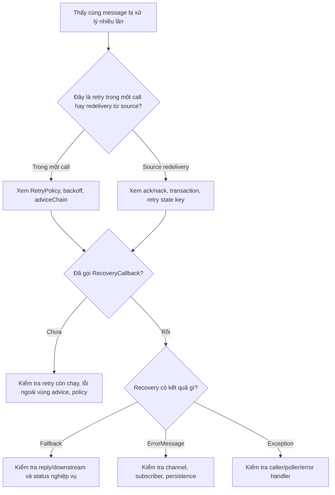

# RecoveryCallback sau khi retry thất bại

Trong **Spring Integration runtime**, một handler có thể thất bại tạm thời vì HTTP 503, timeout kết nối hoặc database đang bận. Thử lại (retry) có giới hạn giúp hệ thống vượt qua lỗi thoáng qua mà chưa cần chuyển message sang luồng xử lý khác. Nhưng đến lúc không thể thử tiếp, runtime phải quyết định: trả kết quả dự phòng, ghi một message lỗi để xử lý sau, hay ném lỗi để transaction/nguồn message thực hiện cơ chế khôi phục.

**`RecoveryCallback` của Spring Retry** là điểm ra quyết định ở cuối một chuỗi retry. Trong chương **Retry và recovery**, bài này giải thích cơ chế callback, cách kết hợp nó với `RetryTemplate` và `RequestHandlerRetryAdvice` của Spring Integration, đồng thời chỉ ra ranh giới với error channel, poller, executor, transaction, message store và correlation.

## 1. Retry kết thúc ở đâu, recovery bắt đầu khi nào?

Một lần xử lý có thể trải qua nhiều attempt. Sau mỗi exception, retry policy kiểm tra còn được thử tiếp hay không; nếu còn, backoff policy điều phối khoảng chờ rồi callback chạy lại. Khi không thể tiếp tục retry, `RecoveryCallback` có cơ hội tạo kết quả hoặc xử lý trạng thái thất bại.



Trong thực tế, nhánh “không thể retry” có thể do **hết số attempt**, do exception bị phân loại **không retryable**, hoặc do state/policy quyết định dừng. Vì vậy `RecoveryCallback` không chỉ có ý nghĩa với “lỗi lần thứ N”. Hơn nữa, những lỗi xảy ra *ngoài vùng được RetryTemplate bảo vệ* không nhất thiết đi qua callback này.

| Khái niệm | Vai trò | Điều không tự đảm bảo |
| --- | --- | --- |
| `RetryCallback<T, E>` | Thực hiện tác vụ có thể được gọi lại | Không tự định nghĩa giới hạn retry |
| `RetryPolicy` | Quyết định có thể thử tiếp hay phải dừng | Không tự lưu message bền vững |
| `BackOffPolicy` | Quyết định khoảng chờ giữa các attempt | Không tự làm xử lý thành bất đồng bộ |
| `RetryContext` | Giữ ngữ cảnh retry, số lần thất bại, exception gần nhất | Không tương đương transaction/acknowledgement |
| `RecoveryCallback<T>` | Chạy khi retry kết thúc mà không có kết quả thành công | Không mặc định retry lại message từ queue/broker |

**Phân biệt kết quả:** retry thành công nghĩa là một attempt đã chạy thành công. Recovery “thành công” chỉ nghĩa là callback đã thực thi và trả về kết quả hợp lệ trong ngữ cảnh API. Nếu callback chỉ ghi log rồi trả `null`, nghiệp vụ ban đầu **chưa chắc** hoàn thành.

## 2. API của Spring Retry

Các kiểu chính thuộc `org.springframework.retry`. Dưới đây là chữ ký rút gọn để hiểu cách chúng phối hợp:

```java
// Sơ đồ API rút gọn, không phải phần mã cần chép để biên dịch
interface RetryCallback<T, E extends Throwable> {
    T doWithRetry(RetryContext context) throws E;
}

interface RecoveryCallback<T> {
    T recover(RetryContext context) throws Exception;
}

// Một overload quan trọng của RetryTemplate:
<T, E extends Throwable> T execute(
        RetryCallback<T, E> retryCallback,
        RecoveryCallback<T> recoveryCallback) throws E;
```

Trong `recover(RetryContext context)`, hai thông tin cần dùng nhất là:

- `context.getLastThrowable()`: exception cuối cùng được ghi nhận trong retry context; cần kiểm tra `null` nếu callback được gọi từ một ngữ cảnh tùy chỉnh.
- `context.getRetryCount()`: bộ đếm retry/failure do Spring Retry quản lý. Với stateless retry thông thường, có thể quan sát bộ đếm sau mỗi lần lỗi; không nên dùng nó làm ID nghiệp vụ hay số thứ tự lưu trữ bền vững.

Callback có thể **trả về cùng kiểu `T`** như `RetryCallback`. Ví dụ, nếu attempt trả `String`, recovery có thể trả một `String` báo “chờ xử lý thủ công”. Callback cũng có thể ném exception để thông báo “không thể phục hồi”; khi đó caller/endpoint vẫn phải xử lý thất bại.

Lưu ý quan trọng: annotation `@Recover` thường dùng với cơ chế `@Retryable` của Spring Retry qua AOP là một cơ chế khai báo khác. Đừng nhầm method `@Recover` với interface `RecoveryCallback` được truyền trực tiếp vào `RetryTemplate` hoặc cấu hình trên `RequestHandlerRetryAdvice`.

## 3. Ví dụ độc lập: retry ba lần, sau đó fallback

Ví dụ sau dùng **Spring Retry** và Java 17+, không cần khởi tạo Spring Integration channel. Mục tiêu là nhìn thấy chính xác lúc `RecoveryCallback` được gọi.

```java
import java.util.concurrent.atomic.AtomicInteger;

import org.springframework.retry.backoff.FixedBackOffPolicy;
import org.springframework.retry.policy.SimpleRetryPolicy;
import org.springframework.retry.support.RetryTemplate;

public class RetryRecoveryDemo {
    public static void main(String[] args) {
        RetryTemplate template = new RetryTemplate();
        template.setRetryPolicy(new SimpleRetryPolicy(3));

        FixedBackOffPolicy backOff = new FixedBackOffPolicy();
        backOff.setBackOffPeriod(200L);
        template.setBackOffPolicy(backOff);

        AtomicInteger invocations = new AtomicInteger();

        String result = template.execute(
                context -> {
                    int attempt = invocations.incrementAndGet();
                    System.out.println("Attempt " + attempt);
                    throw new IllegalStateException("Remote service unavailable");
                },
                context -> {
                    Throwable last = context.getLastThrowable();
                    System.out.println("Recovery after "
                            + invocations.get() + " attempts");
                    System.out.println("Last error: "
                            + (last == null ? "unknown" : last.getMessage()));
                    return "PENDING_MANUAL_REVIEW";
                });

        System.out.println("Result: " + result);
    }
}
```

Một lần chạy thông thường cho thấy:

```text
Attempt 1
Attempt 2
Attempt 3
Recovery after 3 attempts
Last error: Remote service unavailable
Result: PENDING_MANUAL_REVIEW
```

**`maxAttempts = 3` nghĩa là tổng cộng tối đa ba lần gọi**, gồm một attempt đầu tiên và tối đa hai lần thử lại; không phải “một lần đầu cộng ba lần retry”. Với `FixedBackOffPolicy(200 ms)`, trường hợp thất bại liên tục thường có hai khoảng chờ ở giữa các lần gọi. Độ trễ thực tế còn phụ thuộc thời gian thực thi callback và scheduler của JVM.

Nếu attempt thứ hai thành công, `RecoveryCallback` **không chạy**. Nếu bỏ recovery callback mà mọi attempt đều thất bại, `RetryTemplate` thường ném exception ra caller theo policy và kiểu exception tương ứng.

Trong mã production, không nên dùng chuỗi `PENDING_MANUAL_REVIEW` để ngụ ý đã lưu công việc để xử lý thủ công. Trạng thái đó chỉ có ý nghĩa nếu callback đã ghi nhận sự kiện vào **kho recovery thực sự** và kiểm tra việc ghi thành công.

## 4. RecoveryCallback khác retry tiếp, rollback và error channel

`RecoveryCallback` là một **hook cuối chuỗi thử lại**. Những thao tác sau phải được cấu hình riêng:

| Nhu cầu | `RecoveryCallback` có thể làm gì? | Cần thêm gì? |
| --- | --- | --- |
| Trả giá trị dự phòng | Trả `T` thay cho kết quả không có | Giao kèo rõ ràng để downstream biết đây là fallback |
| Gửi lỗi đến một channel | Tạo/ủy quyền gửi `ErrorMessage` | MessageChannel và error handler subscriber |
| Lưu failed message | Ghi record vào DB/store/broker | Persistence, transaction, idempotency và kế hoạch replay |
| Đề nghị rollback | Ném exception cho ngữ cảnh gọi | Transaction manager và transaction boundary phù hợp |
| Thử lại sau khởi động lại | Không tự làm được chỉ bằng callback | Durable state/redelivery từ nguồn và chính sách khôi phục |

Ví dụ callback trả `null` có thể khiến một số endpoint xem đó là **không có reply**; nếu downstream yêu cầu bắt buộc có reply, điều này lại trở thành lỗi khác. Tương tự, nếu callback trả một DTO bình thường, downstream có thể coi đó là kết quả thành công. Khi thiết kế fallback, nên cân nhắc kiểu dữ liệu mô tả rõ trạng thái, chẳng hạn `Success`/`PendingReview`, hoặc chuyển sang error/recovery flow và kết thúc nhánh xử lý có chủ đích.

Không có quy tắc chung rằng “gọi RecoveryCallback thì đã ack message”. Ack/nack là hành vi của source adapter hoặc message broker và phụ thuộc đường lỗi trả ra, transaction và cấu hình listener.

## 5. Kết hợp với Spring Integration: RequestHandlerRetryAdvice

Trong Spring Integration, `RequestHandlerRetryAdvice` có thể bọc **lời gọi handler tại một consumer endpoint** và dùng `RetryTemplate` để gọi lại thao tác xử lý. Ví dụ phổ biến là service activator gửi HTTP request đến hệ thống bên ngoài, hoặc handler truy cập một API tạm thời không sẵn sàng.



`RequestHandlerRetryAdvice` nằm ở **ranh giới handler**, không tự bọc mọi thành phần upstream/downstream. Retry ở đây thường gọi lại handler với message hiện tại, **không nhất thiết gọi lại thao tác `receive()` từ queue**. Do đó nếu producer đã gửi vào `QueueChannel`, retry advice trên consumer không biến queue trong RAM thành giao dịch có khả năng undo dequeue.

Đây cũng là lý do không nên cấu hình retry ở nhiều tầng mà không kiểm soát tổng số attempt: một adapter retry ba lần bên trong handler, được `RequestHandlerRetryAdvice` retry ba lần nữa, có thể gây nhiều cuộc gọi downstream hơn dự kiến.

## 6. ErrorMessageSendingRecoverer: đưa lỗi hết retry vào recovery flow

Spring Integration cung cấp `ErrorMessageSendingRecoverer` để dùng như một `RecoveryCallback`. Recoverer này tạo/gửi `ErrorMessage` đến `MessageChannel` được cấu hình, giúp chuyển thất bại cuối cùng sang một nhánh xử lý riêng.

Luồng thường gặp:



**Ví dụ cấu hình Java DSL có đủ channel, advice và consumer lỗi.** Giả định ứng dụng có Spring Integration và Spring Retry trên classpath; các class đặt trong package được component scan.

```java
import org.springframework.beans.factory.annotation.Qualifier;
import org.springframework.context.annotation.Bean;
import org.springframework.context.annotation.Configuration;
import org.springframework.integration.annotation.EnableIntegration;
import org.springframework.integration.annotation.ServiceActivator;
import org.springframework.integration.channel.DirectChannel;
import org.springframework.integration.channel.PublishSubscribeChannel;
import org.springframework.integration.dsl.IntegrationFlow;
import org.springframework.integration.handler.advice.ErrorMessageSendingRecoverer;
import org.springframework.integration.handler.advice.RequestHandlerRetryAdvice;
import org.springframework.messaging.Message;
import org.springframework.messaging.MessageChannel;
import org.springframework.messaging.MessagingException;
import org.springframework.messaging.support.ErrorMessage;
import org.springframework.messaging.support.MessageBuilder;
import org.springframework.retry.backoff.FixedBackOffPolicy;
import org.springframework.retry.policy.SimpleRetryPolicy;
import org.springframework.retry.support.RetryTemplate;
import org.springframework.stereotype.Component;

@Configuration
@EnableIntegration
class OrderRetryConfiguration {
    @Bean
    MessageChannel ordersInput() {
        return new DirectChannel();
    }

    @Bean
    MessageChannel recoveryErrors() {
        return new PublishSubscribeChannel();
    }

    @Bean
    RequestHandlerRetryAdvice orderRetryAdvice(
            @Qualifier("recoveryErrors") MessageChannel recoveryErrors) {

        RetryTemplate template = new RetryTemplate();
        template.setRetryPolicy(new SimpleRetryPolicy(3));

        FixedBackOffPolicy backOff = new FixedBackOffPolicy();
        backOff.setBackOffPeriod(200L);
        template.setBackOffPolicy(backOff);

        RequestHandlerRetryAdvice advice = new RequestHandlerRetryAdvice();
        advice.setRetryTemplate(template);
        advice.setRecoveryCallback(
                new ErrorMessageSendingRecoverer(recoveryErrors));
        return advice;
    }

    @Bean
    IntegrationFlow ordersFlow(
            @Qualifier("ordersInput") MessageChannel ordersInput,
            RequestHandlerRetryAdvice orderRetryAdvice) {

        return IntegrationFlow.from(ordersInput)
                .handle(String.class, (payload, headers) -> {
                    if (payload.startsWith("FAIL")) {
                        throw new IllegalStateException("Simulated HTTP 503");
                    }
                    return "PROCESSED:" + payload;
                }, endpoint -> endpoint.advice(orderRetryAdvice))
                .handle(message -> System.out.println(
                        "Success: " + message.getPayload()))
                .get();
    }
}

@Component
class RecoveryObserver {
    @ServiceActivator(inputChannel = "recoveryErrors")
    public void onError(ErrorMessage errorMessage) {
        Throwable cause = errorMessage.getPayload();

        Message<?> failed = null;
        if (cause instanceof MessagingException messagingException) {
            failed = messagingException.getFailedMessage();
        }
        if (failed == null) {
            failed = errorMessage.getOriginalMessage();
        }

        Object traceId = failed == null
                ? null
                : failed.getHeaders().get("traceId");
        System.err.println("Retries exhausted. traceId=" + traceId
                + ", cause=" + cause.getClass().getSimpleName());
        // Ở production, lưu yêu cầu recovery có trạng thái rõ ràng.
    }
}
```

Để đưa message vào flow, một thành phần producer có thể inject `@Qualifier("ordersInput") MessageChannel` và gọi:

```java
ordersInput.send(MessageBuilder.withPayload("FAIL-42")
        .setHeader("traceId", "trace-42")
        .build());
```

Trong ví dụ:

1. `DirectChannel` gọi endpoint đồng bộ. `RequestHandlerRetryAdvice` thực thi handler tối đa ba lần.
2. Mỗi lần xử lý `FAIL-42` ném exception; sau lần cuối `ErrorMessageSendingRecoverer` nhận retry context.
3. Recoverer publish `ErrorMessage` đến **`recoveryErrors`**, nơi `RecoveryObserver` đọc lỗi và metadata còn truy được từ failed/original message.
4. Handler chỉ nhận được kết quả thành công từ lời gọi bình thường khi payload không bắt đầu bằng `FAIL`.

**Không mặc định rằng lỗi này được gửi tới global `errorChannel`:** recoverer đang chỉ định một channel tên `recoveryErrors`. Khi cần global channel, phải định tuyến recoverer đến đúng bean/channel đó hoặc cấu hình error handling tương ứng. Nếu subscriber recovery có lỗi, việc publish cũng có thể thất bại; code phải xác định rõ trường hợp ấy có được coi là đã phục hồi hay không.

Một lỗi có thể bị bao bởi `MessagingException` hoặc exception cấp advice; vì vậy consumer lỗi nên xử lý an toàn trường hợp `getFailedMessage()`/`getOriginalMessage()` không có, và tìm root cause từ exception chain khi phân loại.

## 7. Cách tự định nghĩa RecoveryCallback

`ErrorMessageSendingRecoverer` phù hợp khi muốn đưa message tới error flow. Nếu yêu cầu nghiệp vụ là “đánh dấu đơn hàng chờ duyệt sau khi hết retry”, có thể dùng một callback riêng. Ví dụ khái niệm:

```java
import org.springframework.retry.RecoveryCallback;
import org.springframework.retry.RetryContext;

record ProcessingResult(String status, String detail) {}

RecoveryCallback<ProcessingResult> recovery = (RetryContext context) -> {
    Throwable last = context.getLastThrowable();

    // recoveryRepository.savePendingReview(
    //     orderId, correlationId, last, context.getRetryCount());
    // Chỉ trả PENDING sau khi ghi trạng thái phục hồi thành công.

    String reason = last == null ? "UNKNOWN" : last.getClass().getSimpleName();
    return new ProcessingResult("PENDING_REVIEW", reason);
};
```

*Đây là đoạn mã minh họa phần callback; `recoveryRepository`, `orderId` và `correlationId` phải được cung cấp trong ứng dụng thật.* Nếu dùng callback này ở `RetryTemplate.execute(...)` thông thường, kết quả `ProcessingResult` sẽ được trả về cho caller. Nếu gắn vào một Spring Integration advice, kiểu và semantics của kết quả còn phụ thuộc handler/endpoint được bọc.

Một callback có thể có ba chiến lược:

| Chiến lược | Cách làm | Ý nghĩa với runtime |
| --- | --- | --- |
| **Fallback hợp lệ** | Trả DTO chứa dữ liệu/ trạng thái dự phòng | Luồng có thể tiếp tục; phải phân biệt với success thực |
| **Chuyển sang recovery flow** | Gửi `ErrorMessage` hoặc ghi record bền vững rồi kết thúc | Đường lỗi có nơi tiếp nhận rõ ràng |
| **Không thể phục hồi ở đây** | Ném exception có ngữ cảnh | Caller/poller/broker quyết định rollback, redelivery hoặc báo lỗi |

Hạn chế xử lý quá nặng trong callback: khi stateless retry chạy đồng bộ, callback cũng thường chạy trên thread hiện tại của handler. Ghi database chậm, gửi HTTP cảnh báo hoặc chờ broker có thể kéo dài thời gian giữ thread của poller/executor và tăng backlog.

## 8. Retry context và message gốc: đừng nhầm hai loại trạng thái

`RetryContext` giữ **trạng thái của thuật toán retry**: attempt, exception cuối và các attribute tùy chỉnh. `Message<?>` giữ **thông tin của message flow**: payload, headers, message ID và correlation key. Hai đối tượng liên quan nhưng không thay thế cho nhau.

| Dữ liệu | Nơi thường tìm | Dùng để làm gì? |
| --- | --- | --- |
| Exception cuối cùng | `RetryContext.getLastThrowable()` | Phân loại recoverable/permanent |
| Số lần thất bại trong context | `RetryContext.getRetryCount()` | Phân tích số attempt cho một chuỗi retry |
| Business ID | Payload hoặc header nghiệp vụ | Định danh công việc để xử lý lại |
| `traceId`/`correlationId` | Message headers được truyền qua flow | Liên kết log và xử lý phân tán |
| Failed message | `MessagingException.getFailedMessage()` hoặc original message khi có | Khôi phục dữ liệu gốc để audit/replay |
| Trạng thái recovery bền vững | DB/message store/broker được thiết kế riêng | Theo dõi retry sau crash, quarantine, replay |

Với `ErrorMessageSendingRecoverer`, consumer nhận `ErrorMessage` có thể truy ngược failed message theo chuỗi exception hoặc original message nếu nhà xuất bản đã đưa vào. Không nên giả định mọi Throwable đều chứa message gốc hoặc headers được chuyển nguyên vẹn sang error message.

Khi ghi recovery record, nên có ít nhất: `businessKey` (ví dụ `orderId`), `correlationId`, tên handler/nguồn, error code, số attempt, timestamp, trạng thái (PENDING/RETRYING/RESOLVED/FAILED) và dữ liệu tối thiểu đủ để replay theo chính sách bảo mật.

## 9. Stateless và stateful retry ảnh hưởng đến thời điểm recovery

Hai kiểu retry khác nhau ở việc giữ trạng thái và cách phát lại:

| | Stateless retry | Stateful retry |
| --- | --- | --- |
| Trạng thái retry | Thường nằm trong một lời gọi `execute` | Có thể liên kết nhiều lần gọi theo một retry key và context cache |
| Các attempt | Thực hiện liên tiếp trong cùng ngữ cảnh gọi | Có thể trải qua nhiều lần message được phát lại |
| Nguồn redelivery | Không cần để thử tiếp trong một lượt | Thường cần nguồn có redelivery/transaction thích hợp |
| Rủi ro | Giữ thread, lặp tác dụng phụ | Cần stable key, eviction/cache và cơ chế redelivery chính xác |
| Recovery | Khi retry không thể tiếp tục trong lời gọi ấy | Có thể được quyết định theo context giữ qua các lượt phát lại |

`RequestHandlerRetryAdvice` hỗ trợ cấu hình retry state trong những kịch bản phù hợp. Stateful retry **không tự làm `QueueChannel` in-memory trở thành transactional**. Nó chỉ có ý nghĩa khi source/adapter có cách đưa lại message tương ứng (ví dụ broker có cơ chế redelivery và transaction/ack cấu hình đúng). Key cho retry state phải ổn định; dùng message ID thay đổi sau mỗi lần dựng lại message có thể làm mất khả năng liên kết attempt.

Lưu ý khi callback recovery trả bình thường: nếu đang dựa vào việc exception truyền ra để rollback và redeliver, việc “nuốt lỗi” có thể thay đổi outcome của transaction. Cần xác định trạng thái cuối bằng test trong đúng môi trường source adapter.

## 10. Transaction, idempotency và side effect

Giả sử handler thực hiện:

```text
Nhận OrderPlaced -> ghi DB -> gọi payment API -> ghi event hoàn tất
                          \
                           \-- payment API timeout
```

Nếu payment API timeout sau khi đã thực sự trừ tiền, retry cả handler có thể thực hiện **tác dụng phụ trùng lặp**. `RecoveryCallback` chỉ chạy khi các attempt không thành công; nó không tự hoàn tác những tác dụng phụ xảy ra ở attempt trước.

Biện pháp thường dùng:

- **Idempotency key ổn định:** dùng `orderId` hoặc payment request key được downstream hỗ trợ; không sinh key mới cho từng attempt.
- **Ranh giới transaction rõ ràng:** chỉ những tài nguyên tham gia đúng transaction mới có khả năng rollback; gọi HTTP bên ngoài thường không thuộc transaction DB cục bộ.
- **Kiểm tra trạng thái trước replay:** nếu lỗi có kết quả không xác định, tra trạng thái giao dịch trước khi gửi lại.
- **Outbox/inbox hoặc record recovery bền vững:** khi yêu cầu không mất sự kiện, cần lưu có cấu trúc và xử lý theo quy trình retry riêng.

Ví dụ, việc ghi “PENDING_REVIEW” thành công rồi trả về bình thường có thể khiến tầng ngoài coi handler đã hoàn thành. Đây là thiết kế hợp lý nếu nghiệp vụ chấp nhận trạng thái pending; nó không phù hợp nếu broker phải giữ message để tự redeliver. Các kết quả này phải được thống nhất giữa retry, recovery callback, transaction manager và adapter nguồn.

## 11. Phân loại lỗi trước khi quyết định recovery

Một thiết kế an toàn không retry mọi thứ giống nhau:

| Lỗi | Có nên retry? | Recovery cuối cùng |
| --- | --- | --- |
| HTTP 503/429, timeout tạm thời | Có giới hạn; backoff phù hợp (có thể tôn trọng Retry-After) | Pending/durable retry queue, cảnh báo nếu kéo dài |
| Deadlock database tạm thời | Có thể thử lại transaction thích hợp | Ghi error record và chuyển xử lý vận hành |
| Payload sai schema | Thường không | Quarantine, sửa dữ liệu, không retry nóng |
| Thiếu header bắt buộc | Thường không | Báo lỗi validation và lưu message kèm lý do |
| Kết quả thanh toán không rõ | Không retry mù | Tra cứu trạng thái, idempotency và đối soát |
| Exception do lỗi lập trình | Không kỳ vọng tự khỏi | Cảnh báo, điều tra, tránh vòng lặp retry vô hạn |

Đối với Spring Retry, `RetryPolicy` có thể phân loại exception và xác định chính xác số attempt; `BackOffPolicy` đặt khoảng chờ. Ở ví dụ tối giản `SimpleRetryPolicy(3)`, code cho phép retry nhiều loại exception; cấu hình production nên hạn chế theo các exception có khả năng hồi phục.

Nếu policy đánh dấu exception là **không retryable**, recovery có thể xảy ra mà không dùng hết số attempt tối đa; hành vi cụ thể còn phụ thuộc policy, retry state và cách callback được gắn. Theo dõi lý do dừng để không nhầm “một lần lỗi đã recovery” với “retry ba lần”.

## 12. Poller, executor và lỗi recovery

Cùng một `RecoveryCallback` có thể có tác động runtime khác nhau:

| Flow | Nơi advice/callback thường chạy | Khi callback ném exception |
| --- | --- | --- |
| `DirectChannel`, handler đồng bộ | Thread của producer/caller | Lỗi có thể truyền ngược về `send()`/gateway |
| `QueueChannel` + polling consumer | Thread poller hoặc executor theo cấu hình | Lỗi được xử lý trong ngữ cảnh poller/error handler |
| `ExecutorChannel` hoặc handler async | Thread worker được giao task | Lỗi thường được quan sát tại worker và error handling async |

Với đồng bộ, ba attempt kéo dài một giây mỗi lần cộng backoff có thể làm `send()` block nhiều giây. Với poller, retry lâu làm giảm số message được lấy khỏi queue và tăng backlog; với executor, nó chiếm worker và có thể dẫn tới rejected tasks khi pool bị bão hòa.

**Lỗi trong RecoveryCallback** cũng là lỗi cần vận hành: nếu database dùng lưu failed message bị mất kết nối, callback ném exception thì tầng ngoài còn phải quyết định sẽ xử lý thế nào. Đừng để callback âm thầm trả “RECOVERED” khi ghi recovery record không thành công.

## 13. Quan sát và chẩn đoán

Để phân biệt retry đang diễn ra và recovery đã kết thúc, nên quan sát cả các mốc:

1. **Attempt started/completed:** thời gian, exception type, số attempt, handler/endpoint.
2. **Retry decision:** còn retry hay đã dừng, vì hết attempt hay exception không được retry.
3. **Recovery invoked:** callback nào được dùng, nó trả fallback, publish `ErrorMessage`, ghi store hay ném exception.
4. **Delivery outcome:** downstream đã nhận fallback hay error channel đã nhận `ErrorMessage`, subscriber có thành công không.
5. **Business outcome:** message đã xử lý thành công, chờ replay, bị từ chối vĩnh viễn hoặc cần đối soát.



Nên gắn `correlationId` hoặc business key ổn định ở message đầu vào, ghi cùng identifier trong attempt logs và recovery records. Metric chỉ đếm exception sẽ **đếm trùng** các attempt của cùng một message; nên tách counter “attempt failed” khỏi “message permanently failed” và “recovered successfully”.

## 14. Lỗi thường gặp khi dùng RecoveryCallback

| Sai lầm | Hệ quả | Cách xử lý |
| --- | --- | --- |
| Hiểu `maxAttempts=3` thành ba retry cộng attempt ban đầu | Gọi downstream nhiều hơn kỳ vọng | Tính tổng attempt và backoff rõ ràng |
| Không đặt recovery callback nhưng nghĩ lỗi tự vào global `errorChannel` | Exception có thể ném về caller/error handler khác | Cấu hình `ErrorMessageSendingRecoverer` hoặc đường lỗi thích hợp |
| Callback log rồi trả `null` và coi message đã xử lý thành công | Không có recovery bền vững, downstream có thể không nhận reply | Định nghĩa outcome rõ ràng, lưu hoặc throw theo yêu cầu |
| Retry cả lỗi schema hoặc authorization cố định | Tốn thread, tạo log storm | Phân loại exception bằng RetryPolicy |
| Callback thực hiện thao tác I/O chậm trên poller | Backlog tăng, throughput giảm | Hạn chế blocking, cân nhắc recovery queue có kiểm soát |
| Tự động retry handler có side effect không idempotent | Tạo bản ghi/thanh toán trùng | Idempotency key, transaction và kiểm tra trạng thái |
| Dùng `retryCount` làm business ID hoặc quên correlation | Khó nối dấu và replay đúng message | Lưu business key và header correlation ổn định |
| Tin rằng callback đã gửi `ErrorMessage` là broker sẽ tự ack/nack đúng ý | Giao hàng/rollback khác kỳ vọng | Kiểm thử bằng đúng adapter, broker và transaction |

## 15. Bài thực hành

**Bài 1 — Fallback sau ba attempt.** Chạy ví dụ `RetryTemplate` ở mục 3. Cho exception xảy ra ở cả ba attempt, sau đó đổi thành “attempt thứ hai thành công”. So sánh số lần callback retry và số lần recovery thực sự được gọi. Giải thích vì sao backoff chỉ nằm giữa các lần thử.

**Bài 2 — Phân biệt permanent/transient.** Tạo một policy chỉ retry lỗi HTTP tạm thời. Gửi hai loại lỗi: simulated 503 và payload validation error. Ghi số attempt và lý do dừng cho từng case; xác minh recovery có thể được gọi ngay khi lỗi không retryable nếu được policy/callback chấp nhận.

**Bài 3 — Recovery error channel.** Dùng `RequestHandlerRetryAdvice` và `ErrorMessageSendingRecoverer` như mục 6. Gửi message `FAIL-42` kèm `traceId`. Đăng ký hai subscriber cho `recoveryErrors`: logging và một in-memory counter. Xác minh subscriber được gọi cho **kết quả cuối** thay vì một lần trên mỗi attempt; quan sát loại exception và khả năng truy failed message.

**Bài 4 — Thay đổi channel runtime.** Đổi `ordersInput` từ `DirectChannel` sang `QueueChannel`, thêm poller cho handler. Đo thread, thời gian send, backlog và thời điểm recovery. Giải thích vì sao logic retry không đổi nhưng vị trí xử lý exception khác.

**Bài 5 — Khả năng phục hồi khi crash.** Mô phỏng ghi recovery record vào DB, sau đó dừng ứng dụng trước khi replay. Xác minh record tồn tại sau restart và chỉ một worker lấy xử lý lại, sử dụng business idempotency key. So sánh với việc callback chỉ ghi log hoặc lưu trong RAM.

## 16. Câu hỏi tự kiểm tra

1. `RecoveryCallback` được gọi ở thời điểm nào? → Khi `RetryTemplate` không thể tiếp tục retry theo policy và có callback recovery được cung cấp; thường sau khi hết attempt, cũng có thể do lỗi không retryable.
2. `maxAttempts=3` nghĩa là gì? → Tối đa ba lần gọi được kiểm soát, bao gồm attempt đầu tiên.
3. `RetryContext.getLastThrowable()` chứa gì? → Exception cuối được ghi nhận trong retry context, nếu có.
4. Muốn đưa lỗi handler đến một channel sau khi hết retry trong Spring Integration? → Cấu hình `RequestHandlerRetryAdvice` với `ErrorMessageSendingRecoverer` trỏ đến channel lỗi.
5. Recovery callback trả bình thường có đồng nghĩa message nghiệp vụ xử lý thành công? → Không; callback có thể chỉ trả fallback hoặc gửi thông tin lỗi.
6. Retry trên `QueueChannel` in-memory có tự hoàn tác việc dequeue khi handler thất bại không? → Không; cần xem transaction, store và nguồn redelivery cụ thể.
7. Làm sao tránh tác dụng phụ trùng lặp khi retry? → Dùng idempotency key ổn định, transaction boundary phù hợp và kiểm tra trạng thái khi kết quả bên ngoài không xác định.

**Ghi nhớ:** `RecoveryCallback` là điểm xử lý khi **chuỗi thử lại không tạo được kết quả thành công**. Trong Spring Integration, đặt callback ở đúng handler advice, chọn rõ fallback hay error flow, và kiểm chứng transaction, ack/redelivery, message store, correlation cùng trạng thái runtime. Chỉ khi outcome cuối được lưu và quan sát có chủ đích thì recovery mới là một phần đáng tin cậy của message flow.
