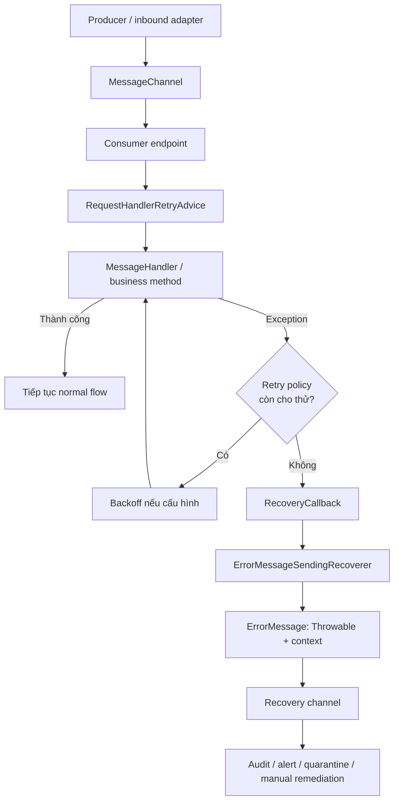

# ErrorMessageSendingRecoverer: phát ErrorMessage khi retry đã cạn

## 1. Vì sao cần ErrorMessageSendingRecoverer?

Trong **Spring Integration Runtime**, message đi qua `MessageChannel`, được consumer endpoint tiếp nhận, rồi chuyển tới `MessageHandler` hoặc phương thức nghiệp vụ. Khi handler gọi database, HTTP API, hệ thống thanh toán hay broker khác, lỗi tạm thời có thể khiến một message cần được thử lại. Nhưng khi số lần thử cho phép đã hết, flow phải có **chính sách recovery** rõ ràng.

**`ErrorMessageSendingRecoverer`** thuộc `org.springframework.integration.handler.advice` là một `RecoveryCallback<Object>` cho cơ chế retry. Khi retry đã cạn, nó **tạo `ErrorMessage` mang lỗi cuối cùng và publish lên một message channel**, cho phép một flow khác ghi nhận, cảnh báo, lưu bản ghi thất bại hoặc chuyển tới hệ thống cần xử lý thủ công.

Chủ đề này thuộc chương **Retry và recovery** của module `SPRING_INTEGRATION_RUNTIME`. Nó liên hệ với việc vận hành channel, endpoint, consumer, poller, executor; và có tác động thực tế tới lifecycle, transaction, retry, message store, correlation, lỗi, threading và hiệu năng.

Bài học tập trung vào Spring Integration **6.x** và cách cấu hình `RequestHandlerRetryAdvice` dùng **Spring Retry 2.x**. Một số API retry đã thay đổi ở các dòng Spring Integration mới hơn, vì vậy cần đối chiếu API đúng phiên bản đang chạy.

**Sau bài học, bạn sẽ:**

1. Hiểu lúc nào recovery callback chạy và tại sao nó khác error handler thông thường.
2. Cấu hình `RequestHandlerRetryAdvice` với `ErrorMessageSendingRecoverer` và một recovery channel.
3. Trích xuất lỗi, failed/original message và correlation thông qua `ErrorMessage`.
4. Phân biệt exhausted retry, stateful redelivery, transaction rollback và message đã được xử lý thành công.
5. Chẩn đoán các tình huống recovery message không xuất hiện, xuất hiện trùng hoặc bị gửi sai channel.

## 2. Vị trí trong pipeline xử lý lỗi



**Phân vai:**

| Thành phần | Vai trò thực tế |
|---|---|
| `RequestHandlerRetryAdvice` | Bao quanh lời gọi message handler, kích hoạt retry theo policy và callback khi cạn |
| `RetryTemplate` / `RetryPolicy` / `BackOffPolicy` | Quyết định có thử lại hay không, tổng số lần thử và thời gian chờ |
| `ErrorMessageSendingRecoverer` | Sau khi cạn retry, publish error event để flow recovery xử lý |
| `ErrorMessagePublisher` | Lớp cha cung cấp cơ chế tạo và gửi `ErrorMessage` |
| `ErrorMessageStrategy` | Xây dựng `ErrorMessage` từ `Throwable` và context, có thể đính kèm original message |
| Recovery `MessageChannel` | Đích nhận event lỗi, ví dụ một `QueueChannel` hoặc `PublishSubscribeChannel` |
| Consumer recovery | Quyết định lưu lỗi, cảnh báo, cách ly hoặc yêu cầu can thiệp; framework không làm thay |

`ErrorMessageSendingRecoverer` **không tự chạy một lần nữa handler**, **không chuyển message sang dead-letter queue theo mặc định**, và **không tự làm transaction thành công**. Nhiệm vụ của nó là xuất bản sự kiện lỗi khi cơ chế retry đã quyết định dừng.

## 3. API của ErrorMessageSendingRecoverer

### 3.1. Vị trí package và hợp đồng

Tên đầy đủ:

```java
org.springframework.integration.handler.advice.ErrorMessageSendingRecoverer
```

Lớp này:

- Kế thừa `org.springframework.integration.core.ErrorMessagePublisher`.
- Triển khai `org.springframework.retry.RecoveryCallback<Object>`.
- Có method `Object recover(RetryContext context)` được retry infrastructure gọi sau exhaustion.
- Có mặt từ Spring Integration 2.2; các constructor/strategy mở rộng được bổ sung ở những phiên bản sau.

Các constructor hữu ích:

```java
new ErrorMessageSendingRecoverer()
new ErrorMessageSendingRecoverer(MessageChannel recoveryChannel)
new ErrorMessageSendingRecoverer(
        MessageChannel recoveryChannel,
        ErrorMessageStrategy errorMessageStrategy)
```

| Constructor | Kết quả |
|---|---|
| Không tham số | Dùng `errorChannel` mặc định; phù hợp khi chủ đích dùng global error flow |
| Nhận `MessageChannel` | Gửi lỗi trực tiếp tới channel đã truyền |
| Nhận channel và `ErrorMessageStrategy` | Dùng một chiến lược xây dựng `ErrorMessage` tùy chỉnh hoặc mặc định nếu strategy `null` |

Dùng **constructor có channel** giúp dễ quan sát ranh giới: endpoint retry cạn → recovery channel → consumer recovery. Đặt tên riêng, ví dụ `orders.recovery`, tránh nhầm event retry-exhausted với các lỗi async chung của ứng dụng.

### 3.2. ErrorMessage khác request Message

`ErrorMessage` là một `Message<Throwable>` trong Spring Messaging:

```java
ErrorMessage error = ...;

Throwable lastFailure = error.getPayload();
Message<?> original = error.getOriginalMessage();
```

- **Payload** của `ErrorMessage` là một `Throwable`; có thể là `MessagingException` bọc lỗi nghiệp vụ.
- **Original message** có thể được tạo từ context nếu `ErrorMessageStrategy` nhận được input message.
- Nếu throwable là `MessagingException`, method `getFailedMessage()` cũng có thể cung cấp message gây lỗi.

Không được giả định exception luôn có cùng kiểu với exception gốc từ service. Framework có thể bọc lỗi bằng `MessageHandlingException` hoặc một `MessagingException` khác tùy vị trí trong flow.

### 3.3. Vai trò của ErrorMessageStrategy

`DefaultErrorMessageStrategy` tạo `ErrorMessage` từ throwable và `AttributeAccessor`. Khi context chứa request message dưới khóa `ErrorMessageUtils.INPUT_MESSAGE_CONTEXT_KEY`, strategy có thể đưa nó vào `ErrorMessage.originalMessage`.

```java
import org.springframework.integration.support.DefaultErrorMessageStrategy;
import org.springframework.integration.handler.advice.ErrorMessageSendingRecoverer;

ErrorMessageSendingRecoverer recoverer =
        new ErrorMessageSendingRecoverer(
                recoveryChannel,
                new DefaultErrorMessageStrategy());
```

Ví dụ trên chỉ cho thấy extension point; khi không có nhu cầu đặc biệt, constructor một tham số đã tự dùng strategy mặc định.

Nếu cần thêm header phục vụ alerting/tracing, có thể triển khai `ErrorMessageStrategy` riêng. Tuy nhiên nên **giữ khả năng truy vết original/failed message**, đồng thời tránh gắn toàn bộ dữ liệu nhạy cảm vào event lỗi.

## 4. Kết hợp RequestHandlerRetryAdvice và recovery callback

Mẫu cấu hình cốt lõi:

```java
RequestHandlerRetryAdvice advice = new RequestHandlerRetryAdvice();
advice.setRecoveryCallback(
        new ErrorMessageSendingRecoverer(recoveryChannel));
```

`RequestHandlerRetryAdvice` chèn retry quanh lời gọi `MessageHandler` được gắn advice. Nó không tự retry tất cả handler hay toàn bộ integration flow. Trong annotation configuration, có thể gắn bean retry advice bằng `@ServiceActivator(adviceChain = "ordersRetryAdvice")`.

Nếu không cấu hình `RecoveryCallback`, exception sau khi retry cạn thường được **ném tiếp** ra call stack; ở flow async hoặc polling, cơ chế error handler của endpoint có thể chuyển nó sang error channel. Khi có `ErrorMessageSendingRecoverer`, lần thất bại cuối kích hoạt callback **chủ động publish `ErrorMessage`**.

**Hệ quả quan trọng:** nếu publish recovery thành công và callback kết thúc bình thường, lỗi gốc có thể được coi là **đã recover ở lớp advice** và không tiếp tục lan theo cách trước đó. Điều này **không có nghĩa nghiệp vụ thành công**. Nếu muốn caller/broker biết failure để rollback hoặc redeliver, phải thiết kế semantics transaction và acknowledgment phù hợp thay vì mặc nhiên coi recovery channel như việc ném exception lại.

### 4.1. Total attempts và backoff

Với Spring Retry `SimpleRetryPolicy(3)`, giới hạn là **3 lần thực thi tính cả lần đầu**: 1 initial attempt và tối đa 2 lần retry. Đừng nhầm “3 attempts” với “3 retries sau initial”.

`BackOffPolicy` điều khiển thời gian chờ giữa các lần thử. Ví dụ `FixedBackOffPolicy` chờ cố định 100 ms; `ExponentialBackOffPolicy` tăng khoảng chờ theo hệ số. Backoff của stateless retry thường giữ thread đang xử lý message ở trạng thái chờ, ảnh hưởng concurrency và thông lượng.

### 4.2. Không retry mọi lỗi một cách vô điều kiện

Một policy mặc định retry rộng có thể lặp lại cả lỗi **không thể tự phục hồi**, ví dụ payload sai format hoặc thiếu header bắt buộc. Trong production cần phân loại exception:

- **Có thể tạm thời:** timeout kết nối, service 503, rate limit, deadlock DB có thể retry, resource busy.
- **Thường không nên retry:** dữ liệu không hợp lệ, vi phạm schema, auth bị từ chối vĩnh viễn, cấu hình sai channel.
- **Cần quyết định theo nghiệp vụ:** conflict, optimistic locking, duplicate request.

Spring Integration đôi khi bọc exception nghiệp vụ bên trong `MessagingException`; nếu phân loại theo exception type, cấu hình traversal của cause chain để chính sách không bị đánh lừa bởi wrapper.

## 5. Ví dụ Java chạy được: retry ba lần rồi nhận ErrorMessage

Ví dụ theo **Spring Integration 6.x + Spring Retry 2.x + Java 17+**; cần dependency `spring-integration-core`, `spring-retry` và các module Spring Context tương ứng. Chúng ta tạo `DirectChannel` cho request, `QueueChannel` cho recovery để đọc `ErrorMessage` trong bài thử.

### 5.1. Cấu hình channel và retry advice

```java
import org.springframework.beans.factory.annotation.Qualifier;
import org.springframework.context.annotation.Bean;
import org.springframework.context.annotation.Configuration;
import org.springframework.integration.channel.DirectChannel;
import org.springframework.integration.channel.QueueChannel;
import org.springframework.integration.config.EnableIntegration;
import org.springframework.integration.handler.advice.ErrorMessageSendingRecoverer;
import org.springframework.integration.handler.advice.RequestHandlerRetryAdvice;
import org.springframework.messaging.MessageChannel;
import org.springframework.retry.backoff.FixedBackOffPolicy;
import org.springframework.retry.policy.SimpleRetryPolicy;
import org.springframework.retry.support.RetryTemplate;

@Configuration
@EnableIntegration
class RecoveryDemoConfig {

    @Bean("orders.in")
    MessageChannel ordersIn() {
        return new DirectChannel();
    }

    @Bean("orders.recovery")
    QueueChannel recoveryQueue() {
        return new QueueChannel();
    }

    @Bean("ordersRetryAdvice")
    RequestHandlerRetryAdvice ordersRetryAdvice(
            @Qualifier("orders.recovery") MessageChannel recoveryChannel) {

        RetryTemplate retryTemplate = new RetryTemplate();
        retryTemplate.setRetryPolicy(new SimpleRetryPolicy(3));

        FixedBackOffPolicy backoff = new FixedBackOffPolicy();
        backoff.setBackOffPeriod(100L);
        retryTemplate.setBackOffPolicy(backoff);

        RequestHandlerRetryAdvice advice = new RequestHandlerRetryAdvice();
        advice.setRetryTemplate(retryTemplate);
        advice.setRecoveryCallback(
                new ErrorMessageSendingRecoverer(recoveryChannel));
        return advice;
    }

    @Bean
    FailingOrderService failingOrderService() {
        return new FailingOrderService();
    }
}
```

Mọi bean channel dùng **tên rõ ràng**. Constructor recoverer nhận chính `orders.recovery`, không phải địa chỉ `replyChannel` của request. Dùng `QueueChannel` ở đây để thực hành kiểm chứng; queue trong bộ nhớ này không phải giải pháp DLQ bền vững cho production.

### 5.2. Handler luôn ném lỗi

```java
import java.util.concurrent.atomic.AtomicInteger;
import org.springframework.integration.annotation.ServiceActivator;

class FailingOrderService {

    private final AtomicInteger attempts = new AtomicInteger();

    @ServiceActivator(
            inputChannel = "orders.in",
            adviceChain = "ordersRetryAdvice")
    public void process(String orderId) {
        int current = attempts.incrementAndGet();
        System.out.println("Attempt " + current + " for " + orderId);
        throw new IllegalStateException("Backend unavailable");
    }

    public int attempts() {
        return attempts.get();
    }
}
```

Method sẽ thất bại ở cả ba lần thử; sau khi policy từ chối thử tiếp, callback gửi `ErrorMessage` đến recovery channel. Vì method `void` và recovery callback xử lý lỗi bằng publish event, flow minh họa này không sinh **normal reply**.

### 5.3. Gửi một request và đọc recovery event

```java
import org.springframework.context.annotation.AnnotationConfigApplicationContext;
import org.springframework.integration.channel.QueueChannel;
import org.springframework.messaging.Message;
import org.springframework.messaging.MessageChannel;
import org.springframework.messaging.MessagingException;
import org.springframework.messaging.support.ErrorMessage;
import org.springframework.messaging.support.MessageBuilder;

public class RecoveryDemo {

    public static void main(String[] args) {
        try (var context = new AnnotationConfigApplicationContext(
                RecoveryDemoConfig.class)) {

            MessageChannel input =
                    context.getBean("orders.in", MessageChannel.class);
            QueueChannel failures =
                    context.getBean("orders.recovery", QueueChannel.class);

            Message<String> request = MessageBuilder
                    .withPayload("ORD-42")
                    .setHeader("traceId", "trace-42")
                    .build();

            input.send(request);

            Message<?> recovered = failures.receive(2_000);
            if (!(recovered instanceof ErrorMessage error)) {
                throw new AssertionError("Expected ErrorMessage on recovery channel");
            }

            Throwable failure = error.getPayload();
            System.out.println(failure.getClass().getName());
            System.out.println(failure.getMessage());

            Message<?> original = error.getOriginalMessage();
            if (original != null) {
                System.out.println(original.getPayload()); // ORD-42
                System.out.println(original.getHeaders().get("traceId"));
            }

            if (failure instanceof MessagingException me
                    && me.getFailedMessage() != null) {
                System.out.println(
                        "Failed payload: " + me.getFailedMessage().getPayload());
            }

            System.out.println(
                    context.getBean(FailingOrderService.class).attempts()); // 3
        }
    }
}
```

**Dự kiến quan sát:** có ba dòng `Attempt 1`, `Attempt 2`, `Attempt 3`; khoảng chờ 100 ms giữa các lần; sau đó một event `ErrorMessage` trên `orders.recovery`. Kiểu exception ở payload có thể là wrapper và `originalMessage` phụ thuộc context/strategy nên ví dụ kiểm tra `null` trước.

Sơ đồ đường đi trong demo:

```text
send("ORD-42")
  └─ orders.in (DirectChannel)
      └─ @ServiceActivator + RequestHandlerRetryAdvice
          ├─ attempt 1 -> exception
          ├─ wait 100 ms
          ├─ attempt 2 -> exception
          ├─ wait 100 ms
          └─ attempt 3 -> exception
              └─ ErrorMessageSendingRecoverer
                  └─ orders.recovery (QueueChannel)
                      └─ receive() -> ErrorMessage
```

Cách đối chứng: sửa handler chỉ ném lỗi ở **hai lần đầu** và hoàn tất ở lần thứ ba. Khi đó retry thành công, callback **không được gọi** và recovery queue không nhận `ErrorMessage`. Đây là phép kiểm tra quan trọng để phân biệt “retry đã diễn ra” với “recovery đã diễn ra”.

## 6. Khi nào một ErrorMessage được tạo?

**Không phải mọi exception đều tạo event bằng recoverer này.** Chỉ những lỗi nằm trong phạm vi lời gọi handler được advice bao quanh, đủ điều kiện retry và sau đó đi vào nhánh recovery mới kích hoạt callback.

| Tình huống | Hành vi kỳ vọng |
|---|---|
| Handler thành công ngay | Không retry, không recovery event |
| Handler lỗi rồi thành công ở lần thử tiếp | Retry dừng khi thành công, không recovery event |
| Handler liên tục lỗi đến khi policy dừng | Recovery callback được kích hoạt |
| Không gắn advice lên endpoint/handler | Recoverer không tham gia xử lý |
| Có advice nhưng không cấu hình recovery callback | Khi cạn retry, lỗi có thể bị ném tiếp ra caller |
| Policy đánh dấu lỗi không retryable | Có thể chuyển sang recovery theo policy, không cần đợi đủ max attempts |
| Recovery channel không nhận được message | Lỗi publish recovery có thể tiếp tục lan ra caller/error handler |
| Handler thất bại sau bước được advice bao quanh | Lỗi ngoài phạm vi advice không được callback này xử lý |

Đặc biệt, việc **publish `ErrorMessage` không bảo đảm đã có consumer xử lý thành công nghiệp vụ recovery**. Ví dụ `QueueChannel` nhận được message nhưng chưa ai poll thì lỗi vẫn nằm trong queue. Nếu ứng dụng shutdown và dùng queue in-memory, sự kiện có thể bị mất.

## 7. Phân biệt recovery channel với error channel thông thường

Spring Integration có cơ chế error handling gắn với **threading và endpoint**:

- Với `DirectChannel` đồng bộ, exception thông thường có thể truyền lại sender trên cùng thread.
- Với `ExecutorChannel` hoặc task của poller, lỗi không thể được ném trực tiếp về thread producer đã rời đi; framework có thể chuyển thành `ErrorMessage` và publish theo `errorChannel` header hoặc global `errorChannel`.
- Một poller scheduler có `MessagePublishingErrorHandler` có thể xử lý lỗi tác vụ và phát `ErrorMessage`.

`ErrorMessageSendingRecoverer` là một đường khác: nó được **gọi chủ động trong retry advice** khi retry cạn. Với constructor `new ErrorMessageSendingRecoverer(recoveryChannel)`, đích phát lỗi là **channel được truyền**, không mặc định theo `replyChannel` của request.

| Cơ chế | Khi được kích hoạt | Destination | Ai quyết định? |
|---|---|---|---|
| `RequestHandlerRetryAdvice` + recoverer | Handler đã hết cơ hội retry | Recovery channel truyền vào recoverer hoặc default global error channel | Cấu hình advice/recoverer |
| Error handler của executor/poller | Exception vượt khỏi tác vụ async/poll | `errorChannel` header hoặc global error channel theo cơ chế handler | Cấu hình endpoint, error handler, request headers |
| Throw exception trên `DirectChannel` | Exception không được recovery xử lý | Caller trong call stack | Semantics đồng bộ |
| Reply nghiệp vụ bình thường | Handler trả giá trị khác null | `outputChannel`/`replyChannel` theo reply flow | Handler/endpoint |

**Đừng cấu hình hai nhánh để cùng phát recovery event cho một lỗi một cách vô tình.** Khi recovery callback đã “nuốt” lỗi bằng event, async error handler bên ngoài thường không còn thấy lỗi đó. Nếu callback publish lỗi tiếp tục thất bại, external error handler mới có thể thấy exception khác. Cần vẽ rõ một đường xử lý failure chính.

## 8. Thiết kế consumer nhận ErrorMessage

Recovery channel chỉ mang event. Một consumer phía sau phải áp dụng chính sách xử lý hợp với nghiệp vụ:

1. Đọc throwable và root cause, giữ trace ID/correlation ID nếu sẵn có.
2. Tìm original/failed message (nếu có) và business key, ví dụ `orderId`.
3. Phân loại lỗi: lỗi dữ liệu không phục hồi, lỗi hạ tầng, lỗi bảo mật, lỗi cấu hình.
4. Ghi một bản ghi thất bại có trạng thái cụ thể, ví dụ `REQUIRES_REVIEW`, hoặc publish sang DLQ bền vững.
5. Tạo metric/alert phù hợp; để người vận hành xác nhận và chủ động replay có kiểm soát.

Ví dụ consumer cho bài thử:

```java
import org.springframework.integration.annotation.ServiceActivator;
import org.springframework.messaging.support.ErrorMessage;

public class RecoveryAuditHandler {

    @ServiceActivator(inputChannel = "orders.recovery")
    public void audit(ErrorMessage error) {
        Throwable cause = error.getPayload();
        System.err.println("Retry exhausted: " + cause.getClass().getSimpleName());
        // Production: ghi audit an toàn hoặc publish vào DLQ bền vững.
    }
}
```

**Chọn một cách consume queue trong demo:** hoặc dùng `receive()` thủ công như mục 5, **hoặc** cấu hình consumer/poller cho `orders.recovery`. Không vừa gọi `receive()` vừa tạo competing consumer rồi kỳ vọng mỗi bên đều nhận cùng một message.

### Tránh replay mù và dữ liệu nhạy cảm

`ErrorMessage` có thể chứa stack trace, header, original message và payload. Nếu gửi ra alerting/DLQ ngoài hệ thống, mask PII, token và dữ liệu không cần thiết; giới hạn quyền truy cập. Bản ghi recovery nên có identity ổn định của nghiệp vụ và attempt metadata, tránh lưu các object Java khó serialize như channel instance trong headers.

**Replay** là hành động nghiệp vụ mới: phải kiểm tra trạng thái đích, phiên bản dữ liệu và bảo vệ idempotency; recoverer không tự động replay.

## 9. Retry và recovery trong mô hình stateless, stateful

### 9.1. Stateless retry

Trong stateless retry, retry advice gọi lại handler trong cùng xử lý message. Khoảng backoff thường xảy ra **trên thread đó**, vì vậy:

- `DirectChannel`: thời gian `send()` của caller tăng theo số lần retry và backoff.
- `ExecutorChannel`: worker thread bị chiếm khi đang retry/chờ; queue executor dễ đầy dưới tải.
- Polling consumer: một lần poll có thể mất lâu, giảm tần suất xử lý message kế tiếp.
- Transaction: nếu advice chạy trong ranh giới transaction hoặc bao bên ngoài transaction advice, kết quả rollback có thể khác. **Thứ tự advice quan trọng**.

Nếu có `N` lần thử, thời gian tối thiểu gần bằng tổng thời gian handler cho các lần đó cộng các lần backoff; cần đo timeout của gateway và poller tương ứng.

### 9.2. Stateful retry

Stateful retry giữ trạng thái thử lại theo **khóa message ổn định**; lỗi có thể được ném ra để nguồn message redeliver sau rollback/nack. Các lần thử tiếp diễn trên những lần giao message khác nhau thay vì trong một call stack. Cách cấu hình stateful cụ thể phụ thuộc phiên bản `RequestHandlerRetryAdvice` và cơ chế broker/inbound adapter, nên **không copy nguyên cấu hình stateless rồi mặc định nó trở thành stateful**.

Để thiết kế stateful:

- Nguồn vào phải có cơ chế **redelivery thực sự**.
- Khóa định danh retry phải ổn định cho cùng một logical message.
- Xác định cách state cache hết hạn, tràn hoặc message không được giao lại.
- Khi exhaustion kích hoạt recovery, xác định acknowledgment/rollback sau callback. Publish lỗi thành công chưa chắc mang nghĩa muốn ack message nguồn.

Nếu nguồn không redeliver, các lần retry về sau sẽ không tự xảy ra chỉ vì advice có state.

## 10. Transaction, idempotency và giới hạn bảo đảm

Giả sử handler gọi dịch vụ thanh toán đã ghi nhận giao dịch nhưng exception xảy ra trước khi trả kết quả. Retry có thể gọi lại giao dịch; sau khi cạn retry, recoverer publish một `ErrorMessage`. Lúc này **không thể suy luận giao dịch đã thất bại hoàn toàn** chỉ dựa vào sự kiện retry-exhausted.

Cần làm rõ:

- **Transaction boundary:** transaction gắn thread; chuyển qua executor/poller thường mất context transaction của caller. Rollback DB không tự rollback việc đã thực hiện ở hệ thống ngoài.
- **Advice ordering:** retry bao ngoài transaction advice khác với transaction bao ngoài retry; một lần thử có thể có transaction riêng hoặc cùng transaction, tùy wiring.
- **At-least-once:** broker redelivery, retry và replay thủ công có thể tạo nhiều lần thực thi cùng một business action.
- **Recovery callback là side effect riêng:** gửi event recovery có thể thành công hoặc thất bại độc lập với nghiệp vụ gốc.
- **Idempotency:** dùng `orderId`/request ID và trạng thái đã xử lý; nếu cần, áp dụng inbox/outbox hoặc unique constraint phù hợp.

Một chiến lược thông thường là **retry tạm thời → publish failure event có correlation → ghi nhận trạng thái cuối → replay có chủ đích**. Muốn bảo đảm không mất thông tin failure, chọn channel/storage bền vững và thiết kế transaction phù hợp; một `QueueChannel` trong RAM không có bảo đảm đó.

## 11. Quan sát runtime: log, metric, tracing và hiệu năng

Các điểm nên đo:

| Điểm đo | Ý nghĩa |
|---|---|
| `messageId` và business/correlation ID | Liên kết request với các lần thử và recovery event |
| `retryCount` hoặc số attempt thực tế | Biết retry policy có hiệu lực và có bị giới hạn |
| Handler duration mỗi attempt | Phân biệt lỗi do upstream chậm với backoff chậm |
| Backoff elapsed time | Tổng thời gian ngủ của worker trước exhaustion |
| Recovery publish duration và error channel depth | Biết event có được gửi, đang bị backlog hay không |
| Endpoint lifecycle và executor queue | Tìm nơi nghẽn khi channel/consumer stop hoặc worker saturated |
| Tỷ lệ retry recovered / eventual success | Đánh giá chính sách retry có hữu ích hay chỉ tốn tài nguyên |

Không nên chỉ log `"retry failed"` rồi coi là đã có recovery event. Cần xác nhận **đích channel nhận được `ErrorMessage`**, và consumer recovery đã xử lý nó. Khi bật debug, có thể log bean/component name, exception type, elapsed time, message/correlation ID; tránh in toàn bộ payload nếu chứa dữ liệu nhạy cảm.

Đối với polling flow, kiểm tra chu kỳ poll, `maxMessagesPerPoll`, worker pool và error handler. Retry với backoff dài có thể chiếm thread, khiến backlog tăng ngay cả khi input channel vẫn “healthy”.

## 12. Các lỗi thường gặp và cách khoanh vùng

| Triệu chứng | Khả năng nguyên nhân | Cách xác minh |
|---|---|---|
| Handler lỗi nhiều lần nhưng không có recovery event | Chưa gắn `RequestHandlerRetryAdvice`, hoặc lời gọi lỗi nằm ngoài advice | Kiểm tra `adviceChain`, bean advice và phạm vi handler được intercept |
| Error event xuất hiện sau lần thử đầu | Policy đánh dấu lỗi không retryable, hoặc max attempts = 1 | Kiểm tra cấu hình retry classifier và số attempt |
| Không thấy exception ở caller dù nghiệp vụ thất bại | Recovery callback publish thành công và lỗi đã được xử lý ở lớp advice | Quan sát `orders.recovery`, hợp đồng ACK/rollback và đáp ứng caller |
| `DestinationResolutionException` hoặc lỗi gửi recovery | Channel đích sai tên, không có subscriber, bounded channel đầy | Kiểm tra constructor recoverer, bean channel, capacity, send timeout |
| `ErrorMessage` thiếu `originalMessage` | Context không chứa input message hoặc strategy tự viết làm mất context | Kiểm tra `ErrorMessageStrategy`, `failedMessage` của exception |
| ErrorMessage chứa wrapper exception | `MessageHandler` bọc lỗi bằng `MessagingException` | Đọc cause chain và `getFailedMessage()` |
| Recovery chỉ xuất hiện ở global `errorChannel` | Recoverer không chỉ định channel, hoặc lỗi phát sinh ngoài advice qua async error handling | Phân biệt nguồn publish bằng logger, component và stack trace |
| Recovery event bị mất sau restart | `QueueChannel` in-memory, không có persistent store | Chọn durable channel/storage, xác định ACK/DLQ |
| Retry lặp side effect | Không có idempotency, external service đã xử lý nhưng response lỗi | Business key, status check, audit duplicate |
| Throughput thấp khi retry nhiều | Backoff chiếm worker thread, pool/queue saturation | Tính concurrency, đo queue backlog và số task chờ |
| Cùng logical event có nhiều recovery event | Nguồn redeliver lại sau callback, nhiều retry layer hoặc replay trùng | Xem ack, retry composition, dedup key |

Một trình tự kiểm tra thực tế:

1. Xác nhận message đi tới **đúng endpoint**; endpoint đang `start` và subscriber/poller hoạt động.
2. Kiểm tra handler có advice và policy đang dùng; so **attempt count thực tế** với thiết lập.
3. Xem nguyên nhân cuối cùng (`cause chain`) và **điều kiện exhaustion** của policy.
4. Xác định recoverer được gọi và channel được truyền vào constructor.
5. Kiểm tra recovery channel có nhận `ErrorMessage`, có consumer và có thể block/throw khi send không.
6. Đối chiếu transaction/ACK của message nguồn; kiểm tra duplicate side effect hoặc redelivery.
7. Đo queue depth, executor saturation, backoff và timeout nếu sự cố chỉ xảy ra dưới tải.

## 13. Thực hành mở rộng và câu hỏi tự kiểm tra

### Bài 1 — Thành công sau retry

Sửa `process()` để chỉ ném `IllegalStateException` ở hai attempt đầu, attempt thứ ba kết thúc bình thường. Dự đoán và kiểm chứng:

- Method được gọi bao nhiêu lần?
- `orders.recovery` có nhận `ErrorMessage` hay không?
- Caller đồng bộ nhìn thấy điều gì?

### Bài 2 — Không recovery callback

Xóa tạm `advice.setRecoveryCallback(...)` nhưng giữ nguyên `RetryTemplate`. So sánh lỗi sau exhaustion khi gửi vào `DirectChannel` với cấu hình có callback. Giải thích vì sao một trường hợp exception lan ra caller, còn một trường hợp có recovery event.

### Bài 3 — Phân loại lỗi

Thay `SimpleRetryPolicy(3)` bằng policy chỉ retry một exception tạm thời do ứng dụng định nghĩa và cho lỗi validation đi thẳng sang recovery/đường lỗi phù hợp. Với lỗi bị bọc trong `MessageHandlingException`, thử bật/tắt kiểm tra cause chain; giải thích sự khác biệt.

### Bài 4 — Recovery channel bền vững

Thay `QueueChannel` in-memory bằng một luồng lưu bản ghi lỗi vào cơ sở dữ liệu hoặc gửi DLQ của broker. Thiết kế thông tin bắt buộc gồm business ID, exception type, cause, thời điểm, status và replay count. Xác định cách bảo vệ dữ liệu và xử lý publish thất bại.

### Bài 5 — Thời gian chờ và thread

Đưa input qua `ExecutorChannel` hoặc polling consumer, chọn backoff đủ lớn, rồi đo latency, backlog và số thread đang chờ. Vì sao caller timeout không đồng nghĩa recovery đã hoàn tất?

### Bài 6 — Stateful và redelivery

Giả định nguồn là JMS/Kafka/AMQP có thể redeliver. Vẽ các mốc: lần giao đầu → exception → rollback/nack → giao lại → exhausted → recovery callback. Nếu recovery thành công nhưng inbound tiếp tục redeliver, chuyện gì có thể xảy ra và cần thay đổi policy ACK/idempotency ra sao?

## 14. Kết luận vận hành

`ErrorMessageSendingRecoverer` giải quyết **đầu ra của một retry đã cạn**: biến lỗi cuối thành `ErrorMessage` và gửi tới channel để downstream quản lý sự cố. Nó không tự giải quyết độ bền lưu trữ, xác nhận message nguồn, transaction xuyên hệ thống hay replay an toàn.

Khi thiết kế flow, hãy kiểm tra đủ bốn liên kết: **retry advice đúng handler → policy đúng loại lỗi → recovery channel có consumer và storage phù hợp → idempotency/ACK nhất quán**. Đây là ranh giới quan trọng để một lỗi được phát hiện, quan sát và phục hồi có kiểm soát thay vì âm thầm biến mất.

## 15. Nguồn tham khảo chính thức

- [Spring Integration 6.5.0 API — ErrorMessageSendingRecoverer](https://docs.spring.io/spring-integration/docs/6.5.0/api/org/springframework/integration/handler/advice/ErrorMessageSendingRecoverer.html): constructor, `RecoveryCallback` và lớp cha `ErrorMessagePublisher`.
- [Spring Integration 6.5.0 API — RequestHandlerRetryAdvice](https://docs.spring.io/spring-integration/docs/6.5.0/api/org/springframework/integration/handler/advice/RequestHandlerRetryAdvice.html): `setRetryTemplate` và `setRecoveryCallback`.
- [Spring Integration Reference — Handler Advice, Provided Advice Classes](https://docs.spring.io/spring-integration/docs/6.1.4/reference/html/handler-advice.html): stateless/stateful retry, recovery callback và XML/Java patterns trong dòng dùng Spring Retry.
- [Spring Integration Reference — Error Handling](https://docs.spring.io/spring-integration/reference/error-handling.html): error channel, hành vi sync/async, `ErrorMessagePublisher` và strategy.
- [Spring Integration 6.5.0 API — DefaultErrorMessageStrategy](https://docs.spring.io/spring-integration/docs/6.5.0/api/org/springframework/integration/support/DefaultErrorMessageStrategy.html): điều kiện đưa request message vào `originalMessage`.
- [Spring Retry 2.0.x API — SimpleRetryPolicy](https://docs.spring.io/spring-retry/docs/current/apidocs/spring.retry/org/springframework/retry/policy/SimpleRetryPolicy.html): giới hạn `maxAttempts` tính cả lần thử đầu.
