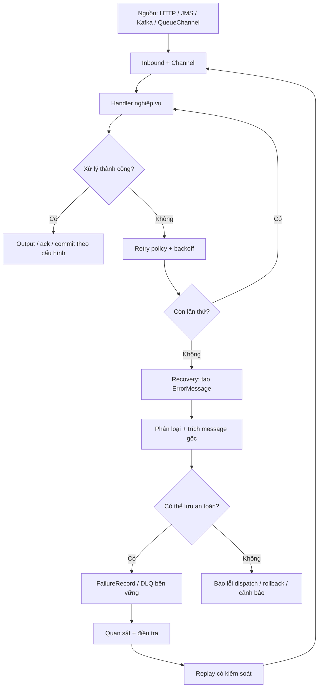

# Dead-letter channel và lưu message lỗi trong Spring Integration

## 1. Bài toán: lỗi đã hết retry thì message đi đâu?

Một message đơn hàng đi qua `MessageChannel` đến `ServiceActivator`, gọi hệ thống thanh toán và thất bại. Khi lỗi chỉ là network timeout, thử lại có thể thành công. Nhưng nếu dữ liệu sai, đối tác từ chối vĩnh viễn hoặc hệ thống phụ thuộc ngừng hoạt động quá lâu, **retry mãi** sẽ tiêu hao tài nguyên và tạo thêm tác dụng phụ.

Trong chương **Retry và recovery** của module **SPRING_INTEGRATION_RUNTIME**, bài học này giải quyết giai đoạn **sau khi retry không còn phù hợp**:

1. Giữ dấu vết message gốc và nguyên nhân thất bại.
2. Đưa message không xử lý được vào nơi cách ly (dead-letter channel hoặc dead-letter queue).
3. Lưu đủ thông tin để điều tra, sửa dữ liệu và **replay có kiểm soát**.
4. Bảo đảm việc cách ly phối hợp đúng với acknowledgment, transaction, executor và poller ở runtime.

**Dead letter** là message đã được hệ thống quyết định **không xử lý tiếp trên luồng bình thường tại thời điểm đó**. **Dead-letter channel (DLC)** là tên một kênh ta thiết kế để nhận message lỗi; **dead-letter queue (DLQ)** thường là hàng đợi chứa các message này để xử lý sau. Spring Integration không áp một cấu hình DLQ duy nhất cho mọi adapter: ta phải thiết kế đường chuyển lỗi, nơi lưu và quy trình khôi phục theo loại transport.

> **Phân biệt quan trọng:** Bean `errorChannel` mặc định là nơi nhận `ErrorMessage` để xử lý lỗi runtime; nó **không mặc nhiên là DLQ bền vững**. Đặt tên một channel là `deadLetterChannel` cũng không làm nó tự lưu được message qua lần restart.

## 2. Sơ đồ luồng: xử lý, retry, recovery, cách ly



Mũi tên `ack / commit` có **ý nghĩa khác nhau** tùy source. Với `QueueChannel` lưu JDBC, transaction của poller có thể bảo vệ thao tác lấy message khỏi store. Với Kafka, JMS hay RabbitMQ, acknowledgment và requeue phụ thuộc inbound adapter, container và broker. Không suy ra rằng chỉ vì error consumer nhận được message thì transaction nguồn chắc chắn đã commit.

### Các trạng thái logic nên theo dõi

| Trạng thái | Ý nghĩa nghiệp vụ | Hành động tiếp theo |
| --- | --- | --- |
| `PROCESSING` | Message đang được xử lý | Quan sát thời gian và số attempt |
| `RETRYING` | Lỗi tạm thời, còn cơ hội retry | Retry có giới hạn và backoff |
| `DEAD_LETTERED` | Đã ghi bản ghi lỗi vào nơi cách ly | Cảnh báo hoặc mở phiên điều tra |
| `READY_TO_REPLAY` | Đã sửa nguyên nhân, được phép chạy lại | Replay qua luồng xác định |
| `REPLAYED` | Đã đưa yêu cầu quay lại luồng xử lý | Kiểm tra kết quả, chống trùng |
| `RESOLVED` / `DISCARDED` | Đã xử lý xong hoặc loại bỏ có lý do | Giữ audit và chính sách retention |

Đây là **mô hình trạng thái do ứng dụng đề xuất**, không phải enum có sẵn của Spring Integration.

## 3. Ba đối tượng rất dễ bị nhầm

| Khái niệm | API hoặc hạ tầng thường gặp | Nó làm gì? | Có lưu bền vững mặc định? |
| --- | --- | --- | --- |
| `ErrorMessage` | `org.springframework.messaging.support.ErrorMessage` | Chứa `Throwable` và có thể kèm message gốc | Không |
| `errorChannel` | Bean message channel tên `errorChannel`, thường là `PublishSubscribeChannel` | Phân phối sự kiện lỗi cho consumer | Không |
| Application dead-letter channel | `DirectChannel`, `QueueChannel`, broker-backed channel, tên tự đặt | Nhận message đã được quyết định cách ly | Tùy cấu hình |
| Broker DLQ/DLX | JMS queue, RabbitMQ DLX/DLQ, Kafka dead-letter topic tùy bộ tích hợp | Cách ly message tại broker | Theo cơ chế broker |
| Failure record / audit store | Table ứng dụng, `MessageStore`, object storage | Giữ dữ liệu cần thiết để phân tích và replay | Tùy công nghệ và transaction |

Trong Spring Integration, một `ErrorMessage` có `payload` là `Throwable`. Nếu có ngữ cảnh, `getOriginalMessage()` có thể trả về message liên quan. Với exception kiểu `MessagingException`, `getFailedMessage()` là nguồn thông tin bổ sung. Các object này **không luôn đầy đủ** và không nên coi stack trace là bản sao của business message.

Ví dụ:

```java
import org.springframework.messaging.Message;
import org.springframework.messaging.MessagingException;
import org.springframework.messaging.support.ErrorMessage;

public Message<?> findFailedMessage(ErrorMessage error) {
    Message<?> original = error.getOriginalMessage();
    if (original != null) {
        return original;
    }

    Throwable failure = error.getPayload();
    if (failure instanceof MessagingException messagingException) {
        return messagingException.getFailedMessage();
    }
    return null; // Bên gửi ErrorMessage có thể không mang ngữ cảnh gốc.
}
```

Trong một flow nhiều bước, `originalMessage` và `failedMessage` có thể là message ở **hai điểm khác nhau**. Muốn replay chính xác, hãy định nghĩa rõ cần giữ *dữ liệu đầu vào ban đầu*, *dữ liệu ngay trước bước lỗi* hay *một lệnh nghiệp vụ có thể chạy lại*.

## 4. Nên đưa những lỗi nào vào dead-letter channel?

Một hệ thống production cần **phân loại** lỗi trước khi quyết định retry hoặc cách ly.

| Loại lỗi | Ví dụ | Hướng xử lý |
| --- | --- | --- |
| Tạm thời | Timeout, HTTP 503, hết connection pool | Retry giới hạn, exponential backoff và jitter khi phù hợp |
| Không thể sửa bằng retry | Payload thiếu trường bắt buộc, schema không hỗ trợ | Dead-letter ngay hoặc sau chính sách xác định; cảnh báo dữ liệu |
| Phụ thuộc không sẵn sàng kéo dài | Dịch vụ bên thứ ba lỗi lâu hơn SLA | Retry giới hạn rồi cách ly, có thể replay sau khi phục hồi |
| Xung đột nghiệp vụ | Đơn đã thanh toán hoặc phiên bản cũ | Điều tra/idempotency; đôi khi không nên replay |
| Lỗi cấu hình | Sai tên channel, không có subscriber, serializer lỗi | Cảnh báo vận hành; bản thân đường DLQ cũng có thể lỗi |
| Lỗi cố ý bị hủy | Người dùng thu hồi yêu cầu | Kết thúc có audit; không nhất thiết thành dead letter |

Với lỗi đã được quyết định không retry, tránh quay message về input ngay lập tức. Làm vậy có thể tạo **vòng lặp độc hại**: nguồn → handler lỗi → DLQ → replay tự động → handler lỗi.

### Sai lầm cần tránh: cùng một lỗi đi qua nhiều đường

- `RequestHandlerRetryAdvice` retry tại handler.
- Inbound adapter/broker cũng có thể re-deliver khi transaction rollback hoặc nack.
- Error flow lại gửi về input để “thử thêm”.

Nếu không giới hạn và theo dõi **số lần thử tổng thể**, ba lớp có thể nhân số attempt lên rất lớn. Xác định rõ lớp nào sở hữu retry ngắn hạn, lớp nào sở hữu delayed retry, lớp nào chuyển sang dead letter.

## 5. Hai nơi xuất hiện dead letter: ứng dụng và broker

### 5.1. Application-level dead-letter channel

Ứng dụng cấu hình một message channel riêng nhận `ErrorMessage` hoặc một bản ghi lỗi đã chuẩn hóa:

```text
orderRequests → @ServiceActivator + retry advice
                       |
                       | retry exhausted
                       v
                 retryFailures
                       |
                  ErrorMessage
                       v
             create FailureRecord
                       |
                 deadLetterQueue
                       |
                operator / replay
```

Ưu điểm: phân loại lỗi theo nghiệp vụ, giữ correlation ID, lưu trạng thái investigation, replay trên API nội bộ. Nhược điểm: ứng dụng phải sở hữu độ bền, concurrency, quyền truy cập và cách ứng phó nếu ghi DLQ thất bại.

### 5.2. Broker-level dead-letter queue/topic

Một broker có thể quản lý dead lettering qua nack/reject, redelivery limit, TTL hay policy riêng. Ví dụ:

- RabbitMQ: dead-letter exchange (DLX) định tuyến message bị dead-letter sang queue đích theo cấu hình broker.
- JMS: một số broker có “dead letter queue” sau giới hạn redelivery; chính sách và tên queue phụ thuộc broker.
- Kafka: thường dùng dead-letter topic qua error handler/recoverer của consumer stack; **không phải mọi Kafka consumer đều tự có DLQ**.

Broker-level DLQ giúp giữ payload gốc và metadata broker, nhưng nguyên nhân business error, trạng thái phân tích và quy trình replay thường vẫn cần một ứng dụng/consumer quản trị.

**Quyết định kiến trúc:** Nếu nguồn đã là broker với DLQ phù hợp, cân nhắc dùng chính cơ chế đó cho redelivery và dead letter. Nếu nguồn là HTTP, poller nội bộ hoặc luồng cần lưu hồ sơ lỗi nghiệp vụ, application-level DLQ/audit store có thể phù hợp hơn. Có thể kết hợp cả hai nhưng phải thiết kế chống double-publish và đảm bảo nguồn/đích không lệch trạng thái.

## 6. Mẫu triển khai với RequestHandlerRetryAdvice và ErrorMessageSendingRecoverer

Trong Spring Integration, `RequestHandlerRetryAdvice` gắn vào handler để retry theo policy. Khi đã hết retry, `ErrorMessageSendingRecoverer` có thể tạo `ErrorMessage` và gửi đến channel recovery. Đây là cầu nối tự nhiên giữa **retry** và **dead lettering**, nhưng chưa phải toàn bộ giải pháp lưu bền vững.

### 6.1. Khai báo retry và recovery channel

Ví dụ sau dùng Java 17+, **Spring Integration 7.x / Spring Framework 7** với Retry API nằm trong Spring Framework. Các lớp cấu hình được đặt trong ứng dụng đã bật component scan. Nếu dự án đang dùng **Spring Integration 6.x**, cách cấu hình retry khác: dùng `RetryTemplate` và `RetryPolicy` của thư viện **Spring Retry**, cùng `RequestHandlerRetryAdvice.setRetryTemplate(...)`; không trộn các import/API giữa hai thế hệ.

```java
import java.time.Duration;

import org.springframework.context.annotation.Bean;
import org.springframework.context.annotation.Configuration;
import org.springframework.core.retry.RetryPolicy;
import org.springframework.integration.channel.DirectChannel;
import org.springframework.integration.channel.QueueChannel;
import org.springframework.integration.config.EnableIntegration;
import org.springframework.integration.handler.advice.ErrorMessageSendingRecoverer;
import org.springframework.integration.handler.advice.RequestHandlerRetryAdvice;
import org.springframework.messaging.MessageChannel;
import org.springframework.messaging.PollableChannel;

@Configuration
@EnableIntegration
public class RecoveryChannelsConfig {

    @Bean("retryFailures")
    public MessageChannel retryFailures() {
        return new DirectChannel();
    }

    // Chỉ dùng cho lab: QueueChannel này nằm trong bộ nhớ.
    @Bean("deadLetterQueue")
    public PollableChannel deadLetterQueue() {
        return new QueueChannel(100);
    }

    @Bean("dlqRetryAdvice")
    public RequestHandlerRetryAdvice dlqRetryAdvice(
            @org.springframework.beans.factory.annotation.Qualifier("retryFailures")
            MessageChannel retryFailures) {

        RetryPolicy policy = RetryPolicy.builder()
                .maxRetries(2)                    // 2 lần retry sau lần đầu
                .delay(Duration.ofMillis(300))      // Delay cố định 300 ms
                .build();

        RequestHandlerRetryAdvice advice = new RequestHandlerRetryAdvice();
        advice.setRetryPolicy(policy);
        advice.setRecoveryCallback(
                new ErrorMessageSendingRecoverer(retryFailures));
        return advice;
    }
}
```

Ở đây, `maxRetries(2)` nghĩa là **một lần gọi ban đầu cộng tối đa hai lần thử lại, tổng cộng ba lần gọi handler**. `delay(Duration.ofMillis(300))` tạo khoảng chờ cố định để dễ quan sát; production có thể dùng exponential backoff và jitter, chọn thời gian phù hợp SLA. Lưu ý số **retry** không đồng nghĩa với tổng số **attempt**; API của từng phiên bản có thể có cách cấu hình khác nhau.

**Chú ý:** Recovery callback được gọi khi retry đã cạn. Khi callback gửi `ErrorMessage` thành công và trả về bình thường, exception ban đầu có thể được coi là **đã recover ở tầng advice**; đây là lý do cần đảm bảo đường ghi dead letter thực sự thành công trước khi xác nhận xử lý với nguồn. Đừng mặc định “recover” nghĩa là công việc nghiệp vụ đã hoàn tất.

### 6.2. Gắn advice vào method endpoint

```java
import org.springframework.integration.annotation.MessageEndpoint;
import org.springframework.integration.annotation.ServiceActivator;

@MessageEndpoint
public class OrderProcessor {

    @ServiceActivator(
        inputChannel = "orderRequests",
        adviceChain = "dlqRetryAdvice")
    public void process(String orderId) {
        if (orderId.startsWith("invalid-")) {
            throw new IllegalArgumentException(
                    "Order is invalid: " + orderId);
        }
        // Gọi nghiệp vụ thực, ví dụ lưu đơn hoặc thanh toán.
    }
}
```

Handler ví dụ không trả reply vì đây là flow một chiều. Khi gửi `invalid-101`, lời gọi `process` thất bại cho tới khi cạn retry; `ErrorMessageSendingRecoverer` gửi `ErrorMessage` vào `retryFailures`.

Trong `DirectChannel` đồng bộ, recovery được thực hiện trong cùng call stack của consumer. Nếu dùng `ExecutorChannel` trước handler, retry và recovery có thể chạy trên worker thread; bên gửi ban đầu không chờ toàn bộ quá trình. Với `QueueChannel` + poller, consumer được kích hoạt bởi poller. Cơ chế acknowledgment và transaction sẽ phụ thuộc inbound endpoint và advice/transaction ở poller.

### 6.3. Chuẩn hóa lỗi thành FailureRecord

Không nên cố persist trực tiếp mọi `Throwable`, stack trace và `ErrorMessage`: exception có thể chứa object khó serialize, dữ liệu nhạy cảm, reference lớn hoặc metadata không ổn định qua deployment.

Thay vào đó, viết **bản ghi lỗi định nghĩa rõ schema**:

```java
import java.io.Serializable;

public record FailedOrder(
        String failureId,
        String orderId,
        String originalMessageId,
        String correlationId,
        String errorType,
        String errorSummary,
        String failedAt,
        int schemaVersion
) implements Serializable {}
```

`failureId` định danh từng lần đưa vào DLQ; `orderId` là business key để phát hiện trùng; `originalMessageId` giúp trace trong một phiên xử lý nhưng có thể đổi khi replay. `schemaVersion` hỗ trợ đọc lại bản ghi được tạo bởi code đời trước.

Handler chuyển lỗi thành message chứa `FailedOrder`:

```java
import java.time.Instant;
import java.util.UUID;

import org.springframework.beans.factory.annotation.Qualifier;
import org.springframework.integration.annotation.MessageEndpoint;
import org.springframework.integration.annotation.ServiceActivator;
import org.springframework.messaging.Message;
import org.springframework.messaging.MessageChannel;
import org.springframework.messaging.MessagingException;
import org.springframework.messaging.support.ErrorMessage;
import org.springframework.messaging.support.MessageBuilder;

@MessageEndpoint
public class DeadLetterWriter {

    private final MessageChannel deadLetterQueue;

    public DeadLetterWriter(
            @Qualifier("deadLetterQueue") MessageChannel deadLetterQueue) {
        this.deadLetterQueue = deadLetterQueue;
    }

    @ServiceActivator(inputChannel = "retryFailures")
    public void write(ErrorMessage error) {
        Throwable failure = error.getPayload();
        Message<?> source = error.getOriginalMessage();

        if (source == null && failure instanceof MessagingException messagingException) {
            source = messagingException.getFailedMessage();
        }

        if (source == null || !(source.getPayload() instanceof String orderId)) {
            throw new IllegalStateException(
                    "Cannot dead-letter: original order message missing", failure);
        }

        FailedOrder record = new FailedOrder(
                UUID.randomUUID().toString(),
                orderId,
                String.valueOf(source.getHeaders().getId()),
                String.valueOf(source.getHeaders().getOrDefault(
                        "correlationId", "")),
                failure.getClass().getName(),
                "Processing failed after retries", // Thông điệp đã làm sạch.
                Instant.now().toString(),
                1
        );

        boolean accepted = deadLetterQueue.send(
                MessageBuilder.withPayload(record).build());
        if (!accepted) {
            throw new IllegalStateException("DLQ rejected the failed order");
        }
    }
}
```

Trong lab, `deadLetterQueue` là in-memory `QueueChannel`. Khi cần bền vững, hãy **thay thế cấu hình bean của queue**, không khai báo thêm một bean trùng tên.

**Điều kiện của ví dụ:** Message đến `orderRequests` mang payload `String orderId`. `DeadLetterWriter` ném lỗi nếu thiếu message gốc để không lưu một record “rỗng” rồi coi như recover thành công. Trong hệ thống thực, có thể thay bằng một record riêng cho lỗi không nhận diện được request và cảnh báo khẩn.

Lời gọi `send()` trả về `true` là dấu hiệu channel đã chấp nhận message theo hợp đồng; với queue in-memory đó **không phải xác nhận dữ liệu đã được ghi bền vững**.

### 6.4. Gửi thử và kiểm tra

```java
import org.springframework.messaging.MessageChannel;
import org.springframework.messaging.support.MessageBuilder;

MessageChannel orders = applicationContext
        .getBean("orderRequests", MessageChannel.class);

orders.send(MessageBuilder.withPayload("invalid-101")
        .setHeader("correlationId", "checkout-101")
        .build());
```

Để chạy được snippet, ứng dụng phải có bean/channel `orderRequests`; có thể cấu hình một `DirectChannel` cùng tên hoặc khai báo flow đầu vào phù hợp.

Kỳ vọng của một lượt lỗi: handler được thử theo policy, recoverer publish **một `ErrorMessage`** khi cạn retry, `DeadLetterWriter` tạo **một `FailedOrder`** và gửi vào `deadLetterQueue`. Nếu error consumer hoặc việc ghi queue thất bại, số sự kiện quan sát được có thể khác; đừng coi “một lần retry exhausted” là bảo đảm exactly-once ở hệ thống phân tán.

## 7. Lưu message lỗi bền vững bằng JdbcChannelMessageStore

`QueueChannel` mặc định chỉ giữ message trong RAM; restart tiến trình có thể làm mất hàng đợi. Nếu phải giữ dead letter qua restart, Spring Integration hỗ trợ `JdbcChannelMessageStore` để làm store phía sau queue. Đây là giải pháp phù hợp khi ứng dụng đã có cơ sở dữ liệu và lượng message vừa phải; không nên coi database queue là lựa chọn mặc định cho mọi khối lượng lớn.

### 7.1. Cách cấu hình persistent QueueChannel bằng XML

Ví dụ sau minh họa chính xác quan hệ giữa channel, JDBC store và query provider trên PostgreSQL. Đây là **phương án thay thế** bean `deadLetterQueue` in-memory ở phần trên.

```xml
<!-- Ví dụ rút gọn, đặt trong Spring XML context có khai báo
     namespace "int" cho http://www.springframework.org/schema/integration. -->

<bean id="pgDeadLetterQueries"
      class="org.springframework.integration.jdbc.store.channel.PostgresChannelMessageStoreQueryProvider"/>

<bean id="deadLetterStore"
      class="org.springframework.integration.jdbc.store.JdbcChannelMessageStore">
    <property name="dataSource" ref="dataSource"/>
    <property name="channelMessageStoreQueryProvider"
              ref="pgDeadLetterQueries"/>
    <property name="region" value="ORDERS_DEAD_LETTER"/>
</bean>

<int:channel id="deadLetterQueue">
    <int:queue message-store="deadLetterStore"/>
</int:channel>
```

Yêu cầu bổ sung: dependency `spring-integration-jdbc`, bean `dataSource`, bảng và index được tạo theo DDL tương ứng trong thư viện Spring Integration JDBC; thêm transaction manager phù hợp nếu poller xử lý message từ persistent queue theo transaction.

**Không khai báo `capacity` cùng `message-store`** trong cấu hình `<int:queue>`; hai thuộc tính này không được kết hợp. Hạn mức dung lượng của persistent queue nên được kiểm soát bằng retention, capacity hạ tầng, cảnh báo và chính sách nhận message.

`JdbcChannelMessageStore` là store được tối ưu cho **message channel**. `JdbcMessageStore` tổng quát hỗ trợ các use case như aggregator hoặc claim-check; không cần đổi sang store tổng quát chỉ để lưu một DLQ kiểu queue.

### 7.2. Tính bền vững phụ thuộc transaction boundary

Với JDBC-backed queue, việc **enqueue** lưu message vào database, và **poll** loại message khỏi store. Theo tài liệu Spring Integration, nếu store hỗ trợ transaction và poller được cấu hình transaction, việc lấy message ra có thể rollback khi xử lý thất bại; message không bị xóa vĩnh viễn khi transaction không commit.

Tuy nhiên, hãy xét hai transaction khác nhau:

- **Transaction của nguồn**: quyết định ack/commit message từ Kafka, JMS, HTTP/giao dịch nghiệp vụ, hoặc queue đầu vào.
- **Transaction ghi dead letter**: quyết định bản ghi DLQ đã thực sự tồn tại hay chưa.

Nếu hai thao tác nằm trong **hai hệ thống không chia sẻ transaction nguyên tử**, có thể xảy ra “source đã ack nhưng DLQ chưa ghi” hoặc “DLQ ghi rồi, source phát lại”. Phải thiết kế idempotency, outbox/inbox hoặc phối hợp transaction khi thích hợp. Spring Integration không thể tự biến hai tài nguyên bất kỳ thành một transaction thống nhất chỉ bằng việc dùng `errorChannel`.

### 7.3. Serialize dữ liệu gì?

Một `Message<?>` có headers và payload. Để persist/replay ổn định:

- Dùng schema đơn giản cho `FailedOrder` hoặc JSON/Avro/Protobuf rõ phiên bản.
- Lưu đủ business command để tái thực thi: business key, version, payload đã chuẩn hóa hoặc reference tới object bền vững.
- Giữ `correlationId`, `traceId`, original message ID, error classification, failed component/flow ID, attempt, timestamps.
- Loại bỏ secrets, token, dữ liệu cá nhân không cần thiết; mã hóa hoặc hạn chế quyền truy cập nếu vẫn cần giữ.
- Lưu `errorType` và thông điệp lỗi đã làm sạch; stack trace đầy đủ có thể gửi tới log bảo mật riêng.

**Lưu ý:** Không phải mọi `Throwable` hay header object đều tương thích serialization. Một DLQ persist trực tiếp `ErrorMessage` có thể thất bại ngay tại bước lưu; bản ghi bất biến `FailedOrder` có schema kiểm soát sẽ dễ vận hành hơn.

## 8. Nên dùng MessageStore hay bảng lỗi nghiệp vụ riêng?

Có ba hướng phổ biến:

| Hướng lưu | Lợi thế | Giới hạn | Tình huống phù hợp |
| --- | --- | --- | --- |
| `QueueChannel` + `JdbcChannelMessageStore` | Tích hợp trực tiếp poller, message channel, transaction và Spring Integration | Audit/query theo trường nghiệp vụ và duyệt thủ công không tiện bằng schema riêng | Cần queue bền vững để xử lý lại bằng flow |
| Bảng `failed_messages` riêng | Dễ tạo state, filter, approval, audit, retention và UI replay | Phải tự viết phần repository, concurrency, claim/replay | Quy trình điều tra và replay có người duyệt |
| Broker DLQ/topic | Quy mô, cơ chế retention, redelivery và vận hành broker sẵn có | Metadata nghiệp vụ/approval có thể cần thêm store | Flow dùng JMS/RabbitMQ/Kafka từ đầu |

Một hệ thống thường dùng **broker DLQ để cách ly giao nhận** và **bảng lỗi nghiệp vụ để theo dõi xử lý**, nhưng không được ghi hai nơi theo cách có thể tạo hai bản sao không đồng bộ mà không có reconciliation.

Ví dụ schema ứng dụng dạng tham khảo:

```sql
CREATE TABLE failed_messages (
    failure_id       VARCHAR(64) PRIMARY KEY,
    source_message_id VARCHAR(128),
    business_key     VARCHAR(128) NOT NULL,
    correlation_id   VARCHAR(128),
    flow_name        VARCHAR(128) NOT NULL,
    failure_type     VARCHAR(255) NOT NULL,
    error_summary    VARCHAR(1000),
    payload_json     TEXT NOT NULL,
    payload_version  INTEGER NOT NULL,
    retry_count      INTEGER NOT NULL,
    status           VARCHAR(32) NOT NULL,
    failed_at        TIMESTAMP NOT NULL,
    replayed_at      TIMESTAMP NULL,
    resolved_at      TIMESTAMP NULL
);
```

Đây là schema **do ứng dụng đề xuất**, không phải bảng nội bộ `INT_CHANNEL_MESSAGE` của Spring Integration. Trong production, nên thêm index cho `status + failed_at`, `business_key`, lifecycle audit, TTL/retention, lease/lock khi nhiều operator xử lý đồng thời, và giới hạn quyền đọc dữ liệu nhạy cảm.

## 9. Recovery không đồng nghĩa replay

**Recovery** là điều gì xảy ra khi lượt xử lý hiện tại không còn retry được: ghi DLQ, trả business error, báo operator hoặc dừng giao dịch.

**Replay** là một hoạt động **mới về sau**: có chủ đích lấy dữ liệu lỗi, kiểm tra điều kiện hiện tại và gửi lại vào một điểm xác định của message flow.

Ví dụ cùng một đơn hàng `order-101` đã có payment thành công nhưng ghi DB thất bại. Nếu replay gọi thanh toán lại, khách hàng có thể bị trừ tiền hai lần. Vì thế replay phải dựa trên business key/idempotency và **phần việc chưa hoàn thành** thay vì phát lại mọi side effect.

### Quy trình replay nên có

1. Chọn record theo `status=DEAD_LETTERED`, đã xác nhận lỗi gốc được khắc phục.
2. Cấp lease hoặc đánh dấu `REPLAYING` bằng điều kiện atomic để tránh hai worker chọn cùng record.
3. Kiểm tra phiên bản schema, quy tắc nghiệp vụ, authorization và dependency hiện tại.
4. Tạo **message mới** có `replayOf=failureId`, `correlationId` và idempotency key ổn định; đừng gán giả message ID hệ thống.
5. Gửi qua một input channel/gateway được định nghĩa rõ; không bỏ qua validation, transaction hoặc security của luồng gốc.
6. Ghi trạng thái cuối `REPLAYED/RESOLVED` khi có bằng chứng xử lý thành công; nếu lại lỗi, ghi attempt mới hoặc cập nhật lịch sử có giới hạn.

**Tránh tự động poll trực tiếp `deadLetterQueue` chỉ để “xem” nội dung**: thao tác `receive()` trên `QueueChannel` là thao tác tiêu thụ, có thể loại message khỏi hàng đợi. Với persistent queue, transaction poller bảo vệ việc lấy message nếu cấu hình đúng; một operator UI dùng `receive()` ngoài transaction có thể làm mất khả năng replay về sau.

Để duyệt lỗi mà không lấy message ra khỏi queue, ưu tiên bảng audit riêng, API quản trị hoặc projection dành cho thao tác đọc.

## 10. Threading, poller, executor và backpressure

Dead-letter flow là một phần **runtime message flow** nên vẫn chịu các quy tắc thread, consumer và poller như các endpoint khác.

| Thành phần | Hành vi | Rủi ro khi lưu lỗi |
| --- | --- | --- |
| `DirectChannel` | Consumer đồng bộ cùng thread gửi | Writer chậm làm tăng latency của recovery; lỗi ghi có thể propagate |
| `ExecutorChannel` | Dispatch lên worker pool | Lỗi và recovery xảy ra bất đồng bộ; caller gửi xong trước khi DLQ được ghi |
| `QueueChannel` | Đưa message vào queue, yêu cầu poller để tiêu thụ | Queue đầy, backlog tăng hoặc dữ liệu mất nếu in-memory |
| `PublishSubscribeChannel` | Gửi tới nhiều subscriber | Hai subscriber cùng lưu gây duplicate; cần phân vai observer/writer |
| `JdbcChannelMessageStore` | Lưu message channel trong DB | Kết nối, transaction, serialization, index và storage capacity |
| Poller có transaction | Lấy và xử lý message theo transaction boundary | Nếu recovery nuốt lỗi trước rollback, nguồn có thể bị xác nhận đã xử lý |

Ví dụ lỗi “chậm một bước kéo cả hệ thống”: `ErrorMessageSendingRecoverer` publish vào `DirectChannel retryFailures`; writer đồng bộ mất 2 giây để ghi DB. Mỗi lần handler cạn retry sẽ giữ thread thêm 2 giây. Nếu 20 worker liên tục lỗi, executor bão hòa và những đơn hàng hợp lệ cũng phải chờ.

Giải pháp phụ thuộc yêu cầu độ bền: có thể dùng broker DLQ, một outbox transactional, bulkhead thread pool riêng hoặc queue lưu bền vững. Chỉ chuyển writer sang một `ExecutorChannel` khác mà không có guarantee ghi vào durable queue trước ack **có thể làm tăng nguy cơ mất lỗi**.

### Cần đo các chỉ số nào?

- Tỷ lệ retry, số attempt trước thành công và số lần cạn retry.
- Số dead letter mới theo `flowId`, exception type, business category.
- `DLQ backlog`, tuổi message lâu nhất, dung lượng store/partition.
- Thời gian từ handler fail đến record được ghi bền vững.
- Tỷ lệ lỗi khi publish/recover, DB timeout, serializer failure.
- Executor active threads, queue depth, rejected tasks, poller lag.
- Số message đang `REPLAYING` quá lâu và số replay thành công/thất bại.
- Tỷ lệ duplicate theo business key và tổng số side effect đã phát sinh.

## 11. Khi chính đường dead-letter cũng lỗi

Đây là nhánh thường bị quên. Ví dụ: service activator đã cạn retry, nhưng JDBC dùng để ghi DLQ cũng hết kết nối. Nếu recoverer hoặc writer **nuốt lỗi ghi**, hệ thống có thể báo đã “xử lý” message dù message lỗi bị mất.

Đề xuất xử lý theo thứ tự ưu tiên nghiệp vụ:

1. **Phân biệt** lỗi xử lý nghiệp vụ với lỗi ghi/chuyển dead letter; dùng metric và alert riêng.
2. Không trả thành công/ack nguồn nếu chính sách yêu cầu bảo đảm ghi DLQ và lưu chưa hoàn tất.
3. Tận dụng rollback/redelivery của nguồn khi chúng thực sự được cấu hình và kiểm chứng.
4. Cân nhắc outbox hoặc broker có xác nhận publisher để giảm cửa sổ mất message.
5. Cảnh báo rõ failure ID, correlation ID, flow ID và thời điểm; giới hạn payload trong log.
6. Tạo runbook khi store đầy, query provider sai, serializer lỗi hoặc consumer không nhận được error message.

Nếu sử dụng recovery callback, hãy xác minh **callback có trả về bình thường hay ném exception** khi dead-letter writer thất bại. Đây là điểm quyết định ngoại lệ tiếp tục propagate hay được coi là recovered, và ảnh hưởng ack/rollback upstream.

Không dùng recursion kiểu `deadLetterError → same deadLetterQueue → deadLetterError`: một lỗi lưu DLQ mới có thể khiến hệ thống tự bão hòa. Tạo kênh cảnh báo vận hành độc lập và giới hạn số nỗ lực khôi phục.

## 12. Kịch bản kiểm thử thực hành

Một phòng lab nên chạy ít nhất các tình huống sau:

| Kịch bản | Cách tạo | Điều cần xác minh |
| --- | --- | --- |
| Handler thành công | `orderId=ok-101` | Không có `FailedOrder` |
| Lỗi tạm thời rồi thành công | Fail ở lần đầu, thành công lần hai | Không dead-letter, đếm đúng attempt |
| Retry cạn | `orderId=invalid-101` | Có một record với correlation và loại lỗi; handler thử đúng policy |
| Input không tìm lại được | Tạo ErrorMessage thiếu original/failed message | Writer báo lỗi, không ghi record rỗng |
| DLQ in-memory restart | Ghi record rồi restart | Nhận biết mất dữ liệu và giới hạn của lab |
| Persistent queue restart | Thay bằng JDBC store, ghi rồi restart | Record còn theo cấu hình database/schema |
| DLQ store unavailable | Ngắt DB hoặc làm đầy queue | Recovery thất bại được quan sát; ack/rollback đúng chính sách |
| Duplicate message | Gửi lại cùng business key | Side effect idempotent, record có thể được deduplicate |
| Replay có kiểm soát | Cho phép replay một record hợp lệ | Có `replayOf`, lưu lịch sử và không double-charge |
| Song song nhiều worker | Gửi nhiều nhóm lỗi | Không mất record, không tranh chấp replay, backlog nằm trong giới hạn |

### Bài kiểm tra cụ thể với transaction

Với persistent `QueueChannel` có transactional poller, tạo consumer ném lỗi rồi kiểm tra message còn trong store khi transaction rollback. Sau đó bật recovery callback ghi DLQ và đánh dấu “handled”; kiểm tra message nguồn có được xóa/ack hay không. So sánh hai lần chạy để hiểu tại sao **bắt và nuốt exception** có thể thay đổi semantics của transaction.

Với nguồn broker, cần bài test integration riêng vì ack/nack và redelivery không thể xác minh chỉ bằng unit test trên `DirectChannel`.

## 13. Checklist thiết kế cho production

- **Đường đi:** Xác định chính xác handler, retry advice, inbound adapter, error channel/recoverer và DLQ sink.
- **Chính sách:** Quy định lỗi nào retry, lỗi nào không; tổng số lần thử, backoff và phân loại terminal.
- **Độ bền:** Sau recovery thành công, dữ liệu lỗi có thật sự tồn tại trong store/broker và tồn tại sau restart?
- **Transaction:** Khi ghi DLQ lỗi, nguồn có thể rollback/requeue không? Có cửa sổ mất hoặc ghi trùng không?
- **Schema:** Có đủ business key, source payload/command, version, trace, reason, attempt và thời điểm?
- **An toàn:** Có secrets/PII trong payload hoặc stack trace? Ai được xem, replay hoặc xóa?
- **Replay:** Có idempotency, chống double replay, authorization, timeout và audit trail?
- **Vận hành:** Có metric backlog/age, alert publish failure, retention, capacity và runbook?

Câu hỏi tổng hợp: **Nếu ứng dụng chết ngay sau khi hệ thống báo “recovery thành công”, ngày mai operator còn tìm thấy message lỗi ở đâu và có thể replay mà không tạo tác dụng phụ trùng lặp hay không?** Nếu câu trả lời chưa rõ, thiết kế dead-letter chưa hoàn chỉnh.

## 14. Kết luận

Dead-letter channel là **điểm cách ly message không thể xử lý tiếp**, còn lưu message lỗi là **cam kết về khả năng tìm lại và xử lý sau**. Trong Spring Integration, `ErrorMessageSendingRecoverer` kết nối retry đã cạn với kênh recovery; một handler có thể chuẩn hóa thành `FailedOrder` và chuyển vào `QueueChannel`, persistent `MessageStore`, bảng audit hoặc broker DLQ tùy kiến trúc.

Hiểu đúng **channel/endpoint/consumer/poller/executor**, transaction boundary, chiến lược ack và correlation giúp tránh hai lỗi nguy hiểm nhất: **mất message vì recovery được coi là thành công khi chưa lưu bền vững**, và **xử lý trùng khi replay/redelivery**. Thiết kế tốt luôn kèm idempotency, theo dõi lifecycle và khả năng điều tra.

## Tài liệu tham khảo

- [Spring Integration Reference — Provided Advice Classes (Retry Advice)](https://docs.spring.io/spring-integration/reference/handler-advice/classes.html)
- [Spring Integration Reference — Error Handling](https://docs.spring.io/spring-integration/reference/error-handling.html)
- [Spring Integration Reference — Configuring Message Channels (Persistent QueueChannel)](https://docs.spring.io/spring-integration/reference/channel/configuration.html)
- [Spring Integration Reference — JDBC Message Store](https://docs.spring.io/spring-integration/reference/jdbc/message-store.html)
- [Spring Integration API — ErrorMessageSendingRecoverer](https://docs.spring.io/spring-integration/api/org/springframework/integration/handler/advice/ErrorMessageSendingRecoverer.html)

