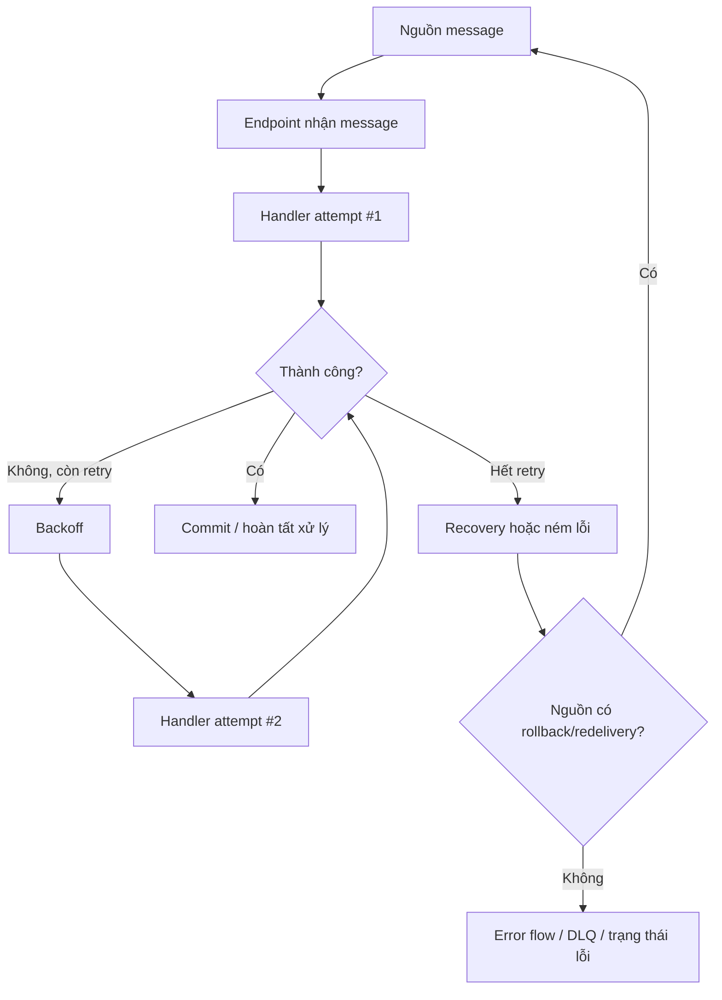
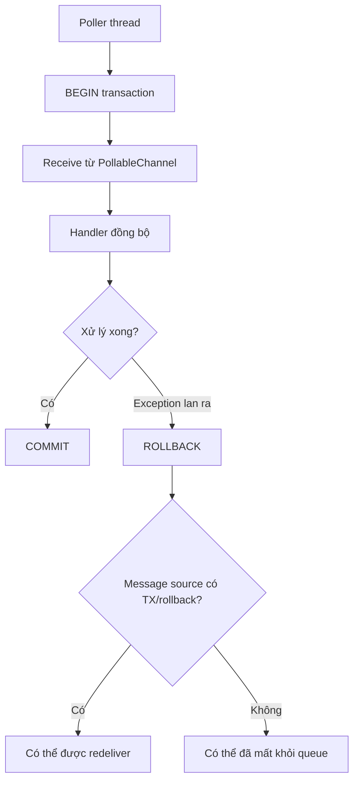
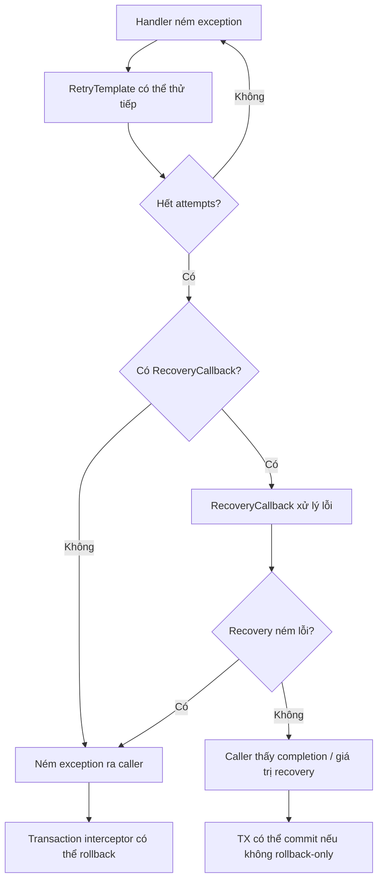

# Retry với transaction và rollback trong Spring Integration Runtime

## 1. Bài toán: thử lại sau lỗi nhưng dữ liệu phải nhất quán

Một `IntegrationFlow` nhận đơn hàng, kiểm tra tồn kho, ghi database và gửi thông báo. Khi database báo deadlock, việc thử lại có thể giúp yêu cầu thành công. Tuy nhiên, nếu lần thử trước đã ghi một phần dữ liệu, đã gửi email hoặc đã xác nhận message với broker, thử lại thiếu kiểm soát có thể gây trùng nghiệp vụ.

Trong **Spring Integration Runtime**, retry và transaction là hai cơ chế độc lập:

- **Retry** quyết định *có gọi lại thao tác thất bại hay không*, tối đa bao nhiêu lần và cách chờ giữa các lần.
- **Transaction** quyết định *những thao tác nào cùng commit hoặc rollback* khi thành công hay thất bại.
- **Recovery** quyết định *xử lý thế nào khi không thể thử tiếp*: trả lỗi, đưa vào error flow, gửi dead-letter hoặc thực hiện bù trừ.

Điểm quan trọng nhất là **thứ tự lồng nhau giữa retry và transaction**. Nếu retry bao ngoài transaction, mỗi lần thử có thể chạy trong transaction mới. Nếu transaction bao ngoài retry, các lần thử có thể dùng cùng transaction đã bị đánh dấu rollback-only, nên dù lần cuối không ném lỗi, commit vẫn thất bại.

Sau bài học, bạn có thể:

1. Giải thích vòng đời attempt, commit, rollback, recovery và redelivery.
2. Chọn thứ tự retry–transaction phù hợp với database, poller và message broker.
3. Sử dụng `RetryTemplate`, `TransactionTemplate` và `RequestHandlerRetryAdvice` đúng phạm vi.
4. Hiểu vì sao `DirectChannel`, `ExecutorChannel`, `QueueChannel` và poller tạo các ranh giới transaction khác nhau.
5. Thiết kế idempotency, dead-letter, observability và quy trình chẩn đoán lỗi runtime.

Chủ đề thuộc chương **Retry và recovery** của module `SPRING_INTEGRATION_RUNTIME`. Các ví dụ tập trung vào điều phối message flow qua channel, endpoint, consumer, poller và executor; chúng không giả định toàn bộ flow tự động nằm trong một transaction.

## 2. Từ vựng cốt lõi

| Khái niệm | Ý nghĩa | Hiểu lầm cần tránh |
| --- | --- | --- |
| **Attempt** | Một lần gọi thao tác được retry bao quanh | Ba attempts nghĩa là một lần đầu và tối đa hai lần thử lại, không phải ba lần thử lại. |
| **Retry policy** | Điều kiện được phép retry, số lần và loại exception | Không phải exception nào cũng nên retry. |
| **Backoff** | Khoảng dừng giữa các lần thử; có thể dùng exponential và jitter | Retry liên tục không chờ dễ gây quá tải dịch vụ đang lỗi. |
| **Transaction boundary** | Phạm vi tài nguyên cùng commit/rollback | Java method có annotation không nhất thiết làm toàn bộ flow có transaction. |
| **Rollback-only** | Transaction được đánh dấu không được commit | Bắt exception rồi retry thành công chưa chắc xóa được dấu rollback-only. |
| **Recovery** | Hành động cuối khi retry không thể tiếp tục | Xử lý lỗi xong không đồng nghĩa dữ liệu nguồn đã rollback. |
| **Redelivery** | Hệ thống nguồn phát lại message sau rollback, nack hoặc timeout | Khác với retry method ngay trong JVM. |
| **Idempotency** | Cùng business event được xử lý nhiều lần vẫn cho kết quả nghiệp vụ đúng | Message ID của một lần delivery không luôn là khóa idempotency bền vững. |

Phân biệt **retry nội bộ** và **redelivery từ nguồn**:



Sơ đồ là mô hình logic: nguồn có phát lại hay không phụ thuộc transport và transaction/acknowledgement thực tế. `QueueChannel` mặc định trong bộ nhớ, một JMS listener có session transacted và Kafka consumer có offset commit là ba cơ chế khác nhau.

## 3. Thứ tự thứ nhất: retry bao ngoài transaction

Đây thường là hướng phù hợp khi lỗi làm transaction database hiện tại không thể sử dụng tiếp, ví dụ deadlock hoặc transaction đã bị rollback-only.

```text
Retry boundary
  ├─ Attempt 1: BEGIN TX-1 → thao tác DB lỗi → ROLLBACK TX-1
  ├─ chờ backoff
  ├─ Attempt 2: BEGIN TX-2 → thao tác DB lỗi → ROLLBACK TX-2
  ├─ chờ backoff
  └─ Attempt 3: BEGIN TX-3 → thao tác DB thành công → COMMIT TX-3
```

Tại mỗi attempt, một transaction riêng được mở rồi kết thúc. Lỗi được **ném ra khỏi transaction callback** để transaction manager biết phải rollback. Retry handler chỉ gọi lại sau khi transaction trước đã kết thúc.

### 3.1. Ví dụ Java với `RetryTemplate` và `TransactionTemplate`

Các lớp dưới đây giả định project đã có Spring Retry và Spring Transaction. `OrderRepository` là interface nghiệp vụ của ứng dụng, được khai báo sau ví dụ.

```java
import org.springframework.retry.backoff.FixedBackOffPolicy;
import org.springframework.retry.policy.SimpleRetryPolicy;
import org.springframework.retry.support.RetryTemplate;
import org.springframework.transaction.PlatformTransactionManager;
import org.springframework.transaction.TransactionDefinition;
import org.springframework.transaction.support.TransactionTemplate;

public final class TransactionalOrderProcessor {
    private final OrderRepository repository;
    private final RetryTemplate retry;
    private final TransactionTemplate perAttemptTransaction;

    public TransactionalOrderProcessor(
            OrderRepository repository,
            PlatformTransactionManager transactionManager) {
        this.repository = repository;

        this.retry = new RetryTemplate();
        // maxAttempts = 3: tính cả lần đầu tiên.
        this.retry.setRetryPolicy(new SimpleRetryPolicy(3));

        FixedBackOffPolicy backoff = new FixedBackOffPolicy();
        backoff.setBackOffPeriod(300L);
        this.retry.setBackOffPolicy(backoff);

        this.perAttemptTransaction = new TransactionTemplate(transactionManager);
        // Đảm bảo mỗi attempt có transaction riêng, kể cả khi caller có TX.
        this.perAttemptTransaction.setPropagationBehavior(
                TransactionDefinition.PROPAGATION_REQUIRES_NEW);
    }

    public void process(String orderId) {
        retry.execute(context -> {
            perAttemptTransaction.executeWithoutResult(status -> {
                repository.markConfirmed(orderId);
                // Nếu method ném RuntimeException, transaction này rollback.
            });
            return null;
        });
    }

    public interface OrderRepository {
        void markConfirmed(String orderId);
    }
}
```

**Giải thích điểm cần chú ý:**

1. `RetryTemplate` nằm **ngoài** `TransactionTemplate`. Một exception của lần thử hiện tại đi ra ngoài transaction callback, khiến transaction manager rollback trước khi retry.
2. `PROPAGATION_REQUIRES_NEW` khiến mỗi attempt có transaction mới. Nếu dùng `REQUIRED` và caller đã có transaction, các attempt có thể tham gia transaction đang mở; lúc đó kết luận “mỗi attempt là một transaction” không còn đúng.
3. `SimpleRetryPolicy(3)` trong ví dụ tổng quát có thể retry các exception thuộc chính sách mặc định; production nên **phân loại** lỗi có thể thử lại, thay vì retry cả lỗi validation hay permission.
4. Nếu `repository.markConfirmed(...)` ghi database và sau đó gọi dịch vụ bên ngoài, rollback của database **không hoàn tác** tác dụng phụ đã xảy ra ở dịch vụ ngoài.
5. Nếu đang ở dưới một transaction bao ngoài khác, `REQUIRES_NEW` commit độc lập; transaction bên ngoài rollback sau đó vẫn có thể làm message nguồn được phát lại. Do vậy idempotency vẫn bắt buộc.

Đừng kéo một transaction dài qua các khoảng backoff. Với cấu trúc này, backoff nằm **ngoài transaction từng attempt**, giúp giảm thời gian giữ lock và connection khi chờ thử lại.

## 4. Thứ tự thứ hai: transaction bao ngoài retry

```text
BEGIN TX
  Retry boundary
    ├─ Attempt 1: DB báo lỗi, resource/TX có thể bị đánh dấu rollback-only
    ├─ Attempt 2: code có thể chạy tiếp hoặc DB từ chối do TX đã hỏng
    └─ Attempt 3: Java method không còn lỗi
COMMIT? → có thể thất bại / UnexpectedRollbackException
```

Ví dụ thể hiện thứ tự:

```java
public void transactionOutsideRetry(
        String orderId,
        RetryTemplate retry,
        TransactionTemplate transaction,
        TransactionalOrderProcessor.OrderRepository repository) {

    transaction.executeWithoutResult(status -> {
        retry.execute(context -> {
            repository.markConfirmed(orderId);
            return null;
        });
    });
}
```

Ưu điểm tiềm năng: nếu tất cả các lỗi đều có thể hồi phục ngay trong một transaction mà tài nguyên còn hợp lệ, toàn bộ attempts nằm cùng đơn vị nguyên tử. Tuy nhiên, với database, nhiều lỗi SQL làm statement, session hoặc transaction không thể tiếp tục an toàn:

- Spring transaction interceptor ở tầng con có thể đã gọi `setRollbackOnly()` khi method ném exception.
- PostgreSQL có thể đưa transaction vào trạng thái aborted sau lỗi SQL đến khi rollback.
- JDBC connection hoặc persistence context của ORM có thể không còn đáng tin sau một số loại lỗi.
- Transaction bao quanh backoff có thể giữ lock/connection lâu, tăng contention.

Vì vậy, **không nên mặc định retry SQL trong cùng một transaction**. Khi exception khiến transaction rollback-only, việc bắt lỗi ở RetryTemplate không làm trạng thái transaction “sạch” trở lại. Spring có thể báo `UnexpectedRollbackException` lúc commit. Với deadlock, serialization failure hoặc timeout, thường cần retry **cả đơn vị transaction** từ đầu.

### 4.1. Bảng chọn thứ tự

| Tình huống | Cách tiếp cận thường phù hợp | Vì sao |
| --- | --- | --- |
| DB deadlock, serialization failure, transient data access error | Retry bao ngoài transaction | Attempt mới cần transaction/resource sạch. |
| Lỗi mạng tạm thời khi gọi API độc lập | Retry quanh HTTP call, cân nhắc ngoài transaction DB | Tránh giữ lock khi chờ backoff, dùng timeout/idempotency. |
| Đọc trạng thái thuần không side effect | Retry theo policy lỗi cụ thể, có thể không cần transaction ghi | Ít nguy cơ lặp side effect. |
| Gồm DB update và publish event cần nhất quán | Outbox hoặc cơ chế phối hợp được thiết kế rõ | Retry một bên không tự tạo atomicity giữa DB và broker. |
| Consumer có broker redelivery | Điều phối retry attempt và redelivery policy cùng nhau | Hai tầng retry cộng dồn có thể gây retry storm. |
| Validation/business rule không thể tự hồi phục | Không retry, trả lỗi hoặc dead-letter | Lặp lại với cùng dữ liệu không tạo kết quả mới. |

Đây là định hướng thiết kế. Lựa chọn cuối phải phù hợp transaction manager, datasource, broker, resource và nghiệp vụ cụ thể.

## 5. `@Transactional`, proxy và `RequestHandlerRetryAdvice`

Trong flow Spring Integration, một consumer endpoint có thể gọi bean service đánh dấu `@Transactional`. Đồng thời, `RequestHandlerRetryAdvice` có thể được gắn quanh **lời gọi handler** để retry khi handler ném lỗi.

```java
import org.springframework.stereotype.Service;
import org.springframework.transaction.annotation.Transactional;

@Service
public class InventoryService {
    private final InventoryRepository repository;

    public InventoryService(InventoryRepository repository) {
        this.repository = repository;
    }

    @Transactional
    public void reserve(String productId, int amount) {
        repository.decreaseAvailable(productId, amount);
        // Exception RuntimeException đi ra sẽ yêu cầu rollback theo mặc định.
    }

    public interface InventoryRepository {
        void decreaseAvailable(String productId, int amount);
    }
}
```

Nếu handler retry advice bao quanh lời gọi tới **transactional proxy** của `InventoryService.reserve(...)` và không có transaction bên ngoài, mỗi lần retry sẽ gọi lại proxy và có thể mở transaction mới. Ngược lại, nếu transaction advice bao ngoài retry, hoặc một poller đã mở transaction với propagation `REQUIRED`, retry có thể diễn ra bên trong transaction đang tồn tại.

Do đó, **không suy ra thứ tự chỉ từ việc nhìn thấy hai annotation/advice**. Cần kiểm tra:

- Advice nào ở vòng ngoài và advice nào ở vòng trong; thứ tự áp dụng proxy/interceptor.
- `@Transactional` có thật sự được kích hoạt qua Spring proxy hay không (self-invocation trong cùng bean có thể không đi qua proxy).
- Propagation là `REQUIRED` hay `REQUIRES_NEW`; có transaction đang mở ở poller/upstream không.
- Lỗi có thoát khỏi phạm vi transactional method để transaction manager áp dụng rollback hay đã bị catch và nuốt mất.

### 5.1. Ví dụ cấu hình retry advice cho endpoint

`RequestHandlerRetryAdvice` của Spring Integration dùng `RetryTemplate` để gọi lại handler theo retry policy. Ví dụ dưới đây chỉ thể hiện **retry ở handler**, chưa quyết định transaction scope:

```java
import org.springframework.context.annotation.Bean;
import org.springframework.context.annotation.Configuration;
import org.springframework.integration.handler.advice.RequestHandlerRetryAdvice;
import org.springframework.retry.backoff.FixedBackOffPolicy;
import org.springframework.retry.policy.SimpleRetryPolicy;
import org.springframework.retry.support.RetryTemplate;

@Configuration
public class RetryAdviceConfiguration {

    @Bean
    public RequestHandlerRetryAdvice requestHandlerRetryAdvice() {
        RetryTemplate retryTemplate = new RetryTemplate();
        retryTemplate.setRetryPolicy(new SimpleRetryPolicy(3));

        FixedBackOffPolicy backoff = new FixedBackOffPolicy();
        backoff.setBackOffPeriod(200L);
        retryTemplate.setBackOffPolicy(backoff);

        RequestHandlerRetryAdvice advice = new RequestHandlerRetryAdvice();
        advice.setRetryTemplate(retryTemplate);
        return advice;
    }
}
```

Áp dụng advice này trong DSL endpoint `handle(...)` bằng cấu hình endpoint `advice(requestHandlerRetryAdvice)` hoặc qua `adviceChain` của `@ServiceActivator` nếu phù hợp. Nếu có cả transaction advice, **xác nhận thứ tự thực tế**, thay vì giả định tên bean hay thứ tự khai báo annotation luôn quyết định đúng phạm vi transaction.

## 6. Poller transaction và chuyện rollback message

Một `PollableChannel` như `QueueChannel` được đọc bởi poller. Transaction advice của poller có thể bao quanh việc **receive message và dispatch đồng bộ sau đó**. Đây là ranh giới rất khác retry chỉ đặt quanh một service handler.



**Điều kiện trọng yếu:** transaction rollback có hoàn trả message vào nguồn hay không phụ thuộc **loại nguồn**, message store và transaction manager tương ứng.

- `QueueChannel` mặc định trong bộ nhớ không tự nhiên trở thành hàng đợi có rollback/durable transaction chỉ vì poller khai báo transaction.
- Pollable channel dựa vào transactional message store (ví dụ JDBC store phù hợp) có thể hỗ trợ rollback receive **nếu** nó thực sự tham gia transaction thích hợp.
- Với JMS, ack/rollback/redelivery tuân theo session/transaction của JMS listener/adapter và broker.
- Với Kafka, offset commit, delivery và consumer group là một bài toán khác; JDBC transaction đơn lẻ không tự điều khiển offset commit.

### 6.1. Cấu hình poller giao dịch bằng Java DSL

Ví dụ khái quát:

```java
import java.time.Duration;
import org.springframework.context.annotation.Bean;
import org.springframework.context.annotation.Configuration;
import org.springframework.integration.dsl.IntegrationFlow;
import org.springframework.integration.dsl.Pollers;
import org.springframework.transaction.PlatformTransactionManager;

@Configuration
public class PollerFlowConfiguration {

    @Bean
    public IntegrationFlow orderPollingFlow(
            PlatformTransactionManager transactionManager,
            OrderService orderService) {

        return IntegrationFlow.from(
                    "durableOrderQueue",
                    endpoint -> endpoint.poller(
                            Pollers.fixedDelay(Duration.ofSeconds(1))
                                   .maxMessagesPerPoll(1)
                                   .transactional(transactionManager)))
                .handle(orderService, "process")
                .get();
    }

    public interface OrderService {
        void process(String orderId);
    }
}
```

Mẫu này giả định bean `durableOrderQueue` là `PollableChannel` đã cấu hình độc lập, có cơ chế lưu và rollback phù hợp. `.transactional(transactionManager)` thiết lập transaction advice cho poller; nó **không tự cấu hình** message store bền vững, database schema hoặc transaction manager cho broker.

Khi handler gọi tiếp qua `DirectChannel` và exception truyền ngược tới poller, transaction của poller có thể bao trùm cả đoạn đồng bộ. Khi flow chuyển sang `ExecutorChannel`, một phần xử lý ở worker thread không còn nằm trong transaction trên thread poller. Transaction manager thông thường gắn transaction với thread, nên không nên coi hai nhánh là một transaction duy nhất.

### 6.2. Poller transaction bao ngoài retry advice: một bẫy điển hình

```text
Poller
  BEGIN TX-OUTER
    Receive message từ transactional source
    Handler retry advice
      Attempt 1: DAO exception → có thể đánh dấu TX-OUTER rollback-only
      Attempt 2: DAO thành công ở mức Java
  COMMIT TX-OUTER ? → vẫn có thể rollback / UnexpectedRollbackException
```

Đặc biệt với `@Transactional(propagation = REQUIRED)` ở service, từng attempt **join** `TX-OUTER`. Nếu muốn retry các thao tác database bằng transaction mới, cần thiết kế scope riêng có hiệu lực, ví dụ `REQUIRES_NEW` quanh mỗi attempt; sau đó xem lại tính nguyên tử giữa **ack của nguồn** và **commit dữ liệu**. Cách này có thể làm thành công DB nhưng message vẫn bị phát lại nếu outer transaction rollback.

## 7. Lỗi được catch, retry hết lượt và recovery ảnh hưởng commit thế nào?

Transaction manager quyết định commit/rollback dựa trên trạng thái transaction và exception **thoát ra khỏi boundary**. Một recovery handler có thể khiến exception được coi như đã xử lý, nhưng điều đó không tự bảo đảm rollback.



### 7.1. `ErrorMessageSendingRecoverer`

Trong Spring Integration, `ErrorMessageSendingRecoverer` có thể được dùng với retry advice để công bố `ErrorMessage` tới một channel khi attempts đã cạn. Error message giúp theo dõi exception, failed message và original context khi có. Tuy nhiên:

- Gửi ErrorMessage **không đồng nghĩa** source message sẽ được rollback hay broker sẽ redeliver.
- Nếu recovery callback xử lý xong và không ném lỗi, transaction advice ở vòng ngoài có thể coi lời gọi là thành công và commit **nếu transaction chưa bị rollback-only**.
- Nếu cần rollback source để broker phát lại, phải để lỗi/rollback-only đến đúng transaction boundary và không thiết kế error recovery như một lời xác nhận thành công.
- Nếu chọn dead-letter rồi ack source, cần bảo đảm bước ghi DLQ đủ tin cậy; database outbox hoặc cơ chế transaction/ack phù hợp có thể cần thiết để tránh thất lạc.

**Thiết kế recovery là quyết định về trạng thái message**, không chỉ là quyết định ghi log.

### 7.2. Không nuốt lỗi trong một transaction cần rollback

```java
// Rủi ro: exception được bắt nhưng transaction không biết phải rollback.
transactionTemplate.executeWithoutResult(status -> {
    try {
        repository.saveBusinessState(orderId);
    } catch (RuntimeException ex) {
        logFailure(ex);
        // Nếu không có dấu rollback-only, transaction có thể commit phần còn lại.
    }
});

// Khi cần báo thất bại mà không ném lại exception:
transactionTemplate.executeWithoutResult(status -> {
    try {
        repository.saveBusinessState(orderId);
    } catch (RuntimeException ex) {
        logFailure(ex);
        status.setRollbackOnly();
    }
});
```

Hai đoạn giả định `transactionTemplate`, `repository` và `logFailure(...)` đã được định nghĩa trong ứng dụng. Đối với những lỗi không thể phục hồi, thông thường **ném lại exception** để transaction manager và retry policy bên ngoài biết thao tác thất bại. Chủ động gọi `status.setRollbackOnly()` chỉ phù hợp khi contract của caller cho phép điều đó.

Với `@Transactional`, rollback mặc định thường áp dụng cho `RuntimeException` và `Error`. Checked exception có thể cần `rollbackFor` hoặc rule riêng. Không nên sửa policy bằng cách catch rồi chuyển mọi exception thành thông báo thành công.

## 8. Những ranh giới threading cần quan sát

`RequestHandlerRetryAdvice` chỉ thử lại **lời gọi handler mà nó bao quanh**. Nó không tự quay lại cả flow, không tự nhận lại message từ broker và không mang transaction qua các thread.

| Thành phần | Thread và đường lan lỗi | Hệ quả khi retry/rollback |
| --- | --- | --- |
| `DirectChannel` | Subscriber chạy trên thread sender | Retry và transaction có thể bao trùm đoạn xử lý đồng bộ nếu đặt advice đúng vị trí. |
| `ExecutorChannel` | Consumer chạy trên thread của executor | Transaction upstream không tự lan sang worker; lỗi downstream thường không trở về caller ban đầu. |
| `QueueChannel` + poller | Poller lấy message định kỳ | Transaction nhận message phụ thuộc cấu hình poller và message store; retry handler chỉ là một lớp. |
| `PublishSubscribeChannel` với executor | Subscriber xử lý bất đồng bộ | Mỗi subscriber có thể cần chính sách transaction/error handling riêng. |
| JMS inbound gateway/adapter | Listener container và broker kiểm soát delivery | Cần xác định session transaction, ack, redelivery và retry của Spring Integration. |
| Kafka inbound adapter | Poll/consumer và offset strategy | Commit offset khác với commit DB; không suy luận rollback offset từ `@Transactional` của DAO. |

Ví dụ flow:

```text
Gateway → DirectChannel → validate → ExecutorChannel → chargePayment → audit
                         (thread caller)   (thread worker)
```

Nếu transaction mở trước `ExecutorChannel`, nó thường kết thúc khi message được handoff, không chờ `chargePayment` xong. Retry ở gateway cũng không tự “gọi lại” đoạn đã chuyển vào executor khi worker báo lỗi sau đó. Để kiểm soát kết quả, cần thiết kế reply/error path, correlation và timeout phù hợp.

## 9. Transaction với DB và broker: không tự động là atomic

Một bài toán điển hình:

```text
JMS/Kafka event → cập nhật orders trong DB → publish "OrderConfirmed"
```

Có ba tác dụng phụ:

1. Nguồn message được ack/commit offset.
2. Database commit thay đổi trạng thái.
3. Event outbound được publish.

Nếu chỉ có một local database transaction, nó **không bao trùm** broker ack và publish ngoài DB. Một lỗi sau khi DB commit nhưng trước broker ack có thể làm message được phát lại; lỗi sau khi ack nhưng trước khi publish lại có thể làm event đầu ra bị thiếu.

Giải pháp tùy yêu cầu:

- **Idempotent consumer:** dùng `eventId`/`orderId` bền vững, unique constraint hoặc trạng thái đã xử lý để việc redelivery không trừ kho hai lần.
- **Transactional outbox:** ghi thay đổi DB và một bản ghi sự kiện outbound trong **cùng local DB transaction**, sau đó publish bằng một worker riêng có retry; consumer downstream vẫn phải idempotent.
- **Broker-specific transaction/ack strategy:** cấu hình đúng session, offset, retry/redelivery và DLQ theo adapter đang dùng; xác định giới hạn của phối hợp giữa broker và DB.
- **Distributed transaction/XA:** chỉ lựa chọn khi hạ tầng và tài nguyên thực sự hỗ trợ và chi phí vận hành phù hợp; không mặc định được Spring Integration tự bật.
- **Compensation/saga:** khi workflow trải qua các dịch vụ không thể cùng rollback, định nghĩa hành động bù trừ theo trạng thái đã thực hiện.

### 9.1. Ví dụ nghiệp vụ chống lặp

Giả sử một message có `eventId = E-87` yêu cầu xác nhận đơn `SO-42`. Thiết kế data model:

```sql
CREATE TABLE processed_events (
    event_id VARCHAR(100) PRIMARY KEY,
    processed_at TIMESTAMP NOT NULL
);
```

Trong **cùng transaction DB** với cập nhật đơn:

1. Thử insert `event_id`; nếu đã tồn tại, xử lý như event đã thực hiện theo policy nghiệp vụ.
2. Cập nhật trạng thái đơn và ghi outbox record nếu cần.
3. Commit cùng lúc.

Nếu transaction rollback, cả đánh dấu đã xử lý và thay đổi đơn rollback cùng nhau. Khi redelivery, duplicate event được nhận diện an toàn hơn so với chỉ dựa vào `MessageHeaders.ID` hoặc chỉ kiểm tra biến trong memory. Triển khai cần làm đúng concurrency constraint và xử lý xung đột unique key.

## 10. Retry policy hiệu quả: thử lại lỗi có thể phục hồi

Không phải exception nào cũng nên retry:

| Lỗi | Quyết định tham khảo | Lưu ý |
| --- | --- | --- |
| Deadlock/serialization conflict | Retry cả transaction, giới hạn attempts, backoff/jitter | Cần kiểm tra error code của driver và DB engine. |
| Lỗi kết nối DB tạm thời | Retry transaction nếu tài nguyên phục hồi được | Không tiếp tục cùng connection/session đã hỏng. |
| HTTP 429/503 | Retry bounded, tôn trọng `Retry-After` khi phù hợp | Dùng idempotency key với operation có side effect. |
| Timeout khi gọi dịch vụ ngoài | Phải kiểm tra khả năng request đã thành công ở đầu kia | Timeout không chứng minh remote side chưa thực hiện. |
| ValidationException | Không retry | Dữ liệu đầu vào không tự thay đổi sau backoff. |
| Permission denied, schema mismatch | Thường không retry tức thì | Cần sửa cấu hình hoặc dữ liệu. |
| Poison message lặp vô hạn | Chuyển DLQ/manual review | Tránh chiếm tài nguyên poller và làm tắc queue. |

Chọn `maxAttempts`, backoff và jitter theo SLA. Với 3 attempts và backoff lần lượt 200 ms, 400 ms, một handler tiêu tốn thời gian gọi `t1 + t2 + t3 + 600ms` (chưa kể queueing); gateway timeout phải tính cả thời gian này. Nếu broker cũng có 5 redeliveries, tổng handler invocations có thể tăng tới 3 × 5 trong một trường hợp, tùy cách các tầng retry kết hợp. Cần đo số attempts **cả trong JVM lẫn từ broker**.

Không retry vô hạn dưới một transaction đang mở. Khi handler chậm, tăng attempts có thể giảm throughput, giữ connection lâu và khiến queue backlog tăng nhanh.

## 11. Chẩn đoán commit và rollback bằng chứng cứ runtime

Khi lỗi xảy ra, cần phân biệt **handler không ném exception**, **DB commit thành công** và **broker ack thành công**. Ba mốc này không tương đương.

### 11.1. Ghi log những tín hiệu có giá trị

Mỗi attempt nên có thể liên hệ với cùng **business/event ID**, cùng flow/endpoint và một retry count:

```text
eventId=E-87 flow=confirmOrder attempt=1 tx=TX-1
  stage=dbUpdate outcome=rollback cause=DeadlockLoserDataAccessException

eventId=E-87 flow=confirmOrder attempt=2 tx=TX-2
  stage=dbUpdate outcome=commit

eventId=E-87 stage=sourceAck outcome=success
```

Đây là **minh họa định dạng log**, không phải log mặc định do Spring Integration tự sinh. Cần instrumentation, transaction callbacks hoặc metrics phù hợp mới xác nhận được commit/rollback thực tế; không tự kết luận “COMMIT” ngay sau khi method trả về.

Có thể kiểm tra transaction đang hoạt động trên thread bằng `TransactionSynchronizationManager.isActualTransactionActive()`, nhưng điều này chỉ cho biết có transaction active, không chứng minh nó đã commit. Cần log ở ranh giới transaction manager và so khớp với broker ack/offset nếu điều tra mất/trùng message.

### 11.2. Bảng triệu chứng → nguyên nhân

| Triệu chứng | Nguyên nhân có thể | Hướng điều tra |
| --- | --- | --- |
| Attempt cuối trả thành công nhưng caller nhận `UnexpectedRollbackException` | Retry trong transaction đã rollback-only | Kiểm tra thứ tự advice, propagation, exception tại lần đầu. |
| Retry nhưng DB row vẫn trống | Mọi transaction đều rollback hoặc callback đánh dấu rollback-only | Đối chiếu attempt count với transaction begin/rollback/commit. |
| DB commit nhưng broker redeliver | Ack/offset chưa commit, transaction khác nhau | Xem transaction manager, acknowledgment timing và idempotency. |
| Message mất khỏi `QueueChannel` sau handler lỗi | Queue in-memory không hỗ trợ rollback receive | Kiểm tra loại channel, store và poller transaction thực tế. |
| Error handler chạy nhưng message nguồn vẫn ack | Recoverer nuốt lỗi hoặc error flow không ảnh hưởng transaction nguồn | Xác định recovery callback và status rollback-only. |
| Lỗi tăng vọt và queue tắc | Retry storm, backoff thiếu, executor bão hòa | Đo số retries, pool active, latency, backlog, broker redelivery. |
| Một email/thanh toán bị gửi hai lần | Side effect ngoài transaction không idempotent | Dùng idempotency key, outbox, kiểm tra status external API. |
| `@Transactional` không có hiệu lực | Self-invocation, bean không qua proxy, method không được proxy hỗ trợ | Xác nhận bean/proxy, AOP, transaction active trong method. |
| Lỗi phát sinh ở `ExecutorChannel` nhưng gateway đã trả | Async boundary tách khỏi caller | Theo errorChannel, correlation và reply flow ở worker. |
| Retry hết attempts nhưng không thấy DLQ | Recoverer không cấu hình, errorChannel sai hoặc publish lỗi | Theo dõi exception cuối, destination, recoverer và xác nhận publish. |

## 12. Bộ kiểm thử tình huống tối thiểu

Khi viết integration test, cần kiểm tra cả **state cuối** và **số lần gọi thực tế**:

| Case | Kích hoạt | Kỳ vọng |
| --- | --- | --- |
| Lỗi DB tạm thời, attempt 2 thành công | Lần 1 ném transient exception | Attempt 1 rollback; attempt 2 có transaction mới, commit đúng một thay đổi. |
| Lỗi business cố định | Input số lượng âm | Không retry; không ghi dữ liệu; error/recovery path đúng contract. |
| Transaction outer bị rollback-only | Ném lỗi dưới transaction đang mở rồi retry bên trong | Không coi method success là commit success; có thể gặp `UnexpectedRollbackException`. |
| Hết retry, recovery rethrow | Cả 3 attempts thất bại | Caller/poller thấy lỗi; rollback nếu transaction thuộc phạm vi đó. |
| Hết retry, recovery publish error | Cả 3 attempts thất bại | ErrorMessage được publish; kiểm tra rõ ack/commit của source theo thiết kế. |
| Broker redelivery sau DB commit | Giả lập lỗi ack sau commit DB | Không xử lý nghiệp vụ hai lần nhờ stable idempotency key. |
| Executor thread thất bại | Chuyển xử lý sang `ExecutorChannel` | Error handler ở worker chạy; transaction caller không bị nhầm là transaction của worker. |
| JDBC message store rollback | Dùng queue store transactional và lỗi handler | Nhận lại message theo chính sách của store, tránh giả định ở in-memory queue. |

Đối với Spring integration test, chờ async result bằng latch hoặc tool kiểm thử có timeout hữu hạn, không dùng `Thread.sleep` như một cách khẳng định rollback đã xảy ra. Đo đúng số bản ghi commit, số lần gọi external API, trạng thái event ID và thông tin từ broker.

## 13. Checklist thiết kế trước khi đưa vào production

1. Xác định **đơn vị cần retry**: handler đơn lẻ, transaction DB trọn vẹn hay toàn bộ message delivery.
2. Vẽ chính xác **thứ tự advice**: retry ở ngoài hay transaction ở ngoài; kiểm tra proxy/propagation.
3. Xác định **nguồn rollback được hay không**: JDBC store, JMS session, Kafka offset, in-memory queue.
4. Kiểm tra **ranh giới thread**: `DirectChannel` so với `ExecutorChannel`/poller.
5. Phân loại **exception retryable**, giới hạn attempts, dùng backoff/jitter và timeout phù hợp.
6. Bảo đảm **idempotency** cho DB và API ngoài, kể cả khi retry trong JVM đã thành công.
7. Quyết định **hết retry thì làm gì**: rethrow/rollback, error channel, DLQ hoặc compensation.
8. Xác định liệu **recovery có nuốt exception** và có làm nguồn ack/commit hay không.
9. Gắn **eventId/traceId/correlationId** để nối attempts và redeliveries; không log payload bí mật.
10. Thử nghiệm failure injection với commit DB, ack broker, publish outbox và restart consumer.

## 14. Câu hỏi tự đánh giá và bài tập

### Câu hỏi

1. Vì sao thứ tự `RetryTemplate.execute(() -> transactionTemplate.execute(...))` khác với `transactionTemplate.execute(() -> retryTemplate.execute(...))`?
2. Nếu một attempt gây rollback-only, vì sao attempt sau thành công ở Java vẫn có thể kết thúc bằng `UnexpectedRollbackException`?
3. `PROPAGATION_REQUIRED` và `PROPAGATION_REQUIRES_NEW` ảnh hưởng thế nào khi poller đã mở transaction?
4. Vì sao transaction của poller không tự chuyển qua `ExecutorChannel`?
5. Một `QueueChannel` in-memory có tự khôi phục message sau rollback DB không? Trường hợp nào mới có thể rollback receive?
6. Nếu `ErrorMessageSendingRecoverer` công bố lỗi rồi trở về bình thường, transaction ngoài có chắc rollback không?
7. Một API thanh toán timeout; vì sao retry không có idempotency key có thể trừ tiền hai lần?
8. Khi DB đã commit mà broker phát lại message, nên dùng khóa nào để chống lặp?

### Bài tập có hướng dẫn

**Bài 1 — Quan sát thứ tự transaction.** Dùng `TransactionalOrderProcessor` ở mục 3, thay implementation `markConfirmed` để attempt 1 ném một runtime exception và attempt 2 thành công. Đếm số transaction bắt đầu/rollback/commit, rồi viết bản đối chứng đặt `TransactionTemplate` bao ngoài retry. So sánh kết quả khi exception gây rollback-only.

**Bài 2 — Transactional polling.** Tạo `QueueChannel` với transactional message store thích hợp, poller với `maxMessagesPerPoll=1`, handler ném lỗi. Kiểm tra message có được nhận lại sau rollback hay không. Lặp thí nghiệm với in-memory `QueueChannel` và giải thích khác biệt.

**Bài 3 — Recovery contract.** Dùng ba attempts: hết lượt thì (a) rethrow, (b) công bố ErrorMessage và kết thúc xử lý. Với mỗi trường hợp, ghi rõ kỳ vọng về transaction commit/rollback, source ack, redelivery và DLQ. Thêm `eventId` để chứng minh không xử lý trùng khi nguồn phát lại.

## 15. Tài liệu tham khảo

- [Spring Integration Reference — Retry Advice](https://docs.spring.io/spring-integration/reference/handler-advice/classes.html)
- [Spring Integration Reference — Transactions Support](https://docs.spring.io/spring-integration/reference/transactions.html)
- [Spring Integration Reference — Error Handling](https://docs.spring.io/spring-integration/reference/error-handling.html)
- [Spring Integration Reference — Poller Configuration](https://docs.spring.io/spring-integration/reference/endpoint.html)
- [Spring Retry — RetryTemplate API](https://docs.spring.io/spring-retry/docs/current/apidocs/org/springframework/retry/support/RetryTemplate.html)
- [Spring Framework Reference — Transaction Propagation](https://docs.spring.io/spring-framework/reference/data-access/transaction/declarative/tx-propagation.html)
- [Spring Framework Reference — Rolling Back a Declarative Transaction](https://docs.spring.io/spring-framework/reference/data-access/transaction/declarative/rolling-back.html)
