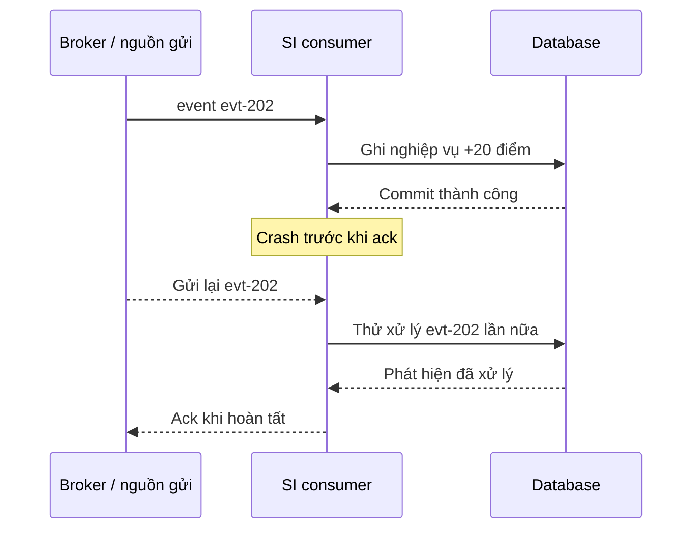
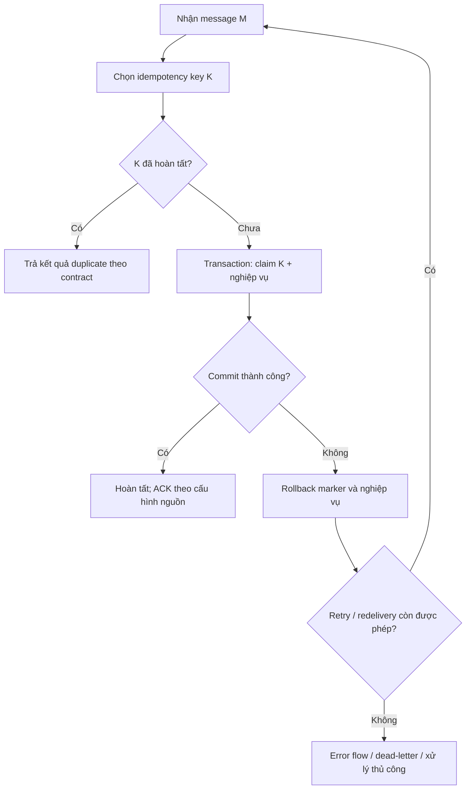

# Idempotency khi message được xử lý lại trong Spring Integration

## 1. Bối cảnh: retry có thể chạy cùng một nghiệp vụ nhiều lần

Trong mô-đun `SPRING_INTEGRATION_RUNTIME`, Spring Integration điều phối message qua **channel, endpoint, consumer, poller và executor**, đồng thời kết hợp retry, transaction, message store, correlation, xử lý lỗi và theo dõi trạng thái runtime. Khi consumer có thể chạy lại một message, một yêu cầu thiết kế không thể bỏ qua là **idempotency**: xử lý lặp lại cùng một yêu cầu nghiệp vụ nhưng không tạo thêm tác dụng ngoài ý muốn.

Ví dụ, một hệ thống thưởng điểm xử lý sự kiện:

```text
AwardPoints(eventId="evt-202", customerId=42, points=20)
```

Nếu message được chuyển tới handler **hai lần**, nghiệp vụ chỉ muốn cộng **20 điểm một lần**, thay vì cộng thành 40. Vấn đề không nằm ở việc message xuất hiện hai lần trên channel, mà ở việc **tác dụng của nghiệp vụ** bị áp dụng trùng.

Mục tiêu bài học:

1. Phân biệt **retry**, **redelivery** và **idempotent processing**.
2. Chọn khóa idempotency ổn định và xác định phạm vi bảo vệ.
3. Triển khai cơ chế **inbox/deduplication** bằng unique constraint và transaction để xử lý lặp an toàn.
4. Hiểu vai trò của `IdempotentReceiverInterceptor`, metadata store và retry advice của Spring Integration.
5. Thiết kế riêng cho side effect ngoài database, request–reply, xử lý đồng thời và message đến trễ.
6. Chẩn đoán tình huống “đã xử lý thành công nhưng vẫn nhận lại” qua log, transaction, error flow và message store.

## 2. Idempotent là gì, và không có nghĩa là gì?

Một phép xử lý `f` là **idempotent** khi áp dụng nhiều lần cho cùng một yêu cầu có hiệu quả nghiệp vụ tương đương áp dụng một lần:

\[
f(f(s, m), m) = f(s, m)
\]

Trong đó `s` là trạng thái ban đầu và `m` là một **yêu cầu nghiệp vụ có danh tính ổn định**. Đẳng thức nói về **trạng thái hoặc tác dụng quan sát được**, không nhất thiết về số lần method Java được gọi.

| Hành động | Có idempotent tự nhiên không? | Giải thích |
|---|---|---|
| `UPDATE orders SET status='PAID' WHERE id=?` | Thường có, đối với riêng trường trạng thái | Ghi cùng trạng thái nhiều lần cho cùng kết quả, nếu không có trigger/side effect khác. |
| `UPDATE customer_points SET points=points+20` | Không | Mỗi lần thực thi cộng thêm điểm. |
| `INSERT payment(order_id, ...)` với unique key phù hợp | Có thể | Constraint có thể ngăn bản ghi thanh toán trùng, nhưng chưa bảo đảm gateway thanh toán ngoài hệ thống không bị gọi hai lần. |
| Gửi email xác nhận | Không mặc định | Hai lần gọi gửi có thể tạo hai email. |
| Gọi API thanh toán hỗ trợ idempotency key | Có điều kiện | Phụ thuộc hợp đồng và thời hạn lưu khóa của nhà cung cấp. |

**Idempotent ≠ message được xử lý đúng một lần.** Handler có thể được gọi ba lần, nhưng tổng tác dụng nghiệp vụ chỉ xảy ra một lần. Một pipeline được quảng bá “exactly once” ở broker hoặc transaction log **không tự động** bảo đảm exactly-once đối với database khác, HTTP API, email hay hệ thống bên ngoài.

Cũng cần phân biệt **duplicate delivery** với hai yêu cầu hợp lệ có cùng nội dung: hai lần cộng 20 điểm nhưng mang **hai event ID khác nhau** có thể là hai nghiệp vụ độc lập và đều phải được thực thi.

## 3. Vì sao cùng message được xử lý lại?

Một message có thể quay lại handler qua nhiều đường:

- **Retry trong endpoint:** `RequestHandlerRetryAdvice` thử gọi lại handler sau exception, có thể trên cùng logical message.
- **Redelivery từ nguồn:** broker, inbound adapter, queue hoặc hệ thống điều phối gửi lại khi chưa nhận được ack/commit hoặc sau khi consumer khởi động lại.
- **Poller và message store:** rollback, lấy lại item đã đọc, quá trình claim chưa hoàn tất hoặc phục hồi sau crash có thể dẫn tới xử lý lại.
- **Concurrency:** hai consumer/thread lấy các bản sao cùng sự kiện, hoặc nguồn phát trùng do race condition.
- **Replay có chủ đích:** phục hồi dữ liệu, vận hành chạy lại batch, tái phát sự kiện từ event log.

**Timeline dễ gặp:**



Đây là “**commit đã thành công, nhưng xác nhận với nguồn chưa thành công**”. Không thể giải quyết triệt để chỉ bằng tăng retry hoặc chờ lâu hơn; cần khả năng nhận diện tác vụ đã hoàn tất khi message đến lần nữa.

### Ba lớp cần phân biệt

| Lớp | Câu hỏi | Ví dụ |
|---|---|---|
| **Delivery** | Message có thể đến mấy lần? | At-least-once: ít nhất một lần, có thể nhiều lần. |
| **Execution** | Handler được gọi mấy lần? | Hai lần do retry/redelivery. |
| **Business effect** | Thay đổi thực tế xảy ra mấy lần? | Chỉ một lần nhờ khóa idempotency và transaction. |

Idempotency chủ yếu kiểm soát **business effect**; không nên lấy số lượt handler chạy làm tiêu chuẩn duy nhất.

## 4. Chọn idempotency key đúng trước khi viết code

Muốn nhận diện “cùng một yêu cầu”, phải có **khóa ổn định** qua retry, redelivery, thread và restart.

Một khóa thiết kế tốt thường gồm:

```text
<consumer / nghiệp vụ / phiên bản xử lý>:<sourceEventId>
Ví dụ: loyalty-award-v1:evt-202
```

| Thành phần | Vai trò | Lưu ý |
|---|---|---|
| `sourceEventId` | Phân biệt từng sự kiện do **producer** phát ra | Phải được giữ nguyên khi retry, replay hoặc republish cùng sự kiện. |
| Consumer/operation | Ngăn các handler nghiệp vụ khác nhau vô tình chặn nhau | Cùng event có thể được xử lý độc lập bởi billing và notification. |
| Version | Kiểm soát tái xử lý sau thay đổi ngữ nghĩa nghiệp vụ | Chỉ đổi version khi có quyết định migration/replay rõ ràng. |
| Payload fingerprint (tùy chọn) | Phát hiện cùng key nhưng dữ liệu mâu thuẫn | Nếu ID trùng mà payload khác, phải báo lỗi dữ liệu thay vì coi là duplicate hợp lệ. |

**Tránh các khóa không ổn định hoặc quá rộng:**

- `MessageHeaders.ID` được framework cấp cho **instance message**; nếu adapter tạo message mới lúc redelivery, UUID có thể đổi. Không dùng làm event ID xuyên hệ thống nếu không có cam kết nguồn giữ nguyên.
- Timestamp lúc consumer nhận, thread ID, random UUID mới sinh lúc xử lý đều làm vô hiệu hóa deduplication.
- Chỉ dùng `customerId` sẽ chặn nhầm các lần cộng điểm khác nhau cho cùng một khách hàng.
- `correlationId` dùng cho ghép nhóm/splitter/aggregator; **không mặc định** tương đương danh tính một tác vụ nghiệp vụ.

Khóa còn có **thời hạn hiệu lực**: nếu lưu 7 ngày mà nguồn có thể replay sau 30 ngày, sự kiện cũ vẫn có nguy cơ gây tác dụng trùng khi marker hết hạn. Chọn retention theo hợp đồng replay, chính sách lưu trữ và chi phí dữ liệu.

## 5. Bốn cách tạo idempotency ở tầng nghiệp vụ

### 5.1. Phép cập nhật tự idempotent

Ưu tiên thiết kế trạng thái đích thay vì lệnh gia tăng nếu bài toán cho phép:

```sql
-- Có tính idempotent với riêng trường này:
UPDATE orders SET status = 'CONFIRMED' WHERE id = 42;

-- Không idempotent:
UPDATE customer_points SET points = points + 20 WHERE customer_id = 42;
```

Cẩn thận với trigger, event phát kèm, email, audit hoặc cập nhật `updated_at`: ngay cả khi giá trị chính không đổi, **tác dụng phụ** vẫn có thể bị lặp.

### 5.2. Ràng buộc duy nhất ở bảng nghiệp vụ

Ví dụ chỉ cho phép một invoice theo `order_id`, hoặc một giao dịch thưởng điểm theo `event_id`. Database là nơi xử lý cạnh tranh giữa nhiều thread/nhiều instance chắc chắn hơn một `Set` trong JVM.

### 5.3. Inbox/processed-message ledger và transaction

Tạo bảng lưu **message đã được áp dụng thành công**. Ghi marker và thay đổi nghiệp vụ trong **cùng transaction database**. Trùng khóa được bỏ qua; nếu xử lý lỗi, **rollback cả marker lẫn thay đổi nghiệp vụ** để lần thử sau xử lý được.

Đây là phương án được triển khai đầy đủ ở mục 6.

### 5.4. Idempotency tại hệ thống đích hoặc qua outbox

Khi có side effect bên ngoài như payment API, email gateway hoặc một database khác, transaction ở database nội bộ **không thể rollback giao dịch bên ngoài**. Lúc đó cần giao thức ở hệ thống đích (idempotency key/unique business operation), outbox hoặc workflow có trạng thái và đối soát; xem mục 9.

## 6. Ví dụ Spring Integration: cộng điểm đúng một lần với PostgreSQL

**Giả định:** ứng dụng Spring có `spring-integration-core`, `spring-jdbc`, `spring-tx`, PostgreSQL datasource và transaction manager. Mẫu Java dùng `record` (Java 17+). Bài này tập trung vào việc message vào `awardsIn` qua endpoint và cách xử lý lặp, không phụ thuộc một transport cụ thể.

### 6.1. Tạo dữ liệu và ledger

```sql
CREATE TABLE customer_points (
    customer_id BIGINT PRIMARY KEY,
    points BIGINT NOT NULL DEFAULT 0
);

CREATE TABLE processed_message (
    consumer_name VARCHAR(100) NOT NULL,
    event_id VARCHAR(200) NOT NULL,
    processed_at TIMESTAMPTZ NOT NULL DEFAULT CURRENT_TIMESTAMP,
    PRIMARY KEY (consumer_name, event_id)
);

INSERT INTO customer_points(customer_id, points)
VALUES (42, 100);
```

Unique primary key `(consumer_name, event_id)` bảo vệ giữa **nhiều thread và nhiều process** cùng dùng database. Đây là một ví dụ dùng PostgreSQL; `ON CONFLICT DO NOTHING` cần đổi tương ứng nếu chạy DBMS khác.

### 6.2. Cấu hình channel và transaction

```java
package example.integration;

import org.springframework.context.annotation.Bean;
import org.springframework.context.annotation.ComponentScan;
import org.springframework.context.annotation.Configuration;
import org.springframework.integration.channel.DirectChannel;
import org.springframework.integration.config.EnableIntegration;
import org.springframework.messaging.MessageChannel;
import org.springframework.transaction.annotation.EnableTransactionManagement;

@Configuration
@EnableIntegration
@EnableTransactionManagement
@ComponentScan(basePackageClasses = LoyaltyPointsHandler.class)
public class LoyaltyFlowConfig {

    @Bean
    public MessageChannel awardsIn() {
        return new DirectChannel();
    }
}
```

`DirectChannel` dùng để quan sát luồng đơn giản và dễ kiểm chứng. Khi áp dụng qua `ExecutorChannel` hoặc polling consumer, giao dịch sẽ phải bắt đầu **trong thread xử lý thực tế**; đừng kỳ vọng transaction từ thread gửi tự động lan qua executor.

### 6.3. Message nghiệp vụ và handler

```java
package example.integration;

public record AwardPoints(
        String eventId,
        long customerId,
        int points
) {}
```

```java
package example.integration;

import org.springframework.integration.annotation.MessageEndpoint;
import org.springframework.integration.annotation.ServiceActivator;
import org.springframework.jdbc.core.JdbcTemplate;
import org.springframework.transaction.annotation.Transactional;

@MessageEndpoint
public class LoyaltyPointsHandler {

    private static final String CONSUMER = "loyalty-award-v1";
    private final JdbcTemplate jdbc;

    public LoyaltyPointsHandler(JdbcTemplate jdbc) {
        this.jdbc = jdbc;
    }

    @ServiceActivator(inputChannel = "awardsIn")
    @Transactional
    public void award(AwardPoints event) {
        if (event.eventId() == null || event.eventId().isBlank()) {
            throw new IllegalArgumentException("eventId is required");
        }
        if (event.points() <= 0) {
            throw new IllegalArgumentException("points must be positive");
        }

        // Claim idempotency key trong cùng DB transaction.
        int claimed = jdbc.update(
            "INSERT INTO processed_message(consumer_name, event_id) " +
            "VALUES (?, ?) ON CONFLICT DO NOTHING",
            CONSUMER,
            event.eventId()
        );

        if (claimed == 0) {
            // Sự kiện đã được xử lý bởi consumer này.
            // Với flow một chiều, return là hợp lệ.
            return;
        }

        int updated = jdbc.update(
            "UPDATE customer_points SET points = points + ? " +
            "WHERE customer_id = ?",
            event.points(),
            event.customerId()
        );

        if (updated != 1) {
            throw new IllegalStateException(
                "No customer_points row for customerId=" + event.customerId()
            );
        }
        // Commit transaction sẽ lưu cả marker và số điểm.
    }
}
```

**Vì sao cách này chống lặp được?**

1. Lần đầu của `evt-202` chèn được marker, `claimed == 1`; handler cộng 20 điểm rồi commit.
2. Lần hai cùng `consumer_name` và `event_id` gặp primary key đã tồn tại; `claimed == 0`, không cộng điểm nữa.
3. Nếu database lỗi hoặc cập nhật điểm ném exception **trước commit**, transaction rollback **cả insert marker và update điểm**; lần retry còn có thể claim lại.
4. Nếu hai worker cùng chèn `evt-202`, unique constraint và điều phối transaction của PostgreSQL chỉ cho phép một request thắng sau khi outcome của transaction cạnh tranh được xác định. Transaction còn lại thấy duplicate hoặc thử lại theo lỗi transaction nếu cần.

Điều kiện bắt buộc: `@Transactional` phải thực sự được Spring AOP áp dụng; `JdbcTemplate` và transaction manager dùng **cùng datasource/database**; không gọi nghiệp vụ qua self-invocation bỏ qua proxy; không bắt rồi nuốt exception khiến transaction commit nhầm. Nếu hạ tầng chưa có `JdbcTemplate` hoặc transaction manager, cấu hình chúng trước khi chạy ví dụ.

> Với một message thật, **trạng thái “marker đã commit” phải đại diện cho “tác dụng nghiệp vụ đã commit”**. Không được commit marker trước rồi mới làm nghiệp vụ bằng một transaction độc lập: crash giữa hai bước sẽ biến message chưa xử lý thành “đã xử lý”.

### 6.4. Gửi cùng sự kiện hai lần và quan sát

Từ một Spring bean có `ApplicationContext context`:

```java
import example.integration.AwardPoints;
import org.springframework.context.ApplicationContext;
import org.springframework.messaging.MessageChannel;
import org.springframework.messaging.support.MessageBuilder;

MessageChannel channel =
        context.getBean("awardsIn", MessageChannel.class);

AwardPoints event = new AwardPoints("evt-202", 42L, 20);

channel.send(MessageBuilder.withPayload(event).build());
channel.send(MessageBuilder.withPayload(event).build());
```

Sau cả hai lần gửi, đọc database:

```sql
SELECT points
FROM customer_points
WHERE customer_id = 42;
-- Kết quả mong đợi: 120, không phải 140.

SELECT consumer_name, event_id
FROM processed_message
WHERE consumer_name = 'loyalty-award-v1'
  AND event_id = 'evt-202';
-- Mong đợi: chính xác một bản ghi.
```

Ở ví dụ `DirectChannel`, method chạy đồng bộ trong lời gọi `send()`. Nếu thử trên `ExecutorChannel`, phải **chờ cho handler hoàn tất** trước khi assert trạng thái, hoặc dùng cách chờ có điều kiện trong bài test; `send() == true` chỉ xác nhận đã chuyển giao message theo hợp đồng của channel.

### 6.5. Sự cố tại các thời điểm khác nhau

| Điểm lỗi | Ledger & thay đổi điểm | Message được gửi lại có gây cộng trùng? |
|---|---|---|
| Chưa chèn marker | Chưa ghi | Không: lần sau thử xử lý bình thường. |
| Đã chèn marker, cập nhật điểm lỗi, transaction rollback | **Cả hai rollback** | Không: lần sau có thể claim và xử lý. |
| Đã cập nhật điểm nhưng chưa commit, process chết | Transaction rollback theo DB | Không: lần sau làm lại một cách hợp lệ. |
| Đã commit cả marker và điểm, nhưng broker chưa ack | Cả hai còn nguyên | Không: lần sau `ON CONFLICT` bỏ qua. |
| Đã gọi API ngoài thành công nhưng DB rollback | Side effect ngoài DB vẫn có thể tồn tại | **Có nguy cơ** nếu API không nhận khóa idempotency. |
| Ledger bị xóa trước thời hạn replay | Không còn marker chống lặp | **Có nguy cơ** khi nguồn phát lại event cũ. |

## 7. Spring Integration hỗ trợ idempotent receiver như thế nào?

Bên cạnh bảng inbox tự xây dựng, Spring Integration có mẫu **Idempotent Receiver** qua `IdempotentReceiverInterceptor`, thường phối hợp `MetadataStoreSelector` và một `ConcurrentMetadataStore`. Advice này nằm ở ranh giới **message handler** và dùng chiến lược xác định key/giá trị để quyết định message có phải duplicate.

Một số khái niệm cần hiểu:

| Thành phần | Vai trò |
|---|---|
| `IdempotentReceiverInterceptor` | Advice bao quanh handler, đánh giá mỗi message theo selector và áp dụng hành vi với duplicate. |
| `MetadataStoreSelector` | Dùng message để tạo key, lưu/so sánh metadata nhằm nhận diện message đã gặp. |
| `ConcurrentMetadataStore` | Giao diện metadata store với các thao tác điều phối đồng thời như `putIfAbsent` và `replace`. |
| `SimpleMetadataStore` | Store trong bộ nhớ, hợp cho demo/local; không phù hợp cho chống lặp qua nhiều instance và restart. |
| Store bền vững/chia sẻ, như `JdbcMetadataStore` | Cho phép dùng khóa chung qua instance và khởi động lại khi được cấu hình đúng. |

**Phân biệt tầng “đã gặp message” với “nghiệp vụ đã commit”:** chỉ lưu key bằng metadata store trước khi gọi dịch vụ rồi coi đó là bằng chứng hoàn thành có thể gây mất xử lý. Ví dụ:

```text
1. Selector ghi key evt-202 vào store.
2. Handler gọi database nhưng thất bại.
3. Lần retry thấy key đã tồn tại và bỏ qua.
4. Kết quả: nghiệp vụ CHƯA hoàn thành nhưng message bị đánh dấu là duplicate.
```

Vì thế, với nghiệp vụ có state quan trọng, cần bảo đảm **metadata marker và business effect thuộc cùng phạm vi atomic**, hoặc xây dựng trạng thái `IN_PROGRESS / COMPLETED` có lease, rollback và recovery kiểm chứng. Có thể dùng một transaction phù hợp với store và nghiệp vụ nếu hai bên thực sự hỗ trợ cùng giao dịch; không được giả định hai resource khác nhau tự phối hợp atomic.

**Hành vi duplicate của interceptor:** tùy phiên bản/cấu hình, duplicate có thể được **đánh dấu bằng header**, gửi tới discard flow hoặc bị từ chối theo chính sách. Đừng giả định mỗi duplicate luôn tự động biến mất. Hãy kiểm tra cấu hình thực tế và kiểm thử side effect sau handler; header đánh dấu duplicate không tự ngăn code nghiệp vụ tiếp tục chạy nếu flow cho phép chuyển nó tiếp.

Lưu ý các trường hợp dùng **value strategy** (ví dụ version hay vị trí offset tăng dần) khác với chỉ kiểm tra key đã xuất hiện. Cần định nghĩa “lặp” theo **ngữ nghĩa nguồn**. So sánh key thuần có thể chặn nhầm những cập nhật hợp lệ cùng entity; so sánh value sai có thể cho qua một replay cũ.

## 8. Retry advice, rollback và message store: đặt idempotency ở đâu?

`RequestHandlerRetryAdvice` có thể thử lại handler khi xử lý lỗi; consumer của channel hoặc polling endpoint cũng có thể retry/redeliver. Từ góc nhìn idempotency, đó là các đường dẫn khác nhau dẫn tới cùng câu hỏi: **tác dụng nghiệp vụ của logical event đã hoàn tất chưa?**



Hai điểm cần kiểm soát kỹ:

**Thứ nhất, transaction boundary.** Với `DirectChannel`, handler có thể chạy trên thread đang giữ transaction do caller/poller mở. Với `ExecutorChannel`, xử lý chạy trên worker thread khác; transaction của thread gửi **không tự truyền** theo message. Nếu muốn cập nhật ledger và nghiệp vụ atomic, mở transaction trong thread handler, thường bằng `@Transactional` trên service được proxy đúng.

**Thứ hai, retry boundary.** Nếu retry advice thử lại trên cùng transaction đã bị đánh dấu rollback-only, lần tiếp theo có thể không commit được. Tùy kiến trúc, mỗi attempt cần transaction mới hoặc retry bao quanh transactional operation; cấu hình thứ tự advice/transaction và thử bằng failure injection. Không mặc định một cấu hình annotation đúng cho mọi flow.

Sau cùng, **ack/offset/claim của nguồn** phải được kiểm soát theo hợp đồng của adapter/broker. Ví dụ nghiệp vụ DB commit nhưng ack bị mất vẫn an toàn nhờ dedup; còn ack xảy ra quá sớm trước khi commit có thể gây **mất message** mà idempotency không cứu được.

### Retry nên dừng khi nào?

Retry hợp lý cho lỗi **tạm thời** như deadlock, timeout mạng hoặc database đang quá tải. Sai dữ liệu vĩnh viễn (key trống, payload mâu thuẫn, vi phạm business invariant) thường cần error flow hoặc dead-letter sau chính sách hữu hạn, không phải lặp vô hạn. Idempotency không sửa được dữ liệu sai và cũng không thay thế backoff/retry policy.

## 9. Side effect bên ngoài database: giới hạn của inbox

Mẫu `processed_message` ở mục 6 bảo vệ hai cập nhật trong **một transaction database**. Nó **không** bảo vệ trực tiếp kịch bản:

```text
BEGIN DB TRANSACTION
  INSERT processed_message(...)
  HTTP POST /payments/charge      <- provider đã thu tiền thành công
  UPDATE local_state(...)
ROLLBACK do lỗi database          <- local marker không còn
RETRY: HTTP POST lần nữa          <- nguy cơ thu tiền hai lần
```

Không có transaction local nào có thể tự rollback request HTTP đã hoàn tất. Một số lựa chọn:

1. **Dùng idempotency key tại dịch vụ đích:** gửi cùng business operation ID trong mọi lần retry; nhà cung cấp phải cam kết nhận diện key, quy tắc xử lý payload khác nhau và thời hạn lưu.
2. **Transactional outbox:** trong cùng DB transaction ghi cập nhật nghiệp vụ và một bản ghi `outbox` cần gửi; worker riêng phát ra bên ngoài và retry. Consumer phía đích cũng cần idempotent nếu nhận trùng, vì outbox publisher vẫn có thể gửi lại sau crash.
3. **Inbox ở bên nhận:** tiêu thụ event và ghi marker + thay đổi nghiệp vụ trong cùng database của consumer.
4. **Workflow với trạng thái và đối soát:** lưu `PENDING`, `SENT`, `CONFIRMED`, kiểm tra trạng thái thật của provider khi timeout mơ hồ, rồi mới quyết định retry hay bù trừ.

```mermaid
sequenceDiagram
    participant A as Handler
    participant DB as Local DB
    participant W as Outbox worker
    participant P as External provider
    A->>DB: Tx: cập nhật state + tạo outbox(eventId)
    DB-->>A: Commit
    W->>DB: Đọc outbox chưa hoàn tất
    W->>P: Call(eventId làm idempotency key)
    P-->>W: Confirmed
    W->>DB: Đánh dấu outbox đã giao
    Note over W,P: Retry có thể lặp lời gọi; provider phải chống tác dụng trùng
```

Nếu provider không hỗ trợ idempotency, đừng tuyên bố “exactly once”; cần xác định chiến lược đối soát, bù trừ và chấp nhận giới hạn nghiệp vụ.

## 10. Duplicate trong request–reply flow: cần phản hồi gì?

Trong flow một chiều như cộng điểm ở mục 6, bỏ qua duplicate rồi `return` là hợp lý. Nhưng nếu caller dùng **messaging gateway** và đợi reply, handler trả `null` hoặc `void` khi gặp duplicate có thể khiến gateway **không nhận được phản hồi** và timeout, hoặc bị `ReplyRequiredException` nếu endpoint yêu cầu reply.

Một request–reply flow idempotent thường cần:

- **Trả lại kết quả đã lưu** theo idempotency key, ví dụ mã giao dịch và trạng thái cuối của lần xử lý đầu.
- Hoặc trả trạng thái **ALREADY_PROCESSED** một cách tường minh nếu contract cho phép.
- Nếu lần xử lý đầu đang `IN_PROGRESS`, trả `IN_PROGRESS`/`202 Accepted` hoặc chờ một khoảng bounded theo yêu cầu, thay vì xử lý trùng.
- Với cùng key nhưng payload khác, trả **conflict** theo hợp đồng, không âm thầm dùng kết quả của yêu cầu khác.

Không dùng header `replyChannel` hay `errorChannel` làm idempotency key: chúng thể hiện **địa chỉ giao tiếp**, có thể thay đổi giữa các lần gọi lại.

## 11. Tính đồng thời, khóa và thời hạn lưu trạng thái

### 11.1. Hai worker nhận cùng event

Một kiểm tra kiểu “`SELECT xem tồn tại` rồi `INSERT`” có thể bị race condition:

```text
Worker A: SELECT evt-202 -> chưa có
Worker B: SELECT evt-202 -> chưa có
Worker A: cộng điểm
Worker B: cộng điểm
Worker A/B: ghi marker
```

**Unique constraint** hoặc `putIfAbsent` thực sự atomic ở kho dùng chung mới có thể phối hợp claim giữa các worker. Trong ví dụ PostgreSQL, `INSERT ... ON CONFLICT DO NOTHING` nằm **trong cùng transaction** với cập nhật điểm; không có “check rồi làm” ở hai bước không được bảo vệ.

### 11.2. Processing lâu và lease

Nếu nghiệp vụ không thể nằm trong một DB transaction ngắn, một state machine thường rõ hơn một boolean:

| Trạng thái | Ý nghĩa | Cần giải quyết |
|---|---|---|
| Chưa tồn tại | Event chưa được claim | Cho phép xử lý. |
| `IN_PROGRESS` với owner/lease | Có worker đang xử lý | Chặn concurrent effect; quyết định lease khi worker chết. |
| `COMPLETED` kèm result/hash | Đã hoàn tất | Bỏ qua duplicate hoặc trả lại kết quả. |
| `FAILED_RETRYABLE` | Có lỗi có thể retry | Backoff, tăng attempt, sở hữu claim. |
| `FAILED_FINAL` | Đã dừng theo policy | Error channel, DLQ hoặc xử lý thủ công. |

**Lease hết hạn không đủ chứng minh side effect chưa xảy ra.** Worker cũ có thể đã gọi provider thành công nhưng chưa cập nhật state. Cần fencing token, idempotency ở hệ thống đích và cơ chế đối soát tùy tài nguyên.

### 11.3. Xóa ledger

Retention cần lớn hơn **cửa sổ trễ lớn nhất** của redelivery, retry, dead-letter replay và restore dữ liệu mà hệ thống cam kết hỗ trợ. Nếu phải xóa ledger, nên có chính sách lưu kết quả/tombstone hoặc watermark giúp phát hiện event cũ đến lại.

## 12. Chẩn đoán lỗi idempotency trong runtime

| Triệu chứng | Nguyên nhân có thể | Kiểm tra |
|---|---|---|
| Handler chạy hai lần nhưng chỉ một lần thay đổi DB | Redelivery/ retry; dedup hoạt động | Đối chiếu `eventId`, số attempt, ledger và thời điểm commit/ack. |
| Cộng điểm hai lần | Key không ổn định; marker ghi ngoài transaction; race giữa check–insert | So sánh key xuyên retry, unique constraint, trace transaction. |
| Event chưa xử lý nhưng bị bỏ qua | Marker commit quá sớm; restore ledger không khớp business state | Đối soát marker với trạng thái nghiệp vụ, xem rollback path. |
| Lỗi duplicate key ở hai worker | Chèn marker không dùng chiến lược conflict phù hợp | Đọc transaction isolation, unique conflict và đường retry. |
| Hai sự kiện hợp lệ bị coi là trùng | Key quá rộng (ví dụ chỉ `customerId`) | Xem tiêu chí định danh logical event và namespace consumer. |
| Hệ thống gọi payment hai lần dù local DB dedup | External side effect không atomic với local DB | Kiểm tra provider idempotency key, outbox và reconciliation. |
| Gateway timeout khi request trùng | Branch duplicate không trả reply | Kiểm tra contract request–reply và kết quả được lưu. |
| Event cũ xử lý lại sau vài tuần | Ledger bị xóa/hết TTL trước cửa sổ replay | So retention với DLQ, retry, backup và replay. |

**Các chỉ số và log nên có:** `eventId` (hoặc dạng đã băm/an toàn), tên consumer, attempt number, trạng thái claim, duplicate count, transaction outcome, thời gian xử lý, channel/endpoint, executor/poller queue time, ack/offset và error/recovery destination. Log nên giúp trả lời: “**Cùng event có bao nhiêu lần attempt? Có bao nhiêu lần commit business effect?**”.

Không ghi nguyên payload nhạy cảm, access token hay dữ liệu thanh toán. Với message đã được xử lý trùng nhiều lần, metric duplicate tăng **không tự nó là lỗi**; quan trọng là business effect có bị nhân lên hay không.

## 13. Bài thực hành kiểm chứng

Dùng mẫu PostgreSQL ở mục 6 để thực hiện các kịch bản có kiểm soát:

1. **Baseline:** gửi `evt-202` hai lần; xác minh điểm chỉ tăng từ 100 thành 120, bảng `processed_message` có một marker.
2. **Hai sự kiện hợp lệ:** gửi `evt-203` và `evt-204` cùng `customerId=42`, mỗi event có `points=20`; điểm tăng thêm 40.
3. **Rollback:** cố tình ném exception sau khi claim nhưng trước khi commit; xác minh cả marker lẫn điểm rollback, sau đó gửi lại và kiểm tra có thể xử lý thành công.
4. **Đồng thời:** chuyển sang dispatcher có executor hoặc chạy hai request đồng thời với cùng `eventId`. Xác minh không double credit dù hai worker cùng tham gia.
5. **Crash sau commit:** mô phỏng cùng message được gửi lại sau khi ledger đã commit; xác minh không thay đổi điểm.
6. **Key mâu thuẫn:** gửi cùng `eventId` nhưng payload thay đổi; thiết kế cách lưu hash và từ chối conflict thay vì âm thầm coi là duplicate bình thường.
7. **Khác database:** thay việc cộng điểm nội bộ bằng một mock external API và tạo lỗi giữa call với commit; quan sát vì sao cần idempotency key tại phía API hoặc outbox.
8. **Gateway:** nếu chuyển flow sang request–reply, đảm bảo duplicate vẫn nhận một response hợp lệ có ý nghĩa.

Mỗi ca cần ghi: **event ID**, số lần attempt, consumer/handler thực thi, trạng thái ledger, thời điểm commit/rollback, tác dụng nghiệp vụ cuối cùng và ack/recovery nếu có. Đó là bằng chứng kỹ thuật để đánh giá tính idempotent.

## 14. Ghi nhớ

- **Retry và redelivery là bình thường** trong hệ thống message; mỗi handler phải xác định hậu quả nếu cùng logical event đến lại.
- **Idempotency key phải ổn định**, đủ hẹp theo event và đủ rõ phạm vi consumer/operation; tránh message UUID tái sinh, timestamp nhận hay chỉ ID entity.
- **Marker và business effect phải atomic** khi cùng database. Unique constraint xử lý concurrency; transaction rollback bảo đảm không lưu “đã xử lý” khi nghiệp vụ thất bại.
- `IdempotentReceiverInterceptor` và metadata store là công cụ hữu ích để phát hiện duplicate, nhưng **đã thấy key** không tự chứng minh **nghiệp vụ đã commit**.
- **External side effect** cần idempotency ở hệ thống đích, outbox/inbox hoặc workflow có đối soát; transaction local đơn lẻ không thể hứa exactly-once end-to-end.
- Với gateway, nhánh duplicate vẫn cần một **reply phù hợp hợp đồng**; với poller/executor, cần theo dõi retry, transaction và ack đúng ranh giới thread.

### Tài liệu tham khảo

- [Spring Integration Reference — Idempotent Receiver](https://docs.spring.io/spring-integration/reference/handler-advice/idempotent-receiver.html): mô hình idempotent receiver và advice trên message handler.
- [Spring Integration Reference — Retry Advice](https://docs.spring.io/spring-integration/reference/handler-advice/classes.html): cơ chế retry/recovery và thứ tự advice.
- [Spring Integration Reference — Metadata Store](https://docs.spring.io/spring-integration/reference/meta-data-store.html): lưu metadata và các lựa chọn store.
- [Spring Integration Reference — Transaction Support](https://docs.spring.io/spring-integration/reference/transactions.html): transaction tại endpoint và ranh giới thread.
- [Spring Integration Reference — Polling Consumer](https://docs.spring.io/spring-integration/reference/endpoint.html): cơ chế polling endpoint và execution model.
