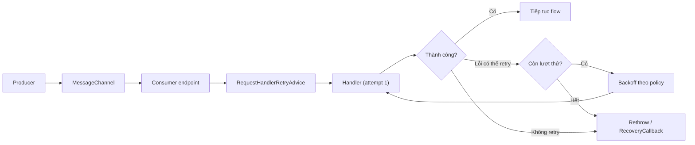
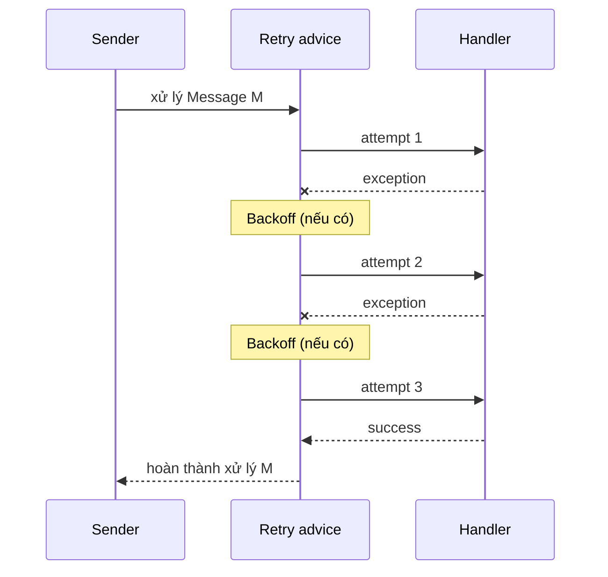
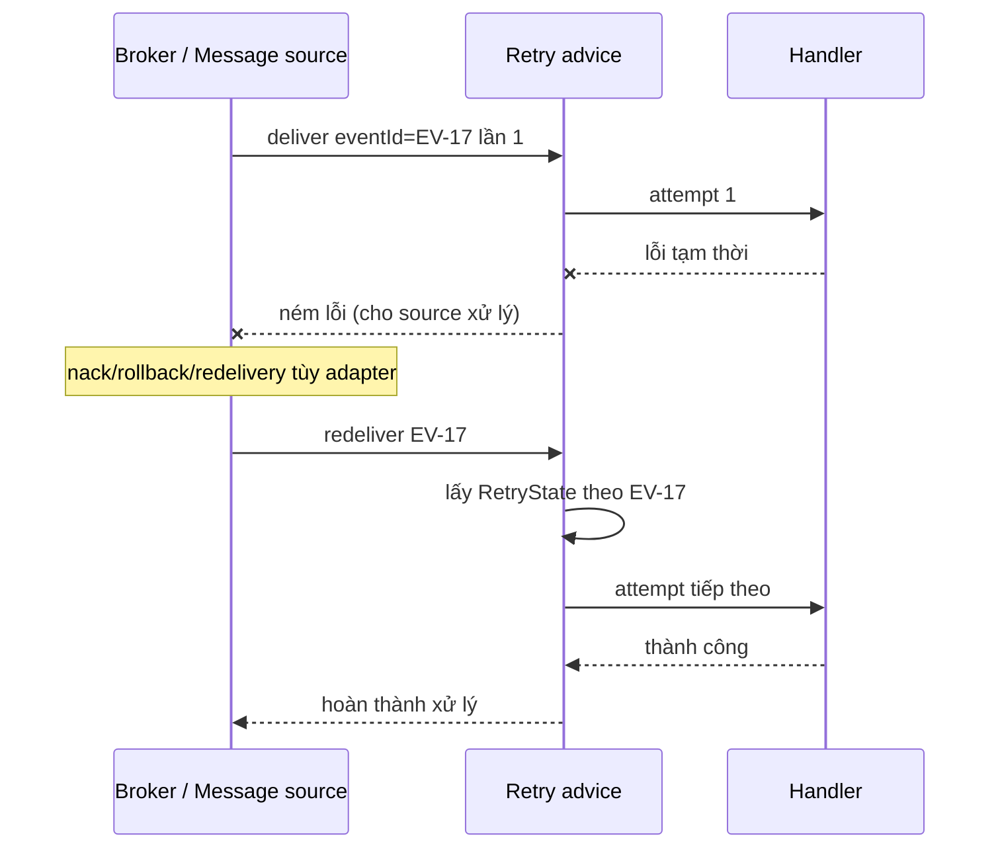
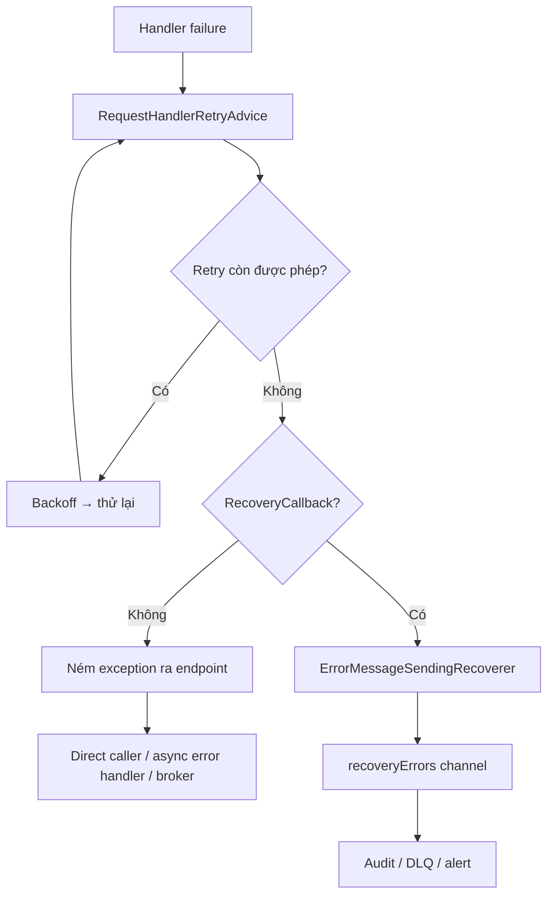

# RequestHandlerRetryAdvice trong Spring Integration

## Mục tiêu và bối cảnh

Trong Spring Integration, một message thường đi từ `MessageChannel` đến consumer endpoint, sau đó được chuyển cho `MessageHandler`. Nếu handler gọi cơ sở dữ liệu hoặc dịch vụ bên ngoài, một lỗi mạng ngắn hạn có thể khiến xử lý thất bại dù message vẫn hợp lệ. `RequestHandlerRetryAdvice` cho phép **thử lại lời gọi handler** theo chính sách có giới hạn, thời gian chờ và hướng khôi phục rõ ràng.

Đây là bài thuộc chương **Advice chain** của module **SPRING_INTEGRATION_RUNTIME**. Chủ đề gắn trực tiếp với runtime: channel/endpoint quyết định khi nào message được xử lý; retry advice quyết định liệu và khi nào lời gọi handler được thực hiện lại; executor, poller, transaction, error channel và message store ảnh hưởng đến nơi lỗi xuất hiện cũng như nguy cơ xử lý trùng.

Sau bài này, bạn có thể:

- Xác định phạm vi thật sự của `RequestHandlerRetryAdvice` và phân biệt nó với retry ở poller, broker hoặc HTTP client.
- Cấu hình **stateless retry** bằng `RetryTemplate`, `RetryPolicy` và `BackOffPolicy`.
- Xử lý trường hợp **retries exhausted** bằng cách ném lỗi tiếp hoặc dùng `RecoveryCallback`/`ErrorMessageSendingRecoverer`.
- Phân loại exception theo nguyên nhân, tránh retry lỗi dữ liệu không thể tự phục hồi.
- Giải thích **stateful retry** kết hợp redelivery từ JMS/AMQP/Kafka hoặc một message source có cơ chế gửi lại.
- Sắp xếp retry advice với transaction advice, đánh giá tác động đến threading, throughput, idempotency và khả năng quan sát.
- Viết kịch bản kiểm thử có số lần gọi, độ trễ, exception và recovery được xác nhận.

Ví dụ API chính sử dụng **Spring Integration 6.5.x, Spring Retry 2.x và Java 17+**. API retry trong các dòng Spring Framework/Integration mới hơn có thể khác; khi sao chép ví dụ, cần đồng bộ phiên bản phụ thuộc và Javadoc.

## 1. RequestHandlerRetryAdvice là gì?

`RequestHandlerRetryAdvice` nằm trong package:

```java
org.springframework.integration.handler.advice.RequestHandlerRetryAdvice
```

Lớp này kế thừa `AbstractRequestHandlerAdvice` và thực hiện AOP advice quanh việc gọi message handler. Nó sử dụng **Spring Retry** để kiểm soát số lần thử, loại exception có thể thử lại, backoff và recovery.



**Advice xử lý lời gọi handler, không tự thay đổi channel hay source.** Nó không đăng ký subscriber, không tạo poller/executor, không lưu message bền vững và không tự mở transaction. Phần retry xảy ra trong phạm vi endpoint mà advice được gắn.

Một lời gọi handler đã thành công có thể trả kết quả, kết thúc không reply, hoặc phát sinh việc gửi reply sau đó. Theo cơ chế request-handler advice thông thường, việc gửi reply và các endpoint downstream **không đương nhiên nằm trong phạm vi retry**.

### Thành phần và vai trò

| Thành phần | Vai trò |
|---|---|
| `RequestHandlerRetryAdvice` | Ghép chính sách retry vào lời gọi `MessageHandler` trong advice chain. |
| `RetryTemplate` | Điều phối lần thử, kiểm tra `RetryPolicy`, áp dụng `BackOffPolicy` và callback. |
| `RetryPolicy` | Quyết định exception nào retry được và đã hết số lần thử hay chưa. |
| `BackOffPolicy` | Quy định đợi bao lâu giữa các lần thử; có thể cố định hoặc exponential. |
| `RecoveryCallback` | Quyết định hành vi cuối cùng khi không thể tiếp tục retry. |
| `ErrorMessageSendingRecoverer` | Một `RecoveryCallback` gửi lỗi cuối cùng thành `ErrorMessage` tới message channel. |
| `RetryStateGenerator` | Tạo state key của message cho cơ chế **stateful retry**. |
| `RetryContext` | Giữ thông tin của lần thử hiện tại như retry count và exception cuối. |

Phân biệt **attempt** với **retry**: một lần gọi đầu cộng hai lần thử lại là **ba attempts**. Trong Spring Retry 2.x, `new SimpleRetryPolicy(3)` nghĩa là tối đa **3 lần thực thi handler tổng cộng**, không phải 3 lần thử lại sau lần đầu.

## 2. Advice được gắn vào đâu?

Đối với annotation-based endpoint, có thể chỉ định tên bean advice trong `@ServiceActivator`:

```java
@ServiceActivator(
        inputChannel = "paymentRequests",
        adviceChain = "retryAdvice")
public void charge(String request) {
    // Business logic: có thể ném exception.
}
```

Bean `retryAdvice` phải tồn tại trong Spring context, có kiểu phù hợp và được khởi tạo trước khi endpoint sử dụng. Thuộc tính `adviceChain` nhận `String[]`, cho phép dùng nhiều advice:

```java
@ServiceActivator(
        inputChannel = "paymentRequests",
        adviceChain = {"retryAdvice", "transactionAdvice"})
public void charge(String request) {
    // ...
}
```

Ví dụ trên mang tính minh họa cách khai báo thứ tự; muốn chạy cần khai báo cả hai bean và transaction manager phù hợp.

Với Java DSL, có thể cấu hình request-handler advice ở endpoint:

```java
@Bean
IntegrationFlow paymentFlow(PaymentService service,
                            RequestHandlerRetryAdvice retryAdvice) {
    return IntegrationFlow.from("paymentRequests")
            .handle(service, "charge",
                    endpoint -> endpoint.advice(retryAdvice))
            .get();
}
```

`PaymentService` và method `charge` là thành phần ứng dụng cần định nghĩa. Ví dụ DSL phù hợp cho request-handler endpoints hỗ trợ `.advice(...)`; các builder đặc thù có thể cung cấp API cấu hình khác.

### Advice của handler khác advice của poller

Giả sử flow:

```text
File inbound adapter → transformer A → HTTP gateway B → JDBC handler C
```

- Gắn retry vào **handler B**: retry nhắm tới lời gọi B, tránh buộc A chạy lại chỉ vì B lỗi.
- Gắn retry vào **handler C**: retry nhắm tới C, không tự gọi lại HTTP gateway B.
- Gắn retry vào **poller** phía nguồn: tùy advice và phạm vi transaction, toàn bộ đường xử lý phát sinh từ lần poll có thể được lặp; những side effect đã thành công phía trước dễ xảy ra lần nữa.

Phạm vi là yếu tố an toàn quan trọng. Nếu muốn retry toàn bộ một sub-flow, cần cơ chế advice ở tầng bao được sub-flow đó, thay vì kỳ vọng mọi `RequestHandlerRetryAdvice` tự bọc luôn các handler downstream.

## 3. Stateless retry: thử lại trong cùng lượt xử lý

Đây là chế độ thông dụng và mặc định. Một input message được xử lý bởi cùng lần gọi advice; khi handler lỗi, advice tiếp tục gọi handler trong thread đó cho đến khi thành công hoặc hết chính sách.



Điểm chính:

- Không cần inbound adapter gửi lại message để attempt 2 hoặc 3 xảy ra.
- Khi handler gọi lại, **side effect của các attempts thất bại có thể đã diễn ra một phần**.
- `BackOffPolicy` kiểu sleep sẽ giữ thread xử lý trong thời gian đợi.
- Với `DirectChannel`, đó thường là thread của caller. Với poller hoặc `ExecutorChannel`, thread bị giữ là worker tương ứng.
- Retry advice không tự biến lỗi nghiệp vụ thành một giao dịch duy nhất, và cũng không tự rollback các side effect.

### Giá trị mặc định và giới hạn

Trong Spring Integration 6.x dùng Spring Retry 2.x, cấu hình đơn giản:

```java
@Bean
RequestHandlerRetryAdvice retryAdvice() {
    return new RequestHandlerRetryAdvice();
}
```

sử dụng template/policy mặc định của Spring Retry: **tối đa ba lần gọi** nếu vẫn lỗi, **không có backoff đáng kể** và **không có RecoveryCallback** trừ khi bạn cấu hình. Khi hết attempts, exception được truyền ngược cho thành phần gọi handler. Với channel đồng bộ, caller thường thấy exception; với poller/executor, một error handler phù hợp có thể nhận lỗi.

Không dùng mặc định này như một SLA chung: cần điều chỉnh retryable exceptions, max attempts, backoff, timeout, nguồn cung cấp message và độ trễ downstream.

## 4. Ví dụ end-to-end: lỗi tạm thời, lỗi cố định và recovery

Ví dụ Spring configuration sau tạo `DirectChannel` đầu vào, `QueueChannel` nhận lỗi đã hết lượt retry và một service activator. Nó dùng `new SimpleRetryPolicy(3)` và backoff cố định 100 ms để làm kết quả dễ quan sát.

Dependency cần có (nếu không được Spring Boot/dependency management cung cấp sẵn): `spring-integration-core` và `spring-retry`, cùng các phụ thuộc Spring Framework tương thích. Với dự án thật, để BOM/Boot quản lý phiên bản nhất quán.

```java
import java.util.concurrent.ConcurrentHashMap;
import java.util.concurrent.atomic.AtomicInteger;

import org.springframework.beans.factory.annotation.Qualifier;
import org.springframework.context.annotation.AnnotationConfigApplicationContext;
import org.springframework.context.annotation.Bean;
import org.springframework.context.annotation.Configuration;
import org.springframework.integration.annotation.ServiceActivator;
import org.springframework.integration.channel.DirectChannel;
import org.springframework.integration.channel.QueueChannel;
import org.springframework.integration.config.EnableIntegration;
import org.springframework.integration.handler.advice.ErrorMessageSendingRecoverer;
import org.springframework.integration.handler.advice.RequestHandlerRetryAdvice;
import org.springframework.messaging.Message;
import org.springframework.messaging.MessageChannel;
import org.springframework.messaging.MessagingException;
import org.springframework.messaging.PollableChannel;
import org.springframework.messaging.support.ErrorMessage;
import org.springframework.messaging.support.MessageBuilder;
import org.springframework.retry.backoff.FixedBackOffPolicy;
import org.springframework.retry.policy.SimpleRetryPolicy;
import org.springframework.retry.support.RetryTemplate;

@Configuration
@EnableIntegration
public class RetryAdviceExample {

    @Bean
    public MessageChannel orders() {
        return new DirectChannel();
    }

    @Bean
    public PollableChannel exhaustedErrors() {
        return new QueueChannel(16);
    }

    @Bean("retryAdvice")
    public RequestHandlerRetryAdvice retryAdvice(
            @Qualifier("exhaustedErrors") MessageChannel exhaustedErrors) {

        RetryTemplate template = new RetryTemplate();

        // Ba lần gọi: 1 lần đầu + tối đa 2 lần retry.
        template.setRetryPolicy(new SimpleRetryPolicy(3));

        FixedBackOffPolicy backOff = new FixedBackOffPolicy();
        backOff.setBackOffPeriod(100L);
        template.setBackOffPolicy(backOff);

        RequestHandlerRetryAdvice advice = new RequestHandlerRetryAdvice();
        advice.setRetryTemplate(template);

        // Chỉ chạy nếu retry đã hết hoặc exception không retry được.
        advice.setRecoveryCallback(
                new ErrorMessageSendingRecoverer(exhaustedErrors));

        return advice;
    }

    @Bean
    public OrderService orderService() {
        return new OrderService();
    }

    public static class OrderService {
        private final ConcurrentHashMap<String, AtomicInteger> calls =
                new ConcurrentHashMap<>();

        @ServiceActivator(
                inputChannel = "orders",
                adviceChain = "retryAdvice")
        public void submit(String orderId) {
            int attempt = calls.computeIfAbsent(
                    orderId, key -> new AtomicInteger())
                    .incrementAndGet();

            System.out.printf("order=%s attempt=%d%n", orderId, attempt);

            // Hai lần đầu lỗi, lần ba thành công.
            if (orderId.startsWith("FLAKY") && attempt < 3) {
                throw new IllegalStateException("Temporary failure");
            }

            // Luôn lỗi: sau ba attempts sẽ gọi recoverer.
            if (orderId.startsWith("FAIL")) {
                throw new IllegalArgumentException("Invalid order");
            }

            System.out.println("COMPLETED " + orderId);
        }
    }

    public static void main(String[] args) {
        try (var context = new AnnotationConfigApplicationContext(
                RetryAdviceExample.class)) {

            MessageChannel input =
                    context.getBean("orders", MessageChannel.class);
            PollableChannel recovery =
                    context.getBean("exhaustedErrors", PollableChannel.class);

            input.send(MessageBuilder.withPayload("FLAKY-01").build());
            // FLAKY-01: attempt 1, 2, 3, rồi COMPLETED.

            input.send(MessageBuilder.withPayload("FAIL-02")
                    .setHeader("correlationId", "batch-42")
                    .build());

            Message<?> received = recovery.receive(2_000);
            if (received instanceof ErrorMessage error) {
                Throwable failure = error.getPayload();
                System.out.println("RECOVERY ERROR: "
                        + failure.getClass().getSimpleName());

                Message<?> original = error.getOriginalMessage();
                if (original == null && failure instanceof MessagingException ex) {
                    original = ex.getFailedMessage();
                }
                if (original != null) {
                    System.out.println("Failed payload: "
                            + original.getPayload());
                }
            }
        }
    }
}
```

**Diễn biến mong đợi:**

1. `FLAKY-01` lỗi lần 1 và 2, thành công lần 3. `exhaustedErrors` không nhận lỗi cho message này.
2. `FAIL-02` lỗi cả ba lần. `ErrorMessageSendingRecoverer` chuyển lỗi cuối cùng vào `exhaustedErrors`; chương trình đọc nó từ queue.
3. Vì recoverer thường hoàn tất với kết quả `null`, lời gọi gửi message tới handler trả về sau recovery; điều đó **không có nghĩa nghiệp vụ đã xử lý thành công**.
4. `ErrorMessage.getOriginalMessage()` hoặc `MessagingException.getFailedMessage()` có thể giúp truy ngược input message, nhưng phải kiểm tra `null` vì chúng phụ thuộc cách lỗi được tạo và context của publisher.

Trong demo, `OrderService` lưu bộ đếm trong memory để người học thấy số lần gọi; production nên dùng metric/log hoặc test spy, tránh giữ trạng thái nghiệp vụ mutable vô hạn trong handler singleton. Nếu gửi lại cùng một `orderId`, bộ đếm minh họa sẽ tiếp tục tăng: đây không phải idempotency logic.

### Khi không có recovery callback

Bỏ dòng `advice.setRecoveryCallback(...)`: nếu `FAIL-02` vẫn lỗi sau ba lần gọi, exception sẽ truyền ra khỏi advice. Với `DirectChannel`, `input.send(...)` sẽ thấy một exception từ tầng handler, thường là `MessagingException` bao quanh nguyên nhân nghiệp vụ.

```java
try {
    input.send(MessageBuilder.withPayload("FAIL-02").build());
} catch (MessagingException ex) {
    System.err.println("Handler exhausted: " + ex.getMessage());
}
```

Đừng tự giả định đặt header `errorChannel` ở input là đủ để biến lỗi **đồng bộ** thành `ErrorMessage`. Khi muốn publish lỗi sau khi retry hết, cần recovery callback, gateway error flow hoặc cơ chế xử lý lỗi phù hợp với endpoint.

## 5. RetryPolicy: chỉ thử lại đúng loại lỗi

Không phải mọi exception đều là lỗi tạm thời. Retry một `IllegalArgumentException` do payload sai có thể tạo tải vô ích và trì hoãn phản hồi. Với Spring Retry 2.x, `SimpleRetryPolicy` có thể nhận danh sách exception cho phép, số attempts và quy tắc duyệt cause.

Ví dụ chỉ retry lỗi I/O có thể phục hồi, kể cả khi nó được bọc bên trong `MessagingException`:

```java
import java.io.IOException;
import java.util.HashMap;
import java.util.Map;
import org.springframework.retry.policy.SimpleRetryPolicy;

Map<Class<? extends Throwable>, Boolean> retryable = new HashMap<>();
retryable.put(IOException.class, true);

SimpleRetryPolicy policy = new SimpleRetryPolicy(
        3,             // Tổng cộng tối đa 3 attempts
        retryable,
        true,          // Duyệt chuỗi cause
        false);        // Exception không được liệt kê: không retry
```

Sau đó:

```java
RetryTemplate template = new RetryTemplate();
template.setRetryPolicy(policy);
advice.setRetryTemplate(template);
```

Ở đây, biến `advice` đại diện cho `RequestHandlerRetryAdvice` đã khởi tạo. Cách phân loại này hữu ích vì framework có thể bọc lỗi của method trong `MessageHandlingException` hoặc một `MessagingException` khác. Với `traverseCauses=false`, classifier có thể chỉ nhìn exception ngoài cùng và bỏ lỡ loại lỗi lồng bên trong.

### Bảng chính sách gợi ý

| Nhóm lỗi | Có nên retry? | Lý do |
|---|---|---|
| Socket timeout, HTTP 503, mất kết nối tạm thời | Thường có, giới hạn số lần và thời gian | Trạng thái bên ngoài có thể phục hồi. |
| Rate limit / HTTP 429 | Có điều kiện | Cần tôn trọng `Retry-After` hoặc giới hạn của đối tác. |
| Validation, sai schema, thiếu trường bắt buộc | Thường không | Gọi lại cùng payload không sửa được dữ liệu. |
| Authentication/authorization thất bại | Thường không cho cùng credentials | Cần cập nhật token/quyền; retry dày có thể làm nặng sự cố. |
| Optimistic locking/deadlock | Có điều kiện | Chỉ khi transaction có thể chạy lại an toàn và logic có idempotency. |
| Không tìm thấy channel/bean hoặc lỗi cấu hình | Không | Cần sửa cấu hình, retry không giải quyết nguyên nhân. |
| Không rõ nguyên nhân | Theo chính sách an toàn | Chọn log/audit/recovery thay vì retry vô hạn. |

Một method có thể ném `IllegalStateException` cho cả lỗi tạm thời lẫn lỗi vĩnh viễn. Dùng exception type cụ thể hoặc một chính sách classifier dựa vào nguyên nhân thực tế để tránh quyết định sai.

### `maxAttempts` và `retryCount`

Trong Spring Retry:

- `maxAttempts = 1`: gọi handler một lần, **không retry**.
- `maxAttempts = 3`: gọi handler lần đầu và tối đa hai lần thử lại.
- `RetryContext.getRetryCount()` thường bằng 0 trước khi có lỗi đầu tiên và tăng theo các lần thất bại đã ghi nhận.

Trong log, nên đặt tên rõ `attemptNumber` (1-based) và `retryCount` (thường 0-based) để không gây nhầm.

## 6. BackOffPolicy: thời gian chờ và tài nguyên

Một retry liên tiếp không có backoff có thể đánh vào dịch vụ đang quá tải bằng nhiều requests gần nhau. Spring Retry có `FixedBackOffPolicy` và `ExponentialBackOffPolicy`:

```java
import org.springframework.retry.backoff.ExponentialBackOffPolicy;

ExponentialBackOffPolicy backOff = new ExponentialBackOffPolicy();
backOff.setInitialInterval(1_000L); // trước lần retry thứ nhất: ~1s
backOff.setMultiplier(2.0);         // khoảng tiếp theo ~2s, ~4s...
backOff.setMaxInterval(10_000L);    // trần mỗi khoảng đợi

RetryTemplate template = new RetryTemplate();
template.setRetryPolicy(new SimpleRetryPolicy(4));
template.setBackOffPolicy(backOff);
```

Với bốn attempts và cấu hình trên, thời gian đợi lý thuyết trước các attempts 2, 3, 4 lần lượt xấp xỉ 1, 2, 4 giây (chưa tính network, overhead và thay đổi scheduler). Đây là **thời gian đợi trên thread hiện tại**, không phải hàng đợi trì hoãn bền vững.

| Kích thước vận hành | Rủi ro khi backoff không phù hợp |
|---|---|
| `DirectChannel` | Giữ thread của caller, tăng latency/API timeout. |
| Poller đồng bộ | Một message lỗi có thể chặn việc lấy message khác trong thời gian retry. |
| `ExecutorChannel` | Chiếm worker thread; backlog tăng và có thể cạn thread pool. |
| Gateway request/reply | Caller hoặc gateway có thể timeout trước khi tất cả attempts hoàn tất. |
| Hệ thống có nhiều instance | Các retry cùng nhịp gây tải đột biến; cân nhắc jitter hoặc rate limit. |

Với volume lớn hoặc retry phải chờ phút/giờ, thường cần thiết kế **retry queue/scheduled redelivery** thay vì để hàng nghìn thread sleep. Đây là lựa chọn hạ tầng, không phải một tham số `BackOffPolicy` đơn giản của advice.

### Ước lượng ngân sách thời gian

Giả sử timeout mỗi downstream call là 2 giây, policy cho 3 attempts, backoff 1 giây rồi 2 giây. Thời gian xấu nhất có thể lên đến khoảng:

```text
3 × 2 giây (thời gian call) + (1 + 2) giây (backoff)
≈ 9 giây, chưa gồm overhead/queue
```

Nếu gateway timeout chỉ 5 giây, caller có thể hết thời gian chờ trước khi policy hoàn thành. Khi đó retry vẫn có thể còn chạy và gây side effect về sau. Hãy phối hợp timeout của caller, downstream, retry policy và thời gian xử lý của flow.

## 7. RecoveryCallback và ErrorMessageSendingRecoverer

Khi hết retry, ta có hai lựa chọn lớn:

1. **Rethrow:** cho exception truyền ra ngoài advice. Caller, poller, container hoặc adapter quyết định rollback, log, error channel, redelivery.
2. **Recover:** gọi `RecoveryCallback` để ghi lỗi, trả giá trị thay thế hoặc gửi message sang kênh xử lý lỗi.

`ErrorMessageSendingRecoverer` là một recovery implementation sẵn có:

```java
@Bean
RequestHandlerRetryAdvice retryAdvice(
        @Qualifier("recoveryErrors") MessageChannel recoveryErrors) {

    RequestHandlerRetryAdvice advice = new RequestHandlerRetryAdvice();
    advice.setRecoveryCallback(
            new ErrorMessageSendingRecoverer(recoveryErrors));
    return advice;
}
```

Ví dụ cần bean channel `recoveryErrors`. Cách recovery này biến lỗi cuối cùng thành một `ErrorMessage` để error flow có thể audit, cảnh báo hoặc gửi DLQ. Nó **không tự persist** lỗi qua restart; độ bền phụ thuộc channel, consumer và message store/DLQ được chọn.

### Recovery có thể “nuốt” exception

`RecoveryCallback` trả về một kết quả cho tầng advice. Nếu callback xử lý được lỗi mà không ném exception, lời gọi bên ngoài có thể coi advice là đã hoàn thành. Một số hệ quả:

- Với service activator trả `void`, không có reply; upstream có thể đánh giá khác nhau tùy adapter.
- Với gateway yêu cầu reply, `null` có thể dẫn đến `ReplyRequiredException` hoặc timeout thay vì trả về payload thành công.
- Với JMS/AMQP/Kafka, việc swallow exception có thể làm source ack/commit theo cấu hình, trong khi business operation **chưa thành công**.
- Nếu recovery channel không nhận được error message, ngay thao tác recovery cũng có thể ném lỗi thứ cấp.

Vì vậy, hãy định nghĩa rõ “xử lý được lỗi” là **đã lưu vào DLQ bền vững và kết thúc trách nhiệm hiện tại**, hay chỉ “đã ghi log”. Hai trường hợp này không có cùng nghĩa đối với acknowledgment.

### Đọc lỗi và message gốc

`ErrorMessage` chứa payload kiểu `Throwable`. Thông tin message ban đầu có thể được lấy từ hai nơi:

```java
import org.springframework.messaging.Message;
import org.springframework.messaging.MessagingException;
import org.springframework.messaging.support.ErrorMessage;

public void audit(ErrorMessage error) {
    Throwable failure = error.getPayload();

    Message<?> original = error.getOriginalMessage();
    if (original == null && failure instanceof MessagingException ex) {
        original = ex.getFailedMessage();
    }

    String id = original == null
            ? "unknown"
            : String.valueOf(original.getHeaders().getId());

    System.err.println("messageId=" + id
            + " exception=" + failure.getClass().getName());
}
```

Không phải publisher nào cũng cung cấp `originalMessage` hoặc `failedMessage`. Nếu exception được bọc qua nhiều tầng, kiểm tra `cause` và message context trước khi quyết định retry classification.

## 8. Stateful retry: để nguồn gửi lại message

**Stateless retry** lặp lại handler ngay trong một lần xử lý. **Stateful retry** giữ retry state qua nhiều lần nhận message với **cùng khóa**, đồng thời ném exception để caller/source có thể rollback hoặc yêu cầu redelivery.



Spring Integration 6.x có thể bật stateful retry bằng `RetryStateGenerator`:

```java
import org.springframework.integration.handler.advice.RequestHandlerRetryAdvice;
import org.springframework.integration.handler.advice.SpelExpressionRetryStateGenerator;

RequestHandlerRetryAdvice advice = new RequestHandlerRetryAdvice();

// Header eventId phải ổn định qua các lần redelivery.
advice.setRetryStateGenerator(
        new SpelExpressionRetryStateGenerator("headers['eventId']"));
```

Đây là phần minh họa cách tạo state key cho một `RequestHandlerRetryAdvice` đã dùng trong endpoint. Cần cấu hình source cho redelivery và chính sách retry/recovery đúng nghiệp vụ; đoạn code riêng lẻ không tạo khả năng redelivery.

### So sánh stateless/stateful

| Tiêu chí | Stateless | Stateful |
|---|---|---|
| Ai khởi xướng attempt tiếp theo? | Advice trong cùng call stack. | Nguồn/transport gửi lại message. |
| Exception của từng lần lỗi | Advice thường giữ để retry nội bộ. | Thường ném về source để rollback/nack/redeliver. |
| Retry state | Theo lần gọi hiện tại. | Có khóa nhận diện cùng message qua nhiều lần delivery. |
| Backoff | Chờ giữa attempts trong cùng lượt xử lý. | Phối hợp với backoff của advice và lịch redelivery của nguồn. |
| Transaction | Có thể mỗi attempt là transaction khác nếu advice xếp đúng thứ tự. | Mỗi redelivery thường là một lượt xử lý/transaction mới tùy adapter. |
| Rủi ro chính | Block thread, lặp side effect và tăng latency. | Khóa state sai, cache hết hạn, redelivery dồn dập, vòng lặp broker. |
| Phù hợp | HTTP client call ngắn hoặc một handler có lỗi tạm thời. | Broker hỗ trợ rollback/nack/requeue hoặc nguồn bảo đảm gửi lại. |

**State key phải ổn định và đủ phân biệt.** Dùng `message.getHeaders().getId()` có thể không phù hợp nếu adapter tạo message ID mới cho mỗi lần redelivery; dùng business event ID/broker delivery key theo hợp đồng nguồn. Tránh dùng payload chung chung vì các message khác nhau có thể vô tình chia sẻ retry state.

### Hai điều cần kiểm tra với stateful retry

- **State storage:** retry state mặc định không có nghĩa đã lưu bền vững xuyên restart hoặc phân tán cho mọi instance. Với hệ thống nhiều consumer/instance, cần xác định chiến lược cache, phân vùng message và redelivery.
- **Source behavior:** nếu broker luôn ack message dù handler ném exception, stateful retry chỉ giữ state mà không có lần retry tiếp theo. Cần kiểm thử trực tiếp acknowledgment/rollback với adapter đang dùng.

## 9. Thứ tự advice và transaction boundary

Advice là các **around interceptors**. Advice đứng trước trong chain là lớp ngoài cùng; advice cuối cùng đứng sát handler hơn. Thứ tự thay đổi phạm vi transaction.

### Retry ở ngoài transaction

```text
RetryAdvice
  ├─ TransactionAdvice → Handler attempt 1 → rollback
  ├─ TransactionAdvice → Handler attempt 2 → rollback
  └─ TransactionAdvice → Handler attempt 3 → commit
```

Cấu hình ý tưởng:

```java
@ServiceActivator(
        inputChannel = "payments",
        adviceChain = {"retryAdvice", "transactionAdvice"})
public void charge(String paymentId) {
    // ...
}
```

**Nếu transaction advice mở transaction mới theo mỗi invocation**, mỗi attempt có một transaction/rollback riêng. Đây thường là lựa chọn phù hợp khi lỗi là deadlock/optimistic locking và có thể chạy lại toàn bộ thao tác trong transaction.

### Transaction ở ngoài retry

```text
TransactionAdvice
  └─ RetryAdvice
       ├─ Handler attempt 1 (lỗi)
       ├─ Handler attempt 2 (lỗi)
       └─ Handler attempt 3 (thành công)
  → một transaction bao ngoài theo cấu hình
```

Nếu transaction advice là lớp ngoài cùng, các attempts có thể chạy trong **cùng một transaction**, hoặc transaction đã bị đánh dấu rollback-only từ lần lỗi đầu. Thành công ở attempt cuối không bảo đảm commit được.

**Lưu ý phạm vi:** với handler sinh reply, một số advice thông thường bọc `handleRequestMessage()` thay vì toàn bộ `handleMessage()`; các implementation `HandleMessageAdvice` có phạm vi khác. Khi kết hợp retry, idempotent receiver hoặc advice cần kiểm soát toàn bộ sub-flow, phải kiểm tra thứ tự và phạm vi AOP thật sự, không chỉ đọc thứ tự tên trong `adviceChain`.

### Tương tác với poller và executor

- `DirectChannel`: advice và handler chạy trong thread gửi; backoff có thể trì hoãn caller.
- `QueueChannel` + poller: advice chạy trên thread poller; retry dài làm giảm lượng message có thể lấy mỗi chu kỳ.
- `ExecutorChannel`: advice chạy trong worker; retry nhiều làm giảm số worker còn rảnh.
- Poller transaction advice đặt ngoài handler advice có thể khiến transaction bao trùm nhiều thao tác; cần đọc phạm vi thực tế.
- `IntegrationFlow` động có thể start/stop consumer endpoint; object advice tồn tại không chứng minh endpoint đang xử lý message.

## 10. Idempotency: điều kiện để retry an toàn

Retry **không đồng nghĩa** exactly-once. Một HTTP request có thể đã được phía đối tác nhận và commit nhưng client timeout trước khi nhận response. Lần retry có thể tạo yêu cầu thanh toán/đặt hàng thứ hai.

Mô hình lỗi thường gặp:

```text
Attempt 1: gửi lệnh tạo payment → server tạo payment → response bị mất
Attempt 2: gửi lại lệnh tạo payment → server tạo payment thứ hai
```

Các biện pháp giảm rủi ro:

1. Tạo **idempotency key ổn định** theo sự kiện nghiệp vụ, ví dụ `paymentId` hoặc `orderEventId`.
2. Downstream lưu key và trả lại cùng kết quả/không thực hiện side effect lần nữa cho cùng key.
3. Nếu ghi DB rồi publish event, cân nhắc outbox/inbox transaction để tránh lặp hoặc mất sự kiện.
4. Nếu không thể rollback side effect bên ngoài, thiết kế compensation và audit thay vì tin vào rollback của DB.
5. Khi retry kết thúc ở recovery, lưu trạng thái rõ ràng: `COMPLETED`, `RETRY_EXHAUSTED`, `QUARANTINED` hoặc tương đương.

**Correlation ID** giúp quan sát các message liên quan nhưng không tự đảm bảo idempotency. **Message ID** do framework tạo cũng không nhất thiết ổn định qua redelivery hoặc transformation. Hãy phân biệt identifier của message với identifier của thao tác nghiệp vụ.

### Retry và retry của broker có thể nhân số lần gọi

Ví dụ handler advice tối đa ba attempts, còn broker redeliver nguyên message năm lần. Nếu mỗi redelivery bắt đầu một chu kỳ stateless mới, số lần gọi handler có thể lên đến:

```text
3 attempts/delivery × 5 deliveries = 15 handler invocations
```

Đây là **giới hạn lý thuyết** nếu mọi lần đều thất bại và cả hai lớp retry cùng hoạt động; số thực tế phụ thuộc retry policy, acknowledgment, recovery và container configuration. Vì vậy, thống nhất ngân sách retry giữa handler, adapter, broker và client thư viện khác.

## 11. Lỗi, errorChannel và trạng thái recovery

Spring Integration có các đường lỗi khác nhau:



Ở **đường đồng bộ**, exception không có recovery thường được ném ngược qua `DirectChannel` cho caller. Đặt `errorChannel` header không tự động bắt mọi lỗi đồng bộ.

Ở **đường bất đồng bộ**, error handler của poller/executor hoặc inbound adapter có thể tạo `ErrorMessage` theo cấu hình. Nếu đã dùng `ErrorMessageSendingRecoverer` ở handler, exception có thể được xử lý tại advice trước khi tới error handler của tầng ngoài; đừng dự đoán có cả hai thông điệp lỗi cho cùng attempt.

Trong error flow:

- Đọc exception chain và failed/original message nếu có.
- Xác định `retryCount`, số lần redelivery, handler/endpoint ID và business correlation.
- Phân loại lỗi cuối: permanently invalid, temporarily unavailable, unknown.
- Xác định việc ghi DLQ/message store có **bền vững** và có thành công thực sự không.
- Cảnh báo khi recovery channel không có consumer hoặc queue đầy.

`ErrorMessageSendingRecoverer` chỉ đảm nhiệm **publish**, không quyết định transaction commit, broker acknowledgment hay business compensation. Khi pipeline yêu cầu trả reply, phải thiết kế response/exception contract của gateway sao cho rõ ràng.

## 12. Quan sát hiệu năng và chẩn đoán runtime

Retry làm thay đổi thời gian một message chiếm handler. Một operation lỗi thường xuyên có thể làm executor backlog dù throughput thành công thấp.

Theo dõi các thông tin:

| Chỉ số/dấu vết | Câu hỏi vận hành |
|---|---|
| `attemptCount` và `retryCount` theo handler | Có bao nhiêu requests phải thử lại? |
| `retryExhausted` | Tỷ lệ lỗi đã hết chính sách là bao nhiêu? |
| Độ trễ thực tế mỗi attempt | Downstream chậm ở đâu: network, DB, lock? |
| Thời gian backoff tổng | Thread bị giữ chờ bao lâu? |
| Queue depth và worker utilization | Retry có gây starvation/backpressure không? |
| Recovery publish failures | Lỗi có thất lạc do channel đầy/thiếu subscriber không? |
| Business ID/correlation ID | Những attempts/redeliveries nào thuộc cùng thao tác? |
| Transaction rollback và broker redelivery | Hệ thống có đang lặp message hay không? |

Spring Retry có `RetryListener` và `RetryContext` để hook theo lần retry. Có thể dùng Micrometer/Observation/logging theo cấu hình thực tế để ghi nhận attempt và outcome. Không đặt giá trị business ID như `orderId` vào metric tag có cardinality cao; đưa nó vào log/tracing có kiểm soát.

### Các lỗi cấu hình thường gặp

| Triệu chứng | Nguyên nhân có thể | Kiểm tra |
|---|---|---|
| Handler chỉ chạy một lần | Advice bean chưa được gắn, exception không retryable hoặc policy cho 1 attempt | Kiểm tra `adviceChain`, policy, tên bean và logs. |
| Retry xảy ra nhưng không có delay | `BackOffPolicy` chưa được cấu hình hoặc no-backoff mặc định | Kiểm tra `RetryTemplate` trong advice thực tế. |
| `SocketTimeoutException` bị bọc và không retry | Classifier chỉ nhìn lỗi wrapper | Bật duyệt cause và cấu hình đúng loại exception. |
| Retry cả validation error | Policy mặc định cho retry mọi exception | Tạo danh sách retryable và default false. |
| Đã ghi lỗi vào recovery channel nhưng caller tưởng thành công | `RecoveryCallback` đã tiêu thụ exception | Xác nhận contract reply/ack và trạng thái nghiệp vụ. |
| Gateway hết thời gian chờ trước khi retry xong | Timeout nhỏ hơn tổng call+backoff | Cân đối ngân sách thời gian và số attempts. |
| Sau khi chuyển sang executor bị chậm hàng loạt | Worker bị giữ trong backoff | Kiểm tra pool, queue và cách retry trì hoãn. |
| Stateful retry không tăng số attempts | Khóa khác giữa redeliveries hoặc source không redeliver | Theo dõi state key và ack/rollback thật. |
| Retry một lần nhưng payment bị tạo hai lần | Attempt trước có side effect dù trả lỗi | Thiết kế idempotency key ở downstream. |
| Error flow nhận hai lỗi cho một event | Nhiều tầng retry/error publisher hoặc nhiều subscribers | Truy vết lời gọi và định danh event; tránh xử lý trùng. |
| Transaction không commit sau retry thành công | Lỗi đầu đã đánh dấu rollback-only | Kiểm tra thứ tự advice và transaction boundary. |

### Checklist khi debug “retry không hoạt động”

1. Xác minh message **đã tới endpoint** và bean handler đang được gọi.
2. Xác minh `RequestHandlerRetryAdvice` được gắn đúng bean tên trong annotation/DSL.
3. Xem exception **gốc và wrapper**; đối chiếu với `RetryPolicy`.
4. Ghi `attemptNumber` rõ ràng trong test và kiểm tra số lần thực thi.
5. Đối chiếu backoff và tổng thời gian chờ với timeout của source/gateway.
6. Tìm `RecoveryCallback` và xác định exception đang được propagate hay đã tiêu thụ.
7. Kiểm tra transaction, broker/container redelivery và idempotency nếu có side effects.
8. Quan sát error channel, DLQ, queue backlog và lifecycle endpoint.

## 13. Bài tập thực hành và kiểm thử

### Bài 1 — Retry khi lỗi tạm thời

Với `RetryAdviceExample`:

- Gửi message `FLAKY-01`; xác nhận handler được gọi **3 lần** và không có `ErrorMessage` ở `exhaustedErrors`.
- Đổi điều kiện thành thành công ở attempt 2; xác nhận số calls giảm còn 2.
- Thêm backoff 200 ms; đo thời gian tổng và quan sát tác động khi nhiều message được gửi đồng thời.

**Kết quả kỳ vọng:** retry dừng ngay sau thành công; số attempts không vượt `maxAttempts`.

### Bài 2 — Recovery sau khi hết attempts

- Gửi `FAIL-02`; xác nhận handler gọi 3 lần và recoverer gửi **một** `ErrorMessage` tới `exhaustedErrors`.
- Từ `ErrorMessage`, đọc class exception và failed/original message nếu có.
- Bỏ recovery callback, xác nhận lỗi được truyền ra caller qua `DirectChannel`.
- Thử consumer recovery bị dừng hoặc channel đầy để quan sát lỗi thứ cấp do publish thất bại.

**Kết quả kỳ vọng:** có quy tắc rõ cho trường hợp retry đã hết; không lẫn “đã được ghi nhận lỗi” với “đã xử lý thành công”.

### Bài 3 — Phân loại exception

Cấu hình `SimpleRetryPolicy(3, retryable, true, false)` để chỉ retry `IOException`:

- Handler ném `IOException` hoặc exception có cause là `IOException`: cho phép thử lại theo policy.
- Handler ném `IllegalArgumentException`: chuyển ngay sang recovery/rethrow theo cơ chế đã chọn.
- Giải thích vì sao cần `traverseCauses=true` khi handler exception bị Spring Integration bọc.

### Bài 4 — Transaction và stateful retry

- Gắn transaction advice và thử cả hai thứ tự với retry advice.
- Khi lỗi DB, xác nhận số transaction/rollback bằng dữ liệu từ transaction manager hoặc integration test.
- Với message source hỗ trợ redelivery, dùng `SpelExpressionRetryStateGenerator` trên header business event ID ổn định.
- Thử cùng event được redeliver nhiều lần, rồi thử hai event khác nhau; xác nhận không chia sẻ retry state sai.
- Bật idempotency phía downstream và chứng minh không tạo side effect trùng khi attempt cũ đã commit ở hệ thống ngoài.

### Các assertion nên có trong integration tests

```java
// Pseudocode dùng với JUnit/AssertJ và bean test spy:
// assertThat(handler.calls("FLAKY-01")).isEqualTo(3);
// assertThat(recoveryChannel.receive(0)).isNull();
// input.send(messageWithPayload("FAIL-02"));
// assertThat(handler.calls("FAIL-02")).isEqualTo(3);
// Message<?> error = recoveryChannel.receive(1000);
// assertThat(error).isInstanceOf(ErrorMessage.class);
// assertThat(((ErrorMessage) error).getPayload()).isInstanceOf(Throwable.class);
```

Khi cần đo backoff, dùng nguồn thời gian hoặc công cụ kiểm thử phù hợp và dung sai hợp lý; tránh assertions phụ thuộc chính xác từng mili giây trên CI. Kiểm thử transaction/redelivery phải chạy qua adapter/container thực tế, vì unit test trực tiếp handler sẽ không chứng minh acknowledgment và rollback đúng.

## 14. Checklist thiết kế production

- [ ] Chỉ retry những exception có thể phục hồi; không retry mù mọi lỗi nghiệp vụ.
- [ ] `maxAttempts` được diễn giải là **tổng số lần gọi**, không nhầm với số lần retry.
- [ ] Backoff phù hợp timeout, SLO và số worker của poller/executor; có jitter/rate limit khi cần.
- [ ] Retry advice được gắn đúng handler, tránh lặp lại side effects ở upstream/downstream.
- [ ] Thứ tự retry/transaction advice đã được kiểm thử bằng transaction thật.
- [ ] Có idempotency key ổn định cho thao tác ghi/thu tiền/gửi sự kiện.
- [ ] Hành vi khi exhausted được định nghĩa rõ: rethrow, fallback, persistent DLQ hay compensation.
- [ ] Error flow giữ thông tin gốc cần thiết, đồng thời không lưu lộ payload nhạy cảm.
- [ ] Source acknowledgment/redelivery không bị thay đổi vô tình do callback nuốt exception.
- [ ] Phân biệt retry của handler, broker, client HTTP và scheduler để giới hạn tổng attempts.
- [ ] Stateful key và retry state không bị trùng hoặc thay đổi qua redeliveries; đánh giá cache/distribution.
- [ ] Metrics/logs cho biết attempt, exhausted, latency, backlog, rollback và correlation.
- [ ] Có test cho success sau N attempts, failure không retry, exhausted, recovery failure, transaction và restart.

## Tài liệu tham khảo

- [Spring Integration 6.5 — Adding Behavior to Endpoints](https://docs.spring.io/spring-integration/reference/6.5/handler-advice.html).
- [Spring Integration 6.5 — Provided Advice Classes / Retry Advice](https://docs.spring.io/spring-integration/reference/6.5/handler-advice/classes.html).
- [Spring Integration 6.5 — Ordering Advices within Advice Chain](https://docs.spring.io/spring-integration/reference/6.5/handler-advice/order.html).
- [Spring Integration 6.5 — Service Activator](https://docs.spring.io/spring-integration/reference/6.5/service-activator.html).
- [Spring Integration 6.5.x Javadoc — RequestHandlerRetryAdvice](https://docs.spring.io/spring-integration/docs/6.5.x/api/org/springframework/integration/handler/advice/RequestHandlerRetryAdvice.html).
- [Spring Integration 6.5.x Javadoc — RetryStateGenerator](https://docs.spring.io/spring-integration/docs/6.5.x/api/org/springframework/integration/handler/advice/RetryStateGenerator.html).
- [Spring Retry 2.x Javadoc — RetryTemplate](https://docs.spring.io/spring-retry/docs/2.0.x/apidocs/org/springframework/retry/support/RetryTemplate.html).
- [Spring Retry 2.x Javadoc — SimpleRetryPolicy](https://docs.spring.io/spring-retry/docs/2.0.x/apidocs/org/springframework/retry/policy/SimpleRetryPolicy.html).

**Ghi nhớ:** `RequestHandlerRetryAdvice` lặp lại **lời gọi handler được advise**. Để retry an toàn, phải đồng thời chọn đúng exception, số attempts, backoff, recovery, phạm vi transaction và idempotency. Chỉ khi xác định rõ những ranh giới đó, retry mới giúp Spring Integration phục hồi lỗi tạm thời mà không tạo lỗi dữ liệu hoặc tắc nghẽn runtime.

