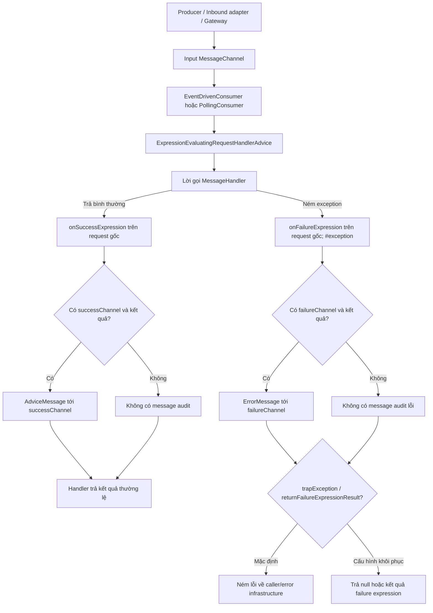
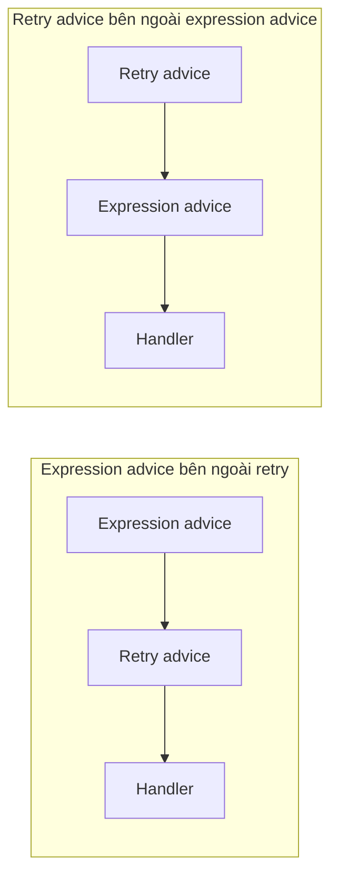

# ExpressionEvaluatingRequestHandlerAdvice trong Spring Integration

## 1. Mục tiêu và bối cảnh runtime

`ExpressionEvaluatingRequestHandlerAdvice` là một advice được Spring Integration cung cấp sẵn để **đánh giá biểu thức SpEL sau khi một message handler xử lý thành công hoặc thất bại**. Tùy cấu hình, kết quả đánh giá được gửi tới channel chuyên trách, giúp hệ thống ghi nhận kết quả, điều phối hoạt động bù, hoặc tạo nhánh thông báo độc lập với xử lý chính.

Bài học nằm trong chương **Advice chain** của module `SPRING_INTEGRATION_RUNTIME`. Phạm vi module là cách Spring Integration điều phối message flow qua channel, endpoint, consumer, poller và executor; quản lý vòng đời flow, transaction, retry, message store, error, correlation và chẩn đoán runtime. Những kiến thức đó đều quan trọng vì advice chạy **tại một ranh giới handler cụ thể**, phụ thuộc thread, lỗi và thứ tự chain.

Tên lớp đầy đủ:

```java
org.springframework.integration.handler.advice
    .ExpressionEvaluatingRequestHandlerAdvice
```

Lớp kế thừa `AbstractRequestHandlerAdvice`, thuộc nhóm AOP `Advice` dành cho `MessageHandler`. Nó **không** phải một `MessageHandler` độc lập, `MessageChannel` hoặc poller; cũng không phải SpEL transformer cho toàn flow.

**Sau bài này, bạn có thể:**

1. Trình bày chính xác thời điểm đánh giá `onSuccessExpression` và `onFailureExpression`.
2. Phân biệt `AdviceMessage`, `ErrorMessage`, reply nghiệp vụ và lỗi được ném về caller.
3. Cấu hình advice bằng Java DSL hoặc `@ServiceActivator(adviceChain=...)`.
4. Dự đoán hành vi khi dùng `trapException`, `returnFailureExpressionResult`, `propagateEvaluationFailures`.
5. Chọn vị trí advice trong retry/transaction chain và phân tích failure boundary khi dùng executor hoặc poller.
6. Quan sát, kiểm thử và khắc phục những lỗi route, SpEL, correlation và side effect.

## 2. Advice nằm ở đâu trong request handling?

Một handler được đăng ký vào endpoint; endpoint được consumer kích hoạt khi nhận message từ channel. Advice được cài **trên invocation của handler**. Khi handler trả về hoặc throw, advice xem đó là cơ sở quyết định đánh giá nhánh success/failure.



**Điểm mấu chốt:** advice nhìn **message đầu vào gốc của handler**. Nó không tự động dùng reply message để làm root object cho biểu thức. Handler có thể trả về một `String`, `Message<?>` hoặc `null`; việc nhánh nào chạy phụ thuộc **có exception thoát ra từ invocation hay không**, chứ không phải payload trả về có “thành công về mặt nghiệp vụ” hay không.

| Trường hợp | Advice nhận định | Hệ quả |
|---|---|---|
| Handler trả payload hợp lệ | Success | Có thể gửi `AdviceMessage` tới success channel; kết quả handler vẫn được chuyển tiếp bình thường. |
| Handler trả `null` không throw | Success | `onSuccessExpression` vẫn có thể chạy; không có nghĩa caller được đảm bảo reply. |
| Handler ném `IllegalStateException` | Failure | Có thể gửi `ErrorMessage` tới failure channel; mặc định lỗi vẫn truyền tiếp. |
| Handler bắt exception và trả DTO lỗi | Success | Với advice, lời gọi đã hoàn tất bình thường. Hãy định nghĩa rõ semantics trong business. |
| Message bị filter trước khi đến handler | Advice không được gọi | Không phát success/failure message cho handler này. |
| Async worker hoàn thành sau khi invocation đã trả quyền điều khiển | Tùy mô hình async | Không mặc nhiên đợi business hoàn tất sau một ranh giới async. |

### Advice không tương đương với “try/catch cho toàn IntegrationFlow”

Ví dụ một flow:

```text
input -> transform A -> outbound gateway B -> database handler C
```

Nếu gắn `ExpressionEvaluatingRequestHandlerAdvice` vào **B**, nó quan sát lời gọi handler **B**. Lỗi ở **C** xảy ra sau khi B đã hoàn thành không nhất thiết trở thành failure của advice B. Tương tự, advice gắn vào poller có phạm vi khác advice gắn trực tiếp vào handler.

Khi cần giám sát nhiều endpoint, gắn advice tại từng boundary thích hợp hoặc dùng tracing/metrics toàn flow. Đừng giả định một advice đơn lẻ đo được end-to-end latency.

## 3. Hai biểu thức và hai channel

Bốn thuộc tính điều khiển hành vi cốt lõi:

- `onSuccessExpression`: biểu thức SpEL đánh giá trên **request `Message<?>` gốc** sau handler chạy thành công.
- `successChannel`: kênh nhận kết quả success expression, dưới dạng **`AdviceMessage`**.
- `onFailureExpression`: biểu thức SpEL đánh giá trên **request `Message<?>` gốc** sau handler ném exception; context có biến đặc biệt `#exception`.
- `failureChannel`: kênh nhận kết quả failure expression, dưới dạng **`ErrorMessage`**.

Các setter API chính (phiên bản Spring Integration 6.5):

| Phương thức | Tác dụng |
|---|---|
| `setOnSuccessExpressionString(String)` hoặc `setOnSuccessExpression(Expression)` | Khai báo SpEL đánh giá sau success. |
| `setOnFailureExpressionString(String)` hoặc `setOnFailureExpression(Expression)` | Khai báo SpEL đánh giá sau exception. |
| `setSuccessChannel(MessageChannel)` / `setSuccessChannelName(String)` | Đặt channel nhận `AdviceMessage`. |
| `setFailureChannel(MessageChannel)` / `setFailureChannelName(String)` | Đặt channel nhận `ErrorMessage`. |
| `setTrapException(boolean)` | Khi `true`, chặn exception và trả `null` theo cơ chế cơ bản (mặc định `false`). |
| `setReturnFailureExpressionResult(boolean)` | Cho phép trả kết quả biểu thức failure như kết quả của handler; cần chú ý hợp đồng reply. |
| `setPropagateEvaluationFailures(boolean)` | Với **lỗi đánh giá success expression**, `true` truyền lỗi tới caller, mặc định `false` bắt lỗi này. Không làm thay đổi quy tắc failure expression. |

> Từ Spring Integration **5.1.3**, nếu đã cấu hình success/failure channel nhưng **chưa cung cấp biểu thức tương ứng**, biểu thức mặc định là `payload`. Đây là payload của **input message**, không phải kết quả trả về của handler.

### 3.1. Root object và biến trong SpEL

Giả sử request vào handler có cấu trúc:

```text
Message:
  payload: "file-42.csv"
  headers:
    requestId: "REQ-42"
    tenant: "north"
```

Biểu thức có thể viết:

```text
payload                                -> "file-42.csv"
headers['requestId']                   -> "REQ-42"
headers['tenant'] + ':' + payload      -> "north:file-42.csv"
payload + ':uploaded'                  -> "file-42.csv:uploaded"
#exception.message                     -> thông điệp lỗi, chỉ ở failure context
#exception.class.simpleName            -> kiểu lỗi, chỉ ở failure context
```

`#exception` trong failure expression là ngoại lệ mà advice bắt được; trong thực tế nó có thể là `MessagingException` chứa `cause` là ngoại lệ nghiệp vụ. Vì vậy dùng `#exception.cause.message` chỉ khi biết `cause` không null; cách an toàn hơn trong ví dụ tổng quát là `#exception.toString()` hoặc biểu thức có kiểm tra null.

**Không dùng `#exception` trong success expression.** Lỗi phát sinh khi đánh giá chính success expression không làm advice tự chuyển sang chạy failure expression. Theo API, *failure expression không được thực thi nếu success expression ném exception*.

### 3.2. Không nhầm message phát từ advice với reply chính

Lấy ví dụ handler `process("A")` trả `"DONE:A"`. Có thể có **hai đường ra**:

1. **Kết quả chính của handler:** `"DONE:A"` được cơ chế reply/output channel của endpoint chuyển tiếp.
2. **Tín hiệu phụ của advice:** success expression tạo `"A:OK"` và gửi `AdviceMessage` vào `successChannel`.

`successChannel` **không phải** output channel thay thế của endpoint. Hãy coi nó là một nhánh quan sát hoặc bù trừ; nếu muốn thay payload chính, dùng transformer, service activator hoặc cơ chế return/recovery được thiết kế riêng.

## 4. Cấu trúc AdviceMessage và ErrorMessage

### 4.1. Success: `AdviceMessage<T>`

Khi success expression trả kết quả và đã cấu hình success channel, Spring Integration gửi một `org.springframework.integration.message.AdviceMessage<T>`. Nội dung:

- `getPayload()`: giá trị SpEL tính được (ví dụ `"REQ-42:SUCCESS"`).
- `getInputMessage()`: tham chiếu tới **message đầu vào gốc** mà advice chuyển cho handler.
- Headers: metadata của message phát sinh; không nên chỉ dựa vào copy header để truy ngược bản gốc.

```java
import org.springframework.integration.message.AdviceMessage;
import org.springframework.messaging.Message;

void recordSuccess(Message<?> message) {
    if (message instanceof AdviceMessage<?> adviceMessage) {
        Object outcome = adviceMessage.getPayload();
        Message<?> original = adviceMessage.getInputMessage();
        String requestId = String.valueOf(
                original.getHeaders().get("requestId"));

        System.out.printf("request=%s result=%s%n", requestId, outcome);
    }
}
```

Với nhánh success, payload của `AdviceMessage` **không mặc định bằng return value của handler**. Nếu biểu thức là `payload`, payload này chính là payload **input**. Điều này rất quan trọng khi handler biến đổi dữ liệu: audit result và business reply có thể hoàn toàn khác nhau.

### 4.2. Failure: `ErrorMessage` có exception giàu ngữ cảnh

Khi handler throw và failure expression có kết quả thích hợp, advice gửi `org.springframework.messaging.support.ErrorMessage` tới failure channel. Payload là instance của:

```java
ExpressionEvaluatingRequestHandlerAdvice
    .MessageHandlingExpressionEvaluatingAdviceException
```

Đây là subclass của `MessagingException`, chứa:

| Thuộc tính | Lấy bằng | Ý nghĩa |
|---|---|---|
| Failure expression result | `getEvaluationResult()` | Dữ liệu SpEL tính được, ví dụ mã tác vụ thất bại. |
| Original input / failed message | `getFailedMessage()` | Message mà handler nhận khi lỗi xảy ra. |
| Original cause | `getCause()` | Exception gốc hoặc wrapper mà advice đã bắt. |

Ví dụ consumer kiểm tra failure channel:

```java
import org.springframework.integration.handler.advice
    .ExpressionEvaluatingRequestHandlerAdvice
    .MessageHandlingExpressionEvaluatingAdviceException;
import org.springframework.messaging.support.ErrorMessage;

void recordFailure(ErrorMessage error) {
    Throwable payload = error.getPayload();
    if (payload instanceof MessageHandlingExpressionEvaluatingAdviceException e) {
        System.out.println("evaluationResult = " + e.getEvaluationResult());
        System.out.println("failedMessage = " + e.getFailedMessage());
        System.out.println("cause = " + e.getCause());
    }
}
```

**Lưu ý:** Failure `ErrorMessage` phát bởi advice **không có cùng kiểu payload** với success `AdviceMessage`. Consumer cần biết cách đọc đúng lớp. `evaluationResult` không phải `ErrorMessage.getPayload()` trực tiếp; nó nằm **bên trong exception**.

### 4.3. Failure channel không đồng nghĩa global errorChannel

`failureChannel` là channel được cấu hình **riêng cho advice**. `errorChannel` global và header `errorChannel` thuộc cơ chế phát lỗi của Spring Integration ở các boundary khác. Khi `trapException=false`, một exception có thể **vừa được gửi như ErrorMessage tới failureChannel, vừa tiếp tục được truyền lên caller hoặc error infrastructure**. Điều này hữu ích cho audit, nhưng dễ gây double counting nếu nhiều error flows cùng ghi sự kiện.

## 5. Ví dụ 1: quan sát xử lý thành công/thất bại bằng Java DSL

Dưới đây là ví dụ Spring Integration 6.x / Java 17 cho tác vụ xử lý tên file. Handler một chiều giả lập upload, không đòi reply. Advice ghi một message riêng cho nhánh thành công hoặc thất bại.

**Giả định:** Ứng dụng có `spring-boot-starter-integration`, bean configuration được Spring quét và chưa có handler nào khác tiêu thụ `fileJobs`. Code dùng cùng package để dễ theo dõi.

### 5.1. Khai báo channels, advice và flow

```java
import org.springframework.context.annotation.Bean;
import org.springframework.context.annotation.Configuration;
import org.springframework.integration.channel.DirectChannel;
import org.springframework.integration.dsl.IntegrationFlow;
import org.springframework.integration.handler.advice
        .ExpressionEvaluatingRequestHandlerAdvice;
import org.springframework.messaging.MessageChannel;

@Configuration
public class FileJobConfig {

    @Bean
    MessageChannel fileJobs() {
        return new DirectChannel();
    }

    @Bean
    MessageChannel fileJobSuccess() {
        return new DirectChannel();
    }

    @Bean
    MessageChannel fileJobFailure() {
        return new DirectChannel();
    }

    @Bean
    ExpressionEvaluatingRequestHandlerAdvice fileJobAdvice() {
        ExpressionEvaluatingRequestHandlerAdvice advice =
                new ExpressionEvaluatingRequestHandlerAdvice();

        advice.setOnSuccessExpressionString(
                "headers['requestId'] + ':SUCCESS:' + payload");
        advice.setOnFailureExpressionString(
                "headers['requestId'] + ':FAILED:' + #exception.toString()");

        advice.setSuccessChannelName("fileJobSuccess");
        advice.setFailureChannelName("fileJobFailure");

        // Ví dụ demo một chiều: lỗi được quan sát và không ném lên producer.
        advice.setTrapException(true);
        return advice;
    }

    @Bean
    IntegrationFlow fileJobFlow(
            ExpressionEvaluatingRequestHandlerAdvice fileJobAdvice) {

        return IntegrationFlow.from("fileJobs")
                .<String>handle((payload, headers) -> {
                    if (payload.startsWith("bad")) {
                        throw new IllegalStateException("upload rejected");
                    }
                    // Giả lập tác vụ một chiều thành công.
                    return null;
                }, endpoint -> endpoint.advice(fileJobAdvice))
                .get();
    }
}
```

**Giải thích:**

- `fileJobs` là input channel của endpoint; `DirectChannel` chạy handler theo call stack đồng bộ.
- Sau khi handler trả bình thường, advice đánh giá success expression và phát `AdviceMessage` tới `fileJobSuccess`.
- Khi handler throw, advice đánh giá failure expression trên request gốc có `#exception`; sau đó phát `ErrorMessage` tới `fileJobFailure`.
- `setTrapException(true)` được chọn có chủ ý **chỉ cho demo tác vụ một chiều**: exception không đi ngược về producer. Với request–reply cần lỗi hiện rõ, nên giữ mặc định `false` hoặc thiết kế result/fallback rõ ràng.
- Handler trả `null` mà không throw **vẫn được xem là thành công tại handler**. Trong gateway chờ reply, điều này có thể gây timeout; đừng sao chép nguyên cấu hình này cho request–reply mà không sửa hợp đồng.

### 5.2. Khai báo consumer của hai nhánh

```java
import org.springframework.integration.annotation.ServiceActivator;
import org.springframework.integration.message.AdviceMessage;
import org.springframework.messaging.Message;
import org.springframework.messaging.support.ErrorMessage;
import org.springframework.stereotype.Component;

@Component
public class FileJobObservers {

    @ServiceActivator(inputChannel = "fileJobSuccess")
    public void onSuccess(Message<?> message) {
        AdviceMessage<?> adviceMessage = (AdviceMessage<?>) message;
        Message<?> original = adviceMessage.getInputMessage();
        System.out.println("SUCCESS " + adviceMessage.getPayload()
                + " originalPayload=" + original.getPayload());
    }

    @ServiceActivator(inputChannel = "fileJobFailure")
    public void onFailure(ErrorMessage message) {
        Throwable error = message.getPayload();
        System.out.println("FAILURE " + error.getMessage());
    }
}
```

Đây là hai side-channel consumer, không thay thế phần xử lý trong `fileJobFlow`. Trong production, dùng structured logging/tracing hoặc một consumer chuyên lưu audit; không in cả payload nếu chứa dữ liệu nhạy cảm.

### 5.3. Gửi thử và đọc kết quả

```java
import org.springframework.messaging.Message;
import org.springframework.messaging.MessageChannel;
import org.springframework.messaging.support.MessageBuilder;

void demo(MessageChannel fileJobs) {
    Message<String> ok = MessageBuilder
            .withPayload("report.csv")
            .setHeader("requestId", "R-100")
            .build();

    Message<String> bad = MessageBuilder
            .withPayload("bad-report.csv")
            .setHeader("requestId", "R-101")
            .build();

    fileJobs.send(ok);
    fileJobs.send(bad);
}
```

Dự đoán:

| Request | Handler | Side-channel |
|---|---|---|
| `R-100`, `report.csv` | Trả `null` bình thường | `fileJobSuccess` nhận `AdviceMessage` có payload `"R-100:SUCCESS:report.csv"`. |
| `R-101`, `bad-report.csv` | Throw `IllegalStateException` | `fileJobFailure` nhận `ErrorMessage`, exception chứa `evaluationResult` bắt đầu `"R-101:FAILED:"`. |

Nhờ `trapException=true`, lần gửi `bad-report.csv` không làm producer nhận lại exception từ chính handler trong demo này. Nếu đổi thành `false`, message lỗi vẫn có thể đến `fileJobFailure` trước khi exception tiếp tục truyền lên caller; cần test rõ behavior ứng dụng mong muốn.

## 6. Ví dụ 2: annotation adviceChain và cấu hình fail-fast

Có thể gắn advice trực tiếp lên một POJO service activator bằng tên bean:

```java
import org.springframework.integration.annotation.ServiceActivator;
import org.springframework.stereotype.Component;

@Component
public class PaymentService {

    @ServiceActivator(
            inputChannel = "payments.in",
            requiresReply = "true",
            adviceChain = "paymentAdvice"
    )
    public String process(String paymentId) {
        if (paymentId.startsWith("INVALID")) {
            throw new IllegalArgumentException("invalid payment");
        }
        return "ACCEPTED:" + paymentId;
    }
}
```

Bean advice:

```java
import org.springframework.context.annotation.Bean;
import org.springframework.context.annotation.Configuration;
import org.springframework.integration.handler.advice
        .ExpressionEvaluatingRequestHandlerAdvice;

@Configuration
class PaymentAdviceConfig {

    @Bean
    ExpressionEvaluatingRequestHandlerAdvice paymentAdvice() {
        var advice = new ExpressionEvaluatingRequestHandlerAdvice();
        advice.setOnSuccessExpressionString(
                "'payment:' + payload + ':handler-success'");
        advice.setOnFailureExpressionString(
                "'payment:' + payload + ':handler-failure'");
        advice.setSuccessChannelName("paymentAuditSuccess");
        advice.setFailureChannelName("paymentAuditFailure");

        // Mặc định trapException=false: không nuốt lỗi payment.
        return advice;
    }
}
```

Để chạy ví dụ, khai báo các channel `payments.in`, `paymentAuditSuccess`, `paymentAuditFailure` và consumer phù hợp. Nếu đang dùng `@MessagingGateway` chờ `String` reply, handler thành công trả chuỗi `"ACCEPTED:..."` thông qua reply channel của request. Audit message không tự trả về gateway. Khi handler throw, advice phát failure audit message, rồi **lỗi tiếp tục truyền lên** theo error path mặc định.

Một biến thể XML của cùng ý tưởng:

```xml
<int:service-activator input-channel="payments.in"
                       ref="paymentService"
                       method="process">
    <int:request-handler-advice-chain>
        <ref bean="paymentAdvice"/>
    </int:request-handler-advice-chain>
</int:service-activator>
```

Không dùng đồng thời annotation và XML trên cùng logic nếu không chủ ý tạo hai endpoint; ví dụ chỉ minh họa hai cách cấu hình thay thế nhau.

## 7. Chính xác các cờ thay đổi semantics như thế nào?

Đây là phần cần nắm chắc trước khi triển khai trong flow thật.

### 7.1. `trapException`: nuốt hay truyền lỗi?

Mặc định `trapException=false`. Khi handler ném exception, advice có thể đánh giá failure expression, gửi `ErrorMessage` sang failure channel, **sau đó vẫn ném exception** về caller hoặc infrastructure bắt lỗi ở ngoài.

Nếu bật:

```java
advice.setTrapException(true);
```

advice bắt lỗi và **trả `null`** theo hành vi cơ bản (trừ khi có logic trả failure evaluation result được cấu hình). Việc này phù hợp với fire-and-forget có nhánh audit lỗi, nhưng tiềm ẩn rủi ro:

- Upstream có thể nghĩ invocation “thành công” mặc dù business thất bại.
- Retry advice bao ngoài có thể không nhìn thấy exception nên không retry.
- Gateway chờ reply có thể timeout thay vì nhận exception nếu kết quả là `null`.
- Nếu transaction boundary bao ngoài chỉ rollback trên exception thoát ra, nuốt lỗi có thể khiến transaction commit ngoài ý muốn.

**Quy tắc:** chỉ bật trap khi đã quyết định rõ nghĩa “xử lý lỗi tại đây xong”, có log/error sink bền vững và downstream không cần thấy exception.

### 7.2. `returnFailureExpressionResult`: đưa failure result trở lại handler contract

```java
advice.setOnFailureExpressionString("'FAILED:' + payload");
advice.setReturnFailureExpressionResult(true);
```

Cờ này cho phép **kết quả của failure expression** trở thành return value cho tầng `AbstractReplyProducingMessageHandler`. Nó không biến mọi failure thành “thành công” theo nghĩa nghiệp vụ; tầng trên vẫn cần có khả năng **chuyển kết quả thành reply và route đúng channel**.

Đặc biệt:

- Đảm bảo kiểu result phù hợp chữ ký gateway hoặc consumer ở downstream.
- Phân biệt **message phụ gửi vào `failureChannel`** với **kết quả trả về của advice/handler**. Hai hành động có thể tồn tại đồng thời tùy cấu hình.
- Cần kiểm thử kết hợp với `trapException`, `requiresReply` và output channel. Không coi cờ này là phương pháp tổng quát để nuốt lỗi.
- Nếu muốn trả một response lỗi có contract rõ, tốt hơn là tạo một DTO (ví dụ `PaymentResult.failed(...)`) trong error flow hoặc business layer.

### 7.3. `propagateEvaluationFailures`: lỗi của chính SpEL success expression

Giả sử handler xử lý thành công, nhưng success expression là:

```java
advice.setOnSuccessExpressionString("payload.nonExistingProperty");
```

Nếu payload là `String`, truy cập property này có thể gây lỗi đánh giá SpEL.

- Mặc định `propagateEvaluationFailures=false`: exception phát sinh khi **đánh giá success expression** được advice bắt; xử lý chính có thể vẫn được xem là thành công.
- Khi `true`, lỗi đánh giá success expression có thể được ném về caller.
- Đối với **lỗi đánh giá failure expression**, cờ này **không áp dụng**; tài liệu API mô tả nguyên nhân lỗi gốc vẫn được truyền tiếp trừ khi `trapException=true`.
- Nếu **success expression** gây lỗi, advice **không chạy `onFailureExpression`** để xử lý lỗi đó.

Đây là một khác biệt quan trọng: “handler lỗi” và “biểu thức quan sát handler lỗi” là **hai lớp lỗi khác nhau**. Không để expression audit phức tạp, dễ throw hoặc có side effect quan trọng phá luồng nghiệp vụ ngoài ý muốn.

### 7.4. Ma trận hành vi

Bảng dưới đây mô tả các trường hợp thường gặp, giả sử expression và channel hợp lệ, không có advice khác can thiệp:

| Handler | Cấu hình | Side-channel | Ảnh hưởng tới kết quả chính |
|---|---|---|---|
| Return bình thường | Success expression + success channel | `AdviceMessage` | Giữ logic reply bình thường. |
| Return `null` bình thường | Success expression + success channel | `AdviceMessage` | Vẫn không có reply nếu endpoint không tạo reply. |
| Throw | `trapException=false` + failure channel | `ErrorMessage` | Exception tiếp tục được ném. |
| Throw | `trapException=true` + failure channel | `ErrorMessage` | Lỗi bị chặn; thường trả `null` nếu không có result thay thế. |
| Throw | `returnFailureExpressionResult=true` | Có thể có `ErrorMessage` nếu cấu hình failure channel | Failure expression result có thể được đưa về tầng reply-producing handler; cần kiểm tra các cờ kết hợp. |
| Handler thành công nhưng success SpEL throw | `propagateEvaluationFailures=false` | Có thể không phát success message thành công | Lỗi evaluation được bắt, không tự kích hoạt failure expression. |
| Handler thành công nhưng success SpEL throw | `propagateEvaluationFailures=true` | Không có success message thành công | Evaluation error được truyền ra caller. |

## 8. Advice order, retry và transaction: hệ quả vận hành

Trong Spring Integration, có thể kết hợp `ExpressionEvaluatingRequestHandlerAdvice` với `RequestHandlerRetryAdvice`, `RequestHandlerCircuitBreakerAdvice` hoặc transaction advice. **Thứ tự advice quyết định phạm vi exception và số lần biểu thức chạy.**

### 8.1. Retry bên ngoài vs expression advice bên ngoài



**Expression advice bên ngoài retry:** phần lõi của expression advice là cả vòng retry. Nếu handler lỗi 2 lần rồi lần 3 thành công, expression advice thường chỉ quan sát **kết quả cuối**: success một lần. Nếu hết retry và exception truyền ra, failure expression chạy cho thất bại cuối.

**Retry bên ngoài expression advice:** mỗi lần retry đi qua expression advice, nên failure expression/channel có thể chạy **nhiều lần** cho cùng request. Điều này làm tăng audit event và nguy cơ thực hiện tác vụ bù lặp.

Nếu expression advice nằm **bên trong retry** mà có `trapException=true`, nó có thể nuốt lỗi trước khi retry thấy exception: retry không có tín hiệu cần thử lại. Khi muốn audit “một outcome cuối cùng”, chọn đặt expression advice bao ngoài retry và kiểm tra thứ tự chain bằng test.

### 8.2. Transaction và side effect

Success expression được đánh giá sau khi invocation handler trong phạm vi advice hoàn tất. Điều đó **không bảo đảm DB transaction đã commit**.

Ví dụ:

```text
TransactionAdvice (outer)
  -> ExpressionAdvice (inner)
      -> Handler: UPDATE payment
      -> ExpressionAdvice: send AdviceMessage SUCCESS
  -> Transaction commit (có thể thất bại)
```

Ở đây `SUCCESS` là “handler không throw”, chưa chắc là “transaction đã commit”. Nếu side-channel consumer trực tiếp thực hiện việc không thể rollback, nó có thể xảy ra **trước** khi transaction commit.

Thiết kế an toàn hơn cho thông báo có yêu cầu chính xác:

- Dùng event sau commit hoặc transactional outbox nếu cần publish sau khi DB commit.
- Xác định riêng phạm vi transaction của handler, channel send và consumer nhận side-channel.
- Không ghi/di chuyển file hoặc gọi API ngoài trong SpEL nếu chưa xử lý retry/rollback/idempotency.
- Giữ expression nhẹ: tính mã/kết quả; giao công việc dài cho handler khác với transaction boundary rõ ràng.

### 8.3. Tại sao không nên tự động retry mọi failure event?

Ví dụ một outbound FTP adapter upload thành công nhưng code phát audit event thất bại. Nếu audit logic ném exception và retry bao cả handler, lần retry có thể upload file **lần nữa**. Hãy cân nhắc idempotency, ngữ nghĩa “at least once”, vị trí advice và chính sách khôi phục. Retry không bảo đảm exactly-once.

## 9. Threading, poller và vòng đời endpoint

Advice chạy trên thread **đang gọi handler**, trừ khi chính phần xử lý có cơ chế bất đồng bộ khác.

| Kiến trúc | Thời điểm advice chạy | Những gì cần quan sát |
|---|---|---|
| `DirectChannel` → handler | Trên thread gọi `send()`, đồng bộ | Exception thường truyền về sender; gửi side-channel trực tiếp có thể kéo dài latency sender. |
| `ExecutorChannel` → handler | Trên executor worker khi handler được dispatch | Exception cần xử lý ở worker/error infrastructure; thread-local transaction không tự truyền từ sender. |
| `QueueChannel` + `PollingConsumer` | Khi poller lấy message và gọi handler | Channel backlog, trạng thái poller và error flow; không thấy advice event nếu message còn nằm queue. |
| `@MessagingGateway` sync | Khi handler trong đường request–reply thực thi | Phân biệt handler outcome, gateway reply và gateway timeout; advice success không tạo reply chính. |
| Dynamic `IntegrationFlow` stop/start | Khi endpoint đang running và nhận message | Không có event advice khi endpoint không chạy hoặc không nhận message. |

Không dựa vào `AdviceMessage` như một **ack broker**. Ví dụ listener nhận message từ Kafka/JMS rồi gọi handler qua IntegrationFlow: advice phát success chỉ xác nhận handler invocation không ném exception tại boundary này; broker acknowledgment/commit có cơ chế riêng.

Khi muốn đảm bảo side-channel event luôn được giữ lại, kiểm tra capacity, persistence, acknowledgments và error handling của **channel nhận side event**. Một `DirectChannel` không có subscriber hoặc consumer ném lỗi có thể ảnh hưởng chính handler invocation; không coi gửi audit là thao tác miễn phí.

## 10. Bài thực hành: tạo, quan sát và chẩn đoán một flow

### Bài A — Phân biệt success với reply

Đặt advice:

```java
advice.setOnSuccessExpressionString(
        "'audit:' + headers['requestId']");
advice.setSuccessChannelName("auditEvents");
```

Handler:

```java
public String handle(String value) {
    return "business:" + value;
}
```

Gửi message payload `"item-7"`, `requestId="R-7"`.

**Kỳ vọng:**

- Business reply: `"business:item-7"` (nếu endpoint có output/reply route).
- Advice side event: `AdviceMessage` payload `"audit:R-7"`.
- `AdviceMessage.getInputMessage().getPayload()` vẫn là `"item-7"`.

### Bài B — Failure expression và exception vẫn được ném

Đặt:

```java
advice.setOnFailureExpressionString(
        "headers['requestId'] + ':' + #exception.class.simpleName");
advice.setFailureChannelName("auditErrors");
advice.setTrapException(false);
```

Handler ném `IllegalArgumentException("bad input")`.

**Kỳ vọng:** `auditErrors` nhận `ErrorMessage` với `evaluationResult` chứa request ID và tên exception. Đồng thời error vẫn có thể truyền về caller nếu flow đồng bộ. Cần xem `getCause()` của exception trong error payload khi handler đã bọc lỗi.

### Bài C — Vì sao retry không hoạt động?

Có chain:

```text
RetryAdvice -> ExpressionAdvice(trapException=true) -> Handler
```

Handler luôn throw. Quan sát retry đếm bao nhiêu lần.

**Đáp án:** Expression advice phía trong chặn exception nên retry phía ngoài thường không còn lỗi để quyết định thử lại. Nếu cần retry, để exception truyền ra; chỉ trap ở boundary thật sự có chủ đích phục hồi.

### Bài D — SpEL success expression hỏng

Handler hoàn tất không lỗi, nhưng `onSuccessExpression="payload.missingField"` trong khi payload là String.

**Câu hỏi:** `onFailureExpression` có được gọi không?  
**Đáp án:** Không. Handler không throw; lỗi là của success expression. Dùng `propagateEvaluationFailures` và test phù hợp để quyết định có truyền lỗi này ra ngoài.

### Bài E — Poller không chạy

Request ở `QueueChannel`, endpoint poller đang stop. Cả `successChannel` lẫn `failureChannel` đều không có sự kiện.

**Đáp án:** Advice chưa hề được gọi vì consumer chưa nhận message. Kiểm tra trạng thái poller/endpoint và queue depth trước khi sửa expression.

### Bài F — Đảm bảo kết quả sau commit

Business method ghi DB, success expression gửi lời gọi cập nhật hệ thống ngoài nhưng outer transaction sau đó rollback.

**Đáp án:** Success expression chạy trước commit; external side effect không tự rollback theo DB. Di chuyển side effect tới event after-commit hoặc outbox + consumer có idempotency, không chỉ đổi thứ tự log.

## 11. Chẩn đoán khi advice “không chạy” hoặc “chạy sai”

| Triệu chứng | Nguyên nhân phổ biến | Kiểm tra/sửa |
|---|---|---|
| Không có message success dù handler return bình thường | Advice chưa gắn vào đúng endpoint, thiếu subscriber, channel tên sai, SpEL trả `null`/ném lỗi | Xác định advice chain thực tế; log expression result; kiểm tra channel bean/consumer. |
| Failure event có nhưng caller vẫn ném exception | `trapException=false` mặc định | Đây là hành vi có chủ đích; chỉ bật trap nếu đã xử lý lỗi và xác định contract mới. |
| Failure event biến thành log hai lần | Vừa publish `failureChannel` vừa propagate exception tới `errorChannel` | Dùng correlation ID để dedup; phân biệt audit event với error event. |
| ErrorMessage consumer cast lỗi | Tưởng payload là failure expression String | Đọc `MessageHandlingExpressionEvaluatingAdviceException.getEvaluationResult()`. |
| Success audit khi business trả DTO FAILED | Handler không throw | Nếu FAILED cần được coi là failure, đổi business contract/throw hoặc phân luồng theo DTO ở bước riêng. |
| Gateway timeout sau `trapException=true` | Advice trả `null`, không có reply | Trả response lỗi hợp lệ hoặc để lỗi propagate; kiểm tra `requiresReply` và gateway timeout. |
| Expression SpEL truy cập nhầm property | Coi handler output là root | Dùng `payload`/`headers` của request gốc; muốn quan sát output cần cơ chế khác. |
| Khi retry, audit đếm nhiều lần | Expression advice nằm trong retry | Đặt ở ngoài vòng retry nếu chỉ muốn final outcome; dùng idempotency key. |
| Không thấy failure sau khi worker async throw | Exception xảy ra ngoài phạm vi synchronous invocation đã được advice bao | Kiểm tra cơ chế completion/error của executor/future và boundary advice. |
| Độ trễ handler tăng sau khi thêm audit | Side-channel đồng bộ, subscriber chậm hoặc channel send bị block | Dùng channel/executor phù hợp và đo độ trễ, áp dụng backpressure khi cần. |
| Transaction rollback sau khi phát success | Advice chạy trước outer transaction commit | Outbox/after-commit, thiết kế lại transaction boundary. |

### Trình tự chẩn đoán đề xuất

1. Ghi request ID/correlation ID vào header; trace một message từ input channel đến handler.
2. Xác nhận endpoint đang **started**, consumer hoặc poller đã thực sự dispatch message.
3. Xác nhận advice được gắn đúng handler và chain chứa các advice theo thứ tự mong muốn.
4. Kiểm tra handler return/throw; phân biệt exception bị bắt ở bên trong method với exception thoát ra.
5. Đánh giá biểu thức trên **message input gốc**; xem `#exception` chỉ ở failure case.
6. Kiểm tra channel name, bean, subscriber, channel type và thời gian gửi side-message.
7. Với failure, đọc `ErrorMessage.payload.cause` và `evaluationResult`; đối chiếu global error flow để tránh đếm trùng.
8. Với retry/transaction/gateway, kiểm tra advice order, khả năng trap lỗi, timeout và commit boundary.
9. Theo dõi latency, queue depth, số event audit, tỷ lệ đánh giá SpEL lỗi, cũng như khả năng ghi side-channel event.

## 12. Các nguyên tắc thiết kế để dùng advice an toàn

- **Biểu thức ngắn, ít side effect:** thích hợp tính mã, chọn thuộc tính header, tạo thông tin audit. Tránh đưa giao dịch mạng hoặc cập nhật DB phức tạp trực tiếp vào SpEL.
- **Giữ phân biệt success của handler với business success:** một method trả `null` hay DTO lỗi vẫn là success nếu không ném exception.
- **Không nuốt exception chỉ để hết log lỗi:** `trapException=true` là thay đổi semantics, ảnh hưởng retry, transaction rollback và gateway.
- **Xử lý side-channel như một nhánh thực:** cần subscriber, lỗi gửi, backpressure và idempotency khi dữ liệu audit quan trọng.
- **Thiết kế correlation rõ ràng:** giữ `requestId`/`traceId` từ input message; `MessageHeaders.ID` có thể thay đổi khi tạo message mới.
- **Thử theo ranh giới thread:** cùng cấu hình advice nhưng error route và caller behavior khác nhau giữa DirectChannel và executor/poller.
- **Không coi advice là retry, circuit breaker hay monitoring hoàn chỉnh:** nó đánh giá kết quả một handler; dùng đúng thành phần cho các chức năng còn lại.
- **Kiểm tra hành vi sau khi cập nhật phiên bản:** đặc biệt nếu dựa vào SpEL, advice order, exception wrapping, reactive/async completion hoặc timeout của gateway.

## 13. Câu hỏi tự kiểm tra

**1.** Handler trả `null` nhưng không throw. `onSuccessExpression` hay `onFailureExpression` chạy?  
**Đáp án:** Nhánh success vì handler invocation kết thúc bình thường. Nếu gateway đòi reply, có thể phát sinh timeout hoặc `ReplyRequiredException` ở tầng khác tùy cấu hình.

**2.** `successChannel` nhận loại message nào? Payload của nó có nhất thiết là return value của handler?  
**Đáp án:** `AdviceMessage`; payload là giá trị **success expression** tính trên request gốc, không nhất thiết bằng return value.

**3.** Muốn lấy dữ liệu mà failure expression tính được từ message trên `failureChannel`, truy cập đâu?  
**Đáp án:** Payload của `ErrorMessage` là `MessageHandlingExpressionEvaluatingAdviceException`; đọc `getEvaluationResult()` trên exception đó.

**4.** Handler throw, advice gửi `ErrorMessage` vào `failureChannel`. Caller có mặc nhiên không bị lỗi nữa không?  
**Đáp án:** Không. Mặc định `trapException=false`, exception vẫn truyền tiếp.

**5.** `propagateEvaluationFailures=false` có làm failure expression nuốt mọi lỗi không?  
**Đáp án:** Không. Cờ này liên quan lỗi khi đánh giá **success expression**; với failure expression, theo API exception gốc vẫn được propagate trừ khi trap được cấu hình.

**6.** Retry bao bên ngoài một expression advice đang bật `trapException=true`. Vì sao retry không diễn ra?  
**Đáp án:** Vì exception bị advice bên trong chặn nên retry ngoài không nhìn thấy failure.

**7.** Khi nào `AdviceMessage` success có thể không phản ánh commit thành công?  
**Đáp án:** Khi outer transaction commit sau thời điểm success expression đã chạy hoặc transaction ở boundary khác.

**8.** Handler sử dụng executor và fail sau khi phương thức send của producer đã trả. Lỗi có luôn ném ngược về producer?  
**Đáp án:** Không. Lỗi phụ thuộc nơi worker thực thi, error infrastructure và reply/error channel của flow; cần kiểm tra ranh giới thread.

## 14. Tài liệu tham khảo chính thức

1. [Spring Integration 6.5 — Expression Evaluating Advice và các advice có sẵn](https://docs.spring.io/spring-integration/reference/6.5/handler-advice/classes.html). Mô tả đường success/failure, `AdviceMessage`, `ErrorMessage` và Java DSL.
2. [Spring Integration 6.5 — Adding Behavior to Endpoints](https://docs.spring.io/spring-integration/reference/6.5/handler-advice.html). Phạm vi của request-handler advice chain so với poller/flow.
3. [API 6.5 — ExpressionEvaluatingRequestHandlerAdvice](https://docs.spring.io/spring-integration/docs/6.5.0/api/org/springframework/integration/handler/advice/ExpressionEvaluatingRequestHandlerAdvice.html). Các setter, mặc định và biến `#exception`.
4. [API — AdviceMessage](https://docs.spring.io/spring-integration/docs/6.5.0/api/org/springframework/integration/message/AdviceMessage.html). Loại message phát khi handler thành công.
5. [API — MessageHandlingExpressionEvaluatingAdviceException](https://docs.spring.io/spring-integration/docs/6.5.0/api/org/springframework/integration/handler/advice/ExpressionEvaluatingRequestHandlerAdvice.MessageHandlingExpressionEvaluatingAdviceException.html). `evaluationResult`, `failedMessage`, `cause`.
6. [Spring Integration 6.5 — Error Handling](https://docs.spring.io/spring-integration/reference/6.5/error-handling.html). Error infrastructure, sync/async và `errorChannel`.
7. [Spring Integration 6.5 — Message Channels](https://docs.spring.io/spring-integration/reference/6.5/channel.html). `DirectChannel`, `ExecutorChannel` và `QueueChannel`.
