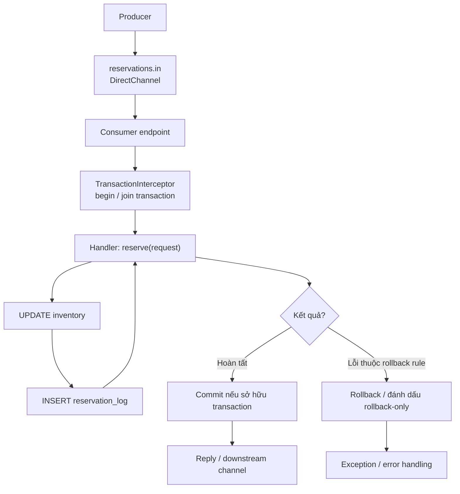
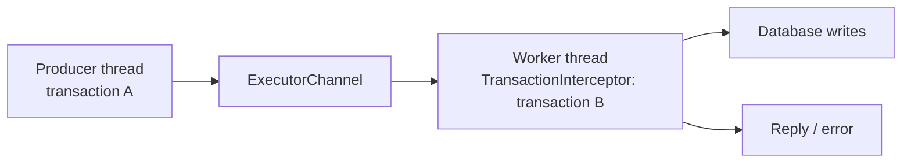

# TransactionInterceptor trong advice chain

## 1. Mục tiêu: transaction bảo vệ phần nào của message flow?

Trong Spring Integration, một consumer endpoint nhận message từ channel rồi gọi handler để xử lý. Handler có thể đọc/ghi database, chuyển payload, gọi dịch vụ khác hoặc tạo reply. Nếu một bước làm thay đổi dữ liệu thất bại giữa chừng, ứng dụng cần biết **những thao tác nào phải commit, những thao tác nào phải rollback**.

`TransactionInterceptor` của Spring Framework là một **AOP `MethodInterceptor`** có thể đặt vào **advice chain** của một endpoint trong Spring Integration. Khi endpoint được gọi, interceptor sử dụng `PlatformTransactionManager` để mở hoặc tham gia transaction, chạy handler, rồi quyết định commit/rollback theo kết quả và chính sách transaction.

Ví dụ, xử lý đặt chỗ gồm:

1. Giảm số lượng tồn kho trong database.
2. Ghi lịch sử đặt chỗ vào cùng database.
3. Trả kết quả cho message flow.

Nếu ghi lịch sử lỗi, cả hai thay đổi database phải rollback. `TransactionInterceptor` có thể tạo một phạm vi transaction cho handler thực hiện những thao tác đó, miễn là thao tác cùng sử dụng transaction manager phù hợp.

Bài học thuộc chương **Advice chain** của module **SPRING_INTEGRATION_RUNTIME**. Trọng tâm là transaction thực sự hoạt động tại runtime qua channel, endpoint, consumer, poller và executor; cách phối hợp retry, xử lý lỗi, message store, correlation và quan sát hiệu năng. Một cấu hình advice chỉ có ý nghĩa khi hiểu **ranh giới thực thi** mà advice bao quanh.

> **Ý chính:** `TransactionInterceptor` không làm toàn bộ `IntegrationFlow` tự động trở thành một transaction. Nó bao phần gọi được áp advice; các thao tác tham gia transaction và việc transaction có đi tiếp qua endpoint khác hay không phụ thuộc thread, channel, transaction manager và nguồn message.

## 2. Advice chain hoạt động khi endpoint nhận message

Spring Integration cho phép cấu hình một hay nhiều advice quanh **handler endpoint**. Có thể hình dung chuỗi gọi:



Sơ đồ mô tả phạm vi theo ý nghĩa nghiệp vụ; thời điểm dispatch reply cụ thể phụ thuộc handler và endpoint. Không được suy diễn từ sơ đồ rằng việc gửi reply sang broker hoặc mọi endpoint phía sau sẽ tự tham gia cùng giao dịch database.

**Các thành phần:**

| Thành phần | Trách nhiệm |
| --- | --- |
| `MessageChannel` | Chuyển message đến consumer; kiểu channel quyết định cách điều phối đồng bộ/bất đồng bộ. |
| Consumer endpoint | Đăng ký nhận message từ channel, gọi message handler và áp advice theo cấu hình. |
| `TransactionInterceptor` | Bắt đầu/tham gia transaction và áp quy tắc commit/rollback quanh lời gọi được advice. |
| `PlatformTransactionManager` | Quản lý transaction cho tài nguyên cụ thể, ví dụ JDBC/JPA. |
| Handler nghiệp vụ | Thực hiện xử lý và truy cập tài nguyên cần transaction. |
| `ErrorMessage` / error channel | Chuyển lỗi theo cơ chế xử lý lỗi của endpoint/adapter khi phù hợp; không thay thế transaction manager. |

`TransactionInterceptor` có thể cùng xuất hiện với logging advice, retry advice và advice đo thời gian. **Thứ tự** trong chain ảnh hưởng đến việc một lần retry chạy trong transaction mới hay nằm trong cùng một phạm vi transaction.

## 3. Phân biệt transaction advice ở handler và transaction ở poller

Hai cấu hình phổ biến có phạm vi khác nhau:

| Nơi đặt transaction | Hoạt động được bao quanh | Điều đáng chú ý |
| --- | --- | --- |
| **Handler endpoint:** `.handle(..., e -> e.advice(txAdvice))` | Lời gọi tới handler được cấu hình advice, trong ngữ cảnh thực thi của endpoint đó | Phù hợp để bảo vệ thao tác database của một handler. Không tự bao luôn việc receive từ queue hoặc bước ngoài phạm vi advice. |
| **Polling endpoint:** `Pollers.fixedDelay(...).transactional(txManager)` | Chu kỳ poll gồm thao tác nhận và xử lý theo phạm vi do poller transaction advice tạo | Hữu ích khi việc receive từ message store/nguồn dữ liệu và xử lý cần phối hợp transaction. |
| **`@Transactional` trên service được Spring quản lý** | Lời gọi vào service thông qua Spring transaction proxy | Phù hợp khi transaction thuộc nghiệp vụ và service được gọi từ nhiều nơi, không chỉ IntegrationFlow. |
| **Transaction ở inbound adapter** | Phạm vi do adapter/container/nguồn tin nhắn mở | Acknowledgement, offset hay broker transaction có hợp đồng riêng; không giả định transaction JDBC tự đồng bộ với broker. |

Không phải cứ thêm `TransactionInterceptor` cho handler là transaction sẽ bao trọn một poll từ `QueueChannel`. Nếu cần xử lý nguyên tử giữa **receive từ nguồn giao dịch được** và **ghi database**, cần xác định tài nguyên, transaction manager và chính sách của polling consumer.

### Mốc bắt đầu/kết thúc đáng kiểm tra

Trong đường đồng bộ `DirectChannel`, nếu handler không có transaction sẵn, advice với propagation `REQUIRED` có thể mở transaction mới khi handler được gọi. Khi handler trả về hoặc ném exception, interceptor hoàn tất transaction theo quy tắc. Nếu đã có transaction tương thích ở thread đó, `REQUIRED` thường **tham gia transaction hiện hữu**; khi đó commit cuối cùng có thể do bên ngoài quyết định.

Vì vậy, “handler trả về thành công” không đồng nghĩa “database đã commit tại chính thời điểm ấy” nếu handler đang tham gia transaction ngoài.

## 4. Ví dụ hoàn chỉnh: Advice transaction quanh service activator

Ví dụ minh họa một flow đồng bộ nhận yêu cầu đặt chỗ, cập nhật bảng tồn kho và ghi log trong cùng JDBC transaction. Các class dưới đây có thể đặt trong một file Java demo trong ứng dụng đã có Spring Integration, Spring JDBC và một `PlatformTransactionManager` gắn với `DataSource`.

Giả sử database có các bảng thử nghiệm:

```sql
CREATE TABLE inventory (
    sku VARCHAR(40) PRIMARY KEY,
    available INTEGER NOT NULL
);

CREATE TABLE reservation_log (
    reservation_id VARCHAR(60) PRIMARY KEY,
    sku VARCHAR(40) NOT NULL,
    quantity INTEGER NOT NULL
);

INSERT INTO inventory (sku, available) VALUES ('SKU-001', 10);
```

Khai báo request và kết quả:

```java
record ReserveRequest(String reservationId, String sku, int quantity) {}

record ReserveReceipt(String reservationId, String status) {}
```

Handler dùng `JdbcTemplate`; cả hai câu SQL sẽ tham gia cùng transaction nếu `JdbcTemplate` và transaction manager dùng đúng `DataSource`:

```java
import org.springframework.jdbc.core.JdbcTemplate;

class ReservationService {

    private final JdbcTemplate jdbc;

    ReservationService(JdbcTemplate jdbc) {
        this.jdbc = jdbc;
    }

    public ReserveReceipt reserve(ReserveRequest request) {
        if (request.quantity() <= 0) {
            throw new IllegalArgumentException("So luong phai duong");
        }

        int changed = jdbc.update(
            "UPDATE inventory SET available = available - ? " +
            "WHERE sku = ? AND available >= ?",
            request.quantity(), request.sku(), request.quantity());

        if (changed != 1) {
            throw new IllegalStateException("Khong du hang");
        }

        jdbc.update(
            "INSERT INTO reservation_log (reservation_id, sku, quantity) " +
            "VALUES (?, ?, ?)",
            request.reservationId(), request.sku(), request.quantity());

        // Tạo tình huống lỗi SAU khi đã chạy cả hai câu SQL.
        if ("FAIL".equals(request.reservationId())) {
            throw new IllegalStateException("Gia lap loi de rollback");
        }

        return new ReserveReceipt(request.reservationId(), "RESERVED");
    }
}
```

Tạo `TransactionInterceptor` và gắn vào **endpoint `.handle`**, không gắn cho một đối tượng bất kỳ rồi mong cả flow được bảo vệ:

```java
import org.springframework.context.annotation.Bean;
import org.springframework.context.annotation.Configuration;
import org.springframework.integration.channel.DirectChannel;
import org.springframework.integration.channel.QueueChannel;
import org.springframework.integration.config.EnableIntegration;
import org.springframework.integration.dsl.IntegrationFlow;
import org.springframework.jdbc.core.JdbcTemplate;
import org.springframework.messaging.MessageChannel;
import org.springframework.messaging.PollableChannel;
import org.springframework.transaction.PlatformTransactionManager;
import org.springframework.transaction.TransactionDefinition;
import org.springframework.transaction.interceptor.DefaultTransactionAttribute;
import org.springframework.transaction.interceptor.TransactionInterceptor;

@Configuration
@EnableIntegration
class ReservationIntegrationConfig {

    @Bean("reservations.in")
    MessageChannel reservationInput() {
        return new DirectChannel();
    }

    @Bean("reservations.done")
    PollableChannel reservationOutput() {
        // Queue trong bộ nhớ để đọc kết quả demo; không bảo đảm durability.
        return new QueueChannel(100);
    }

    @Bean
    ReservationService reservationService(JdbcTemplate jdbc) {
        return new ReservationService(jdbc);
    }

    @Bean
    TransactionInterceptor reservationTransactionAdvice(
            PlatformTransactionManager txManager) {
        DefaultTransactionAttribute attribute =
            new DefaultTransactionAttribute();
        attribute.setPropagationBehavior(
            TransactionDefinition.PROPAGATION_REQUIRED);
        attribute.setTimeout(10); // giây; timeout phụ thuộc hỗ trợ tài nguyên
        return new TransactionInterceptor(txManager, attribute);
    }

    @Bean
    IntegrationFlow reservationFlow(
            ReservationService reservationService,
            TransactionInterceptor reservationTransactionAdvice) {

        return IntegrationFlow.from("reservations.in")
            .handle(reservationService, "reserve",
                endpoint -> endpoint.advice(reservationTransactionAdvice))
            .channel("reservations.done")
            .get();
    }
}
```

Ví dụ sử dụng Java `record` (Java 16+), với các record `ReserveRequest`/`ReserveReceipt` từ đoạn trước. Ứng dụng cần có bean `JdbcTemplate`, `PlatformTransactionManager` cho database và schema tương ứng. Spring Boot có thể tự cấu hình những bean này khi các dependency và DataSource được thiết lập đúng; nếu không, cần khai báo tương ứng.

**Đường chạy thực tế:**

1. Producer gửi `Message<ReserveRequest>` tới `reservations.in`.
2. `DirectChannel` giao message tới endpoint gọi `ReservationService.reserve`.
3. Transaction advice bắt đầu/tham gia transaction phù hợp rồi gọi service.
4. `JdbcTemplate` thực hiện update tồn kho và insert lịch sử trong phạm vi giao dịch.
5. Nếu service trả `ReserveReceipt` thành công, transaction hoàn tất theo propagation và policy hiện hành; reply đi tới `reservations.done`.
6. Nếu service ném `IllegalStateException`, quy tắc rollback mặc định áp dụng cho lỗi runtime. Hai thay đổi JDBC trong cùng transaction mới được tạo sẽ bị rollback.

### Kiểm chứng trên dữ liệu

```java
import org.springframework.context.ApplicationContext;
import org.springframework.messaging.Message;
import org.springframework.messaging.MessageChannel;
import org.springframework.messaging.PollableChannel;
import org.springframework.messaging.support.GenericMessage;

MessageChannel input =
    context.getBean("reservations.in", MessageChannel.class);
PollableChannel output =
    context.getBean("reservations.done", PollableChannel.class);

input.send(new GenericMessage<>(
    new ReserveRequest("OK-1", "SKU-001", 2)));

Message<?> result = output.receive(1_000);
// Payload: ReserveReceipt("OK-1", "RESERVED")

try {
    input.send(new GenericMessage<>(
        new ReserveRequest("FAIL", "SKU-001", 3)));
} catch (RuntimeException ex) {
    // Lỗi có thể được Spring Messaging bọc ở tầng endpoint.
    System.out.println(ex.getMessage());
}
// Kiểm tra database: lần thử FAIL không làm giảm thêm tồn kho
// và không để lại bản ghi reservation_log với id = FAIL.
```

`context` ở đây là `ApplicationContext` đã khởi động ứng dụng. Giá trị `available` sau một lần thành công `OK-1` phải là `8` (xuất phát từ `10`); sau lần `FAIL` vẫn là `8` nếu rollback đã hoạt động và không có transaction ngoài nào chưa kết thúc. Kết quả có thể sai nếu dữ liệu thử nghiệm không được reset, transaction manager không dùng cùng DataSource hoặc có tác vụ khác đồng thời cập nhật tồn kho.

Đây là thử nghiệm có ý nghĩa hơn việc chỉ thấy bean advice tồn tại: **đo lại trạng thái database sau lỗi** để chứng minh rollback thật sự diễn ra.

## 5. Propagation, rollback rule và timeout

Các thuộc tính transaction chi phối kết quả nhiều hơn tên `TransactionInterceptor`.

| Thuộc tính | Hành vi tiêu biểu | Rủi ro thường gặp |
| --- | --- | --- |
| `PROPAGATION_REQUIRED` | Tham gia transaction đang có, nếu chưa có thì tạo mới | Tưởng handler tự commit trong khi transaction thuộc caller. |
| `PROPAGATION_REQUIRES_NEW` | Tạm treo transaction hiện hữu và tạo transaction mới nếu transaction manager hỗ trợ | Side effect đã commit trong transaction mới có thể tồn tại dù giao dịch ngoài rollback. |
| `PROPAGATION_MANDATORY` | Yêu cầu transaction hiện hữu | Gặp lỗi nếu flow đến endpoint từ thread không có transaction. |
| `PROPAGATION_SUPPORTS` | Có transaction thì tham gia, không có vẫn chạy | Không bảo đảm rollback cho lời gọi không có transaction sẵn. |
| `readOnly` | Gợi ý/giới hạn tùy transaction manager và tài nguyên | Không phải cơ chế bảo mật chống mọi lệnh ghi SQL. |
| `timeout` | Yêu cầu giới hạn thời gian transaction khi hỗ trợ | Không mặc định ngắt một Java thread đang treo hoặc tự hủy lời gọi HTTP. |
| Rollback rule | Mặc định rollback cho `RuntimeException` và `Error` | Checked exception thông thường không mặc định gây rollback nếu chưa cấu hình. |

Ví dụ tùy chỉnh rollback với một checked exception:

```java
import org.springframework.transaction.interceptor.RuleBasedTransactionAttribute;
import org.springframework.transaction.interceptor.RollbackRuleAttribute;

RuleBasedTransactionAttribute attribute =
    new RuleBasedTransactionAttribute();
attribute.setPropagationBehavior(
    TransactionDefinition.PROPAGATION_REQUIRED);
attribute.getRollbackRules().add(
    new RollbackRuleAttribute(Exception.class));

TransactionInterceptor txAdvice =
    new TransactionInterceptor(transactionManager, attribute);
```

Đoạn trên minh họa cách thêm rollback rule cho `Exception`; `transactionManager` là bean đã cấu hình. Cần cân nhắc phạm vi rule: rollback cho mọi checked exception có thể không phù hợp nếu một số exception biểu thị kết quả nghiệp vụ chấp nhận được.

**Lỗi bị bắt rồi bỏ qua:** Nếu handler tự `catch` exception và trả kết quả bình thường mà không đánh dấu transaction rollback-only, interceptor nhìn thấy lời gọi thành công và có thể commit. Nếu cần rollback, hãy để exception thích hợp lan ra, hoặc đánh dấu rollback-only một cách có chủ đích ở lớp quản lý transaction.

**Rollback-only từ transaction bên trong:** Nếu một thành phần tham gia transaction hiện hữu đánh dấu rollback-only, caller ngoài có thể gặp `UnexpectedRollbackException` khi cố commit. Đây không phải lỗi “Spring Integration gửi message hai lần”; hãy truy lại phạm vi transaction và exception khiến trạng thái bị đánh dấu.

## 6. Poller transaction: khi nào cần bao cả thao tác receive?

Giả sử message đang nằm trong `QueueChannel` gắn với một message store giao dịch được. Poller lấy message ra rồi giao cho handler. Nếu transaction chỉ bao handler, thao tác **lấy message khỏi queue** có thể đã hoàn tất trước khi handler bắt đầu transaction. Khi handler lỗi, rollback database chưa chắc trả message về queue.

Có thể cấu hình transaction tại **poller**, theo API DSL của Spring Integration:

```java
import java.time.Duration;
import org.springframework.integration.channel.QueueChannel;
import org.springframework.integration.dsl.IntegrationFlow;
import org.springframework.integration.dsl.Pollers;
import org.springframework.transaction.PlatformTransactionManager;

@Bean
IntegrationFlow polledReservationFlow(
        QueueChannel pendingReservations,
        ReservationService service,
        PlatformTransactionManager txManager) {

    return IntegrationFlow.from(pendingReservations,
        spec -> spec.poller(
            Pollers.fixedDelay(Duration.ofSeconds(1))
                .maxMessagesPerPoll(1)
                .transactional(txManager)))
        .handle(service, "reserve")
        .get();
}
```

Đây là **đoạn cấu hình minh họa**: `pendingReservations` phải là bean `QueueChannel` được khai báo và nối với producer; muốn receive rollback đúng, cần message store có tính chất giao dịch tương thích với `txManager`, cùng các điều kiện khác do triển khai quy định. Một `QueueChannel` **in-memory mặc định** không tự trở thành nguồn dequeue có rollback chỉ vì thêm `.transactional(txManager)`.

Đặc biệt, nếu nguồn là adapter polling file, JDBC hay message broker, transaction/acknowledgement semantics của nguồn đó phải được kiểm tra độc lập. Transaction JDBC không tự rollback thao tác gửi HTTP, gửi email hoặc offset đã commit ở broker.

### Khi nào chọn ở poller, khi nào chọn ở handler?

- Chọn **handler advice** nếu chỉ cần bảo vệ thao tác trong handler, hoặc handler cũng được gọi từ những nguồn khác.
- Chọn **poller transaction** khi điều quan trọng là phạm vi **receive + xử lý** và nguồn/queue có hỗ trợ giao dịch tương ứng.
- Có thể có cả hai trong hệ thống phức tạp, nhưng phải xác định propagation và manager để tránh hiểu sai về transaction lồng nhau hoặc hai transaction độc lập.

## 7. Phối hợp `TransactionInterceptor` với retry advice

`RequestHandlerRetryAdvice` có thể retry lời gọi handler khi xảy ra exception đủ điều kiện. Khi kết hợp retry và transaction, **thứ tự bao quanh** rất quan trọng.

### Mô hình A: retry bên ngoài, transaction bên trong

```text
Retry advice
  attempt 1 -> TransactionInterceptor -> Handler -> lỗi -> rollback
  attempt 2 -> TransactionInterceptor -> Handler -> lỗi -> rollback
  attempt 3 -> TransactionInterceptor -> Handler -> thành công -> commit
```

Đây thường là mô hình phù hợp cho lỗi tạm thời khi muốn **mỗi attempt có transaction riêng**. Trong Spring Integration DSL, thứ tự advice cần được kiểm tra trên chính cấu hình và phiên bản framework; khi đặt retry advice trước transaction advice trong chain, ý định là retry bao các lần gọi transaction:

```java
// retryAdvice là RequestHandlerRetryAdvice đã được cấu hình retry policy.
// txAdvice là TransactionInterceptor dùng cùng transaction manager thích hợp.
.handle(reservationService, "reserve",
    e -> e.advice(retryAdvice, txAdvice))
```

Hãy xác nhận bằng log bắt đầu/kết thúc transaction và số lần handler chạy; không đánh giá chỉ bằng số lần `retryCallback` được gọi. Nếu đang có **transaction ngoài** và propagation vẫn là `REQUIRED`, advice bên trong có thể tiếp tục tham gia transaction đó thay vì tạo transaction độc lập như sơ đồ lý tưởng.

### Mô hình B: transaction bên ngoài, retry bên trong

```text
TransactionInterceptor
  begin
    Retry advice
      attempt 1 -> Handler -> lỗi
      attempt 2 -> Handler -> thành công
  commit / rollback
```

Ở mô hình này, các attempt có thể dùng **cùng transaction**, tùy transaction manager và tài nguyên. Một số lỗi database khiến transaction không còn dùng được hoặc đánh dấu rollback-only; retry trong cùng transaction có thể lặp lại vô ích, hoặc lúc cuối gặp rollback dù handler trả thành công.

### Quy tắc thực hành

1. Retry chỉ nên áp cho lỗi **có khả năng phục hồi**, chẳng hạn deadlock được phân loại đúng hoặc sự cố tạm thời.
2. Lỗi dữ liệu sai định dạng, vi phạm validation hay cấu hình thiếu bean không nên retry nhiều lần.
3. Mỗi attempt có thể chạy lại những bước đã có side effect; cần idempotency key và kiểm tra transaction thực sự bao thao tác nào.
4. Không để transaction kéo dài qua sleep/backoff nếu không có lý do rõ ràng; nó có thể giữ lock và connection lâu.
5. Đặt giới hạn số lần retry, backoff phù hợp, recovery/DLQ hoặc kênh thất bại cuối cùng; theo dõi tổng thời gian xử lý.

`TransactionInterceptor` không tạo cơ chế retry tự thân. Retry advice, transaction advice và error channel thực hiện những trách nhiệm khác nhau.

## 8. Channel, executor và ranh giới thread

Transaction do các transaction manager thông dụng quản lý thường gắn với **thread hiện tại**. Vì vậy chọn channel có thể làm thay đổi transaction nhìn thấy trong handler.

| Trường hợp | Thread của handler | Transaction context |
| --- | --- | --- |
| `DirectChannel`, các bước đồng bộ | Thường là thread gửi message | Có thể tham gia transaction của caller qua `REQUIRED`. |
| `ExecutorChannel` trước handler | Worker trong executor | Transaction của thread producer thường **không tự truyền** sang worker; handler advice có thể mở transaction mới. |
| `QueueChannel` với poller | Thread polling/task executor của poller | Transaction do poller hoặc handler advice mở trong thread đó. |
| `PublishSubscribeChannel` có executor | Có thể dispatch trên các worker khác nhau | Không giả định mọi subscriber tham gia cùng transaction producer. |



Trong sơ đồ, transaction A và B là **hai ngữ cảnh cần xem xét riêng**; đường gửi từ producer sang executor không tự bảo đảm B là transaction con hay cùng transaction của A.

Ví dụ, gateway đang gọi đồng bộ mà flow chuyển qua executor có thể thay đổi khả năng nhận exception, thời điểm reply, thời gian chờ và cách rollback. Nếu error publishing xảy ra trong worker, lỗi có thể được gửi thành `ErrorMessage` đến error channel đã cấu hình; producer không nhất thiết nhận trực tiếp exception trong `send()`.

**Cần đo:** thread name trước/sau channel, `TransactionSynchronizationManager.isActualTransactionActive()` bên trong handler, tên transaction manager, và thời điểm commit/rollback. Không được dùng riêng việc một exception xuất hiện trong log làm bằng chứng transaction rollback.

## 9. Error channel, transaction và trạng thái message gốc

Khi handler được transaction advice bao quanh ném exception:

- Trong **đường đồng bộ** qua `DirectChannel`, exception chưa được xử lý có thể lan ngược về producer/gateway. Transaction advice rollback theo policy.
- Trong **đường bất đồng bộ** qua executor/poller/adapter, thành phần quản lý lỗi có thể đóng gói thành `ErrorMessage` để gửi error channel. Điều này phụ thuộc cấu hình cụ thể và không phải cam kết cho mọi exception.
- Nếu error handler tiếp tục ném exception, bị dừng hoặc error channel không có consumer, việc ghi nhận/khôi phục lỗi có thể thất bại thêm. **Rollback database và thành công của error flow là hai kết quả riêng.**

Một `ErrorMessage` thường có payload là `Throwable`, đôi khi là `MessagingException` có `failedMessage`. Để đối chiếu với message gốc, kiểm tra các header như `correlationId`, `replyChannel`, `errorChannel` và custom `traceId`. Không giả định mỗi error message đều tự copy mọi header nghiệp vụ từ message gốc; cần đọc `failedMessage` nếu có.

Giả sử `ReserveRequest("FAIL", "SKU-001", 3)` đã được đưa qua một nguồn broker và handler rollback JDBC thành công. Nếu adapter đã ack message quá sớm, broker có thể không phát lại message. Ngược lại, nếu message được redeliver sau rollback, handler có thể chạy thêm lần nữa. Vì vậy, cần xác định **transaction database**, **cơ chế ack của nguồn**, **retry** và **idempotency** cùng nhau.

## 10. Message store và tính nhất quán khi khôi phục

Khi lưu message vào `QueueChannel`, channel thường nhận message theo cơ chế riêng. Nếu queue chỉ nằm trong bộ nhớ, transaction JDBC không biến queue đó thành persistent storage.

Các câu hỏi thiết kế quan trọng:

| Câu hỏi | Hướng kiểm tra |
| --- | --- |
| Message đang ở đâu trước khi xử lý? | In-memory queue, JDBC message store, Kafka/RabbitMQ hay adapter khác? |
| Receive có rollback được không? | Message store/adapter có hỗ trợ transaction không; dùng transaction manager nào? |
| Message đã được acknowledge lúc nào? | Trước xử lý, sau xử lý, sau commit hoặc theo cơ chế container? |
| DB update và publish message mới có cùng transaction không? | Nếu cần atomicity xuyên tài nguyên, cân nhắc transaction phối hợp phù hợp hoặc transactional outbox. |
| Nếu worker chết sau commit DB nhưng trước khi ack thì sao? | Có thể redeliver; handler phải idempotent. |
| Nếu handler đã gọi HTTP trước khi DB rollback thì sao? | Gọi HTTP không tự bị rollback; cần idempotency, compensation hoặc thiết kế khác. |

Thực tế thường chọn **at-least-once delivery + xử lý idempotent** cho flow có broker, hoặc **transactional outbox** khi cần đảm bảo phát sự kiện tương ứng với commit DB. Không dùng `TransactionInterceptor` như lời hứa “exactly once” trên tất cả nguồn và đích.

## 11. Vòng đời IntegrationFlow và quan sát transaction runtime

Advice thường được cấu hình khi endpoint/flow được tạo; trạng thái `start`/`stop` của endpoint điều khiển khả năng nhận message, không tự thay đổi định nghĩa rollback của advice.

Với flow được đăng ký động qua `IntegrationFlowContext`, cần kiểm tra:

1. Endpoint đã start và subscribe đúng input channel chưa? Có message nào đang xử lý khi stop không?
2. `TransactionInterceptor` có thực sự được gắn vào **endpoint đang chạy** hay chỉ tồn tại như bean chưa được sử dụng?
3. Transaction manager được inject có đúng nguồn dữ liệu của handler không?
4. Có ranh giới `ExecutorChannel`, polling executor hoặc tác vụ `@Async` nằm trong handler làm tách thread không?
5. Flow có retry advice hoặc error handling nào đang nuốt exception khiến transaction commit không?
6. Khi drain/shutdown, message nào được xử lý xong, message nào đang chờ queue, message nào sẽ được redeliver?

### Những gì cần log/đo

Một cách quan sát có kiểm soát là ghi nhận:

- `messageId`, `correlationId`/`traceId`, endpoint ID, tên thread, attempt number.
- Thời gian bắt đầu/kết thúc xử lý, thời gian chờ queue, duration của transaction.
- Số commit, rollback, retry, timeout, deadlock và `UnexpectedRollbackException`.
- Pool JDBC: active/idle connections; lock wait; throughput và executor queue depth.
- `TransactionSynchronizationManager.isActualTransactionActive()` tại các điểm đáng nghi.

Không bật log toàn bộ payload chứa dữ liệu nhạy cảm. Khi debug SQL transaction, các log mức DEBUG/TRACE của Spring transaction hoặc JDBC có thể giúp xác định ranh giới; nên giới hạn theo thời gian và môi trường.

## 12. Triệu chứng thường gặp và cách chẩn đoán

| Triệu chứng | Nguyên nhân đáng kiểm tra | Cách xác minh/sửa |
| --- | --- | --- |
| Đã thêm `TransactionInterceptor` nhưng dữ liệu vẫn commit sau lỗi | Advice không được gắn vào endpoint, exception bị bắt rồi trả kết quả, rollback rule không khớp | Kiểm tra endpoint config, exception ra khỏi handler và transaction trace. |
| Một bảng rollback, bảng khác vẫn ghi | Hai datasource/transaction manager khác nhau, có `REQUIRES_NEW` hoặc tác vụ ngoài transaction | Đối chiếu DataSource, connection, propagation và log transaction. |
| Lỗi xuất hiện tại thời điểm commit | Transaction bị đánh dấu rollback-only hoặc vi phạm ràng buộc được phát hiện muộn | Xem nested cause và `UnexpectedRollbackException`. |
| Retry chạy nhưng cuối cùng vẫn rollback | Retry nằm trong transaction ngoài, transaction đã bị đánh dấu rollback-only | Xem thứ tự advice, transaction hiện hữu và lựa chọn transaction mỗi attempt. |
| Dùng `ExecutorChannel` rồi transaction “mất” | Thread chuyển giao nên transaction của producer không tự truyền | Gắn advice ở worker endpoint và xác minh transaction tại đó. |
| Handler rollback nhưng message không quay lại queue | Transaction chỉ bao handler, nguồn/queue không có rollback receive tương thích | Kiểm tra poller transaction, store/adapter và ack semantics. |
| Lỗi được gửi error channel nhưng DB vẫn commit | Handler nuốt lỗi, rollback rule không khớp hoặc error handling nằm ngoài phạm vi transaction | Phân biệt lỗi nghiệp vụ, commit và publish `ErrorMessage`; xem transaction trace. |
| Throughput giảm sau khi bật transaction | Giữ lock/connection lâu, advice bao cả I/O chậm hay retry/backoff | Đo transaction duration, wait time, concurrency; thu hẹp transaction. |
| Duplicate sau crash/retry | Message được redeliver khi DB đã commit hoặc external side effect đã xảy ra | Bảo đảm idempotency và kiểm tra chiến lược ack/outbox. |
| Timeout được cấu hình nhưng HTTP vẫn treo | Transaction timeout không phải deadline/interrupt cho mọi blocking call | Cấu hình timeout của HTTP/JDBC và circuit breaker riêng. |

Khi xử lý sự cố, hãy tiến hành tuần tự: xác định **message ID và handler**, xác định advice nào thực sự bao quanh handler, kiểm tra **transaction manager + thread**, đọc **root cause**, rồi so sánh trạng thái database, queue/broker và error channel. Chẩn đoán bằng kết quả quan sát được thay vì giả định từ số lượng annotation.

## 13. Bài thực hành và tự kiểm tra

**Bài tập 1 — Chứng minh rollback.** Chạy ví dụ phần 4 với `ReserveRequest("OK-1", "SKU-001", 2)` rồi `ReserveRequest("FAIL", "SKU-001", 3)`. Dùng SQL đọc `inventory.available` và đếm record `reservation_log` sau từng lần; giải thích vì sao lần `FAIL` không để lại hai cập nhật.

**Bài tập 2 — Thay rollback rule.** Tạo một checked exception ở cuối `reserve` và kiểm tra mặc định có rollback không khi exception thực sự đi ra khỏi lời gọi được advice. Sau đó thêm `RollbackRuleAttribute` và thử lại. Lưu ý service method phải có chữ ký `throws` phù hợp để Java biên dịch.

**Bài tập 3 — Tìm ranh giới thread.** Thêm một `ExecutorChannel` ngay trước service activator, log thread name và `TransactionSynchronizationManager.isActualTransactionActive()` trong handler. So sánh trường hợp có/không gắn transaction advice tại endpoint sau executor.

**Bài tập 4 — Retry và dữ liệu lặp.** Cấu hình một `RequestHandlerRetryAdvice` có tối đa 3 attempts rồi chủ động tạo lỗi tạm thời ở service. So sánh transaction advice bên trong và bên ngoài retry, quan sát commit/rollback, lock và dữ liệu bị lặp nếu thiếu idempotency.

**Bài tập 5 — Poller và phục hồi.** Thay inbound `DirectChannel` bằng `QueueChannel` có poller. So sánh transaction chỉ ở `.handle` với transaction tại `Pollers...transactional(...)`, sử dụng message store hỗ trợ giao dịch nếu cần kiểm thử rollback receive. Diễn giải tại sao queue trong bộ nhớ không được bảo đảm như persistent store.

**Câu hỏi tự kiểm tra:**

1. `TransactionInterceptor` bao phần nào của Spring Integration flow khi gắn tại `.handle(..., e -> e.advice(...))`?
2. `PROPAGATION_REQUIRED` tạo transaction mới trong trường hợp nào, và khi nào chỉ tham gia transaction ngoài?
3. Thứ tự retry bên ngoài hay bên trong transaction làm thay đổi hành vi như thế nào?
4. Vì sao transaction JDBC không tự theo message qua `ExecutorChannel`?
5. Một handler rollback database có bảo đảm broker redeliver message không? Điều kiện nào còn thiếu?
6. Khi handler bắt exception rồi trả reply bình thường, tại sao transaction có thể commit?
7. Metric/log nào chứng minh rollback thực sự xảy ra?

**Nguyên tắc thiết kế:** Đặt `TransactionInterceptor` đúng ranh giới của thao tác cần tính nguyên tử; kiểm tra transaction manager, propagation và rollback rule; quan sát thread thực thi và thứ tự advice; rồi thiết kế retry, error handling, message store, acknowledgement và idempotency như những phần của cùng một hợp đồng runtime.
