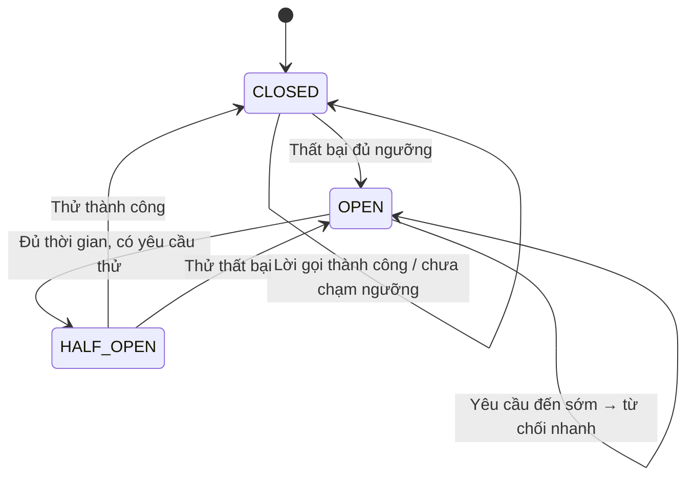
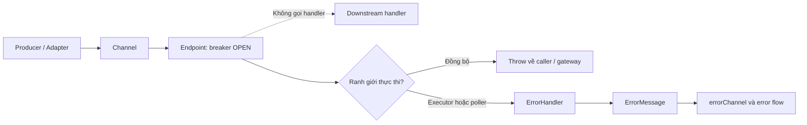
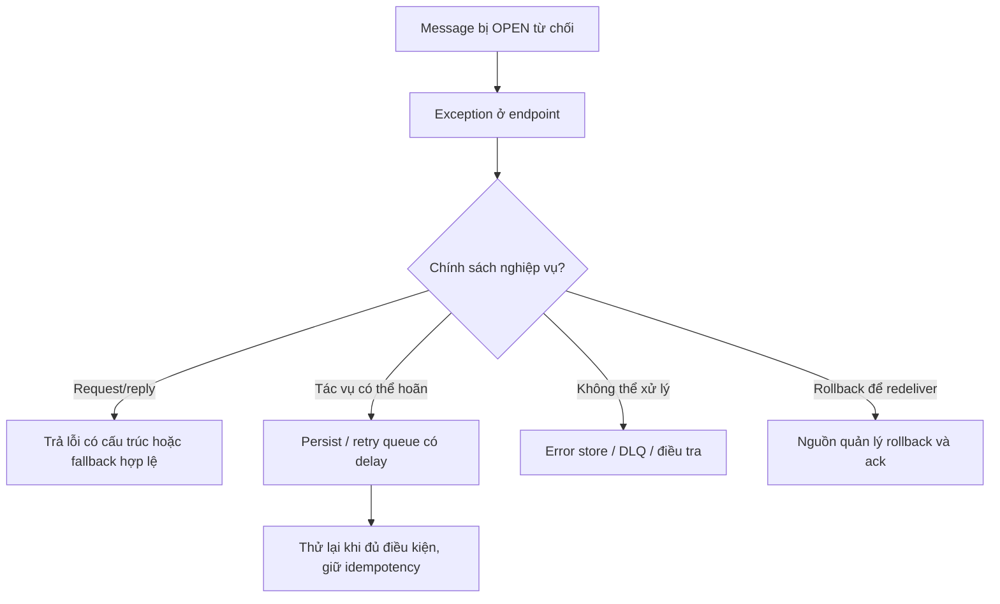

# Circuit breaker advice và trạng thái mở trong Spring Integration

## Mục tiêu học tập

Trong một `IntegrationFlow`, một handler có thể gọi REST API, database, broker hoặc hệ thống bên ngoài. Nếu phía downstream đang lỗi, việc để mọi message tiếp tục truy cập rồi lần lượt timeout sẽ chiếm hết thread, lấp đầy hàng đợi, kéo dài độ trễ và có thể khiến lỗi lan sang các thành phần khác. **Circuit breaker** là cơ chế phát hiện chuỗi thất bại và tạm ngăn những lời gọi tiếp theo vào tài nguyên đang gặp vấn đề.

Bài này thuộc chương **Advice chain** của module **SPRING_INTEGRATION_RUNTIME**. Chủ đề trực tiếp là **Circuit breaker advice và trạng thái mở**. Ta sẽ xem cách Spring Integration điều phối message qua channel, endpoint, consumer, poller và executor khi breaker chuyển trạng thái; đồng thời kết nối với retry, recovery, transaction, message store, error flow, correlation và quan sát runtime.

Sau khi học, bạn có thể:

- Giải thích ba trạng thái logic **CLOSED**, **OPEN**, **HALF_OPEN**, đặc biệt là tác động của **OPEN** lên message flow.
- Mô tả các tham số `threshold`, `halfOpenAfter`, `failCountReset` của `RequestHandlerCircuitBreakerAdvice` và hành vi khi chúng phối hợp.
- Gắn circuit breaker vào một endpoint bằng Java DSL, xác định chính xác phần công việc được bảo vệ.
- Phân tích thứ tự circuit breaker với retry, recovery, transaction advice và hệ quả đối với số lần gọi downstream.
- Chẩn đoán vì sao một message bị từ chối ngay, không xuất hiện trong log downstream, hoặc có `ErrorMessage` dù handler thực tế chưa chạy.
- Kiểm thử, đo đạc và vận hành breaker an toàn trong hệ thống nhiều thread, nhiều instance và có cơ chế redelivery.

## 1. Circuit breaker bảo vệ điều gì?

Circuit breaker thường được đặt quanh một **thao tác có rủi ro thất bại lặp** như gọi hệ thống tồn kho:

```text
Order message
   -> DirectChannel / ExecutorChannel / Poller
   -> Consumer endpoint
   -> [Circuit breaker advice]
   -> MessageHandler
   -> Inventory API
```

Khi breaker đóng (**CLOSED**), lời gọi được cho đi qua. Nếu handler liên tiếp gặp lỗi đủ để chạm ngưỡng, breaker mở (**OPEN**) và những lời gọi tiếp theo bị từ chối nhanh mà **không thực thi handler được bảo vệ**. Sau một khoảng thời gian, lời gọi thử phục hồi được cho phép trong pha **HALF_OPEN**; kết quả sẽ quyết định quay về CLOSED hay tiếp tục OPEN.

Đừng nhầm breaker với retry:

| Cơ chế | Câu hỏi nó trả lời | Hành vi khi downstream lỗi |
| --- | --- | --- |
| **Retry** | Một yêu cầu được thử lại bao nhiêu lần? | Lặp lại handler theo chính sách số lần, exception và backoff |
| **Circuit breaker** | Có nên cho yêu cầu mới chạm downstream lúc này? | Quan sát thất bại, mở mạch và từ chối nhanh những lời gọi mới |
| **Timeout** | Một lần gọi được chờ lâu bao nhiêu? | Kết thúc thao tác nếu không nhận kết quả đúng hạn |
| **Bulkhead / concurrency limit** | Tối đa bao nhiêu lời gọi đồng thời được phép? | Giới hạn concurrency để một downstream không chiếm hết worker |
| **Recovery / fallback** | Sau thất bại hoặc bị từ chối thì xử lý message ra sao? | Trả kết quả thay thế, phát lỗi, lưu lại hoặc gửi sang luồng xử lý khác |

Circuit breaker **không tự** bổ sung timeout, giới hạn đồng thời, retry, fallback hoặc dead-letter queue. Mỗi cơ chế cần có cấu hình và một hợp đồng nghiệp vụ cụ thể.

### 1.1. Tại sao trạng thái OPEN quan trọng?

Giả sử một endpoint nhận 100 message/giây, API tồn kho đang timeout sau 5 giây và thread pool chỉ có 20 worker. Nếu tiếp tục gửi mọi request, worker dễ bị giữ trong các lời gọi đang đợi, backlog tăng và gateway có thể timeout hàng loạt.

Khi breaker mở, các message mới bị **fail fast** tại điểm advice. Việc từ chối này cũng là một thất bại nghiệp vụ cần xử lý, nhưng nó tránh bổ sung tải xuống hệ thống đang hỏng và giảm thời gian chiếm dụng thread cho mỗi message. Vì thế **OPEN có thể là cơ chế bảo vệ đang hoạt động đúng**, không nhất thiết là lỗi mới ở chính circuit breaker.

Lợi ích thực tế vẫn phụ thuộc vị trí breaker: nếu có một transformer tốn CPU hoặc một adapter gọi mạng **trước** endpoint được bọc, những phần đó đã chạy trước khi breaker kịp từ chối.

## 2. Vòng đời CLOSED → OPEN → HALF_OPEN



Đây là **mô hình logic** để học và quan sát hệ thống. Chi tiết lưu trạng thái, tính thời gian và xử lý đồng thời tùy implementation/phiên bản; không nên tự suy ra một tác vụ nền tự động chuyển trạng thái mà chưa kiểm tra cấu hình cụ thể.

### 2.1. CLOSED: lời gọi đi qua và thất bại được đếm

Trong trạng thái bình thường, handler được thực thi. Lỗi mà advice nhìn thấy có thể đóng góp vào bộ đếm thất bại. Khi số lỗi đạt ngưỡng, breaker chuyển sang OPEN.

- Một **exception đã bị handler bắt rồi nuốt** có thể khiến breaker quan sát kết quả như một lời gọi thành công.
- Exception sinh ra **trước khi đến endpoint** gắn advice sẽ không được breaker của endpoint ấy đếm.
- Nếu advice nằm **ngoài** retry, một chuỗi nhiều attempt có thể được thấy như **một** kết quả thất bại cuối cùng.
- Nếu advice nằm **bên trong** retry, từng attempt đi qua breaker có thể ảnh hưởng tới bộ đếm.

Vì vậy, “3 lỗi” nghĩa là **3 thất bại mà advice nhận thấy tại vị trí nó bao quanh**, không nhất thiết bằng 3 HTTP request, 3 message gốc hoặc 3 bản ghi trong log.

### 2.2. OPEN: từ chối trước khi handler chạy

Ở OPEN, breaker thường ném một lỗi cho biết mạch đang mở ngay khi message đến vị trí được bảo vệ. Hệ quả:

1. Handler downstream được bọc **không được gọi** cho message bị chặn.
2. Caller đồng bộ có thể thấy exception nhanh, sau khi đi qua các lớp bọc của Spring Messaging.
3. Nếu lỗi xảy ra ở thread executor/poller, error handler tại biên đó có thể tạo `ErrorMessage` và định tuyến sang error channel.
4. Nếu flow có transaction, retry hoặc recovery bên ngoài advice, quyết định commit, rollback, retry tiếp và ack còn phụ thuộc các lớp đó.
5. Không có cơ chế tự động “giữ lại message đến khi mạch đóng” chỉ vì breaker đang OPEN; muốn hoãn xử lý cần queue/retry scheduler hoặc storage phù hợp.

Đặc biệt: **OPEN không đồng nghĩa với inbound adapter ngừng nhận message**. Nó chỉ thay đổi việc cho chạy đoạn handler mà advice bao quanh. Nguồn vẫn có thể gửi nhiều message tới endpoint, khiến những message ấy lần lượt bị từ chối.

### 2.3. HALF_OPEN: kiểm tra khả năng phục hồi

Sau khoảng `halfOpenAfter`, breaker có thể cho phép một hoặc một số yêu cầu thử đi qua, tùy thuật toán của implementation. Nếu thử thành công, breaker quay về CLOSED; nếu lại thất bại, breaker trở về OPEN và tiếp tục giai đoạn bảo vệ.

**Đừng mặc nhiên giả định đúng một probe đồng thời trên mọi phiên bản/cấu hình.** Trong hệ thống nhiều worker, nhiều message có thể đến sát thời điểm đủ điều kiện; cần kiểm chứng hành vi cạnh tranh của implementation nếu yêu cầu giới hạn probe nghiêm ngặt. Nếu cần cô lập số request thử, cân nhắc thêm giới hạn concurrency/bulkhead hoặc một cơ chế breaker chuyên biệt có hợp đồng concurrency rõ ràng.

Trong nhiều implementation, khoảng thời gian `halfOpenAfter` là điều kiện để **lời gọi tiếp theo** thử phục hồi. Nếu không có message mới, không nhất thiết có một background job tự gọi downstream và chuyển trạng thái.

## 3. Ba tham số của RequestHandlerCircuitBreakerAdvice

Spring Integration cung cấp `RequestHandlerCircuitBreakerAdvice` để áp dụng circuit breaker ở ranh giới handler. Ba tham số thường dùng:

| Thuộc tính | Ý nghĩa | Giá trị minh họa |
| --- | --- | --- |
| `threshold` | Số lần thất bại được advice quan sát để mở mạch | `3` |
| `halfOpenAfter` | Thời gian chờ sau khi mạch mở trước khi cho phép thử phục hồi | `10_000` ms (10 giây) |
| `failCountReset` | Khoảng thời gian dùng để đặt lại bộ đếm lỗi đã tích lũy khi chưa đủ điều kiện mở mạch | `30_000` ms (30 giây) |

Cần phân biệt **`halfOpenAfter` không phải thời gian API timeout** và **`failCountReset` không phải thời điểm tự đóng một mạch OPEN**.

### 3.1. Ví dụ theo dòng thời gian

Giả sử `threshold=3`, `halfOpenAfter=10s`, `failCountReset=30s`. Bỏ qua concurrent requests để chỉ tập trung vào ý nghĩa logic:

| Thời điểm | Sự kiện ở endpoint được bọc | Quan sát |
| --- | --- | --- |
| `t=0s` | Message A gọi API và lỗi | CLOSED; tích lũy thất bại |
| `t=1s` | Message B gọi API và lỗi | CLOSED; chưa đủ ngưỡng |
| `t=2s` | Message C gọi API và lỗi | Đủ `threshold`; chuyển OPEN |
| `t=3s` | Message D đến | Bị chặn nhanh; không gọi API |
| `t=8s` | Message E đến | Vẫn chưa tới lúc thử phục hồi; tiếp tục từ chối |
| `t≈12s+` | Message F đến sau khoảng chờ | Có thể được dùng làm lời gọi thử HALF_OPEN |
| Sau F thành công | API có phản hồi hợp lệ | Breaker quay về CLOSED |
| Sau F thất bại | API tiếp tục lỗi | Breaker mở lại và bắt đầu thời gian chờ mới |

`failCountReset` hữu ích cho trường hợp các lỗi rải rác khi breaker chưa mở. Ví dụ một lỗi xuất hiện rồi thời gian dài không có lỗi nữa: không nhất thiết cộng mãi lỗi cũ vào số lỗi mới để cuối cùng mở mạch vì những lần hỏng cách nhau rất xa. Chi tiết tính mốc đặt lại đếm lỗi cần đối chiếu phiên bản/cấu hình đang dùng; đừng xem nó là một cửa sổ thống kê tùy ý giống mọi thư viện breaker khác.

### 3.2. Tham số phải phản ánh lưu lượng và mục tiêu phục hồi

Với luồng 10 request/ngày, `threshold=3` có thể tích lũy chậm; với luồng 20.000 request/giây, ba lỗi có thể xuất hiện trong tích tắc. Vì vậy chọn tham số dựa trên **lưu lượng và mức độ lỗi thường gặp**, không copy một bộ giá trị cho mọi endpoint.

Trả lời các câu hỏi:

- Downstream có timeout client là bao nhiêu? Trạng thái OPEN xuất hiện trước khi quá nhiều worker bị giữ lại hay không?
- Tỉ lệ lỗi tự nhiên của dịch vụ là bao nhiêu, và bao nhiêu lỗi liên tiếp mới chứng minh dịch vụ đang hỏng?
- Cần chờ bao lâu trước khi thử phục hồi để tránh liên tục làm quá tải downstream?
- Nếu downstream hỗ trợ maintenance window hoặc `Retry-After`, cách điều chỉnh chính sách phục hồi nào phù hợp?
- Khi OPEN, message sẽ được trả lỗi ngay, xếp hàng có kiểm soát hay ghi vào kho chờ xử lý?

## 4. Gắn circuit breaker advice vào IntegrationFlow

Ví dụ Spring Integration 6.x dưới đây cho handler gọi API giữ tồn kho. Nó dùng `RequestHandlerCircuitBreakerAdvice` trên endpoint xử lý message, cho thấy chính xác vị trí breaker bao quanh.

```java
import org.springframework.beans.factory.annotation.Qualifier;
import org.springframework.context.annotation.Bean;
import org.springframework.context.annotation.Configuration;
import org.springframework.integration.channel.DirectChannel;
import org.springframework.integration.config.EnableIntegration;
import org.springframework.integration.dsl.IntegrationFlow;
import org.springframework.integration.handler.advice.RequestHandlerCircuitBreakerAdvice;
import org.springframework.messaging.MessageChannel;
import org.springframework.messaging.MessageHandler;

@Configuration
@EnableIntegration
class InventoryIntegrationConfig {

    record ReserveStock(String sku, int quantity) {}

    interface InventoryClient {
        void reserve(String sku, int quantity);
    }

    @Bean("stockInput")
    MessageChannel stockInput() {
        return new DirectChannel();
    }

    @Bean("inventoryCircuitBreaker")
    RequestHandlerCircuitBreakerAdvice inventoryCircuitBreaker() {
        RequestHandlerCircuitBreakerAdvice breaker =
                new RequestHandlerCircuitBreakerAdvice();

        breaker.setThreshold(3);
        breaker.setHalfOpenAfter(10_000);
        breaker.setFailCountReset(30_000);
        return breaker;
    }

    @Bean
    IntegrationFlow stockReservationFlow(
            @Qualifier("stockInput") MessageChannel input,
            InventoryClient inventoryClient,
            @Qualifier("inventoryCircuitBreaker")
                    RequestHandlerCircuitBreakerAdvice breaker) {

        MessageHandler reserveHandler = message -> {
            ReserveStock request =
                    (ReserveStock) message.getPayload();
            inventoryClient.reserve(request.sku(), request.quantity());
        };

        return IntegrationFlow.from(input)
                .handle(reserveHandler, endpoint -> endpoint.advice(breaker))
                .get();
    }
}
```

Để chạy ví dụ phải có bean `InventoryClient` thực sự, dependency Spring Integration và thiết lập Spring context phù hợp. `ReserveStock` có thể thay bằng DTO của ứng dụng; code cố ý dùng `MessageHandler` đơn hướng để tập trung vào circuit breaker.

Hãy chú ý những điểm sau:

1. `stockInput` là `DirectChannel`, vì vậy trong cấu hình này luồng xử lý đồng bộ với thread gọi `send()`.
2. Breaker được gắn **tại handler endpoint**, nên nó có thể ngăn `inventoryClient.reserve(...)` được gọi.
3. Code tạo DTO, xác thực đầu vào hoặc thực hiện I/O **trước** endpoint vẫn có thể chạy kể cả khi breaker OPEN.
4. Advice giữ trạng thái ở **instance được cấu hình**. Việc dùng chung một bean breaker cho các endpoint không liên quan có thể khiến chúng cùng chịu một bộ đếm/lịch sử lỗi. Thường nên tách theo dependency hoặc phạm vi bảo vệ cần thiết.
5. Nếu handler tự bắt lỗi API và chỉ log rồi trả về bình thường, breaker có thể không thấy thất bại. Hãy quyết định rõ exception nào phải đi qua advice và exception nào được chuyển thành kết quả hợp lệ.

### 4.1. Một producer gửi message vào flow

```java
import org.springframework.messaging.Message;
import org.springframework.messaging.MessageChannel;
import org.springframework.messaging.support.MessageBuilder;

// stockInput được inject từ Spring context.
Message<InventoryIntegrationConfig.ReserveStock> message =
        MessageBuilder
                .withPayload(
                        new InventoryIntegrationConfig.ReserveStock("SKU-42", 2))
                .setHeader("correlationId", "order-42")
                .setHeader("businessKey", "order-42")
                .build();

stockInput.send(message);
```

Trong trạng thái CLOSED, `send()` thường đi vào handler và đợi hoàn tất. Khi breaker OPEN, `send()` có thể nhận exception nhanh theo call stack. Cần bắt ngoại lệ ở biên gọi phù hợp và xác định trả lỗi/ghi chờ xử lý theo hợp đồng của ứng dụng.

Để quan sát **handler thực sự được gọi bao nhiêu lần**, tăng counter ngay trước `inventoryClient.reserve(...)`. Khi OPEN, số message vào có thể tiếp tục tăng trong khi số lần gọi client không đổi; đây là dấu hiệu đúng của fail fast.

### 4.2. Breaker có bao cả một IntegrationFlow không?

Không mặc nhiên. Advice chỉ bao vùng **endpoint được gắn**, ví dụ:

```text
input
  -> validate()                      # không nằm trong breaker
  -> transform()                     # không nằm trong breaker
  -> handle(inventoryClient)         # được breaker bảo vệ
  -> routeToNextEndpoint()           # không nằm trong breaker
```

Nếu transformer lỗi khi map JSON, breaker đặt ở `handle(inventoryClient)` chưa từng được gọi nên không tăng failure count. Nếu endpoint sau handler lỗi, cũng không tự cộng vào breaker của handler tồn kho. Muốn bảo vệ một tác vụ lớn hơn, thiết kế ranh giới invocation/handler có chủ đích, rồi kiểm tra ảnh hưởng với transaction và side effect.

## 5. OPEN trong DirectChannel, ExecutorChannel và poller

Trạng thái OPEN tạo lỗi ở vị trí advice, nhưng **ai nhận lỗi** phụ thuộc vào thread đang thực thi:

| Cách endpoint được gọi | Khi OPEN | Ai có thể quan sát lỗi? | Điểm cần kiểm tra |
| --- | --- | --- | --- |
| `DirectChannel` đồng bộ | Advice từ chối trong thread của sender | Caller `send()` hoặc upstream gateway đồng bộ | Stack exception, latency, transaction hiện tại |
| Sau `ExecutorChannel` | Worker nhận message rồi gặp từ chối tại advice | Error handler ở worker có thể publish `ErrorMessage` | Header `errorChannel`, channel mặc định, queue backlog |
| Consumer do poller kích hoạt | Lượt poll gọi endpoint và bị từ chối | Poller error handler, transaction/source | Ack, rollback, khả năng nhận lại message |
| Message-driven inbound adapter | Thread/container của adapter gọi endpoint | Error policy của adapter và broker | Redelivery, nack/ack, DLQ và delay |
| Gateway request/reply | Lỗi xảy ra ở flow phục vụ gateway | Gateway caller, error flow hoặc timeout tùy cấu hình | `errorChannel`, `replyChannel`, timeout và fallback |



Sơ đồ là **các đường đi tùy cấu hình**, không phải tất cả nhánh xảy ra đồng thời. Một exception đồng bộ **không tự được xuất bản** vào error channel chỉ vì message có header `errorChannel`. Phải có thành phần bắt exception và publish `ErrorMessage`.

### 5.1. OPEN không tự làm dừng inbound adapter

Nếu consumer nhận message từ broker theo cơ chế đẩy, broker vẫn có thể gửi message cho container. Advice có thể từ chối mọi lần xử lý, và adapter có thể redeliver liên tục nếu transaction rollback hoặc nack. Đây có thể thành một **vòng lặp nóng**, dù breaker đang bảo vệ downstream thành công.

Giải pháp tùy nguồn: backoff ở listener container, giới hạn redelivery, retry queue có delay, pause/resume consumer, DLQ hoặc lưu message vào kho chờ xử lý. Chọn cơ chế phù hợp thay vì tự động retry ngay một lỗi OPEN.

### 5.2. OPEN không tự động “khóa” toàn bộ message queue

Một `QueueChannel`, broker queue hoặc message store nằm **trước** endpoint có thể tiếp tục tích lũy message. Breaker quyết định có thực thi handler hay không, nhưng không bảo đảm mỗi message đang chờ được xử lý an toàn sau khi đóng mạch. Cần xác định dung lượng queue, TTL, thứ tự, khả năng duplicate và cách tiêu thụ khi downstream phục hồi.

## 6. Circuit breaker trong advice chain: thứ tự thay đổi ý nghĩa

Một endpoint có thể có nhiều advice: retry, breaker, transaction và advice quan sát/log. **Thứ tự bọc quyết định advice nào nhìn thấy exception nào**, bao nhiêu lần và trong phạm vi transaction nào.

### 6.1. Breaker nằm ngoài retry

```text
CircuitBreakerAdvice                 <- thấy outcome cuối của vòng retry
  -> RetryAdvice                    <- có thể gọi handler nhiều lần
      -> Handler -> Inventory API
```

Giả sử retry cho tối đa 3 attempts và breaker có `threshold=2`. Nếu mỗi message đều đi qua 3 attempts rồi thất bại, breaker nằm ngoài thường nhìn thấy **một kết quả thất bại cho mỗi invocation**. Sau hai invocation thất bại, breaker có thể mở. Số HTTP request thực tế có thể là 6 trước khi OPEN.

Ưu điểm: breaker đo tình trạng một yêu cầu sau khi đã thử phục hồi trong ngân sách retry. Nhược điểm: các attempts tiêu tốn thời gian và có thể tiếp tục gây tải khi API đã quá tải.

**Cẩn thận với recovery:** nếu RetryAdvice phía trong dùng `RecoveryCallback` bắt lỗi và trả về như thành công, breaker phía ngoài có thể quan sát thành công, làm sai số liệu nếu chính sách muốn đếm lỗi gốc. Recovery và fallback phải được thiết kế như một kết quả có nghĩa rõ ràng.

### 6.2. Retry nằm ngoài breaker

```text
RetryAdvice
  -> CircuitBreakerAdvice           <- thấy từng attempt đi qua
      -> Handler -> Inventory API
```

Khi handler lỗi liên tiếp, breaker có thể tăng failure count nhanh hơn và mở **ngay trong một lượt retry**. Những attempt tiếp theo có thể bị từ chối bởi OPEN thay vì gọi API. Retry policy phía ngoài cũng có thể nhìn thấy lỗi OPEN và thử lại chính lời gọi bị chặn; nếu retry ngay không có backoff phù hợp, ứng dụng chỉ lặp các lỗi từ chối.

Điều cần làm: phân loại exception OPEN như một tín hiệu **không nên retry ngay**, hoặc dùng retry delay phù hợp với thời gian phục hồi. Đừng mặc nhiên cho phép retry toàn bộ `RuntimeException`.

### 6.3. So sánh bằng bảng

| Lựa chọn | Điều breaker thường đếm | Khi nào hợp lý | Rủi ro |
| --- | --- | --- | --- |
| Breaker ngoài retry | Kết quả của cả lần xử lý có retry | Cần đánh giá độ tin cậy sau khi đã dùng retry budget | Một message có thể tạo nhiều request trước khi breaker mở |
| Breaker trong retry | Thất bại của từng attempt tới breaker | Cần cắt tải xuống nhanh khi downstream lỗi liên tục | Dễ mở mạch ngay giữa retry; exception OPEN có thể bị retry lặp |
| Breaker ngoài recovery nuốt exception | Có thể thấy kết quả bình thường thay vì thất bại thật | Recovery thực sự tạo kết quả hợp lệ | Che khuất thất bại của downstream |
| Breaker bao cả transaction | Thấy lỗi từ đơn vị transaction nằm bên trong | Cần giám sát kết quả toàn bộ thao tác | Dễ trộn lỗi DB/validation vào bộ đếm của API ngoài |

Trong DSL, endpoint cho phép đưa advice vào chain, ví dụ `endpoint.advice(breaker, retryAdvice)`; tuy nhiên cần xác minh bằng **test quan sát thứ tự invocation thực tế** của phiên bản framework và cơ chế advice được sử dụng trước khi kết luận một advice là lớp ngoài hay lớp trong. Bảng trên mô tả **hai cấu trúc lồng nhau**, không khẳng định thứ tự tên tham số tự động tương ứng với thứ tự thực thi trong mọi cấu hình.

### 6.4. Transaction advice ở đâu?

Có hai mô hình khác nhau:

```text
A. TransactionAdvice
      -> CircuitBreakerAdvice
           -> Handler

B. CircuitBreakerAdvice
      -> TransactionAdvice
           -> Handler
```

Ở A, khi breaker OPEN, transaction có thể đã được mở trước khi advice từ chối. Ở B, lỗi OPEN xảy ra trước khi vùng transaction bên trong được vào. Tính chất chính xác phụ thuộc Spring transaction advice, propagation và cấu hình endpoint.

Đặc biệt, handler ghi database rồi gọi API có thể tạo side effect dở dang nếu API timeout nhưng transaction DB rollback hoặc ngược lại. Breaker chỉ quyết định việc cho gọi handler, **không cung cấp exactly-once**. Dùng khóa idempotency, transaction phù hợp và nếu cần thì outbox/saga hoặc compensation cho các hệ thống độc lập.

## 7. Phân loại exception và tín hiệu OPEN

Một lỗi timeout ở Inventory API và một lỗi validate đơn hàng không nên có cùng tác động tới mạch bảo vệ API. Tuy nhiên, đừng giả định `RequestHandlerCircuitBreakerAdvice` luôn cung cấp đầy đủ mọi quy tắc phân loại exception tinh vi của thư viện resilience khác.

**Các vấn đề cần cân nhắc ở vùng được bọc:**

- Timeout, connection reset hoặc lỗi 503 thường biểu thị downstream không khỏe và có thể đáng tính là thất bại.
- Validation lỗi, thiếu trường và sai kiểu xảy ra ngay trong handler **có thể bị advice quan sát là lỗi** nếu exception đi qua cùng vùng.
- Exception bị bọc bởi `MessagingException` hoặc exception của client khiến phân loại theo class ngoài cùng có thể sai lệch.
- Một HTTP response báo lỗi nhưng client được viết để trả đối tượng `Result.error(...)` bình thường sẽ không tự biến thành exception để breaker thấy thất bại.
- Exception được catch rồi bỏ qua trước ranh giới advice cũng không được đếm.

Giải pháp thiết kế thường là **đặt breaker sát đoạn gọi downstream** và giữ validate dữ liệu ở bước trước. Nếu cần quy tắc đặc thù như “chỉ tính 5xx, bỏ qua 4xx”, hãy chuẩn hóa tín hiệu kết quả ở adapter, xem xét advice/classifier được tùy biến hoặc một breaker chuyên dụng đáp ứng hợp đồng; không tự suy diễn rằng mọi property có sẵn trên Spring Integration breaker.

### 7.1. Kết quả “mạch mở” phải được phân biệt với “downstream gọi thất bại”

Hai trường hợp có dấu vết khác nhau:

```text
CLOSED -> Handler invoked -> API timeout          # downstream call thực hiện rồi thất bại
OPEN   -> Breaker rejects -> Handler not invoked  # không có downstream call
```

Trong error record và monitoring, nên lưu hai loại nguyên nhân: **execution failure** và **short-circuit rejection**. Nếu gom cả hai vào một chỉ số “API failure”, hệ thống có thể hiểu sai rằng downstream vẫn nhận request liên tục khi thực ra breaker đang chặn chúng.

Mặt khác, nếu mạch mở trên nhiều replica ứng dụng, tổng số từ chối có thể rất lớn dù số downstream calls thấp. Đây là trạng thái cần theo dõi để điều chỉnh retry queue, thời gian half-open và cảnh báo người vận hành.

## 8. OPEN, error flow, fallback và message store

Một breaker OPEN thường phát sinh exception ngay ở điểm advice. Cách **xử lý message sau từ chối** phải được quyết định rõ:



Với một gateway đồng bộ, fallback hợp lệ có thể là “hàng đang chờ xác nhận, tra lại sau”, nhưng chỉ nếu contract API cho phép. Không được trả “đặt hàng thành công” chỉ vì breaker đã từ chối gọi hệ thống tồn kho.

Với flow bất đồng bộ, error handler của executor/poller có thể đưa exception vào `ErrorMessage`. Khi xử lý:

- Xem `ErrorMessage.getPayload()` để biết exception; truy `getCause()` nếu bị wrapper.
- Lấy `getOriginalMessage()` hoặc `MessagingException.getFailedMessage()` nếu có; cả hai có thể `null`.
- Giữ `businessKey`, `correlationId`, tên endpoint, thời điểm, trạng thái thử lại và reason code.
- Ghi lỗi vào nơi bền vững nếu cần phát lại sau restart; log hoặc channel trong bộ nhớ không phải một DLQ bền vững.
- Quy định ai sở hữu ack/rollback; **error flow xử lý xong không đồng nghĩa tự động ack hay rollback message nguồn**.

Ví dụ một record lưu lỗi để replay:

```json
{
  "businessKey": "order-42",
  "correlationId": "corr-42",
  "endpoint": "stockReservationFlow",
  "reason": "CIRCUIT_OPEN",
  "firstSeenAt": "2026-11-20T10:00:00Z",
  "nextEligibleAt": "2026-11-20T10:00:10Z",
  "attempt": 1,
  "status": "DEFERRED"
}
```

Đây là **một schema ứng dụng minh họa**, không phải JSON do Spring Integration tự tạo. `nextEligibleAt` là thời điểm lịch xử lý do ứng dụng quyết định, không nhất thiết bằng một API đọc trạng thái nội bộ breaker. Nếu worker phát lại quá sớm, breaker vẫn OPEN và message có thể bị chặn tiếp.

### 8.1. Recovery không được che lỗi ngoài ý muốn

Giả sử advice recovery phía ngoài catch tất cả exception, ghi log rồi trả về bình thường. Với một inbound adapter sử dụng transaction, luồng xử lý có thể trông như đã hoàn tất và adapter có thể ack/commit, khiến message bị mất khỏi nguồn dù nghiệp vụ chưa xử lý.

Một policy có thể chấp nhận “đã ghi vào error store bền vững nên được ack”; nhưng phải xác minh việc ghi thành công **trước** khi cho phép nguồn kết thúc lượt xử lý. Trường hợp chưa ghi lỗi được thì nên giữ đường thất bại để cơ chế nguồn xử lý lại theo contract.

## 9. Threading, instance và trạng thái breaker thực tế

### 9.1. Một breaker là trạng thái ở đâu?

`RequestHandlerCircuitBreakerAdvice` là một advice có trạng thái runtime, thường được quản lý trong instance bean của application context. Khi chạy nhiều node/pod, mỗi node thường có instance breaker và bộ đếm riêng trừ khi bạn chủ động xây dựng cơ chế chia sẻ trạng thái.

Ví dụ:

```text
Pod A: breaker OPEN      -> chặn các call đi qua A
Pod B: breaker CLOSED    -> vẫn có thể gọi downstream qua B
Pod C: breaker HALF_OPEN -> cho call thử phục hồi qua C
```

Điều này có nghĩa biểu đồ trung bình toàn cụm có thể che khuất trạng thái từng instance. Cảnh báo nên có cả số lượng reject theo instance/endpoint và tình trạng thực của downstream. Restart một process có thể tạo advice instance mới với trạng thái ban đầu; đừng coi thời điểm restart là bằng chứng hệ thống ngoài đã phục hồi.

### 9.2. Concurrency và half-open probe

Trạng thái có thể thay đổi khi nhiều worker đang thực thi gần đồng thời. Một số request có thể **đã vượt qua breaker** và đang chạy lúc một request khác đẩy trạng thái sang OPEN. Mạch mở không thể hủy tự động các I/O call đã bắt đầu. Khi đo “sau OPEN vẫn có một vài request tới API”, cần phân biệt request đang in-flight với request mới bắt đầu.

Nếu cần bảo đảm chỉ một probe tại HALF_OPEN hoặc chỉ tối đa N request đồng thời, kiểm tra hành vi của phiên bản advice đang dùng và bổ sung concurrency limiter phù hợp. Không nhầm breaker với semaphore.

### 9.3. OPEN vẫn có thể làm hệ thống nghẽn

Breaker giảm tải xuống dependency, nhưng backlog trước endpoint có thể tiếp tục tăng nếu inbound vẫn nhận message nhanh, retry policy cứ gọi lại lỗi OPEN hoặc error flow đồng bộ làm I/O chậm. Cần giám sát:

- Message rate theo từng channel và endpoint.
- Queue depth, queue age, retry queue, DLQ và thời gian chờ của message.
- Thread pool: active, pool size, queued, rejected.
- Tỷ lệ execution failure, short-circuit rejection, half-open trial và recovery success.
- Latency của downstream call **thực sự được thực hiện** so với latency của request bị từ chối nhanh.

## 10. Theo dõi trạng thái và điều tra incident

Không nên giả định một dashboard mặc định luôn hiển thị chính xác `OPEN/HALF_OPEN/CLOSED` của mỗi instance advice. Khả năng lộ trạng thái/metrics phụ thuộc phiên bản Spring Integration, cấu hình management/observability và instrumentation của ứng dụng. Nếu cần SLO, hãy đặt instrumentation tại ranh giới endpoint và thử nghiệm xem các tín hiệu có phân biệt được thất bại gốc với từ chối do breaker.

| Tín hiệu | Nên đo | Cách diễn giải |
| --- | --- | --- |
| `handler.invoked` | Số lời gọi thực đến handler | Khi OPEN, có thể gần như đứng yên |
| `handler.failure` | Lỗi của handler khi đã chạy | Phản ánh downstream hoặc logic handler |
| `circuit.rejected` | Số message bị từ chối nhanh | Tăng trong thời gian OPEN |
| `circuit.recovered` | Các lần thử sau chờ mà thành công | Cho thấy nhánh phục hồi có hoạt động |
| `errorFlow.persisted` | Lỗi đã lưu để xử lý lại | Đảm bảo message không bị thất lạc |
| `queue.depth` và `queue.age` | Backlog và thời gian chờ | Tránh để breaker bảo vệ API nhưng làm đầy bộ nhớ |
| `downstream.latency` | Chỉ lời gọi thực sự chạm API | Tìm dấu hiệu dependency chậm/lỗi |
| `attempt.count` / `delivery.count` | Retry trong handler và redelivery từ nguồn | Phát hiện nhiều tầng retry nhân số lần gọi |

Tên metric trong bảng là **gợi ý naming khi tự instrument**, không phải khẳng định tất cả là metric có sẵn của Spring Integration. Dùng endpoint ID, instance ID và exception type làm dimension có giới hạn cardinality; gắn `correlationId` vào log/tracing thay vì đưa một giá trị riêng cho từng message làm nhãn metric.

### 10.1. Quy trình chẩn đoán “lỗi OPEN liên tục”

1. **Xác định vị trí:** endpoint/advice bean nào đang từ chối? Nó bảo vệ dependency gì?
2. **Xác minh nguồn gốc:** trước khi OPEN có lỗi timeout, 5xx, DB lock hay lỗi validation? Cause chain có bị wrapper che không?
3. **Kiểm tra tham số:** `threshold`, `halfOpenAfter`, `failCountReset`, timeout client, policy retry, thứ tự advice.
4. **So sánh với thực tế:** có message mới sau thời gian half-open không? Lời gọi thử có thành công hay lại thất bại?
5. **Kiểm tra nhiều instance:** trạng thái và exception rate có khác nhau giữa các pod không?
6. **Kiểm tra backpressure:** executor, queue, poller, source redelivery và DLQ có đang bị bão hòa không?
7. **Xác minh đường phục hồi:** message bị từ chối đã được trả lỗi đúng hợp đồng, lưu an toàn hoặc phát lại có idempotency chưa?

Ví dụ log có ích:

```text
time=... instance=pod-a endpoint=stockReservationFlow
businessKey=order-42 correlationId=corr-42
outcome=SHORT_CIRCUITED handlerInvoked=false

time=... instance=pod-b endpoint=stockReservationFlow
businessKey=order-43 correlationId=corr-43
outcome=DOWNSTREAM_FAILURE handlerInvoked=true cause=SocketTimeoutException
```

Log này chỉ minh họa các trường ứng dụng tự ghi. Không ghi toàn bộ payload chứa thông tin cá nhân hoặc token nếu không cần thiết cho điều tra.

## 11. Những sai lầm phổ biến

| Hiện tượng | Nguyên nhân hoặc hiểu nhầm | Cách khắc phục |
| --- | --- | --- |
| “Breaker OPEN nghĩa là Spring Integration ngừng nhận message” | Breaker chỉ chặn endpoint được gắn | Kiểm tra input source, queue và policy cho message bị từ chối |
| “Đủ `halfOpenAfter` thì tự động gọi API thử” | Không có message mới hoặc không có scheduler thử riêng | Kiểm tra lần invocation tiếp theo và cơ chế half-open thực tế |
| “Đã bật breaker thì không cần timeout” | Một request đang được phép đi qua vẫn có thể treo | Cấu hình timeout rõ tại HTTP/DB client |
| “Một lỗi validation làm mở circuit đúng” | Validation đặt trong vùng bảo vệ downstream | Dời validation ra trước; chuẩn hóa exception và policy |
| “Có 5 lần HTTP timeout nhưng breaker chỉ thấy 1 lỗi” | Retry nằm bên trong breaker | Đo cả attempts và invocation; kiểm tra advice order |
| “Khi OPEN, errorChannel luôn nhận message” | Flow đồng bộ và không có publisher lỗi | Xác định caller, executor/poller error handler hoặc recovery |
| “Mạch đã đóng nên đơn hàng chắc đã thành công” | Kết quả half-open thành công không xác nhận các message cũ | Kiểm tra trạng thái nghiệp vụ và replay có kiểm soát |
| “Restart pod là đã sửa lỗi API” | State của breaker có thể được khởi tạo lại | Điều tra tình trạng dependency thay vì dựa vào trạng thái process |
| “Recovery đã log là có thể ack message” | Log không phải error store bền vững | Chỉ ack theo hợp đồng khi đã ghi nhận/khôi phục thành công |
| “Dùng một bean breaker cho mọi API đều ổn” | Các endpoint có thể chia sẻ một state/bộ đếm | Tách breaker theo dependency và phạm vi bảo vệ |

## 12. Thực hành có hướng dẫn

### Bài A — Quan sát chuyển CLOSED → OPEN

Dùng một `InventoryClient` giả luôn ném `IllegalStateException` trong flow ở mục 4. Đặt `threshold=3`, `halfOpenAfter=10_000`. Gửi các message có `businessKey` khác nhau, ghi số lần handler thực sự được gọi và thời gian trả lời.

```java
import java.util.concurrent.atomic.AtomicInteger;

AtomicInteger downstreamCalls = new AtomicInteger();

InventoryIntegrationConfig.InventoryClient fake = (sku, qty) -> {
    int n = downstreamCalls.incrementAndGet();
    throw new IllegalStateException("Inventory unavailable, call=" + n);
};
```

**Đối chiếu mong đợi trong kịch bản tuần tự:** những lần đầu handler bị gọi rồi ném lỗi; sau khi đạt ngưỡng, các message tiếp theo bị từ chối nhanh, số `downstreamCalls` không tăng. Không khẳng định tổng số exception bên ngoài phải là cùng một class; hãy quan sát cause chain và hành vi lời gọi thật.

### Bài B — Kiểm tra HALF_OPEN và phục hồi

Thay fake client để có thể chuyển từ lỗi sang thành công. Sau khi mạch OPEN, đợi đủ khoảng `halfOpenAfter`, gửi message mới và quan sát handler có được gọi thử hay không. Nếu thành công, gửi tiếp một message để kiểm tra breaker cho qua lại; nếu vẫn lỗi, quan sát nó quay về từ chối nhanh.

**Mong đợi:** mạch mở không phải trạng thái vĩnh viễn; hồi phục xảy ra qua nhánh thử sau điều kiện thời gian. Ghi rõ thời điểm theo clock, tên thread và số lời gọi downstream.

### Bài C — So sánh hai thứ tự advice

Cho `RetryAdvice` tối đa ba attempts và breaker ngưỡng hai thất bại. Chạy hai cấu trúc lồng nhau:

```text
I.  CircuitBreaker -> Retry -> Handler
II. Retry -> CircuitBreaker -> Handler
```

Dùng fake client luôn lỗi, ghi số lần gọi handler trong mỗi invocation, số invocation trước khi OPEN và lỗi sau cùng của caller. Thử thêm recovery callback ở trong RetryAdvice trả về bình thường để xem breaker phía ngoài quan sát gì.

**Mong đợi:** thứ tự advice thay đổi cách đếm thất bại và cách OPEN xuất hiện. Hãy chứng minh bằng instrumentation thay vì suy từ danh sách bean.

### Bài D — Chuyển từ đồng bộ sang executor

Chạy cùng endpoint trước tiên qua `DirectChannel`, sau đó qua `ExecutorChannel`. Gửi message khi breaker OPEN; log thread name, thời gian `send()`, exception ở caller và thông điệp vào error flow. Đảm bảo error channel có consumer và phân biệt message không gọi handler với message gọi handler rồi lỗi.

**Mong đợi:** cùng một breaker nhưng đường đi của lỗi thay đổi khi xuất hiện thread boundary. Message không tự được persist chỉ vì phát ra `ErrorMessage`.

### Bài E — Recovery, redelivery và idempotency

Giả lập một adapter có thể redeliver, một error store bền vững và `InventoryClient` không sẵn sàng. Quy định khi OPEN sẽ trả lỗi hay lưu message để replay có delay; ghi `businessKey`, `correlationId`, trạng thái và số lần giao. Sau khi fake client phục hồi, phát lại các message còn tồn đọng và kiểm tra không reserve tồn kho hai lần cho cùng business key.

**Mong đợi:** breaker giảm tải dependency, còn cơ chế nguồn/recovery đảm bảo kết quả nghiệp vụ và tránh mất hoặc nhân đôi message. Kiểm tra tình huống error store cũng lỗi để xác định rollback/ack.

## 13. Câu hỏi tự kiểm tra

1. Tại sao circuit breaker được đặt tại handler không ngăn một transformer trước đó gọi HTTP?
2. Sự khác nhau giữa **OPEN** và **HALF_OPEN** là gì? Khi nào message mới có thể được dùng làm lời gọi thử?
3. `threshold`, `halfOpenAfter`, `failCountReset` điều chỉnh ba hành vi nào?
4. Khi breaker OPEN trên `DirectChannel`, caller và error channel mặc định sẽ thấy gì nếu không có error publisher bổ sung?
5. Vì sao số lần gọi API có thể khác với số exception mà breaker quan sát khi RetryAdvice được đặt bên trong?
6. Nếu retry nằm ngoài breaker, điều gì xảy ra khi retry policy tiếp tục thử lại ngay một exception báo OPEN?
7. Vì sao việc recovery catch exception và trả bình thường có thể làm sai kết quả ack/rollback?
8. Tại sao cùng một ứng dụng chạy ba pod có thể có pod OPEN và pod CLOSED ở cùng thời điểm?
9. Vì sao không nên xem OPEN như một dead-letter queue tự động?
10. Những metric nào giúp phân biệt lỗi do downstream đã được gọi với message bị short-circuit?
11. Việc downstream phục hồi có đảm bảo các message đã thất bại trước đó được tự động xử lý lại không?
12. Khi nào nên bổ sung timeout, bulkhead, backoff, idempotency và durable error store bên cạnh circuit breaker?

**Ghi nhớ:** `RequestHandlerCircuitBreakerAdvice` bảo vệ **lời gọi handler được advice bao quanh**. Khi **OPEN**, message có thể bị từ chối ngay trước khi handler chạy; điều đó bảo vệ downstream nhưng vẫn là một kết quả cần xử lý tại caller, error flow hoặc queue lưu trữ. Muốn vận hành an toàn, phải hiểu **thứ tự advice, ranh giới thread/transaction, chính sách retry/recovery, correlation và trạng thái của từng instance**.

