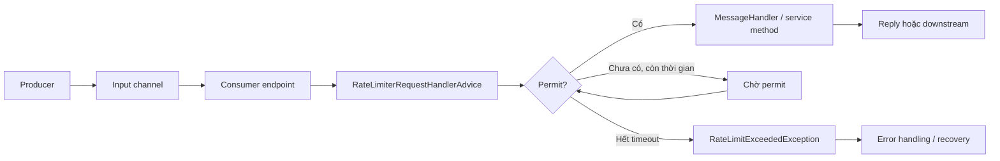
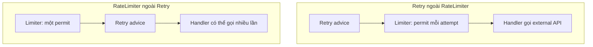

# Rate limiting advice trong Spring Integration Runtime

## 1. Mục tiêu và bối cảnh

Trong **Spring Integration Runtime**, message đi qua `MessageChannel`, consumer endpoint tiếp nhận và gọi `MessageHandler`. Khi handler gọi API đối tác, ví dụ thanh toán chỉ cho phép 100 yêu cầu/phút, tốc độ message đến có thể vượt quota thực tế. Một message được chấp nhận vào channel chưa đồng nghĩa backend bên ngoài đã sẵn sàng nhận lời gọi tương ứng.

**`RateLimiterRequestHandlerAdvice`** thuộc chương **Advice chain** của `SPRING_INTEGRATION_RUNTIME`, dùng để giới hạn **tốc độ lời gọi một handler**. Advice đứng trước lời gọi nghiệp vụ, xin một permit từ Resilience4j; khi chưa có permit, nó có thể chờ tối đa một khoảng cấu hình hoặc từ chối request.

Bài học gắn kiến thức rate limiting với channel, endpoint, consumer, poller, executor, lifecycle `IntegrationFlow`, transaction, retry, message store, error channel, correlation và những tình huống hiệu năng runtime.

**Mục tiêu sau bài học:**

- Giải thích `limitForPeriod`, `limitRefreshPeriod` và `timeoutDuration`.
- Cấu hình `RateLimiterRequestHandlerAdvice` trong `@ServiceActivator`.
- Phân biệt chờ permit, bị từ chối, retry và recovery.
- Hiểu thứ tự advice chain, giới hạn cục bộ theo JVM, rủi ro nhiều instance.
- Chẩn đoán thread chờ, gateway timeout, message backlog, lỗi quá quota.

**Phiên bản:** ví dụ dùng Spring Integration **6.x** (API 6.5), Java 17+ và Resilience4j tương thích. `RateLimiterRequestHandlerAdvice` được bổ sung từ Spring Integration **5.2**; nên kiểm tra dependency/BOM đúng phiên bản đang triển khai.

## 2. Rate limit không đồng nghĩa concurrency limit

Rate limiting trả lời câu hỏi **bao nhiêu lần gọi được phép bắt đầu trong một chu kỳ**. Concurrency limit trả lời **có bao nhiêu lời gọi đang thực thi cùng lúc**.

| Cơ chế | Giới hạn | Không tự bảo đảm |
|---|---|---|
| **Rate limiter** | Số permit trong mỗi chu kỳ thời gian | Số calls đang chạy đồng thời |
| **Semaphore/Bulkhead** | Số tác vụ in-flight cùng lúc | Tốc độ calls/phút |
| **`QueueChannel` + poller** | Khả năng đệm và số message được poll | Tốc độ cố định nếu xử lý bất thường |
| **Retry advice** | Số lần thử xử lý lỗi | Quota external API |
| **Circuit breaker** | Lượng calls khi dịch vụ đã gặp lỗi vượt ngưỡng | Rate limit khi dịch vụ khỏe |
| **Backpressure** | Tốc độ gửi/nhận phù hợp khả năng hệ thống | Hợp đồng quota cụ thể của nhà cung cấp |

Giả sử limiter chấp nhận 2 calls/giây nhưng mỗi call mất 5 giây. Các chu kỳ tiếp theo vẫn có thể cấp permit, làm số request đồng thời tăng. Nếu đối tác yêu cầu vừa **2 req/s** vừa **tối đa 4 requests đang xử lý**, dùng thêm bulkhead/concurrency control.

Rate limiter cũng **không tự lưu message vào kho bền vững**. Khi chưa có permit, thread có thể chờ; khi vượt thời gian chờ, request bị từ chối. Muốn retry/requeue có kiểm soát, cần thêm logic tại source, flow hoặc recovery.

## 3. Advice được đặt ở đâu trong message flow?

Tên đầy đủ:

```java
org.springframework.integration.handler.advice.RateLimiterRequestHandlerAdvice
```

Lớp mở rộng `AbstractRequestHandlerAdvice` và bảo vệ **handler tại endpoint được gắn advice**. Nó không mặc nhiên ôm toàn bộ downstream flow.



Ví dụ một flow:

```text
Inbound adapter -> orders.in -> transformer
    -> HTTP outbound gateway [RateLimiter advice]
    -> orders.out -> downstream consumer
```

Advice ở HTTP outbound gateway chỉ đếm những lời gọi vào **gateway đó**. Nếu một handler khác gửi ba HTTP calls bên trong một invocation, advice bọc handler có thể tính **một permit cho invocation**, trong khi quota thật tiêu thụ ba calls. Vì vậy hãy gắn limiter ngay tại **điểm thực sự gọi tài nguyên cần giới hạn**.

### 3.1. Handler advice và poller advice

**Handler advice** phù hợp bảo vệ một outbound API cụ thể. **Poller advice** bao quanh tác vụ polling, có thể ảnh hưởng một chuỗi xử lý đồng bộ khởi đầu từ poller; phạm vi và ý nghĩa khác.

- `DirectChannel`: advice thường chạy ngay trên thread gọi `send()`.
- `ExecutorChannel`: producer giao message cho executor; advice chỉ chạy khi worker thực thi handler.
- `QueueChannel` cùng polling consumer: thời điểm advice chạy phụ thuộc lịch poll, tình trạng endpoint và backlog.
- `PublishSubscribeChannel`: nếu nhiều subscriber có endpoint được advice bảo vệ, mỗi invocation có thể tiêu thụ permit theo limiter mà endpoint sử dụng.

Một limiter không tự điều khiển lifecycle của endpoint, `SmartLifecycle`, task executor hoặc lịch poller.

## 4. Resilience4j cấp permit như thế nào?

`RateLimiterRequestHandlerAdvice` dùng `io.github.resilience4j.ratelimiter.RateLimiter`. Resilience4j quản lý permit theo **chu kỳ thời gian**; ở mỗi chu kỳ có ngân sách permit được bổ sung theo cấu hình.

| Thuộc tính `RateLimiterConfig` | Ý nghĩa | Ví dụ |
|---|---|---|
| `limitRefreshPeriod` | Độ dài chu kỳ cấp permit | `Duration.ofSeconds(1)` |
| `limitForPeriod` | Số lượt được phép mỗi chu kỳ | `2` |
| `timeoutDuration` | Thời gian tối đa chờ permit | `Duration.ofMillis(100)` |

```java
RateLimiterConfig config = RateLimiterConfig.custom()
        .limitRefreshPeriod(Duration.ofSeconds(1))
        .limitForPeriod(2)
        .timeoutDuration(Duration.ofMillis(100))
        .build();
```

Trên một instance limiter, cấu hình có ý nghĩa **hai permit cho mỗi chu kỳ một giây**. Khi permit hết, lời gọi kế tiếp có thể chờ tối đa 100 ms để lấy permit. Nếu deadline tới mà không có permit, nó bị từ chối.

**Lưu ý thuật toán:** đây là quota theo chu kỳ của Resilience4j, không phải lời hứa “mọi cửa sổ trượt liên tiếp chính xác 1.000 ms đều có tối đa hai calls”. Các lần gọi ở sát ranh giới hai chu kỳ có thể nằm rất gần nhau. Khi đối tác kiểm tra sliding window hay thuật toán khác, nên có biên an toàn.

### 4.1. Ba trường hợp khi xin permit

1. **Permit đang có:** handler được gọi ngay.
2. **Permit hết, `timeoutDuration > 0`:** thread có thể chờ một khoảng để lấy permit ở chu kỳ sau.
3. **Không lấy được permit trong timeout:** Resilience4j báo `RequestNotPermitted`, Spring Integration bọc thành `RateLimiterRequestHandlerAdvice.RateLimitExceededException` có context message/target.

Với `timeoutDuration = Duration.ZERO`, không có permit thường dẫn đến **fail fast**. Message không tự được xếp hàng bền vững và cũng không tự được replay vào kỳ sau.

Permit đã dùng đại diện cho quyền **bắt đầu một invocation**; nó không tự được hoàn trả khi method kết thúc như semaphore. Nếu cần giới hạn số nhiệm vụ đang chạy, kết hợp bulkhead hay bounded executor.

### 4.2. Rate limiter timeout không phải timeout khác

| Thời gian chờ | Phạm vi |
|---|---|
| `RateLimiterConfig.timeoutDuration` | Chờ permit trước khi vào handler |
| HTTP client timeout | Chờ upstream/downstream network |
| Gateway `replyTimeout` | Chờ reply theo semantics message channel |
| Retry backoff | Chờ giữa hai lần retry |
| Poller interval | Chờ tới lần lấy message kế tiếp |

Với `DirectChannel`, thread producer có thể bị chặn khi chờ permit, nên gateway timeout không nhất thiết ngắt lời gọi xử lý đồng bộ. Khi xây SLO phải tính cả chờ permit, xử lý handler, retry, timeout HTTP và thời gian queue.

## 5. API của RateLimiterRequestHandlerAdvice

Các constructor được hỗ trợ trong Spring Integration 6.x:

```java
new RateLimiterRequestHandlerAdvice()
new RateLimiterRequestHandlerAdvice("partner-a")
new RateLimiterRequestHandlerAdvice(rateLimiterConfig)
new RateLimiterRequestHandlerAdvice(rateLimiterConfig, "partner-a")
new RateLimiterRequestHandlerAdvice(rateLimiter)
```

Constructor nhận `RateLimiter` thuận tiện khi hai endpoint cần dùng **cùng một quota**. Constructor nhận `RateLimiterConfig` giúp tạo limiter theo cấu hình. Dùng tên ý nghĩa giúp trace/metrics dễ hiểu.

Các API quan sát và điều chỉnh:

```java
RateLimiter limiter = advice.getRateLimiter();

int available = advice.getMetrics().getAvailablePermissions();
int waiting = advice.getMetrics().getNumberOfWaitingThreads();

advice.setLimitForPeriod(3);
advice.setTimeoutDuration(Duration.ofMillis(200));
```

`getAvailablePermissions()` có thể âm do reservation cho chu kỳ sau; `getNumberOfWaitingThreads()` là ước lượng. Thay `limitForPeriod` có hiệu lực ở chu kỳ kế tiếp, và thay `timeoutDuration` không sửa timeout của các thread đã chờ từ trước.

### 5.1. Cùng quota hay nhiều quota độc lập?

Hai bean advice với cấu hình giống nhau **không đồng nghĩa** dùng chung ngân sách permit. Nếu hai endpoints gọi cùng partner, có thể chia sẻ instance:

```java
RateLimiter shared = RateLimiter.of("partnerQuota", config);

RateLimiterRequestHandlerAdvice adviceA =
        new RateLimiterRequestHandlerAdvice(shared);
RateLimiterRequestHandlerAdvice adviceB =
        new RateLimiterRequestHandlerAdvice(shared);
```

Nhưng `RateLimiter` nằm trong bộ nhớ process. Nếu triển khai 3 pods và mỗi pod cho 10 req/s, toàn cụm có thể gần **30 req/s** nếu tải phân bố tương ứng. Cùng một tên limiter giữa JVM không tự đồng bộ quota. Quota toàn cụm cần distributed limiter, gateway tập trung hoặc cơ chế phân bổ ngân sách permit giữa các instance.

## 6. Ví dụ: hai requests được phép, request thứ ba bị từ chối

Bài thử dùng Spring Integration 6.x, Java 17+, `spring-integration-core` và `resilience4j-ratelimiter` tương thích với dependency management.

Tạo `DirectChannel` làm input để nhìn thấy exception đồng bộ khi `send()` và `QueueChannel` nhận normal reply. Đặt chu kỳ **1 phút**, 2 permits và `timeoutDuration=ZERO` để ba lời gọi liên tiếp dễ rơi vào cùng một chu kỳ.

### 6.1. Spring configuration

```java
import java.time.Duration;
import java.util.concurrent.atomic.AtomicInteger;

import io.github.resilience4j.ratelimiter.RateLimiterConfig;
import org.springframework.context.annotation.Bean;
import org.springframework.context.annotation.Configuration;
import org.springframework.integration.annotation.ServiceActivator;
import org.springframework.integration.channel.DirectChannel;
import org.springframework.integration.channel.QueueChannel;
import org.springframework.integration.config.EnableIntegration;
import org.springframework.integration.handler.advice.RateLimiterRequestHandlerAdvice;
import org.springframework.messaging.MessageChannel;
import org.springframework.messaging.PollableChannel;

@Configuration
@EnableIntegration
public class RateLimitFlowConfig {

    @Bean("quota.input")
    MessageChannel quotaInput() {
        return new DirectChannel();
    }

    @Bean("quota.results")
    PollableChannel quotaResults() {
        return new QueueChannel();
    }

    @Bean("quotaAdvice")
    RateLimiterRequestHandlerAdvice quotaAdvice() {
        RateLimiterConfig config = RateLimiterConfig.custom()
                .limitRefreshPeriod(Duration.ofMinutes(1))
                .limitForPeriod(2)
                .timeoutDuration(Duration.ZERO)
                .build();

        return new RateLimiterRequestHandlerAdvice(config, "vendor-api");
    }

    @Bean
    VendorHandler vendorHandler() {
        return new VendorHandler();
    }
}

class VendorHandler {

    private final AtomicInteger invoked = new AtomicInteger();

    @ServiceActivator(
            inputChannel = "quota.input",
            outputChannel = "quota.results",
            adviceChain = "quotaAdvice")
    public String invoke(String orderId) {
        int n = invoked.incrementAndGet();
        return "sent:" + orderId + ":call-" + n;
    }

    int count() {
        return invoked.get();
    }
}
```

Một endpoint được phát hiện từ `@ServiceActivator` sẽ gọi method `invoke()` khi có message. Advice nằm trước lần gọi này, vì thế lần bị từ chối **không tăng `invoked`**. Hai lần thành công tạo normal reply tới `quota.results`.

### 6.2. Chạy bài thử

```java
import org.springframework.context.annotation.AnnotationConfigApplicationContext;
import org.springframework.integration.channel.QueueChannel;
import org.springframework.messaging.Message;
import org.springframework.messaging.MessageChannel;
import org.springframework.messaging.MessagingException;
import org.springframework.messaging.support.MessageBuilder;

public class RateLimitDemo {

    public static void main(String[] args) {
        try (var context = new AnnotationConfigApplicationContext(
                RateLimitFlowConfig.class)) {

            MessageChannel input =
                    context.getBean("quota.input", MessageChannel.class);
            QueueChannel results =
                    context.getBean("quota.results", QueueChannel.class);

            for (int i = 1; i <= 3; i++) {
                Message<String> msg = MessageBuilder
                        .withPayload("ORD-" + i)
                        .setHeader("traceId", "rate-demo")
                        .build();

                try {
                    input.send(msg);
                    System.out.println("Accepted request " + i);
                }
                catch (MessagingException ex) {
                    System.out.println("Rejected request " + i
                            + ": " + ex.getClass().getSimpleName());
                }
            }

            for (int i = 0; i < 2; i++) {
                Message<?> reply = results.receive(1_000);
                if (reply == null) {
                    throw new IllegalStateException("Expected success reply");
                }
                System.out.println(reply.getPayload());
            }

            System.out.println("Extra reply: " + results.receive(0));
            // null
            System.out.println("Handler calls: "
                    + context.getBean(VendorHandler.class).count()); // 2
        }
    }
}
```

**Dự kiến:** trong cùng chu kỳ 60 giây, hai request đầu được phép, request thứ ba bị từ chối và không có normal reply. Một exception bên ngoài có thể bọc `RateLimitExceededException`; khi debug phải đi qua cause chain tới `RequestNotPermitted`. Nếu phép thử vô tình vượt ranh giới chu kỳ, kết quả có thể khác.

### 6.3. Chế độ chờ permit

Đổi config thành:

```java
RateLimiterConfig config = RateLimiterConfig.custom()
        .limitRefreshPeriod(Duration.ofSeconds(1))
        .limitForPeriod(1)
        .timeoutDuration(Duration.ofSeconds(2))
        .build();
```

Ba message liên tiếp có thể được xử lý tuần tự khi permit mới được cấp, miễn timeout cho từng lời gọi chưa hết. Với `DirectChannel`, thread gọi `send()` chờ permit. Đây không phải message queue bền vững; nếu process dừng khi thread đang chờ, không có cơ chế replay tự động từ limiter.

## 7. RateLimitExceededException, error channel và recovery

Khi xin permit thất bại, Resilience4j phát `RequestNotPermitted`. Spring Integration cung cấp `RateLimiterRequestHandlerAdvice.RateLimitExceededException`, một `MessagingException` bọc lỗi, kèm context request message/target để tìm nguyên nhân.

**Lỗi quota không phải lỗi nghiệp vụ từ external API.** Khi limiter từ chối **trước lời gọi handler**, handler ở endpoint đó không chạy. Tuy nhiên upstream có thể đã thực hiện những side effect trước khi message đến handler này. Tránh kết luận cả giao dịch hoàn toàn chưa xử lý chỉ vì gặp lỗi rate limit.

| Cơ chế chạy | Khi không lấy được permit | Hệ quả cần xác minh |
|---|---|---|
| `DirectChannel` đồng bộ | Lỗi thường lan về thread đang gọi `send()` | Caller có bắt lỗi hay không |
| `ExecutorChannel` | Lỗi xuất hiện trên worker executor | Producer có thể đã `send()` thành công trước khi worker thất bại |
| `QueueChannel` + polling consumer | Lỗi trong tác vụ polling | Error handler, transaction và redelivery |
| `@MessagingGateway` | Caller có thể nhận lỗi hoặc timeout tùy flow | Gateway đang chờ reply qua channel nào |
| Adapter JMS/AMQP/Kafka | ACK/requeue/rebalance theo adapter và transaction | Message có thể phát lại hoặc mất theo chính sách cấu hình |

`RateLimiterRequestHandlerAdvice` **không tự sinh recovery queue**. Nếu không có advice xử lý lỗi khác, exception tuân theo semantics endpoint. Với đường đồng bộ, exception có thể trở về producer; đường bất đồng bộ/polling có thể tạo `ErrorMessage` đi vào header `errorChannel` hay global error channel.

### 7.1. Xử lý quá tải: chờ, từ chối hay lưu lại?

- **Fail fast:** `timeoutDuration=Duration.ZERO` rồi trả trạng thái “busy” hoặc điều hướng lỗi cho upstream. Phù hợp API request-response muốn phản hồi nhanh.
- **Chờ ngắn:** timeout nhỏ để hấp thụ burst vừa phải, miễn worker pool có đủ tài nguyên và caller còn chờ.
- **Hàng đợi có kiểm soát:** nếu mọi request cần được xử lý về sau, có thể dùng durable transport hoặc channel với `MessageStore`, một consumer điều tiết và chính sách ACK/retry phù hợp.
- **Quarantine/DLQ:** lưu bản ghi thất bại có business key, exception type, timestamp và trạng thái để replay có kiểm soát.

Tuyệt đối tránh tight loop ngay lập tức retry mọi `RateLimitExceededException`. Khi một quota đã hết, retry không có delay chỉ tăng CPU, số lần đi vào advice và độ dài hàng đợi. Nếu cần retry, dùng backoff hoặc lịch phát lại từ transport với giới hạn attempts và deadline tổng.

### 7.2. ErrorMessageSendingRecoverer có thể liên quan thế nào?

`RequestHandlerRetryAdvice` có thể dùng `ErrorMessageSendingRecoverer` sau khi retry cạn. Lúc đó event `ErrorMessage` được gửi vào **recovery channel của retry advice**. Đây là hoạt động riêng của lớp retry, không phải tính năng tự động của rate limiter.

Nếu retry advice được phép bắt `RateLimitExceededException`, cần kiểm tra policy có vô tình retry lỗi quota theo kiểu tức thời không. Thường nên phân biệt:

- `RequestNotPermitted`: bị **từ chối bởi limiter**.
- HTTP 429: handler **đã gọi downstream** và bị dịch vụ từ chối theo quota của chính nó.
- `TimeoutException`/lỗi HTTP khác: handler có thể đã gọi nhưng không nhận được kết quả.
- Lỗi validation: message không hợp lệ, thường không nên retry theo quota.

Các trường hợp có chiến lược retry, recovery và idempotency khác nhau.

### 7.3. Reply channel khi bị từ chối

Handler bị chặn trước khi trả kết quả thì **không phát normal reply**. Nếu gateway đang chờ reply, nó có thể nhìn thấy exception hoặc timeout tùy channel và error path; không có quy tắc tự tạo reply thành công cho request bị từ chối.

Khi một gateway qua `ExecutorChannel` chờ lâu, caller có thể hết `replyTimeout` rồi retry cùng business request. Request ban đầu có thể vẫn đang ở queue hoặc vẫn chờ permit và được chạy sau đó. Đó là lý do phải áp dụng idempotency key và theo dõi state nghiệp vụ xuyên các lần gửi.

## 8. Rate limiter và thứ tự advice chain

Một endpoint có thể có retry, rate limiting, circuit breaker, transaction hoặc logging advice. **Thứ tự AOP ảnh hưởng số permit bị tiêu thụ**.

Ví dụ:

```java
@ServiceActivator(
        inputChannel = "partner.in",
        adviceChain = {"retryAdvice", "rateLimiterAdvice"})
public String callPartner(String payload) {
    return partnerClient.call(payload);
}
```

Các advice thông thường được xếp lồng nhau. Nếu **retry nằm ngoài rate limiter**, mỗi retry attempt đi vào handler lại phải xin permit. Nếu **rate limiter nằm ngoài retry**, cả nhóm retry attempts có thể dùng chỉ một permit, mặc dù có nhiều cuộc gọi thực tế tới external API.



**Quy tắc thiết kế:** nếu bên thứ ba tính quota trên **mỗi HTTP call**, limiter phải bảo vệ **mỗi HTTP attempt thực tế**. Đồng thời retry policy cần tránh retry tức thời lỗi của chính limiter.

Nếu hợp đồng quota tính trên **logical business request**, một permit cho toàn bộ nhóm retry có thể phù hợp, nhưng vẫn phải chấp nhận rủi ro số HTTP attempts thực tế vượt quota của đối tác. Không có một thứ tự advice đúng cho mọi hệ thống.

### 8.1. Circuit breaker và rate limiter

Circuit breaker từ chối calls khi hệ thống phụ thuộc có tỷ lệ lỗi cao; rate limiter từ chối calls vượt ngân sách thời gian. Khi circuit mở, lời gọi thất bại có thể đến trước bước xin permit hoặc sau bước xin permit, tùy thứ tự advice. Nếu không cần tiêu permit khi circuit mở, cần đặt thứ tự phù hợp và xác minh bằng metrics.

### 8.2. Transaction advice và thời gian chờ

Nếu transaction được mở **trước** khi chờ permit, một thread có thể giữ transaction/connection trong khi chưa thực thi nghiệp vụ. Điều này làm tăng thời gian transaction, nguy cơ timeout và lock contention. Thường nên đặt rate limiting **trước khi mở giao dịch tốn tài nguyên**, nếu semantics nghiệp vụ và topology cho phép.

Trong Spring Integration, nhiều reply-producing handler áp dụng `AbstractRequestHandlerAdvice` trên `handleRequestMessage()`, còn `HandleMessageAdvice` áp dụng trên `handleMessage()`. Khi hai loại advice cùng xuất hiện, thứ tự thực tế có thể không trùng danh sách khai báo. Đừng dùng thứ tự của mảng annotation như bằng chứng duy nhất; xác minh bằng log hoặc phép thử số lần gọi.

### 8.3. Advice ở poller khác advice ở handler

Nếu đặt retry vào **poller advice**, các bước downstream đồng bộ của một lần poll có thể bị chạy lại; nếu đặt rate limiter tại **handler ngoại vi cụ thể**, chỉ lời gọi handler đó chịu giới hạn.

Một poller có `maxMessagesPerPoll=10` không nghĩa là limiter sẽ cấp 10 permit hay tất cả thành công. Số permit phụ thuộc từng invocation vào handler được advice bảo vệ và trạng thái của limiter.

## 9. Threading, hiệu năng và lifecycle

### 9.1. Chờ permit chiếm thread

Ví dụ có 100 message vào `ExecutorChannel`, phía sau là handler giới hạn 2 req/s và timeout chờ permit 10 giây. Nhiều worker có thể chờ, gây:

- Thread pool bị chiếm dù CPU và HTTP backend không quá tải.
- Executor queue tăng, latency end-to-end tăng.
- Gateway upstream timeout khi request còn ở queue/chờ permit.
- Poller không kịp xử lý chu kỳ tiếp theo nếu worker bị giữ lâu.
- Nếu retry backoff cũng chờ trên thread, tổng thời gian chờ tăng thêm.

Limiter không phải scheduler không-blocking. Dùng `timeoutDuration` hợp lý, bounded queue và backpressure ở mức producer nếu cần. Khi lưu lượng lớn vượt quota lâu dài, **điều tiết nguồn hoặc queue bền vững + consumer có giới hạn** thường dễ vận hành hơn việc để hàng trăm worker chờ permit.

### 9.2. MessageStore, correlation và tính bền vững

`RateLimiterRequestHandlerAdvice` giữ state permit của Resilience4j trong process. Nó **không lưu failed message vào `MessageStore`** và không tự tạo correlation key.

- `QueueChannel` có thể dùng message store bền vững khi được cấu hình; điều này là trách nhiệm của channel.
- Aggregator dùng correlation/release strategy và message groups riêng; một permit không thay thế logic gom nhóm.
- `correlationId` hoặc trace ID giúp nối input với retry/recovery, nhưng chúng không tự ngăn duplicate side effect.
- Nếu nhiều caller cùng dùng chung reply queue, caller có thể lấy nhầm reply; dùng gateway temporary reply channel hoặc thiết kế demultiplex theo correlation.

Nếu cần replay sau reject hoặc restart, chọn nguồn có đảm bảo persistence/acknowledgment phù hợp, tạo business ID ổn định và kiểm tra idempotency trước khi gọi external API.

### 9.3. Quản lý IntegrationFlow runtime

Dừng/start endpoint qua `SmartLifecycle` có thể làm ngừng lấy message, nhưng không đồng nghĩa singleton `RateLimiter` đang tồn tại trong application context được reset. Nếu flow động được unregister rồi tạo lại bean limiter khác, quota in-memory có thể thay đổi theo instance mới.

Cần xác định:

- Limiter thuộc riêng endpoint hay chia sẻ bởi nhiều flow?
- Khi flow restart, có giữ bean limiter đang sống hay dựng lại?
- Khi rolling restart nhiều pods, quota có thể đồng thời được cấp mới ở từng pod?
- Khi thay đổi giới hạn runtime, có cần điều phối giữa các process không?

Đây là vấn đề thiết kế ownership/runtime, không phải thuộc tính `status` trong metadata của khóa học.

## 10. Quan sát metrics của RateLimiter

Lấy metrics trực tiếp:

```java
RateLimiterRequestHandlerAdvice advice = ...;

String limiterName = advice.getRateLimiter().getName();
int available = advice.getMetrics().getAvailablePermissions();
int waiting = advice.getMetrics().getNumberOfWaitingThreads();
```

`available` là số permit ước lượng, có thể âm do reservation. `waiting` là ước lượng số thread đang chờ trong process. Hai số này hữu ích khi debug, nhưng không thay thế metrics về latency, throughput và lỗi.

| Metric | Câu hỏi vận hành |
|---|---|
| Granted/rejected permit | Bao nhiêu request bị chặn bởi quota? |
| Waiting threads | Có worker pool bị giữ bởi limiter không? |
| Thời gian chờ permit p50/p95/p99 | Bao nhiêu latency phát sinh trước handler? |
| Handler execution time | External API chậm hay rate limiter chậm? |
| Input queue depth/oldest age | Flow đang dồn backlog ở đâu? |
| Gateway timeout | Caller hết thời gian chờ khi message còn chưa chạy? |
| Retry attempts | Một logical message tạo bao nhiêu external calls? |
| HTTP 429 từ provider | Hạn mức nội bộ có sai so với hạn mức thực tế? |
| Error channel/Recovery queue | Lỗi quota được xử lý hay đang ứ đọng? |

Sử dụng trace ID/correlation ID để nối thời điểm nhận message, trước/sau chờ permit, gọi external API và phát reply. Tránh ghi payload hay token nhạy cảm vào log. Không dùng business request ID hoặc user ID làm **tên limiter** hay tag metric nếu gây cardinality quá lớn.

### 10.1. Thay đổi cấu hình khi runtime đang chạy

`RateLimiterRequestHandlerAdvice` cho phép:

```java
advice.setLimitForPeriod(5);
advice.setTimeoutDuration(Duration.ofMillis(250));
```

Đổi `limitForPeriod` có hiệu lực từ chu kỳ tiếp theo; đổi `timeoutDuration` không thay đổi thời hạn chờ của thread đã ở trạng thái waiting. API này **không hủy** các lời gọi đã nhận permit và đang thực thi.

Nếu cần đổi `limitRefreshPeriod`, không giả định advice có setter tương ứng. Cần kiểm tra API Resilience4j/phiên bản và có thể tạo limiter với config khác theo kế hoạch chuyển đổi an toàn. Đừng cập nhật giới hạn liên tục theo dao động metrics tức thời mà chưa kiểm tra feedback loop.

## 11. Những lỗi thường gặp

| Triệu chứng | Nguyên nhân khả dĩ | Cách kiểm tra |
|---|---|---|
| Calls vượt `limitForPeriod` | Tính nhiều chu kỳ, nhiều pods hoặc nhiều limiter độc lập | Đối chiếu timestamp, replica, bean và tên limiter |
| Có advice nhưng mọi request đều qua | Gắn sai handler, quota quá lớn, nhiều limiter có state riêng | Xem `adviceChain`, identity limiter, metrics |
| Caller chậm dù CPU thấp | Worker chờ permit | `getNumberOfWaitingThreads()`, thread dump, queue |
| `RateLimitExceededException` | Timeout chờ permit đã hết | Phân biệt với HTTP timeout và HTTP 429 |
| Message không được xử lý lại | Không có backoff/recovery/redelivery, lỗi bị log rồi bỏ | Xác minh error channel, ACK, retry policy |
| Retry làm vượt quota | Limiter ngoài retry hoặc policy retry không kiểm soát | Đếm actual calls so với permit |
| 429 dù limiter hoạt động | API key dùng chung, nhiều instances, sliding window khác | Đối chiếu quota toàn tài khoản và `Retry-After` |
| Throughput thấp hơn kỳ vọng | Period quá dài, permit sử dụng không đều, poller yếu | Đo queue depth, available permits, consumer speed |
| Lỗi chỉ có trên async worker | Error handling ở executor/poller thread | Theo dõi error channel và worker log |
| Sau restart quota dường như reset | Limiter process-local được tạo mới | Xác định quota toàn cụm và lifecycle bean |
| Transaction kéo dài khi chờ | Mở transaction trước limiter | Kiểm tra advice ordering, connection/lock metrics |
| Handler có reply nhưng gateway timeout | Chờ queue + permit + xử lý vượt thời gian gateway | Quan sát latency theo từng chặng |

**Quy trình debug thực tế:**

1. Xác định handler chịu quota: advice có gắn đúng endpoint chưa?
2. Kiểm tra `limitRefreshPeriod`, `limitForPeriod`, `timeoutDuration`, limiter name và instance.
3. Xác định scope: một bean, nhiều handlers, một JVM hay nhiều pods.
4. Phân biệt **chờ permit** với **đã vào handler** qua logs timestamp trước/sau.
5. Đọc exception chain: `RateLimitExceededException`/`RequestNotPermitted` hay lỗi external API?
6. Kiểm tra error channel, gateway reply, ACK, retry và message store nếu cần replay.
7. Đo executor saturation, poller concurrency, queue depth và elapsed time trước khi đổi quota.

## 12. Bài tập thực hành

### Bài 1 — Fail fast và chờ

Chạy mã mục 6 với `timeoutDuration=ZERO`, kiểm chứng hai handler calls. Đổi sang `timeoutDuration=Duration.ofSeconds(2)`, `limitRefreshPeriod=Duration.ofSeconds(1)`, `limitForPeriod=1`. Đo thời gian từng `send()`.

**Câu hỏi:** thread nào thực sự chờ permit khi input là `DirectChannel`?

### Bài 2 — Hai endpoint chia sẻ limiter

Tạo hai service activator gọi cùng đối tác, dùng chung **một** `RateLimiter` rồi thay bằng **hai limiter độc lập**. Gửi message qua cả hai, so tổng calls được cho phép trong chu kỳ.

### Bài 3 — Rate limiter kết hợp retry

Cho handler gọi external service lỗi hai lần đầu rồi thành công lần ba. Thử đặt retry ngoài rate limiter và rate limiter ngoài retry. Đếm số permit và actual calls. Kịch bản nào đáp ứng quota **mỗi HTTP attempt**?

### Bài 4 — Executor và timeout

Đặt `ExecutorChannel` trước handler có quota thấp, gửi nhiều message đồng thời. Theo dõi waiting threads, executor queue, gateway timeout và reply latency khi thay đổi `timeoutDuration`.

### Bài 5 — Lỗi async và recovery

Đặt `timeoutDuration=ZERO` và mô phỏng polling consumer bị từ chối. Xác định `ErrorMessage` xuất hiện ở channel nào, cơ chế ACK/rollback và chọn requeue có delay hay DLQ. Không tự động replay vô hạn.

### Bài 6 — Quota nhiều pods

Giả sử 4 pods, mỗi pod có `limitForPeriod=10` và `limitRefreshPeriod=1s`, trong khi đối tác cho tối đa 20 req/s **toàn tài khoản**. Giải thích tổng quota có thể vượt giới hạn thế nào và đề xuất giải pháp phân tán hoặc gateway tập trung.

## 13. Checklist thiết kế production

1. **Giới hạn đúng nơi:** outbound handler/API call thực sự tiêu quota.
2. **Giới hạn đúng đơn vị:** mỗi business request hay mỗi retry attempt; chọn advice chain tương ứng.
3. **Cấu hình timeout rõ:** chờ ngắn hoặc fail fast, tránh chiếm hàng loạt worker.
4. **Có overload path:** trả busy, requeue có delay, recovery hoặc DLQ có giới hạn.
5. **Bảo vệ side effect:** transaction, ACK, idempotency xuyên retry và redelivery.
6. **Tính cả hệ thống:** replicas, ứng dụng cùng API key và biến động quota đối tác.
7. **Quan sát:** permit, waiting threads, latency, 429, queue depth, error channel.
8. **Tách rate và concurrency:** nếu backend giới hạn in-flight calls, dùng thêm bulkhead/worker limit.

`RateLimiterRequestHandlerAdvice` là công cụ kiểm soát **tốc độ gọi handler** tại runtime. Hiệu quả end-to-end phụ thuộc vị trí gắn advice, retry order, thời gian chờ permit, channel/threading, thiết kế overload và yêu cầu quota toàn cụm.

## 14. Tài liệu chính thức

- [Spring Integration 6.5 – Provided Advice Classes, Rate Limiter Advice](https://docs.spring.io/spring-integration/reference/6.5/handler-advice/classes.html): mục tiêu, API Resilience4j và cấu hình `@ServiceActivator`.
- [Spring Integration 6.5.0 Javadoc – RateLimiterRequestHandlerAdvice](https://www.springframework.org/spring-integration/docs/6.5.0/api/org/springframework/integration/handler/advice/RateLimiterRequestHandlerAdvice.html): constructor, `getMetrics()`, setters, `RateLimitExceededException`.
- [Spring Integration Reference – Handling Message Advice](https://docs.spring.io/spring-integration/reference/handler-advice/handle-message.html): phạm vi của `handleRequestMessage()` và `handleMessage()`, trường hợp `HandleMessageAdvice` thay đổi thứ tự.
- [Spring Integration Reference – Messaging Endpoints](https://docs.spring.io/spring-integration/reference/endpoint.html): poller advice, transaction và task executor.
- [Resilience4j Documentation – RateLimiter](https://resilience4j.readme.io/docs/ratelimiter): chu kỳ, permit, metrics và cập nhật config.
- [Resilience4j Source – RateLimiter.java](https://github.com/resilience4j/resilience4j/blob/master/resilience4j-ratelimiter/src/main/java/io/github/resilience4j/ratelimiter/RateLimiter.java): hợp đồng `acquirePermission()` và các phương thức động.
