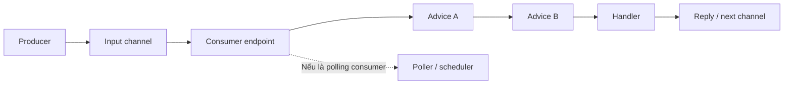
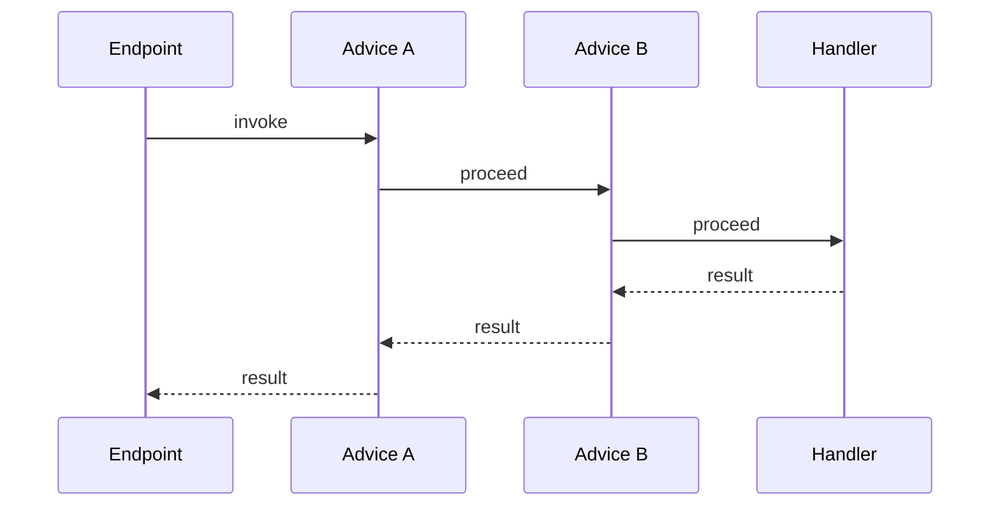
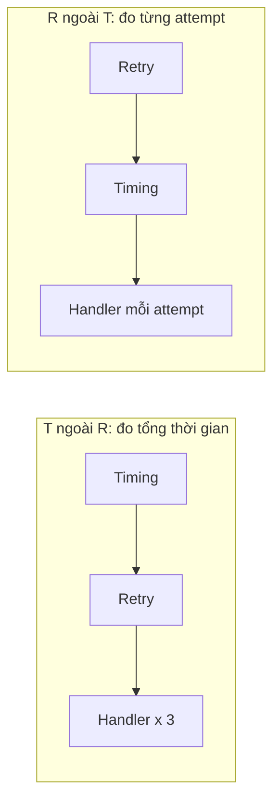
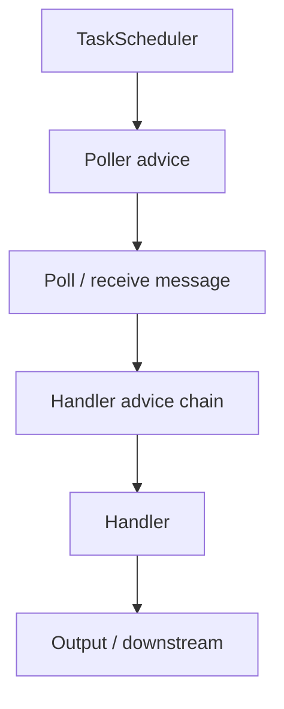
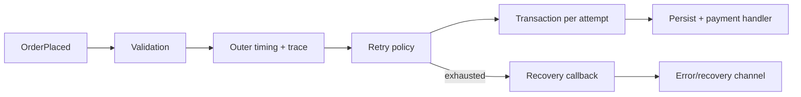
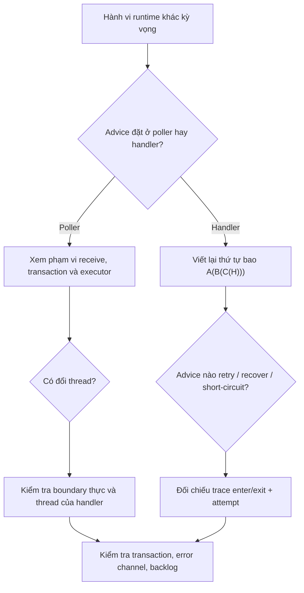

# Thứ tự nhiều advice

Trong **Spring Integration runtime**, một message đi từ channel qua consumer endpoint đến handler. Trên đường đi, hệ thống thường cần nhiều chính sách cắt ngang: ghi log, đo thời gian, kiểm tra quyền, retry, transaction và recovery. Spring Integration cho phép gắn một **advice chain** vào endpoint để bao quanh lời gọi xử lý. Khi có từ hai advice trở lên, **thứ tự khai báo quyết định cách chúng lồng nhau**, ảnh hưởng trực tiếp đến số lần gọi handler, thời gian giữ transaction, nơi exception được bắt và kết quả đi tiếp trong message flow.

Bài thuộc chương **Advice chain** của module `SPRING_INTEGRATION_RUNTIME`. Trọng tâm là đọc đúng thứ tự nhiều advice, thử nghiệm thứ tự bằng trace và chọn cách xếp advice cho một luồng thông điệp thực tế. Các ví dụ liên hệ với channel, endpoint, poller, executor, retry, error channel, message store và việc chẩn đoán runtime.

## 1. Advice chain bao quanh bước nào?

Một **advice** là thành phần bổ sung hành vi trước, sau hoặc xung quanh một thao tác mà framework gọi. Trong xử lý message, advice có thể làm những việc như:

- Ghi thời gian bắt đầu/kết thúc và thông tin correlation.
- Thử lại thao tác khi có lỗi tạm thời.
- Mở/commit/rollback transaction theo cấu hình.
- Phân loại exception và chuyển thất bại cuối cùng sang error/recovery flow.
- Áp dụng kiểm soát truy cập, giới hạn hoặc đo lường bổ sung.

**Vị trí đặt advice quan trọng không kém thứ tự của nó.** Một chuỗi gắn tại **handler endpoint** thường bao quanh việc thực thi handler. Một advice đặt ở **poller** có thể bao quanh một lượt polling (gồm thao tác nhận message và các bước được gọi trong phạm vi poll). Advice không tự “phủ” toàn bộ message flow chỉ vì một IntegrationFlow có nhiều endpoint.



Đối với `DirectChannel`, endpoint xử lý đồng bộ thường chạy trên thread của producer. Với `QueueChannel`, một polling consumer phải lấy message trước khi gọi handler. Với `ExecutorChannel`, việc dispatch có thể chạy trên thread của executor. Thêm advice **không tự thay đổi** kiểu channel, thread model hay bảo đảm giao hàng.

## 2. Quy tắc cốt lõi: advice đầu tiên ở ngoài cùng

Với các **around advice** tuân theo mô hình interceptor thông thường, thứ tự khai báo:

```text
advice(A), advice(B), advice(C) -> targetHandler
```

có thể hình dung là:

```text
A.before
  B.before
    C.before
      handler()
    C.after / finally
  B.after / finally
A.after / finally
```

**Chiều đi vào:** A → B → C → handler. **Chiều đi ra:** handler → C → B → A. Advice đầu chuỗi là lớp bao ngoài cùng; advice cuối đứng gần handler nhất. Đây là quy tắc nền để dự đoán thứ tự log, thời lượng đo được và phạm vi exception có thể bị bắt.



Trong ví dụ sau, `A` ghi log trước/sau toàn bộ `B`; `B` ghi log gần lời gọi handler hơn:

```java
// Mã giả để hình dung phép lồng nhau
Object execute() {
    return A.around(() ->
        B.around(() ->
            C.around(() -> handler.process(message))));
}
```

**Không phải advice nào cũng luôn gọi phần bên trong đúng một lần.** Retry advice có thể gọi `proceed/execute` nhiều lần; circuit breaker có thể từ chối mà không gọi handler; recovery advice có thể biến exception thành kết quả; một số advice là interceptor quan sát chỉ chạy `finally`. Vì thế log thực tế có thể không phải một cặp “before/after” đơn giản.

## 3. Khi handler ném exception: thứ tự trở ra còn quan trọng hơn

Giả sử handler ném `IllegalStateException`. Nếu không advice nào xử lý exception, stack đi qua các advice theo chiều ngược và được ném tới endpoint/caller:

```text
A.before
B.before
handler -> throws IllegalStateException
B.catch(error)
B.finally
A.catch(error)
A.finally
caller/endpoint nhận exception
```

Nếu **B bắt exception và trả fallback**, thì A nhìn thấy một **kết quả bình thường**:

```text
A.before
B.before
handler -> throws
B.recover -> returns "PENDING_REVIEW"
B.finally
A.afterSuccess("PENDING_REVIEW")
A.finally
```

Kết quả này có hệ quả vận hành: một advice ở ngoài dùng số lần exception để tính “tỷ lệ thất bại” có thể **không nhìn thấy exception** nếu advice bên trong đã recover. Muốn đo số lần attempt thất bại, phải đặt instrumentation ở vị trí thích hợp hoặc lấy dữ liệu từ retry listener/recovery callback.

| Hành vi của advice bên trong | Advice bên ngoài quan sát | Rủi ro khi suy luận sai |
| --- | --- | --- |
| Ném lại exception | Ngoại lệ truyền ra | Biết có thất bại, nhưng chưa biết thất bại thuộc attempt nào |
| Trả fallback | Kết quả bình thường | Dễ ghi nhận nhầm thành thành công nghiệp vụ |
| Không gọi `proceed()` | Không có lời gọi handler | Có thể là từ chối có chủ đích, không phải handler “không chạy vì lỗi” |
| Gọi `proceed()` nhiều lần | Nhiều lời gọi xử lý phía trong | Có nguy cơ lặp side effect nếu không idempotent |

## 4. Cấu hình nhiều advice ở handler bằng Java DSL

Một cách dễ thấy thứ tự là tạo hai advice ghi trace rồi gắn chúng theo đúng thứ tự vào service activator trong `IntegrationFlow`. Ví dụ cho Spring Integration (Java 17+) dưới đây dùng `AbstractRequestHandlerAdvice`, loại advice phù hợp với lời gọi request handler.

```java
import org.springframework.context.annotation.Bean;
import org.springframework.context.annotation.Configuration;
import org.springframework.integration.annotation.EnableIntegration;
import org.springframework.integration.channel.DirectChannel;
import org.springframework.integration.dsl.IntegrationFlow;
import org.springframework.integration.handler.advice.AbstractRequestHandlerAdvice;
import org.springframework.messaging.Message;
import org.springframework.messaging.MessageChannel;

@Configuration
@EnableIntegration
public class AdviceOrderConfig {

    @Bean
    MessageChannel commands() {
        return new DirectChannel();
    }

    @Bean
    TraceAdvice outerTrace() {
        return new TraceAdvice("A");
    }

    @Bean
    TraceAdvice innerTrace() {
        return new TraceAdvice("B");
    }

    @Bean
    IntegrationFlow commandFlow(MessageChannel commands,
                                TraceAdvice outerTrace,
                                TraceAdvice innerTrace) {
        return IntegrationFlow.from(commands)
                .handle(String.class, (payload, headers) -> {
                    System.out.println("handler: " + payload);
                    return "DONE:" + payload;
                }, endpoint -> endpoint.advice(outerTrace, innerTrace))
                .handle(message -> System.out.println(
                        "downstream: " + message.getPayload()))
                .get();
    }

    static final class TraceAdvice extends AbstractRequestHandlerAdvice {
        private final String name;

        TraceAdvice(String name) {
            this.name = name;
        }

        @Override
        protected Object doInvoke(ExecutionCallback callback,
                                  Object target,
                                  Message<?> message) throws Exception {
            System.out.println(name + ": before");
            try {
                Object result = callback.execute();
                System.out.println(name + ": success");
                return result;
            }
            catch (Exception ex) {
                System.out.println(name + ": error " +
                        ex.getClass().getSimpleName());
                throw ex;
            }
            finally {
                System.out.println(name + ": finally");
            }
        }
    }
}
```

Một producer trong cùng ứng dụng có thể lấy bean `commands` và gửi:

```java
commands.send(
    org.springframework.messaging.support.MessageBuilder
        .withPayload("CMD-42")
        .build());
```

Nếu handler xử lý bình thường, thứ tự quan sát dự kiến:

```text
A: before
B: before
handler: CMD-42
B: success
B: finally
A: success
A: finally
downstream: DONE:CMD-42
```

Ví dụ dùng `DirectChannel` để trace dễ quan sát. Trong ứng dụng có nhiều bean cùng loại `TraceAdvice`, nên định danh dependency chính xác bằng `@Qualifier` hoặc tên bean khi Spring không thể suy ra. Nếu cấu hình `commands` và các advice bằng method tạo bean, phải đăng ký các thành phần trong cùng Spring context và đảm bảo consumer endpoint đã start trước khi gửi.

Đổi thứ tự thành `endpoint.advice(innerTrace, outerTrace)` sẽ đảo thứ tự **tại entry/exit**: B ở ngoài, A ở trong. Đây là cách kiểm chứng ngắn nhất rằng thứ tự trong chain có ảnh hưởng thực tế.

## 5. Thứ tự retry và đo thời gian

Lấy hai advice:

- `T`: ghi thời gian xử lý bằng đồng hồ monotonic, ví dụ `System.nanoTime()`.
- `R`: `RequestHandlerRetryAdvice` thử handler tối đa ba lần và áp dụng backoff.

Hai cách xếp cho ra **hai ý nghĩa metric khác nhau**:

| Cấu hình | Lồng nhau | Thời gian mà `T` đo |
| --- | --- | --- |
| `advice(T, R)` | `T(R(handler))` | Toàn bộ chuỗi retry và các khoảng backoff |
| `advice(R, T)` | `R(T(handler))` | Mỗi attempt xử lý được đo riêng, vì retry gọi lại T |

Giả sử handler thất bại hai lần rồi thành công ở lần thứ ba. Khi T nằm ngoài R, T thường ghi một lần với tổng thời gian; khi T nằm trong R, T có thể ghi ba lần. Để theo dõi đầy đủ latency, hệ thống thường cần **cả hai metric**: tổng thời gian xử lý một message và thời gian của mỗi attempt.



Cũng nên phân biệt số **attempt failed** với số **message finally failed**. Một message thất bại hai lần rồi thành công không phải một message thất bại vĩnh viễn. Nếu retry tự recover và trả fallback, metric “handler success” ở advice ngoài có thể đo sai trạng thái nghiệp vụ.

## 6. Thứ tự retry và transaction

Đây là cặp advice có tác động lớn đến tính đúng đắn. Dùng `R` cho retry, `TX` cho transaction và `H` cho handler:

### 6.1. Retry ngoài, transaction trong: `R(TX(H))`

```text
Retry
  attempt 1:
    begin TX-1 -> handler -> error -> rollback TX-1
  backoff
  attempt 2:
    begin TX-2 -> handler -> error -> rollback TX-2
  backoff
  attempt 3:
    begin TX-3 -> handler -> success -> commit TX-3
```

Nếu transaction interceptor thực sự tạo **transaction mới cho mỗi attempt**, cách này giúp mỗi lần thử bắt đầu với transaction sạch. Đây thường là hướng mong muốn khi một thao tác DB có thể fail và retry lại toàn bộ đơn vị công việc. Tuy nhiên, transaction propagation (ví dụ một transaction bên ngoài đã tồn tại) vẫn quyết định thực tế có tạo transaction mới hay không; chỉ xếp chain không đủ để đảm bảo mỗi attempt có một physical transaction riêng.

### 6.2. Transaction ngoài, retry trong: `TX(R(H))`

```text
begin TX-1
  Retry
    attempt 1 -> handler -> error
    attempt 2 -> handler -> error
    attempt 3 -> handler -> success
commit / rollback TX-1
```

Ở cách này, các attempt có thể cùng nằm trong một transaction. Nếu một lần thất bại làm transaction bị đánh dấu `rollback-only` hoặc tài nguyên bị mất hiệu lực, lần tiếp theo có thể không cứu được transaction dù logic handler trả thành công. Có thể gặp `UnexpectedRollbackException` ở bước commit.

| Tiêu chí | Retry ngoài TX | TX ngoài retry |
| --- | --- | --- |
| Ranh giới transaction theo attempt | Có thể riêng từng lần nếu propagation phù hợp | Thường một ranh giới bao trùm các attempt |
| Khả năng dùng lại transaction đã lỗi | Thấp hơn nếu mỗi attempt dùng TX mới | Có nguy cơ dùng lại transaction đã rollback-only |
| Tổng thời gian giữ transaction | Thường mỗi transaction ngắn hơn | Có thể gồm thời gian backoff giữa attempts |
| Khi handler có side effect ngoài DB | Vẫn phải làm idempotent | Vẫn phải làm idempotent |
| Có tự đảm bảo redelivery/ack không? | Không | Không |

**Cảnh báo về phạm vi:** ví dụ trên chỉ đúng khi `TX` thực sự là transaction advice quanh handler. Một `poller transaction advice` có thể đặt transaction **bao quanh nhận message và xử lý**; nếu thêm handler retry bên trong, phần nhận message có thể vẫn thuộc transaction bên ngoài retry. Cần xem **vị trí** advice trước khi áp dụng bảng so sánh.

## 7. Advice của poller khác advice của handler

Với `QueueChannel` hoặc nguồn polling như JDBC/file, có ít nhất hai ranh giới:



**Handler advice** bọc lời gọi xử lý của một handler. **Poller advice** bọc thao tác polling theo kiểu advice phù hợp và cấu hình của poller; một số advice poller có thể điều khiển cả nguồn lấy message. Thực tế quan sát phải xét loại endpoint, cấu hình poller và cả việc xử lý message có chuyển sang executor hay không.

Ví dụ minh họa khai báo riêng hai phạm vi bằng annotation:

```java
// Các tên bean advice được khai báo trong cùng Spring context.
// Chọn advice phù hợp cho từng vùng (poller vs handler).
@ServiceActivator(
    inputChannel = "workQueue",
    adviceChain = {"handlerTimingAdvice", "handlerRetryAdvice"},
    poller = @Poller(
        fixedDelay = "500",
        maxMessagesPerPoll = "5",
        adviceChain = {"pollerTransactionAdvice"}
    )
)
public void consume(String payload) {
    // Xử lý nghiệp vụ
}
```

*Đoạn này minh họa vị trí các thuộc tính annotation; cần import `@ServiceActivator` và `@Poller`, định nghĩa `workQueue` là `PollableChannel` cùng các bean advice tương ứng. Một transaction advice trên poller và handler retry cần được kiểm thử theo đúng nguồn/stores đang dùng.*

Nếu nhiệm vụ là **rollback việc đọc khỏi message store transactional** khi handler fail, transaction ở poller có thể cần thiết. Nếu mục tiêu chỉ là retry HTTP request trong handler, handler advice thường phù hợp hơn. **Đừng đặt cùng một advice lên cả hai ranh giới** mà chưa tính đến retry lồng nhau, transaction lồng nhau và số attempt thực tế.

### 7.1. Executor tạo thêm ranh giới

Giả sử poller nhận message rồi dispatch sang `ExecutorChannel` hoặc một asynchronous handler. Transaction bắt đầu ở poller thường gắn với **thread hiện tại**; không tự lan sang worker thread. Một `TransactionInterceptor` đặt quanh poller không bảo đảm phần handler bất đồng bộ cùng tham gia transaction đó. Cần thiết kế transaction ở đúng nơi thao tác DB chạy và kiểm chứng commit/rollback trong thread thực tế.

Ngược lại, đo thời gian chỉ ở poller có thể ghi “hoàn thành” khi message mới được submit vào executor, chưa chắc handler đã xử lý xong. Chỗ đặt advice quyết định định nghĩa “thời gian hoàn tất”.

## 8. Retry và recovery: thứ tự có thể biến exception thành thành công

`RequestHandlerRetryAdvice` có thể cấu hình `RecoveryCallback`; một lựa chọn phổ biến là `ErrorMessageSendingRecoverer` để đưa lỗi cuối vào recovery channel. Khi recoverer gửi `ErrorMessage` rồi **trả bình thường**, advice bên ngoài có thể không thấy exception gốc.

```text
AuditAdvice (ngoài)
  RetryAdvice (trong)
    handler attempt 1 -> throw
    handler attempt 2 -> throw
    handler attempt 3 -> throw
    RecoveryCallback -> send(ErrorMessage)
  RetryAdvice trả bình thường
AuditAdvice ghi "success" nếu chỉ nhìn trạng thái exception
```

Vì vậy cần phân biệt:

- **Attempt-level failure:** từng lần gọi handler thất bại.
- **Retry exhausted:** không còn tiếp tục retry theo policy.
- **Recovery action completed:** callback đã gửi error message hoặc lưu trạng thái xử lý.
- **Business success:** tác vụ nghiệp vụ thực sự hoàn tất, không chỉ “không ném exception”.

Nếu callback ném exception để ngữ cảnh ngoài rollback, đường chạy khác với callback trả fallback. Trong môi trường có broker ack/nack, một callback “nuốt lỗi” có thể làm listener coi message đã xử lý; kết quả cụ thể phụ thuộc adapter, transaction và listener configuration.

Không được xem `ErrorMessageSendingRecoverer` là một advice được xếp độc lập nếu nó đang là **recovery callback nằm trong RetryAdvice**. Bước recover ở cuối nhiều lần thử là một phần của retry policy, không phải một interceptor xung quanh từng attempt.

## 9. Thứ tự circuit breaker, kiểm tra quyền và retry

Một số advice không chỉ quan sát mà có thể **chặn không gọi handler**. Thứ tự trở thành một quyết định chính sách:

| Chuỗi minh họa | Điều được quan sát / kiểm soát | Khi cần cân nhắc |
| --- | --- | --- |
| `CircuitBreaker(Retry(H))` | Circuit breaker thường nhìn kết quả của cả chuỗi retry | Một lời gọi ngoài có thể gây nhiều request thực bên dưới |
| `Retry(CircuitBreaker(H))` | Circuit breaker nằm gần handler, thấy từng attempt | Trạng thái open có thể khiến những attempt còn lại bị từ chối nhanh |
| `Authorization(Retry(H))` | Kiểm tra quyền một lần mỗi invocation bên ngoài | Thông tin xác thực phải có hiệu lực cho toàn bộ chuỗi xử lý |
| `Retry(Authorization(H))` | Kiểm tra lại quyền ở từng attempt | Có thể tăng chi phí và thay đổi loại lỗi được retry |

Đây là mô hình khái niệm: circuit breaker thực tế có bộ đếm, policy và exception mapping riêng. Không thể suy diễn từ một chuỗi tên rằng thư viện circuit breaker sẽ đếm chính xác bao nhiêu lần nếu chưa xem cấu hình cụ thể.

Các nguyên tắc an toàn:

1. Không retry lỗi phân quyền hoặc dữ liệu không hợp lệ một cách mù quáng.
2. Giới hạn tổng số request bên ngoài khi có nhiều tầng retry (handler, HTTP client, broker redelivery).
3. Đặt idempotency key ổn định qua mọi attempt có side effect.
4. Xác định thứ tự cần dùng qua **outcome mong muốn**, rồi viết test trace cho đúng chain.

## 10. Thiết kế thứ tự cho tình huống thực tế

Xét một flow nhận `OrderPlaced`, cần kiểm tra dữ liệu, ghi DB và gọi hệ thống thanh toán. Hệ thống muốn log toàn bộ thời gian, retry tạm thời và theo dõi kết quả cuối:



Đây chỉ là **hình dung trình tự thiết kế**, không phải một ví dụ an toàn tuyệt đối cho mọi luồng thanh toán. Cuộc gọi payment API bên ngoài không được rollback chỉ bởi transaction cục bộ của database. Phải dùng idempotency key và đối soát khi kết quả thanh toán không rõ.

Một phương án thường cần:

| Tầng | Chọn chính sách | Kiểm chứng |
| --- | --- | --- |
| Validation trước retry | Loại bỏ lỗi schema cố định | Dữ liệu sai không chạy retry nóng |
| Trace/timing ngoài retry | Đo total latency và business key | Một tổng thời gian cho mỗi message |
| Retry có giới hạn | Chỉ retry lỗi tạm thời và có backoff | Đúng số attempt và giới hạn thời gian |
| Transaction ở phạm vi đúng | Mỗi attempt có transaction mới khi cần | Kiểm tra rollback/commit bằng test tích hợp |
| Recovery cuối cùng | Lưu thất bại bền vững hoặc ném lỗi có chủ đích | Có trạng thái cuối cùng rõ, có thể replay |
| Metrics trong attempt | Đếm từng lỗi và thời gian xử lý | Tách attempt failure với final failure |

Chỉ gắn một advice chain không thay thế được **tách bước nghiệp vụ** khi mỗi bước cần transaction, độ tin cậy hoặc retry khác nhau. Đôi khi cách đúng là chia flow thành nhiều endpoint và channel, rồi đặt advice khác nhau cho từng endpoint.

## 11. Thứ tự advice với correlation, message store và idempotency

Nhiều advice có thể cùng đọc `MessageHeaders`, song không nên suy ra chúng tự sửa/đồng bộ toàn bộ headers. Nên tạo hoặc duy trì `correlationId` và business key **trước ranh giới retry**, để tất cả attempt gắn với cùng công việc.

Các câu hỏi cần xác định:

- ID của business event là gì? `orderId` có ổn định khi retry hoặc redelivery không?
- Một attempt thất bại có được rollback toàn bộ side effect trong transaction hay không?
- Nếu handler đã ghi DB và sau đó lỗi HTTP, lớp idempotency có ngăn cập nhật lặp lại được không?
- Retry context nằm trong RAM hay có stateful retry cache? Nếu restart thì nguồn nào đưa message trở lại?
- Message store có transactional dequeue hay chỉ là queue in-memory?

Nếu có **idempotency advice** nằm ngoài retry và đánh dấu message là processed trước khi xử lý thực sự hoàn tất, các attempt bên trong có thể không được kiểm soát đúng. Nếu idempotency nằm trong retry, nó cũng phải biết phân biệt **attempt đang dở** với **business operation đã commit thành công**. Phần này đòi hỏi thiết kế trạng thái và transaction, không thể giải quyết đơn giản bằng đảo vị trí advice.

## 12. Quan sát thứ tự đang chạy tại runtime

Khi điều tra “handler chạy nhiều lần nhưng log timing một lần” hoặc “transaction không rollback như kỳ vọng”, hãy ghi lại **thứ tự thực** thay vì chỉ nhìn tên bean:

| Thông tin log/metric | Giúp trả lời câu hỏi |
| --- | --- |
| Tên advice + thời điểm enter/exit | Advice nào ngoài, advice nào trong? |
| Tên handler/endpoint | Advice đang bọc endpoint nào? |
| `threadName` | Có đổi thread qua scheduler/executor không? |
| `messageId` và `correlationId` | Cùng message hay message phát lại khác? |
| Attempt number và exception type | Retry có thực sự gọi lại handler? |
| Transaction active/ID phù hợp | Transaction mở mỗi attempt hay một lần? |
| Retry exhausted / recovery outcome | Callback có nuốt lỗi hay ném lại? |
| Queue depth/poller latency | Retry dài có làm backlog tăng không? |

Có thể dùng `TransactionSynchronizationManager.isActualTransactionActive()` trong môi trường Spring transaction để kiểm tra transaction có gắn với thread hiện tại. Tuy nhiên, một giá trị `true` không cho biết mọi tài nguyên downstream đều cùng transaction; cần xem transaction manager, propagation và tài nguyên thực tế.

Đo latency bằng `System.nanoTime()` hoặc công cụ metrics/observation phù hợp. Ghi những trường định danh tối thiểu; tránh log đầy đủ payload chứa dữ liệu nhạy cảm. Nếu chỉ có stack trace ngoài cùng, hãy kiểm tra advice có bắt, wrap hoặc chuyển exception thành fallback trước đó hay không.

### 12.1. Quy trình chẩn đoán nhanh



Nếu thấy handler chạy ba lần nhưng cùng một message ID, thường là retry tại cùng ngữ cảnh invocation. Nếu ID khác nhau, có thể là producer gửi lại hoặc source redelivery tạo message mới. Đây chỉ là **dấu hiệu để điều tra**, không phải bằng chứng đủ vì message cũng có thể bị dựng lại trong cùng một luồng.

## 13. Lỗi thường gặp khi xếp nhiều advice

| Sai lầm | Hậu quả | Cách khắc phục |
| --- | --- | --- |
| Nghĩ khai báo A trước B thì A hoàn tất trước B | Thứ tự log/exception ngược kỳ vọng | Nhớ A ngoài, B trong; chiều trở ra đảo ngược |
| Đo timing trong retry nhưng gọi đó là total latency | Không tính backoff và toàn chuỗi | Đặt timing ngoài retry, bổ sung per-attempt metric nếu cần |
| Transaction bọc ngoài retry bị rollback-only | Attempt sau “thành công” nhưng commit lỗi | Cân nhắc retry ngoài transaction với propagation thích hợp |
| Recovery callback trả bình thường, outer advice báo thành công | Che khuất thất bại nghiệp vụ | Đo final outcome và trạng thái recovery riêng |
| Gắn retry ở cả poller và handler mà không tính | Số attempt lớn, tăng side effect | Vẽ cây lời gọi và tính tổng số lần trước khi triển khai |
| Cho rằng poller transaction đi theo handler async | Transaction không tồn tại ở thread xử lý | Đặt transaction đúng boundary trong worker |
| Retry lỗi validation/auth hoặc payment không idempotent | Log storm, thao tác nghiệp vụ lặp | Phân loại lỗi và thiết kế idempotency |
| Đặt audit subscriber trong đường nóng, không xử lý exception | Lỗi logging làm flow bị ảnh hưởng | Đặt timeout, exception policy, cô lập side effect khi cần |
| Một advice chỉ được gắn ở endpoint đầu nhưng kỳ vọng áp dụng toàn flow | Endpoint tiếp theo không có advice | Cấu hình rõ từng endpoint hoặc cơ chế cross-cutting phù hợp |

## 14. Bài thực hành

### Bài 1 — Đọc thứ tự mà không chạy ứng dụng

Cho chuỗi `advice(A, B, C)`, trong đó mọi advice đều log trước/sau và luôn gọi tiếp đúng một lần. Viết log dự kiến khi handler thành công, khi handler ném exception và khi B bắt exception rồi trả fallback. Đối chiếu câu trả lời với mô hình `A(B(C(handler)))`.

### Bài 2 — Đổi thứ tự và đọc trace

Dùng `AdviceOrderConfig` ở mục 4. Gửi message `CMD-42`; chụp log. Đổi `endpoint.advice(outerTrace, innerTrace)` thành `endpoint.advice(innerTrace, outerTrace)` và gửi lại. Xác nhận entry/exit thay đổi và handler vẫn chỉ gọi một lần mỗi message.

### Bài 3 — Timing bên ngoài và bên trong retry

Gắn `RequestHandlerRetryAdvice` tối đa ba attempt cho handler cố ý lỗi hai lần rồi thành công. Thử `advice(timingAdvice, retryAdvice)` và `advice(retryAdvice, timingAdvice)`. Ghi số lần timing chạy và xem thời gian đo có gồm backoff hay không.

### Bài 4 — Retry và transaction

Trong môi trường DB test có transaction manager, gây lỗi tạm thời ở lần ghi đầu. So sánh `Retry(Transaction(handler))` với `Transaction(Retry(handler))`; log transaction active và rollback/commit thực tế. Không thử phép thanh toán thật hoặc side effect không thể hoàn tác. Phân tích vì sao việc transaction bị đánh dấu `rollback-only` ảnh hưởng đến attempt kế tiếp.

### Bài 5 — Poller, executor và recovery

Tạo `QueueChannel` có polling service activator và advice retry. Sau đó thêm ranh giới bất đồng bộ bằng executor. Quan sát thread, backlog, thông điệp được dequeue khi nào, nơi exception xuất hiện và thời điểm recovery callback chạy. Thử cho callback gửi `ErrorMessage` vào channel riêng; xác minh việc publish lỗi không tự động phát lại message nghiệp vụ.

## 15. Tự kiểm tra kiến thức

1. Với `advice(A, B)`, ai chạy “before” trước? → A. Ai xử lý “after” cuối cùng? → A.
2. Khi B bắt exception và trả fallback, A luôn thấy exception gốc không? → Không, A có thể chỉ thấy một kết quả bình thường.
3. Muốn đo tổng thời gian cả retry/backoff, timing đặt ở đâu? → Bên ngoài retry advice.
4. Vì sao `Transaction(Retry(handler))` có thể không phù hợp sau lỗi DB? → Các attempt có thể cùng transaction đã bị đánh dấu rollback-only.
5. Advice của poller có luôn cùng phạm vi với advice của handler không? → Không; poller có thể bao quanh hoạt động nhận message, còn handler advice bao quanh lời gọi handler.
6. Transaction ở poller có tự truyền qua `ExecutorChannel` không? → Không được giả định; transaction thường gắn với thread và boundary cụ thể.
7. `RecoveryCallback` trả bình thường có đồng nghĩa xử lý nghiệp vụ thành công không? → Không; cần đánh giá kết quả và trạng thái recovery cuối.

**Ghi nhớ:** Khi có nhiều advice, hãy vẽ rõ mô hình **`A(B(C(handler)))`**, xác định vùng nào được bọc và quan sát cả **chiều đi vào, chiều quay ra, exception và số lần gọi lại**. Thứ tự advice quyết định ngữ nghĩa runtime của retry, transaction, timing và recovery; để một flow an toàn còn cần xử lý đúng thread, nguồn message, message store, correlation và idempotency.
