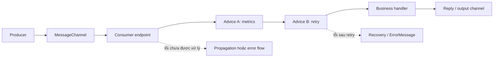
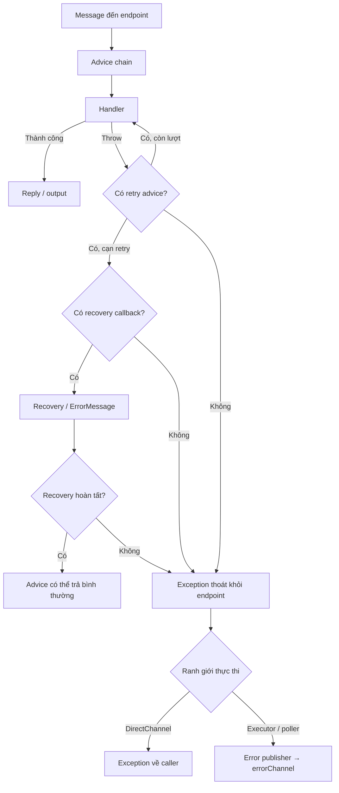

# Advice tác động đến metrics và error flow trong Spring Integration

## 1. Bài toán: cùng một lỗi, tại sao số liệu và đường đi khác nhau?

Trong Spring Integration, một message đi qua `MessageChannel` và được một **consumer endpoint** chuyển cho handler. Ta có thể gắn **advice chain** quanh lời gọi handler để thực hiện retry, đo thời gian, giới hạn tốc độ, kiểm soát transaction hoặc xử lý exception. Mặc dù advice không cần thay đổi nghiệp vụ chính, nó có thể làm thay đổi đáng kể:

- **Số lần thực sự gọi handler**: retry chạy lại lời gọi bao nhiêu lần?
- **Metric đo gì**: một message đầu vào, một lần handler attempt, hay toàn bộ thời gian retry và backoff?
- **Thời điểm ghi nhận lỗi**: exception thoát ngay, được advice chuyển thành một kết quả recovery, hay sau đó mới đến `errorChannel`?
- **Thread và transaction**: handler/advice chạy trên thread nào, transaction/observation có đi qua `ExecutorChannel` hay không?
- **Tính đúng đắn của thống kê**: tác vụ thất bại về nghiệp vụ có thể bị đo thành “success” nếu advice bên ngoài chỉ thấy recovery trả về bình thường.

Đây là bài thuộc chương **Advice chain** của module **SPRING_INTEGRATION_RUNTIME**. Mục tiêu là biết cách bố trí advice và đo được điều thực sự xảy ra trong runtime: channel, endpoint, consumer, executor/poller, retry, message store, correlation và error flow.

> **Nguyên tắc cốt lõi:** “Handler được gọi thành công” khác “message được xử lý thành công về nghiệp vụ”. Một advice có thể hấp thụ exception, gửi `ErrorMessage` sang recovery channel và trả về bình thường; metric bên ngoài advice phải hiểu rõ ngữ nghĩa này.

## 2. Advice chain nằm ở đâu trong một message flow?

Advice cho **request handler** là cơ chế can thiệp quanh quá trình handler nhận message và thực thi xử lý. Các cấu hình phổ biến là `@ServiceActivator(adviceChain = ...)`, DSL endpoint/handler advice và các advice phù hợp cho polling endpoint. Không phải mọi advice đều có cùng phạm vi.



Với danh sách advice `[A, B]` theo thứ tự được áp dụng từ ngoài vào trong, mô hình lời gọi thường là:

```text
A.before
  B.before
    handler(message)
  B.after
A.after
```

Khi `B` là retry advice, `B` có thể gọi handler nhiều lần trước khi trả về cho `A`. Một bộ đo đặt trong `B` và một bộ đo đặt ngoài `B` sẽ thấy **hai đơn vị đo khác nhau**.

Cần phân biệt ba lớp can thiệp:

| Lớp | Ví dụ | Phạm vi tác động |
| --- | --- | --- |
| Request-handler advice | `RequestHandlerRetryAdvice`, advice dựa trên `AbstractRequestHandlerAdvice` | Bao quanh lời gọi xử lý message của handler được gắn advice |
| Poller/endpoint advice | Transaction/advice được gắn cho poller | Bao quanh thao tác poll và phần xử lý nằm trong phạm vi interceptor tương ứng |
| Channel/observation instrumentation | Channel interceptor, Micrometer/Observation | Ghi nhận thời gian gửi/nhận message ở mức channel hoặc endpoint |

**Không mặc định một advice gắn ở handler bao phủ cả flow.** Ví dụ handler A có retry advice, handler B sau `ExecutorChannel` không được retry chỉ vì A có advice. Muốn đo end-to-end phải kết hợp correlation ID, quan sát ở nhiều điểm hoặc một cơ chế tracing thích hợp.

## 3. Cơ chế retry làm thay đổi hình dạng phép đo

Giả sử message `order-42` đi vào endpoint một lần. Handler gọi dịch vụ bên thứ ba và thất bại tạm thời hai lần, thành công ở lần thứ ba:

```text
Input message: 1
  |
  +-- Attempt #1: 35 ms, throw TimeoutException
  +-- Backoff:   200 ms
  +-- Attempt #2: 42 ms, throw TimeoutException
  +-- Backoff:   200 ms
  +-- Attempt #3: 30 ms, thành công
  |
  +-- Output/reply thành công: 1

Số message đi vào endpoint = 1
Số lời gọi nghiệp vụ = 3
Số attempt thất bại = 2
Số lần retry exhausted = 0
Tổng thời gian xấp xỉ = 507 ms (chưa tính overhead)
```

Cùng một luồng, các metric đều có thể đúng nhưng diễn đạt các khía cạnh khác nhau:

| Chỉ số | Giá trị trong ví dụ | Ý nghĩa |
| --- | ---: | --- |
| `messages_received_total` | 1 | Có một message đi vào endpoint |
| `handler_attempts_total` | 3 | Handler chạy ba lần |
| `handler_attempt_failures_total` | 2 | Hai attempt ném lỗi |
| `handler_recovered_total` | 0 | Không cần nhánh recovery |
| `message_processing_success_total` | 1 | Lượt xử lý cuối cùng hoàn thành |
| `handler_attempt_duration` | 35, 42, 30 ms | Thời gian chỉ riêng từng lần gọi |
| `message_total_duration` | ~507 ms | Tổng thời gian gồm retry và backoff |

Tên metric trong bảng **chỉ là tên ví dụ do ứng dụng tự định nghĩa**, không phải cam kết tên meter mặc định của mọi phiên bản Spring Integration/Micrometer.

Nếu đo một lần ở ngoài retry, latency quan sát được sẽ lớn hơn latency của từng attempt. Nếu đo cả ở trong và ngoài, phải đặt **hai tên metric** khác nhau để tránh cộng nhầm một message thành nhiều request.

### Advice order và kết quả đo

Giả sử ta định nghĩa `TimingAdvice` là advice đo thời gian quanh `callback.execute()`:

| Danh sách advice | Phép đo của `TimingAdvice` | Tình huống lỗi |
| --- | --- | --- |
| `[retryAdvice, timingAdvice]` | Mỗi lần retry gọi vào timing advice: số điểm đo theo số attempt | Thấy failure của từng attempt |
| `[timingAdvice, retryAdvice]` | Một lần timing advice bao cả retry, backoff và recovery | Chỉ thấy exception thoát khỏi retry; nếu recovery bình thường có thể thành “success” |
| `[retryAdvice, timingAdvice, auditAdvice]` | Timing bao cả audit/handler cho mỗi attempt | Ghi audit trong mỗi lần retry nếu audit cũng ở phía trong |
| `[timingAdvice, retryAdvice, auditAdvice]` | Timing toàn bộ lượt xử lý | Audit có thể chạy lại nhiều lần |

Đừng chỉ hỏi “advice nào ở trước?”; hãy hỏi chính xác **một callback bao bọc điều gì và callback có bị gọi lại hay không**. Thứ tự khai báo và cơ chế tạo proxy phải được kiểm chứng trong cấu hình thực tế nếu có nhiều loại advice/proxy cùng hoạt động.

## 4. Ví dụ Java: đo từng attempt và chuyển lỗi sau retry

Đây là ví dụ minh họa một flow **một chiều**: đầu vào là `String orderId`; handler có thể ném exception, retry advice thử lại, sau khi hết retry thì gửi `ErrorMessage` sang một channel recovery. Code dùng các API chung thường gặp trong Spring Integration 6.x–7.x; **policy retry mặc định có thể thay đổi theo phiên bản** nên sản phẩm thực tế cần khai báo rõ số attempt/backoff bằng API đúng phiên bản.

### 4.1. Tạo advice đo attempt với Micrometer

`AbstractRequestHandlerAdvice` cho phép viết lời gọi bao quanh handler bằng `doInvoke(...)`. Ví dụ định nghĩa meter theo outcome để biết từng attempt thành công hay thất bại:

```java
import io.micrometer.core.instrument.MeterRegistry;
import io.micrometer.core.instrument.Timer;
import org.springframework.integration.handler.advice.AbstractRequestHandlerAdvice;
import org.springframework.messaging.Message;

public final class AttemptTimingAdvice
        extends AbstractRequestHandlerAdvice {

    private final MeterRegistry registry;

    public AttemptTimingAdvice(MeterRegistry registry) {
        this.registry = registry;
    }

    @Override
    protected Object doInvoke(
            ExecutionCallback callback,
            Object target,
            Message<?> message) throws Exception {

        Timer.Sample sample = Timer.start(registry);
        String outcome = "success";

        try {
            return callback.execute();
        } catch (Exception | Error ex) {
            outcome = "failure";
            throw ex; // Quan trọng: không nuốt lỗi tại advice đo.
        } finally {
            sample.stop(registry.timer(
                    "app.orders.handler.attempt.duration",
                    "outcome", outcome));
        }
    }
}
```

Các tag `outcome=success|failure` có **cardinality thấp**. Không thêm trực tiếp `messageId`, `correlationId`, `orderId`, exception message hoặc stack trace làm tag Micrometer: mỗi giá trị mới có thể tạo một chuỗi thời gian mới, tốn RAM và gây khó cho hệ thống metrics.

**Giới hạn phép đo:** Advice này bắt exception do callback ném. Nó không thể biết rằng một phương thức đã nuốt lỗi bằng `try/catch` ở bên trong; và cũng không tự đếm nghiệp vụ “đã thất bại nhưng recover”. Để biết kết quả nghiệp vụ, cần metric riêng ở nhánh recovery hoặc phân loại kết quả theo hợp đồng nghiệp vụ.

### 4.2. Cấu hình input, recovery channel và advice chain

```java
import org.springframework.beans.factory.annotation.Qualifier;
import org.springframework.context.annotation.Bean;
import org.springframework.context.annotation.Configuration;
import org.springframework.integration.channel.DirectChannel;
import org.springframework.integration.config.EnableIntegration;
import org.springframework.integration.handler.advice.ErrorMessageSendingRecoverer;
import org.springframework.integration.handler.advice.RequestHandlerRetryAdvice;
import org.springframework.messaging.MessageChannel;
import io.micrometer.core.instrument.MeterRegistry;

@Configuration
@EnableIntegration
public class OrderAdviceConfig {

    @Bean("ordersIn")
    public MessageChannel ordersIn() {
        return new DirectChannel();
    }

    @Bean("retryFailures")
    public MessageChannel retryFailures() {
        return new DirectChannel();
    }

    @Bean("attemptTimingAdvice")
    public AttemptTimingAdvice attemptTimingAdvice(MeterRegistry registry) {
        return new AttemptTimingAdvice(registry);
    }

    @Bean("retryAdvice")
    public RequestHandlerRetryAdvice retryAdvice(
            @Qualifier("retryFailures") MessageChannel retryFailures) {

        RequestHandlerRetryAdvice advice = new RequestHandlerRetryAdvice();

        // Với bản dùng Spring Integration 6.x, cấu hình RetryTemplate
        // của Spring Retry; với 7.x dùng RetryPolicy thuộc
        // org.springframework.core.retry.
        // Đặt max retries/backoff tường minh theo phiên bản dự án.

        advice.setRecoveryCallback(
                new ErrorMessageSendingRecoverer(retryFailures));
        return advice;
    }
}
```

Bean `MeterRegistry` cần được cung cấp bởi cấu hình Micrometer/Actuator của ứng dụng, hoặc được khai báo thủ công. Bean `retryFailures` là một `DirectChannel` nên dispatch lỗi đồng bộ đến subscriber, không giữ message qua restart.

**Vị trí của hai advice rất quan trọng:** cấu hình handler dưới đây khai báo retry bên ngoài timing. Mỗi lần retry thực hiện callback xuống dưới sẽ tạo một lượt đo attempt. Nếu đưa timing ra ngoài retry, phép đo sẽ thành một lượt cho toàn bộ quá trình.

### 4.3. Service activator và error consumer

```java
import org.springframework.integration.annotation.MessageEndpoint;
import org.springframework.integration.annotation.ServiceActivator;
import org.springframework.messaging.support.ErrorMessage;

@MessageEndpoint
public class OrderEndpoints {

    @ServiceActivator(
        inputChannel = "ordersIn",
        adviceChain = {"retryAdvice", "attemptTimingAdvice"})
    public void handleOrder(String orderId) {
        if (orderId.startsWith("poison-")) {
            throw new IllegalArgumentException("Order rejected");
        }
        // Thực thi nghiệp vụ; không tạo reply trong ví dụ này.
    }

    @ServiceActivator(inputChannel = "retryFailures")
    public void onRetryExhausted(ErrorMessage error) {
        Throwable failure = error.getPayload();

        // Demo: consumer chỉ ghi dấu vết; production cần store/DLQ an toàn.
        System.err.println(
                "Retry exhausted: " + failure.getClass().getName());
    }
}
```

Sau khi gửi một message `poison-101` qua `ordersIn`, handler có thể được gọi lại theo retry policy. Mỗi attempt ném exception được đo `outcome=failure`. Khi cạn retry, `ErrorMessageSendingRecoverer` tạo một `ErrorMessage` và gửi vào `retryFailures`, kích hoạt `onRetryExhausted`.

**Chú ý về semantics:** Nếu recovery callback gửi lỗi thành công và trả về bình thường, tầng retry có thể coi exception đã được **recover**. Điều đó không có nghĩa đơn hàng đã xử lý thành công. Trong ví dụ flow một chiều, message không có reply; đây là lý do nên đo riêng “retry exhausted” ở `onRetryExhausted`.

### 4.4. Kiểm thử bằng một message

```java
import org.springframework.messaging.MessageChannel;
import org.springframework.messaging.support.MessageBuilder;

MessageChannel input =
        applicationContext.getBean("ordersIn", MessageChannel.class);

input.send(MessageBuilder.withPayload("poison-101")
        .setHeader("correlationId", "checkout-101")
        .build());
```

Nếu giữ `DirectChannel`, toàn bộ lời gọi handler và advice bình thường chạy trên thread của `send()`. Khi recovery callback thành công, bên gửi có thể không thấy exception; để biết nghiệp vụ thất bại phải quan sát `retryFailures` hoặc trạng thái nghiệp vụ.

Nếu consumer trên `retryFailures` ném lỗi, lỗi từ quá trình **publish/recovery** có thể propagate hoặc được framework xử lý tùy endpoint và ranh giới thực thi. Trong production, hãy bảo đảm dead-letter sink không chỉ log rồi âm thầm coi mọi lỗi đã được lưu bền vững.

## 5. Metrics ở từng tầng: đo cái gì, và có bị đếm lặp không?

Spring Integration có cơ chế instrumentation cho channel, handler và endpoint; có thể tích hợp **Micrometer** và **Observation** tùy phiên bản/cấu hình. Tên meter và tag cụ thể do phiên bản, binder, observation convention và cách bật management quyết định. Cần xem `MeterRegistry`/`ObservationRegistry` đang hoạt động thay vì đoán một tên counter cố định.

Một flow `inputChannel → executor → serviceActivator[retry] → outputChannel` có thể tạo các quan sát khác nhau:

| Tầng đo | Đơn vị đo | Có bị tăng theo từng retry? |
| --- | --- | --- |
| Ingress adapter | Request hoặc message nhận vào | Thường một lần theo giao nhận đầu vào, trừ khi redelivery |
| `MessageChannel.send` | Lần gửi vào channel | Retry bên trong handler thường không gửi lại message qua channel trước đó |
| Consumer endpoint | Lượt tiếp nhận/xử lý message | Phụ thuộc vị trí instrumentation so với advice chain |
| Advice đo attempt | Lần callback thực thi handler | Có, nếu nằm trong retry |
| Advice đo total duration | Toàn bộ chuỗi retry của một lượt xử lý | Thường một điểm đo nếu nằm ngoài retry |
| Recovery consumer | Một thông điệp lỗi/nhánh recovery được xử lý | Sau khi retry exhausted, nếu publish thành công |
| Error channel | Lần dispatch `ErrorMessage` | Phụ thuộc số publisher/subscriber và cấu hình channel |
| Business outcome | Đơn hàng thực sự hoàn tất / từ chối | Phải định nghĩa bằng nghiệp vụ, không suy ra duy nhất từ exception |

**Đừng cộng tổng metrics channel, endpoint và handler thành một “tổng request”**: một message thường đi qua nhiều channel và handler, nên việc cộng sẽ làm tăng giả số lượng yêu cầu.

### Những metric nên định nghĩa tách riêng

| Metric đề xuất của ứng dụng | Loại | Diễn giải |
| --- | --- | --- |
| `app.orders.message.received` | Counter | Message mới đi vào boundary xác định |
| `app.orders.handler.attempt.duration` | Timer | Thời gian mỗi lần thực thi handler |
| `app.orders.processing.total.duration` | Timer | Thời gian tổng, gồm retry/backoff |
| `app.orders.retry.exhausted` | Counter | Số lượt xử lý cạn retry |
| `app.orders.recovery.success` | Counter | Số lần ghi recovery sink thành công |
| `app.orders.recovery.failure` | Counter | Số lần ghi recovery sink thất bại |
| `app.orders.inflight` | Gauge | Số lượt đang chờ/đang xử lý |
| `app.orders.deadletter.backlog` | Gauge | Số bản ghi chờ điều tra hoặc replay |

Đây là **quy ước đặt tên ví dụ**, không phải metric có sẵn từ Spring Integration.

Timer thường đã chứa `count`, `totalTime` và có thể xuất `max`/percentile/histogram theo cấu hình. Tránh tạo thêm một counter trùng với count của cùng timer nếu không có ý nghĩa độc lập. Với latency, quan sát cả trung vị, p95/p99 và lỗi timeout; chỉ nhìn trung bình có thể bỏ sót đuôi dài của retry/backoff.

## 6. Advice tương tác với exception và error flow ra sao?

Một lời gọi handler có thể đi theo nhiều đường khi thất bại:



Sơ đồ cho thấy **errorChannel không tự động là đích của mọi exception**. Một số điểm cần hiểu:

1. **Advice chạy trước ranh giới publish lỗi**: nếu nó catch và xử lý exception rồi trả bình thường, error handler bên ngoài sẽ không còn thấy exception ban đầu.
2. **Advice ném lại exception**: trong flow đồng bộ `DirectChannel`, lỗi thường được đẩy ngược về caller; trong tác vụ async do Spring Integration quản lý, có thể được gói thành `ErrorMessage` gửi error channel.
3. **Recovery callback gửi ErrorMessage**: đây là một đường publish **chủ động** của advice, độc lập với cơ chế error publisher bắt unhandled exception ở async boundary.
4. **Advice khác cũng có thể thay đổi kết quả**: ví dụ một advice đánh giá biểu thức có thể ghi nhận lỗi, gửi message đến failure channel và theo cấu hình chọn ném lại hay hấp thụ.
5. **Output/reply là đường khác**: không nên tự hiểu một `ErrorMessage` được gửi vào failure channel sẽ thành reply nghiệp vụ của gateway, trừ khi đã thiết kế reply path phù hợp.

### Hành vi với `ExpressionEvaluatingRequestHandlerAdvice`

`ExpressionEvaluatingRequestHandlerAdvice` có thể đánh giá biểu thức trên kết quả thành công hoặc exception, gửi kết quả tới channel thành công/thất bại theo cấu hình và có các tùy chọn ảnh hưởng đến việc trap hoặc propagate exception.

Nó rất hữu ích để **ghi dấu vết** hoặc phát sự kiện kết quả, nhưng dễ tạo hiểu lầm:

- Nếu advice ném lại lỗi, endpoint ngoài vẫn có thể đẩy lỗi về caller hoặc `errorChannel`.
- Nếu advice trap/handle lỗi, nhánh bên ngoài có thể nhìn thấy kết thúc bình thường.
- Nếu dùng cả advice đánh giá lỗi và retry recoverer, có thể phát **hai thông báo cho một lượt xử lý lỗi** nếu không xác định rõ bên nào sở hữu failure event.

Hãy quyết định một nơi ghi **business failure terminal** và những nơi khác chỉ tạo telemetry phụ. “Một message lỗi trên failure channel” và “một ErrorMessage trên errorChannel” là hai loại sự kiện có thể khác nhau cả về payload lẫn thời điểm phát.

## 7. Bảng so sánh: đồng bộ, bất đồng bộ và poller

Advice luôn được thực thi ở vị trí handler/endpoint mà nó gắn vào. Nhưng **thread thực thi handler** phụ thuộc channel và consumer:

| Flow | Handler/advice chạy ở đâu? | Lỗi không được advice bắt | Ý nghĩa với metric |
| --- | --- | --- | --- |
| `DirectChannel → handler` | Thread gọi `send()` | Thường quay về caller | Latency của `send()` có thể gồm cả thời gian advice và retry |
| `ExecutorChannel → handler` | Worker của `TaskExecutor` | Có thể xuất bản `ErrorMessage` qua error channel | `send()` phía producer có thể hoàn tất trước handler; cần đo worker latency riêng |
| `QueueChannel → poller → handler` | Thread chạy poller/scheduler | Có cơ chế error handler của poller | Poll interval, queue wait và execution duration là ba đại lượng khác nhau |
| Gateway request/reply đồng bộ | Thread hoặc đường reply do gateway điều phối | Có thể được ném về gateway caller hoặc đi qua error flow được cấu hình | Đo thêm thời gian chờ reply và gateway timeout |
| Source broker có redelivery | Consumer thread theo adapter/container | Có thể rollback/nack/requeue tùy transport | Một business message có thể vào endpoint nhiều lượt delivery |

**Lưu ý:** Đặt retry advice bên trong handler không khiến thread producer “đợi retry xong” khi có `ExecutorChannel`. Cũng không làm transaction context hay tracing context của producer tự động lan sang worker thread.

Nếu luồng có `@Async` tự tạo, `CompletableFuture` chạy trên executor khác hoặc đoạn mã spawn thread thủ công, error handling và context propagation của riêng cơ chế đó phải được thiết kế; đừng mặc định mọi exception đều được Spring Integration đóng gói.

### Poller advice khác handler advice ở điểm nào?

Một `PollerMetadata` có thể mang advice cho poller; transaction interceptor hoặc advice quanh poll task có thể bao trùm việc nhận message từ `PollableChannel`. Ngược lại, `RequestHandlerRetryAdvice` bao quanh xử lý của **handler cụ thể**.

Ví dụ queue đầu vào có transaction: message được poll, handler có retry và recover, recovery trả về bình thường; transaction phía poller có thể **commit** vì nó không nhìn thấy exception. Điều này đúng nếu chính sách nghiệp vụ cho rằng đã cách ly message thành công, nhưng nguy hiểm nếu error flow chỉ log mà không lưu record bền vững.

Muốn rollback khi recovery sink lỗi, **để lỗi ghi DLQ thoát ra** qua transaction boundary phù hợp. Với adapter/broker bên ngoài, cần xác minh ack/nack cụ thể bằng integration test trên nguồn thực.

## 8. Thứ tự advice với transaction, retry và recovery

Thứ tự bao bọc retry và transaction thay đổi cách các attempt dùng transaction.

Giả sử `TxAdvice` mở transaction, `RetryAdvice` có thể gọi lại handler:

```text
A. TxAdvice ngoài, RetryAdvice trong

Tx.begin
  Retry(attempt 1)
  Retry(attempt 2)
  Retry(attempt 3)
Tx.commit/rollback
```

```text
B. RetryAdvice ngoài, TxAdvice trong

Retry:
  Tx.begin → attempt 1 → rollback
  Tx.begin → attempt 2 → rollback
  Tx.begin → attempt 3 → commit
```

Hai sơ đồ là **mô hình để suy luận**, không phải cam kết mọi `TransactionInterceptor` đều có thể gắn vào mọi loại advice chain giống nhau. Thực tế còn phụ thuộc transaction manager, transaction propagation và vị trí advice (handler hay poller).

Nếu các attempt dùng chung một transaction bị đánh dấu rollback-only sau lỗi đầu tiên, attempt sau có thể “thành công” trong logic mà commit vẫn bị từ chối. Đặt mỗi retry trong một transaction mới có thể phù hợp hơn với thao tác DB ngắn hạn. Ngược lại, retry qua network call mà mỗi attempt gây side effect cần **idempotency** để tránh thanh toán/ghi đơn trùng.

### Mối liên hệ với message store

Aggregator, resequencer hoặc queue bền vững có thể dùng `MessageStore`/`MessageGroupStore`. Retry advice trên handler **không tự đảm bảo** rằng việc cập nhật store, gửi reply và ack nguồn nằm trong một transaction nguyên tử. Với flow nhiều tài nguyên (DB + broker), có thể cần outbox/inbox, idempotent receiver và cơ chế reconciliation.

Nếu retry làm cùng message đến stateful handler nhiều lần, cần xem xét duplicate, group correlation, completion, cleanup và message đến muộn. Một metric `handler_attempt_failures` tăng không có nghĩa số “failed business messages” cũng tăng tương ứng.

## 9. Đặt error metrics ở đâu để không bị hiểu sai?

Một nguyên tắc vận hành thực tế là tách **attempt failure**, **terminal failure** và **recovery delivery**:

| Sự kiện | Nên phát ở đâu? | Khi nào tăng counter? |
| --- | --- | --- |
| Attempt thất bại | Advice phía trong retry | Mỗi lần handler ném exception |
| Retry cạn | Recovery callback hoặc nhánh xử lý exhausted | Một lần khi không còn retry cho lượt xử lý đó |
| Business operation thành công | Sau khi xác nhận hoàn tất nghiệp vụ | Một lần theo business key/idempotency |
| Đã đưa lỗi vào nơi cách ly | Sau khi durable sink xác nhận lưu | Chỉ khi ghi recovery record thực sự thành công |
| Recovery sink thất bại | Error path của sink | Khi bản ghi không được chấp nhận hoặc commit thất bại |
| Một `ErrorMessage` được publish | Điểm phát hoặc consumer lỗi | Theo số lần publish/consume thực tế; có thể có duplicate |

Một lỗi nghiệp vụ có thể có 3 attempt failure và 1 terminal failure. Nếu cuối cùng có recovery thành công, không nên xếp trường hợp này là **business success** chỉ vì outer timing advice không thấy exception.

### Thiết kế nhãn và correlation

- **Meter tags**: tên flow, endpoint cố định, loại lỗi chuẩn hóa, outcome, retry/terminal. Đây là các giá trị ít biến thiên.
- **Log/tracing fields**: `correlationId`, `messageId`, `orderId`, attempt number, thread name, error channel, exception chain. Các giá trị này có thể có cardinality cao nhưng vẫn hữu ích khi tìm trong log/traces có kiểm soát.
- **Business record**: trạng thái cuối theo khóa idempotent, failure ID, thời điểm xử lý, retry count, replay attempt, phiên bản schema.

Không dùng `correlationId` làm Micrometer tag trừ khi có hệ thống metrics được thiết kế đặc biệt cho độ cardinality đó. Một metric có hàng triệu chuỗi thời gian không giúp giải quyết lỗi nhanh hơn.

## 10. Observation, tracing và thời gian chờ queue

Micrometer Observation và tracing thường bổ sung ngữ cảnh dài hơn cho message flow; metrics truyền thống tổng hợp các lượt xử lý. Khi advice đổi retry hoặc thread, cần xác định scope quan sát:

- Span/observation ở **ingress** đo thời gian nhận request hoặc thời gian xử lý trong một boundary xác định.
- Span ở **handler** cho thấy handler thực thi trên thread nào và mất bao lâu.
- Span ở **retry attempt** (nếu tự instrument) giúp phân biệt thử lại thứ hai với lần gọi đầu.
- **Queue wait time** từ lúc enqueue tới khi worker thực sự bắt đầu xử lý phải được đo riêng nếu muốn đánh giá backpressure. Một timer chỉ bọc handler không nhìn thấy thời gian nằm trong `QueueChannel` hoặc executor queue.
- Nếu tracing context không được propagate qua worker/executor hoặc message header phù hợp, các span có thể bị tách thành những trace khác nhau; correlation ID ổn định giúp kết nối lại khi cần.

Đừng dùng thời điểm gửi thành công vào `ExecutorChannel` làm bằng chứng handler đã chạy thành công. Khi worker pool bão hòa, queue dài hoặc task bị reject, latency thực tế sẽ khác nhiều với latency `send()`.

**Gợi ý biểu đồ:** vẽ riêng p95 handler attempt, p95 total processing, executor queue depth, time-in-queue và retry exhausted rate. Khi lỗi hệ thống bên thứ ba tăng, attempt time có thể gần như không đổi nhưng total time và queue backlog cùng tăng mạnh do backoff/retry.

## 11. Tình huống chẩn đoán: vì sao metrics tăng nhưng errorChannel trống?

Một endpoint có `RetryAdvice` và `ErrorMessageSendingRecoverer` ghi về `retryFailures`. Metric `attempt_failure` tăng 3, nhưng subscriber trên bean `errorChannel` toàn cục không nhận được gì. Đây có thể là **hành vi hoàn toàn đúng**:

1. Handler ném lỗi ở từng attempt; advice phía trong retry đo failure.
2. Retry cạn và gọi recoverer.
3. Recoverer **chủ động** publish `ErrorMessage` sang channel `retryFailures` do bạn chỉ định.
4. Subscriber của `retryFailures` xử lý thành công.
5. Retry advice kết thúc bình thường; exception không thoát ra ngoài để error publisher ở boundary xử lý.

Kết luận từ telemetry: **không có lỗi trên `errorChannel` toàn cục** không có nghĩa không xảy ra lỗi; cần xem cả recovery channel và business outcome.

Ngược lại, nếu recoverer **không** được cấu hình và handler ở `ExecutorChannel` ném lỗi sau khi retry hết, exception có thể đi đến cơ chế error publisher bất đồng bộ, thường chọn header `errorChannel` (nếu có) hoặc bean `errorChannel` toàn cục. Ở `DirectChannel` đồng bộ, exception thường quay về caller.

### Tình huống thứ hai: metric “success” tăng cho lỗi đã cách ly

Giả sử `[TimingAdvice, RetryAdvice]` và recovery callback ghi bản ghi DLQ rồi trả bình thường. `TimingAdvice` ở ngoài hoàn tất `callback.execute()` mà không thấy exception, do đó tăng success. Metric này chỉ có nghĩa **lời gọi advice bao quanh kết thúc bình thường**, không có nghĩa handler xử lý đơn thành công.

Cách khắc phục là:

1. Đặt meter trong retry nếu muốn đo **attempt outcome**.
2. Đo **terminal business outcome** tại kết quả nghiệp vụ hoặc nhánh recovery.
3. Đặt tên metric và mô tả rõ đơn vị: `attempt`, `message`, `delivery`, `business operation`.
4. Nếu cần đo total duration, dùng outcome riêng như `completed`, `recovered`, `failed` mà một lớp có thông tin về recovery có thể phân loại; không gán tất cả `return normally` thành `business_success`.

## 12. Diagnostic checklist cho lỗi advice chain

| Triệu chứng | Nguyên nhân có thể | Cách xác minh |
| --- | --- | --- |
| Một message tạo nhiều handler logs | Retry gọi handler nhiều lần hoặc broker redelivery | Ghi attempt index, original message ID và delivery ID |
| Số failure cao hơn số message đầu vào | Counter đếm từng attempt | So sánh `attempt_failures` với `terminal_failures` |
| Duration tăng khi thêm retry | Timer bên ngoài retry bao cả backoff | Kiểm tra thứ tự advice và vị trí start/stop Timer |
| `errorChannel` không có message khi retry exhausted | Recoverer gửi sang channel riêng và xử lý thành công | Quan sát `retryFailures`, đo recovery counter |
| Lỗi xuất hiện hai lần | Advice phát failure event rồi exception vẫn propagate | Truy đường từ recoverer/failureChannel đến async error publisher |
| Caller không thấy lỗi | Recovery hấp thụ exception hoặc handler chạy async | Xem channel type, callback result, error channel |
| Không có metrics dù handler chạy | Advice không gắn đúng endpoint, registry/observation chưa bật | Xác nhận bean advice, annotation, registry, meter tồn tại |
| Metrics nổ số time series | Dùng orderId/exception message làm tag | Kiểm tra unique label values và thay bằng loại lỗi chuẩn hóa |
| DB rollback dù retry đã thành công | Transaction bị mark rollback-only từ attempt trước | Kiểm tra transaction boundary và propagation |
| Task queue tăng nhưng handler duration bình thường | Delay nằm trước handler, không ở trong advice timer | Đo queue wait, active worker và rejection |

Cần phân biệt **lỗi phát sinh trong handler** với **lỗi phát sinh khi chính advice ghi metric, gửi event hay publish recovery**. Ví dụ meter registry hoặc error subscriber ném exception trong khối `finally` có thể che exception ban đầu; instrumentation production phải hạn chế tạo thêm lỗi thứ cấp.

### Thứ tự debug được đề xuất

1. In/log cấu hình endpoint: input/output channel, advice chain, poller, executor, error handler và retry policy.
2. Gửi một message với `correlationId` ổn định; xác nhận nhận đúng một lần ở ingress.
3. Ghi log trước/sau từng advice (chỉ trong lab) và trước handler; so sánh thứ tự và thread.
4. Chủ động tạo lỗi tạm thời rồi thành công: đếm attempts, total duration và kiểm tra không có terminal failure.
5. Chủ động tạo lỗi vĩnh viễn: xác nhận retry exhausted, error channel/recovery channel được chọn và hành vi caller.
6. Làm recovery sink thất bại: quan sát exception có bị nuốt không và transaction/ack của nguồn ra sao.
7. Tạo tải đồng thời: quan sát executor queue, queue wait, backoff và cardinality metrics.

## 13. Bài lab có số liệu kỳ vọng

Thiết lập handler giả lập:

- `flaky-1` thất bại ở attempt 1, thành công ở attempt 2.
- `poison-1` luôn ném `IllegalArgumentException`.
- `ok-1` luôn thành công.

Dùng một retry policy có tổng cộng **ba attempt tối đa** (đặt rõ theo API của phiên bản dự án). Giữ `[retryAdvice, attemptTimingAdvice]` và một consumer ghi lại sự kiện trên `retryFailures`.

| Message | Handler attempts | Attempt failures | Terminal recovery events | Business result |
| --- | ---: | ---: | ---: | --- |
| `ok-1` | 1 | 0 | 0 | Thành công |
| `flaky-1` | 2 | 1 | 0 | Thành công |
| `poison-1` | 3 | 3 | 1 | Chưa hoàn tất, đã recovery/cách ly |
| **Tổng** | **6** | **4** | **1** | **2 thành công, 1 cách ly** |

Đây là số liệu **kỳ vọng theo giả định lab**: một message vào mỗi loại, không có broker redelivery, không có duplicate, retry đúng ba attempts và recovery gửi thành công đúng một lần. Trong hệ thống thực, adapter redelivery, duplicate và lỗi recovery có thể thay đổi các con số.

Sau đó đổi thứ tự thành `[attemptTimingAdvice, retryAdvice]`:

- Timer attempt đặt tên như cũ sẽ nhận **một sample cho mỗi message**, không còn là bộ đo từng attempt; vì vậy phải đổi **tên metric** nếu dùng cho total duration.
- `poison-1` có thể bị ghi outcome `success` ở timer bên ngoài nếu recovery callback trả bình thường.
- Vì thế kết quả trong dashboard sẽ gây hiểu lầm nếu chỉ đổi order mà không cập nhật metric semantics và alert thresholds.

Bài mở rộng: đưa handler sau `ExecutorChannel` rồi đặt một sleep/backoff có kiểm soát. So sánh thời gian `send()`, thời gian trong worker, hàng đợi executor và thời gian bắt đầu từ ingress tới khi recovery. Kiểm tra `correlationId` trên error message.

## 14. Quy tắc thiết kế và tổng kết

1. **Chọn rõ đơn vị đo**: attempt, handler invocation, message delivery, flow processing hay business operation.
2. **Sắp advice theo mục đích**: retry bọc timing để đo từng attempt; timing bọc retry để đo end-to-end retry duration.
3. **Không đồng nhất `return normally` với business success** khi có recovery callback hoặc advice trap exception.
4. **Tách đường lỗi**: handler exception, retry exhausted, recovery sink failure và async `errorChannel` có thể là bốn sự kiện khác nhau.
5. **Quản lý transaction và thread** ở đúng boundary; advice không tự chuyển transaction/context qua `ExecutorChannel`.
6. **Đo queue wait và retry exhausted** bên cạnh latency handler để phát hiện bão hòa và lỗi downstream.
7. **Giữ cardinality thấp** cho meter tags; dùng log và tracing có correlation ID để điều tra từng message.
8. **Kiểm chứng bằng lỗi chủ động**: phải thử transient failure, terminal failure, recovery thất bại, đồng bộ/bất đồng bộ và retry với side effect.

Advice chain là công cụ điều phối xử lý trên endpoint; nó đồng thời quyết định **lỗi nào còn được quan sát từ bên ngoài** và **phép đo đang bao quanh đoạn code nào**. Một hệ thống đáng tin cậy phải ghi nhận được cả chuyện handler đã thử mấy lần, vì sao phải retry, khi nào phải recovery, lỗi đi đến đâu và nghiệp vụ cuối cùng ra sao.

## Tài liệu tham khảo

- [Spring Integration Reference — Message Handler Advice](https://docs.spring.io/spring-integration/reference/handler-advice.html)
- [Spring Integration Reference — Provided Advice Classes](https://docs.spring.io/spring-integration/reference/handler-advice/classes.html)
- [Spring Integration Reference — Error Handling](https://docs.spring.io/spring-integration/reference/error-handling.html)
- [Spring Integration Reference — Metrics and Management](https://docs.spring.io/spring-integration/reference/metrics.html)
- [Micrometer — Concepts and Observation](https://docs.micrometer.io/micrometer/reference/observation/introduction.html)

