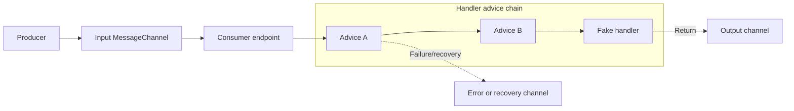

# Kiểm thử advice với handler giả lập trong Spring Integration

## 1. Mục tiêu và phạm vi

Trong Spring Integration, **advice chain** là chuỗi các đối tượng advice bao quanh lời gọi tới một message handler. Advice có thể ghi log, đo thời gian, retry, áp transaction hoặc chuyển lỗi sang recovery. Khi thêm advice, số lần handler chạy, exception cuối cùng, reply và thread thực thi có thể thay đổi. Vì vậy, chỉ kiểm tra kết quả trả về của method là chưa đủ.

Bài **“Kiểm thử advice với handler giả lập”** thuộc chương **Advice chain** của module **SPRING_INTEGRATION_RUNTIME**. Phạm vi liên hệ trực tiếp với vận hành message flow: channel, endpoint, consumer, poller, executor, transaction, retry, message store, lỗi và correlation. Mục tiêu là thiết kế kiểm thử có thể tái hiện lỗi một cách chủ động, sau đó quan sát đúng ranh giới runtime.

**Handler giả lập (fake handler)** là lớp Java thay cho nghiệp vụ thật. Ta điều khiển nó thành công ngay, lỗi một số lần rồi thành công, hoặc luôn lỗi; fake không gọi API hay database nên test nhanh và ổn định.

Sau bài này, bạn có thể:

1. Kiểm chứng `RequestHandlerRetryAdvice` đã được gắn vào đúng endpoint và thực sự gọi lại handler.
2. Assert số attempts, exception retryable/nonretryable, reply và recovery sau khi hết retry.
3. Quan sát thứ tự advice và giải thích vì sao advice nằm trong/ngoài retry cho kết quả khác nhau.
4. Phân biệt test của `DirectChannel` đồng bộ với `ExecutorChannel`, polling consumer và message store.
5. Thiết kế test riêng cho transaction rollback, idempotency và correlation.

> **Phiên bản minh họa:** Spring Integration 6.5.x, Spring Retry 2.x, Spring Framework 6.x, JUnit Jupiter 5 và Java 17+. Khi đổi phiên bản, cần đối chiếu lại API và cơ chế handler advice.

## 2. Phân định phạm vi của advice



Trong Java DSL, cấu hình như `.handle(fake, "handle", spec -> spec.advice(retryAdvice))` đặt advice tại **lời gọi của handler đó**. Nó không tự retry toàn bộ flow từ producer. Lỗi conversion trước khi handler được gọi có thể nằm ngoài phạm vi advice; lỗi của một downstream endpoint khác cũng không được bao tự động.

Ba mức kiểm thử bổ sung cho nhau:

| Mức | Điều được chứng minh | Điều chưa được chứng minh |
| --- | --- | --- |
| Unit test `RetryTemplate`/policy | Số attempts, loại exception, backoff và callback thuần. | Advice thực sự được gắn vào endpoint trong flow. |
| Integration test với fake handler | Wiring channel → endpoint → advice → handler → reply/error. | Ack/rollback của broker, database, mạng ngoài. |
| End-to-end với adapter/transport thật | Redelivery, transaction, timeout, persistence và recovery thực tế. | Không đủ nhanh hoặc cô lập để thay thế test nhỏ. |

**Quy ước attempts:** `maxAttempts = 3` trong Spring Retry bao gồm **lần đầu + tối đa hai lần thử lại**. Handler lỗi hai lần rồi thành công sẽ được gọi tổng cộng ba lần.

## 3. Ma trận tình huống trước khi viết test

| Tình huống | Fake handler | Các assertion cần có |
| --- | --- | --- |
| Thành công ngay | Trả `ACCEPTED` ở lần đầu. | Một call, một reply, không có recovery. |
| Lỗi tạm thời | Hai calls đầu ném lỗi retryable, call thứ ba thành công. | Ba calls, một reply, không có reply trùng. |
| Retry hết giới hạn | Luôn ném lỗi retryable, `maxAttempts=3`. | Ba calls, không có success reply, exception hoặc recovery hợp lệ. |
| Lỗi nghiệp vụ | Luôn ném lỗi không retryable. | Một call, không tạo vòng lặp vô ích. |
| Chain nhiều advice | Hai probes ghi before/after. | Thứ tự event và số lần gọi từng advice đúng. |
| Recovery | Hết attempts rồi phát `ErrorMessage`. | Một recovery event, không có reply thành công giả. |
| Thread bất đồng bộ | Handler chạy qua executor hoặc poller. | Quan sát lỗi trên worker, không phụ thuộc `send()` ném đồng bộ. |
| Side effect | Fake “ghi” dữ liệu rồi ném timeout. | Có bảo vệ idempotency, không phát sinh kết quả nghiệp vụ trùng. |

Test nên đọc số attempts từ fake **và** kiểm tra kênh reply/error: chỉ assert `calls == 3` có thể bỏ sót handler gửi hai reply hoặc recovery báo thành công giả.

## 4. Ví dụ integration test hoàn chỉnh với handler giả lập

Ví dụ này định nghĩa fake, flow và assertions trong cùng một lớp test. Sử dụng `DirectChannel` để sender, advice và handler chạy đồng bộ, còn `QueueChannel` nhận kết quả. Phần kiểm thử cần các dependencies Spring Integration Core, Spring Retry, spring-test và JUnit 5.

```java
import java.util.concurrent.atomic.AtomicInteger;

import org.junit.jupiter.api.Test;
import org.springframework.beans.factory.annotation.Autowired;
import org.springframework.beans.factory.annotation.Qualifier;
import org.springframework.context.annotation.Bean;
import org.springframework.context.annotation.Configuration;
import org.springframework.integration.annotation.EnableIntegration;
import org.springframework.integration.channel.DirectChannel;
import org.springframework.integration.channel.QueueChannel;
import org.springframework.integration.dsl.IntegrationFlow;
import org.springframework.integration.handler.advice.RequestHandlerRetryAdvice;
import org.springframework.messaging.Message;
import org.springframework.messaging.MessageChannel;
import org.springframework.messaging.PollableChannel;
import org.springframework.messaging.handler.annotation.Payload;
import org.springframework.messaging.support.GenericMessage;
import org.springframework.retry.support.RetryTemplate;
import org.springframework.test.annotation.DirtiesContext;
import org.springframework.test.context.junit.jupiter.SpringJUnitConfig;

import static org.junit.jupiter.api.Assertions.*;

@SpringJUnitConfig(AdviceChainTest.Config.class)
@DirtiesContext(classMode = DirtiesContext.ClassMode.AFTER_EACH_TEST_METHOD)
class AdviceChainTest {

    @Autowired
    @Qualifier("testInput")
    MessageChannel input;

    @Autowired
    @Qualifier("testOutput")
    PollableChannel output;

    @Autowired
    FakeHandler fake;

    @Test
    void successDoesNotRetry() {
        fake.failFirst(0, false);

        assertTrue(input.send(new GenericMessage<>("order-A")));

        assertEquals(1, fake.calls());
        assertEquals("ACCEPTED:order-A", receivePayload());
        assertNull(output.receive(0));
    }

    @Test
    void twoFailuresThenSuccessProduceOneReply() {
        fake.failFirst(2, false);

        assertTrue(input.send(new GenericMessage<>("order-B")));

        assertEquals(3, fake.calls()); // 1 lần đầu + 2 retries
        assertEquals("ACCEPTED:order-B", receivePayload());
        assertNull(output.receive(0)); // Không có reply thứ hai
    }

    @Test
    void threeRetryableFailuresExhaustPolicy() {
        fake.failFirst(100, false);

        RuntimeException error = assertThrows(RuntimeException.class,
                () -> input.send(new GenericMessage<>("order-C")));

        assertTrue(hasCause(error, IllegalStateException.class));
        assertEquals(3, fake.calls());
        assertNull(output.receive(0));
    }

    @Test
    void validationErrorIsNotRetried() {
        fake.failFirst(100, true);

        RuntimeException error = assertThrows(RuntimeException.class,
                () -> input.send(new GenericMessage<>("order-D")));

        assertTrue(hasCause(error, IllegalArgumentException.class));
        assertEquals(1, fake.calls());
        assertNull(output.receive(0));
    }

    private Object receivePayload() {
        Message<?> reply = output.receive(0);
        assertNotNull(reply);
        return reply.getPayload();
    }

    private static boolean hasCause(Throwable exception, Class<?> type) {
        for (Throwable cause = exception;
             cause != null;
             cause = cause.getCause()) {
            if (type.isInstance(cause)) {
                return true;
            }
        }
        return false;
    }

    static class FakeHandler {
        private final AtomicInteger attempts = new AtomicInteger();
        private volatile int failuresBeforeSuccess;
        private volatile boolean validationFailure;

        void failFirst(int times, boolean invalidRequest) {
            attempts.set(0);
            failuresBeforeSuccess = times;
            validationFailure = invalidRequest;
        }

        int calls() {
            return attempts.get();
        }

        public String handle(@Payload String orderId) {
            int attempt = attempts.incrementAndGet();
            if (attempt <= failuresBeforeSuccess) {
                if (validationFailure) {
                    throw new IllegalArgumentException("Invalid order");
                }
                throw new IllegalStateException("Temporary downstream outage");
            }
            return "ACCEPTED:" + orderId;
        }
    }

    @Configuration
    @EnableIntegration
    static class Config {
        @Bean
        FakeHandler fakeHandler() {
            return new FakeHandler();
        }

        @Bean
        MessageChannel testInput() {
            return new DirectChannel();
        }

        @Bean
        PollableChannel testOutput() {
            return new QueueChannel();
        }

        @Bean
        RequestHandlerRetryAdvice testRetryAdvice() {
            RetryTemplate template = RetryTemplate.builder()
                    .maxAttempts(3)
                    .retryOn(IllegalStateException.class)
                    .traversingCauses()
                    .noBackoff() // Loại thời gian chờ khỏi test
                    .build();

            RequestHandlerRetryAdvice advice = new RequestHandlerRetryAdvice();
            advice.setRetryTemplate(template);
            return advice;
        }

        @Bean
        IntegrationFlow testFlow(FakeHandler fakeHandler,
                                 RequestHandlerRetryAdvice testRetryAdvice) {
            return IntegrationFlow.from("testInput")
                    .handle(fakeHandler, "handle",
                            e -> e.advice(testRetryAdvice))
                    .channel("testOutput")
                    .get();
        }
    }
}
```

### Giải thích các quyết định trong test

- `input.send(...)` đi qua **channel và endpoint thật**, do đó xác minh `RequestHandlerRetryAdvice` thực sự được gắn. Gọi thẳng `fake.handle(...)` chỉ test phương thức Java; tự gọi `retryTemplate.execute(...)` chỉ test Spring Retry.
- `.maxAttempts(3)` tính cả attempt đầu; `.noBackoff()` giữ test nhanh, không phụ thuộc scheduler. Muốn kiểm tra timing hãy viết test riêng.
- Spring Integration có thể bọc exception từ handler trong `MessagingException` hoặc wrapper khác. `.traversingCauses()` giúp policy phân loại lỗi gốc; `hasCause(...)` giúp assertion ít phụ thuộc lớp wrapper.
- `@DirtiesContext` tạo context mới sau mỗi test, tránh chia sẻ bộ đếm và queue. Với bộ test lớn có thể reset fake trước mỗi test thay thế, nhưng phải xử lý triệt để state/channels và tác vụ chạy dở.
- `receive(0)` đủ vì `DirectChannel` trong ví dụ đồng bộ. Với thread khác hoặc polling consumer phải chờ có timeout.

## 5. Kiểm thử thứ tự advice trong chain

Với hai advice A và B, thứ tự bọc AOP thông thường là:

```text
A.before
    B.before
        handler
    B.after
A.after
```

Để kiểm tra một chain thực sự được gọi đúng thứ tự, dùng `MethodInterceptor` lưu event:

```java
import java.util.List;
import org.aopalliance.intercept.MethodInterceptor;

static MethodInterceptor probe(String name, List<String> events) {
    return invocation -> {
        events.add(name + ".before");
        try {
            return invocation.proceed();
        }
        finally {
            events.add(name + ".after");
        }
    };
}
```

Trong một **flow test riêng**, gắn `outerProbe` ở trước retry và `innerProbe` ở sau retry:

```java
// outerProbe và innerProbe là MethodInterceptor; events là list thread-safe.
return IntegrationFlow.from("testInput")
        .handle(fakeHandler, "handle",
                e -> e.advice(outerProbe, testRetryAdvice, innerProbe))
        .channel("testOutput")
        .get();
```

Khi fake lỗi hai attempts đầu rồi thành công ở attempt ba, chuỗi event kỳ vọng theo cách bao quanh này là:

```text
outer.before
inner.before
inner.after
inner.before
inner.after
inner.before
inner.after
outer.after
```

Giải thích: outer probe bọc **toàn bộ lời gọi retry** nên chạy một cặp before/after; inner probe nằm **bên trong retry** nên chạy ba cặp. Nếu hoán đổi vị trí, số lần ghi log hoặc thời gian đo tại từng advice thay đổi. Test cần assert thứ tự toàn bộ event, `fake.calls() == 3`, `outer.before == 1` và `inner.before == 3`; nếu thực tế khác, kiểm tra chain cuối cùng được endpoint đăng ký thay vì chỉ kiểm tra tên bean.

**Liên hệ transaction:** retry bọc transaction advice có thể tạo transaction mới ở mỗi attempt nếu propagation và proxy phù hợp; transaction advice bọc retry có thể đặt tất cả attempts trong một transaction đã bị đánh dấu `rollback-only` từ lỗi đầu. Fake và event log chỉ kiểm chứng thứ tự gọi, chưa đủ chứng minh commit/rollback đúng.

## 6. Kiểm thử recovery khi retry đã hết

Không phải mọi lỗi sau lần retry cuối đều được ném về sender. Khi có `RecoveryCallback`, advice có thể chuyển lỗi sang một channel hoặc trả fallback:

| Cấu hình | Hành vi kết thúc | Assertion phải quan sát |
| --- | --- | --- |
| Không có recovery callback | Exception thường được ném lại nếu handler vẫn lỗi. | `assertThrows(...)` ở đường đồng bộ, không có success reply. |
| `ErrorMessageSendingRecoverer` | Gửi `ErrorMessage` đến recovery channel. | Một error event, không có success reply, exception và failed message có thể truy vết. |
| Recovery trả fallback hợp lệ | Có thể hoàn tất invocation với kết quả thay thế. | Giá trị fallback chính xác, không được đánh đồng với kết quả xử lý thật. |
| Recovery tự ném exception | Chuyển lỗi cho tầng caller/endpoint xử lý tiếp. | Exception cuối cùng và error handling ở đúng tầng. |

Ví dụ thay advice ở mục 4 bằng cấu hình recovery trong **một test context độc lập**. Thêm channel thu lỗi:

```java
import org.springframework.beans.factory.annotation.Qualifier;
import org.springframework.context.annotation.Bean;
import org.springframework.integration.channel.QueueChannel;
import org.springframework.integration.handler.advice.ErrorMessageSendingRecoverer;
import org.springframework.integration.handler.advice.RequestHandlerRetryAdvice;
import org.springframework.messaging.MessageChannel;
import org.springframework.messaging.PollableChannel;
import org.springframework.retry.support.RetryTemplate;

@Bean
PollableChannel recoveryEvents() {
    return new QueueChannel();
}

@Bean
RequestHandlerRetryAdvice adviceWithRecovery(
        @Qualifier("recoveryEvents") MessageChannel recoveryChannel) {

    RetryTemplate template = RetryTemplate.builder()
            .maxAttempts(3)
            .retryOn(IllegalStateException.class)
            .traversingCauses()
            .noBackoff()
            .build();

    RequestHandlerRetryAdvice advice = new RequestHandlerRetryAdvice();
    advice.setRetryTemplate(template);
    advice.setRecoveryCallback(
            new ErrorMessageSendingRecoverer(recoveryChannel));
    return advice;
}
```

Trong flow test recovery, cấu hình `endpoint.advice(adviceWithRecovery)` thay cho `testRetryAdvice`, giữ fake, input và output tương ứng. Test nhận thêm `PollableChannel recoveryEvents` qua injection. Các assertions như sau:

```java
import org.springframework.messaging.Message;
import org.springframework.messaging.support.ErrorMessage;
import org.springframework.messaging.support.MessageBuilder;

fake.failFirst(100, false);
input.send(MessageBuilder.withPayload("order-42")
        .setHeader("correlationId", "payment-42")
        .build());

assertEquals(3, fake.calls());
assertNull(output.receive(0));               // Không có business reply

Message<?> failure = recoveryEvents.receive(0);
assertNotNull(failure);
assertTrue(failure instanceof ErrorMessage);
assertNotNull(((ErrorMessage) failure).getPayload());
assertNull(recoveryEvents.receive(0));        // Đúng một event recovery
```

Khi xác minh `correlationId`, tìm `failedMessage` trong `MessagingException` thích hợp bên trong payload lỗi (có thể phải đi qua wrapper), rồi đối chiếu header với message ban đầu. **Không** giả định mọi header của message gốc đều xuất hiện trực tiếp trên **ErrorMessage headers**. Phân biệt ba thực thể: original message, failed message do exception giữ và error message được gửi qua channel.

Một điểm dễ bỏ sót: khi callback đã gửi error event và trả `null`, lời gọi `send()` ở flow đồng bộ có thể hoàn tất mà không ném lỗi, dù fake chưa từng thành công. Test phải xác nhận trạng thái nghiệp vụ từ output/recovery và side effect; riêng `send() == true` chỉ nói dispatch thành công.

Trường hợp có `errorChannel` của inbound adapter, nó khác với channel `recoveryEvents` được recoverer trực tiếp gửi tới. Nguồn transport có thể quyết định ack/rollback khác nhau tùy exception cuối cùng có truyền ra khỏi handler hay không; cần test với nguồn thật khi semantics đó quan trọng.

## 7. Kiểm thử nguyên nhân lỗi: đừng retry sai tầng

Để tìm phạm vi của advice, có thể giả lập nhiều vị trí gây lỗi:

| Vị trí lỗi | Fake được gọi bao nhiêu lần? | Ý nghĩa |
| --- | --- | --- |
| Converter hoặc resolver thất bại **trước khi** đến handler | Có thể bằng 0. | Retry advice bọc handler không nhất thiết xử lý được lỗi ở tầng trước. |
| Fake ném exception retryable | Tối đa `maxAttempts`. | Đây là hành vi điển hình của `RequestHandlerRetryAdvice`. |
| Fake ném exception không retryable | Thường một lần rồi dừng/recovery. | Policy phải nhận diện root cause đúng. |
| Handler thành công nhưng một endpoint sau nó ném lỗi | Fake trước đó có thể chỉ chạy một lần. | Advice tại handler trước không tự bao endpoint downstream khác. |
| Producer/adapter thất bại trước khi gửi message | Fake bằng 0. | Lỗi nguồn có cơ chế retry/redelivery riêng. |

Spring Integration có thể bọc exception handler thành `MessageHandlingException`; khi dùng `.retryOn(SomeException.class)`, cần kiểm tra policy có nhìn vào nguyên nhân sâu hơn không. Đoạn `.traversingCauses()` ở mục 4 nhằm tránh test cho kết quả sai vì wrapper, đồng thời vẫn không retry `IllegalArgumentException`.

Một cách kiểm tra hữu ích là cho fake ghi mỗi attempt vào danh sách và xác minh **không có hai reply**, kể cả khi method chạy ba lần. Nếu một handler có side effect trước khi ném exception, ba attempts có thể tạo ba side effect, dù chỉ có một reply cuối cùng. Vì thế phải kiểm tra thêm idempotency.

## 8. Kiểm thử thread, executor và poller

Ở mục 4, `DirectChannel` xử lý đồng bộ nên `output.receive(0)` sau `input.send(...)` là hợp lý. Với `ExecutorChannel` hoặc `QueueChannel` + polling consumer:

1. Producer có thể hoàn tất `send()` trước khi handler thực sự chạy.
2. Exception xảy ra ở worker/poller thread; không thể luôn dùng `assertThrows(...)` bao quanh `send()`.
3. Retry có backoff giữ thread chạy handler, làm tăng queue depth và giảm throughput.
4. `receive(0)` có thể trả `null` do reply chưa đến, không phải do advice sai.

Trong test bất đồng bộ, dùng giới hạn chờ:

```java
Message<?> reply = output.receive(2_000);
assertNotNull(reply, "No reply before test deadline");
```

Dùng `CountDownLatch` để điều khiển thời điểm handler bắt đầu và kết thúc mà không phụ thuộc thời gian ngủ tùy ý:

```java
import java.util.concurrent.CountDownLatch;
import java.util.concurrent.TimeUnit;

CountDownLatch entered = new CountDownLatch(1);
CountDownLatch release = new CountDownLatch(1);

// Trong fake handler chạy bởi executor:
entered.countDown();
if (!release.await(2, TimeUnit.SECONDS)) {
    throw new IllegalStateException("Simulated timeout");
}
// Trong test: entered.await(timeout,...); assert trạng thái;
// sau đó release.countDown() trong finally.
```

Khi cần chứng minh handler thực sự chạy trên thread khác, fake có thể ghi `Thread.currentThread().getName()` (hoặc định danh thread) vào một collector thread-safe. Đừng assert tiền tố tên thread nếu executor được cấu hình khác nhau ở CI; so sánh định danh với producer thread hoặc kiểm tra thuộc tính thực sự cần.

**Backoff:** các test logic retry nên dùng `noBackoff()` để không chờ. Viết test riêng cho `FixedBackOffPolicy` hoặc `ExponentialBackOffPolicy`: đo `System.nanoTime()` và chấp nhận sai số scheduler, không assert chính xác từng mili-giây. Một test quá chặt về timing có thể gây lỗi ngẫu nhiên dù ứng dụng đúng.

## 9. Transaction, side effect, correlation và message store

Fake chỉ giữ `AtomicInteger` và trả chuỗi **không mô phỏng rollback**. Khi mục tiêu là transaction, cần một test với transaction manager và nguồn dữ liệu thực sự tham gia transaction. Một tình huống nên kiểm tra:

```text
Attempt #1: ghi record A vào database -> giả lập lỗi
Attempt #2: ghi record A -> thành công
Kỳ vọng nghiệp vụ: chỉ một record A được commit.
```

Kiểm tra cả thứ tự transaction advice ở ngoài retry và retry ở ngoài transaction. Với propagation phù hợp, mỗi attempt có thể bắt đầu một transaction riêng, hoặc tất cả attempts nằm trong transaction chung và bị `rollback-only` sau lần đầu. Điều này cần được đo bằng commit/rollback và dữ liệu đọc lại, không suy luận từ `fake.calls()`.

**Idempotency:** ngay cả khi transaction local rollback, một lời gọi HTTP đã ghi thành công ở dịch vụ xa vẫn có thể trả timeout. Retry có thể gửi lại và ghi trùng. Bài test cần tạo business/idempotency key ổn định, cho fake ghi trạng thái theo key và giả lập lỗi *sau* side effect để chứng minh vẫn chỉ có một kết quả nghiệp vụ. `correlationId` giúp truy vết nhưng tự nó không ngăn thực thi trùng.

**Message store:** `QueueChannel` có thể dùng store trong bộ nhớ hoặc persistent store; retry state và message store có vòng đời khác nhau. Test khi restart hoặc redelivery phải dùng persistent store/broker thật, kiểm tra message được ack, retry, dead-letter hay phát lại và trạng thái liên quan được duy trì thế nào.

**Correlation và lỗi:** bổ sung header `correlationId` cho original message; nếu recovery phát `ErrorMessage`, kiểm tra mối liên hệ qua failed message, không chỉ qua tên channel. Với nhiều message song song, kiểm tra từng business key thay vì giả định thứ tự queue luôn giống thứ tự producer gửi.

## 10. Thiết kế fake handler an toàn cho kiểm thử lặp và song song

Fake ở mục 4 tối ưu cho test chạy **tuần tự, mỗi test có context riêng**. Với concurrency test, một bộ đếm `AtomicInteger` dùng chung không thể hiện số attempts **theo từng message**. Nên lập state theo key:

```java
import java.util.concurrent.ConcurrentHashMap;
import java.util.concurrent.atomic.AtomicInteger;

class PerMessageAttempts {
    private final ConcurrentHashMap<String, AtomicInteger> calls =
            new ConcurrentHashMap<>();

    int next(String businessKey) {
        return calls.computeIfAbsent(businessKey, ignored -> new AtomicInteger())
                .incrementAndGet();
    }

    int count(String businessKey) {
        AtomicInteger counter = calls.get(businessKey);
        return counter == null ? 0 : counter.get();
    }
}
```

Trong fake, quyết định lỗi theo `businessKey` của message và số lần gọi `next(key)`. Khi assert kết quả, dùng cùng key để tránh trộn hai luồng. Tránh lưu message cuối cùng vào một field mutable dùng chung; message có thể được xử lý đồng thời. Nếu test dùng Mockito thay fake, cũng cần đảm bảo stub có hành vi nhất quán với concurrency và kiểm tra số invocations theo tham số cụ thể.

Với nhiều test sử dụng chung Spring context, phải cleanup hàng đợi, trạng thái giả lập, các tasks trong executor và external side effect. `@DirtiesContext` là lựa chọn dễ hiểu khi bài test nhỏ; test suite lớn có thể tối ưu sau khi đã chứng minh việc reset đầy đủ.

## 11. Quan sát và chẩn đoán lỗi khi test advice

Những tín hiệu nên thu thập:

| Tín hiệu | Nguồn | Ý nghĩa |
| --- | --- | --- |
| Số `attempts` | Fake hoặc retry listener | Policy thực sự giới hạn số lần thực thi. |
| Thứ tự before/after | Probe `MethodInterceptor` | Chain có đúng thứ tự và phạm vi không. |
| Root exception | Throwable chain | Loại lỗi được retry hay đưa sang recovery. |
| Reply/recovery count | Output/recovery channels | Không có reply thành công giả hoặc event thừa. |
| Thread name/id | Producer, handler, recoverer | Xác định thread boundary của channel/poller. |
| `correlationId` | Input, failed message | Ghép đúng lỗi với message gốc. |
| Duration/queue depth | Probe và metrics endpoint | Nhận diện backoff giữ worker, backlog hoặc timeout. |

Các lỗi thường gặp và cách sửa:

| Biểu hiện | Nguyên nhân thường gặp | Hướng kiểm tra |
| --- | --- | --- |
| Fake chỉ chạy một lần dù dự kiến ba. | Advice chưa gắn, exception không retryable, wrapper exception chưa được duyệt. | `.advice(...)`, `retryOn(...)`, `traversingCauses()`, root cause. |
| Test gọi `RetryTemplate` pass nhưng flow không retry. | Test chưa đi qua endpoint thật. | Gửi message qua input channel của flow. |
| Test mất hàng giây dù không gọi mạng. | Backoff của production giữ nguyên. | `noBackoff()` cho test logic. |
| `send()` không ném lỗi khi handler thất bại. | Recovery callback đã nuốt lỗi hoặc consumer bất đồng bộ. | Recovery channel, error handling và thread thực thi. |
| Reply xuất hiện hai lần. | Hai endpoint tạo reply hoặc side effect lặp. | Flow topology, reply routing, idempotency. |
| Test async chập chờn. | `receive(0)` quá sớm, sleep tùy ý, state dùng chung. | Receive với timeout, latch, context tách biệt. |
| Assertion exception quá mong manh. | Framework bọc lỗi ở nhiều tầng. | Kiểm tra cause chain và hậu quả nghiệp vụ. |
| Test rollback pass với list trong RAM. | List không tham gia transaction manager. | Test với kho dữ liệu có rollback thật. |

**Vòng đời IntegrationFlow:** nếu flow đăng ký động bằng `IntegrationFlowContext`, cần test nó đã start trước khi nhận message và ngừng nhận sau stop/remove. Một advice bean có thể được dùng cho nhiều handler; không nên giữ state kiểm thử mutable bên trong advice singleton rồi dùng chung nhiều flow mà không đồng bộ.

## 12. Bài tập thực hành và câu hỏi tự kiểm tra

**Bài tập 1 — Số attempts:** đổi `maxAttempts(3)` thành 1 và 4 trong test. Fake lỗi hai lần rồi thành công. Dự đoán số lần gọi, kết quả, exception hoặc recovery của từng cấu hình.

**Bài tập 2 — Loại lỗi:** thêm `PermanentBusinessException`. Viết policy chỉ retry `IllegalStateException`, rồi assert `PermanentBusinessException` dừng sau một attempt.

**Bài tập 3 — Advice ordering:** gắn `outerProbe` và `innerProbe` trước/sau retry. Assert chuỗi event khi handler thành công lần đầu và khi lỗi hai lần. Hoán đổi thứ tự và giải thích khác biệt.

**Bài tập 4 — Recovery:** tạo test context riêng dùng `adviceWithRecovery`, gửi input có `correlationId`; kiểm tra ba attempts, một `ErrorMessage`, không có business reply. Phân tích recovery callback ảnh hưởng cách source coi message đã xử lý.

**Bài tập 5 — Executor:** chuyển handler sang thread executor, ghi tên thread và dùng latch. Giải thích vì sao `assertThrows(...)` bọc `send()` không còn đủ để quan sát exception ở handler.

**Bài tập 6 — Idempotency:** cho fake lưu record theo business key rồi ném timeout sau khi lưu ở attempt đầu. Chứng minh retries không tạo nhiều record.

**Bài tập 7 — Transport:** với nguồn hỗ trợ redelivery, kiểm tra tổng số attempts ở handler và broker, ack/rollback và vị trí cuối của poison message sau khi hết retry.

Câu hỏi tự kiểm tra:

1. Vì sao test phải gửi message qua channel thay vì chỉ gọi thẳng method của fake?
2. Vì sao `fake.calls() == 3` vẫn chưa đủ để chứng minh xử lý đúng?
3. `maxAttempts = 3` là tổng cộng bao nhiêu lần gọi handler?
4. Khi recovery callback gửi `ErrorMessage`, vì sao `send()` có thể hoàn tất bình thường?
5. Điều gì thay đổi khi retry advice nằm ở ngoài hoặc trong một transaction advice?
6. Vì sao exception của polling consumer không nhất thiết truyền lại producer?
7. Fake trong RAM có thể kiểm chứng rollback transaction thật không?

## 13. Tài liệu tham khảo

- Spring Integration 6.5 — [Handler Advice: Provided Advice Classes](https://docs.spring.io/spring-integration/reference/6.5/handler-advice/classes.html).
- Spring Integration 6.5 — [`RequestHandlerRetryAdvice` API](https://docs.spring.io/spring-integration/docs/6.5.0/api/org/springframework/integration/handler/advice/RequestHandlerRetryAdvice.html).
- Spring Integration 6.5 — [`ErrorMessageSendingRecoverer` API](https://docs.spring.io/spring-integration/docs/6.5.0/api/org/springframework/integration/handler/advice/ErrorMessageSendingRecoverer.html).
- Spring Integration 6.5 — [Testing Support](https://docs.spring.io/spring-integration/reference/6.5/testing.html).
- Spring Integration 6.5 — [Java DSL](https://docs.spring.io/spring-integration/reference/6.5/dsl.html).
- Spring Retry 2.x — [`RetryTemplate` API](https://docs.spring.io/spring-retry/docs/2.0.x/apidocs/spring.retry/org/springframework/retry/support/RetryTemplate.html).
- Spring Framework — [`@DirtiesContext` API](https://docs.spring.io/spring-framework/docs/current/javadoc-api/org/springframework/test/annotation/DirtiesContext.html).
