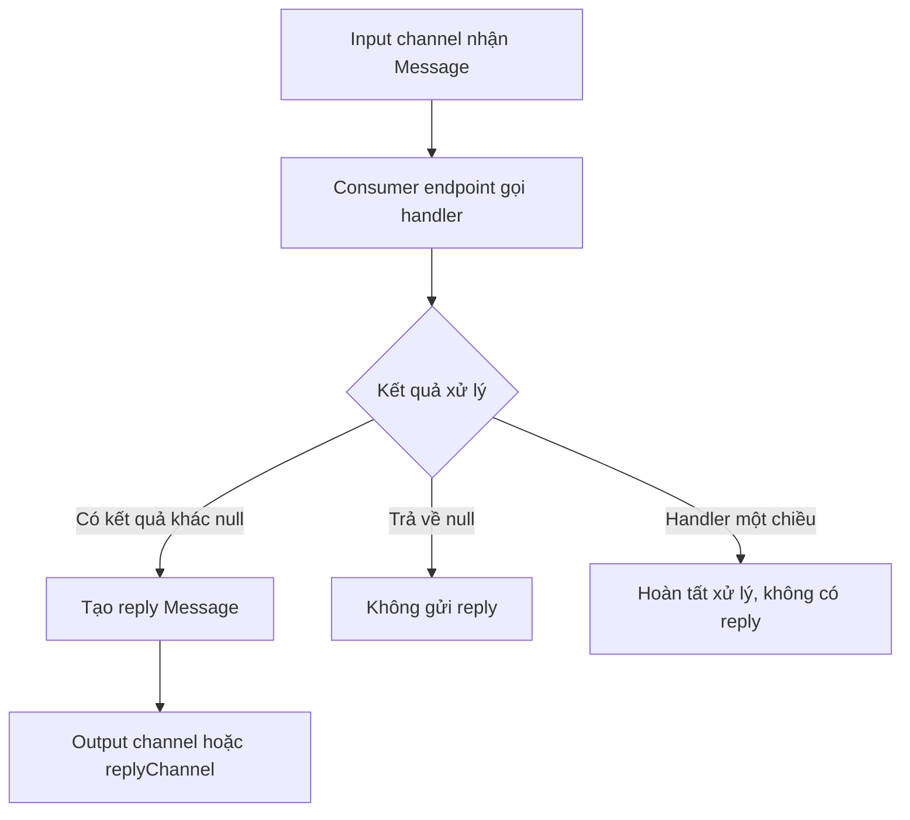

# Reply message, null reply và one-way handler

Trong module `SPRING_INTEGRATION_RUNTIME`, phần **Message runtime** giải thích cách Spring Integration điều phối message flow qua channel, endpoint, consumer, poller và executor. Một điểm cần nắm vững khi đọc hoặc thiết kế flow là: sau khi một endpoint xử lý message, nó có thể tạo reply, chủ động không tạo reply, hoặc chỉ thực hiện một thao tác một chiều. Ba trường hợp này có hành vi runtime khác nhau và ảnh hưởng trực tiếp đến các bước phía sau.

## 1. Reply bắt đầu từ hợp đồng của handler

Spring Integration truyền dữ liệu dưới dạng `Message<?>`. Một message có payload và headers; headers mang metadata như định tuyến, correlation, timestamp hoặc thông tin phục vụ xử lý.

Một consumer endpoint nhận message từ input channel rồi gọi handler. Endpoint quản lý việc kết nối handler với hạ tầng message, còn handler thực hiện nghiệp vụ. Vì vậy, cần phân biệt:

- **Reply message**: handler tạo ra một kết quả khác null. Spring Integration đóng gói kết quả thành message đầu ra và gửi tới đích reply.
- **Null reply**: handler thuộc loại có khả năng tạo reply nhưng lần xử lý này trả về `null`. Không có message đầu ra được gửi.
- **One-way handler**: handler chỉ nhận và xử lý message, không có hợp đồng trả kết quả. Ví dụ điển hình là một phương thức trả về `void` hoặc một implementation của `MessageHandler`.

Hợp đồng Java của `MessageHandler` là `void handleMessage(Message<?> message)`. Handler kiểu này không trả reply thông qua giá trị return. Các handler tạo reply, chẳng hạn service activator hoặc transformer, được Spring Integration hỗ trợ bằng cơ chế reply-producing riêng.



Điểm quan trọng là **giá trị return của phương thức Java không tự động có nghĩa mọi handler đều phát ra message**. Loại handler và cấu hình endpoint quyết định runtime có tạo và gửi reply hay không.

## 2. Reply message được tạo và định tuyến như thế nào?

Với một reply-producing handler, phương thức xử lý có thể trả về payload hoặc một message. Khi trả về payload khác null, Spring Integration tạo message đầu ra để chuyển tiếp kết quả. Các header phù hợp từ request có thể được giữ lại để duy trì ngữ cảnh xử lý.

Đích gửi reply được xác định theo cấu hình endpoint và request:

1. Nếu endpoint có cấu hình `outputChannel`, đây là đích gửi reply được chỉ định rõ ràng.
2. Nếu không có `outputChannel`, runtime có thể sử dụng header `replyChannel` của request.
3. Header `replyChannel` có thể chứa một đối tượng `MessageChannel` hoặc tên channel để runtime phân giải.
4. Nếu handler tạo reply nhưng không có đích gửi hợp lệ, reply không thể được chuyển tiếp; cần kiểm tra cấu hình output channel và header định tuyến.

Trong Java DSL, channel đặt ngay sau một reply-producing endpoint được dùng làm đầu ra của endpoint đó:

```java
@Bean
IntegrationFlow processOrders(OrderService service) {
    return IntegrationFlow.from("orders.in")
        .handle(Order.class,
            (order, headers) -> service.process(order),
            endpoint -> endpoint.requiresReply(true))
        .channel("orders.out")
        .get();
}
```

Trong ví dụ này, `service.process(order)` trả kết quả để endpoint phát reply vào `orders.out`. Cấu hình `requiresReply(true)` thể hiện rằng mỗi lần xử lý đều phải tạo được reply. Nếu nghiệp vụ có thể không tìm thấy dữ liệu hoặc không tạo ra kết quả, cần thiết kế trường hợp đó rõ ràng trước khi bật cấu hình này.

Một request có thể mang sẵn reply channel. Ví dụ, phía gửi tạo request như sau:

```java
Message<String> request = MessageBuilder.withPayload("C-42")
    .setReplyChannel(replyChannel)
    .build();
```

Khi endpoint xử lý request mà không được cấu hình output channel riêng, `replyChannel` cung cấp đường trả kết quả về phía gửi. Cách này thường xuất hiện trong các tương tác request-reply, gateway hoặc khi dùng messaging template để gửi và chờ phản hồi.

Cần phân biệt ba header/khái niệm sau:

| Thành phần | Vai trò |
|---|---|
| `replyChannel` | Xác định nơi nhận reply của request |
| `errorChannel` | Định tuyến thông tin lỗi khi có exception theo cơ chế xử lý lỗi |
| `correlationId` | Nhận diện các message thuộc cùng một nhóm hoặc cùng ngữ cảnh nghiệp vụ; thường hữu ích với aggregator và resequencer |

`replyChannel` là thông tin định tuyến. `correlationId` là metadata tương quan. Có correlation ID không đồng nghĩa request đã có nơi nhận reply, và có reply channel cũng không tự động bảo đảm các message được gom nhóm đúng cách.

## 3. Null reply có nghĩa là không phát ra message

Trong Spring Integration, payload của một `Message` không được là `null`. Vì vậy, khi một reply-producing handler trả về `null`, runtime hiểu rằng lần xử lý đó không tạo reply. Nó không tạo một message có payload null.

Ví dụ, service tìm khách hàng có thể trả về `null` khi không tìm thấy bản ghi:

```java
@Bean
IntegrationFlow findCustomer(CustomerService service) {
    return IntegrationFlow.from("customer.lookup")
        .handle(String.class,
            (customerId, headers) -> service.find(customerId))
        .channel("customer.found")
        .get();
}
```

Nếu `service.find(customerId)` trả về một khách hàng, message kết quả đi tiếp tới `customer.found`. Nếu kết quả là `null`, endpoint không gửi reply và bước downstream không nhận được message cho lần xử lý đó.

### 3.1. Cấu hình requiresReply

Với reply-producing handler, `requiresReply` xác định việc không tạo reply có được chấp nhận hay không:

- Mặc định, `requiresReply` là `false`: kết quả null được xem là không có reply; endpoint không phát message đầu ra.
- Khi đặt `requiresReply(true)`: nếu handler không tạo reply, Spring Integration ném `ReplyRequiredException`.

Ví dụ:

```java
.handle(Order.class,
    (order, headers) -> orderService.process(order),
    endpoint -> endpoint.requiresReply(true))
```

Cấu hình này phù hợp khi hợp đồng nghiệp vụ bắt buộc phải có kết quả, chẳng hạn xử lý một lệnh đã được xác thực và mọi request hợp lệ đều phải nhận trạng thái xử lý. Nó giúp phát hiện sớm một đường code bất ngờ trả về null.

Không nên bật `requiresReply(true)` chỉ để “chắc chắn flow chạy tiếp”. Nếu nghiệp vụ cho phép không có kết quả, cấu hình này biến một trường hợp được dự kiến thành exception. Hãy quyết định rõ liệu không có kết quả là trạng thái hợp lệ hay là lỗi hợp đồng.

### 3.2. Null reply ảnh hưởng tới phía gọi

Hành vi tiếp theo phụ thuộc vào cách phía gọi tương tác:

- Với kiểu gửi một chiều, phía gửi chỉ gửi message; nó không chờ reply.
- Với request-reply đồng bộ, phía gọi chờ trên reply channel. Nếu handler không phát reply, phía gọi có thể chờ tới khi hết `replyTimeout`, sau đó nhận kết quả timeout hoặc không có reply tùy API đang sử dụng.
- Với flow bất đồng bộ, reply có thể đến muộn qua channel khác. Cần đặt timeout và correlation phù hợp với thời gian xử lý thực tế.

Vì thế, một flow có thể xử lý nghiệp vụ thành công nhưng phía gọi vẫn timeout nếu handler trả null trong khi phía gọi đang chờ reply. Null reply không tự động có nghĩa là nghiệp vụ thất bại; nó chỉ nói rằng không có message phản hồi được phát ra.

### 3.3. Null reply không thay thế cho filter hoặc kết quả nghiệp vụ

Dùng `return null` để biểu diễn mọi tình huống “không có dữ liệu” thường làm flow khó quan sát. Các trường hợp khác nhau có thể bị gộp thành cùng một biểu hiện: downstream không nhận được message.

Hãy chọn cơ chế theo ý nghĩa nghiệp vụ:

- Dùng **filter** khi muốn quyết định message có được đi tiếp hay không. Có thể cấu hình discard channel để xử lý message bị loại.
- Dùng **router** khi cần gửi message tới nhánh “tìm thấy”, “không tìm thấy” hoặc “không hợp lệ”.
- Trả về một **kết quả nghiệp vụ tường minh** khi phía sau cần biết trạng thái xử lý, ví dụ `FOUND`, `NOT_FOUND` hoặc `REJECTED`.
- Chỉ dùng null reply khi việc không phát ra message là hành vi có chủ đích và phía gọi/downstream đã được thiết kế để chấp nhận điều đó.

Ví dụ, thay vì để `null` mang nhiều nghĩa, service có thể trả về một đối tượng kết quả gồm trạng thái và dữ liệu. Khi đó flow có thể định tuyến theo trạng thái, ghi log hoặc trả một phản hồi rõ ràng cho caller.

## 4. One-way handler: nhận message nhưng không trả reply

One-way handler thực hiện một hành động và kết thúc việc xử lý message tại endpoint đó. Các ví dụ thường gặp:

- Ghi audit log hoặc lưu lịch sử.
- Gửi telemetry hoặc metric.
- Ghi dữ liệu vào hệ thống đích.
- Gọi một dịch vụ ngoài theo kiểu fire-and-forget.
- Thực hiện side effect mà không cần trả dữ liệu cho bước tiếp theo.

Một service activator có thể dùng phương thức trả về `void`:

```java
@ServiceActivator(inputChannel = "audit.events")
public void record(AuditEvent event) {
    auditService.store(event);
}
```

Hoặc dùng trực tiếp hợp đồng `MessageHandler` trong Java DSL:

```java
@Bean
IntegrationFlow auditFlow(AuditService auditService) {
    return IntegrationFlow.from("audit.events")
        .handle((MessageHandler) message ->
            auditService.store((AuditEvent) message.getPayload()))
        .get();
}
```

Trong hai ví dụ trên, endpoint tiêu thụ message và thực hiện side effect. Không có reply message được tạo từ giá trị return.

**One-way không có nghĩa là bỏ qua lỗi.** Nếu `auditService.store(...)` ném exception, lỗi vẫn đi qua cơ chế xử lý lỗi của endpoint, channel, poller hoặc flow. Khác biệt nằm ở việc handler không trả reply trong trường hợp thành công.

### 4.1. One-way handler có làm flow phía sau dừng lại không?

Có, nếu bước phía sau đang chờ reply từ handler đó. Một endpoint one-way không phát message đầu ra để chuyển sang bước tiếp theo. Tương tự, reply-producing handler trả null cũng không tạo message cho bước tiếp theo.

Nếu muốn vừa thực hiện side effect vừa tiếp tục xử lý cùng message, có thể chọn một trong các cách sau:

- Dùng handler trả lại payload hoặc message cần chuyển tiếp sau khi hoàn thành side effect.
- Dùng `wireTap` để gửi một nhánh phụ thực hiện audit/logging trong khi flow chính tiếp tục.
- Dùng publish-subscribe khi cần nhiều subscriber cùng nhận một message.

Ví dụ, handler vừa ghi audit vừa trả lại order:

```java
.handle(Order.class, (order, headers) -> {
    auditService.store(order);
    return order;
})
.channel("orders.next")
```

Ở đây handler không còn là one-way theo hợp đồng reply: nó tạo reply chứa order để flow chính tiếp tục. Nếu chỉ muốn audit ở nhánh phụ, `wireTap` thường diễn đạt ý định rõ hơn và tránh buộc logic audit phải quyết định message đầu ra của flow chính.

### 4.2. Adapter và gateway cũng thể hiện khác biệt này

Trong tích hợp hệ thống ngoài, cần chọn đúng loại endpoint:

- **Inbound adapter** nhận dữ liệu từ hệ thống ngoài và tạo Spring message để đưa vào flow.
- **Outbound adapter** nhận Spring message và gửi dữ liệu ra hệ thống ngoài; thông thường không tạo phản hồi nghiệp vụ.
- **Inbound gateway** nhận request từ hệ thống ngoài và có thể trả response về hệ thống đó.
- **Outbound gateway** gửi request tới hệ thống ngoài và nhận reply.

Nếu phía gọi cần phản hồi, hãy dùng gateway hoặc thiết kế reply channel tương ứng. Dùng adapter một chiều rồi chờ phản hồi sẽ tạo ra kỳ vọng sai về hợp đồng message.

## 5. Channel, poller và executor ảnh hưởng tới thời điểm nhận reply

Reply/null/one-way mô tả kết quả của handler. Channel và cơ chế dispatch quyết định message được chuyển tới handler ở đâu, khi nào và trên thread nào.

| Cơ chế | Hành vi thực thi | Hệ quả khi không có reply |
|---|---|---|
| `DirectChannel` | Subscriber thường chạy đồng bộ trên thread gửi | Bước tiếp theo trong reply path không được gọi nếu handler không tạo output |
| `ExecutorChannel` | Dispatch qua executor, xử lý có thể chạy trên thread khác | Phía request-reply vẫn cần nhận reply qua channel và có thể timeout nếu không có reply |
| `QueueChannel` + poller | Message được giữ trong queue và consumer lấy ra theo poller | Gửi vào queue không đồng nghĩa nghiệp vụ đã hoàn tất hoặc đã có reply |

Với `DirectChannel`, thời gian xử lý thường nằm trong lời gọi gửi message. Với `ExecutorChannel` hoặc `QueueChannel`, việc gửi và xử lý có thể tách rời. Do đó, khi chẩn đoán timeout, cần xem cả thời gian chờ trong queue, lịch poller, executor saturation và thời gian xử lý handler.

Không nên suy luận rằng dùng executor thì runtime tự tạo reply bất đồng bộ. Reply vẫn phải được handler tạo ra và gửi tới một đích hợp lệ. Nếu handler trả null hoặc là one-way, việc đổi channel không làm xuất hiện reply.

## 6. Phân biệt không có reply với xử lý lỗi

Ba tình huống dưới đây có ý nghĩa khác nhau:

| Tình huống | Kết quả runtime | Hướng xử lý |
|---|---|---|
| Handler trả null, `requiresReply=false` | Không có reply; không tự phát sinh exception chỉ vì null | Kiểm tra đây có phải nhánh nghiệp vụ hợp lệ không |
| Handler trả null, `requiresReply=true` | Ném `ReplyRequiredException` | Kiểm tra hợp đồng reply và đường code trả null |
| Handler ném exception | Xử lý lỗi theo error channel, error handler, advice hoặc cơ chế của endpoint | Kiểm tra nguyên nhân exception và chính sách retry/transaction |

`errorChannel` không phải nơi nhận “reply rỗng”. Một null reply không tự động tạo `ErrorMessage`. Nếu cần biểu diễn thất bại nghiệp vụ, hãy trả về một kết quả lỗi có cấu trúc hoặc chủ động ném exception theo hợp đồng của flow.

Nếu endpoint có transaction advice, exception như `ReplyRequiredException` có thể tham gia quy tắc rollback của transaction bao quanh lời gọi handler. Tuy nhiên, side effect đã thực hiện trên hệ thống ngoài transaction vẫn không tự được hoàn tác. Cần xác định ranh giới transaction và tính idempotent của thao tác trước khi dựa vào retry.

## 7. Cách chẩn đoán khi caller không nhận được reply

Khi một gateway hoặc thành phần request-reply không nhận được kết quả, nên kiểm tra theo thứ tự sau:

1. **Kiểm tra kiểu handler và giá trị return.** Phương thức có trả về null ở một nhánh nào không? Nó có phải `void` hoặc `MessageHandler` một chiều không?
2. **Kiểm tra `requiresReply`.** Nếu đang bật, mọi đường xử lý thành công có thực sự tạo reply khác null không?
3. **Kiểm tra đích reply.** Endpoint có `outputChannel` không? Nếu không, request có header `replyChannel` hợp lệ không? Tên channel có phân giải được và channel có subscriber phù hợp không?
4. **Kiểm tra flow phía sau.** Bước trước có phải one-way handler hoặc null reply khiến message không được phát ra không?
5. **Kiểm tra timeout và cơ chế dispatch.** Với gateway, xem `replyTimeout`; với queue, xem độ trễ poller; với executor, xem hàng đợi tác vụ và trạng thái thread pool.
6. **Phân loại lỗi.** Tìm `ReplyRequiredException`, lỗi phân giải channel, lỗi gửi message hoặc timeout. Mỗi loại chỉ ra một lớp nguyên nhân khác nhau.

Trong integration test, nên kiểm tra cả hai mặt: message có xuất hiện ở output channel khi handler trả kết quả, và không xuất hiện khi handler trả null/one-way. Nếu bật `requiresReply(true)`, cần có test xác nhận nhánh trả null phát sinh `ReplyRequiredException`. Kiểm tra hành vi của caller khi hết reply timeout cũng quan trọng nếu flow được gọi theo request-reply.

## 8. Quy tắc chọn hợp đồng phù hợp

| Nhu cầu nghiệp vụ | Thiết kế phù hợp |
|---|---|
| Luôn phải có kết quả cho caller | Reply-producing handler và `requiresReply(true)` |
| Có thể không có kết quả và caller chấp nhận không nhận reply | Reply-producing handler với null reply có chủ đích, `requiresReply(false)` |
| Cần báo rõ “không tìm thấy” hoặc “bị từ chối” | Trả về DTO/result có trạng thái hoặc định tuyến sang nhánh tương ứng |
| Chỉ ghi nhận hoặc thực hiện side effect | One-way handler, phương thức `void` hoặc `MessageHandler` |
| Thực hiện side effect rồi tiếp tục flow chính | Handler trả lại message/payload hoặc dùng `wireTap` cho nhánh phụ |
| Gửi request tới hệ thống ngoài và cần response | Gateway với cấu hình request-reply phù hợp |

Khi thiết kế message flow, hãy xác định ngay từ đầu endpoint có nhiệm vụ **tiêu thụ**, **biến đổi và trả reply**, hay **định tuyến** message. Sau đó chọn loại handler, output channel, reply channel và timeout tương ứng. Hợp đồng rõ ràng giúp tránh tình trạng caller chờ vô hạn, downstream âm thầm không nhận message hoặc một nhánh nghiệp vụ hợp lệ bị biến thành exception.

