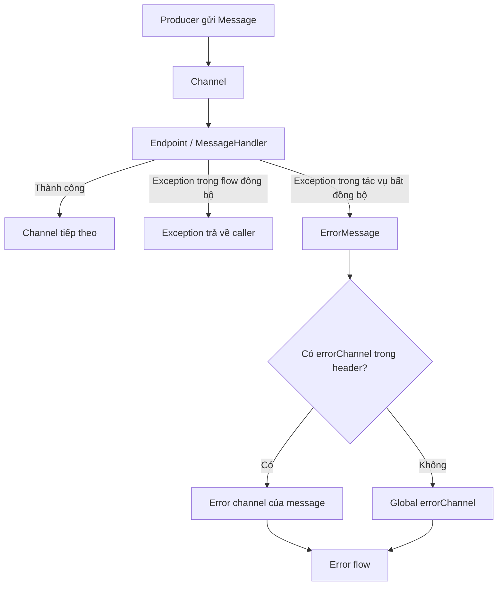

# ErrorMessage và exception trong flow

Trong Spring Integration, một message đi qua nhiều thành phần runtime: channel tiếp nhận và chuyển message, endpoint gọi handler, consumer thực thi công việc, còn poller hoặc executor quyết định thời điểm và thread xử lý. Vì vậy, khi một bước phát sinh lỗi, điều cần xác định đầu tiên là **lỗi xảy ra ở đâu và đang chạy trong ngữ cảnh đồng bộ hay bất đồng bộ**. Hai yếu tố này quyết định exception được trả về cho bên gửi hay được chuyển thành `ErrorMessage` trên một error channel.

`ErrorMessage` là cơ chế biểu diễn lỗi dưới dạng message để một flow khác có thể tiếp nhận và xử lý. Nó không thay thế toàn bộ cơ chế exception của Java hoặc Spring Messaging. Trong một số đường đi, exception vẫn được ném ngược về caller; trong những đường đi khác, runtime công bố một `ErrorMessage` để xử lý tách rời. Hiểu ranh giới này giúp thiết kế retry, transaction, lưu message lỗi và redrive mà không vô tình làm mất lỗi hoặc xử lý một message nhiều lần.

## 1. Exception phát sinh ở đâu trong message flow?

Một flow điển hình có thể được hình dung như sau:

```text
Producer -> Channel -> Endpoint -> MessageHandler -> Channel tiếp theo
```

Exception có thể xuất hiện tại nhiều vị trí:

- **Producer hoặc bước gửi message:** dữ liệu đầu vào không hợp lệ, lỗi khi tạo message, hoặc channel từ chối nhận message.
- **Channel:** không thể chuyển message, hết thời gian chờ khi gửi vào channel có giới hạn, hoặc executor từ chối tác vụ.
- **Endpoint hoặc handler:** lỗi chuyển đổi payload, lỗi gọi service, lỗi truy cập cơ sở dữ liệu, hoặc lỗi nghiệp vụ chưa được xử lý.
- **Poller và consumer:** lỗi khi lấy message từ nguồn polling, khi xử lý message lấy từ `QueueChannel`, hoặc khi chạy tác vụ theo lịch.
- **Hạ tầng runtime:** lỗi khi khởi tạo endpoint, thực thi tác vụ nền, hoặc gọi một thành phần phụ trợ.

Spring Messaging cung cấp `MessagingException` làm lớp exception nền cho nhiều lỗi liên quan đến message. Một số exception chuyên biệt thường gặp gồm:

| Exception | Ý nghĩa thường gặp |
|---|---|
| `MessagingException` | Lỗi tổng quát trong quá trình xử lý hoặc gửi message. |
| `MessageHandlingException` | Một message handler không xử lý được message. Exception này thường giữ tham chiếu đến message lỗi. |
| `MessageDeliveryException` | Không thể chuyển hoặc giao message đến đích. |
| `MessageTimeoutException` | Một thao tác gửi hoặc nhận message vượt quá thời gian chờ cho phép. |
| `MessageConversionException` | Không thể chuyển đổi message hoặc payload theo yêu cầu. |

Các exception có thể được bọc lồng nhau. Ví dụ, một lỗi truy cập dữ liệu có thể trở thành cause của `MessageHandlingException`, rồi được đưa vào `ErrorMessage`. Khi điều tra, cần tìm cause gốc thay vì chỉ đọc tên exception ngoài cùng. Với `MessagingException`, có thể kiểm tra `getFailedMessage()` để biết message mà thành phần xử lý xem là thất bại.

## 2. Cấu trúc và ý nghĩa của ErrorMessage

`ErrorMessage` thuộc Spring Messaging (`org.springframework.messaging.support.ErrorMessage`) và là một loại `Message` đặc biệt. Payload của nó là một đối tượng `Throwable`, tức exception hoặc error đã xảy ra. Ngoài payload, nó có thể giữ message ban đầu liên quan đến lỗi thông qua `getOriginalMessage()`.

```text
ErrorMessage
├── payload          -> Throwable (exception gây lỗi)
├── headers          -> MessageHeaders
└── originalMessage  -> Message<?> ban đầu, nếu runtime có thông tin này
```

Hai thông tin message cần phân biệt:

- `ErrorMessage.getOriginalMessage()` là message gốc được đính kèm khi tạo `ErrorMessage`. Nó có thể không tồn tại nếu lỗi xảy ra trước khi runtime có một message đầu vào, chẳng hạn một số lỗi trong bước polling hoặc hạ tầng.
- `MessagingException.getFailedMessage()` là message mà exception kiểu `MessagingException` ghi nhận là đã thất bại. Đây là thông tin nằm trong exception payload, vì vậy cần kiểm tra kiểu exception trước khi truy cập.

Ví dụ, `ErrorMessage` có thể chứa một `MessageHandlingException`; khi đó có thể kiểm tra cả `error.getOriginalMessage()` và `((MessagingException) error.getPayload()).getFailedMessage()`. Hai tham chiếu này phục vụ hai mục đích khác nhau và không nên mặc định luôn giống nhau.

Không nên nhầm `ErrorMessage` với một message nghiệp vụ có payload kiểu `Error`, `Failure` hoặc một chuỗi mô tả lỗi. `ErrorMessage` là cấu trúc runtime mang exception thật, nhờ đó flow xử lý lỗi có thể phân loại theo kiểu exception, đọc cause và truy xuất message liên quan.

## 3. Đồng bộ và bất đồng bộ quyết định nơi exception được xử lý

Đây là điểm quan trọng nhất khi đọc hành vi runtime. Cùng một handler ném cùng một exception nhưng kết quả quan sát được có thể khác nhau tùy channel và thread thực thi.

| Thành phần hoặc cách chạy | Nơi handler thực thi | Hành vi lỗi thường gặp |
|---|---|---|
| `DirectChannel` | Đồng bộ trên thread gọi `send()` | Exception từ subscriber truyền ngược về caller. Caller có thể nhận trực tiếp exception hoặc một exception đã được bọc. |
| `PublishSubscribeChannel` không cấu hình executor | Đồng bộ trên thread gửi | Lỗi từ subscriber xảy ra trong lời gọi gửi message và có thể truyền về caller. |
| `ExecutorChannel` | Một thread do executor quản lý | Caller thường chỉ biết việc gửi đã được tiếp nhận. Lỗi khi handler chạy được xử lý theo cơ chế error handler và error channel của tác vụ bất đồng bộ. |
| `QueueChannel` | Thread của consumer/poller lấy message khỏi queue | Producer và consumer tách rời. Lỗi xử lý xuất hiện ở phía consumer, không thể mặc định trả về lời gọi `send()` ban đầu. |
| `PublishSubscribeChannel` có executor | Các subscriber có thể chạy trên executor | Lỗi phát sinh trong nhánh bất đồng bộ cần được xử lý tại ngữ cảnh thực thi nhánh đó. |

Với flow đồng bộ, exception là một phần của kết quả lời gọi. Ví dụ, nếu một service gửi message vào `DirectChannel` và handler ném exception, lời gọi gửi có thể thất bại ngay tại caller. Trong tình huống này, không nên mặc định rằng Spring Integration sẽ tự chuyển mọi exception thành `ErrorMessage` trên global `errorChannel`.

Với flow bất đồng bộ, thread gửi không còn trực tiếp thực thi handler. Khi handler thất bại, runtime cần một nơi khác để công bố lỗi. Cơ chế error handling của Spring Integration thường tạo `ErrorMessage` và gửi nó đến error channel phù hợp. Vì thế, việc kiểm tra channel thực tế và cấu hình executor là bước đầu tiên khi một lỗi không xuất hiện ở nơi gọi `send()`.



Sơ đồ thể hiện đường đi thường gặp của lỗi từ một handler bất đồng bộ. Các lỗi xảy ra trước khi có message, lỗi từ chính error handler, hoặc lỗi do executor từ chối tác vụ có thể có đường xử lý khác. Vì vậy, khi chẩn đoán phải xác định đúng điểm phát sinh exception thay vì suy luận chỉ từ loại channel đầu tiên.

### Global errorChannel và error channel riêng cho từng message

Spring Integration cung cấp global channel có tên `errorChannel` làm đích mặc định cho nhiều `ErrorMessage` được công bố bởi cơ chế error handling. Trong cấu hình mặc định, channel này có subscriber ghi log lỗi. Ứng dụng có thể bổ sung hoặc thay thế cấu hình để chuyển lỗi vào flow nghiệp vụ, lưu trữ, cảnh báo hoặc định tuyến theo loại exception.

Một message cũng có thể chỉ định đích xử lý lỗi riêng bằng header `errorChannel` (hằng `MessageHeaders.ERROR_CHANNEL`). Giá trị header có thể là một `MessageChannel` hoặc tên channel được phân giải trong context. Khi cơ chế công bố lỗi sử dụng header này, lỗi được gửi đến channel riêng của message; nếu không có đích riêng thì global `errorChannel` được dùng làm fallback.

Ví dụ đặt error channel riêng khi tạo message:

```java
Message<Order> request = MessageBuilder.withPayload(order)
    .setHeader(MessageHeaders.ERROR_CHANNEL, "orderErrorChannel")
    .build();
```

Header này hữu ích khi các nhóm message cần chính sách xử lý lỗi khác nhau. Chẳng hạn, lỗi của đơn hàng có thể đi đến flow lưu đơn hàng lỗi, trong khi lỗi đồng bộ dữ liệu đi đến flow dành cho tác vụ đồng bộ. Cần bảo đảm channel được khai báo và có consumer phù hợp; chỉ đặt tên header không tự tạo ra channel hoặc handler.

## 4. Xây dựng một error flow

Một error flow nên nhận `ErrorMessage`, đọc exception và message liên quan, phân loại lỗi rồi thực hiện hành động phù hợp. Có thể dùng một service activator nhận trực tiếp `ErrorMessage` để giữ được cả payload lẫn `originalMessage`:

```java
@Component
public class IntegrationErrorHandler {

    @ServiceActivator(inputChannel = "errorChannel")
    public void handle(ErrorMessage error) {
        Throwable failure = error.getPayload();
        Message<?> original = error.getOriginalMessage();

        // Phân loại failure, ghi log đã loại bỏ dữ liệu nhạy cảm,
        // hoặc lưu original và thông tin lỗi vào kho để xử lý sau.
    }
}
```

Trong ví dụ này:

1. `inputChannel = "errorChannel"` đăng ký handler vào global error channel.
2. `error.getPayload()` trả về `Throwable`; có thể duyệt `getCause()` để tìm lỗi gốc.
3. `error.getOriginalMessage()` cung cấp message đầu vào nếu nó được gắn vào `ErrorMessage`.
4. Handler có thể ghi nhận mã tương quan, loại exception, thời điểm lỗi và trạng thái xử lý để phục vụ truy vết.

Nếu muốn dùng channel riêng, khai báo một bean `MessageChannel` có tên `orderErrorChannel` và đăng ký handler với `@ServiceActivator(inputChannel = "orderErrorChannel")`. Sau đó đặt header `MessageHeaders.ERROR_CHANNEL` trên message như ví dụ ở phần trước. Với một flow phức tạp hơn, có thể dùng Java DSL để định tuyến, biến đổi hoặc chia nhánh error message trước khi gọi service xử lý.

Không nên coi error flow là nơi chỉ ghi log rồi bỏ qua mọi lỗi. Tùy nghiệp vụ, nó có thể cần lưu message lỗi bền vững, đánh dấu trạng thái xử lý, phát cảnh báo, chuyển sang dead-letter channel hoặc tạo quy trình redrive có kiểm soát. Nếu handler của error flow tiếp tục ném exception, chính việc xử lý lỗi cũng thất bại; cần có logging, giám sát và phương án dự phòng cho trường hợp này.

## 5. Lỗi trong poller và consumer

Với `QueueChannel`, thao tác gửi message thường chỉ đưa message vào hàng đợi. Một polling consumer lấy message ra và chuyển cho endpoint xử lý. Do đó, exception từ handler xảy ra trong thread poller, sau thời điểm producer gửi message. Producer không thể nhận exception đó như kết quả trực tiếp của lời gọi `send()` trước đó.

Poller cũng có thể gặp lỗi khi gọi nguồn dữ liệu để nhận message, trước khi một message đầu vào được tạo thành công. Khi đó `ErrorMessage` có thể không có `originalMessage`. Cần cấu hình error handling ở đúng polling endpoint/poller, đặc biệt nếu ứng dụng có nhiều poller với chính sách lỗi khác nhau. Spring Integration Java DSL hỗ trợ khai báo error channel trong cấu hình poller; ví dụ dạng cấu hình thường dùng là:

```java
Pollers.fixedDelay(1_000)
    .errorChannel("pollerErrors");
```

Đoạn trên minh họa phần cấu hình poller; nó cần được gắn vào source polling endpoint tương ứng. Tên API và vị trí cấu hình cụ thể có thể khác theo cách khai báo endpoint và phiên bản Spring Integration mà ứng dụng đang dùng.

Với inbound adapter hoặc message-driven consumer, hãy kiểm tra cấu hình error channel và error handler của adapter/container. Lỗi xảy ra trong lúc nhận dữ liệu từ hệ thống bên ngoài có thể khác lỗi xảy ra sau khi message đã được đưa vào flow. Đừng giả định rằng mọi lỗi của adapter đều mang theo message nghiệp vụ ban đầu.

## 6. Phân biệt xử lý lỗi, retry và dead-letter

Ba cơ chế này giải quyết ba nhu cầu khác nhau:

| Cơ chế | Mục đích | Thời điểm phù hợp |
|---|---|---|
| Xử lý lỗi tại endpoint | Chuyển một lỗi thành kết quả hoặc hành động phục hồi tại bước phát sinh lỗi | Khi endpoint biết rõ cách khôi phục hoặc chuyển đổi lỗi đó. |
| Retry | Thực hiện lại thao tác có khả năng thành công ở lần sau | Khi lỗi mang tính tạm thời, ví dụ timeout hoặc dịch vụ phụ thuộc đang gián đoạn. |
| Dead-letter / lưu message lỗi | Giữ lại message không thể xử lý để điều tra hoặc redrive sau | Khi đã hết retry, lỗi không thể tự phục hồi, hoặc cần quyết định thủ công. |

### Retry tại endpoint

Spring Integration hỗ trợ gắn advice vào endpoint. `RequestHandlerRetryAdvice` kết hợp với `RetryTemplate` cho phép định nghĩa số lần thử, loại exception được retry và backoff giữa các lần thử. Ví dụ sau minh họa chính sách thử tối đa ba lần cho lỗi truy cập dữ liệu có tính tạm thời:

```java
@Bean
RequestHandlerRetryAdvice transientRetryAdvice() {
    RetryTemplate template = new RetryTemplate();
    template.setRetryPolicy(new SimpleRetryPolicy(
        3,
        Map.of(TransientDataAccessException.class, true),
        true
    ));

    ExponentialBackOffPolicy backOff = new ExponentialBackOffPolicy();
    backOff.setInitialInterval(250L);
    backOff.setMultiplier(2.0);
    backOff.setMaxInterval(5_000L);
    template.setBackOffPolicy(backOff);

    RequestHandlerRetryAdvice advice = new RequestHandlerRetryAdvice();
    advice.setRetryTemplate(template);
    return advice;
}
```

Gắn advice vào endpoint xử lý:

```java
@Bean
IntegrationFlow orderFlow(
        OrderService orderService,
        RequestHandlerRetryAdvice transientRetryAdvice) {

    return IntegrationFlow.from("orders")
        .handle(orderService, "publish",
            endpoint -> endpoint.advice(transientRetryAdvice))
        .get();
}
```

Ví dụ dùng API của Spring Retry và Spring Integration; cần có dependency tương ứng và import các lớp `RetryTemplate`, `SimpleRetryPolicy`, `ExponentialBackOffPolicy`, `RequestHandlerRetryAdvice`, `TransientDataAccessException` và `Map`. `traverseCauses = true` giúp retry policy xét cả cause lồng bên trong exception bọc ngoài. Trong hệ thống thực tế, danh sách exception được retry cần được chọn rõ ràng; lỗi dữ liệu sai, vi phạm ràng buộc hoặc lỗi nghiệp vụ vĩnh viễn thường không nên retry.

Retry phải có giới hạn và backoff để tránh tạo thêm tải khi dịch vụ phụ thuộc đang quá tải. Handler cũng cần có tính idempotent hoặc cơ chế chống xử lý trùng, bởi một lần gọi có thể đã tạo tác dụng phụ ở hệ thống ngoài trước khi timeout khiến caller tưởng rằng thao tác thất bại.

### Dead-letter và redrive

Khi hết retry hoặc gặp lỗi không thể phục hồi, ứng dụng có thể lưu message cùng thông tin exception vào một kho bền vững hoặc gửi đến dead-letter channel. Bản ghi lỗi nên có tối thiểu:

- Message hoặc dữ liệu đủ để tái tạo thao tác, được bảo vệ theo chính sách dữ liệu của ứng dụng.
- Exception gốc, chuỗi cause và tên endpoint/channel liên quan nếu xác định được.
- Message ID, correlation ID, thời điểm lỗi và số lần thử.
- Trạng thái xử lý lỗi, thời điểm redrive và kết quả redrive nếu đã thực hiện.

Redrive là việc đưa một message đã lưu trở lại một điểm vào flow sau khi nguyên nhân lỗi được khắc phục. Đây là một hành động nghiệp vụ cần kiểm soát: phải xác định điểm nhận, kiểm tra tính idempotent, giới hạn số lần redrive và tránh đưa message lỗi vào chính error flow theo vòng lặp vô hạn.

Gửi một `ErrorMessage` vào error channel không tự động có nghĩa là message gốc sẽ được retry. Error flow thường là nhánh xử lý tách rời; nếu muốn phát lại message, ứng dụng phải chủ động lưu và gửi lại message phù hợp.

## 7. Quan hệ giữa exception, transaction và xác nhận message

Exception có thể quyết định transaction rollback hay commit. Trong flow đồng bộ, nếu handler ném exception ra khỏi phạm vi transaction, transaction interceptor có thể đánh dấu rollback theo chính sách rollback đã cấu hình. Nếu exception bị bắt và xử lý như thành công, transaction có thể commit dù nghiệp vụ ban đầu đã thất bại.

Khi lỗi được chuyển sang error channel và error handler tiêu thụ message lỗi mà không ném lại exception, caller hoặc transaction bao quanh bước gửi có thể không còn quan sát thấy thất bại đó. Vì vậy, **việc một `ErrorMessage` đã được gửi thành công không đồng nghĩa transaction xử lý message gốc đã rollback**. Cần thiết kế rõ nơi mở transaction, nơi bắt exception và chính sách rollback.

Ranh giới bất đồng bộ càng cần chú ý. Transaction gắn với thread thường không tự truyền qua `ExecutorChannel` sang thread executor. Nếu downstream cần transaction, hãy thiết lập transaction ở endpoint hoặc consumer downstream. Với poller, transaction thường được cấu hình quanh lần polling/xử lý theo nhu cầu của nguồn dữ liệu. Cũng cần xem xét thời điểm xác nhận hoặc xóa message khỏi nguồn: nếu xác nhận trước khi lưu lỗi bền vững, sự cố ở error flow có thể làm mất khả năng redrive.

Một thiết kế đáng tin cậy thường xác định rõ ba điểm: thời điểm message được coi là đã nhận, thời điểm tác dụng phụ nghiệp vụ được commit, và thời điểm message lỗi được lưu bền vững. Ba điểm này cần nhất quán với cơ chế ack, transaction và retry của nguồn message.

## 8. Chẩn đoán lỗi trong runtime

Khi một message không đi đến endpoint mong đợi hoặc một exception không xuất hiện ở nơi dự kiến, hãy kiểm tra theo trình tự sau:

1. **Xác định endpoint phát sinh lỗi.** Đọc stack trace, tên handler và cause sâu nhất. Phân biệt lỗi khi gửi message, lỗi trong handler, lỗi poller và lỗi của executor.
2. **Xác định kiểu channel và thread.** `DirectChannel` thường chạy đồng bộ; `ExecutorChannel` hoặc poller làm thay đổi thread và thời điểm xử lý. Kiểm tra executor có từ chối tác vụ hoặc đang quá tải không.
3. **Kiểm tra exception có message đi kèm không.** Với `ErrorMessage`, đọc payload và `originalMessage`; với `MessagingException`, đọc `failedMessage` nếu có. Không giả định mọi lỗi đều có message gốc.
4. **Kiểm tra đích error channel.** Xem message có header `errorChannel` không, tên channel có được khai báo không, channel có subscriber không và handler có đang hoạt động không.
5. **Kiểm tra cấu hình poller/adapter.** Xác minh error channel, error handler, transaction advice, receive timeout và cách consumer xác nhận message.
6. **Kiểm tra retry và tác dụng phụ.** Xem exception nào được retry, số lần thử, backoff, recovery callback và khả năng xử lý trùng.
7. **Theo dõi bằng correlation.** Dùng message ID, correlation ID, endpoint, thời điểm và số lần thử để nối log giữa các thread và các nhánh flow.

Khi ghi log, nên ghi loại exception, cause, message ID, correlation ID, tên endpoint và channel liên quan. Tránh ghi toàn bộ payload hoặc header có token, thông tin cá nhân hay dữ liệu bí mật. Với payload lớn, nên ghi định danh hoặc bản tóm tắt đã làm sạch thay vì sao chép toàn bộ message vào log.

## 9. Những lỗi thiết kế thường gặp

- **Cho rằng mọi exception đều tự đi đến global `errorChannel`.** Lỗi trong flow đồng bộ thường truyền về caller; phải xét channel và ngữ cảnh thực thi.
- **Chỉ cấu hình error flow mà không kiểm tra subscriber.** Message lỗi có thể đến một channel không có consumer hoặc consumer của error flow lại thất bại.
- **Retry mọi exception.** Điều này kéo dài thời gian xử lý, tăng tải và lặp lại các lỗi không thể phục hồi.
- **Dùng error flow như cơ chế retry mặc định.** Error flow không tự khôi phục trạng thái của endpoint hoặc transaction đã kết thúc.
- **Nuốt exception rồi báo thành công.** Hệ thống có thể commit transaction hoặc xác nhận message dù tác dụng phụ nghiệp vụ chưa hoàn tất.
- **Bỏ qua idempotency.** Retry hoặc redrive có thể tạo đơn hàng, thanh toán hay bản ghi trùng nếu handler không chống lặp.
- **Không lưu message lỗi bền vững.** Nếu chỉ ghi log rồi tiến trình dừng, dữ liệu cần điều tra hoặc phát lại có thể không còn.
- **Để error handler ném lỗi vào chính đường xử lý lỗi.** Cần giới hạn vòng lặp và có phương án dự phòng độc lập cho lỗi của error flow.

## 10. Ghi nhớ khi thiết kế

Khi thiết kế một flow có xử lý lỗi, hãy trả lời được các câu hỏi sau:

- Handler chạy đồng bộ, trên executor hay trong poller?
- Exception sẽ truyền về caller hay được công bố thành `ErrorMessage`?
- Error channel riêng của message có cần thiết không, và ai tiêu thụ channel đó?
- Lỗi nào được retry, tối đa bao nhiêu lần và backoff ra sao?
- Sau khi hết retry, message được lưu ở đâu và ai có quyền redrive?
- Transaction rollback ở ranh giới nào; message được ack hoặc xóa khỏi nguồn vào lúc nào?
- Làm thế nào để truy vết message qua nhiều channel/thread mà không lộ dữ liệu nhạy cảm?

Khi trả lời rõ các câu hỏi này, `ErrorMessage` trở thành một phần có chủ đích của kiến trúc message flow: exception được giữ lại cùng ngữ cảnh cần thiết, error flow có thể phân loại và lưu lỗi, còn retry, transaction và redrive có ranh giới vận hành rõ ràng.
