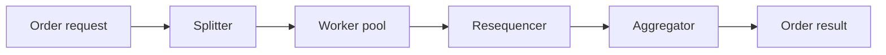
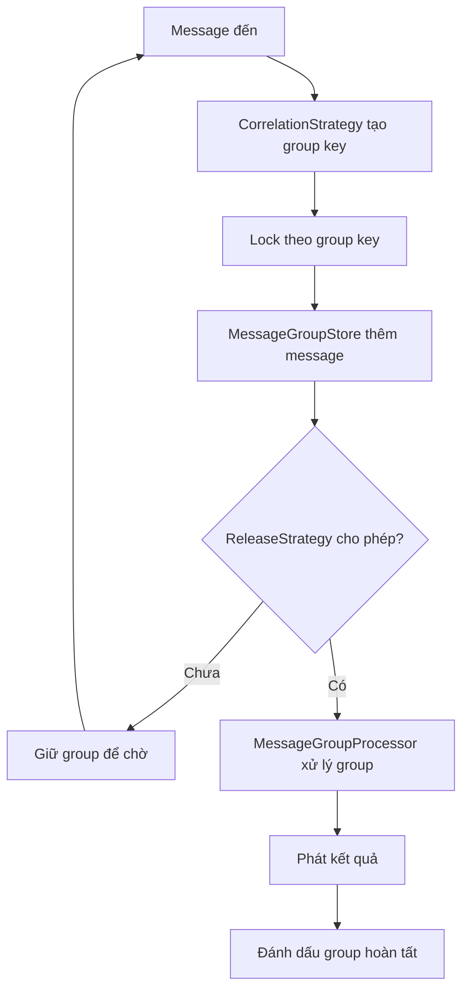

# Sequence, correlation và group state

Trong Spring Integration, một message flow có thể tách một message thành nhiều message con, xử lý chúng trên các nhánh hoặc thread khác nhau, rồi chờ kết quả quay về. Khi đó runtime cần trả lời ba câu hỏi: message nào thuộc cùng một lần xử lý, message nào đứng ở vị trí nào trong chuỗi, và những message đã đến được lưu ở đâu trong lúc chờ phần còn lại.

Ba khái niệm tương ứng là **sequence metadata**, **correlation** và **message group state**. Chúng là nền tảng cho `Splitter`, `Aggregator`, `Resequencer` và các luồng scatter-gather. Hiểu đúng chúng giúp tránh tình trạng aggregator chờ mãi, trộn kết quả của hai request, phát kết quả thiếu hoặc giữ message trong bộ nhớ vô thời hạn.

## 1. Bài toán runtime: nhiều message nhưng cùng một công việc

Giả sử một đơn hàng có ba dòng hàng. Flow tách đơn hàng thành ba message, gửi từng dòng hàng qua một worker pool để tính giá và kiểm tra tồn kho, sau đó ghép ba kết quả thành một `OrderResult`.



Các worker có thời gian xử lý khác nhau. Message thứ ba có thể đến aggregator trước message thứ nhất. Nếu chỉ nhìn payload, aggregator không biết ba message có cùng nguồn gốc hay thuộc ba đơn hàng khác nhau. Nếu chỉ dựa vào thứ tự đến, kết quả có thể bị đảo.

Spring Integration giải quyết bài toán bằng metadata trên message và state được lưu theo nhóm:

- `correlationId` xác định các message thuộc cùng một nhóm xử lý.
- `sequenceNumber` cho biết vị trí của message trong chuỗi.
- `sequenceSize` cho biết số message dự kiến trong chuỗi, nếu biết trước.
- `MessageGroupStore` giữ các message đã đến và metadata của nhóm cho đến khi nhóm được phát hành hoặc hết hạn.

Sequence header chỉ mô tả quan hệ và vị trí. Chúng không tự buộc channel hay executor xử lý message theo thứ tự. Khi cần khôi phục thứ tự sau xử lý song song, flow phải dùng `Resequencer` hoặc tự sắp xếp trong bước xử lý phù hợp.

## 2. Sequence metadata trong message header

Spring Integration khai báo các header chuẩn trong `IntegrationMessageHeaderAccessor`.

| Header | Kiểu dữ liệu | Ý nghĩa runtime |
| --- | --- | --- |
| `CORRELATION_ID` | `Object` | Khóa liên kết các message thuộc cùng một nhóm. |
| `SEQUENCE_NUMBER` | `Integer` | Vị trí của message trong chuỗi; thường đi cùng `SEQUENCE_SIZE`, nhưng cũng có thể dùng cho chuỗi không có kích thước xác định trong resequencer. |
| `SEQUENCE_SIZE` | `Integer` | Tổng số message dự kiến của nhóm. |
| `SEQUENCE_DETAILS` | Danh sách lồng nhau | Stack thông tin correlation phục vụ các splitter lồng nhau. Đây chủ yếu là metadata nội bộ của framework. |

Ví dụ, splitter tách một đơn hàng thành ba phần có thể tạo ra các message như sau:

| Payload | `correlationId` | `sequenceNumber` | `sequenceSize` |
| --- | --- | ---: | ---: |
| Dòng hàng A | `order-run-81` | 1 | 3 |
| Dòng hàng B | `order-run-81` | 2 | 3 |
| Dòng hàng C | `order-run-81` | 3 | 3 |

`MessageHeaders.ID` không thay thế được `CORRELATION_ID`. ID nhận diện một message cụ thể và thường thay đổi khi framework tạo message mới sau một bước biến đổi. Correlation ID nhận diện một nhóm nghiệp vụ gồm nhiều message.

### Splitter tạo sequence như thế nào?

`AbstractMessageSplitter` bổ sung `CORRELATION_ID`, `SEQUENCE_NUMBER` và `SEQUENCE_SIZE` cho các message được tạo ra. Đây là hành vi mặc định của splitter. Vì vậy, flow phổ biến `split → xử lý từng phần → aggregate` thường không cần tự gán ba header này.

Các endpoint khác có thể phát nhiều bản sao của một message, nhưng không mặc định gắn sequence metadata. Ví dụ, `PublishSubscribeChannel` và `RecipientListRouter` không bật `apply-sequence` theo mặc định. Khi dùng chúng như một nhánh scatter-gather và muốn aggregator nhận diện số nhánh, cần bật `apply-sequence` hoặc tự thiết kế correlation/release metadata phù hợp.

Nếu tự tạo message để đưa vào aggregator hoặc resequencer, có thể gán header tường minh:

```java
Message<OrderLine> part = MessageBuilder.withPayload(line)
    .setHeader(IntegrationMessageHeaderAccessor.CORRELATION_ID, batchId)
    .setHeader(IntegrationMessageHeaderAccessor.SEQUENCE_NUMBER, index + 1)
    .setHeader(IntegrationMessageHeaderAccessor.SEQUENCE_SIZE, totalParts)
    .build();
```

Trong ví dụ này, `index` bắt đầu từ `0`, còn sequence number được gán từ `1`. Với message được tạo từ splitter chuẩn, không cần tự viết đoạn gán header như trên.

### Sequence qua các endpoint

Các endpoint tạo message đầu ra thường truyền tiếp header đầu vào nếu chúng chỉ trả về payload mới. Nếu một transformer hoặc service method tự trả về một `Message` hoàn chỉnh, phần code đó chịu trách nhiệm cung cấp các header cần thiết cho message mới. Một custom message builder có thể vô tình làm mất `correlationId` hoặc sequence metadata; khi đó aggregator sẽ xem message là một nhóm khác hoặc không thể xác định lúc nào nhóm hoàn tất.

Hãy kiểm tra header tại các ranh giới quan trọng của flow, đặc biệt sau custom transformer, gateway, adapter và đoạn chuyển đổi sang message do ứng dụng tự tạo.

### Splitter lồng nhau và `SEQUENCE_DETAILS`

Một flow có thể tách đơn hàng thành shipment, rồi tiếp tục tách mỗi shipment thành các dòng hàng. Lúc này tồn tại nhiều cấp sequence. Nếu chỉ giữ một bộ `correlationId`/`sequenceNumber`/`sequenceSize`, cấp trong có thể ghi đè thông tin của cấp ngoài.

`SEQUENCE_DETAILS` lưu stack correlation data để framework khôi phục ngữ cảnh của cấp trước khi nhóm ở cấp hiện tại được aggregate. Trong các splitter-aggregator lồng nhau theo cách chuẩn, Spring Integration từ phiên bản 5.3 có cơ chế `popSequenceDetails()` trong quá trình xử lý kết quả group để khôi phục sequence bên ngoài. Đây là header nội bộ; không nên tự sửa cấu trúc danh sách lồng nhau này trong business code.

## 3. Correlation: xác định message thuộc nhóm nào

Correlation là phép tính khóa nhóm. Khi aggregator hoặc resequencer nhận một message, endpoint chạy `CorrelationStrategy` để lấy một key. Các message có cùng key được lưu trong cùng một `MessageGroup`.

Mặc định, correlation strategy đọc header `IntegrationMessageHeaderAccessor.CORRELATION_ID` thông qua `HeaderAttributeCorrelationStrategy`. Có thể thay bằng một `CorrelationStrategy` riêng hoặc một biểu thức dựa trên header/payload.

Một correlation key tốt cần:

1. Không trả về `null`.
2. Có `equals()` và `hashCode()` ổn định, vì key được dùng trong cấu trúc map của store.
3. Đại diện cho đúng một lần thực thi cần gom kết quả.
4. Không va chạm giữa các flow hoặc correlation endpoint dùng chung vùng lưu trữ.

Ví dụ, `customerId` thường không đủ làm correlation key: cùng một khách hàng có thể gửi hai đơn hàng đồng thời. `orderId` có thể phù hợp nếu mỗi lần xử lý đơn hàng chỉ có một group; nếu một đơn hàng được chạy lại hoặc chia thành nhiều batch độc lập, nên thêm `requestId`, `batchId` hoặc một execution ID duy nhất.

Correlation key cũng là ranh giới cô lập state. Nếu hai aggregator cùng dùng một store và cùng tạo ra một key cho hai công việc khác nhau, message có thể bị trộn hoặc group của endpoint này bị endpoint kia xử lý khi hết hạn. Hãy thiết kế key có namespace hoặc cấp store riêng cho từng endpoint.

## 4. Message group và vòng đời state

`MessageGroup` là tập message đang được gom theo một correlation key, cùng metadata như thời điểm tạo/cập nhật và trạng thái hoàn tất. `MessageGroupStore` chịu trách nhiệm lưu và truy xuất các group đó. Nhờ vậy, logic của correlation/release handler không phải tự giữ toàn bộ state trong field của một object xử lý message.



Vòng đời cơ bản:

1. **Nhận message:** correlation strategy tạo group key.
2. **Đồng bộ cập nhật:** handler lấy lock ứng với key để nhiều thread không cập nhật cùng group đồng thời.
3. **Lưu message:** store thêm message vào `MessageGroup`.
4. **Kiểm tra điều kiện:** release strategy quyết định group đã đủ điều kiện xử lý chưa.
5. **Phát hành:** message group processor tạo kết quả; handler gửi kết quả tới output channel và cập nhật state của group.
6. **Hoàn tất hoặc hết hạn:** group được giữ lại một thời gian để nhận diện message đến muộn, hoặc bị dọn theo chính sách expiry.

Group có thể tồn tại lâu nếu thiếu message hoặc release strategy không bao giờ trả về `true`. Đây là lý do aggregator là một endpoint có state và cần chính sách timeout, persistence, cleanup rõ ràng.

## 5. Aggregator: khi nào gom nhóm và phát kết quả

Aggregator kết hợp hai quyết định độc lập:

- **Correlation strategy:** message nào cùng một nhóm?
- **Release strategy:** khi nào nhóm đủ điều kiện được xử lý?

Sau khi release, `MessageGroupProcessor` quyết định kết quả được tạo ra như thế nào. Processor mặc định `DefaultAggregatingMessageGroupProcessor` tạo một message có payload là `List` các payload trong group. Ứng dụng có thể thay bằng POJO hoặc processor riêng để tạo DTO nghiệp vụ, tính tổng, kiểm tra tính đầy đủ hoặc phát nhiều message.

Không nên giả định collection bên trong group luôn giữ thứ tự sequence. `SimpleMessageGroup` có thể dùng collection không bảo đảm thứ tự duyệt. Nếu payload của kết quả phải theo đúng thứ tự ban đầu, hãy sắp xếp theo `SEQUENCE_NUMBER` trong output processor hoặc dùng resequencer tại vị trí cần phát message theo thứ tự.

Release strategy mặc định dựa trên `SEQUENCE_SIZE` và sequence metadata. Từ Spring Integration 5.0, `SimpleSequenceSizeReleaseStrategy` là implementation mặc định cho trường hợp không yêu cầu release partial group; nó được thiết kế hiệu quả hơn cho group lớn. Với ứng dụng cần quy tắc khác, có thể dùng `ReleaseStrategy` riêng.

### Ví dụ Java DSL: xử lý song song rồi gom kết quả

```java
@Bean
IntegrationFlow splitAndGatherFlow(TaskExecutor workers, LineProcessor lineProcessor) {
    return IntegrationFlows.from("orders.input")
        .split()
        .channel(MessageChannels.executor(workers))
        .handle(lineProcessor, "process")
        .aggregate(spec -> spec.outputProcessor(group -> group.getMessages().stream()
            .sorted(Comparator.comparingInt(message ->
                new IntegrationMessageHeaderAccessor(message).getSequenceNumber()))
            .map(message -> message.getPayload())
            .toList()))
        .get();
}
```

Payload đầu vào cần là một collection/array hoặc kiểu mà splitter có thể duyệt. Splitter tạo các message con và sequence metadata. `ExecutorChannel` cho phép các message được xử lý trên worker thread nên thời điểm hoàn thành có thể khác thứ tự ban đầu. Output processor sắp các message trong group theo `SEQUENCE_NUMBER`, rồi tạo danh sách payload theo thứ tự gốc. Ví dụ giả định các message vẫn giữ sequence header sau `LineProcessor.process()`.

Ví dụ trên dùng correlation và release mặc định do splitter cung cấp. Khi nhận message từ nhiều nguồn hoặc cần nhóm theo một khóa nghiệp vụ khác, cấu hình rõ correlation strategy và release strategy:

```java
.aggregate(spec -> spec
    .correlationStrategy(message ->
        message.getHeaders().get("batchId"))
    .releaseStrategy(group -> group.size() == 10)
    .outputProcessor(group -> group.getMessages().stream()
        .map(message -> message.getPayload())
        .toList()))
```

Đoạn cấu hình thứ hai gom message theo header `batchId`, phát group khi có đủ 10 message và trả về danh sách payload. Đây là ví dụ cho một batch có kích thước cố định; nếu số lượng message thay đổi theo request, hãy mang tổng số dự kiến vào metadata và xây release strategy tương ứng. Không dùng điều kiện `size() == 10` cho flow có thể gửi ít hơn hoặc nhiều hơn 10 message.

### Filter và sequence bị khuyết

Giả sử splitter tạo ba message với `sequenceSize = 3`, nhưng filter loại message số 2. Aggregator vẫn chờ đủ ba phần tử theo sequence metadata, trong khi chỉ còn hai message có thể tới. Group sẽ không tự hoàn tất chỉ vì tất cả message còn lại đã được xử lý.

Có ba cách xử lý tùy nghiệp vụ:

- Dùng release strategy theo điều kiện thực tế sau filter.
- Thay message bị loại bằng một compensation message để aggregator vẫn nhận biết vị trí đó đã được xử lý.
- Dùng timeout và chính sách partial result/discard nếu việc chờ đủ message có giới hạn thời gian.

Không nên đổi release strategy thành `group.size() >= sequenceSize` một cách máy móc: nếu filter làm mất message, điều kiện đó vẫn không bao giờ đạt; nếu message trùng được nhận nhiều lần, chỉ đếm size có thể cho kết quả sai.

### Iterator hoặc stream không biết trước kích thước

Với `Iterator`/`Iterable` mà framework không xác định được số phần tử, splitter có thể đặt `SEQUENCE_SIZE` bằng `0`. Release strategy dựa trên sequence size sẽ không biết lúc nào group đầy đủ. Từ phiên bản 5.0, splitter có thêm khả năng thử xác định kích thước nếu kiểu dữ liệu hỗ trợ, nhưng không phải mọi stream/iterator đều có thể đếm trước mà không tiêu thụ dữ liệu.

Với nguồn không biết trước số message, hãy chọn một quy tắc hoàn tất khác: custom release strategy dựa trên marker cuối chuỗi, số lượng do giao thức cung cấp, cửa sổ thời gian hoặc một sự kiện kết thúc rõ ràng. Timeout chỉ nên là cơ chế dự phòng khi nghiệp vụ chấp nhận kết quả không đầy đủ.

## 6. Resequencer: khôi phục thứ tự mà không gộp payload

Resequencer dùng correlation để giữ các message cùng nhóm, sau đó phát chúng theo `SEQUENCE_NUMBER`. Nó không biến nhiều payload thành một payload tổng hợp. Đây là khác biệt chính với aggregator:

| Endpoint | Hành vi | Kết quả |
| --- | --- | --- |
| `Resequencer` | Sắp xếp message theo sequence number. | Nhiều message riêng lẻ, được phát theo thứ tự. |
| `Aggregator` | Chờ group đủ điều kiện rồi xử lý toàn group. | Thường là một message tổng hợp. |

Resequencer hữu ích khi một sequence đi qua executor, queue hoặc nhánh xử lý có thời gian hoàn tất không đồng đều. Theo mặc định, resequencer chờ toàn bộ sequence trước khi phát; có thể cấu hình phát các phần sequence hợp lệ sớm hơn bằng `release-partial-sequences` khi nghiệp vụ cho phép. Nó phù hợp với chuỗi tương đối ngắn và khoảng trống sequence nhỏ; nhiều sequence rời rạc với nhiều khoảng trống có thể gây chi phí lưu trữ và xử lý đáng kể.

Trong Java DSL, có thể đặt `.resequence()` sau endpoint xử lý song song để phát từng message theo sequence trước khi nối vào các bước tiếp theo:

```java
.channel(MessageChannels.executor(workers))
.handle(lineProcessor, "process")
.resequence()
.channel("orderedLines")
```

Resequencer không thể tự đoán message bị mất. Nếu sequence có các số 1, 2 và 4 nhưng `sequenceSize = 4`, nó không thể phát toàn bộ chuỗi như thể số 3 đã tồn tại. Cần quyết định rõ chờ, timeout để phát phần còn lại, hay đưa group lỗi sang discard/error flow.

## 7. Timeout, expiry và message đến muộn

Có hai cơ chế thường được dùng để xử lý group bị treo:

| Cơ chế | Phạm vi tác động | Mục đích |
| --- | --- | --- |
| `group-timeout` / `group-timeout-expression` | Từng group; timeout được tính lại khi có message mới. | Buộc hoàn tất hoặc loại một group khi không có message mới trong khoảng thời gian cấu hình. |
| `MessageGroupStoreReaper` | Các group trong store; chạy định kỳ. | Tìm group đã cũ và gọi expiry callback để xử lý/dọn state. |

Khi group hết hạn, `send-partial-result-on-expiry = true` cho phép gửi các message còn lại như một kết quả partial. Nếu tắt tùy chọn này, group được discard theo cấu hình. Hãy xác định output channel, discard channel và cách ghi nhận nguyên nhân hết hạn để downstream không nhầm một kết quả thiếu dữ liệu với kết quả đầy đủ.

### Vì sao group đã phát hành vẫn còn trong store?

Sau khi group hoàn tất, Spring Integration thường giữ metadata của group rỗng nếu `expire-groups-upon-completion = false` (mặc định). Metadata này giúp nhận diện và discard message đến muộn có cùng correlation ID. Nếu xóa toàn bộ group ngay, message đến muộn có thể tạo một group mới rồi nằm chờ vô hạn vì sequence đã được phát hành.

Đổi `expire-groups-upon-completion` thành `true` sẽ xóa group hoàn toàn khi hoàn tất. Một message đến muộn cùng correlation ID khi đó có thể bắt đầu một group mới. Chỉ bật tùy chọn này nếu ứng dụng có cơ chế khác xử lý duplicate/late message và chấp nhận semantics đó.

Metadata group rỗng cũng cần được dọn sau một khoảng thời gian. `MessageGroupStoreReaper` có thể làm việc này; chu kỳ chạy của scheduler ảnh hưởng thời điểm expiry thực tế. Nếu reaper chạy mỗi 10 phút, một group vừa đủ tuổi hết hạn ngay sau lượt chạy có thể phải chờ gần 10 phút nữa mới được xử lý.

## 8. Persistence, concurrency và hiệu năng

`MessageGroupStore` mặc định thường là `SimpleMessageStore` trong bộ nhớ. Đây là lựa chọn đơn giản cho phát triển hoặc flow có thể chấp nhận mất state khi process dừng. Với flow production cần khôi phục group sau restart hoặc nhiều instance cùng xử lý, cân nhắc store persistent như JDBC, Redis, MongoDB hoặc implementation phù hợp hạ tầng.

Persistence không tự động đảm bảo mọi payload/header đều lưu được. Một số implementation serialize message; kiểu payload và header không tương thích serializer có thể bị lỗi hoặc bị loại khỏi dữ liệu persisted. Cần kiểm tra chính sách serialization và các header chứa object đặc biệt, nhất là channel reference hoặc object không serializable.

### Đồng bộ theo group key

Spring Integration dùng `LockRegistry` để đồng bộ cập nhật cùng một correlation key. Với một group, các message đến đồng thời được xử lý tuần tự tại vùng cập nhật group, dù các group khác nhau vẫn có thể tiến triển độc lập. Lock registry mặc định là in-memory. Khi nhiều application instance cùng ghi vào một persistent store, cần lock registry dùng chung phù hợp để tránh hai node cùng cập nhật một group mà không có đồng bộ liên tiến trình.

Mỗi correlation endpoint nên có lock registry riêng; nếu chia sẻ giữa nhiều aggregator có thể tạo deadlock trong một số flow lồng nhau. Nếu dùng chung store cho nhiều endpoint, ngoài key phải được namespace rõ ràng, cũng cần chú ý expiry callback: không dùng cùng một `MessageGroupStore` instance cho nhiều aggregator/resequencer khi các endpoint đều dựa vào `expireMessageGroups`, vì callback của endpoint này có thể tác động nhầm group của endpoint khác.

### Giới hạn kích thước group

Group càng lớn thì càng nhiều message và metadata phải được lưu, duyệt và serialize. Với group lớn:

- Chọn release strategy phù hợp với kích thước và yêu cầu phát partial group. `SimpleSequenceSizeReleaseStrategy` hiệu quả hơn cho group lớn khi không cần phát partial và không cần phát hiện/từ chối duplicate sequence theo cách của implementation cũ.
- Tránh tạo quá nhiều group có correlation key duy nhất nhưng không bao giờ hoàn tất.
- Giới hạn payload/header được giữ trong group; chỉ mang dữ liệu cần thiết qua các nhánh.
- Đặt timeout/reaper theo thời gian đến trễ hợp lý, rồi theo dõi số group và số message đang lưu.
- Không giữ tham chiếu tới collection message của group sau khi processor kết thúc nếu store có thể clear collection khi release. Nếu cần giữ kết quả, hãy tạo collection mới và sao chép các phần tử cần thiết.

## 9. Chẩn đoán lỗi thường gặp

| Triệu chứng | Nguyên nhân cần kiểm tra | Hướng xử lý |
| --- | --- | --- |
| Aggregator không phát kết quả | Thiếu message; `SEQUENCE_SIZE` bằng 0; filter làm mất một phần; header bị rơi; correlation key bị đổi. | Log `correlationId`, `sequenceNumber`, `sequenceSize` ở đầu vào aggregator; kiểm tra từng nhánh và release strategy. |
| Kết quả của hai request bị trộn | Correlation key không duy nhất cho từng execution. | Dùng request/execution ID hoặc composite key; kiểm tra endpoint nào đang dùng chung store. |
| Kết quả phát sai thứ tự | Chỉ có sequence header nhưng flow xử lý song song; aggregator không đảm bảo thứ tự payload đầu ra. | Đặt resequencer trước bước cần thứ tự hoặc sort rõ ràng trong output processor theo sequence number. |
| Group tăng mãi theo thời gian | Message bị thiếu, release strategy sai, timeout/reaper chưa cấu hình hoặc scheduler không chạy. | Kiểm tra group count, tuổi group, timeout và expiry callback; tạo discard/error path cho group không hoàn tất. |
| Message đến muộn tạo group mới | Group cũ đã bị xóa hoàn toàn khi hoàn tất hoặc metadata đã được reaper dọn. | Điều chỉnh cửa sổ giữ metadata; xử lý duplicate/late message bằng idempotency hoặc store riêng. |
| Group chỉ lỗi khi chạy nhiều instance | Store persistent dùng chung nhưng lock registry chỉ đồng bộ trong một JVM. | Cấu hình shared `LockRegistry` tương thích với môi trường triển khai. |

Khi điều tra một group cụ thể, thu thập ít nhất: tên endpoint, correlation key, các sequence number đã nhận, sequence size, số message trong group, thời điểm message đầu/cuối đến, release decision và trạng thái expiry. Những dữ liệu này thường đủ để phân biệt lỗi metadata, thiếu message, release policy và cleanup.

## 10. Quy trình thiết kế một flow có correlation

Trước khi đưa aggregator/resequencer vào flow, hãy trả lời lần lượt:

1. **Ai tạo sequence?** Splitter, router với `apply-sequence`, hay code ứng dụng tự tạo message?
2. **Khóa nào nhận diện một execution?** Khóa có duy nhất khi cùng khách hàng/đơn hàng chạy song song không?
3. **Có biết tổng số message không?** Nếu không, marker kết thúc hoặc release strategy nào xác định group đã đủ?
4. **Có endpoint nào loại hoặc nhân bản message không?** Filter, retry và fan-out ảnh hưởng thế nào tới điều kiện release?
5. **Có cần giữ thứ tự không?** Nếu có, resequencer ở vị trí nào trong flow?
6. **Group tồn tại bao lâu?** Timeout, partial result, discard và late-message window được định nghĩa ra sao?
7. **Restart hoặc chạy nhiều node có được hỗ trợ không?** Chọn persistent store và lock registry tương ứng.
8. **Có thể quan sát state không?** Theo dõi group count, message count, group age, số group hết hạn và số message bị discard.

## 11. Điểm cần nhớ

- `CORRELATION_ID` trả lời “cùng nhóm nào”; `SEQUENCE_NUMBER` trả lời “vị trí nào”; `SEQUENCE_SIZE` trả lời “dự kiến bao nhiêu phần”.
- Splitter chuẩn tự tạo sequence metadata; router và publish-subscribe cần `apply-sequence` nếu muốn framework thêm metadata cho các nhánh.
- Correlation và release là hai quyết định khác nhau. Một group có thể được nhận diện đúng nhưng vẫn không bao giờ được phát nếu release strategy không thể đạt điều kiện.
- Aggregator gộp message; resequencer chỉ phát lại message theo thứ tự. Sequence header tự thân không bảo đảm thứ tự thực thi.
- Message group là runtime state. Store, timeout, expiry, lock và late-message policy là một phần của thiết kế flow, không phải chi tiết phụ.

## Tài liệu tham khảo

- [Spring Integration Reference — Splitter](https://docs.spring.io/spring-integration/reference/splitter.html)
- [Spring Integration Reference — Aggregator và MessageGroupStore](https://docs.spring.io/spring-integration/reference/aggregator.html)
- [Spring Integration Reference — Resequencer](https://docs.spring.io/spring-integration/reference/resequencer.html)
- [Spring Integration Reference — Message Store](https://docs.spring.io/spring-integration/reference/message-store.html)
