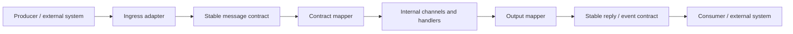

# Thiết kế message contract ổn định khi flow thay đổi

Trong Spring Integration, flow có thể được tái cấu trúc nhiều lần: đổi channel, thêm transformer, tách handler, chuyển từ xử lý đồng bộ sang polling hoặc executor, hay thay adapter kết nối hệ thống ngoài. Nếu các thành phần phụ thuộc trực tiếp vào cấu trúc nội bộ của nhau, mỗi lần thay đổi flow đều có thể buộc producer và consumer phải sửa cùng lúc.

Message contract là thỏa thuận giữa nơi phát message và nơi tiêu thụ message. Contract tốt mô tả rõ dữ liệu, ý nghĩa, metadata, phiên bản và cách hai phía quan sát kết quả xử lý. Khi contract được giữ ổn định ở ranh giới tích hợp, các endpoint và channel phía sau có thể thay đổi mà ít ảnh hưởng tới những thành phần khác.

Trong phạm vi Spring Integration Runtime, cần nhìn contract rộng hơn một Java class. Contract còn bao gồm semantics của message, headers, correlation, reply, lỗi, khả năng retry, thứ tự và thời điểm producer được xem là đã bàn giao công việc. Đổi `DirectChannel` sang `QueueChannel` có thể giữ nguyên payload nhưng thay đổi hành vi mà producer quan sát được; đó cũng là một thay đổi cần đánh giá ở cấp contract.

## 1. Message contract gồm những gì?

Một message contract nên xác định ít nhất sáu nhóm thông tin:

| Nhóm | Câu hỏi cần trả lời | Ví dụ |
|---|---|---|
| Payload schema | Dữ liệu có cấu trúc gì, trường nào bắt buộc, kiểu và đơn vị ra sao? | `orderId`, `occurredAt`, `total`, `currency` |
| Semantics | Message biểu đạt ý định hay sự kiện nào? | `SubmitOrder` là command; `OrderSubmitted` là event |
| Headers | Metadata nào phục vụ routing, tracing, correlation hoặc sequencing? | correlation ID, tenant ID, content type |
| Versioning | Producer và consumer nhận biết phiên bản bằng cách nào? | `schemaVersion: 1` |
| Processing behavior | Message được gửi đồng bộ, xếp hàng hay xử lý bất đồng bộ? Có thể giao trùng hoặc sai thứ tự không? | Broker có thể redelivery theo cấu hình |
| Reply và failure | Producer nhận kết quả gì, lỗi được biểu diễn và định tuyến ra sao? | reply event, timeout, error code, retryable |

Contract cần mô tả cả điều được bảo đảm và điều không được bảo đảm. Ví dụ, một channel có thể bảo đảm dispatch tới subscriber đồng bộ nhưng không bảo đảm dữ liệu được lưu bền vững qua lần restart. Một executor có thể nhận task nhưng chưa hoàn tất handler. Consumer phải biết producer đang xác nhận việc tiếp nhận hay xác nhận nghiệp vụ đã thành công.

### Phân biệt contract với implementation

`Message<?>` là envelope mà Spring Messaging dùng để chuyển payload và headers. `MessageChannel` là abstraction truyền message. `IntegrationFlow` kết nối các endpoint và channel thành runtime topology.

Các thành phần đó là cơ chế thực thi. Contract là ý nghĩa mà hai phía đã thống nhất. Ví dụ, một producer gửi sự kiện `order.submitted` không nên phải biết flow hiện có ba transformer, một router và hai service activator hay không. Nếu topology thay đổi nhưng sự kiện vẫn mang cùng ý nghĩa và cấu trúc tương thích, producer không cần thay đổi.

Tuy nhiên, channel và endpoint có thể làm thay đổi semantics quan sát được. Vì vậy, contract phải nêu cả payload lẫn hành vi giao nhận ở ranh giới.

## 2. Giữ ranh giới contract ổn định khi refactor flow

Một cách tổ chức dễ thay đổi là chia flow thành ba vùng:

1. **Ingress boundary** tiếp nhận định dạng message từ producer hoặc hệ thống ngoài.
2. **Internal processing** chuyển đổi dữ liệu sang command/model nội bộ và thực hiện nghiệp vụ.
3. **Egress boundary** chuyển kết quả nội bộ thành reply hoặc event có contract đã công bố.

Sơ đồ khái quát:



Ingress adapter chịu trách nhiệm xác thực message, kiểm tra phiên bản, chuyển đổi dữ liệu và đưa lỗi định dạng về đúng error path. Internal processing có thể dùng domain object, application command hoặc kiểu dữ liệu riêng. Egress boundary chuyển kết quả nội bộ thành contract dành cho consumer.

Khi flow thay đổi, thường chỉ cần cập nhật phần mapper hoặc wiring nội bộ. Ví dụ:

- Tách một handler lớn thành nhiều handler nhỏ.
- Thêm bước chuẩn hóa địa chỉ trước khi lưu đơn hàng.
- Chuyển một nhánh từ DirectChannel sang ExecutorChannel.
- Đưa một thao tác chậm sang QueueChannel và PollingConsumer.
- Thay implementation truy cập database bằng service khác.

Những thay đổi đó không nhất thiết làm thay đổi payload contract. Nhưng nếu đổi cách xác nhận hoàn tất, thứ tự xử lý, khả năng retry hoặc thời gian phản hồi, cần đánh giá lại behavior contract và thông báo cho producer.

Không nên xem tên channel nội bộ là contract công khai mặc định. Nếu một channel được nhiều module hoặc hệ thống khác gửi trực tiếp vào, tên channel, kiểu payload và semantics của nó đã trở thành một ranh giới phụ thuộc thực tế; khi đó phải quản lý nó như một contract.

## 3. Thiết kế payload: ổn định về ý nghĩa trước khi ổn định về kiểu

Payload chứa dữ liệu nghiệp vụ mà consumer cần để hiểu message. Thiết kế payload nên bắt đầu từ câu hỏi: consumer cần biết sự thật hoặc ý định gì để thực hiện công việc?

### Command và event có ý nghĩa khác nhau

- **Command** biểu đạt yêu cầu thực hiện một hành động, ví dụ `SubmitOrder` hoặc `CancelOrder`. Command thường hướng tới một nơi chịu trách nhiệm xử lý.
- **Event** biểu đạt một sự việc đã xảy ra, ví dụ `OrderSubmitted` hoặc `PaymentCaptured`. Một event có thể được nhiều consumer độc lập quan tâm.

Không nên đặt tên event như một yêu cầu chưa xảy ra. `OrderSubmitted` có nghĩa đơn hàng đã được gửi/ghi nhận theo định nghĩa nghiệp vụ của hệ thống phát event. Nếu chỉ mới yêu cầu xử lý, đó là command hoặc request.

Channel implementation không tự quyết định message là command hay event. Ví dụ, dùng `PublishSubscribeChannel` không tự biến payload thành event; semantics phải được xác định bởi contract.

### Dùng integration DTO thay vì lộ domain model

Không nên gửi trực tiếp JPA entity hoặc domain object nội bộ qua ranh giới tích hợp. Những object đó thường thay đổi theo cách tổ chức persistence và nghiệp vụ. Chúng có thể chứa lazy proxy, quan hệ hai chiều, dữ liệu nhạy cảm hoặc phương thức không có ý nghĩa khi serialize.

Hãy tạo DTO dành riêng cho contract:

```java
public record OrderSubmittedV1(
        int schemaVersion,
        String eventId,
        Instant occurredAt,
        String orderId,
        String customerId,
        List<OrderLine> lines,
        BigDecimal total,
        String currency
) {
}

public record OrderLine(
        String productId,
        int quantity,
        BigDecimal unitPrice
) {
}
```

Các trường trên có ý nghĩa rõ ràng:

- `schemaVersion` xác định cấu trúc payload.
- `eventId` là định danh nghiệp vụ ổn định của event.
- `occurredAt` là thời điểm sự kiện xảy ra, có múi giờ hoặc offset rõ ràng.
- `orderId` và `customerId` là định danh, không phải object graph nội bộ.
- `total` phải đi cùng `currency` để tránh hiểu sai đơn vị tiền.
- `lines` mô tả dữ liệu dòng hàng mà consumer thực sự cần.

Khi viết schema JSON, nên định nghĩa rõ trường bắt buộc, nullable, giá trị mặc định, định dạng ngày giờ, độ chính xác số và đơn vị đo. Không nên dựa vào tên Java class hoặc thứ tự field trong một object để truyền đạt ý nghĩa.

### Không đưa mọi dữ liệu vào payload

Chỉ đưa dữ liệu consumer cần để thực hiện nhiệm vụ. Nếu consumer cần trạng thái tại thời điểm event xảy ra, event nên chứa snapshot tối thiểu cần thiết. Đừng bắt consumer phải gọi ngược producer để ghép các trường cơ bản mà contract đã có thể cung cấp.

Ngược lại, tránh gửi toàn bộ object graph hoặc bản sao dữ liệu lớn không cần thiết. Payload quá rộng làm tăng coupling, chi phí serialization và rủi ro lộ dữ liệu. Hãy phân biệt dữ liệu nghiệp vụ cần thiết với metadata chỉ phục vụ vận chuyển.

## 4. Thiết kế headers: metadata vận chuyển và điều phối

Spring Integration đặt payload và headers trong `Message<?>`. Headers phù hợp với thông tin giúp vận chuyển, định tuyến và liên kết quá trình xử lý. Dữ liệu quyết định ý nghĩa nghiệp vụ vẫn nên nằm trong payload.

Một số loại metadata thường gặp:

| Metadata | Mục đích | Lưu ý |
|---|---|---|
| Message ID | Nhận diện một envelope message trong Spring Messaging | Do framework tạo; không dùng thay business event ID |
| Correlation ID | Liên kết nhiều message thuộc một request hoặc workflow | Phải được giữ qua các bước cần đối chiếu |
| Sequence number / size | Theo dõi vị trí và số lượng message trong nhóm | Hữu ích với splitter/aggregator |
| Trace ID | Nối log và trace qua các service | Thường đến từ hệ thống observability |
| Tenant ID | Xác định tenant của message | Phải được xác thực, không tin mù quáng giá trị do producer gửi |
| Content type | Cho biết cách diễn giải payload | Cần tương thích với serializer và adapter |
| Reply/error channel | Điều phối phản hồi hoặc lỗi trong runtime | Có thể chứa object tham chiếu nội bộ, không mặc định là dữ liệu có thể serialize |

Spring Integration cung cấp các header tiêu chuẩn như correlation ID và sequence metadata thông qua `IntegrationMessageHeaderAccessor`. Khi dùng custom header, nên tập trung tên header theo namespace của ứng dụng để tránh xung đột:

```java
public final class OrderHeaders {

    public static final String EVENT_TYPE = "app.eventType";
    public static final String TENANT_ID = "app.tenantId";
    public static final String TRACE_ID = "app.traceId";

    private OrderHeaders() {
    }
}
```

Tạo message:

```java
Message<OrderSubmittedV1> message =
        MessageBuilder.withPayload(event)
                .setHeader(OrderHeaders.EVENT_TYPE, "order.submitted")
                .setHeader(OrderHeaders.TENANT_ID, tenantId)
                .setHeader(
                        IntegrationMessageHeaderAccessor.CORRELATION_ID,
                        correlationId
                )
                .setHeader(OrderHeaders.TRACE_ID, traceId)
                .build();
```

`MessageHeaders` là cấu trúc bất biến sau khi tạo message, nhưng điều đó không làm object payload hoặc object nằm trong custom header trở thành immutable. Tránh đưa object mutable hoặc object phụ thuộc implementation vào headers được chia sẻ giữa nhiều thread.

### Đừng biến header nội bộ thành public contract

Các header như `replyChannel` và `errorChannel` có thể chứa tham chiếu tới channel object trong application context. Chúng hữu ích cho điều phối nội bộ nhưng không phải định dạng trao đổi ổn định giữa các process.

Khi gửi message qua broker hoặc adapter, chỉ một tập header nhất định được ánh xạ và truyền đi. Header mapper có thể lọc, đổi tên hoặc chuyển kiểu header. Không giả định mọi custom header trong `Message<?>` đều tự động tới được consumer bên ngoài.

Hãy định nghĩa allowlist các header thực sự cần qua ranh giới. Những thông tin quan trọng mà consumer cần để hiểu nghiệp vụ hoặc chống trùng lặp nên có mặt trong payload contract, hoặc trong metadata transport đã được quy định và kiểm thử rõ ràng.

## 5. Phân biệt message ID, event ID và correlation ID

Ba định danh này giải quyết ba bài toán khác nhau. Dùng lẫn chúng sẽ làm cho retry, tracing và deduplication khó chính xác.

| Định danh | Đại diện cho | Có thay đổi khi tạo message mới không? |
|---|---|---|
| Message ID (`MessageHeaders.ID`) | Một envelope message trong Spring Messaging | Thường có ID mới khi tạo envelope mới |
| Event ID | Một sự kiện nghiệp vụ đã xảy ra | Giữ nguyên khi event được retry, phát lại hoặc đóng gói lại |
| Correlation ID | Một request hoặc workflow liên quan nhiều message | Được giữ trong phạm vi workflow đã xác định |

Ví dụ, một event `OrderSubmitted` có event ID `evt-123`. Khi broker giao lại event đó hoặc adapter tạo một `Message<?>` mới, Message ID có thể khác nhưng event ID vẫn là `evt-123`. Consumer dùng event ID hoặc idempotency key để nhận diện việc xử lý trùng.

Correlation ID có thể là `checkout-456` và nối các message trong một luồng checkout. Nó không nhất thiết duy nhất cho từng event và không thay thế event ID.

Nếu cần truy nguyên quan hệ nhân quả, có thể bổ sung `causationId` để chỉ ra event hoặc command nào tạo ra message hiện tại. Nếu cần bảo đảm thứ tự trong một aggregate, thêm `aggregateVersion` hoặc sequence number có ý nghĩa rõ ràng. Không dùng timestamp làm thứ tự tuyệt đối khi nhiều producer hoặc nhiều node có thể phát message đồng thời.

## 6. Versioning và tiến hóa schema

Contract ổn định không có nghĩa schema không bao giờ thay đổi. Nó có nghĩa thay đổi được quản lý theo cách consumer hiện tại vẫn hiểu được message trong khoảng tương thích đã cam kết.

### Những thay đổi thường tương thích

Các thay đổi sau thường có thể tương thích ngược nếu producer và consumer tuân thủ schema:

- Thêm trường optional mới.
- Thêm trường có default rõ ràng mà consumer cũ có thể bỏ qua.
- Bổ sung metadata không làm thay đổi ý nghĩa các trường hiện tại.
- Mở rộng mô tả hoặc ví dụ mà không đổi semantics.

Ví dụ, thêm `salesChannel` là trường optional vào event đơn hàng. Consumer cũ bỏ qua trường đó; consumer mới có thể sử dụng khi trường xuất hiện.

### Những thay đổi có nguy cơ phá vỡ contract

| Thay đổi | Rủi ro |
|---|---|
| Đổi tên hoặc xóa field | Consumer cũ không tìm thấy dữ liệu |
| Đổi kiểu `String` sang số hoặc ngược lại | Deserialization hoặc validation thất bại |
| Đổi đơn vị tiền, trọng lượng hoặc thời gian | Payload có thể parse được nhưng sai nghiệp vụ |
| Đổi nghĩa của field hiện có | Consumer tiếp tục chạy nhưng diễn giải sai |
| Thêm enum value mà consumer không xử lý | Consumer có thể lỗi khi deserialize hoặc switch |
| Biến field optional thành required | Message cũ không còn hợp lệ |
| Thay đổi semantics đồng bộ/bất đồng bộ | Producer hiểu sai thời điểm hoàn tất và cách nhận lỗi |

Một schema có thể tương thích về mặt cú pháp nhưng không tương thích về nghiệp vụ. Ví dụ, trường `total` vẫn là decimal nhưng chuyển từ tổng trước thuế sang tổng sau thuế. Đây là breaking change về semantics dù JSON vẫn parse thành công.

### Đánh dấu phiên bản một cách tường minh

Có thể dùng trường `schemaVersion` hoặc event type có version, ví dụ `order.submitted.v1`. Chọn một quy ước nhất quán, tài liệu hóa và kiểm tra ngay tại ingress.

Ví dụ JSON của contract:

```json
{
  "eventType": "order.submitted",
  "schemaVersion": 1,
  "eventId": "evt-123",
  "occurredAt": "2026-11-21T10:15:30Z",
  "data": {
    "orderId": "ord-456",
    "customerId": "cus-789",
    "total": 125000.00,
    "currency": "VND"
  }
}
```

Không nên suy ra version từ tên class Java sau khi serialize. Tên class là chi tiết triển khai; đổi package hoặc refactor class không nên vô tình đổi schema công khai. Nếu dùng cả event type và schema version, cần quy định quan hệ giữa chúng để không tạo các tổ hợp version mâu thuẫn.

### Quy trình expand–migrate–contract

Khi cần thay đổi breaking, có thể triển khai theo các bước:

1. **Expand consumer:** cập nhật consumer để hiểu schema mới, đồng thời vẫn đọc được schema cũ.
2. **Deploy producer:** bắt đầu phát schema mới sau khi các consumer cần thiết đã sẵn sàng. Trong giai đoạn chuyển tiếp, có thể phát song song hai dạng nếu contract và hạ tầng cho phép.
3. **Observe and drain:** theo dõi tỷ lệ message cũ/mới, xử lý backlog, retry queue và dữ liệu còn lưu theo schema cũ.
4. **Contract:** chỉ bỏ hỗ trợ schema cũ sau khi hết thời hạn tương thích, retention và replay đã được thống nhất.

Không nên xóa field cũ ngay khi producer đã ngừng ghi field đó. Message cũ vẫn có thể nằm trong queue, message store, dead-letter queue, bản backup hoặc dữ liệu dùng để replay.

### Upcaster và anti-corruption mapper

Khi cần hỗ trợ nhiều schema, ingress có thể chuyển từng version về một model nội bộ ổn định:

```java
@Component
class OrderContractMapper {

    SubmitOrder toCommand(OrderSubmittedV1 event) {
        return new SubmitOrder(
                event.orderId(),
                event.customerId(),
                event.total(),
                event.currency()
        );
    }

    SubmitOrder toCommand(OrderSubmittedV2 event) {
        return new SubmitOrder(
                event.orderId(),
                event.customer().id(),
                event.amount().value(),
                event.amount().currency()
        );
    }
}
```

`SubmitOrder` là model nội bộ mà application service sử dụng. Mapper giữ cho logic nghiệp vụ không phải kiểm tra version ở mọi handler. Đây cũng là vị trí thích hợp để validate, chuẩn hóa đơn vị, áp dụng default và từ chối dữ liệu không hợp lệ.

Với nhiều phiên bản hoặc dữ liệu lưu trữ lâu dài, có thể dùng upcaster để nâng schema cũ thành representation mới trước khi xử lý. Việc chuyển đổi phải xác định rõ trường nào có thể suy ra, trường nào không thể khôi phục và trường hợp nào cần đưa message vào luồng lỗi.

## 7. Refactor flow mà không làm rò rỉ model nội bộ

Ví dụ một flow nhận `OrderSubmittedV1` theo contract, sau đó chuyển thành command nội bộ trước khi gọi application service:

```java
@Configuration
@EnableIntegration
class OrderIngressConfiguration {

    @Bean
    IntegrationFlow orderIngress(
            OrderContractMapper mapper,
            OrderApplicationService service
    ) {
        return IntegrationFlow.from("orders.v1.input")
                .transform(OrderSubmittedV1.class, mapper::toCommand)
                .handle(service, "submit")
                .get();
    }
}
```

Sau này có thể thay nội dung xử lý bên trong:

```java
@Bean
IntegrationFlow orderIngress(
        OrderContractMapper mapper,
        OrderApplicationService service,
        OrderRiskService riskService
) {
    return IntegrationFlow.from("orders.v1.input")
            .transform(OrderSubmittedV1.class, mapper::toCommand)
            .handle(riskService, "check")
            .handle(service, "submit")
            .get();
}
```

Giả sử `OrderRiskService.check()` nhận và trả lại `SubmitOrder`; contract đầu vào vẫn là `OrderSubmittedV1`. Producer không cần biết có thêm risk check. Nếu kết quả hoặc thời điểm xác nhận với producer thay đổi, phần reply/acknowledgment contract cần được đánh giá riêng.

Một nguyên tắc hữu ích là không để handler nội bộ nhận trực tiếp nhiều schema công khai. Hãy tập trung version handling ở ingress adapter. Tương tự, khi phát event ra ngoài, output mapper chuyển domain event thành integration DTO trước khi gửi.

### Đừng để mapper trở thành nơi che giấu lỗi dữ liệu

Mapper chỉ nên chuyển đổi những khác biệt đã hiểu rõ. Không nên tự động thay giá trị thiếu bằng `0`, chuỗi rỗng hoặc thời điểm hiện tại nếu các giá trị đó làm đổi ý nghĩa nghiệp vụ.

Ví dụ, thiếu `currency` không thể tự động hiểu là VND trừ khi contract quy định rõ default đó. Nếu không có default hợp lệ, mapper phải từ chối message và cung cấp lỗi có thể chẩn đoán.

## 8. Bảo toàn metadata qua transformer và endpoint

Trong flow, transformer có thể thay payload nhưng vẫn cần giữ metadata như correlation ID hoặc trace ID. Khi tạo message mới bằng code, hãy quyết định rõ header nào được chuyển tiếp.

Ví dụ tạo message mới chỉ với những metadata cần thiết:

```java
Message<OrderCommand> commandMessage =
        MessageBuilder.withPayload(mapper.toCommand(input.getPayload()))
                .setHeader(
                        IntegrationMessageHeaderAccessor.CORRELATION_ID,
                        input.getHeaders().get(
                                IntegrationMessageHeaderAccessor.CORRELATION_ID
                        )
                )
                .setHeader(
                        OrderHeaders.TRACE_ID,
                        input.getHeaders().get(OrderHeaders.TRACE_ID)
                )
                .build();
```

Ví dụ này thể hiện chủ đích giữ correlation và trace metadata. Trong flow thực tế, transformer endpoint tiêu chuẩn có cơ chế chuyển tiếp headers; nếu dùng custom transformer, message builder hoặc adapter riêng, hãy kiểm tra chính xác header nào được giữ, lọc hoặc chuyển kiểu.

Không sao chép mọi header một cách vô điều kiện qua ranh giới ngoài. Một header nội bộ có thể chứa channel reference, object bảo mật, dữ liệu tạm hoặc metadata chỉ có nghĩa trong một application context. Khi gửi qua broker, dùng header mapper và allowlist phù hợp.

## 9. Serialization là một phần của contract

Khi message đi qua process boundary, payload và các header được chọn phải được serialize thành định dạng mà consumer có thể hiểu. Lúc đó contract không còn phụ thuộc vào Java type trong bộ nhớ.

Một số nguyên tắc:

- Chọn định dạng có schema hoặc quy tắc rõ ràng như JSON, Avro hoặc Protobuf theo nhu cầu hệ thống.
- Định nghĩa cách biểu diễn thời gian, timezone, decimal, enum, null và binary.
- Không dựa vào Java native serialization hoặc tên class làm định danh schema công khai nếu cần tương thích lâu dài.
- Quy định content type và type mapping ở adapter.
- Chỉ truyền các header primitive hoặc có serializer rõ ràng.
- Xác thực payload trước khi đưa vào business flow.

Spring Integration cung cấp adapter và message converter để kết nối các hệ thống; framework không tự định nghĩa một schema registry hay chính sách versioning chung cho mọi ứng dụng. Những quy ước đó cần được thiết lập ở cấp hệ thống hoặc nền tảng tích hợp.

Với inbound adapter, kiểm tra header mapping để biết custom header nào được chuyển thành `MessageHeaders`. Với outbound adapter, kiểm tra header nào được xuất ra transport. Không coi việc header tồn tại trong một message nội bộ là bằng chứng rằng broker hoặc hệ thống đích sẽ nhận được nó.

## 10. Delivery semantics, retry và idempotency cũng thuộc contract

Payload có thể giữ nguyên nhưng cách delivery thay đổi khi channel hoặc endpoint thay đổi.

| Runtime boundary | Hành vi cần mô tả |
|---|---|
| DirectChannel | Dispatch trực tiếp; handler thường chạy trên thread gửi và lỗi đồng bộ có thể truyền về caller |
| QueueChannel | Message được lưu trong queue nội bộ; consumer lấy ra bằng polling; queue mặc định trong bộ nhớ không tự tạo durability qua restart |
| ExecutorChannel | Task được bàn giao cho executor; handler chạy trên thread khác và hoàn tất sau lời gọi gửi |
| Broker-backed channel/adapter | Delivery, acknowledgment, redelivery, persistence và ordering phụ thuộc broker cùng cấu hình adapter |

Nếu chuyển từ DirectChannel sang QueueChannel, producer có thể thấy `send()` trả về trước khi handler hoàn tất. Nếu chuyển sang executor, exception của handler cũng không còn truyền ngược theo call stack của producer. Những khác biệt này cần được công bố như behavior contract.

### Thiết kế cho giao nhận trùng

Trong hệ thống phân tán, retry và redelivery có thể làm cùng một business event tới consumer nhiều lần. Không nên dựa vào giả định mọi message chỉ được xử lý đúng một lần.

Consumer cần có chiến lược idempotency:

1. Xác định khóa nghiệp vụ ổn định, thường là `eventId` hoặc idempotency key đã được producer cấp.
2. Lưu dấu vết xử lý thành công trong cùng transaction với thay đổi nghiệp vụ nếu có thể.
3. Khi nhận lại cùng event ID, nhận diện bản trùng và trả kết quả phù hợp.
4. Chỉ đánh dấu hoàn tất sau khi thao tác nghiệp vụ đã commit theo định nghĩa của hệ thống.

Message ID do framework tạo không phải lúc nào cũng là khóa idempotency phù hợp vì envelope mới có thể có ID mới. Cần dùng định danh nghiệp vụ tồn tại xuyên suốt retry và replay.

### Thứ tự message

Nếu consumer cần xử lý theo thứ tự, contract phải chỉ rõ phạm vi ordering: theo toàn hệ thống, theo aggregate, theo partition hay theo một key cụ thể. Timestamp không tự bảo đảm thứ tự xử lý.

Có thể dùng `aggregateVersion` hoặc sequence number để phát hiện message đến muộn, trùng hoặc bị thiếu. Consumer cần quy định cách xử lý khi version nhảy cóc: chờ, retry, truy vấn lại trạng thái hoặc đưa vào luồng reconciliation.

## 11. Reply, acknowledgment và lỗi có schema rõ ràng

Với request-reply, contract phải xác định:

- Reply có kiểu payload nào và có thể vắng mặt hay không?
- Correlation được nối lại với request bằng trường hoặc header nào?
- Timeout được tính từ thời điểm nào?
- Producer nhận kết quả nghiệp vụ hay chỉ nhận xác nhận đã tiếp nhận?
- Nếu xử lý bất đồng bộ, completion event sẽ được phát ở đâu?

Không nên dùng việc `send()` trả về `true` làm bằng chứng rằng nghiệp vụ đã hoàn tất. Kết quả này phụ thuộc semantics của channel. Với QueueChannel, nó thường nói rằng message đã được nhận vào queue; với DirectChannel, dispatch đồng bộ có thể đã hoàn tất trước khi trả về.

Lỗi nội bộ trong Spring Integration có thể được biểu diễn bằng `ErrorMessage` và định tuyến tới error channel. Nhưng exception Java, stack trace hoặc object `MessagingException` không nên trở thành public error schema.

Hãy chuyển lỗi thành cấu trúc ổn định:

```java
public record IntegrationFailure(
        String code,
        String message,
        boolean retryable,
        String correlationId,
        String eventId
) {
}
```

Contract lỗi nên phân biệt:

- **Validation failure:** payload thiếu trường hoặc sai định dạng; thường không retry nếu producer không sửa dữ liệu.
- **Business rejection:** dữ liệu hợp lệ nhưng không đáp ứng quy tắc nghiệp vụ; không nên tự động retry vô hạn.
- **Transient failure:** timeout, tài nguyên tạm thời không sẵn sàng; có thể retry theo chính sách.
- **Permanent infrastructure/configuration failure:** lỗi cấu hình hoặc dependency không hợp lệ; cần cảnh báo và xử lý vận hành.

`retryable` là gợi ý theo chính sách của contract, không thay thế cấu hình retry thực tế. Consumer vẫn phải áp dụng giới hạn số lần thử, backoff, dead-letter hoặc cơ chế phục hồi phù hợp.

## 12. Kiểm thử contract độc lập với topology

Khi contract được kiểm thử riêng, có thể refactor flow mà không cần viết lại toàn bộ test producer và consumer.

Nên có các nhóm kiểm thử sau:

| Kiểm thử | Điều cần xác nhận |
|---|---|
| Schema validation | Message hợp lệ có đủ field bắt buộc, kiểu, format và version |
| Compatibility | Consumer hiện tại đọc được payload từ producer phiên bản được hỗ trợ |
| Unknown field | Consumer bỏ qua hoặc xử lý đúng field mới theo quy ước |
| Missing optional field | Giá trị default được áp dụng đúng |
| Invalid payload | Message bị từ chối có lỗi phân loại rõ ràng |
| Header mapping | Correlation, trace và metadata cần thiết qua được adapter |
| Idempotency | Cùng event ID được giao nhiều lần không gây lặp side effect |
| Ordering | Message sai thứ tự được phát hiện và xử lý theo quy tắc |
| Reply/error | Correlation, timeout và error schema đúng contract |
| Runtime behavior | Thay channel/executor không âm thầm đổi semantics mà producer đang phụ thuộc |

Có thể lưu các payload mẫu đã được phê duyệt như contract fixtures. Mỗi thay đổi schema chạy kiểm tra với payload cũ và mới. Nếu hỗ trợ replay, cần thêm mẫu từ các version còn nằm trong thời hạn lưu trữ.

Ngoài unit test cho mapper, nên có integration test xác nhận wiring của flow: message vào đúng input channel, endpoint gọi đúng handler, headers quan trọng được giữ và lỗi đi tới đúng error path. Test không nên chỉ kiểm tra implementation class mà bỏ qua hành vi quan sát được ở ranh giới.

## 13. Ví dụ một lần thay đổi contract an toàn

Giả sử contract V1 hiện có `orderId`, `customerId`, `total` và `currency` (cùng các metadata nghiệp vụ như `eventId`, `occurredAt`). Nghiệp vụ mới cần biết kênh bán hàng.

Một thay đổi tương thích có thể tiến hành như sau:

1. Thêm `salesChannel` dạng optional vào schema.
2. Cập nhật consumer mới để sử dụng trường này khi có, và tiếp tục xử lý message cũ khi trường vắng mặt.
3. Cập nhật producer để bắt đầu phát `salesChannel`.
4. Theo dõi message cũ, message mới và tỷ lệ lỗi deserialization.
5. Chỉ chuyển trường thành required trong một version mới nếu mọi producer đã được nâng cấp và consumer có kế hoạch hỗ trợ version đó.

Nếu thay đổi tiếp theo là đổi `total` thành object `amount + currency`, đó có thể là breaking change. Có thể phát `OrderSubmittedV2` hoặc schema version 2, sau đó dùng mapper chuyển cả V1 và V2 về một command nội bộ. Khi hết thời hạn hỗ trợ V1, mới loại bỏ adapter V1.

Trong suốt quá trình này, internal flow có thể được tách handler, thay executor hoặc đổi cách lưu trữ. Contract mapping vẫn là nơi kiểm soát sự khác biệt giữa định dạng bên ngoài và model nội bộ.

## 14. Checklist trước khi công bố hoặc thay đổi message contract

Trước khi phát hành một contract hoặc refactor flow có ảnh hưởng tới producer/consumer, hãy trả lời các câu hỏi sau:

- [ ] Message là command, event hay request-reply? Tên gọi có phản ánh đúng ý nghĩa không?
- [ ] Payload có DTO riêng, không phụ thuộc domain entity hoặc persistence model không?
- [ ] Trường bắt buộc, optional, nullable, default, đơn vị và timezone đã được định nghĩa chưa?
- [ ] Event ID, Message ID, correlation ID và causation ID có vai trò tách biệt không?
- [ ] Header nào là metadata công khai, header nào chỉ phục vụ runtime nội bộ?
- [ ] Header mapper và serializer có chuyển đúng các trường cần thiết qua adapter không?
- [ ] Version được biểu diễn tường minh và có chính sách tương thích không?
- [ ] Consumer cũ xử lý được payload mới trong giai đoạn tương thích không?
- [ ] Retry, duplicate delivery, ordering và idempotency đã có quy tắc chưa?
- [ ] Producer xác định được khác biệt giữa accepted, processed và completed không?
- [ ] Reply, timeout, error code và retryability đã có contract chưa?
- [ ] Việc đổi channel hoặc executor có làm thay đổi behavior mà producer phụ thuộc không?
- [ ] Payload mẫu, compatibility test và integration test đã được cập nhật chưa?
- [ ] Thời hạn hỗ trợ schema cũ, backlog, replay và dead-letter đã được tính đến chưa?

Một message contract ổn định giúp flow phát triển độc lập hơn vì nó đặt ranh giới rõ giữa dữ liệu được công bố và cách hệ thống xử lý dữ liệu đó. Khi thiết kế hoặc refactor, hãy kiểm tra đồng thời ba lớp: **schema và semantics của payload**, **metadata và correlation của message**, và **behavior giao nhận của runtime**. Giữ được cả ba lớp này trong phạm vi đã cam kết thì có thể thay đổi topology, handler, poller hoặc executor mà không buộc mọi producer và consumer phải thay đổi theo.

## Tài liệu tham khảo

- [Spring Integration — Message](https://docs.spring.io/spring-integration/reference/message.html) — cấu trúc Message, payload, headers và MessageBuilder.
- [Spring Integration — Message Channels](https://docs.spring.io/spring-integration/reference/channel.html) — abstraction và cách channel chuyển message.
- [Spring Integration — Message Channel Implementations](https://docs.spring.io/spring-integration/reference/channel/implementations.html) — semantics của DirectChannel, QueueChannel, PublishSubscribeChannel và các implementation khác.
- [Spring Integration — Message Endpoints](https://docs.spring.io/spring-integration/reference/endpoint.html) — endpoint kết nối channel với handler.
- [Spring Integration — Message Transformers](https://docs.spring.io/spring-integration/reference/message-transformer.html) — chuyển đổi payload và message trong flow.
- [Spring Integration — Error Handling](https://docs.spring.io/spring-integration/reference/error-handling.html) — ErrorMessage và error channel.

Cấu hình và API cụ thể có thể khác theo phiên bản Spring Integration. Khi triển khai, hãy đối chiếu tài liệu với phiên bản dependency mà ứng dụng đang sử dụng.
