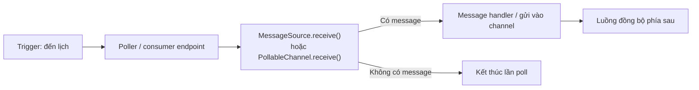
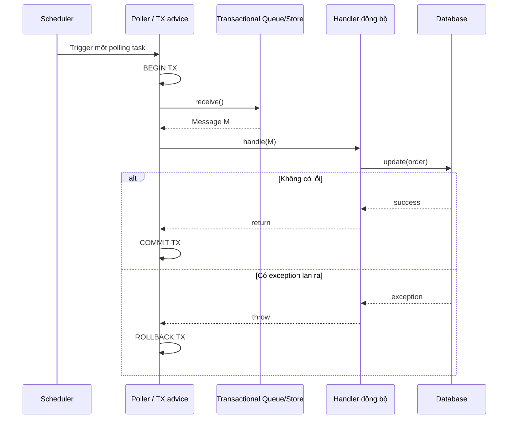
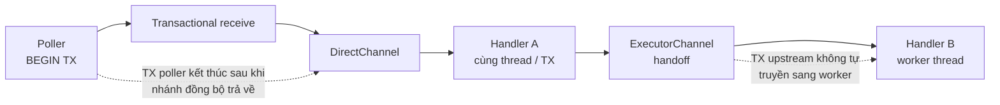

# Transaction boundary tại poller trong Spring Integration Runtime

## 1. Bài toán: nhận message và xử lý trong cùng một transaction

Hãy hình dung hệ thống nhận đơn hàng từ một hàng đợi, ghi trạng thái đơn vào database rồi chuyển message sang bước tiếp theo. Nếu database báo lỗi, hệ thống cần biết **message vừa lấy khỏi hàng đợi có quay trở lại không**. Câu trả lời phụ thuộc vị trí transaction boundary, loại message source, tài nguyên tham gia transaction và thread thực thi flow.

Trong module **SPRING_INTEGRATION_RUNTIME**, poller là thành phần kích hoạt những consumer cần chủ động gọi `receive()` trên `PollableChannel` hoặc `MessageSource`. Spring Integration cho phép đặt transaction advice **bao quanh hoạt động polling**, nhờ đó thao tác lấy message và xử lý đồng bộ sau khi lấy có cơ hội thuộc cùng một đơn vị giao dịch.

Mục tiêu sau bài:

1. Vẽ và giải thích chính xác transaction boundary của một poller.
2. Phân biệt lịch poll, một lượt poll, message được nhận và transaction thật sự được tạo.
3. Cấu hình poller dùng `PlatformTransactionManager` qua Java DSL hoặc XML.
4. Giải thích khi nào rollback trả message về transactional store và khi nào message có thể mất.
5. Phân tích tác động của `DirectChannel`, `ExecutorChannel`, `QueueChannel` và poller kế tiếp đối với transaction.
6. Chẩn đoán transaction propagation, retry/recovery, error channel, synchronization, thông lượng và rủi ro xử lý lặp.

Đây là bài về **Transaction runtime**, tập trung vào transaction boundary tại poller. Nó không giả định mọi broker, channel hay endpoint đều hỗ trợ transaction chỉ vì Spring Integration đang chạy trong một ứng dụng dùng database.

## 2. Poller hoạt động như thế nào?

Một consumer dạng polling thường có các thành phần:

| Thành phần | Vai trò |
| --- | --- |
| `Trigger` | Quyết định khi nào gọi poller: fixed delay, fixed rate hoặc cron. |
| `PollingConsumer` | Consumer endpoint chủ động lấy message từ `PollableChannel` rồi gọi handler. |
| `SourcePollingChannelAdapter` | Endpoint gọi `MessageSource.receive()` và gửi message nhận được vào output channel. |
| `PollerMetadata` | Chứa trigger, `maxMessagesPerPoll`, `receiveTimeout`, advice và các tùy chọn khác. |
| `TransactionInterceptor` | Advice mở/join transaction, thực thi poll task và commit/rollback. |
| `PlatformTransactionManager` | Điều phối resource transaction (JDBC, JPA, JTA...) theo cấu hình. |

Không phải mọi inbound endpoint đều cần poller. Một listener JMS, AMQP hoặc HTTP thường có cơ chế **event-driven** của adapter/container; transaction tại listener phải được xét theo cơ chế riêng của nó.



**Phân biệt ba đơn vị:**

- *Lần kích hoạt* là khi trigger khiến polling task chạy.
- *Lần nhận* là một lời gọi `receive()` lấy tối đa một message; task có thể lặp nhiều lần để lấy thêm message.
- *Transaction boundary* là vùng do transaction advice bao quanh. Nó phụ thuộc nơi advice được gắn, transaction propagation và thread, không thể suy ra chỉ từ tần suất fixed delay.

`maxMessagesPerPoll` là giới hạn số message/attempts trong một lần poll. Đối với `PollingConsumer`, cấu hình mặc định và hành vi có thể khác `SourcePollingChannelAdapter`; vì tính dễ kiểm thử, bài này đặt **`maxMessagesPerPoll = 1`** để một lần poll tối đa xử lý một message. Khi tăng số này, cần xác minh phạm vi `doPoll()`/advice và số message có thể đi qua cùng transaction trên phiên bản đang chạy.

## 3. Vị trí transaction boundary

Khi cấu hình transaction cho poller, Spring Integration dùng transaction advice (thường là `TransactionInterceptor`) bao quanh **polling task**. Transaction được mở **trước** bước nhận message; thành phần downstream đồng bộ có thể tham gia cùng transaction cho đến khi lời gọi trả về.



Trong sơ đồ trên, thao tác loại message khỏi store và database update **chỉ thật sự được commit/rollback cùng nhau** nếu chúng dùng tài nguyên và transaction manager có khả năng phối hợp phù hợp. Một `DataSourceTransactionManager` cho database A không tự rollback việc tiêu thụ message ở broker B.

### Ba loại boundary không được lẫn lộn

| Boundary | Bắt đầu từ đâu | Có thể bao trùm gì? |
| --- | --- | --- |
| **Poller transaction** | Advice quanh `doPoll()` | Nhận message và xử lý tiếp trên cùng thread, khi resource tham gia transaction. |
| **Service transaction** | Proxy/`@Transactional` ở service method | Hoạt động của method và các call đồng bộ trong transaction của service. |
| **Broker receive/ack transaction** | JMS session hoặc container/adapter có transaction | Ack/rollback/redelivery theo quy tắc của broker; không tự gộp với JDBC. |

Một flow có thể có **nhiều transaction** độc lập. Cần biết transaction nào bao quanh *receive*, transaction nào bao quanh *database update* và ai commit/ack message nguồn.

## 4. Cấu hình poller transactional bằng Java DSL

Ví dụ dưới đây giả định Spring Integration Java DSL, một bean `ordersQueue` là `PollableChannel` đã được đăng ký, một `PlatformTransactionManager` quản lý tài nguyên liên quan và một service bean xử lý đơn hàng.

**`PollerTransactionConfiguration.java`**

```java
import java.time.Duration;
import org.springframework.context.annotation.Bean;
import org.springframework.context.annotation.Configuration;
import org.springframework.integration.dsl.IntegrationFlow;
import org.springframework.integration.dsl.Pollers;
import org.springframework.transaction.PlatformTransactionManager;

@Configuration
public class PollerTransactionConfiguration {

    @Bean
    public IntegrationFlow orderFlow(
            PlatformTransactionManager transactionManager,
            OrderService orderService) {

        return IntegrationFlow
                .from("ordersQueue", endpoint -> endpoint.poller(
                        Pollers.fixedDelay(Duration.ofSeconds(1))
                               .maxMessagesPerPoll(1)
                               .transactional(transactionManager)))
                .handle(orderService, "process")
                .get();
    }

    public interface OrderService {
        void process(String orderId);
    }
}
```

Ý nghĩa:

1. Poller được kích hoạt theo fixed delay khoảng một giây, với tần suất thực tế còn phụ thuộc thời gian xử lý và scheduler.
2. `maxMessagesPerPoll(1)` giúp kiểm soát đơn vị nhận/tác nghiệp trong ví dụ.
3. `transactional(transactionManager)` thêm transaction advice ở **poller**, trước khi nhận message.
4. Handler `process` chạy đồng bộ trong đường thực thi do poller khởi phát; tài nguyên cùng transaction manager có thể tham gia transaction đang mở.
5. Kết quả xử lý ném exception ra khỏi transaction boundary mới có thể kích hoạt rollback theo rollback rules.

**Đây là cấu hình transaction boundary, không phải cấu hình queue bền vững.** Nếu `ordersQueue` là `new QueueChannel()`, rollback JDBC không tự đưa message đã bị lấy ra khỏi hàng đợi trong memory. Muốn kiểm thử rollback nhận message, cần dùng source/store transactional hoặc container hỗ trợ transactional acknowledgment.

### Cấu hình với `@ServiceActivator`

Với endpoint annotation, có thể dùng poller:

```java
import org.springframework.integration.annotation.MessageEndpoint;
import org.springframework.integration.annotation.Poller;
import org.springframework.integration.annotation.ServiceActivator;
import org.springframework.messaging.Message;

@MessageEndpoint
public class OrderConsumer {

    @ServiceActivator(
            inputChannel = "ordersQueue",
            poller = @Poller(fixedDelay = "1000",
                             maxMessagesPerPoll = "1"))
    public void process(Message<String> message) {
        // Cấu hình ví dụ này chỉ tạo lịch poll, chưa đặt TX advice.
        doBusinessWork(message.getPayload());
    }

    private void doBusinessWork(String orderId) {
        // Mô phỏng nghiệp vụ.
    }
}
```

`@Poller` như trên **chưa bật transaction**. Muốn transaction bao quanh `receive()`, cần cấu hình poller transactional/advice ở endpoint tương ứng (ví dụ Java DSL ở trên, hoặc XML ở mục tiếp theo). Chỉ gắn `@Transactional` lên method handler là **không tương đương** với đặt transaction bao quanh thao tác poller nhận message.

## 5. Cấu hình XML minh họa nguồn transactional

Đây là một cấu hình mẫu nằm **bên trong Spring XML context đã khai báo namespace Spring Integration**:

```xml
<!-- Message được lưu ở JDBC channel message store đã khai báo. -->
<int:channel id="ordersQueue">
    <int:queue message-store="ordersStore"/>
</int:channel>

<!-- ordersStore: bean JdbcChannelMessageStore được cấu hình
     với DataSource, query provider và schema đúng database. -->

<int:service-activator id="orderConsumer"
                       input-channel="ordersQueue"
                       ref="orderService"
                       method="process">
    <int:poller fixed-delay="1000"
                max-messages-per-poll="1"
                receive-timeout="100">
        <int:transactional transaction-manager="transactionManager"
                           propagation="REQUIRED"
                           isolation="READ_COMMITTED"
                           read-only="false"/>
    </int:poller>
</int:service-activator>
```

Để mẫu này hoạt động thật, ứng dụng cần có:

- `ordersStore` là `JdbcChannelMessageStore` được cấu hình với `DataSource`, `ChannelMessageStoreQueryProvider` đúng database và các bảng theo schema JDBC của Spring Integration.
- `transactionManager` quản lý cùng JDBC resource dùng cho thao tác store; nếu muốn update nghiệp vụ commit cùng receive, các cập nhật đó cũng phải tham gia transaction được phối hợp thích hợp.
- Bean `orderService` có method `process(...)` với kiểu payload tương thích.

Nếu dùng XML `<int:transactional/>` cùng `<int:advice-chain/>` trên **cùng poller**, cần theo quy tắc cấu hình namespace: để kết hợp nhiều advice và kiểm soát thứ tự, đưa transaction advice vào advice chain tương ứng, thay vì khai báo tùy ý hai cơ chế cạnh nhau.

## 6. Khi nào rollback đưa message trở lại hàng đợi?

Đây là câu hỏi quan trọng nhất khi vận hành:

| Nguồn message | Hành vi receive | Kết quả khi transaction DB rollback |
| --- | --- | --- |
| `QueueChannel` mặc định in-memory | Message bị lấy khỏi queue trong RAM | **Không tự khôi phục** message bằng rollback JDBC. |
| `QueueChannel` + `JdbcChannelMessageStore` | Nhận/xóa message qua JDBC store | Có thể hoàn tác thao tác lấy nếu store và poller cùng transaction JDBC hợp lệ. |
| `PollableChannel` với transactional message store khác | Phụ thuộc khả năng store | Cần kiểm tra adapter/store thực sự enlist transaction và cơ chế rollback. |
| File inbound polling | Nhận file không phải thao tác DB transactional | Rollback JDBC **không tự đưa file về trạng thái cũ**; có thể dùng transaction synchronization để làm hậu xử lý. |
| JMS/AMQP queue qua listener/adapter | Ack/nack/session do adapter/container/broker quản lý | Cần chính sách transaction/redelivery của nguồn; JDBC rollback không tự quyết định ack broker. |
| Kafka consumer | Offset, consumer record và transaction broker có cơ chế riêng | Rollback JDBC không tự rollback offset; phải thiết kế offset commit và idempotency. |

### 6.1. Tình huống A: queue trong bộ nhớ

```text
T0: QueueChannel(in-memory) chứa M-101
T1: Poller BEGIN JDBC transaction
T2: queue.receive() lấy M-101 khỏi RAM
T3: handler UPDATE orders ... rồi ném lỗi
T4: JDBC transaction ROLLBACK
T5: DB đã rollback, nhưng queue in-memory có thể không còn M-101
```

Không được kết luận `ROLLBACK` sẽ làm queue tự trả message nếu queue không tham gia transaction. Thử nghiệm này là lý do cần chọn message source theo yêu cầu bảo toàn dữ liệu, chứ không chỉ thêm `@Transactional`.

### 6.2. Tình huống B: queue dùng JDBC channel store

```text
T0: Bảng INT_CHANNEL_MESSAGE chứa M-101
T1: Poller BEGIN TX (DataSourceTransactionManager phù hợp)
T2: JdbcChannelMessageStore lấy/xóa M-101 trong TX
T3: handler cập nhật orders trong TX
T4a: Handler thành công → COMMIT → xóa M-101 + cập nhật orders
T4b: Handler lỗi       → ROLLBACK → M-101 còn có thể nhận lại
```

Nhánh rollback cần transaction manager thực sự dùng cùng tài nguyên phù hợp và không có cơ chế ngoài transaction đã xác nhận message. Ngay cả khi receive rollback an toàn, consumer vẫn cần **idempotency** vì mất kết nối sau commit, retry từ upstream hoặc failover có thể làm message được gửi trùng.

JDBC-backed queue có đánh đổi về lock contention, database load, throughput và việc dọn dữ liệu. Spring Integration có `JdbcChannelMessageStore` tối ưu cho channel; không nên tự suy rằng mọi database đều hoạt động giống nhau dưới concurrent polling.

## 7. Thread quyết định transaction còn hiệu lực đến đâu

Spring imperative transaction context thường gắn với **thread** đang thực thi. Vì vậy channel topology ảnh hưởng trực tiếp đến boundary:



| Đoạn flow | Transaction của poller có lan tới không? | Lý do |
| --- | --- | --- |
| Handler nhận trực tiếp qua `DirectChannel` | Thường có, nếu chưa có propagation tách biệt | Subscriber được gọi trên thread gửi, exception có thể truyền ngược. |
| Transformer/router đồng bộ trên `DirectChannel` | Thường có | Cùng call stack và transaction thread-bound. |
| Gửi sang `ExecutorChannel` | Transaction upstream chỉ bao quanh bước handoff thành công | Worker chạy thread khác; lỗi sau handoff không tự rollback transaction cũ. |
| Gửi sang `QueueChannel` | Transaction upstream không bao quanh việc poll/consume lần kế tiếp | Consumer mới cần poller/transaction mới nếu muốn atomic receive. |
| Async `PublishSubscribeChannel` với executor | Không tự truyền sang worker subscribers | Các subscriber là những nhánh thực thi khác thread. |
| Một `@Async` hoặc tự tạo `Thread` | Không tự truyền | Context đồng bộ gắn thread, không phải field trên `Message`. |

Ví dụ:

```text
JDBC Queue → [Poller TX-1] → DirectChannel → validate → ExecutorChannel
                                                       |
                                                       v
                                         [worker, không còn TX-1]
                                               chargePayment()
```

Nếu validate thành công và message được handoff sang executor, `TX-1` có thể commit **trước khi** `chargePayment()` thất bại. Không thể đợi lỗi phía worker để tự động rollback một transaction đã commit. Cần thiết kế error channel, compensation, reply flow hoặc transaction riêng cho worker.

### Poller `taskExecutor` khác với downstream `ExecutorChannel`

Poller có thể được cấu hình dùng `TaskExecutor` để chạy polling task. Khi đó transaction advice của poller được thực thi **trên thread chạy polling task**, tùy cấu hình. Điều này khác với việc message đã được poller nhận rồi chuyển sang `ExecutorChannel`: transaction **không tự băng qua** bước handoff xuống worker ở phía sau.

Đừng kết luận transaction luôn chạy ở thread scheduler ban đầu. Quan sát thread thực thi `receive()`, handler, transaction interceptor và các channel trung gian khi chẩn đoán.

## 8. Transaction của poller và `@Transactional` ở service

Giả sử poller mở `TX-P` và handler gọi method nghiệp vụ có `@Transactional`:

| Propagation ở service | Hành vi điển hình | Điều cần kiểm tra |
| --- | --- | --- |
| `REQUIRED` | Join `TX-P` nếu dùng transaction manager/tài nguyên tương thích | Lỗi ném ra có thể đánh dấu `TX-P` rollback-only. |
| `REQUIRES_NEW` | Tạm ngưng transaction hiện tại, mở transaction độc lập | Service có thể commit dù `TX-P` rollback; redelivery sẽ chạy lại nghiệp vụ. |
| `NESTED` | Dùng savepoint nếu transaction manager/resource hỗ trợ | Không tương đương transaction độc lập; không phải manager nào cũng hỗ trợ. |
| `NOT_SUPPORTED` | Tạm dừng transaction hiện tại trong phạm vi service | Side effect thực hiện ngoài `TX-P` không bị rollback theo `TX-P`. |
| Method không đi qua Spring proxy | `@Transactional` có thể không có tác dụng | Self-invocation hoặc bean không được proxy hóa. |

**Rollback rules:** transaction interceptor mặc định rollback với `RuntimeException` và `Error`; checked exception có thể cần cấu hình `rollbackFor`. Khi handler bắt lỗi rồi trả bình thường, transaction có thể commit nếu chưa bị đặt rollback-only.

Ví dụ về sai lầm thường gặp:

```java
@Transactional
public void process(String orderId) {
    try {
        repository.updateOrder(orderId);
    } catch (RuntimeException ex) {
        logError(ex);
        // Lỗi bị nuốt; caller/poller tưởng thao tác đã thành công.
    }
}
```

Nếu yêu cầu rollback nguồn, thông thường nên **ném lại exception** để transaction boundary bên ngoài quan sát được. Nếu contract buộc phải xử lý lỗi trong method, việc gọi `TransactionAspectSupport.currentTransactionStatus().setRollbackOnly()` hoặc cách đánh dấu rollback phù hợp phải được cân nhắc cẩn thận; đồng thời phải xác định nguồn có tham gia transaction thật không.

## 9. Advice chain, retry và phạm vi rollback

Poller cho phép nhiều AOP advice. Một ví dụ điển hình là transaction và retry; thứ tự áp dụng quyết định hành vi:

```text
Phương án A — RETRY nằm ngoài TX:
retry
  attempt 1 → begin TX-1 → receive/process → rollback TX-1
  attempt 2 → begin TX-2 → receive/process → commit TX-2

Phương án B — TX nằm ngoài RETRY:
begin TX-OUTER
  retry attempt 1 → exception, TX có thể rollback-only
  retry attempt 2 → method trả thành công
commit TX-OUTER? → vẫn có thể thất bại
```

Tuy nhiên, **retry đặt ở poller** có thể thử lại cả bước `receive()`; retry đặt ở **handler** có thể gọi lại handler trên chính message đã được lấy. Hai nơi đặt retry **khác nhau về phạm vi**.

- Với transient DB errors (deadlock, serialization failure), thường muốn retry **cả transaction mới**.
- Retry handler trong một transaction đã rollback-only không làm transaction đó khỏe lại; commit có thể ném `UnexpectedRollbackException`.
- Nếu retry poller lại bước nhận sau rollback, source/store phải hỗ trợ rollback receive để trả lại message.
- Khi dùng recovery callback nuốt exception rồi trả thành công, transaction bao ngoài có thể commit **nếu** chưa rollback-only; source có thể được coi đã xử lý xong.
- Một `RequestHandlerRetryAdvice` ở handler không thay thế transactional poller nếu cần rollback thao tác `receive()`.

Trong production phải biết chính xác **advice nào bao ngoài**, số attempts, độ dài backoff, timeout transaction và chính sách commit/ack của nguồn. Một transaction có thời gian sống dài qua các khoảng backoff có thể giữ lock/connection, làm giảm thông lượng và tăng backlog.

## 10. Transaction synchronization tại poller

Không phải nguồn nào cũng có “rollback” vật lý. Ví dụ file inbound adapter có thể đọc một file nhưng JDBC rollback không khiến hệ thống file tự undo thao tác. Spring Integration hỗ trợ **transaction synchronization** để thực thi hành động trước/sau commit hoặc sau rollback:

- `TransactionSynchronizationFactory`: tạo synchronization gắn với polling context.
- `DefaultTransactionSynchronizationFactory`: implementation có thể dùng processor cho biểu thức SpEL.
- `ExpressionEvaluatingTransactionSynchronizationProcessor`: hỗ trợ `beforeCommitExpression`, `afterCommitExpression` và `afterRollbackExpression`.
- `PassThroughTransactionSynchronizationFactory`: duy trì context message đã poll để hỗ trợ thông tin lỗi trong tình huống phù hợp.

Ví dụ cấu hình XML minh họa:

```xml
<int:transaction-synchronization-factory id="syncFactory">
    <int:after-commit expression="payload" channel="committedChannel"/>
    <int:after-rollback expression="payload" channel="failedChannel"/>
</int:transaction-synchronization-factory>

<int-file:inbound-channel-adapter id="fileInput"
                                  directory="/data/in"
                                  channel="filesToProcess">
    <int:poller fixed-delay="2000"
                max-messages-per-poll="1">
        <int:transactional transaction-manager="transactionManager"
                           synchronization-factory="syncFactory"/>
    </int:poller>
</int-file:inbound-channel-adapter>
```

Đoạn XML trên minh họa các thành phần liên quan, giả định các namespace, bean, destination channel và file adapter đã được cấu hình trong ứng dụng. Biểu thức `payload` gửi payload sang channel sau khi transaction hoàn tất; cần thiết kế riêng việc move/delete/retry file phù hợp với source.

**Điểm giới hạn:** transaction synchronization **không biến file system, HTTP API hay email thành tài nguyên transactional**. `afterCommit` chỉ chạy sau commit, và nếu phát sinh lỗi khi làm side effect ở giai đoạn này thì không thể quay ngược một commit đã hoàn tất. Muốn bảo đảm phát event sau DB commit, cân nhắc outbox.

### 10.1. Pseudo transaction

`PseudoTransactionManager` cho phép dùng cơ chế trước/sau “commit/rollback” như một callback lifecycle khi **không có tài nguyên transactional thật**. Đây là cách phối hợp hậu xử lý file hoặc các hành động cùng tính chất.

Nó **không** mở JDBC transaction thật, không hoàn tác external API và không bảo đảm atomicity giữa các hệ thống. Dùng từ “rollback” trong pseudo transaction chỉ nên hiểu là kích hoạt nhánh xử lý thất bại, không phải hoàn tác tài nguyên.

## 11. Transaction failure và ErrorMessage tại poller

Với poller, exception có thể phát sinh khi:

1. `MessageSource.receive()` thất bại trước khi có message.
2. Store trả message, nhưng handler hoặc dispatcher đồng bộ ném exception.
3. Transaction manager commit thất bại, dù handler đã trả bình thường.
4. Retry/recovery callback phát sinh lỗi sau nhiều attempts.

Trong các cấu hình thích hợp, `MessagePublishingErrorHandler` chuyển lỗi thành `ErrorMessage` vào `errorChannel`. Vì exception có thể xuất hiện **khi commit**, kiểm tra mỗi handler log “success” là chưa đủ để kết luận transaction thành công.

Spring Integration dùng transaction synchronization gắn message đã poll trong context. Với các strategy có sẵn và `TransactionInterceptor` phù hợp, lỗi sau transaction advice có thể được bọc thành `MessagingException` có `failedMessage` để giữ message liên quan:

```java
import org.springframework.integration.annotation.MessageEndpoint;
import org.springframework.integration.annotation.ServiceActivator;
import org.springframework.messaging.Message;
import org.springframework.messaging.MessagingException;
import org.springframework.messaging.support.ErrorMessage;

@MessageEndpoint
public class PollerErrorConsumer {

    @ServiceActivator(inputChannel = "pollerErrors")
    public void handleError(ErrorMessage error) {
        Throwable cause = error.getPayload();
        Message<?> original = error.getOriginalMessage();
        Message<?> failed = cause instanceof MessagingException exception
                ? exception.getFailedMessage()
                : null;

        Object eventId = original != null
                ? original.getHeaders().get("eventId")
                : failed != null ? failed.getHeaders().get("eventId") : null;

        System.err.println("eventId=" + eventId
                + ", exception=" + cause.getClass().getSimpleName());

        // Production: phân loại lỗi, metrics, alert, DLQ theo chính sách.
    }
}
```

`pollerErrors` phải thực sự được cấu hình làm error destination phù hợp; annotation đơn lẻ không làm mọi exception tự gửi đến đó. Cả `originalMessage` lẫn `failedMessage` đều có thể `null` tùy nơi phát sinh lỗi và strategy. Không tự động đưa original message trở lại queue trong error handler vì dễ tạo vòng retry vô hạn hoặc side effect lặp.

## 12. Tại sao transaction đã commit nhưng message vẫn được xử lý lại?

Transaction tại poller có thể giải quyết **một phần** yêu cầu atomicity, nhưng không bảo đảm exactly-once trên toàn hệ thống:

```text
Transactional poller → UPDATE DB → publish event sang broker
                                        |
                                        +-- broker không chung TX với DB
```

Một số kịch bản:

| Kịch bản | Hậu quả | Hướng xử lý |
| --- | --- | --- |
| DB update commit, nhưng producer crash trước khi ghi event outbound | Event thiếu | Transactional outbox trong cùng DB transaction. |
| Database commit xong, nhưng ack nguồn thất bại | Nguồn phát lại message | Idempotent consumer theo business/event ID. |
| Publish HTTP API thành công rồi exception làm rollback JDBC | API đã có side effect, DB chưa commit | Idempotency key và compensating action. |
| Transaction fail tại commit sau khi method log success | Log thành công sai | Quan sát transaction completion, không đo chỉ handler return. |
| Error flow đã publish lỗi, nhưng source vẫn ack | Recovery nuốt lỗi hoặc transaction source không rollback | Điều tra recoverer, tx boundary và acknowledgement config. |

**Pattern an toàn với DB + outbound event:**

1. Nhận event chứa `eventId` ổn định.
2. Trong cùng local transaction DB, ghi trạng thái nghiệp vụ, dấu `eventId` đã xử lý và một bản ghi outbox.
3. Commit database.
4. Một publisher riêng gửi outbox qua broker, retry khi lỗi.
5. Consumer downstream cũng idempotent; publisher đánh dấu outbox sau khi gửi theo giao thức đã chọn.

Không dùng `MessageHeaders.ID` của một lần delivery làm khóa idempotency duy nhất. Message mới sau retry, mapping hoặc redelivery có thể mang ID khác; dùng event ID từ contract nghiệp vụ.

## 13. Quan sát hiệu năng: poller transactional dễ nghẽn ở đâu?

| Tham số/điểm đo | Tác động lên runtime | Cách diễn giải |
| --- | --- | --- |
| `fixedDelay`/`fixedRate` | Nhịp gọi poller | Fixed delay tính theo sau lần chạy trước; fixed rate có mục tiêu tần suất cố định nhưng vẫn chịu giới hạn scheduler. |
| `receiveTimeout` | Có thể làm thread chờ message | Khi TX mở trước `receive()`, thời gian chờ có thể kéo dài vùng TX. |
| `maxMessagesPerPoll` | Số message tối đa trong lượt poll | Để 1 giúp thí nghiệm dễ suy luận, tăng phải đo throughput và scope TX. |
| Poller `taskExecutor` | Số task poll đồng thời | Có thể tăng throughput nhưng gây contention ở JDBC store và database. |
| Transaction timeout | Giới hạn thời gian cho transaction theo manager | Backoff, I/O chậm hoặc queue wait có thể khiến timeout. |
| Connection pool saturation | Poller chờ được connection | Dễ gây tích tụ backlog và timeout. |
| DB lock/wait/deadlock | Một số pollers tranh chấp row | Xem isolation, query/index, số consumer và retry policy. |
| Queue depth + message age | Nợ xử lý chưa hoàn thành | Theo dõi cùng commit rate và rollback/redelivery rate. |

Với JDBC-backed channel, nhiều poller cạnh tranh có thể giảm throughput nếu database không có concurrency/locking phù hợp. Tài liệu Spring Integration lưu ý về khả năng **MVCC** và `JdbcChannelMessageStore` khi polling đồng thời; cấu hình `usingIdCache` cũng có những lưu ý riêng tùy database. Không nên tăng pool size mà chưa đo lock contention.

Đối với transaction dài, đừng đưa HTTP call chậm, đợi backoff hoặc sleep vào cùng TX nếu không cần. Một request transaction càng lâu thì rủi ro deadlock, giữ lock và bão hòa connection pool càng cao.

## 14. Chẩn đoán lỗi bằng bằng chứng

| Triệu chứng | Nguyên nhân thường gặp | Kiểm tra trước tiên |
| --- | --- | --- |
| Message mất sau khi handler ném lỗi | `QueueChannel` in-memory; nguồn không transactional; exception bị nuốt | Loại channel/message store, phạm vi TX và đường xử lý exception. |
| DB rollback nhưng message không redeliver | Ack/receive không cùng TX hoặc broker có policy khác | Transaction manager, connection và adapter acknowledgment. |
| Lỗi phía worker không rollback queue | `ExecutorChannel` hoặc `QueueChannel` khác tách thread | Dùng trace để tìm điểm handoff; thiết kế TX riêng cho worker. |
| Handler trả thành công rồi báo `UnexpectedRollbackException` | Transaction đã bị đánh dấu rollback-only | Log exception trước đó, propagation và advice order. |
| Không thấy error ở `errorChannel` | Lỗi đi về caller, error handler/channel không đúng, transaction lỗi tại boundary khác | Xác định thread, poller error handler, header `errorChannel`. |
| Retry quá nhiều hoặc mất thời gian | Retry trong JVM cộng redelivery broker; backoff trong TX | Đếm attempts qua cả hai tầng, kiểm tra timeout và lock. |
| Poller chạy nhưng không lấy message | Sai input channel, poller stop, backlog ở nguồn khác, timeout hoặc lock store | Endpoint lifecycle, `receiveTimeout`, store query và transaction logs. |
| Message nhận lại mãi | Poison message luôn gây rollback | Validation, retry cap, DLQ, idempotency và policy xử lý lỗi. |
| Event downstream bị mất dù DB commit | Publish không được phối hợp với transaction DB | Outbox hoặc cơ chế broker transaction phù hợp. |
| JDBC queue nhiều consumer chậm | Lock contention, thiếu index, transaction dài | DB execution plan, pooling, MVCC, queue metrics. |

### Quy trình điều tra tuần tự

1. **Vẽ toàn bộ flow** và đánh dấu `PollableChannel`, poller, `DirectChannel`, `ExecutorChannel`, handler, broker boundary.
2. **Đánh dấu ranh giới transaction thực tế**: transaction manager nào, bắt đầu trước hay sau `receive()`, commit/rollback ở đâu.
3. **Xác định message source** có hỗ trợ transactional receive không; phân biệt in-memory queue, JDBC store, file và broker.
4. **Xác định thread** xử lý poll task, `receive()`, handler và async handoff.
5. **Đọc cause chain và outcome**: handler exception, rollback-only, commit failure, error channel, broker ack/redelivery.
6. **Kiểm tra transaction + business state**: DB rows đã commit hay chưa, message còn trong store hay không, outbox/event ID có hay không.
7. **Đối chiếu timeline** bằng traceId/eventId và log transaction completion, tránh dùng message ID mới phát sinh làm bằng chứng duy nhất.

Có thể lấy tín hiệu transaction hiện tại bằng:

```java
import org.springframework.transaction.support.TransactionSynchronizationManager;

boolean txActive =
        TransactionSynchronizationManager.isActualTransactionActive();
String thread = Thread.currentThread().getName();
System.out.println("thread=" + thread + ", txActive=" + txActive);
```

Biến `txActive` chỉ chứng minh **trên thread hiện tại đang có transaction**, không chứng minh receive và DB update cùng enlist, không chứng minh transaction cuối cùng commit và cũng không xác nhận broker đã ack. Cần quan sát transaction synchronization hoặc log từ transaction manager/DB/broker khi kiểm thử kết quả cuối.

## 15. Bài tập thực hành có đối chứng

### Bài tập A — So sánh in-memory và JDBC-backed queue

1. Cấu hình `QueueChannel` trong memory, poller transactional như mục 4, handler lưu DB rồi cố ý ném `RuntimeException`.
2. Quan sát DB rollback và kiểm tra còn message trong queue hay không.
3. Thay queue bằng `JdbcChannelMessageStore` với đúng schema và `DataSourceTransactionManager`, giữ `maxMessagesPerPoll=1`.
4. Gây exception giống hệt, quan sát rollback database **và** rollback thao tác lấy message.
5. Cho handler thành công, chứng minh message được xóa và business state được commit.

Khi test async, dùng latch hoặc await với timeout hữu hạn. Đừng dựa vào `Thread.sleep` để suy ra transaction đã kết thúc.

### Bài tập B — Tách thread giữa chừng

Flow thử nghiệm:

```text
JDBC Queue → Poller(TX) → DirectChannel → validate → ExecutorChannel → saveAudit
```

Tạo lỗi ở `validate`, rồi tạo lỗi độc lập ở `saveAudit`. Dự đoán trước outcome của poller transaction và message source; sau đó kiểm tra bằng DB, queue, error channel và trace. Giải thích vì sao exception ở worker không tự đảo commit đã xảy ra trước handoff.

### Bài tập C — Retry và recovery

Thử hai cấu trúc:

```text
retry → transaction → receive + handle

transaction → retry → receive + handle
```

Tạo transient DB error ở attempt đầu và success ở attempt sau; ghi lại số transaction mở, rollback-only state, số lần receive, số lần handler chạy và trạng thái nguồn. Sau đó cho hết attempts và dùng một error recoverer; kiểm tra liệu recovery có vô tình khiến transaction bao ngoài commit không.

### Câu hỏi tự kiểm tra

1. Vì sao transaction advice ở poller có thể rollback `receive()`, còn `@Transactional` ở service activator thường không bao quanh lời gọi `receive()` trước nó?
2. Điều kiện nào để rollback một `JdbcChannelMessageStore`-backed queue thực sự trả message về?
3. Tại sao `QueueChannel` trong bộ nhớ có thể mất message dù transaction DB rollback?
4. `ExecutorChannel` làm transaction boundary thay đổi tại điểm nào?
5. Điều gì xảy ra nếu retry handler trong cùng transaction đã rollback-only?
6. Transaction synchronization `afterRollback` có phải cơ chế hoàn tác mọi tài nguyên bên ngoài không?
7. Vì sao handler “success” chưa đủ để khẳng định DB commit và broker ack?
8. Khi poller backlog lớn, bạn sẽ đo những thông số nào trước khi tăng số worker?

## 16. Tài liệu tham khảo

- [Spring Integration Reference — Transaction Support](https://docs.spring.io/spring-integration/reference/transactions.html)
- [Spring Integration Reference — Message Endpoints and Pollers](https://docs.spring.io/spring-integration/reference/endpoint.html)
- [Spring Integration Reference — Configuring Message Channels](https://docs.spring.io/spring-integration/reference/channel/configuration.html)
- [Spring Integration Reference — JDBC Message Store](https://docs.spring.io/spring-integration/reference/jdbc/message-store.html)
- [Spring Integration Reference — Error Handling](https://docs.spring.io/spring-integration/reference/error-handling.html)
- [Spring Framework Reference — Declarative Transaction Propagation](https://docs.spring.io/spring-framework/reference/data-access/transaction/declarative/tx-propagation.html)
- [Spring Framework Reference — Rolling Back a Transaction](https://docs.spring.io/spring-framework/reference/data-access/transaction/declarative/rolling-back.html)
