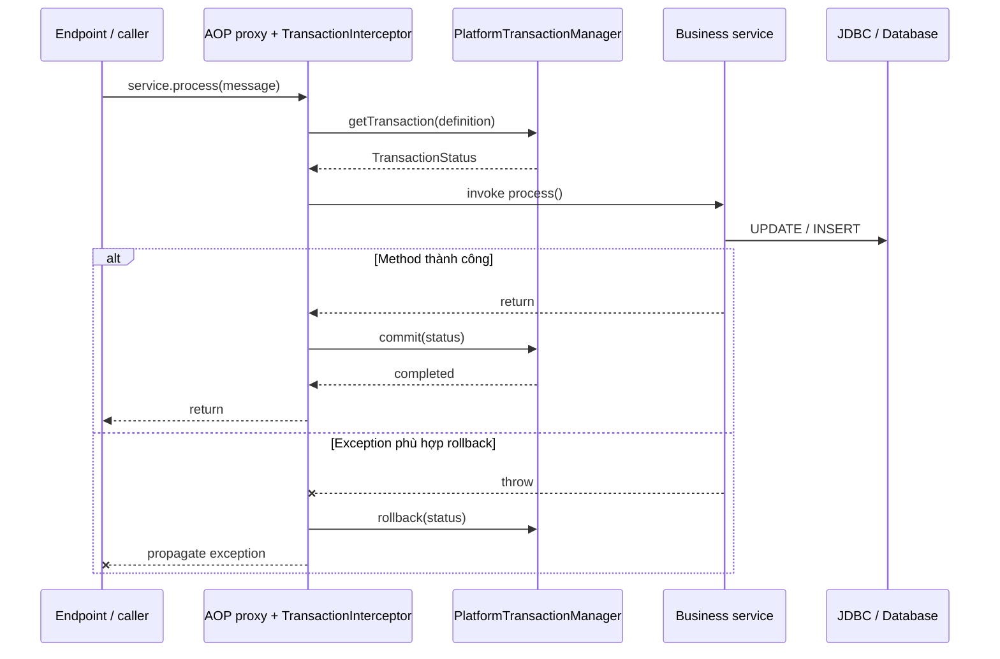
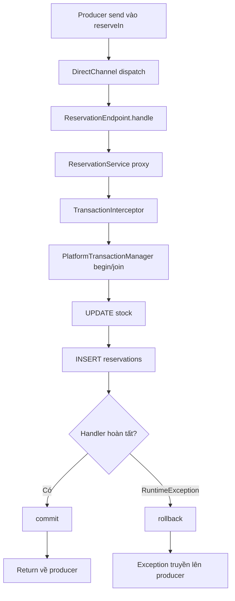
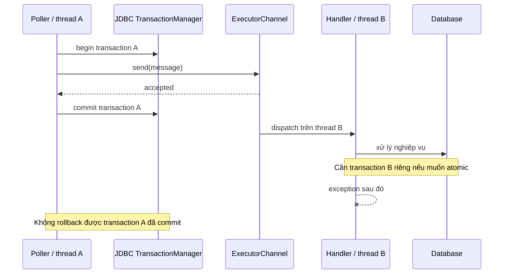

# TransactionInterceptor và PlatformTransactionManager trong Spring Integration

## 1. Transaction nằm ở đâu trong message flow?

Trong module `SPRING_INTEGRATION_RUNTIME`, một message có thể đi qua `MessageChannel`, handler, consumer, poller và executor; đồng thời thực hiện các thay đổi ở database hoặc message store. Câu hỏi quan trọng là: **ai bắt đầu transaction, phần nào của flow được transaction bao phủ, và khi nào commit/rollback xảy ra?**

Spring Integration sử dụng hạ tầng transaction của Spring Framework. Hai thành phần nền tảng của cơ chế **transaction đồng bộ (imperative)** là:

- **`TransactionInterceptor`**: AOP advice đứng quanh một lời gọi được cấu hình; quyết định bắt đầu hoặc tham gia transaction và xử lý commit/rollback sau lời gọi.
- **`PlatformTransactionManager`**: giao diện điều phối transaction với tài nguyên thực tế (JDBC, JPA, JTA...), thực hiện lấy transaction, commit hoặc rollback.

Hai thành phần phối hợp nhưng không đồng nghĩa. Interceptor **xác định ranh giới và chính sách**; manager **điều khiển giao dịch trên tài nguyên**. Spring Integration chỉ có thể bảo đảm rollback đối với các tài nguyên thực sự tham gia transaction đó. Gửi email, gọi HTTP API hoặc chuyển giao sang thread khác không tự trở thành một phần của transaction database.

**Tình huống xuyên suốt:** message `ReserveStock(requestId, sku, quantity)` đi vào channel `reserveIn`; handler trừ tồn kho và ghi phiếu giữ hàng. Cả hai câu lệnh JDBC phải **cùng thành công hoặc cùng rollback**. Nếu flow chuyển sang executor hoặc poller, ta cần xác định transaction được mở ở thread nào và nó có bao phủ được bước nhận message hay không.

Sau bài này, bạn sẽ có thể:

1. Giải thích luồng gọi `TransactionInterceptor → PlatformTransactionManager → business handler`.
2. Chọn transaction manager phù hợp với tài nguyên và kiểm tra cấu hình transaction thực sự có hiệu lực.
3. Sử dụng `@Transactional`, Spring Integration handler advice hoặc transactional poller đúng phạm vi.
4. Phân biệt `TransactionInterceptor` thông thường với `TransactionHandleMessageAdvice`.
5. Dự đoán rollback khi exception, retry, message chuyển thread và lỗi của poller.
6. Điều tra trường hợp một endpoint “có transaction” nhưng dữ liệu vẫn commit ngoài ý muốn.

## 2. Hai vai trò: interceptor điều phối, manager thực thi

### 2.1. `PlatformTransactionManager` là SPI của transaction đồng bộ

Spring Framework định nghĩa giao diện:

```java
public interface PlatformTransactionManager extends TransactionManager {
    TransactionStatus getTransaction(TransactionDefinition definition)
            throws TransactionException;

    void commit(TransactionStatus status) throws TransactionException;

    void rollback(TransactionStatus status) throws TransactionException;
}
```

Trong đó:

| Thành phần | Ý nghĩa |
|---|---|
| `TransactionDefinition` | Chính sách: propagation, isolation, timeout, read-only, tên transaction. |
| `TransactionStatus` | Trạng thái giao dịch mà manager đã lấy hoặc tạo; có thể đánh dấu rollback-only. |
| `getTransaction(...)` | Tham gia transaction hiện có hoặc tạo transaction mới theo propagation. |
| `commit(status)` | Hoàn tất transaction theo trạng thái; có thể thực hiện rollback nếu đã rollback-only. |
| `rollback(status)` | Hủy thay đổi thuộc transaction mà manager kiểm soát. |

Một số implementation phổ biến:

| Manager | Tài nguyên được quản lý | Lựa chọn điển hình |
|---|---|---|
| `DataSourceTransactionManager` hoặc `JdbcTransactionManager` | Một JDBC `DataSource`; `JdbcTransactionManager` cung cấp chuyển đổi exception commit/rollback theo mô hình JDBC | `JdbcTemplate`/JDBC đồng bộ. |
| `JpaTransactionManager` | `EntityManager`/JPA persistence context, có thể phối hợp JDBC cùng datasource khi cấu hình đúng | Handler gọi repository JPA. |
| `JtaTransactionManager` | Transaction phân tán khi nền tảng JTA và các resource tham gia thực sự hỗ trợ | Hệ thống cần JTA/XA; cấu hình, hiệu năng và lỗi phức tạp hơn. |
| `PseudoTransactionManager` (Spring Integration) | Cơ chế đồng bộ hóa callback theo trạng thái “commit/rollback”, **không có tài nguyên giao dịch thực** | Công việc file hoặc flow cần hook `afterCommit`/`afterRollback` nhưng không có DB transaction. |

**Chọn manager đúng là điều kiện bắt buộc.** `JdbcTemplate` cập nhật qua datasource A nhưng transaction manager điều khiển datasource B sẽ không tạo bảo đảm atomic cho dữ liệu của A. Với nhiều transaction manager, hãy chọn rõ bằng tên/qualifier; đừng để Spring ngẫu nhiên chọn một resource khác.

Lưu ý: `ReactiveTransactionManager` là mô hình **khác**, gắn transaction với Reactor context cho reactive pipeline. `PlatformTransactionManager` thường gắn tài nguyên vào **thread hiện tại**; không tự truyền sang thread mới. Bài này tập trung vào flow đồng bộ JDBC/imperative.

### 2.2. `TransactionInterceptor` đứng quanh lời gọi

Trong Spring declarative transaction, `@Transactional` là **metadata**. Khi hỗ trợ AOP được bật và lời gọi đi qua **Spring proxy**, một `TransactionInterceptor` dùng metadata đó để áp dụng transaction.



Hãy phân biệt **transaction interceptor** (cơ chế kiểm soát lời gọi) và **transaction manager** (chiến lược tài nguyên). Không cần viết tay `getTransaction/commit/rollback` cho mỗi handler nếu sử dụng `@Transactional` hoặc transaction advice đúng cách.

### 2.3. Bốn điều kiện để transaction có hiệu lực

- Một **transaction manager** phù hợp đã được đăng ký và chọn đúng.
- Phương thức/endpoint được **gắn transaction metadata hoặc advice**.
- Lời gọi thực sự **đi qua proxy/interceptor**; tự gọi `this.process()` từ phương thức trong cùng bean thường bỏ qua Spring proxy AOP mặc định.
- Tài nguyên được sửa dùng **cùng transaction-bound resource** và chạy trong phạm vi còn hiệu lực, thường cùng thread với mô hình imperative.

Chỉ có annotation xuất hiện trong source code không đủ để chứng minh database đang tham gia transaction.

## 3. Propagation, isolation, timeout và rollback rule

`TransactionInterceptor` dùng `TransactionAttribute`, một dạng `TransactionDefinition` có thêm quy tắc rollback. Các thuộc tính quan trọng:

| Thuộc tính | Ví dụ | Tác động |
|---|---|---|
| `propagation` | `REQUIRED` (mặc định), `REQUIRES_NEW`, `MANDATORY`, `NESTED` | Có tham gia transaction hiện tại hay tạo transaction mới; `NESTED` cần savepoint/resource hỗ trợ. |
| `isolation` | `DEFAULT`, `READ_COMMITTED`, `REPEATABLE_READ`, `SERIALIZABLE` | Mức cô lập khi tạo transaction mới, tùy DB và manager; không phải cách khóa mọi tài nguyên. |
| `timeout` | 5 giây | Giới hạn transaction được manager/resource hỗ trợ; không phải timer tự động ngắt bất kỳ code Java hay HTTP call nào. |
| `readOnly` | `true` | Gợi ý tối ưu/thực thi cho manager và database; **không mặc định** là hàng rào cấm ghi ở mọi DB. |
| `rollbackFor`/`noRollbackFor` | Exception nghiệp vụ cụ thể | Quyết định một exception thoát ra có khiến transaction rollback hay không. |

**Quy tắc mặc định của Spring Framework:** `RuntimeException` và `Error` gây rollback; checked `Exception` thông thường **không** gây rollback trừ khi cấu hình quy tắc khác. Nếu code bắt exception rồi trả thành công, interceptor sẽ nhìn thấy một lời gọi **thành công** và có thể commit.

Ví dụ:

```java
@Transactional(
        transactionManager = "transactionManager",
        propagation = Propagation.REQUIRED,
        isolation = Isolation.READ_COMMITTED,
        rollbackFor = IOException.class
)
public void importFile() throws IOException {
    // Nếu IOException thoát khỏi lời gọi qua proxy, rollback theo rule.
}
```

Đoạn trên cần `org.springframework.transaction.annotation.Transactional`, `Propagation`, `Isolation` và `java.io.IOException`.

**`REQUIRES_NEW` không có nghĩa "làm lại toàn flow".** Nó tạm treo transaction hiện tại (nếu có) và tạo transaction độc lập trên resource phù hợp. Ví dụ audit dùng `REQUIRES_NEW` có thể commit ngay cả khi transaction nghiệp vụ bên ngoài rollback. Việc này có chủ đích nhưng dễ gây trạng thái không nhất quán nếu dùng tùy tiện.

## 4. Ví dụ chạy được: một handler, hai thao tác database, một transaction

Ví dụ dùng Java 17+, Spring Integration, Spring JDBC, Spring transaction và một `DataSource` đã cấu hình kết nối PostgreSQL. Đặt các kiểu Java sau trong cùng package `example.integration` nhưng **mỗi public class/record ở một file riêng**. Nếu ứng dụng đã auto-configure transaction manager/JdbcTemplate, dùng các bean sẵn có thay vì đăng ký trùng.

### 4.1. Schema và dữ liệu thử

```sql
CREATE TABLE stock (
    sku VARCHAR(80) PRIMARY KEY,
    available INTEGER NOT NULL CHECK (available >= 0)
);

CREATE TABLE reservations (
    request_id VARCHAR(100) PRIMARY KEY,
    sku VARCHAR(80) NOT NULL REFERENCES stock(sku),
    quantity INTEGER NOT NULL CHECK (quantity > 0)
);

INSERT INTO stock(sku, available) VALUES ('BOOK-1', 10);
```

Giả sử message `ReserveStock("req-01", "BOOK-1", 3)`: sau khi commit, `available` thành 7 và xuất hiện một reservation. Nếu bước ghi reservation thất bại, `available` phải vẫn là 10 đối với lần xử lý đó.

### 4.2. Cấu hình channel và transaction manager

```java
package example.integration;

import javax.sql.DataSource;
import org.springframework.context.annotation.Bean;
import org.springframework.context.annotation.ComponentScan;
import org.springframework.context.annotation.Configuration;
import org.springframework.integration.channel.DirectChannel;
import org.springframework.integration.config.EnableIntegration;
import org.springframework.jdbc.core.JdbcTemplate;
import org.springframework.jdbc.support.JdbcTransactionManager;
import org.springframework.messaging.MessageChannel;
import org.springframework.transaction.PlatformTransactionManager;
import org.springframework.transaction.annotation.EnableTransactionManagement;

@Configuration
@EnableIntegration
@EnableTransactionManagement
@ComponentScan(basePackageClasses = {
        ReservationEndpoint.class, ReservationService.class
})
public class TransactionFlowConfig {

    @Bean("reserveIn")
    public MessageChannel reserveIn() {
        return new DirectChannel();
    }

    @Bean("transactionManager")
    public PlatformTransactionManager transactionManager(DataSource dataSource) {
        return new JdbcTransactionManager(dataSource);
    }

    @Bean
    public JdbcTemplate jdbcTemplate(DataSource dataSource) {
        return new JdbcTemplate(dataSource);
    }
}
```

`DirectChannel` là channel đồng bộ, nên exception có thể truyền ngược tới lời gọi `send()` của producer. `JdbcTransactionManager` điều phối JDBC operations của `JdbcTemplate` vì hai bean cùng dùng `DataSource`.

### 4.3. Data model và service mang transaction

```java
package example.integration;

public record ReserveStock(String requestId, String sku, int quantity) {}
```

```java
package example.integration;

import org.springframework.jdbc.core.JdbcTemplate;
import org.springframework.stereotype.Service;
import org.springframework.transaction.annotation.Transactional;

@Service
public class ReservationService {

    private final JdbcTemplate jdbc;

    public ReservationService(JdbcTemplate jdbc) {
        this.jdbc = jdbc;
    }

    @Transactional(transactionManager = "transactionManager")
    public void reserve(ReserveStock command) {
        if (command.quantity() <= 0) {
            throw new IllegalArgumentException("quantity must be positive");
        }

        int changed = jdbc.update(
                "UPDATE stock SET available = available - ? " +
                "WHERE sku = ? AND available >= ?",
                command.quantity(),
                command.sku(),
                command.quantity());

        if (changed != 1) {
            throw new IllegalStateException("not enough stock or unknown SKU");
        }

        jdbc.update(
                "INSERT INTO reservations(request_id, sku, quantity) " +
                "VALUES (?, ?, ?)",
                command.requestId(),
                command.sku(),
                command.quantity());
    }
}
```

Nếu `INSERT` bị lỗi unique key vì `request_id` trùng, exception từ `JdbcTemplate` thường là unchecked `DataAccessException`. Nó thoát ra khỏi `reserve()`, làm **cả UPDATE và INSERT rollback**. Đây là atomicity cho **một transaction database**. Việc trả lời duplicate với trạng thái hợp lệ (idempotency) là bài toán nghiệp vụ bổ sung, không tự được giải quyết chỉ bằng rollback.

### 4.4. Endpoint Spring Integration gọi service qua proxy

```java
package example.integration;

import org.springframework.integration.annotation.MessageEndpoint;
import org.springframework.integration.annotation.ServiceActivator;

@MessageEndpoint
public class ReservationEndpoint {

    private final ReservationService service;

    public ReservationEndpoint(ReservationService service) {
        this.service = service;
    }

    @ServiceActivator(inputChannel = "reserveIn")
    public void handle(ReserveStock command) {
        service.reserve(command);
    }
}
```

Spring quản lý `ReservationService` và chèn transaction advice khi `ReservationEndpoint` gọi `service.reserve()`. Phạm vi transaction là **method `reserve()`**, tức bao cả hai lệnh JDBC. Chính vì service ở bean khác, lời gọi từ endpoint đi qua Spring proxy; cách tách bean này cũng giúp dễ kiểm thử.

Producer gửi message từ một Spring-managed component:

```java
import example.integration.ReserveStock;
import org.springframework.context.ApplicationContext;
import org.springframework.messaging.MessageChannel;
import org.springframework.messaging.support.MessageBuilder;

MessageChannel reserveIn =
        context.getBean("reserveIn", MessageChannel.class);

reserveIn.send(
        MessageBuilder.withPayload(
                new ReserveStock("req-01", "BOOK-1", 3))
                .build());
```

Trong snippet trên, `context` là `ApplicationContext` đã được ứng dụng inject/cung cấp; import chỉ minh họa kiểu. Để xác minh:

```sql
SELECT available FROM stock WHERE sku = 'BOOK-1';
-- Mong đợi: 7

SELECT request_id, sku, quantity
FROM reservations WHERE request_id = 'req-01';
-- Mong đợi: đúng một bản ghi, quantity = 3
```

Để thử rollback, gửi lại cùng `requestId = "req-01"` sau khi lần đầu đã commit. Bước `UPDATE` chạy nhưng `INSERT` vi phạm primary key; transaction lần hai rollback nên `available` **giữ nguyên 7**, không giảm thành 4. Trường hợp này minh họa atomicity, **không phải** một API duplicate-friendly: caller có thể nhận exception và vẫn cần chính sách idempotency/reply ở tầng nghiệp vụ.

### 4.5. Trình tự runtime của ví dụ



Một transaction ở đây **không** bắt đầu ngay lúc tạo `Message<?>`, cũng không vì channel tên `reserveIn` tự biết transaction. Nó bắt đầu khi lời gọi vào service được interceptor bao quanh.

## 5. Sử dụng `TransactionInterceptor` trực tiếp: điểm khác với `@Transactional`

`@Transactional` là cú pháp khai báo thuận tiện cho service layer, còn **Spring Integration endpoint advice** cho phép đặt transaction ở ranh giới của handler/poller. Khi cần điều khiển pipeline bằng `adviceChain` hoặc Java DSL, có thể tạo bean `TransactionInterceptor` qua `TransactionInterceptorBuilder` của Spring Integration.

Ví dụ cấu hình một advice bao quanh **toàn bộ `handleMessage()` và phần dispatch đồng bộ đi tiếp**:

```java
import org.springframework.context.annotation.Bean;
import org.springframework.integration.transaction.TransactionInterceptorBuilder;
import org.springframework.transaction.PlatformTransactionManager;
import org.springframework.transaction.annotation.Isolation;
import org.springframework.transaction.annotation.Propagation;
import org.springframework.transaction.interceptor.TransactionInterceptor;

@Bean("wholeMessageTxAdvice")
public TransactionInterceptor wholeMessageTxAdvice(
        PlatformTransactionManager transactionManager) {
    return new TransactionInterceptorBuilder(true)
            .transactionManager(transactionManager)
            .propagation(Propagation.REQUIRED)
            .isolation(Isolation.READ_COMMITTED)
            .build();
}
```

Đây là **một phương án cấu hình khác** so với `@Transactional` ở mục 4; không tự gắn cả hai vào cùng handler nếu chưa có chủ đích về propagation/ordering. Nếu class cấu hình dùng injection theo tên để chọn manager giữa nhiều bean, thêm qualifier phù hợp.

Có thể tham chiếu bean advice này trong Spring Integration annotation, chẳng hạn một transformer endpoint. Vì tên annotation `@Transformer` trùng với tên interface `Transformer`, đoạn mã dùng tên đầy đủ của cả hai kiểu để tránh nhập nhằng:

```java
@Bean
@org.springframework.integration.annotation.Transformer(
        inputChannel = "transformIn",
        outputChannel = "transformOut",
        adviceChain = "wholeMessageTxAdvice")
public org.springframework.integration.transformer.Transformer passThrough() {
    return message -> message;
}
```

Ví dụ transformer chỉ minh họa **cách gắn advice vào endpoint**; ứng dụng phải tạo các channel `transformIn`, `transformOut` và subscriber tương ứng nếu muốn chạy đoạn này như một flow riêng. Trong Java DSL, có thể dùng cấu hình transaction trên endpoint bằng phương thức `transactional(...)` thay vì tạo advice bean thủ công.

### 5.1. Một khác biệt dễ gây bug: `TransactionHandleMessageAdvice`

Với **reply-producing handler** (service activator/transformer/outbound gateway), Spring Integration phân biệt:

| Advice | Phần được bao | Hệ quả |
|---|---|---|
| `TransactionInterceptor` thông thường gắn trong request-handler advice chain | Thường chỉ bao `handleRequestMessage()` của handler | Có thể commit **trước** khi reply được gửi đến `outputChannel` và downstream handler đồng bộ chạy. |
| `TransactionHandleMessageAdvice` (kế thừa `TransactionInterceptor`, triển khai `HandleMessageAdvice`) | Bao `MessageHandler.handleMessage()` | Khi downstream tiếp tục trên **cùng thread**, send reply và handler phía sau có thể còn nằm trong transaction. |

`TransactionInterceptorBuilder(true)` tạo **`TransactionHandleMessageAdvice`**; tham số `true` là lựa chọn có ý nghĩa. `false`/constructor thông thường tạo interceptor không có mở rộng phạm vi `handleMessage()` đó. Đây là khác biệt của cơ chế advice dành cho Spring Integration, không phải hai loại transaction manager.

```text
Request -> [TransactionInterceptor thường: handleRequestMessage()] -> COMMIT
        -> send reply -> DirectChannel -> downstream

Request -> [TransactionHandleMessageAdvice:
              handleRequestMessage() -> send reply
              -> DirectChannel -> downstream] -> COMMIT
```

Sơ đồ chỉ đúng nếu downstream chạy **đồng bộ trên cùng thread**. `ExecutorChannel`, `QueueChannel` hoặc một thành phần reactive có thể cắt đứt transaction scope ngay cả khi dùng `TransactionHandleMessageAdvice`. Nếu mục đích chỉ cần atomic hai lệnh JDBC ở service, phương án `@Transactional` mục 4 đơn giản và dễ giải thích hơn.

## 6. Transaction ở poller: bao cả bước `receive()`

Poller khác caller chủ động gọi gateway hoặc `MessageChannel.send(...)` ở chỗ **poller khởi phát luồng theo lịch**. Muốn transaction bắt đầu **trước khi lấy message từ một nguồn có khả năng transactional**, có thể gắn transaction advice vào poller. Khi đó `receive()` và phần xử lý đồng bộ ở cùng thread có thể thuộc một unit of work.

Ví dụ cấu hình XML Spring Integration (một flow **thay thế** cho ví dụ annotation; không đăng ký đồng thời cùng input channel/consumer):

```xml
<int:service-activator
        input-channel="pendingReservations"
        ref="reservationWorker"
        method="reserve">
    <int:poller fixed-delay="1000" max-messages-per-poll="1">
        <int:transactional
                transaction-manager="transactionManager"
                propagation="REQUIRED"/>
    </int:poller>
</int:service-activator>
```

Ở cấu hình thực tế, cần khai báo namespace `int`, bean `reservationWorker` và channel `pendingReservations` có thể polling (`PollableChannel`). `reservationWorker.reserve(...)` là phương thức handler tương ứng với payload. Nếu handler đã tự có `@Transactional`, hãy kiểm tra việc join transaction theo `REQUIRED` thay vì mặc định coi là hai unit of work độc lập.

**Điểm quyết định là nguồn message:**

- Nếu `receive()` làm việc với một **transactional resource** (ví dụ queue/message store được transaction manager thích hợp quản lý), rollback có thể khôi phục/đưa message trở lại theo hợp đồng nguồn.
- Nếu dùng **`QueueChannel` trong bộ nhớ**, transaction JDBC của poller **không thể tự hoàn tác thao tác lấy message khỏi queue in-memory**. Có thể rollback thay đổi DB nhưng không đồng nghĩa message quay về queue.
- Khi poller nối `DirectChannel` với service activator cùng thread, exception của downstream có thể quay ngược lại poller và gây rollback. Khi nối qua `ExecutorChannel`, việc giao message thành công có thể khiến poller commit trước khi worker báo lỗi.

Nếu poller còn dùng retry, logging hoặc metrics advice, thứ tự trong **advice chain** có thể quyết định retry attempt tham gia một transaction hay mỗi attempt có transaction mới. XML cung cấp `<advice-chain>` để sắp thứ tự advice; không kết hợp `<transactional>` và `<advice-chain>` trong cùng poller XML như thể chúng là hai cấu hình độc lập. Muốn nhiều advice thì đưa transaction advice vào chain theo đúng thứ tự.

## 7. Ranh giới thread: vì sao `ExecutorChannel` có thể commit quá sớm?

Transaction JDBC dạng imperative được lưu trong ngữ cảnh **thread hiện tại** thông qua Spring transaction synchronization. Channel quyết định thread tiếp tục xử lý message:

| Thành phần | Thread thường thực thi | Tác động transaction |
|---|---|---|
| `DirectChannel` | Thread của caller khi `send()` | Downstream synchronous handler có thể tham gia transaction hiện tại. |
| `ExecutorChannel` | Thread của `TaskExecutor` | Thread mới **không mặc định kế thừa** transaction của caller. |
| `QueueChannel` | Producer gửi vào queue, polling consumer nhận sau | Bên nhận thường mở transaction riêng; không giữ nguyên transaction của producer. |
| `PublishSubscribeChannel` không gắn executor | Thường dispatch đồng bộ | Có thể cùng transaction thread, nhưng cần tính tới nhiều subscriber và lỗi. |
| `PublishSubscribeChannel` dùng executor | Xử lý subscriber trên thread khác | Không mặc định có transaction chung với caller. |



**Quy tắc thực dụng:** nếu chuyển thread, đặt transaction ở **thread consumer** cho công việc cần atomic; đừng dựa vào transaction của thread producer. Nếu cần bảo toàn trạng thái qua handoff, chọn queue/broker/message store hỗ trợ giao dịch riêng, hoặc outbox/inbox và idempotency theo yêu cầu.

Dù `DirectChannel` chạy cùng thread, transaction không tự động kéo dài vĩnh viễn: nó kết thúc khi interceptor/proxy bao quanh trả quyền điều khiển và hoàn tất commit/rollback.

## 8. Exception, error flow và rollback: thứ tự là tất cả

Transaction interceptor chỉ quyết định rollback dựa trên **kết quả lời gọi mà nó thấy** và các rollback rule.

### 8.1. Exception được ném ra ngoài scope

```text
begin -> UPDATE -> INSERT lỗi -> throw RuntimeException
      -> interceptor bắt exception -> rollback
```

Đây là hành vi mong đợi của ví dụ mục 4.

### 8.2. Handler nuốt exception rồi trả bình thường

```java
@Transactional
public void unsafeProcess() {
    try {
        performDatabaseUpdates();
    } catch (RuntimeException ex) {
        log.error("Cannot process", ex);
        // Không ném tiếp; interceptor có thể commit phần đã thay đổi.
    }
}
```

Đoạn là **phản ví dụ**, không phải mẫu nên sao chép. Nếu muốn rollback, để exception thoát ra, ném lại exception phù hợp hoặc **đánh dấu rollback-only** có chủ đích. Với transaction đã tham gia từ caller, rollback-only có thể dẫn tới `UnexpectedRollbackException` ở lúc caller commit; đây là tín hiệu cần chẩn đoán, không phải exception nên nuốt.

### 8.3. Error channel và transaction không cùng vai trò

`errorChannel` là nơi nhận `ErrorMessage` khi có thành phần bắt và publish exception, nhất là khi xử lý bất đồng bộ. Nó **không tự thực hiện rollback**. Nếu exception bị một advice/error handler bắt rồi chuyển thành kết quả “thành công” **trước khi thoát khỏi transaction advice**, transaction có thể commit.

Ngược lại, một exception đồng bộ từ `DirectChannel` có thể truyền thẳng về caller; không phải mọi exception đều mặc định chuyển thành `ErrorMessage`. Để hiểu kết quả, cần biết **advice nào bao advice nào**, exception được bắt tại lớp nào và transaction bắt đầu ở đâu.

### 8.4. Retry nằm ngoài hay trong transaction?

So sánh hai cấu hình ý tưởng:

```text
RetryAdvice(
    TransactionAdvice(
        handler attempt #1, #2, ...
    )
)
=> Mỗi attempt có thể mở transaction mới, rollback trước khi retry.

TransactionAdvice(
    RetryAdvice(
        handler attempt #1, #2, ...
    )
)
=> Nhiều attempt có thể dùng cùng transaction; một lỗi có thể
   đánh dấu rollback-only, làm commit cuối thất bại.
```

Với `RequestHandlerRetryAdvice`, thứ tự advice có thể thay đổi đường đi thực tế (đặc biệt khi có `HandleMessageAdvice`). Cần **kiểm thử cấu hình thực** và lỗi có chủ đích, thay vì suy ra an toàn transaction chỉ từ thứ tự tên bean trong một đoạn mã.

Retry của handler và redelivery từ broker là hai cơ chế khác nhau; nếu DB commit nhưng ack không thành công, message vẫn có thể đến lại. **Idempotency key** bảo vệ business effect khi redelivery; transaction bảo vệ atomicity của **mỗi lần xử lý**.

## 9. Transaction không thay thế message store và external consistency

Một manager JDBC có thể rollback những câu lệnh SQL cùng tham gia transaction, nhưng không thể bảo đảm rollback cho mọi thao tác trong flow:

| Thao tác | Rollback bởi `JdbcTransactionManager`? | Hướng thiết kế |
|---|---|---|
| Hai câu lệnh `JdbcTemplate` trên cùng datasource/transaction | Có, nếu resource và proxy đúng | `@Transactional` hoặc advice phù hợp. |
| Gửi email ngay trong handler | Không | Outbox, gửi sau commit, idempotency phía nhận. |
| Gọi HTTP thanh toán và provider đã xử lý | Không | Idempotency key, đối soát, saga/compensation. |
| Gửi vào `QueueChannel` in-memory | Không rollback bằng JDBC | Queue/message store transactional hoặc cơ chế retry riêng. |
| Ghi vào `JdbcMessageStore` với cùng datasource/transaction | Có thể, tùy cấu hình store và transaction thực tế | Đảm bảo dùng cùng manager, connection và ranh giới. |
| Gửi message tới broker độc lập | Không mặc định | Transaction/ack của broker hoặc outbox/inbox; không suy luận XA tự có. |

**Transaction synchronization** (ví dụ `TransactionSynchronizationFactory` ở polling endpoint) có thể chạy `afterCommit`/`afterRollback` để dời file sang thư mục success/failure hoặc phát notification. Hook đó **không biến việc đổi tên file thành một giao dịch rollback được**. Nếu hook thất bại sau commit, database đã commit; cần retry/recovery riêng.

`PseudoTransactionManager` cũng chỉ cung cấp vòng đời synchronization khi thiếu resource giao dịch thực. Không dùng nó để tuyên bố JDBC/HTTP sẽ được atomic.

Với reactive flow (`Flux`/`Mono`), cần xem `ReactiveTransactionManager` và **Reactor context**; một `PlatformTransactionManager` thread-bound không được tự động chuyển thành reactive transaction bởi việc đổi kiểu channel.

## 10. Chẩn đoán transaction runtime

Nếu logs cho thấy handler có annotation/advice nhưng kết quả không đúng, lần theo sáu điểm sau:

1. **Transaction bắt đầu ở đâu?** `@Transactional` tại service, advice ở handler hay advice ở poller? Xác định interceptor thực sự được gọi.
2. **Manager nào được dùng?** Kiểm tra bean `transactionManager`, datasource/entity manager và qualifier; tìm tình huống hai resource khác nhau.
3. **Thread nào chạy đoạn SQL?** Đối chiếu thread name khi nhận, khi vào handler và khi gọi JDBC; xác định ranh giới `ExecutorChannel`/poller.
4. **Exception có thoát khỏi interceptor không?** Xem `try/catch`, retry advice, error handler, checked exception và rollback rule.
5. **Resource nào thực sự nằm trong transaction?** DB, queue, broker, file và HTTP là những resource khác nhau; đừng lấy một lần commit JDBC làm bằng chứng tất cả đã thành công.
6. **Transaction kết thúc khi nào?** Đối chiếu timestamp của `begin`, `commit`/`rollback`, gửi reply và ack/offset nguồn.

Có thể bật log ở mức phù hợp cho `org.springframework.transaction`, `org.springframework.jdbc` và `org.springframework.integration` trong môi trường kiểm thử; dùng SQL logging có kiểm soát để thấy transaction bắt đầu/kết thúc. Trong code kiểm tra ngắn tại service:

```java
import org.springframework.transaction.support.TransactionSynchronizationManager;

boolean active =
        TransactionSynchronizationManager.isActualTransactionActive();
String name = TransactionSynchronizationManager.getCurrentTransactionName();
```

`active == true` xác nhận một transaction imperative hiện tại ở thread, **không chứng minh** mọi thao tác resource khác đã tham gia. Khi ghi log, dùng correlation/business event ID, hạn chế in payload hoặc credential.

| Triệu chứng | Khả năng | Kiểm tra trước |
|---|---|---|
| `@Transactional` không rollback | Self-invocation, bean không qua Spring proxy, sai manager hoặc exception bị bắt. | Call path tới bean; transaction log; datasource. |
| Handler sau `ExecutorChannel` lỗi nhưng bước trước đã commit | Handoff sang thread khác; transaction producer đã hoàn tất. | Thread và thời điểm commit/dispatch. |
| Rollback DB nhưng message không trở lại queue | Queue in-memory không transactional với JDBC manager. | Loại `MessageStore`/broker và ack/receive semantics. |
| `UnexpectedRollbackException` | Inner operation đánh dấu rollback-only, outer cố commit. | Propagation và nơi xuất hiện exception đầu tiên. |
| Retry chạy nhiều lần rồi không commit | Retry cùng transaction đã rollback-only. | Thứ tự advice và transaction cho mỗi attempt. |
| Error handler ghi log nhưng dữ liệu đã commit | Error flow bắt exception ở ngoài transaction hoặc lỗi xảy ra sau commit. | Vị trí error publisher, advice scope, thread. |
| Chạy “sau commit” nhưng file không di chuyển | Callback/file operation không transactional và có lỗi riêng. | Log `afterCommit` và cơ chế recovery của file. |

## 11. Bài thực hành có thể tự kiểm chứng

Sử dụng code mục 4 trên database thử nghiệm. Mỗi bước cần kiểm tra **số dòng dữ liệu, transaction outcome và thread**, không chỉ xem lời gọi `send()` trả về gì:

1. **Commit:** gửi `req-01/BOOK-1/3`, xác nhận stock từ 10 còn 7 và reservation được tạo.
2. **Rollback:** gửi lại `req-01/BOOK-1/3`, xác nhận primary-key violation và stock **vẫn là 7** nhờ rollback của lần gửi thứ hai.
3. **Proxy:** tạm thử gọi method transactional qua `this.reserve(...)` trong cùng service (trong một biến thể riêng) và so sánh với lời gọi qua bean proxy. Khôi phục kiến trúc hai bean sau thử nghiệm.
4. **Rollback rule:** tạo một checked exception ném ra khỏi service, so sánh mặc định với `rollbackFor` phù hợp.
5. **Thread boundary:** thay `DirectChannel` bằng `ExecutorChannel` trong bản thử; ghi log thread/transaction và chứng minh transaction của caller không tự lan sang worker. Giữ transaction trên service được worker gọi.
6. **Poller:** tạo một polling flow khác với transactional `MessageStore`; thử failure và xác minh cơ chế requeue/rollback của nguồn. Làm tương tự với `QueueChannel` in-memory và giải thích sự khác biệt.
7. **Advice scope:** dùng một reply-producing handler rồi nối `DirectChannel` tới handler thứ hai cố ý ném exception. So sánh transaction interceptor thông thường và `TransactionHandleMessageAdvice`.
8. **Retry:** mô phỏng lỗi DB tạm thời với retry giới hạn; quan sát mỗi attempt có transaction mới hay đang tái dùng transaction rollback-only.
9. **External side effect:** trong một bản giả lập, gọi HTTP mock trước khi transaction DB rollback; quan sát HTTP không thể tự bị rollback, sau đó đề xuất outbox hoặc idempotency key.

Với từng ca, ghi bảng kết quả:

| Trường cần quan sát | Giá trị cần ghi |
|---|---|
| `requestId` / business key | Có giữ nguyên qua retry/redelivery không? |
| Thread nhận và xử lý | Cùng thread hay đã chuyển qua executor/poller? |
| Manager & transaction active | Có đúng datasource/transaction không? |
| Advice/proxy boundary | Bao quanh method, handler, reply dispatch hay poller receive? |
| Exception & rollback rule | Bị ném, bị bắt, checked hay unchecked? |
| Transaction outcome | Commit, rollback hay rollback-only? |
| Source ack / message store | Message có thể xuất hiện lại không? |

## 12. Tóm lược quy tắc thiết kế

- `TransactionInterceptor` quyết định transaction quanh **lời gọi được intercept**; `PlatformTransactionManager` quản lý transaction trên **tài nguyên được hỗ trợ**.
- Với nghiệp vụ JDBC đơn giản, tách service được Spring quản lý và đặt `@Transactional` trên **public method được gọi qua proxy** là cách dễ kiểm chứng.
- Với **poller**, transaction advice có thể bao cả `receive()` và downstream đồng bộ, nhưng việc rollback message phụ thuộc nguồn có transactional hay không.
- `DirectChannel` thường giữ cùng thread; `ExecutorChannel`/`QueueChannel` tạo ranh giới không tự truyền transaction imperative.
- Với Spring Integration reply-producing handler, cần phân biệt **`TransactionInterceptor` thường** và **`TransactionHandleMessageAdvice`** khi muốn bao cả việc dispatch reply xuống downstream.
- Transaction rollback, retry, error channel, idempotency và nguồn ack liên quan nhau nhưng có hợp đồng riêng. Hãy kiểm thử nơi bắt đầu/kết thúc transaction và hậu quả nghiệp vụ quan sát được.

### Tài liệu tham khảo chính thức

- [Spring Integration Reference — Transaction Support](https://docs.spring.io/spring-integration/reference/transactions.html): transactional poller, transaction boundary, synchronization và pseudo transaction.
- [Spring Integration Reference — TransactionHandleMessageAdvice](https://docs.spring.io/spring-integration/reference/handler-advice/tx-handle-message.html): khác biệt advice scope giữa `handleRequestMessage()` và `handleMessage()`.
- [Spring Framework Reference — Understanding Declarative Transaction Implementation](https://docs.spring.io/spring-framework/reference/data-access/transaction/declarative/tx-decl-explained.html): AOP proxy và `TransactionInterceptor`.
- [Spring Framework Reference — Transaction Strategies](https://docs.spring.io/spring-framework/reference/data-access/transaction/strategies.html): giao diện `PlatformTransactionManager` và cách chọn transaction manager.
- [Spring Framework Reference — Rollback Rules](https://docs.spring.io/spring-framework/reference/data-access/transaction/declarative/rolling-back.html): exception và điều kiện rollback.
