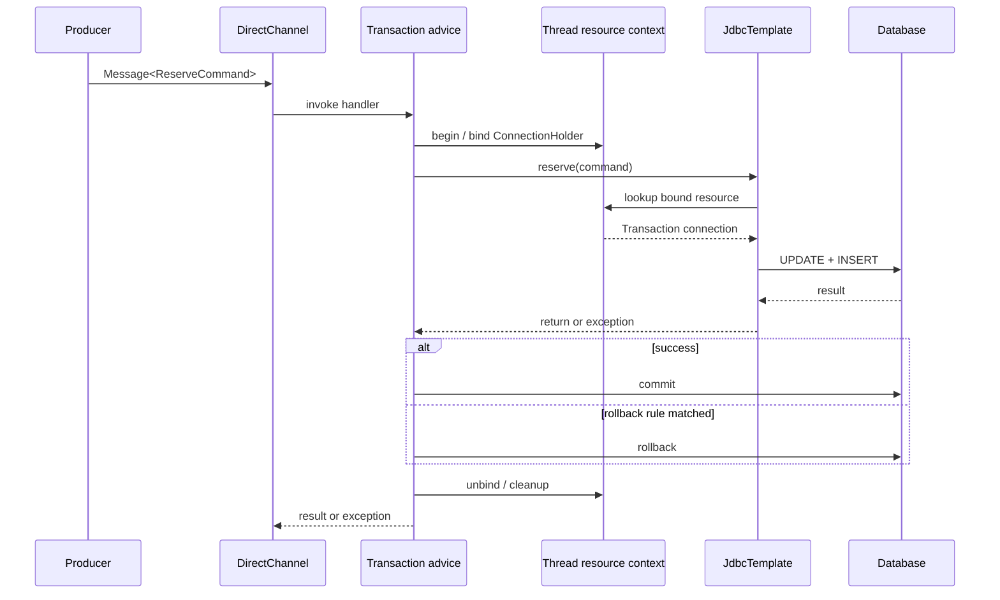
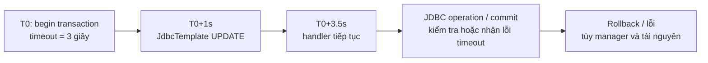
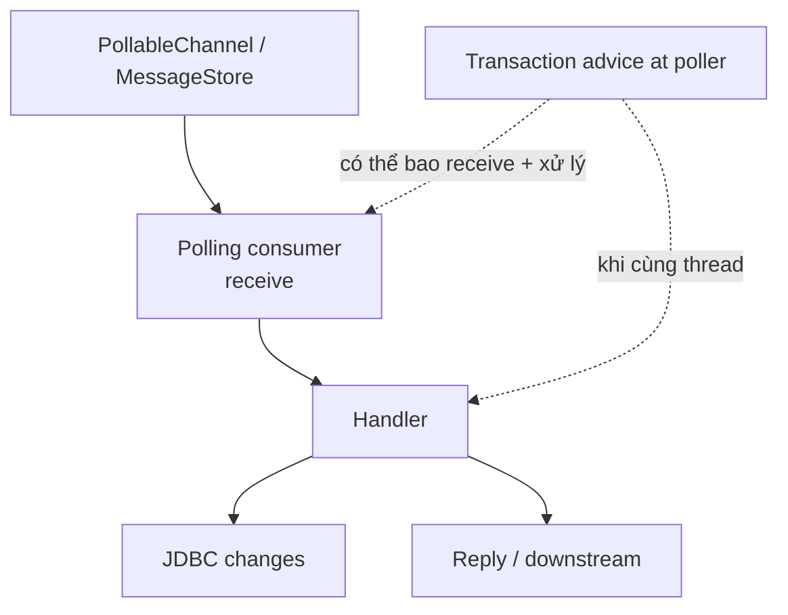
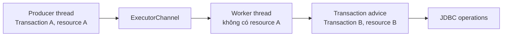

# Transaction timeout và resource binding

## 1. Hai câu hỏi quyết định hành vi transaction tại runtime

Trong Spring Integration, message đi qua channel, consumer endpoint, poller và handler. Handler có thể truy vấn database, cập nhật message store, gọi HTTP hoặc gửi reply. Khi một bước chạy quá lâu hoặc xảy ra exception, ta thường đặt hai câu hỏi:

1. **Transaction có timeout ở đâu?** Một giới hạn 3 giây có thật sự dừng handler sau đúng 3 giây, hay chỉ được kiểm tra khi tài nguyên hỗ trợ transaction thực hiện thao tác tiếp theo?
2. **Tài nguyên đang gắn với thread nào?** JDBC connection của handler có thuộc transaction đang mở không, và nó còn thuộc transaction đó sau khi message qua `ExecutorChannel` hay không?

Hai câu hỏi liên quan với nhau. Trong Spring, các transaction manager thông dụng như `DataSourceTransactionManager` hoặc `JdbcTransactionManager` thường dùng `TransactionSynchronizationManager` để gắn trạng thái transaction và resource holder vào **thread hiện tại**. Thông tin timeout của resource cũng được quản lý trong ngữ cảnh này. Một handler có thể trông giống đang chạy trong cùng `IntegrationFlow` nhưng lại dùng connection ngoài transaction nếu message chuyển qua thread khác trước handler.

Bài học thuộc chương **Transaction runtime** của module **SPRING_INTEGRATION_RUNTIME**, tập trung vào cách các channel, endpoint, consumer, poller và executor ảnh hưởng đến transaction, retry, error channel, message store, correlation và hiệu năng.

> **Nguyên tắc cốt lõi:** transaction timeout là chính sách của transaction manager và tài nguyên giao dịch; nó **không phải bộ hẹn giờ tự động ngắt mọi đoạn Java code**. Resource binding gắn với thread thực thi; **message không tự mang transaction context sang thread khác**.

## 2. Các khái niệm cần tách bạch

| Khái niệm | Ý nghĩa | Không đồng nghĩa với |
| --- | --- | --- |
| **Transaction timeout** | Ngân sách thời gian mà transaction manager cấp cho một transaction mới, khi tài nguyên hỗ trợ | Deadline toàn bộ HTTP request hoặc timeout của executor task |
| **Statement/query timeout** | Thời gian chờ một câu SQL hoặc operation do JDBC driver áp dụng | Tổng thời gian xử lý của cả message flow |
| **Poll interval** | Chu kỳ poller tìm message từ một nguồn pollable | Timeout của transaction đang xử lý message |
| **Receive/send timeout** | Thời gian chờ khi gửi/nhận ở những channel/adapter hỗ trợ | JDBC transaction timeout |
| **Resource binding** | Gắn `ConnectionHolder`/resource holder vào thread theo khóa tài nguyên | Gắn connection vào message headers để đi khắp flow |
| **Propagation** | Quy tắc tạo, tham gia hoặc tạm treo transaction hiện hữu | Bảo đảm transaction xuyên nhiều thread và nhiều hệ thống |

`TransactionDefinition.TIMEOUT_DEFAULT` nghĩa là dùng mặc định của transaction manager; nó không mang nghĩa “tự động timeout sau một khoảng cố định” trong mọi ứng dụng. `TransactionDefinition.PROPAGATION_REQUIRED` thường tham gia transaction đang có; thuộc tính timeout của một lời gọi tham gia transaction hiện hữu **không tự khởi động lại deadline** của transaction bên ngoài.

## 3. Resource binding diễn ra như thế nào?

Ví dụ một consumer endpoint có transaction advice, sử dụng `JdbcTemplate` kết nối đến `DataSource`. Khi manager mở transaction JDBC mới, nó thường lấy connection và **bind** một `ConnectionHolder` vào thread. Các lời gọi JDBC tuân theo Spring transaction infrastructure, như `JdbcTemplate` thông qua `DataSourceUtils`, sẽ dùng đúng connection đang được bind.



Đây là mô hình khái niệm của local JDBC transaction; chi tiết thời điểm lấy connection có thể khác nếu có `LazyConnectionDataSourceProxy`. Khi một transaction **tham gia transaction đã có**, resource đã bind có thể được tái sử dụng và manager bên ngoài sẽ chịu trách nhiệm commit/rollback cuối cùng.

### `TransactionSynchronizationManager`

Spring cung cấp `org.springframework.transaction.support.TransactionSynchronizationManager` để quan sát thông tin gắn với thread:

```java
import javax.sql.DataSource;
import org.springframework.transaction.support.TransactionSynchronizationManager;

public void inspectCurrentThread(DataSource dataSource) {
    System.out.println(
        "activeTx=" +
        TransactionSynchronizationManager.isActualTransactionActive());

    System.out.println(
        "syncActive=" +
        TransactionSynchronizationManager.isSynchronizationActive());

    System.out.println(
        "resourceBound=" +
        TransactionSynchronizationManager.hasResource(dataSource));

    System.out.println(
        "txName=" +
        TransactionSynchronizationManager.getCurrentTransactionName());
}
```

Phân biệt các chỉ báo:

- `isActualTransactionActive()` cho biết thread được đánh dấu đang có transaction thực sự theo cơ chế Spring tương ứng.
- `isSynchronizationActive()` cho biết transaction synchronization đang hoạt động; **không đủ một mình** để kết luận có JDBC transaction thực sự.
- `hasResource(dataSource)` kiểm tra có resource được bind theo **khóa DataSource cụ thể**. Nếu ứng dụng dùng proxy/wrapper cho DataSource, phải kiểm tra đúng object được transaction manager sử dụng.
- `getCurrentTransactionName()` có thể là `null`; tên transaction không phải correlation ID của message.

Đây là API để **quan sát và hỗ trợ hạ tầng**, không nên gọi `bindResource()`/`unbindResource()` thủ công trong một business handler chỉ để “ép” nó tham gia transaction. Transaction manager phải điều phối bind/unbind, commit và cleanup. Rò rỉ resource holder trên thread trong pool có thể khiến các message sau sử dụng sai trạng thái hoặc gây cạn connection.

## 4. Timeout được đặt ở đâu và được thực thi thế nào?

Timeout có thể được khai báo qua `@Transactional(timeout = 3)` trên một Spring service được gọi qua proxy, `TransactionInterceptor` trong advice chain, hoặc transaction advice của poller. Dù khai báo ở đâu, phải biết transaction nào **thực sự mới được tạo**.

Một dòng thời gian minh họa:



**Điểm dễ nhầm:** khi handler ngủ 5 giây trong `Thread.sleep(5000)`, timeout 3 giây **không nhất thiết ngắt giấc ngủ**. Với Spring JDBC, thời gian còn lại của transaction có thể được áp cho `Statement` thông qua `JdbcTemplate` và `DataSourceUtils`. Khi thời hạn đã hết, một lời gọi JDBC tiếp theo có thể ném `TransactionTimedOutException`; cơ chế enforcement tại operation/commit phụ thuộc transaction manager, JDBC driver và transaction integration thực tế.

Cần phân biệt:

- `TransactionTimedOutException` của Spring thường chỉ ra transaction deadline đã hết theo cơ chế transaction infrastructure.
- `QueryTimeoutException` hoặc `SQLTimeoutException` có thể báo timeout ở một câu SQL; chưa chắc toàn transaction đã vượt deadline.
- Lỗi do lock wait, socket read timeout hoặc database statement cancellation có thể có exception và chính sách rollback khác.
- Timeout trên `WebClient`, HTTP client, broker hay gRPC là **cơ chế riêng**; timeout JDBC không tự hủy các cuộc gọi đó.

Trong nghiệp vụ có blocking I/O, hãy cấu hình timeout của từng client **và** transaction timeout hợp lý, đồng thời tránh giữ transaction database mở trong thời gian chờ mạng dài.

## 5. Ví dụ Java DSL: mở transaction có timeout tại handler

Giả sử ứng dụng đã cấu hình Spring Integration, Spring JDBC, `DataSource` và một `PlatformTransactionManager` cho cùng database. Ví dụ quản lý tồn kho theo yêu cầu đặt chỗ; mỗi message chứa mã yêu cầu, mã hàng và số lượng.

Tạo schema thử nghiệm:

```sql
CREATE TABLE stock (
    sku VARCHAR(40) PRIMARY KEY,
    available INTEGER NOT NULL
);

CREATE TABLE reservation_log (
    request_id VARCHAR(60) PRIMARY KEY,
    sku VARCHAR(40) NOT NULL,
    quantity INTEGER NOT NULL
);

INSERT INTO stock (sku, available) VALUES ('SKU-01', 10);
```

Handler thực hiện hai thao tác JDBC trong một transaction:

```java
import javax.sql.DataSource;
import org.springframework.jdbc.core.JdbcTemplate;
import org.springframework.messaging.handler.annotation.Payload;
import org.springframework.transaction.support.TransactionSynchronizationManager;

record ReserveCommand(
    String requestId, String sku, int quantity, boolean failAfterWrite) {}

record ReserveReceipt(String requestId, String status) {}

public class StockReservationHandler {

    private final JdbcTemplate jdbc;
    private final DataSource dataSource;

    public StockReservationHandler(JdbcTemplate jdbc, DataSource dataSource) {
        this.jdbc = jdbc;
        this.dataSource = dataSource;
    }

    public ReserveReceipt reserve(@Payload ReserveCommand request) {
        System.out.printf(
            "thread=%s activeTx=%s boundConnection=%s%n",
            Thread.currentThread().getName(),
            TransactionSynchronizationManager.isActualTransactionActive(),
            TransactionSynchronizationManager.hasResource(dataSource));

        if (request.quantity() <= 0) {
            throw new IllegalArgumentException("Quantity must be positive");
        }

        int updated = jdbc.update(
            "UPDATE stock SET available = available - ? " +
            "WHERE sku = ? AND available >= ?",
            request.quantity(), request.sku(), request.quantity());

        if (updated != 1) {
            throw new IllegalStateException("Insufficient stock");
        }

        jdbc.update(
            "INSERT INTO reservation_log(request_id, sku, quantity) " +
            "VALUES (?, ?, ?)",
            request.requestId(), request.sku(), request.quantity());

        if (request.failAfterWrite()) {
            throw new IllegalStateException("Simulated failure");
        }

        return new ReserveReceipt(request.requestId(), "RESERVED");
    }
}
```

Đăng ký `TransactionInterceptor` với timeout 3 giây và gắn vào **consumer endpoint**:

```java
import javax.sql.DataSource;
import org.springframework.context.annotation.Bean;
import org.springframework.context.annotation.Configuration;
import org.springframework.integration.channel.DirectChannel;
import org.springframework.integration.channel.QueueChannel;
import org.springframework.integration.config.EnableIntegration;
import org.springframework.integration.dsl.IntegrationFlow;
import org.springframework.jdbc.core.JdbcTemplate;
import org.springframework.messaging.MessageChannel;
import org.springframework.messaging.PollableChannel;
import org.springframework.transaction.PlatformTransactionManager;
import org.springframework.transaction.TransactionDefinition;
import org.springframework.transaction.interceptor.DefaultTransactionAttribute;
import org.springframework.transaction.interceptor.TransactionInterceptor;

@Configuration
@EnableIntegration
public class StockFlowConfiguration {

    @Bean("stock.in")
    MessageChannel stockInput() {
        return new DirectChannel();
    }

    @Bean("stock.done")
    PollableChannel stockOutput() {
        return new QueueChannel(100);
    }

    @Bean
    StockReservationHandler stockReservationHandler(
            JdbcTemplate jdbc, DataSource dataSource) {
        return new StockReservationHandler(jdbc, dataSource);
    }

    @Bean
    TransactionInterceptor stockTxAdvice(
            PlatformTransactionManager transactionManager) {
        DefaultTransactionAttribute attr = new DefaultTransactionAttribute();
        attr.setPropagationBehavior(
            TransactionDefinition.PROPAGATION_REQUIRED);
        attr.setTimeout(3); // giây
        return new TransactionInterceptor(transactionManager, attr);
    }

    @Bean
    IntegrationFlow stockFlow(
            StockReservationHandler handler,
            TransactionInterceptor stockTxAdvice) {
        return IntegrationFlow.from("stock.in")
            .handle(handler, "reserve",
                endpoint -> endpoint.advice(stockTxAdvice))
            .channel("stock.done")
            .get();
    }
}
```

`@EnableIntegration` bật hạ tầng Spring Integration khi cần; trong một số ứng dụng Spring Boot, cấu hình auto-configuration đã cung cấp hạ tầng phù hợp. Các record minh họa cần Java 16+, có thể thay bằng POJO nếu chạy Java cũ hơn.

**Vì sao cách này kiểm tra được resource binding?** `stock.in` là `DirectChannel`; endpoint gọi handler trên thread của producer, và `stockTxAdvice` bọc lời gọi handler. Khi transaction manager tạo JDBC transaction mới cho `DataSource` mà `JdbcTemplate` đang dùng, log trong `reserve()` thông thường cho thấy `activeTx=true` và `boundConnection=true`. Nếu kết quả khác, kiểm tra transaction manager, DataSource proxy và cấu hình advice; đừng tự bind connection thủ công.

**Phạm vi đảm bảo:** rollback có thể hoàn tác `UPDATE` và `INSERT` cùng database, trong phạm vi transaction JDBC thực tế. Việc gửi reply sang `stock.done`, gọi HTTP hoặc tạo log bên ngoài database không tự trở thành tài nguyên rollback được.

## 6. Kiểm chứng rollback, timeout và trạng thái dữ liệu

Sau khi ứng dụng khởi động, có thể gửi request bằng Spring Messaging API:

```java
import org.springframework.messaging.Message;
import org.springframework.messaging.MessageChannel;
import org.springframework.messaging.PollableChannel;
import org.springframework.messaging.support.GenericMessage;

MessageChannel input = context.getBean("stock.in", MessageChannel.class);
PollableChannel output = context.getBean("stock.done", PollableChannel.class);

input.send(new GenericMessage<>(
    new ReserveCommand("OK-1", "SKU-01", 2, false)));

Message<?> receipt = output.receive(1_000);
// ReserveReceipt("OK-1", "RESERVED")

try {
    input.send(new GenericMessage<>(
        new ReserveCommand("FAIL-1", "SKU-01", 3, true)));
} catch (RuntimeException ex) {
    // Messaging layer có thể bọc exception của handler.
    System.out.println(ex.getClass().getName());
}
```

`context` là `ApplicationContext` đang chạy. Sau các bước, nếu database bắt đầu với `available = 10`, không có writer khác cạnh tranh và transaction được cấu hình đúng, kết quả mong đợi:

| Bước | Số lượng còn lại | Dòng log nghiệp vụ |
| --- | ---: | --- |
| Ban đầu | 10 | 0 |
| `OK-1` commit thành công, giữ 2 sản phẩm | 8 | 1 |
| `FAIL-1` ném runtime exception sau hai câu SQL, rollback | 8 | 1 |

Có thể kiểm tra bằng SQL:

```sql
SELECT available FROM stock WHERE sku = 'SKU-01';
SELECT request_id, quantity FROM reservation_log ORDER BY request_id;
```

Đây là **kiểm chứng rollback**, chưa phải kiểm chứng timeout. Muốn thử timeout, tạo đường xử lý có độ trễ có kiểm soát và thao tác JDBC tiếp theo sau khi deadline hết, chẳng hạn thêm `Thread.sleep(3500)` giữa hai câu SQL trong **môi trường thử nghiệm**. Cần xử lý `InterruptedException` đúng cách và không đưa sleep vào logic production. Quan sát loại exception, giá trị rollback của hai bảng và transaction trace; kết quả chính xác phụ thuộc transaction manager/driver.

**Không khẳng định** rằng chỉ ngủ quá 3 giây là Spring luôn ném timeout exception ngay tại dòng `sleep`. Đó chính là điều người học phải kiểm chứng.

## 7. `@Transactional`, `TransactionTemplate` và `TransactionInterceptor`

Ba cách khai báo transaction có thể cùng dùng transaction manager nhưng khác vị trí bắt đầu phạm vi:

| Cách dùng | Phạm vi điển hình | Lưu ý |
| --- | --- | --- |
| `@Transactional(timeout = 3)` trên service Spring | Method được gọi **qua Spring proxy** | Tự gọi method trong cùng bean thường không đi qua proxy theo mặc định. |
| `TransactionTemplate` | Đoạn code bên trong callback của template | Hữu ích khi muốn điều khiển phạm vi bằng code, có thể đặt timeout trên template. |
| `TransactionInterceptor` ở advice chain của endpoint | Phần invocation được advice bọc | Phải xác minh advice gắn vào endpoint thật đang chạy; không tự bao cả flow. |
| Transaction advice của poller | Phạm vi polling/receive/handler mà poller quản lý | Việc receive rollback được hay không còn tùy message store/adapter và transaction manager. |

Ví dụ `TransactionTemplate` gắn timeout vào callback:

```java
import org.springframework.transaction.support.TransactionTemplate;

TransactionTemplate template = new TransactionTemplate(transactionManager);
template.setTimeout(3);

ReserveReceipt receipt = template.execute(status ->
    stockReservationHandler.reserve(request));
```

Đoạn này giả định đã có `transactionManager`, `stockReservationHandler`, `request` phù hợp; dùng để làm rõ ranh giới transaction theo code. Nếu nằm bên trong transaction đã có với propagation `REQUIRED`, timeout mới cũng không tự đặt lại hạn của transaction bên ngoài.

Các cách trên **không nên chồng lên nhau thiếu chủ đích**. Một handler có thể vừa được endpoint advice bọc vừa có service `@Transactional`; cần ghi rõ propagation của từng lớp, đối tượng nào sở hữu transaction và khi nào commit thực sự xảy ra.

## 8. Poller, message store và timeout của vòng xử lý

Với `PollableChannel`, poller là thành phần chủ động gọi `receive` để lấy message. Nếu đặt transaction **chỉ quanh handler**, thao tác lấy message từ queue có thể xảy ra ngoài transaction đó.



Ví dụ cấu hình poller transaction trong DSL (đoạn này dùng các bean đã tạo sẵn):

```java
import java.time.Duration;
import org.springframework.integration.dsl.IntegrationFlow;
import org.springframework.integration.dsl.Pollers;
import org.springframework.messaging.PollableChannel;
import org.springframework.transaction.PlatformTransactionManager;

@Bean
IntegrationFlow pendingStockFlow(
        PollableChannel pendingStock,
        StockReservationHandler handler,
        PlatformTransactionManager txManager) {

    return IntegrationFlow.from(pendingStock,
        endpoint -> endpoint.poller(
            Pollers.fixedDelay(Duration.ofSeconds(1))
                .maxMessagesPerPoll(1)
                .transactional(txManager)))
        .handle(handler, "reserve")
        .get();
}
```

Ví dụ minh họa **ý tưởng transaction ở poller**; `pendingStock` phải là channel có receiver phù hợp và được cấu hình riêng. Cấu hình `.transactional(txManager)` của poller sử dụng transaction advice phù hợp để điều phối lượt poll. Cần xác minh timeout thực sự áp dụng từ transaction definition/advice mà poller dùng; đừng suy luận rằng `fixedDelay(1s)` chính là timeout của transaction.

Một số điểm quan trọng:

- `QueueChannel` trong bộ nhớ không tự trở thành persistent, transactional queue chỉ vì poller có transaction.
- Khi dùng message store JDBC tương thích, có thể phối hợp poller transaction và JDBC transaction để các thao tác tham gia đúng phạm vi, nhưng phải kiểm tra trên triển khai cụ thể.
- Nếu poller sử dụng executor để xử lý ở thread khác, resource binding của thread polling không tự đi theo message sang worker.
- Nếu broker adapter có cơ chế ack/redelivery riêng, transaction JDBC không mặc nhiên rollback broker offset/ack.

Trong hệ thống cần phục hồi, kiểm tra ba trạng thái riêng: **message đã rời nguồn chưa**, **database đã commit chưa**, và **message đã được ack hay sẽ redeliver**. Transaction timeout của database chỉ giải quyết một phần hợp đồng đó.

## 9. Điều gì xảy ra khi flow đổi thread?

Vì transaction resource được bind với thread, ranh giới bất đồng bộ cần đặc biệt chú ý:

| Đường message | Thread xử lý | Resource binding |
| --- | --- | --- |
| `DirectChannel` → handler đồng bộ | Thường là thread gọi `send` | Có thể thấy transaction hiện hữu của producer; handler advice có thể mở hoặc tham gia transaction. |
| `ExecutorChannel` → handler | Worker của executor | **Không tự kế thừa** transaction resource của thread gửi. Advice tại worker có thể mở transaction riêng. |
| `QueueChannel` → polling consumer | Thread poller/worker của poller | Có thể gắn transaction do poller hoặc handler advice mở trên chính thread xử lý. |
| `PublishSubscribeChannel` có executor | Worker dispatch subscriber | Không giả định mọi subscriber dùng transaction của producer. |



**Tình huống:** producer đang dùng một `@Transactional` service và gửi message qua `ExecutorChannel`. `send()` có thể trả trước khi handler xử lý xong. Handler trên worker không tự có JDBC connection/transaction của producer. Nếu handler vẫn phải bảo vệ database write, hãy đặt transaction advice ở phía worker (hoặc một service transaction được gọi qua proxy), sau đó kiểm tra lại `isActualTransactionActive()`, `hasResource(dataSource)` và rollback bằng dữ liệu thực.

Không cố copy `ConnectionHolder` hay transaction object vào message header để “truyền giao dịch”. Các object này gắn với thread/tài nguyên, thường không an toàn cho cross-thread use và không giải quyết hai-phase commit giữa hệ thống khác nhau.

## 10. Propagation, timeout và retry: sự khác nhau của các attempt

Giả sử trong handler có lỗi transient và `RequestHandlerRetryAdvice` thử lại ba lần. Khi kết hợp với transaction advice, thứ tự lớp bao quyết định timeout được tính theo cách nào.

**Retry bên ngoài transaction (mỗi attempt có thể có transaction riêng):**

```text
RetryAdvice
  attempt 1 -> TransactionInterceptor(timeout=3s) -> handler -> rollback
  attempt 2 -> TransactionInterceptor(timeout=3s) -> handler -> rollback
  attempt 3 -> TransactionInterceptor(timeout=3s) -> handler -> commit
```

Nếu **không có transaction bên ngoài** và `PROPAGATION_REQUIRED` mở transaction mới cho từng attempt, mỗi attempt có deadline riêng. Nếu caller đã mang transaction và các attempt đều **tham gia** transaction đó, kết quả khác: deadline gốc vẫn giới hạn xử lý; transaction có thể đã bị đánh dấu rollback-only.

**Transaction bên ngoài retry (nhiều attempt có thể chung transaction):**

```text
TransactionInterceptor(timeout=3s)
  RetryAdvice
    attempt 1 -> handler -> lỗi
    backoff
    attempt 2 -> handler -> thành công
  commit / rollback
```

Backoff nằm trong transaction có thể tiêu hao timeout và giữ connection/lock. Sau một lỗi database, transaction có thể không còn thích hợp để retry. Trong hầu hết nghiệp vụ có retry JDBC do lỗi tạm thời, cần cân nhắc **retry bao transaction mới trên mỗi attempt**, theo đúng thứ tự advice và propagation.

**`REQUIRES_NEW`** có thể tạo transaction độc lập ngay cả khi caller có transaction, nhưng thường phải lấy thêm connection khi transaction ngoài đang giữ một connection. Với thread pool và connection pool nhỏ, cấu hình này có thể làm tăng nguy cơ cạn connection hoặc deadlock do tài nguyên; chỉ sử dụng khi thực sự cần tính độc lập.

**Timeout của retry khác timeout của transaction:** ba attempt, mỗi attempt tối đa 3 giây cộng backoff không tạo thành deadline tổng thể 3 giây. Nếu caller/gateway cần SLA 5 giây, phải có deadline tổng thể và chính sách hủy/recovery riêng phù hợp.

## 11. Lỗi timeout, rollback và error channel

Một exception trong transaction có thể đi theo các đường xử lý khác nhau:

- **`DirectChannel` đồng bộ:** exception chưa được xử lý có thể quay về producer/gateway. Transaction advice rollback theo policy và resource được cleanup sau khi transaction hoàn tất.
- **`ExecutorChannel` hoặc poller:** exception thường xuất hiện ở worker/poller. Cơ chế error handling được cấu hình có thể tạo `ErrorMessage` và gửi đến `errorChannel` phù hợp. Lỗi phát thông báo hoặc error channel không có consumer là vấn đề thứ cấp, khác rollback database.
- **Handler bắt exception rồi trả reply thành công:** interceptor có thể xem method hoàn tất bình thường và commit, trừ khi transaction đã được đánh dấu rollback-only hoặc có chính sách khác. Đừng đánh đồng việc log một exception với việc đã rollback.

Lưu ý về rollback rule: mặc định Spring transaction infrastructure thường rollback khi `RuntimeException` hoặc `Error` thoát khỏi phạm vi advice; **checked exception** thông thường không tự động rollback nếu chưa đặt rule phù hợp. `TransactionTimedOutException` là một runtime exception trong Spring; nhưng chính sách cuối cùng vẫn cần kiểm tra với manager và đường xử lý lỗi thực tế.

Một message gửi qua flow có thể mang `correlationId`, `replyChannel`, `errorChannel` hoặc custom `traceId`. Những headers này giúp **truy vết** transaction timeout nhưng **không truyền transaction**. Đọc `MessagingException.getFailedMessage()` khi có, kết hợp root cause và transaction trace để tìm message lỗi; không ghi toàn bộ payload nhạy cảm vào log.

### Cleanup resource khi lỗi

Transaction manager chịu trách nhiệm unbind/cleanup resource sau commit/rollback theo cơ chế đã quản lý. Nếu connection pool giảm available connections sau hàng loạt timeout, đừng vội kết luận `ThreadLocal` chưa được xóa; điều tra thêm **SQL đang chạy**, connection leak do code tự quản lý, query cancellation của driver, transaction chờ lock và pool sizing. Với I/O chưa bị hủy, worker có thể tiếp tục giữ tài nguyên dù deadline logic đã hết.

## 12. Hướng dẫn chẩn đoán tại runtime

| Triệu chứng | Nguyên nhân khả dĩ | Bằng chứng nên kiểm tra |
| --- | --- | --- |
| Đã đặt `timeout=3` nhưng handler chạy hơn 3 giây | Handler chờ CPU/sleep/HTTP, tài nguyên chưa kiểm tra deadline; timeout không ngắt thread | Tên thread, thời gian từng bước, SQL/query timeout và HTTP client timeout. |
| `TransactionTimedOutException` phát sinh ở câu SQL kế tiếp | Deadline transaction đã hết khi `JdbcTemplate` áp thời gian còn lại | Stack trace, thời điểm begin, thời điểm lấy statement, transaction trace. |
| `activeTx=false` trong handler | Advice không gắn vào endpoint, handler gọi ngoài proxy, hoặc đã qua ranh giới thread | Cấu hình endpoint, thread trước/sau channel, transaction active flag. |
| `activeTx=true` nhưng `hasResource(dataSource)=false` | Transaction dùng resource khác, DataSource proxy/khóa khác hoặc chưa bind resource theo cách dự kiến | Transaction manager đang dùng, identity của DataSource, loại resource, cấu hình lazy proxy. |
| DB vẫn commit dù handler log lỗi | Exception bị catch rồi bỏ qua; rollback rule không khớp; gọi DB ngoài phạm vi tx | Root cause, rollback-only state, SQL state sau lỗi. |
| Rollback DB nhưng message không quay lại queue | Receive/ack ngoài phạm vi transaction hoặc nguồn không hỗ trợ rollback | Poller advice, message store, ack mode, redelivery logs. |
| Timeout liên tục khi tải tăng | Pool/lock wait kéo dài, transaction quá rộng, backoff trong tx | JDBC active/idle pool, wait time, lock metrics, transaction duration. |
| Lỗi chỉ xuất hiện sau khi đổi sang `ExecutorChannel` | Transaction của producer không truyền sang worker | Worker thread name, endpoint advice ở worker, resource binding check. |
| Retry nhiều lần mà vẫn hết hạn | Các attempt dùng chung deadline hoặc resource ở trạng thái rollback-only | Thứ tự advice, propagation, số attempt, transaction ID/log. |
| Error flow nhận lỗi nhưng message bị xử lý trùng | Broker redelivery/retry sau partial side effect ngoài tx | Idempotency key, commit/ack timing, outbox/DLQ policy. |

Quy trình ngắn khi điều tra một sự cố:

1. **Xác định message:** message ID, `correlationId`/`traceId`, endpoint, handler, thời điểm nhận.
2. **Xác định phạm vi transaction:** annotation/advice/poller nào thật sự được gọi, propagation và timeout bao nhiêu.
3. **Kiểm tra thread:** log thread trước và sau các channel; đối chiếu trạng thái `TransactionSynchronizationManager` ở handler.
4. **Kiểm tra tài nguyên:** `PlatformTransactionManager` nào, `DataSource` nào, `JdbcTemplate` có tham gia cùng resource không.
5. **Đọc root cause:** phân biệt transaction deadline, SQL timeout, lock wait, HTTP timeout và message delivery error.
6. **Xác minh hậu quả:** kiểm tra DB commit/rollback, queue/broker ack, redelivery, error handler và retry. Không suy kết quả chỉ từ `send()` hoặc một dòng log.

## 13. Hiệu năng và rủi ro khi timeout cấu hình sai

Giả sử handler có 30 ms truy cập database, sau đó gọi API ngoài trung bình 2 giây và cuối cùng ghi thêm SQL. Nếu mở JDBC transaction trước bước gọi API, connection/lock có thể bị giữ trong thời gian chờ mạng. Dưới tải cao, nhiều request song song làm tăng connection pool pressure, lock contention, timeout và retry; retry lại làm tải tăng.

Các cách thiết kế hợp lý tùy bài toán:

- **Thu hẹp transaction** để bao đúng những cập nhật database cần nguyên tử, tránh làm việc CPU nặng hoặc chờ HTTP dài trong transaction.
- **Đặt timeout từng tầng**: HTTP client timeout, JDBC statement/query timeout, transaction timeout, broker receive/ack và request/reply gateway timeout.
- **Theo dõi resource pool**: active/idle connection, thời gian chờ connection, lock wait, thread pool queue và độ trễ message.
- **Phối hợp retry và idempotency**: đặt retry bên ngoài transaction khi cần transaction mới cho mỗi attempt; phân biệt transient error với validation error.
- **Dùng outbox hoặc cơ chế phối hợp phù hợp** nếu cần bảo đảm sự kiện được phát sau commit DB; transaction JDBC không tự tạo atomicity với một HTTP/broker call.
- **Không tự sửa resource binding** để vá triệu chứng. Tìm sai khác giữa DataSource, transaction manager và thread trước khi thay đổi hạ tầng.

## 14. Bài thực hành và tự kiểm tra

**Bài tập 1 — Chứng minh resource binding.** Chạy ví dụ phần 5 qua `DirectChannel`. Ghi thread name, `isActualTransactionActive()`, `hasResource(dataSource)` bên trong handler. Gửi một message thành công và một message ném exception sau khi ghi SQL. Đọc dữ liệu thật để xác nhận commit/rollback.

**Bài tập 2 — Timeout không phải interrupt.** Giữ timeout ở 3 giây; trong môi trường thử nghiệm, thêm một bước đợi lâu hơn deadline trước câu `JdbcTemplate.update()` thứ hai. Quan sát thời điểm exception xuất hiện, loại exception và kết quả rollback. Sau đó thêm timeout riêng cho client I/O giả lập và ghi sự khác biệt.

**Bài tập 3 — Tách thread.** Tạo `ExecutorChannel` giữa producer và endpoint xử lý. Nếu producer đã có transaction riêng, so sánh `activeTx`/`hasResource` ở hai phía. Gắn transaction advice vào handler ở worker và xác minh resource mới được bind trong đúng thread.

**Bài tập 4 — Poller và message store.** Dùng `QueueChannel` với poller. So sánh transaction chỉ ở handler với transaction tại poller. Nếu cần chứng minh receive rollback, thay queue in-memory bằng store/adapter hỗ trợ transaction và kiểm tra redelivery sau exception.

**Bài tập 5 — Retry với timeout.** Thêm retry advice có ba attempts và backoff cho một lỗi tạm thời. Thử hai cách sắp thứ tự retry/transaction; ghi số transaction begin/rollback, thời gian xử lý tổng và dấu hiệu sử dụng lại transaction đang rollback-only.

**Câu hỏi tự kiểm tra:**

1. Vì sao `Thread.sleep(5000)` không nhất thiết bị ngắt khi transaction có timeout 3 giây?
2. `TransactionSynchronizationManager` gắn resource với thông tin gì, và vì sao chuyển sang `ExecutorChannel` làm thay đổi điều đó?
3. `isSynchronizationActive()` và `isActualTransactionActive()` khác nhau thế nào?
4. Vì sao đặt timeout 2 giây trên một method `REQUIRED` không chắc ghi đè deadline của transaction bên ngoài?
5. Transaction advice ở handler khác với transaction ở poller ở thao tác `receive` như thế nào?
6. Vì sao rollback JDBC không bảo đảm broker message được redeliver?
7. Khi retry, làm cách nào để bảo đảm mỗi attempt có transaction mới mà vẫn giữ giới hạn thời gian tổng?
8. Metric nào giúp phân biệt transaction timeout vì giữ lock, vì chờ connection và vì lời gọi mạng chậm?

**Nguyên tắc vận hành:** xác định chính xác transaction được tạo ở đâu, timeout áp cho operation nào, resource nào đang bind với thread nào, rồi mới điều tra rollback, retry, acknowledgement và hiệu năng. Chỉ khi **transaction boundary**, **thread boundary** và **delivery boundary** được thiết kế nhất quán, flow mới có thể phục hồi lỗi và vận hành ổn định.
