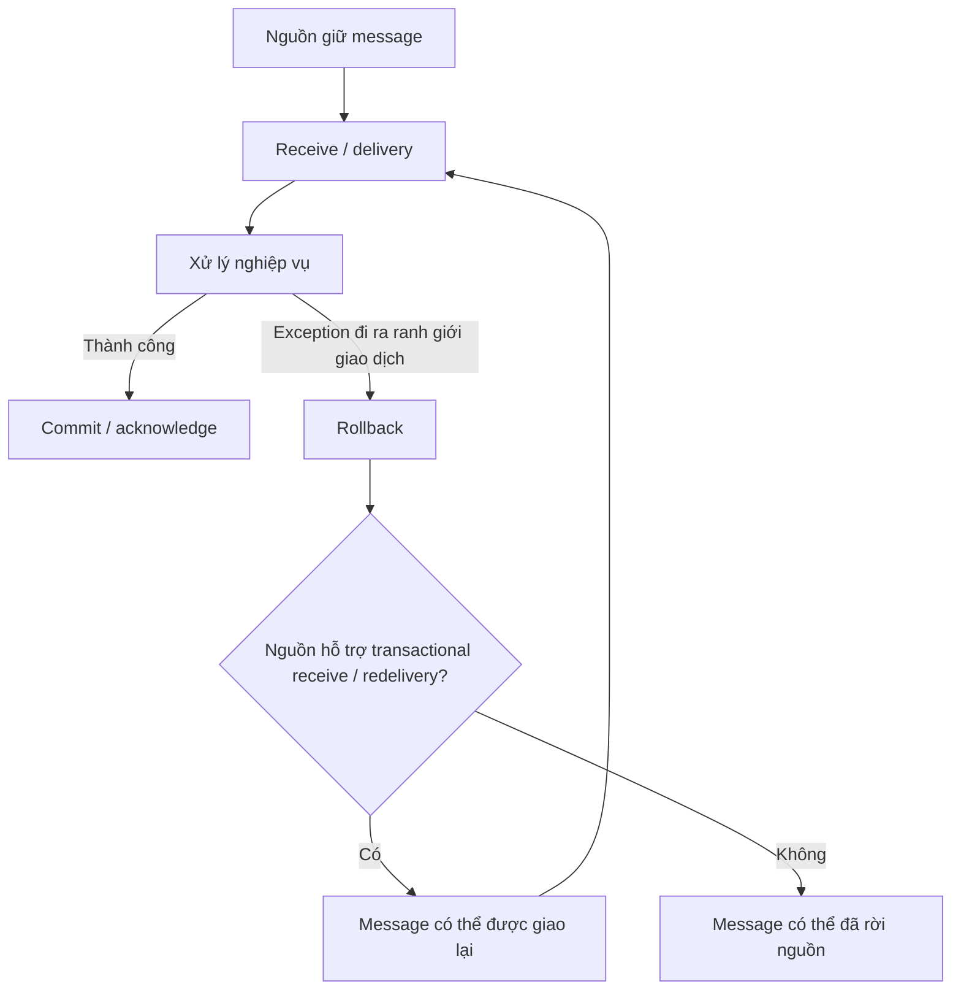
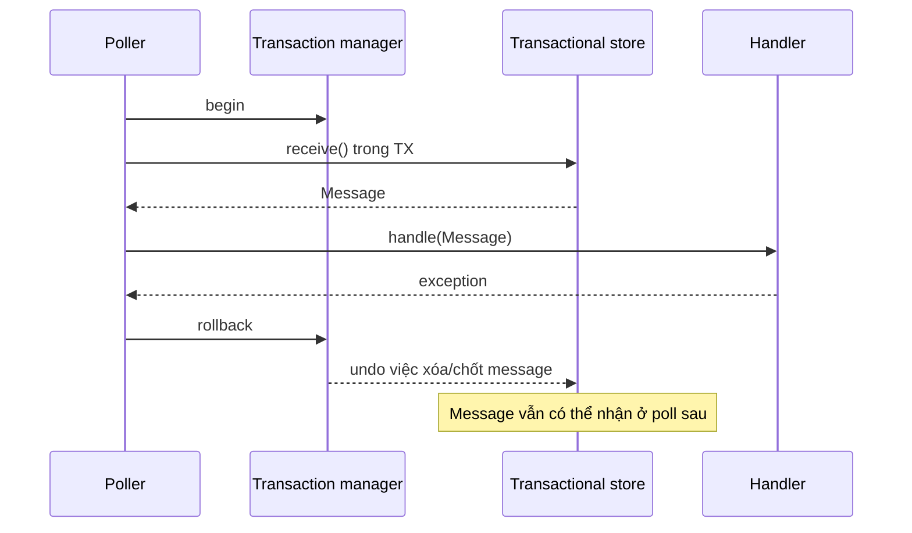
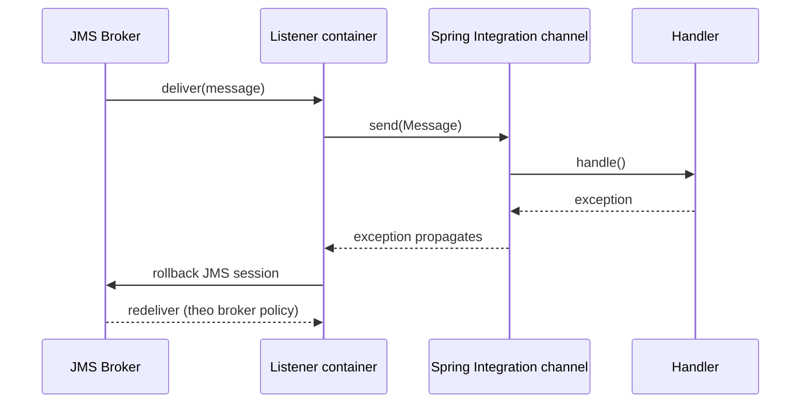
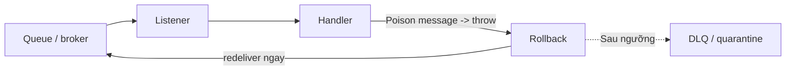
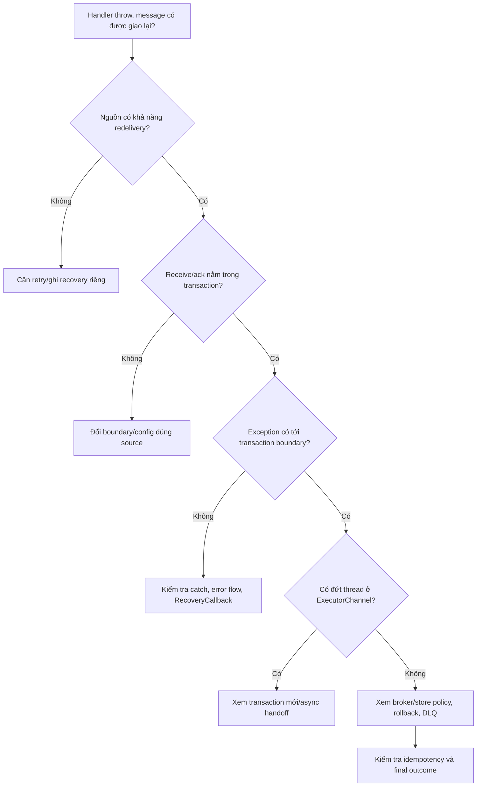

# Message redelivery sau rollback

Trong **Spring Integration runtime**, một message có thể đi qua channel, consumer endpoint, poller, executor và handler trước khi hoàn thành nghiệp vụ. Khi handler ném exception, transaction có thể **rollback**. Nhưng câu hỏi quan trọng là: **message có được giao lại (redeliver) sau rollback hay không?**

Câu trả lời phụ thuộc vào **tài nguyên cung cấp message**, **thao tác nhận/acknowledge có thuộc transaction không**, **exception có thực sự đi đến ranh giới transaction không** và **source có hỗ trợ giao lại hay không**. Rollback một giao dịch database ở handler không tự làm message quay lại mọi loại channel. Bài thuộc chương **Transaction runtime** của module `SPRING_INTEGRATION_RUNTIME`, làm rõ cơ chế này và cách thiết kế, kiểm thử, chẩn đoán redelivery cùng retry, message store, error flow và correlation.

## 1. Phân biệt rollback, retry và redelivery

Ba khái niệm thường bị dùng thay nhau nhưng có phạm vi khác nhau:

| Khái niệm | Điều gì xảy ra? | Ai điều phối? |
| --- | --- | --- |
| **Rollback** | Hủy các thay đổi thuộc một transaction chưa commit | Transaction manager / broker transaction |
| **Retry** | Gọi lại thao tác xử lý sau khi thất bại; có thể giữ nguyên message trong một invocation | `RetryTemplate`, advice, HTTP client hoặc logic ứng dụng |
| **Redelivery** | Nguồn giao lại một message chưa được xác nhận thành công hoặc vẫn nằm trong store | Broker, transactional message store, source adapter |

**Ví dụ:** một HTTP handler được `RequestHandlerRetryAdvice` gọi lại ba lần trên cùng một message là **retry tại handler**. Nếu một JMS listener rollback session và broker đưa message trở lại consumer, đó là **redelivery từ nguồn**. Hai cơ chế này có thể cùng tồn tại và làm tổng số lần gọi handler tăng lên nhiều hơn dự kiến.



Một message được giao lại **không đồng nghĩa** với xử lý chính xác một lần (*exactly once*). Nếu lần trước đã gây tác dụng phụ không rollback được (gọi API, gửi email, cập nhật hệ thống ngoài), redelivery có thể làm tác dụng phụ xảy ra lần nữa. Vì vậy, idempotency và chính sách xử lý lỗi vĩnh viễn là phần bắt buộc của thiết kế.

## 2. Bốn điều kiện để kỳ vọng redelivery sau rollback

Hãy kiểm tra các câu hỏi theo đúng thứ tự:

1. **Source là gì?** JMS/AMQP broker, `QueueChannel` in-memory, `QueueChannel` lưu JDBC, file adapter, hoặc HTTP inbound gateway có semantics hoàn toàn khác nhau.
2. **Receive/ack có thuộc transaction đang rollback không?** Transaction phải bao trùm thao tác lấy message hoặc xác nhận delivery; transaction chỉ bọc `INSERT` nghiệp vụ thường không đủ.
3. **Lỗi có đi ra ngoài transaction boundary không?** Nếu handler, error flow hoặc recovery callback bắt exception rồi trả bình thường, transaction có thể commit.
4. **Nguồn sẽ làm gì sau rollback?** Có thể đưa lại vào queue, chọn consumer khác, áp dụng độ trễ, tăng delivery count hoặc chuyển vào dead-letter queue theo chính sách riêng.

| Nguồn / cấu hình | Sau khi handler thất bại | Kỳ vọng redelivery |
| --- | --- | --- |
| `QueueChannel` mặc định trong RAM | Message thường đã bị `receive()` lấy khỏi hàng đợi | **Không tự động** chỉ vì DB rollback |
| `QueueChannel` + transactional `JdbcChannelMessageStore`, poller có transaction phù hợp | Việc loại message khỏi store có thể rollback | Message còn trong store và có thể được poll lại |
| JMS listener với **session transacted**, exception dẫn đến rollback | Phiên nhận message rollback | Broker có thể redeliver theo chính sách delivery |
| JMS listener xử lý lỗi rồi hoàn tất bình thường | Session có thể commit | Thường không redeliver vì lỗi đã bị hấp thụ |
| HTTP inbound request | Caller đã gửi request; không có broker lưu hộ | Chỉ có request mới nếu client chủ động gửi lại |
| File poller + `PseudoTransactionManager` | Có callback đồng bộ hóa trạng thái | Không biến việc đọc file thành transaction thật |

Những hàng trên mô tả trường hợp **thông thường**, không thay thế kiểm tra adapter/broker và transaction manager cụ thể. Với JMS, AMQP, Kafka hoặc JDBC store, khái niệm commit, ack, rollback và requeue còn chịu ảnh hưởng của chế độ listener, container và cấu hình nguồn.

## 3. Ranh giới transaction trong một message flow

Với một polling endpoint, transaction có thể bắt đầu **trước khi gọi `receive()`**. Nếu nguồn nhận là tài nguyên transactional và xử lý tiếp theo nằm trong cùng transaction, lỗi ở handler có thể kéo theo rollback việc lấy message.



Trong Spring Integration, poller hỗ trợ transaction advice để mỗi thao tác **receive-and-forward** được thực hiện trong ranh giới giao dịch phù hợp. Tuy nhiên, transaction context của Spring thường gắn với **thread hiện tại**. Nếu flow đi qua `ExecutorChannel`, chuyển sang một pollable channel khác hoặc tạo thread mới, exception xảy ra sau ranh giới bất đồng bộ có thể không quay về transaction ban đầu.

```text
Poller thread:
  BEGIN TX
  receive() -> handler đồng bộ -> exception
  ROLLBACK  (có cơ hội khôi phục receive)

Poller thread:
  BEGIN TX
  receive() -> ExecutorChannel.send() -> accepted
  COMMIT

Executor thread (sau đó):
  handler -> exception
  // Không tự rollback transaction đã commit ở poller.
```

**Ý nghĩa:** cùng một exception nghiệp vụ nhưng thay đổi channel từ `DirectChannel` sang `ExecutorChannel` có thể làm thay đổi hoàn toàn kết quả redelivery. Khi kiểm tra lỗi, hãy ghi **thread**, thời điểm `receive`, thời điểm `commit/rollback` và tên endpoint.

## 4. Trường hợp không redeliver: QueueChannel trong bộ nhớ

`QueueChannel` mặc định sử dụng bộ nhớ tiến trình cho hàng đợi. Consumer gọi `receive()` thường lấy message ra khỏi queue ngay lúc nhận. Nếu sau đó handler chạy trong transaction database và ném exception, transaction đó chỉ có thể hoàn tác **những thao tác database thực sự tham gia**, không hoàn tác việc dequeue khỏi queue RAM.

Ví dụ tối giản:

```java
import org.springframework.integration.channel.QueueChannel;
import org.springframework.messaging.Message;
import org.springframework.messaging.support.MessageBuilder;

QueueChannel queue = new QueueChannel(10);
queue.send(MessageBuilder.withPayload("ORDER-42").build());

Message<?> received = queue.receive(0);  // Lấy khỏi RAM queue

try {
    // Chỉ minh họa. Ở ứng dụng thật, transaction nằm tại service/poller.
    throw new IllegalStateException("DB update failed");
}
catch (IllegalStateException ex) {
    System.out.println("Business transaction may roll back: " + ex.getMessage());
}

System.out.println(queue.receive(0));  // null nếu không có producer khác
```

Trong ví dụ này, không có transaction nào thật sự được mở trong mã Java; nó chỉ làm rõ **lấy message khỏi RAM queue không tự được hoàn tác**. Dù đưa handler vào `@Transactional`, chỉ annotation đó vẫn không biến `QueueChannel` thành một resource có transactional dequeue.

Nếu cần chống mất message khi ứng dụng dừng hoặc khi handler lỗi, hãy dùng một **source/broker có redelivery semantics**, hoặc `QueueChannel` được hỗ trợ bằng `ChannelMessageStore` bền vững **và** transaction bao trùm cả `receive()`.

## 5. Trường hợp có thể redeliver: QueueChannel + JdbcChannelMessageStore

`JdbcChannelMessageStore` lưu message của `QueueChannel` trong cơ sở dữ liệu. Khi poller chạy với transaction phù hợp, thao tác lấy message khỏi store có thể được rollback cùng các thao tác database liên quan. Message vì vậy vẫn hiện diện để lần polling sau nhận lại.

### 5.1. Cấu hình minh họa bằng Spring Integration XML

Ví dụ dưới đây là **fragment cấu hình**, giả định ứng dụng đã có `dataSource`, `orderHandler`, thư viện `spring-integration-jdbc`, `PlatformTransactionManager` tên `transactionManager`, cùng các bảng store được tạo từ schema JDBC tương ứng. `queryProvider` bên dưới sử dụng PostgreSQL.

```xml
<!-- Channel sử dụng JDBC store thay cho hàng đợi RAM -->
<int:channel id="ordersQueue">
    <int:queue message-store="channelStore"/>
</int:channel>

<bean id="queryProvider"
      class="org.springframework.integration.jdbc.store.channel.PostgresChannelMessageStoreQueryProvider"/>

<bean id="channelStore"
      class="org.springframework.integration.jdbc.store.JdbcChannelMessageStore">
    <property name="dataSource" ref="dataSource"/>
    <property name="channelMessageStoreQueryProvider" ref="queryProvider"/>
</bean>

<!-- Transaction phải bao quanh poll/receive và handler đồng bộ -->
<int:service-activator input-channel="ordersQueue"
                       ref="orderHandler"
                       method="handle">
    <int:poller fixed-delay="250" max-messages-per-poll="1">
        <int:transactional transaction-manager="transactionManager"
                           propagation="REQUIRED"/>
    </int:poller>
</int:service-activator>
```

Để đưa fragment này vào một file Spring XML hoàn chỉnh, cần khai báo namespace `beans`/`int` và schema tương ứng. `JdbcChannelMessageStore` còn phụ thuộc bảng và SQL query provider phù hợp phiên bản/database; các bảng này không tự xuất hiện chỉ vì định nghĩa bean. Cấu hình thường sử dụng cùng `DataSourceTransactionManager` với nguồn `DataSource` để thao tác store và nghiệp vụ **thực sự cùng tham gia giao dịch**, nếu mong muốn rollback cả hai.

Ví dụ handler có một lỗi chỉ xảy ra một lần:

```java
import java.util.Set;
import java.util.concurrent.ConcurrentHashMap;
import org.springframework.jdbc.core.JdbcTemplate;

public class OrderHandler {
    private final JdbcTemplate jdbc;
    private final Set<String> failOnce = ConcurrentHashMap.newKeySet();

    public OrderHandler(JdbcTemplate jdbc) {
        this.jdbc = jdbc;
        this.failOnce.add("ORDER-42");
    }

    public void handle(String orderId) {
        jdbc.update(
                "INSERT INTO processed_orders(order_id) VALUES (?)",
                orderId);
        if (failOnce.remove(orderId)) {
            throw new IllegalStateException("Demo: fail only on first delivery");
        }
        System.out.println("Processed " + orderId);
    }
}
```

Giả định bảng `processed_orders` đã được tạo, đây là cách mô phỏng một lỗi **nhất thời**. `failOnce` chỉ nằm trong RAM để minh họa; không phải cơ chế idempotency hay retry state phù hợp production.

### 5.2. Diễn biến kỳ vọng

| Thời điểm | Hoạt động | Trạng thái JDBC |
| --- | --- | --- |
| T0 | Producer gửi `ORDER-42`, message được lưu vào `ordersQueue` JDBC | Message còn trong store |
| T1 | Poller mở transaction, lấy message, handler thực hiện `INSERT` | Xóa khỏi store và insert đang ở trạng thái chưa commit |
| T2 | Handler ném exception, exception thoát ra transaction advice | Transaction rollback; xóa message và insert được hoàn tác |
| T3 | Poller chạy lại, nhận message còn trong store | Có thể giao lại `ORDER-42` |
| T4 | Handler thành công, transaction commit | Xóa message khỏi store và insert được commit |

**Điểm mấu chốt:** gọi lại handler chỉ là kết quả quan sát được; khả năng redelivery đến từ **rollback thao tác nhận trong JDBC store**. Nếu transaction chỉ bao quanh handler và thao tác receive đã commit riêng, rollback không tái tạo message. Nếu store và bảng nghiệp vụ thuộc hai nguồn giao dịch không được phối hợp, rollback có thể chỉ ảnh hưởng một bên.

Trong môi trường nhiều poller/instance, message sau rollback có thể được consumer **khác** nhận; không đảm bảo cùng thread hoặc cùng node. Khi sử dụng cơ chế lock/cache của JDBC store, cũng cần kiểm tra tương thích database, mức isolation và cấu hình vận hành để tránh contention hoặc nhận trùng.

## 6. JMS: rollback session và broker redelivery

Với **JMS message-driven channel adapter**, một JMS listener container có thể nhận message trong **transacted session**. Nếu xử lý đồng bộ dẫn tới exception truyền về container và session rollback, broker có quyền giao lại message theo chính sách redelivery của nó. Spring Integration hỗ trợ message-driven JMS inbound adapter, nhưng việc dispatch xuống các channel và error handling phải được xét như một phần ranh giới này.



Fragment XML sau minh họa **listener container có `sessionTransacted=true`**. Các bean `connectionFactory` và `orderHandler`, cùng namespaces `int`/`int-jms` và schema phù hợp được khai báo ở cấu hình ứng dụng:

```xml
<bean id="jmsContainer"
      class="org.springframework.jms.listener.DefaultMessageListenerContainer">
    <property name="connectionFactory" ref="connectionFactory"/>
    <property name="destinationName" value="orders.in"/>
    <property name="sessionTransacted" value="true"/>
</bean>

<int:channel id="ordersFromJms"/>

<int-jms:message-driven-channel-adapter
        id="ordersInbound"
        container="jmsContainer"
        channel="ordersFromJms"/>

<int:service-activator input-channel="ordersFromJms"
                       ref="orderHandler"
                       method="handle"/>
```

Trong ví dụ, `ordersFromJms` mặc định là channel đồng bộ có subscriber là handler. Nếu handler ném exception và không bị error flow/advice nuốt, container có thể rollback. Nếu thay bằng `ExecutorChannel` rồi gửi task thành công, phần xử lý bất đồng bộ có thể lỗi sau khi JMS delivery đã được coi là thành công và session đã commit.

### 6.1. Ack, delivery count và chính sách broker

Redelivery có thể mang các dấu hiệu từ broker như `JMSRedelivered` và `JMSXDeliveryCount`, nhưng mức độ hỗ trợ và ý nghĩa đếm phụ thuộc JMS provider. Các header JMS có thể được ánh xạ qua adapter, cũng phụ thuộc cấu hình mapping. Không suy luận rằng có một header tùy ý tên `retryCount` là được mọi broker tự tăng.

Broker thường có cấu hình số lần redelivery, khoảng delay/backoff và điểm xử lý cuối như **dead-letter queue (DLQ)**. Khi đạt giới hạn, thông điệp có thể được chuyển khỏi queue chính; tiếp tục ném exception trong handler sẽ không tự bảo đảm có vô hạn lần giao lại.

**Lưu ý:** transaction JMS của listener và transaction database trong handler có thể là **hai transaction cục bộ khác nhau**. `sessionTransacted=true` không tự tạo atomic commit giữa JMS và JDBC. Nếu yêu cầu phối hợp mạnh, phải xem xét XA/JTA hoặc thiết kế outbox/inbox, deduplication và recovery phù hợp.

## 7. Exception có thoát ra khỏi transaction boundary không?

Redelivery thường cần một **tín hiệu thất bại thực sự** đến transaction manager/container. Một handler có thể ném lỗi nhưng lớp phía ngoài lại bắt rồi trả bình thường:

```text
JMS / transactional poller
  -> handler throws
  -> error handler catches, sends ErrorMessage
  -> error handler returns normally
  -> outer transaction sees normal completion
  -> COMMIT may happen
```

Khi đó không nên kỳ vọng message được broker/store giao lại. Ngược lại, nếu error flow ném lại exception hoặc đánh dấu transaction `rollback-only` đúng cách, transaction có thể rollback.

| Cách xử lý lỗi | Kết quả ở transaction boundary | Tác động có thể xảy ra |
| --- | --- | --- |
| Exception từ handler truyền ra | Thấy thất bại | Rollback; source transactional có thể redeliver |
| `catch` rồi chỉ ghi log | Thấy hoàn thành bình thường | Có thể commit và không redeliver |
| Retry advice thành công trong cùng invocation | Thấy hoàn thành bình thường | Commit sau khi retry thành công |
| `RecoveryCallback` gửi `ErrorMessage` rồi trả bình thường | Có thể không còn exception | Có thể commit; message sẽ không được source gửi lại |
| Recovery callback ném lỗi sau khi hết retry | Thấy thất bại | Có thể rollback/redeliver theo source |

Đây là lý do **error channel** và **transactional redelivery** phải được thiết kế cùng nhau. Với JMS inbound adapter có error channel, lỗi chuyển đổi/dispatch có thể được gửi thành `ErrorMessage`; nếu error flow xử lý xong mà không ném exception, container có thể commit thay vì rollback. Không thể chỉ thấy log “ERROR” rồi kết luận broker sẽ giao lại.

Trong Spring Transaction, các quy tắc rollback mặc định thường áp dụng cho unchecked exception (`RuntimeException`/`Error`), còn checked exception phụ thuộc rollback rules hoặc cấu hình transaction advice. Cần kiểm tra exception cuối mà transaction interceptor thực sự thấy, kể cả trường hợp wrapper.

## 8. Ranh giới retry advice và redelivery từ nguồn

`RequestHandlerRetryAdvice` có thể retry một handler nhiều lần **trong một lần delivery**. Nếu tất cả attempt thất bại và exception tiếp tục truyền lên source transactional, source có thể redeliver và bắt đầu một chuỗi retry mới.

```text
Delivery #1
  handler attempt 1 -> lỗi
  handler attempt 2 -> lỗi
  handler attempt 3 -> lỗi
  rollback

Delivery #2
  handler attempt 1 -> lỗi
  handler attempt 2 -> thành công
  commit
```

Trong ví dụ trên, handler thực thi **5 lần** cho hai delivery của một công việc. Nếu broker cho tối đa 4 delivery và mỗi delivery dùng 3 attempt, số lượt gọi handler có thể lên tới **12** khi mọi lần đều lỗi, chưa kể retry ở HTTP client hoặc tầng downstream.

Vì vậy phải phân biệt rõ:

- **Attempt count**: số lần method handler được gọi.
- **Delivery count**: số lần source giao message.
- **Message ID/correlation**: cách liên kết những attempt/delivery của cùng công việc.
- **Final outcome**: đã xử lý thành công, đã đưa vào DLQ, chờ can thiệp hay thất bại vĩnh viễn.

Với `stateful retry`, retry context có thể được liên kết qua nhiều lần giao message bằng khóa ổn định. Nhưng stateful retry không tự bảo đảm broker redelivery; nguồn phải có cơ chế rollback/redelivery đúng. Cần lưu ý retry context cache và message identity khi restart.

Khi dùng `ErrorMessageSendingRecoverer`, callback có thể **nuốt exception cuối** sau khi publish lỗi. Điều đó có thể chặn rollback nguồn. Đây có thể là lựa chọn đúng khi luồng recovery đã lưu message bền vững hoặc chuyển sang DLQ, nhưng phải được quyết định có chủ đích.

## 9. Poison message và vòng lặp rollback vô hạn

Một message sai schema, thiếu dữ liệu bắt buộc hoặc gây lỗi lập trình luôn thất bại là **poison message**. Nếu mỗi lần rollback khiến nguồn lập tức giao lại, hệ thống có thể tạo **redelivery storm**:



Hệ quả gồm CPU cao, log lặp, poller/executor bị chiếm, tăng lock contention và làm chậm message hợp lệ. Không nên chỉ tăng số thread khi đang gặp poison message.

Thiết kế thường cần **giới hạn retry và redelivery ở đúng tầng**:

| Loại lỗi | Xử lý thường hợp lý | Lý do |
| --- | --- | --- |
| HTTP 503 tạm thời | Retry có giới hạn, backoff, rồi redelivery có delay nếu cần | Có khả năng phục hồi |
| Database deadlock | Retry transaction đúng phạm vi | Transaction cần thực hiện lại từ trạng thái sạch |
| Dữ liệu sai schema | Quarantine hoặc DLQ kèm lý do | Giao lại y nguyên ít khi hữu ích |
| Authorization/validation vĩnh viễn | Báo lỗi, chặn retry vô hạn | Không tự khỏi khi chờ |
| Payment outcome không rõ | Tra cứu trạng thái/idempotency trước khi replay | Tránh thực hiện tác dụng phụ hai lần |

DLQ hoặc quarantine không mặc nhiên có sẵn trong mọi `QueueChannel`. Với JMS/AMQP, tên queue, số lần retry, chính sách delay và điều kiện chuyển DLQ do broker/adapter quyết định. Với JDBC store tự triển khai, có thể phải thiết kế trạng thái/quy trình chuyển message khỏi queue nóng sang bảng lỗi.

## 10. Redelivery không bảo đảm exactly-once

Giả sử handler thực hiện:

```text
receive(OrderPaid)
  -> ghi trạng thái đơn hàng vào DB
  -> gọi payment gateway
  -> gửi email xác nhận
  -> ném exception do timeout
rollback
redelivery(OrderPaid)
```

Rollback DB có thể xóa thay đổi vừa ghi, nhưng **không hoàn tác** email đã gửi hoặc khoản thanh toán đã được API bên ngoài chấp nhận. Message được giao lại và handler chạy lần nữa có thể gây kết quả trùng lặp.

Biện pháp:

1. **Business idempotency key:** định danh ổn định như `orderId`/`paymentRequestId`; giữ nguyên qua retry/redelivery, không dùng attempt index làm khóa.
2. **Unique constraint hoặc inbox table:** ghi nhận message đã xử lý thành công trong cùng transaction với cập nhật business DB khi có thể.
3. **Outbox pattern:** ghi ý định phát sự kiện trong DB transaction, publisher riêng gửi về sau; giảm khoảng trống giữa commit business data và publish event.
4. **Kiểm tra trạng thái downstream:** trước khi replay giao dịch có kết quả không xác định, gọi API tra cứu để tránh lặp.
5. **Thiết kế “at least once + idempotency”:** chấp nhận source có thể giao lại và đảm bảo tác dụng phụ là an toàn với việc xử lý lặp.

Một kiểu triển khai ở tầng DB:

```sql
-- Bảng minh họa: cùng message nghiệp vụ chỉ có một row thành công.
CREATE TABLE processed_message (
    business_key VARCHAR(128) PRIMARY KEY,
    processed_at TIMESTAMP NOT NULL
);

-- Trong CÙNG transaction với cập nhật nghiệp vụ:
INSERT INTO processed_message (business_key, processed_at)
VALUES (:businessKey, CURRENT_TIMESTAMP);
```

**Không chỉ dựa vào kiểm tra `SELECT` rồi `INSERT`** nếu có nhiều consumer cạnh tranh. Dùng unique constraint/UPSERT hoặc khóa thích hợp, và thiết kế rõ trường hợp transaction rollback: khi rollback, dấu “đã xử lý” cũng bị hủy để delivery khác có thể xử lý lại.

Đối với một side effect ngoài transaction DB, idempotency của API downstream hoặc một workflow trạng thái rõ ràng vẫn là yêu cầu riêng.

## 11. Correlation, thứ tự xử lý và competing consumers

Redelivery có thể xảy ra trên thread, consumer hoặc node khác. Vì thế:

- **Không giả định cùng thread:** transaction trước đã kết thúc; lần sau là một invocation mới.
- **Không giả định thứ tự hoàn tất:** message mới có thể được xử lý trước message đang rollback/redelivery, tùy queue, broker và concurrency.
- **Không giả định message ID bất biến:** adapter hoặc bước chuyển đổi có thể tạo message wrapper/ID mới; business key và correlation ID nên được duy trì rõ ràng.
- **Không giả định cùng consumer:** khi chạy nhiều listener hoặc instance, source có thể phân phối lại.

| Định danh | Nên dùng để làm gì? |
| --- | --- |
| `MessageHeaders.ID` | Lần theo một Spring message trong phạm vi có thể quan sát |
| JMS `JMSMessageID` hoặc broker ID | Lần theo delivery trên broker, tùy provider |
| `correlationId`/`traceId` | Nối log qua các channel, thread và endpoint |
| `businessKey` (`orderId`) | Idempotency, replay, đối soát nghiệp vụ |
| Delivery/attempt count | Phân biệt source redelivery với retry cục bộ |

Nếu ứng dụng dùng aggregator hoặc message groups, một `correlationId` không tự đảm bảo thứ tự, deduplication hay đúng một consumer xử lý. Cần release strategy, message store và chính sách idempotency phù hợp.

## 12. Quan sát redelivery tại runtime

Khi message “cứ xuất hiện lại”, cần đo đúng các ranh giới:

| Tầng | Dữ liệu nên log/metric | Chẩn đoán được gì? |
| --- | --- | --- |
| Source | Broker delivery count, queue depth, DLQ count | Có redelivery từ nguồn hay không |
| Poller / listener | Thời điểm receive, thread, container transaction mode | Receive có thuộc transaction không |
| Handler | Business key, attempt number, exception type | Có bao nhiêu lần xử lý logic |
| Transaction | Begin/commit/rollback, resource/manager | Rollback có tác động đúng store không |
| Advice / error flow | Retry exhausted, recovery outcome, error channel | Exception có bị xử lý thành công giả không |
| Downstream | Idempotency decision, API result, outbox status | Có tác dụng phụ lặp không |

Đối với JDBC, quan sát dữ liệu trong bảng store sau rollback hoặc trước lần poll kế tiếp (khi an toàn để kiểm tra); với JMS, xem thống kê broker và header delivery qua adapter nếu được cung cấp. Một log “handler failed” không đủ để biết message còn tồn tại trong nguồn hay không.

### 12.1. Quy trình chẩn đoán nhanh



Nếu handler chạy lặp nhưng source không tăng delivery count, nhiều khả năng đó là **retry advice bên trong một delivery**. Nếu message được giao lần nữa sau một commit/rollback rõ ràng ở listener, đó mới là dấu hiệu mạnh của **redelivery từ nguồn**.

## 13. Kiểm thử redelivery có chủ đích

Để kiểm tra một flow transactional, hãy tạo một handler cố ý thất bại **lần đầu**, sau đó thành công; dùng một nguồn có thể quan sát được như JDBC-backed queue hoặc JMS test broker.

1. Gửi message có `businessKey=ORDER-42` và `traceId` ổn định, đồng thời đặt bộ đếm riêng cho **lượt delivery** và **lượt gọi handler**.
2. Trên delivery đầu, handler cập nhật dữ liệu thuộc transaction rồi ném exception; log thread và trạng thái transaction.
3. Xác minh transaction rollback: cập nhật DB không còn; nếu nhận từ JDBC store transactional, message vẫn còn; nếu nhận qua JMS transacted, broker báo rollback/redelivery.
4. Để source giao lại: handler thành công ở lần kế tiếp; xác minh chỉ một kết quả nghiệp vụ cuối cùng được commit.
5. Đổi cấu hình sang `QueueChannel` RAM hoặc chèn `ExecutorChannel` giữa nguồn và handler; so sánh kết quả redelivery, không dùng side effect bên ngoài khó hoàn tác.
6. Cho handler luôn lỗi, cấu hình giới hạn/delay redelivery và quan sát điều kiện chuyển DLQ hoặc quarantine.

### 13.1. Ma trận kỳ vọng để so sánh

| Thử nghiệm | Kỳ vọng sau exception | Điều cần xác nhận |
| --- | --- | --- |
| Queue RAM + DB `@Transactional` trong handler | DB rollback; dequeue không khôi phục | Queue rỗng nếu chỉ có một message |
| JDBC store + poller transaction trên cùng DB | Dequeue rollback, có thể poll lại | Store còn message, transaction log đúng |
| JMS transacted + handler đồng bộ ném lỗi | Broker có thể redeliver | Redelivery count/policy và lỗi tới container |
| JMS transacted + error flow nuốt exception | Có thể commit, không redeliver | Broker không giao lại khi listener hoàn tất bình thường |
| Source transactional + xử lý bất đồng bộ sau handoff | Source có thể commit trước lỗi phía sau | Chứng minh thread/commit diễn ra trước handler failure |
| Broker poison message với policy giới hạn | Sau ngưỡng vào DLQ/đường recovery | Không còn vòng lặp vô hạn ở queue nóng |

Trong kiểm thử, “lần thứ hai thành công” không đủ chứng minh rollback: có thể do **producer đã gửi hai message giống nhau** hoặc retry nội bộ của handler. Hãy kiểm tra cả transaction log, source delivery count và business key để phân biệt.

## 14. Những hiểu nhầm thường gặp

| Hiểu nhầm | Vì sao sai? | Cách sửa |
| --- | --- | --- |
| Cứ có `@Transactional` là rollback đưa message về channel | Channel RAM không phải tài nguyên DB có transactional dequeue | Kiểm tra nguồn và ranh giới nhận |
| Retry advice và redelivery broker là cùng một cơ chế | Retry có thể chạy nhiều attempt trong một delivery | Đếm attempt và delivery riêng |
| ErrorMessage được log thì chắc chắn rollback | Error flow có thể bắt lỗi rồi hoàn tất bình thường | Xác minh exception có tới container/transaction advice |
| `ExecutorChannel` vẫn chạy trong transaction poller | Transaction thường gắn với thread, handoff có thể kết thúc sớm | Thiết kế boundary tại worker hoặc dùng nguồn transactional phù hợp |
| Rollback JMS cũng rollback JDBC tự động | Hai local transaction là hai tài nguyên khác nhau | XA/JTA khi thật sự cần hoặc dùng outbox/inbox + idempotency |
| Một message sau rollback chắc chắn quay lại cùng consumer ngay | Broker/store có policy, delay, concurrency và DLQ | Theo dõi scheduler và source policy |
| Redelivery tự đảm bảo `exactly-once` | Tác dụng phụ ngoài transaction vẫn có thể xảy ra | Business idempotency và đối soát |
| Message có cùng `correlationId` sẽ giữ nguyên thứ tự | Correlation chỉ là metadata | Thiết kế thứ tự/serialization rõ ràng |

## 15. Bài thực hành và câu hỏi tự kiểm tra

**Bài 1 — Đánh giá bốn flow.** Cho bốn flow: (a) `QueueChannel` RAM + handler `@Transactional`, (b) `QueueChannel` JDBC + poller transaction, (c) JMS transacted + handler đồng bộ, (d) JMS transacted + `ExecutorChannel` rồi handler. Hãy chỉ ra flow nào có thể redeliver sau rollback và điều kiện cần thêm.

**Bài 2 — Bẫy của error flow.** Cho handler ném exception nhưng error channel handler chỉ ghi log rồi trả. Xem trạng thái transaction và broker có redeliver không. Thay đổi error flow để lỗi đi ra transaction boundary và quan sát khác biệt. Không giả định rằng mọi adapter xử lý error channel giống nhau.

**Bài 3 — Retry hai tầng.** Giả sử handler retry tối đa ba attempt, broker redelivery tối đa bốn delivery. Tính số lượt gọi handler tối đa khi mọi attempt thất bại, và kiểm tra bằng counter tại handler và broker. Sau đó bổ sung backoff để ngăn vòng lặp nóng.

**Bài 4 — Idempotency sau redelivery.** Thiết kế bảng `processed_message` có unique constraint và cập nhật business DB trong cùng transaction. Mô phỏng hai consumer nhận cùng business event ở các delivery khác nhau, xác minh kết quả nghiệp vụ cuối không bị cộng dồn sai.

**Bài 5 — Crash và replay.** Dùng store/broker bền vững, dừng ứng dụng sau khi source giao message nhưng trước khi transaction commit, sau đó khởi động lại. Quan sát message có được giao lại không; so sánh với `QueueChannel` RAM khi tiến trình kết thúc.

### Câu hỏi tự kiểm tra

1. **Rollback một transaction database ở handler có luôn làm message quay lại `QueueChannel` không?** Không; cần nguồn và thao tác dequeue tham gia transaction.
2. **Khi nào `JdbcChannelMessageStore` có thể giữ message sau rollback?** Khi thao tác receive được thực hiện trong poller transaction thích hợp và transaction đó rollback.
3. **JMS listener transacted ném exception ra container thì có thể xảy ra gì?** Session rollback và broker có thể giao lại message theo chính sách.
4. **Nếu recovery callback ghi lỗi rồi trả bình thường thì redelivery có chắc xảy ra?** Không; transaction bên ngoài có thể coi là thành công và commit.
5. **Vì sao `ExecutorChannel` cần được xem xét đặc biệt?** Nó thay đổi thread và có thể cắt ranh giới transaction ban đầu.
6. **Có nên dùng message ID sinh mới theo attempt làm idempotency key không?** Không; nên dùng business key ổn định.
7. **Message được redeliver có đảm bảo exactly-once không?** Không; cần idempotency và quản lý side effect ngoài transaction.

## 16. Tài liệu tham khảo

- [Spring Integration — Transaction Support](https://docs.spring.io/spring-integration/reference/transactions.html): transaction boundaries, poller transaction và thread handoff.
- [Spring Integration — Configuring Message Channels](https://docs.spring.io/spring-integration/reference/channel/configuration.html): `QueueChannel` và transactional `JdbcChannelMessageStore`.
- [Spring Integration — JMS Support](https://docs.spring.io/spring-integration/reference/jms.html): message-driven channel adapter, transacted session và error-channel behavior.
- [Spring Integration — Message Endpoints](https://docs.spring.io/spring-integration/reference/endpoint.html): poller, consumer và transaction support.

**Ghi nhớ:** **Rollback chỉ dẫn tới redelivery khi việc nhận/xác nhận message nằm trong ranh giới giao dịch có thể rollback của nguồn tương ứng.** Khi phân tích một Spring Integration flow, hãy lần theo **source → receive/ack → transaction → thread → handler → error flow → commit/rollback**. Sau đó mới quyết định retry, redelivery, DLQ và idempotency để vừa không mất message vừa tránh xử lý nghiệp vụ trùng lặp.
