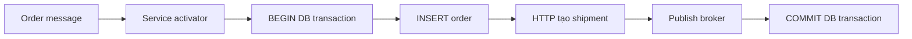
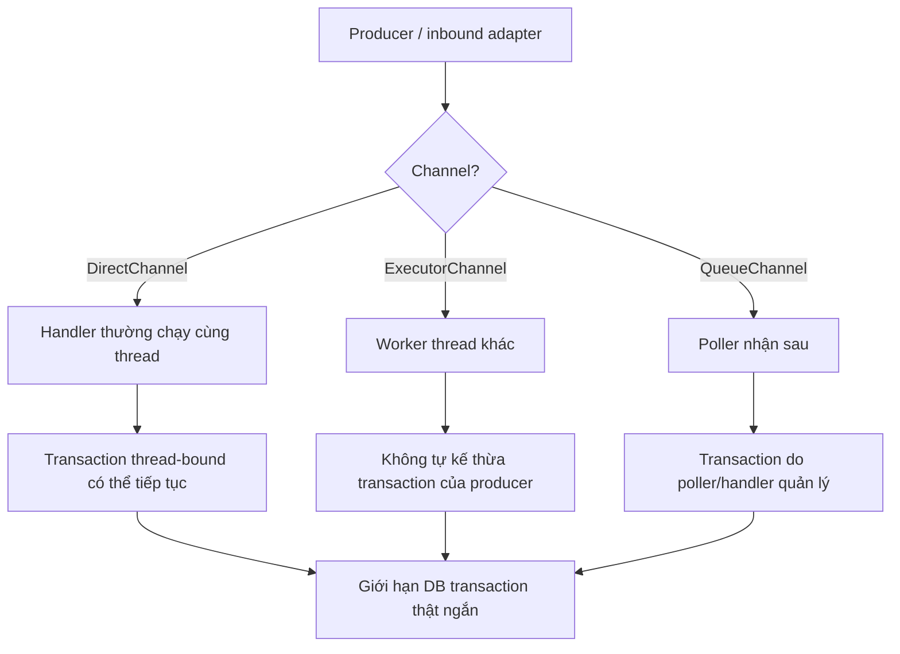
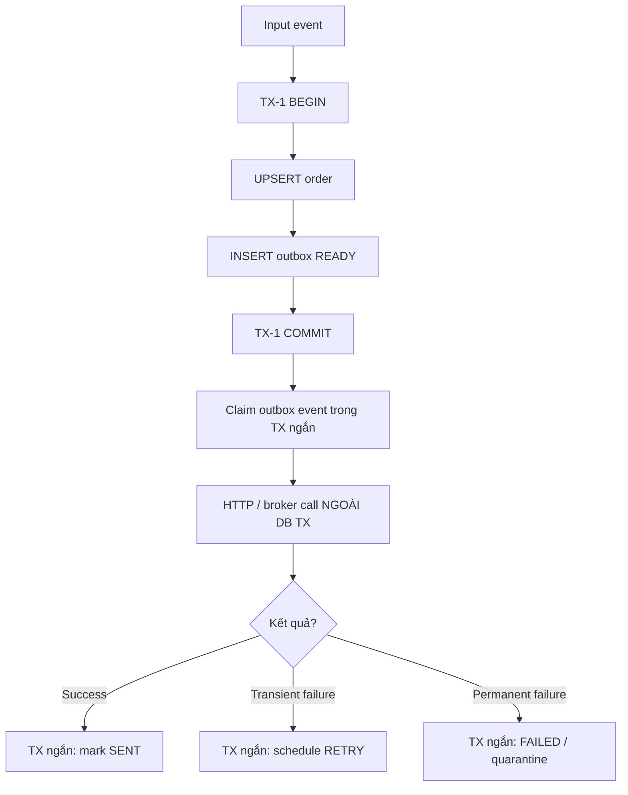
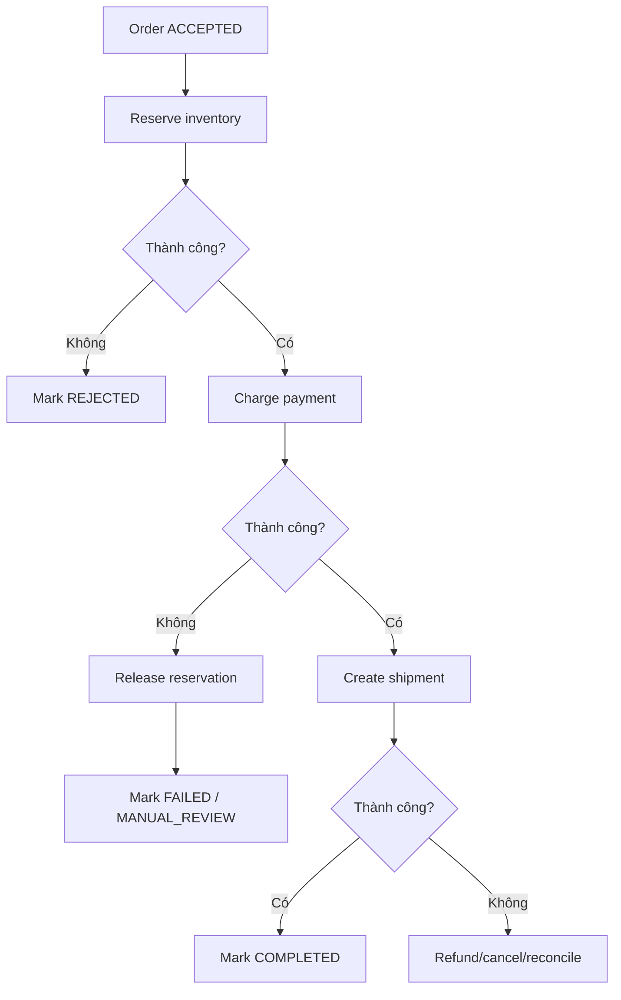

# Không mở transaction qua hệ thống ngoài quá rộng trong Spring Integration

## Mục tiêu và bối cảnh

Module **SPRING_INTEGRATION_RUNTIME** tìm hiểu cách Spring Integration điều phối message qua channel, endpoint, consumer, poller, executor; quản lý transaction, retry, message store, lỗi và correlation. Trong chương **Transaction runtime**, bài này tập trung vào một nguyên tắc có ảnh hưởng trực tiếp tới tính đúng đắn và hiệu năng:

> **Chỉ giữ transaction trong phạm vi tài nguyên mà transaction manager thực sự quản lý; ưu tiên transaction ngắn. Không giữ DB transaction khi chờ HTTP, thanh toán, email hoặc những hệ thống bên ngoài có side effect độc lập.**

Sau bài học, bạn có thể:

- Phân biệt local transaction của database, transaction/acknowledgment của broker và lời gọi remote không tham gia transaction.
- Nhận diện transaction bị mở quá rộng trong một Spring Integration flow, kể cả qua `DirectChannel` và poller.
- Thiết kế giao việc ra hệ thống ngoài với **transactional outbox**, inbox, idempotency key và retry có giới hạn.
- Xác định transaction boundary khi dùng `@Transactional`, `TransactionTemplate`, request-handler advice, `ExecutorChannel` và `QueueChannel`.
- Giải thích vì sao rollback DB không undo được HTTP call đã thành công.
- Viết kịch bản kiểm tra crash, rollback, redelivery, duplicate side effects, transaction timeout và áp lực lên connection pool.

Ví dụ dùng Java 17+ và các khái niệm của Spring Framework/Spring Integration 6.x. Những interface repository, adapter HTTP và outbox là ví dụ kiến trúc, cần được hiện thực và kiểm thử với database/broker thật của hệ thống.

## 1. Anti-pattern: một transaction đi qua quá nhiều hệ thống

Giả sử hệ thống nhận sự kiện tạo đơn hàng và cần ghi DB, gọi dịch vụ vận chuyển, rồi publish thông báo:



Mã Java dễ viết nhưng nguy hiểm:

```java
@ServiceActivator(inputChannel = "ordersIn")
@Transactional
public void handle(OrderPlaced event) {
    orderRepository.insert(event);
    shippingClient.createShipment(event);
    eventPublisher.publish(event);
}
```

Đây là ví dụ **thiết kế nên tránh** khi `@Transactional` thực sự có hiệu lực qua Spring proxy. DB transaction có thể vẫn mở trong lúc ứng dụng chờ remote HTTP và broker. Một local DB transaction không có quyền rollback side effect đã commit tại dịch vụ vận chuyển, email gateway, REST payment provider hoặc broker độc lập.

Giả sử ghi DB mất 40 ms, HTTP mất 3 giây, publish broker mất 150 ms. Thời gian transaction sống có thể hơn 3,19 giây mặc dù xử lý database chỉ mất 40 ms.

| Rủi ro | Vì sao xảy ra? | Dấu hiệu |
|---|---|---|
| Connection pool cạn | Thread giữ connection được bind vào transaction khi chờ HTTP | `connection acquisition timeout`, active connections luôn cao |
| Lock kéo dài | Row lock, snapshot hoặc MVCC được giữ tới commit/rollback | Lock wait, deadlock, transaction age lớn |
| Throughput giảm | Poller/worker chờ I/O và backoff, tài nguyên DB bị giữ | Queue backlog, p95/p99 tăng |
| Rollback không hoàn nguyên remote | HTTP đã thành công nhưng DB rollback | Shipment/charge tồn tại mà local state không có |
| Retry lặp side effect | Không biết remote đã xử lý chưa khi client timeout | Tạo vận đơn hoặc thanh toán trùng |
| Timeout xếp chồng | Timeout DB, HTTP, gateway và broker khác nhau | DB rollback sau khi bên ngoài đã commit |

**Transaction dài** là vấn đề về giữ tài nguyên; **transaction không bao phủ remote** là vấn đề về tính nhất quán. Chỉ tăng timeout hoặc tăng pool không giải quyết căn nguyên thứ hai.

### Kịch bản khó nhất: mất response sau khi remote thành công

```text
Ứng dụng                        Remote service                 Database
BEGIN DB TRANSACTION                                          transaction active
UPDATE orders                                                    uncommitted
POST /shipments ----------------> CREATE shipment + COMMIT
       <---- TCP reset / timeout
ROLLBACK DB -------------------------------------------------> undo DB changes
```

Khi message được redeliver, hệ thống có thể gửi lại HTTP POST. Remote đã xử lý lần đầu, nhưng phía ứng dụng không biết. Đây là nền tảng của yêu cầu **idempotency** và ghi nhận tiến độ bền vững.

## 2. Ba loại ranh giới cần phân biệt

### 2.1. Local database transaction

`DataSourceTransactionManager` hoặc `JdbcTransactionManager` điều phối các JDBC operations dùng cùng tài nguyên `DataSource` phù hợp. `JpaTransactionManager` điều phối JPA resource. `@Transactional` thường hoạt động qua Spring proxy và transaction manager được chọn.

```java
@Transactional(transactionManager = "ordersTransactionManager")
public void persist(Order order) {
    orderRepository.insert(order);
    auditRepository.recordAccepted(order.id());
}
```

Khi cả hai repository thực sự làm việc trên resource trong cùng transaction, chúng có thể commit/rollback cùng nhau. Với hai database khác nhau, một local transaction manager **không tự** biến cả hai thành atomic transaction.

### 2.2. Broker transaction, offset và acknowledgment

JMS, AMQP/RabbitMQ, Kafka và các message source có semantics khác nhau: local transaction, acknowledgment, offset commit, nack, requeue, redelivery hoặc dead-letter queue. Chúng không tự trở thành một phần của DB transaction chỉ vì flow có annotation `@Transactional`.

Với resource hỗ trợ XA/JTA, một số transaction có thể phối hợp bằng two-phase commit; chi phí và giới hạn phụ thuộc participant. HTTP API thông thường không phải XA resource. Kafka transactions giải quyết một số phạm vi publish/consume trong Kafka, không khiến HTTP/DB tùy ý trở thành nguyên tử với Kafka.

### 2.3. External side effect

HTTP payment, tạo shipment, gửi email, webhook hoặc SaaS API là những hệ thống có trạng thái riêng. Khi call đã thành công, rollback DB tại nguồn **không** đảo ngược kết quả bên ngoài.

Nếu nghiệp vụ cần sửa sai, phải dùng một trong các cách: yêu cầu idempotent, tra cứu/truy vấn trạng thái, tác vụ bù trừ (refund/cancel), reconciliation và workflow có trạng thái rõ ràng.

| Cơ chế | Đảm bảo chính | Điều không đảm bảo |
|---|---|---|
| Local DB transaction | Atomic update của resource DB đã enlist đúng | Undo HTTP hoặc publish broker không cùng resource |
| JMS/XA và DB/XA | Phối hợp commit giữa những XA resources đã enlist | HTTP thông thường hoặc mọi broker/driver đều hỗ trợ |
| Transactional outbox | Atomic giữa thay đổi DB và ý định gửi event trong **cùng DB** | Exactly-once delivery tới remote |
| Inbox + unique constraint | Không lặp xử lý business event đã commit | Không ngăn mọi duplicate network request phía ngoài |
| Idempotency phía remote | Cùng key không tạo business effect trùng nếu remote hỗ trợ đúng | Không rút ngắn transaction của caller |
| Saga/compensation | Điều phối nhiều bước và cách bù khi partial failure | Rollback nguyên tử tức thời giữa mọi dịch vụ |

## 3. Transaction đi qua Spring Integration như thế nào?

Trong Spring Integration, phải theo **thread, endpoint và phạm vi advice** để nhận biết transaction còn mở hay không.



| Thành phần runtime | Ảnh hưởng tới transaction | Vấn đề cần kiểm tra |
|---|---|---|
| `DirectChannel` | Thường gọi consumer đồng bộ trên thread của sender | Transaction của gateway/service phía trước có bao toàn flow không? |
| `PublishSubscribeChannel` không có executor | Thường dispatch đồng bộ tới các subscriber | Một subscriber chậm có thể kéo dài transaction sender |
| `ExecutorChannel` | Đổi thread; thread-local transaction không tự đi theo | Worker có transaction riêng khi thao tác DB không? |
| `QueueChannel` | Tách thời điểm gửi và thời điểm poller nhận | Send thành công không đồng nghĩa business đã commit |
| `Poller` | Có thể gắn transaction advice quanh polling/processing phù hợp | Transaction có bị giữ qua remote handler trong cùng poll cycle không? |
| `@Transactional` tại bean service | Transaction theo proxy/weaving và propagation | Được gọi qua proxy hay self-invocation? |
| `RequestHandlerRetryAdvice` | Lặp lời gọi handler | Retry/backoff có nằm trong DB transaction dài không? |

### Ví dụ transaction ở tầng caller

```java
@Transactional
public void submit(OrderPlaced event) {
    orderGateway.send(event); // Flow DirectChannel có thể chạy cùng thread.
}
```

Nếu gateway kích hoạt handler đồng bộ rồi handler gọi REST API trong nhiều giây, transaction của `submit` có thể bao tới lúc lời gọi gateway kết thúc. Việc chuyển annotation sang method DB bên trong chưa đủ nếu transaction ngoài vẫn có propagation `REQUIRED`.

### Poller có transaction advice

```text
Poller BEGIN transaction
    receive message
    transform payload
    update database
    call remote system
    retry with backoff
Poller COMMIT / ROLLBACK transaction
```

Phạm vi thực tế phụ thuộc endpoint, transaction advice và channel. Một poller transactional có thể rất hợp lý để lấy và cập nhật record trong DB, nhưng không nên kéo transaction qua HTTP và thời gian backoff. Với source hỗ trợ claim/ack, có thể cần tách bước “nhận và ghi ý định xử lý” thành transaction riêng trước khi remote call.

### Những điều @Transactional không tự làm

- Không biến HTTP thành một phần của DB transaction.
- Không bảo đảm transaction lan sang `ExecutorChannel` hay một thread tự tạo.
- Không tạo transaction khi method chỉ được gọi bằng `this.someMethod()` qua self-invocation trong proxy mode mặc định.
- Không đảm bảo tất cả checked exceptions khiến rollback; quy tắc mặc định thường rollback với `RuntimeException`/`Error`, cần cấu hình `rollbackFor` nếu nghiệp vụ yêu cầu khác.
- Không đảm bảo acknowledgment của broker diễn ra sau DB commit nếu adapter/container chưa được cấu hình phù hợp.

Vì vậy, cần nhìn cả luồng và transaction manager thay vì chỉ đếm số annotation.

## 4. Thực hành thiết kế đúng: DB + outbox rồi gọi remote

Giải pháp phổ biến là **transactional outbox**. Trong một transaction DB ngắn, ứng dụng lưu dữ liệu nghiệp vụ cùng một “ý định gửi” bền vững. Sau commit, worker khác thực hiện HTTP/broker side effect rồi cập nhật trạng thái outbox trong transaction mới.



Cách này tạo **eventual consistency**: remote có thể cập nhật chậm hơn database. Đổi lại, không cần giữ connection/lock DB trong thời gian chờ mạng và có thể phục hồi sau restart.

### 4.1. Handler chỉ gọi một service lưu DB

```java
@ServiceActivator(inputChannel = "ordersIn")
public void acceptOrder(OrderPlaced event) {
    orderIntakeService.record(event);
}
```

```java
@Service
public class OrderIntakeService {

    private final OrderRepository orders;
    private final OutboxRepository outbox;

    public OrderIntakeService(
            OrderRepository orders,
            OutboxRepository outbox) {
        this.orders = orders;
        this.outbox = outbox;
    }

    @Transactional(transactionManager = "ordersTransactionManager")
    public void record(OrderPlaced event) {
        orders.insertIfAbsent(event.orderId(), event);
        outbox.insertIfAbsent(
                event.eventId(),
                "SHIPMENT_REQUESTED",
                event.payloadForShipment());
    }
}
```

`OrderPlaced`, `OrderRepository`, `OutboxRepository` và các method tương ứng là hợp đồng ứng dụng cần định nghĩa. Cả hai repository phải thao tác trong **cùng DB transaction** để commit/rollback đồng bộ.

Điểm quan trọng: `OrderIntakeService.record` được gọi qua **một Spring bean khác**, có proxy transaction thích hợp. Nếu có transaction bên ngoài bao `acceptOrder`, phương thức `record` với propagation mặc định `REQUIRED` có thể tham gia transaction ngoài đó. Cần bảo đảm handler/caller không mở một transaction rộng hơn.

### 4.2. Bảng outbox minh họa

```sql
CREATE TABLE integration_outbox (
    event_id           VARCHAR(64) PRIMARY KEY,
    aggregate_id       VARCHAR(64) NOT NULL,
    event_type         VARCHAR(80) NOT NULL,
    payload_json       TEXT NOT NULL,
    status             VARCHAR(20) NOT NULL,
    attempts           INT NOT NULL DEFAULT 0,
    next_attempt_at    TIMESTAMP NULL,
    lease_owner        VARCHAR(80) NULL,
    lease_until        TIMESTAMP NULL,
    created_at         TIMESTAMP NOT NULL,
    updated_at         TIMESTAMP NOT NULL
);
```

Ví dụ dùng SQL tổng quát; lựa chọn datatype, index, timestamp, locking và câu lệnh claim phụ thuộc RDBMS. `event_id` phải ổn định cho cùng một business event. Dùng unique constraint để chống ghi lặp khi source redeliver.

Khi nhiều workers cùng poll outbox:

- Claim trong transaction DB ngắn, với `SELECT ... FOR UPDATE SKIP LOCKED` nếu DB hỗ trợ hoặc atomic update theo điều kiện.
- Gán một lease/owner/token; chỉ worker còn giữ lease hợp lệ mới được cập nhật kết quả.
- Lease có expiry để tiếp tục sau crash, nhưng việc expiry khiến một event có thể bị gửi lại.
- Giới hạn batch, đặt index cho `status`/`next_attempt_at`, có retention và chính sách dọn event cũ.

Không dùng `SELECT` thông thường rồi gửi ngay: hai workers có thể đọc cùng một row chưa được claim và tạo side effect trùng.

### 4.3. API thao tác outbox với transaction ngắn

```java
@Service
public class OutboxOperations {

    private final OutboxRepository repository;

    public OutboxOperations(OutboxRepository repository) {
        this.repository = repository;
    }

    @Transactional(transactionManager = "ordersTransactionManager")
    public Optional<ClaimedEvent> claimNext() {
        return repository.claimNextReadyAtomically();
    }

    @Transactional(transactionManager = "ordersTransactionManager")
    public void markSent(String eventId, String leaseToken) {
        repository.markSentIfOwned(eventId, leaseToken);
    }

    @Transactional(transactionManager = "ordersTransactionManager")
    public void reschedule(
            String eventId, String leaseToken, Instant nextAttempt) {
        repository.scheduleRetryIfOwned(
                eventId, leaseToken, nextAttempt);
    }
}
```

`Optional` nằm trong `java.util`; `Instant` nằm trong `java.time`. Các class và repository method là phác thảo, cần triển khai DB locking và kiểm tra số row được cập nhật. Nếu kết quả update có 0 row do lease mất hiệu lực, đừng im lặng coi đã mark sent.

### 4.4. Dispatcher gọi remote ngoài transaction

```java
@Component
public class ShipmentDispatcher {

    private final OutboxOperations outbox;
    private final ShippingClient shipping;

    public ShipmentDispatcher(
            OutboxOperations outbox, ShippingClient shipping) {
        this.outbox = outbox;
        this.shipping = shipping;
    }

    @Scheduled(fixedDelay = 500L)
    public void dispatchOnce() {
        Optional<ClaimedEvent> claimed = outbox.claimNext();
        if (claimed.isEmpty()) {
            return;
        }

        ClaimedEvent event = claimed.get();
        try {
            // OutboxOperations.claimNext() đã commit.
            // dispatchOnce() KHÔNG có @Transactional:
            shipping.createShipment(
                    event.payload(), event.eventId());

            outbox.markSent(event.eventId(), event.leaseToken());
        } catch (TransientRemoteException ex) {
            outbox.reschedule(
                    event.eventId(),
                    event.leaseToken(),
                    Instant.now().plusSeconds(30));
        } catch (PermanentRemoteException ex) {
            // Ghi FAILED/quarantine và cảnh báo bằng transaction ngắn.
            handlePermanentFailure(event, ex);
        }
    }
}
```

Code trên trình bày **kiến trúc và ranh giới**, chưa phải chương trình độc lập có thể build: cần định nghĩa `ClaimedEvent`, `ShippingClient`, exception classes, `handlePermanentFailure`, schema và query tương ứng; bật `@EnableScheduling` khi cần. Trong flow production có thể thay scheduled poller bằng message-driven outbox dispatcher/CDC.

**Kết quả cần đảm bảo:** HTTP call thực sự được thực hiện sau khi `claimNext()` đã commit. Một transaction manager bao ngoài `dispatchOnce()` sẽ làm mất ý nghĩa tách ranh giới, nên cần kiểm tra bằng integration test.

Nếu HTTP thành công nhưng `markSent` thất bại, event sẽ bị reclaim/retry. Phía remote phải nhận `event.eventId()` như idempotency key hoặc có phương án tra cứu đã tạo shipment.

### 4.5. Vì sao callback sau commit không thay outbox?

`@TransactionalEventListener(phase = AFTER_COMMIT)` hoặc `TransactionSynchronization` có thể kích hoạt công việc sau commit, nhưng callback chạy trong process:

```text
DB COMMIT thành công
    ↓
JVM crash trước khi callback gửi HTTP
    ↓
Remote không nhận được gì
```

Nếu không có bản ghi ý định gửi đã commit, tác vụ có thể mất vĩnh viễn. Một callback sau commit chỉ nên được xem là cách đánh thức dispatcher nhanh hơn; **outbox bền vững** giúp dispatcher khôi phục sau crash/restart.

## 5. Inbox và idempotency: đi cùng outbox

Outbox giải quyết chiều DB → remote. Ở chiều inbound broker → DB, message có thể được redeliver nếu crash xảy ra sau commit DB nhưng trước acknowledgment. Vì vậy, cần business key ổn định và deduplication.

```sql
CREATE TABLE processed_event (
    event_id       VARCHAR(64) PRIMARY KEY,
    processed_at   TIMESTAMP NOT NULL
);
```

Trong cùng DB transaction:

```text
BEGIN
    INSERT processed_event(eventId) nếu chưa có
    nếu eventId đã được xử lý thì không thực hiện side effect DB lần nữa
    INSERT/UPDATE order
    INSERT outbox event
COMMIT
```

Một số mốc lỗi cần xử lý:

| Điểm lỗi | Trạng thái DB | Remote | Cơ chế cần có |
|---|---|---|---|
| Trước commit order + outbox | Cả hai rollback | Chưa gọi | Source có thể redeliver; không mất business event |
| Sau commit, trước ack inbound | Order/outbox đã ghi | Có thể chưa gọi | Inbox/unique key ngăn DB duplicate |
| Sau commit, trước dispatcher | Outbox `READY` bền vững | Chưa gọi | Dispatcher gửi khi chạy lại |
| Sau claim, trước HTTP | Outbox `IN_PROGRESS` | Chưa gọi | Lease expiry rồi reclaim |
| HTTP timeout không rõ kết quả | Outbox cần retry/reconcile | Có thể đã thực hiện | Remote idempotency key ổn định |
| HTTP thành công, trước mark `SENT` | Outbox chưa `SENT` | Đã thực hiện | Retry an toàn và idempotency |
| Compensation thất bại | Workflow chưa hoàn tất | Partial success | Retry có giới hạn/manual intervention |

**Idempotency key** phải ổn định qua mọi attempt và redelivery của một thao tác. `MessageHeaders.ID` thường định danh message cụ thể, có thể khác sau khi adapter tạo lại message. Business `orderId` hoặc `eventId` thích hợp hơn khi hợp đồng nguồn bảo đảm ý nghĩa của nó.

`correlationId` phục vụ truy vết/ghép message, nhưng bản thân nó không ngăn xử lý trùng. Đừng dùng retry attempt ID làm idempotency key vì ID đó thay đổi mỗi lần thử.

## 6. Transaction và retry advice

`RequestHandlerRetryAdvice` của Spring Integration chạy lại lời gọi handler theo `RetryPolicy`, `BackOffPolicy` và recovery. Nếu transaction bao cả retry, thời gian chờ có thể giữ DB resources lâu hơn.

### Transaction ở ngoài retry

```text
TransactionAdvice BEGIN
    RetryAdvice
        HTTP attempt 1 -> lỗi
        backoff 1s
        HTTP attempt 2 -> lỗi
        backoff 2s
        HTTP attempt 3 -> thành công
TransactionAdvice COMMIT
```

Transaction có thể tồn tại xuyên cả các lượt gọi và thời gian sleep. Nếu một lỗi đã đánh dấu rollback-only, attempt cuối thành công không bảo đảm commit.

### Retry ở ngoài transaction

```text
RetryAdvice
    TransactionAdvice BEGIN -> DB attempt 1 -> ROLLBACK
    backoff 1s (không giữ transaction)
    TransactionAdvice BEGIN -> DB attempt 2 -> COMMIT
```

Cách này thường thích hợp cho lỗi DB có thể retry, miễn là mỗi attempt không thực hiện external side effect không idempotent. Thứ tự advice ảnh hưởng đến phạm vi mở transaction, nhưng còn phụ thuộc loại advice và handler (request-handler advice so với `HandleMessageAdvice`).

**Khuyến nghị:** Tách DB work, external call và DB status update thành các bước rõ ràng. Retry DB trong transaction ngắn; retry remote **ngoài DB transaction**; retry exhaustion dẫn tới DLQ/quarantine hoặc business compensation.

### Retry và broker redelivery có thể nhân số lần xử lý

Nếu handler advice cho tối đa 3 attempts/delivery, còn broker gửi lại 5 lần, một lỗi kéo dài có thể tạo tới:

```text
3 attempts × 5 deliveries = 15 lần gọi handler
```

Đây là kịch bản cực đại giả định, tùy policy và cách exception/ack xử lý. Khi recovery callback nuốt exception sau khi ghi log, broker có thể coi message đã xử lý thành công và ack, dù nghiệp vụ chưa hoàn tất. Cần xác định chính xác lúc nào source nên ack, redeliver hoặc chuyển DLQ.

### Timeout của transaction khác timeout HTTP

`@Transactional(timeout = 30)` không thay cho HTTP connect/read timeout. Một lời gọi tới dịch vụ ngoài có thể đã xử lý xong nhưng client timeout trước khi nhận response. Dù DB rollback, remote có thể giữ side effect. Cần thiết lập timeout riêng và **tổng ngân sách retry** dựa trên SLO.

## 7. Tại sao REQUIRES_NEW không phải cách sửa nhanh?

`@Transactional(propagation = Propagation.REQUIRES_NEW)` bắt đầu transaction mới và tạm đình chỉ transaction hiện hành khi thích hợp; **outer transaction có thể vẫn giữ connection/lock** trong lúc bị đình chỉ. Việc tạo transaction mới còn tăng nhu cầu kết nối từ connection pool.

`Propagation.NOT_SUPPORTED` có thể tạm đình chỉ transaction trong một đoạn code, nhưng nó không khiến hệ thống ngoài tham gia atomic commit, và cũng không bảo đảm giải phóng mọi resource của transaction ngoài.

Cách sửa gốc thường là:

1. Không mở transaction ở gateway/controller/handler bao toàn flow.
2. Chỉ mở transaction tại service thật sự thao tác DB.
3. Commit trước khi chờ I/O ngoài.
4. Ghi outbox nếu phải đảm bảo công việc remote không mất sau crash.
5. Dùng idempotency, lease/retry, đối soát và compensation để xử lý kết quả không chắc chắn.

### Vấn đề self-invocation

`@Transactional` áp dụng qua Spring proxy có thể không được kích hoạt khi một method trong bean gọi `this.save()`. Vì vậy, một method `@ServiceActivator` gọi thẳng method transactional cùng class có thể khác kỳ vọng. Đặt boundary ở bean service độc lập hoặc dùng `TransactionTemplate` đúng chỗ, rồi kiểm chứng transaction manager đang hoạt động.

## 8. Message store, correlation và lifecycle

Một `QueueChannel`, `JdbcMessageStore` hoặc aggregator có message group store không làm mọi downstream side effect tự động nằm trong một transaction. Nếu source store và business table cùng DB, vẫn cần cấu hình đúng transaction manager và phạm vi đọc/ghi.

Ví dụ:

```text
JDBC message store (DB-A)
     ↓
poller đọc message
     ↓
aggregator lưu group state
     ↓
handler gọi HTTP
     ↓
ghi DB-B
```

Cần trả lời:

- Store của queue/aggregator dùng DB nào? Transaction manager có bao resource đó không?
- Poller có xóa/ack message trước hay sau khi business state được lưu?
- Khi group release strategy quyết định phát output, group state có commit trước remote call không?
- Nếu handler HTTP lỗi, message có thể được replay từ durable store hay không?
- Với ranh giới `ExecutorChannel`, transaction của poller có chấm dứt trước worker không?
- Khi `IntegrationFlow` dừng, còn message/event trong outbox hoặc store chưa xử lý không?

Nếu aggregator nắm DB locks trên group trong khi gọi HTTP, rất dễ tạo contention giữa các message cùng correlation key. Tách cập nhật group state trong transaction ngắn, lưu event hoặc workflow state bền vững rồi để handler remote xử lý bước tiếp theo.

### Phân biệt những ID trong log

```text
orderId       : định danh order/aggregate
eventId       : định danh một business event, dùng cho dedup/idempotency
correlationId : liên kết nhiều message trong cùng workflow
attemptId     : một lần gọi thử, thay đổi sau mỗi retry
messageId     : ID của message Spring hiện tại
```

Không tạo metric tags cho từng eventId/orderId nếu số giá trị có thể tăng vô hạn; dùng ID đó trong logs/traces phù hợp. Component name, endpoint ID và outcome là tags dễ kiểm soát hơn.

## 9. Khi có nhiều remote service: saga và compensation

Với chuỗi giữ kho → thanh toán → tạo vận đơn, một DB transaction không thể rollback tất cả bên ngoài. Khi một bước sau thất bại, cần trạng thái workflow và nghiệp vụ bù trừ.



`refund` hay `release reservation` là các lệnh nghiệp vụ mới, có thể thất bại hoặc bị retry. Không gọi chúng là rollback nguyên tử. Mỗi state transition nên commit nhanh vào database và phát bước tiếp theo qua outbox/worker.

| Trạng thái | Ý nghĩa | Bước kế tiếp |
|---|---|---|
| `ACCEPTED` | Đã chấp nhận đơn trong DB | Gửi yêu cầu giữ hàng |
| `INVENTORY_RESERVED` | Remote đã giữ hàng | Yêu cầu thu tiền |
| `PAYMENT_CONFIRMED` | Remote đã thanh toán | Tạo vận đơn |
| `COMPENSATING` | Một bước sau thất bại | Gửi lệnh bù trừ và chờ kết quả |
| `MANUAL_REVIEW` | Không bù trừ tự động được | Cảnh báo/operator xử lý |
| `COMPLETED` | Các bước nghiệp vụ thành công | Đóng workflow |

Nếu yêu cầu trả lời đồng bộ cho caller, có thể trả `PENDING` sau commit đầu và cung cấp API tra cứu trạng thái; không cần giữ DB transaction tới khi mọi service hoàn tất.

## 10. Hiệu năng: một phép tính trực quan

Giả sử hệ thống nhận **50 message/giây**, mỗi message cần 20 ms thao tác DB và 2 giây chờ remote. Theo định luật Little, số công việc đồng thời trung bình gần bằng `L = λ × W` trong trạng thái ổn định.

Nếu transaction DB bị giữ qua remote call:

```text
50 message/s × (0,020 + 2,000) s ≈ 101 transaction đồng thời
```

Nếu local DB transaction chỉ kéo dài 20 ms rồi kết thúc:

```text
50 message/s × 0,020 s ≈ 1 transaction DB đồng thời
```

Đây là **ước lượng lý thuyết minh họa**, không phải đo lường chính xác hay cam kết năng lực hệ thống; lock, pool size, mức concurrency, transaction isolation, batching và biến động lưu lượng đều ảnh hưởng. Ý nghĩa là độ trễ remote có thể nhân nhu cầu connection pool lên rất nhiều khi transaction mở quá rộng.

### Chỉ số nên theo dõi

| Thành phần | Metrics và câu hỏi chẩn đoán |
|---|---|
| Connection pool | Active/idle connections, acquire wait; có giữ connection trong lúc chờ HTTP? |
| Database | Transaction age, lock wait, deadlock, slow queries; có transaction không commit? |
| Remote | Timeout, 429/503, p95/p99; client retry và backoff có phù hợp? |
| Poller/executor | Active worker threads, queue backlog, polling delay; backoff có block worker? |
| Outbox | `READY`/`IN_PROGRESS`/`RETRY_WAIT`, oldest event age, lease expiry |
| Reliability | Duplicate calls, idempotency hits, DLQ, compensation, reconciliation |
| Transaction | Commit/rollback count, rollback-only, transaction timeout |

Đừng tăng `@Transactional(timeout=...)` hoặc pool size như cách sửa đầu tiên. Chúng có thể che triệu chứng và làm số transaction/lock kéo dài tăng thêm.

## 11. Debug transaction boundary ngoài thực tế

Bắt đầu từ flow, không chỉ từ stack trace:

1. Vẽ inbound adapter → channel → consumer endpoint → handler → service → DB/HTTP/broker.
2. Đánh dấu method `@Transactional`, `TransactionTemplate`, poller advice và các điểm đổi thread.
3. Kiểm tra transaction manager được chọn và resource nào được enlist.
4. Đo begin/commit/rollback time; so sánh với thời gian HTTP/publish.
5. Đọc connection pool, DB lock wait và thread dump để thấy worker có đợi mạng khi transaction đang mở không.
6. Phân biệt timeout do DB, remote, gateway và retry budget.
7. Kiểm tra liệu remote có thành công trước khi lỗi/rollback, và nguồn có redeliver không.
8. Thay ranh giới bằng transaction ngắn + outbox, rồi thử lỗi tại từng điểm crash.

### API kiểm tra transaction trong thread

```java
import org.springframework.transaction.support.TransactionSynchronizationManager;

boolean active =
        TransactionSynchronizationManager.isActualTransactionActive();
System.out.println("TX active here = " + active);
```

Đặt kiểm tra ngay trước external call trong integration test:

- Với anti-pattern một method `@Transactional` bao DB + HTTP, thường thấy `true` nếu annotation đang hoạt động.
- Trong `ShipmentDispatcher.dispatchOnce` (không bị transaction advice bao ngoài) sau khi `claimNext` trả về, kỳ vọng `false`.
- Nếu vẫn `true`, cần tìm transaction bên ngoài hoặc cấu hình không như dự tính.

Kết quả này chỉ cho biết transaction **theo thread hiện tại**; không chứng minh một broker transaction hoặc remote service đã commit.

### Lỗi thường gặp

| Triệu chứng | Nguyên nhân cần xét | Hành động |
|---|---|---|
| DB pool hết connection khi remote chậm | Transaction giữ connection suốt HTTP | Đưa call ra ngoài DB transaction; outbox |
| DB rollback nhưng payment vẫn tồn tại | Remote đã commit độc lập | Idempotency, reconciliation, refund/compensation |
| Retry cuối thành công nhưng DB không commit | Transaction đã rollback-only | Xem thứ tự retry/transaction advice và propagation |
| Message mất sau commit | Ack sai, callback after-commit in-memory | Inbox/outbox và kiểm thử crash |
| Hai workers gửi cùng event | Claim outbox không atomic hoặc lease race | Atomic claim, lease token, remote idempotency |
| Outbox backlog tăng | Dispatcher không theo kịp hoặc remote lỗi | Index, worker capacity, backoff, DLQ |
| Transaction annotation không chạy | Self-invocation, bean tự tạo, sai manager | Tách service Spring bean và integration test |
| Poller bị nghẽn vì remote timeout | Poller transaction hoặc retry bao I/O | Kết thúc transaction trước remote; worker riêng |
| DB có nhiều nguồn resource | Các resource không cùng transaction | Thiết kế coordination/outbox/inbox phù hợp |

## 12. Bài tập kiểm thử ranh giới và crash

Để tin vào thiết kế, cần test cả **đường thành công** và **thời điểm thất bại**.

### Bài tập 1 — So sánh hai handler

1. Viết một handler `@Transactional` vừa lưu DB vừa gọi fake shipping client có độ trễ 1 giây.
2. Đo số active DB connections và thời gian transaction.
3. Tách thành `OrderIntakeService.record` lưu DB + outbox, dispatcher gọi shipping client sau commit.
4. Xác nhận method fake client có `TransactionSynchronizationManager.isActualTransactionActive() == false`.
5. So sánh độ trễ transaction, số thread/connection đang chờ và throughput khi tăng concurrency.

### Bài tập 2 — Các điểm crash phải phục hồi được

| Tiêm lỗi tại đâu? | Kết quả phải quan sát |
|---|---|
| Trước khi commit order + outbox | Cả hai rollback; không gửi remote |
| Sau DB commit, trước dispatch | Outbox vẫn còn `READY` sau restart |
| Sau claim, trước HTTP | Lease hết hạn và event được reclaim |
| Remote thành công, response bị mất | Retry với cùng key không tạo shipment thứ hai |
| Remote thành công, update `SENT` thất bại | Event có thể retry nhưng business effect vẫn chỉ một |
| Source redeliver cùng event sau DB commit | Inbox/unique key ngăn ghi DB trùng |
| Error flow không ghi được DLQ | Có cảnh báo và trạng thái cần can thiệp, không giả báo thành công |

### Gợi ý assertions

```java
// Pseudocode: dùng bean Spring thật và spy ShippingClient.
// when(shippingClient.createShipment(any(), any()))
//     .thenAnswer(invocation -> {
//         assertThat(TransactionSynchronizationManager
//             .isActualTransactionActive()).isFalse();
//         return remoteResult;
//     });
//
// sendInboundMessage(orderEvent);
// assertThat(orderRepository.exists(orderId)).isTrue();
// assertThat(outboxRepository.findByEventId(eventId)).isPresent();
// dispatchOne();
// verify(shippingClient).createShipment(any(), eq(eventId));
```

Nếu test class hoặc test method tự gắn `@Transactional`, nó có thể vô tình mở outer transaction và che boundary cần kiểm chứng. Với concurrency/lease/rollback, nên dùng database tích hợp thật hoặc Testcontainers, không chỉ mock repository. Với broker acknowledgment, kiểm thử adapter/container thực tế.

### Bài tập 3 — Outbox có hai worker

1. Tạo một event `READY`, chạy hai dispatchers đồng thời.
2. Đảm bảo chỉ một dispatcher claim được event trong một thời điểm.
3. Cho worker đã claim bị dừng, đợi lease hết hạn; worker khác được reclaim.
4. Giả lập worker cũ tỉnh lại và cố `markSent`: phải bị từ chối nếu lease token không còn hợp lệ.
5. Kiểm tra remote vẫn idempotent nếu hai HTTP attempts cùng event chồng nhau.

## 13. Khi nào vẫn có thể giữ transaction qua một lời gọi?

Không phải mọi hoạt động ngoài method hiện tại đều cần tách riêng:

- JDBC operation của đúng database đang được quản lý là thành phần bình thường của local transaction.
- Một lệnh tính toán thuần CPU, rất ngắn và không side effect có thể chạy trong transaction nếu không kéo dài locks đáng kể.
- Trong kiến trúc dùng XA thật sự, hai resources hỗ trợ enlist có thể phối hợp transaction theo phạm vi đã thiết kế; cần chứng minh bằng integration test và chấp nhận chi phí vận hành.
- Một remote **read-only call** không có side effect vẫn có latency và có thể chặn transaction; nếu được, đọc trước transaction rồi xác nhận điều kiện nhất quán trong DB khi commit.

Quy trình thực tế nên là:

1. Chuẩn bị dữ liệu ngoài transaction khi hợp lý.
2. Mở transaction DB ngắn để kiểm tra điều kiện, ghi dữ liệu và outbox.
3. Commit trước khi gọi hệ thống ngoài.
4. Gọi remote với timeout/idempotency/retry rõ ràng.
5. Ghi nhận kết quả trong transaction ngắn riêng và phát compensation khi cần.

## 14. Checklist production

- [ ] Xác định rõ transaction manager và những resource thực sự được bảo vệ.
- [ ] Không bao HTTP, email, payment API, webhook hoặc broker publish thông thường trong DB transaction dài.
- [ ] Với `DirectChannel` và poller, kiểm tra transaction có vô tình đi qua downstream I/O hay không.
- [ ] Với `ExecutorChannel`/`QueueChannel`, khai báo transaction tại worker/poller phù hợp; không giả định thread-local tự lan.
- [ ] Dùng Spring-managed service đúng proxy; tránh self-invocation và outer transaction không chủ ý.
- [ ] Ghi business DB data và outbox trong cùng local transaction.
- [ ] Outbox có unique event ID, atomic claim, lease, retry, retention và chỉ số backlog.
- [ ] Remote nhận idempotency key ổn định; source redelivery được bảo vệ bằng inbox hoặc unique constraint.
- [ ] Timeout của HTTP và transaction được định nghĩa riêng; retry budget hữu hạn, có backoff/jitter khi cần.
- [ ] Transaction/retry advice ordering, rollback-only, error channel và recovery đã được kiểm chứng.
- [ ] Source acknowledgment/offset commit gắn với boundary nghiệp vụ thực tế.
- [ ] Message store, aggregator và correlation group không giữ locks qua remote calls.
- [ ] Có recovery sau restart, reconciliation và compensation cho partial failures.
- [ ] Có kiểm thử crash giữa commit, dispatch, remote success và cập nhật outbox status.
- [ ] Theo dõi DB pool, lock time, worker queue, outbox lag, duplicate rate và DLQ.

## Tài liệu tham khảo

- [Spring Integration Reference — Transaction Support](https://docs.spring.io/spring-integration/reference/transactions.html).
- [Spring Integration Reference — Message Channels](https://docs.spring.io/spring-integration/reference/channel.html).
- [Spring Integration Reference — Handler Advice](https://docs.spring.io/spring-integration/reference/handler-advice.html).
- [Spring Integration Reference — Poller](https://docs.spring.io/spring-integration/reference/endpoint.html).
- [Spring Framework Reference — Declarative Transactions](https://docs.spring.io/spring-framework/reference/data-access/transaction/declarative.html).
- [Spring Framework Reference — Transaction Propagation](https://docs.spring.io/spring-framework/reference/data-access/transaction/declarative/tx-propagation.html).
- [Spring Framework Javadoc — TransactionSynchronizationManager](https://docs.spring.io/spring-framework/docs/6.2.x/javadoc-api/org/springframework/transaction/support/TransactionSynchronizationManager.html).

**Ghi nhớ:** Một transaction trong Spring Integration phải được xem xét theo **resource, thread, endpoint và advice boundary**. DB rollback không tự hoàn nguyên kết quả HTTP/broker độc lập. Giữ local DB transaction ngắn, lưu ý định xử lý bằng outbox, dùng inbox và idempotency để chịu redelivery, rồi theo dõi trạng thái recovery để xử lý những điểm lỗi không thể tránh.

