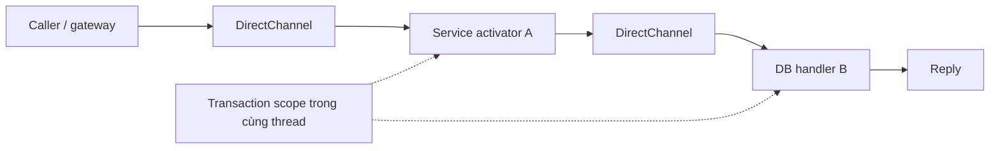
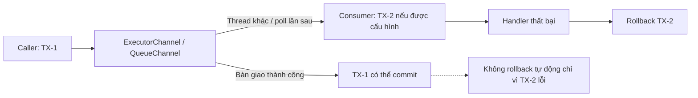
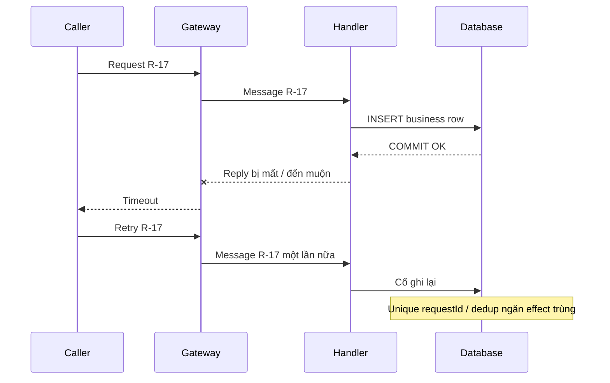

# Kiểm thử commit, rollback và recovery trong Spring Integration

## 1. Mục tiêu: chứng minh điều gì thực sự được commit?

Một *message flow* trong Spring Integration có thể đi qua gateway, `MessageChannel`, endpoint, service activator, poller, executor, message store và hệ thống ngoài. Khi nghiệp vụ gặp lỗi, câu hỏi kiểm thử không chỉ là "có exception không?" mà còn là:

- Thao tác database nào **đã commit**? Dữ liệu nào **đã rollback**?
- Message đã bị **lấy khỏi nguồn** chưa? Sau rollback có thể đọc lại không?
- Retry đã chạy bao nhiêu lần, mỗi lần nằm trong transaction nào?
- Recovery đã chuyển message sang kênh lỗi/dead-letter, hay vô tình báo thành công?
- Nếu caller timeout nhưng transaction đã commit, lần gửi lặp có tạo side effect trùng?
- Điều gì xảy ra khi flow đi qua `ExecutorChannel` hoặc `QueueChannel` và đổi thread?

Bài **Kiểm thử commit, rollback và recovery** thuộc chương **Transaction runtime** của module `SPRING_INTEGRATION_RUNTIME`. Trọng tâm là kiểm tra tác động thực tế của transaction trên runtime Spring Integration, đồng thời liên hệ điều phối flow, transaction manager, error handling, message store, correlation, threading và hiệu năng.

**Kết quả học tập:** bạn sẽ thiết kế được bộ kiểm thử có assertion vào trạng thái bền vững sau giao dịch, phân biệt transaction business với transaction poller/nguồn message, thử được rollback và redelivery, đồng thời phát hiện các cấu hình retry/recovery làm thay đổi ngữ nghĩa commit.

> **Phiên bản tham chiếu:** Spring Integration 6.5, Spring Framework 6.x, Java 17+, JUnit 5 và Spring Boot 3.x. Ví dụ dùng H2/JDBC để tái hiện dễ dàng; với Kafka, JMS, JDBC Message Store hoặc nhiều resource, contract giao dịch cần xác minh riêng cho adapter và transaction manager cụ thể.

## 2. Mô hình transaction của một message flow

### 2.1. Transaction là một phạm vi cụ thể

Spring transaction thông thường được quản lý bằng `PlatformTransactionManager` và gắn context vào **thread hiện tại**. Với một luồng hoàn toàn đồng bộ qua `DirectChannel`, cùng thread có thể đi qua nhiều endpoint và cùng tham gia một transaction nếu scope của transaction bao trùm chúng.



Ngược lại, `ExecutorChannel` chuyển lời gọi handler sang thread của executor; `QueueChannel` chuyển message cho một polling consumer xử lý vào thời điểm khác. Transaction của thread sender **không tự chuyển** sang thread consumer.



Dù `ExecutorChannel` có cấu hình dùng executor đôi khi chạy task tại caller theo rejection policy, **không được dựa vào hành vi bất thường đó** để coi transaction có thể truyền qua executor.

### 2.2. Transaction của handler và transaction của poller khác nhau

| Điểm bắt đầu transaction | Phạm vi thường có | Không mặc nhiên bao gồm |
|---|---|---|
| `@Transactional` trên service method | DB operations do method thực hiện và các lời gọi cùng transaction bên trong nó | Reply send diễn ra sau khi method/transaction kết thúc; thread khác; network operation không enlist. |
| Transaction mở quanh gateway/caller (ví dụ `TransactionTemplate`) | Các bước đồng bộ trên cùng thread khi dùng chung transaction manager | Công việc sau executor/pollable boundary; remote service độc lập. |
| Transactional poller | Có thể bao gồm `receive()` của nguồn hỗ trợ transaction và luồng đồng bộ ngay sau poll | Những consumer ở thread khác; nguồn không hỗ trợ rollback hoặc message store in-memory. |
| Transaction riêng của JMS/JDBC inbound adapter | Receive/ack hoặc resource được quản lý trong phạm vi adapter | DB khác nếu không phối hợp transaction; remote API call không thể rollback. |

**Đừng suy luận "transactional poller" = "mỗi message chắc chắn được redeliver khi lỗi".** Khả năng khôi phục message phụ thuộc bản chất nguồn: JDBC message store có thể rollback thao tác remove; queue in-memory thường đã lấy mất message dù transaction DB rollback; broker còn phụ thuộc ack, container và session transaction.

### 2.3. Commit/rollback không đồng nghĩa success/failure ở caller

Một handler có thể insert DB rồi commit, nhưng reply gửi về gateway thất bại. Caller nhìn thấy timeout, **không thể suy ra DB đã rollback**. Ngược lại, handler có thể trả response trước khi transaction bao ngoài commit, rồi commit gặp lỗi.

Phân biệt ba trạng thái:

1. **Invocation outcome:** handler trả về hay ném exception?
2. **Transaction outcome:** transaction manager commit hay rollback resource?
3. **Delivery outcome:** message/reply/ack đã tới nơi đích chưa?

Kiểm thử tốt phải xác nhận cả ba khi chúng ảnh hưởng hợp đồng nghiệp vụ.

## 3. Bộ kịch bản cần kiểm thử

| Kịch bản | Dữ liệu DB kỳ vọng | Message/luồng kỳ vọng | Assertion quan trọng |
|---|---|---|---|
| Nghiệp vụ hoàn tất, transaction commit | Có bản ghi hoặc trạng thái mới | Có reply/ack theo contract | Đọc DB bằng transaction/connection riêng sau lời gọi. |
| Ném `RuntimeException` trong transaction | Thay đổi DB trong transaction bị rollback | Exception/error flow nhận lỗi | Không có bản ghi, nguyên nhân lỗi phù hợp. |
| Ném checked exception mặc định | Có thể commit nếu không cấu hình `rollbackFor` | Caller vẫn có thể nhận exception | Xác minh chính sách rollback, không dựa vào tên exception. |
| Bắt exception rồi return bình thường | Thường commit nếu không đánh dấu rollback-only | Flow coi như xử lý thành công | Chứng minh exception bị nuốt đã đổi semantics. |
| Worker async thất bại sau khi sender bàn giao | Transaction sender có thể đã commit | Lỗi của worker nằm ở error path riêng | Không mong rollback transaction sender. |
| Poller lấy từ persistent transactional store rồi handler throw | DB write rollback; message removal rollback | Message còn để retry/redeliver | Đọc store/queue sau lỗi; quan sát attempt count. |
| Poller lấy từ in-memory queue rồi handler throw | DB write có thể rollback | Message có thể đã bị remove khỏi queue | Không suy diễn redelivery từ DB rollback. |
| Retry hai lần lỗi, lần ba thành công | Phụ thuộc thứ tự retry/tx advice; mong một kết quả cuối | Attempt count = 3 | Kiểm tra số side effect đã commit và số thông báo. |
| Retry hết và recovery xử lý | Phụ thuộc callback và transaction boundary | DLQ/recovery event chỉ đúng một lần theo chính sách | Xác nhận bản ghi lỗi bền vững và trạng thái nguồn. |
| Timeout rồi caller gửi lại cùng request ID | Tối đa một effect nghiệp vụ nếu thiết kế idempotent | Có thể có nhiều lần attempt | Unique key/idempotency và kết quả trả lại nhất quán. |

Hãy tách **kiểm thử đơn vị của phép tính/handler** khỏi **kiểm thử tích hợp transaction thật**. Mockito có thể xác nhận method được gọi, nhưng không thể chứng minh JDBC commit/rollback, broker ack hay SQL transaction isolation.

## 4. Thiết lập một thí nghiệm JDBC có thể kiểm tra thật

Đây là ví dụ tối thiểu: client gọi một `@MessagingGateway`, request đi qua `DirectChannel` đến service activator; method xử lý có `@Transactional` và ghi vào H2 bằng `JdbcTemplate`.

### 4.1. Dependencies và schema

Ví dụ dự án Gradle Spring Boot; quản lý version bằng BOM/plugin Spring Boot đang dùng:

```groovy
dependencies {
    implementation 'org.springframework.boot:spring-boot-starter-integration'
    implementation 'org.springframework.boot:spring-boot-starter-jdbc'

    testImplementation 'org.springframework.boot:spring-boot-starter-test'
    testRuntimeOnly 'com.h2database:h2'
}
```

Tạo schema cho test (ví dụ đặt đoạn SQL dưới đây ở `src/test/resources/schema.sql` khi triển khai):

```sql
CREATE TABLE tx_job (
    request_id VARCHAR(100) PRIMARY KEY,
    state VARCHAR(32) NOT NULL
);
```

Để Boot khởi tạo schema ở môi trường test, dùng `spring.sql.init.mode=always` nếu cấu hình datasource hoặc môi trường của bạn yêu cầu. Với in-memory H2, cần chắc chắn schema tồn tại trước khi test bắt đầu. Bảng `tx_job` có khóa chính để hỗ trợ kiểm tra thao tác trùng.

### 4.2. Gateway và channel đồng bộ

```java
import org.springframework.boot.SpringApplication;
import org.springframework.boot.autoconfigure.SpringBootApplication;
import org.springframework.context.annotation.Bean;
import org.springframework.integration.annotation.IntegrationComponentScan;
import org.springframework.integration.annotation.MessagingGateway;
import org.springframework.integration.channel.DirectChannel;
import org.springframework.integration.config.EnableIntegration;
import org.springframework.messaging.MessageChannel;

@SpringBootApplication
@EnableIntegration
@IntegrationComponentScan
public class TransactionDemoApplication {
    public static void main(String[] args) {
        SpringApplication.run(TransactionDemoApplication.class, args);
    }

    @Bean("tx.requests")
    MessageChannel txRequests() {
        return new DirectChannel();
    }
}

// Đặt interface gateway ở cùng package hoặc package được quét.
@MessagingGateway(defaultRequestChannel = "tx.requests")
interface TxGateway {
    String submit(String requestId);
}
```

Không tạo thêm một consumer cạnh tranh trên `tx.requests` trong thí nghiệm này. Để giữ ví dụ đơn giản, lời gọi gateway và service activator chạy đồng bộ trên cùng thread; gateway tự quản lý reply channel tạm.

### 4.3. Service activator ghi DB

```java
import org.springframework.integration.annotation.ServiceActivator;
import org.springframework.jdbc.core.JdbcTemplate;
import org.springframework.stereotype.Component;
import org.springframework.transaction.annotation.Transactional;

@Component
public class TxJobHandler {
    private final JdbcTemplate jdbc;

    public TxJobHandler(JdbcTemplate jdbc) {
        this.jdbc = jdbc;
    }

    @Transactional
    @ServiceActivator(inputChannel = "tx.requests", requiresReply = "true")
    public String submit(String requestId) {
        jdbc.update(
                "INSERT INTO tx_job (request_id, state) VALUES (?, ?)",
                requestId, "DONE");

        if (requestId.startsWith("FAIL-")) {
            throw new IllegalStateException("Force rollback: " + requestId);
        }

        return "ACK:" + requestId;
    }
}
```

**Vì sao ví dụ này kiểm thử được rollback?**

- `@Transactional` tạo/tiếp tục transaction khi method được Spring AOP proxy gọi. `JdbcTemplate` dùng cùng Spring-managed `DataSource` và transaction manager.
- Nếu method trả bình thường, transaction interceptor commit phần insert.
- Nếu `IllegalStateException` thoát ra ngoài method, mặc định Spring rollback với unchecked exception.
- Reply `"ACK:..."` được endpoint gửi sau khi handler trả về; **không được mặc định xem việc trả reply là một phần của transaction quanh method**.

Nếu transaction interceptor không chạy do self-invocation, bean không được proxy, dùng sai transaction manager hoặc dùng một `DataSource` khác, kết quả có thể khác. Bởi vậy cần test DB thực thay vì chỉ nhìn log `@Transactional`.

### 4.4. Kiểm thử commit và rollback bằng JUnit 5

```java
import static org.junit.jupiter.api.Assertions.*;

import org.junit.jupiter.api.BeforeEach;
import org.junit.jupiter.api.Test;
import org.springframework.beans.factory.annotation.Autowired;
import org.springframework.boot.test.context.SpringBootTest;
import org.springframework.jdbc.core.JdbcTemplate;

@SpringBootTest(classes = TransactionDemoApplication.class)
class TxJobIntegrationTest {

    @Autowired TxGateway gateway;
    @Autowired JdbcTemplate jdbc;

    @BeforeEach
    void clearTable() {
        jdbc.update("DELETE FROM tx_job");
    }

    private int count(String id) {
        Integer result = jdbc.queryForObject(
                "SELECT COUNT(*) FROM tx_job WHERE request_id = ?",
                Integer.class, id);
        return result == null ? 0 : result;
    }

    private Throwable deepestCause(Throwable error) {
        Throwable current = error;
        while (current.getCause() != null) {
            current = current.getCause();
        }
        return current;
    }

    @Test
    void commitsAfterSuccessfulHandler() {
        String reply = gateway.submit("OK-1");

        assertEquals("ACK:OK-1", reply);
        assertEquals(1, count("OK-1")); // Đọc sau lời gọi đã hoàn tất.
    }

    @Test
    void rollsBackWhenUncheckedExceptionEscapes() {
        RuntimeException thrown = assertThrows(
                RuntimeException.class,
                () -> gateway.submit("FAIL-2"));

        assertInstanceOf(IllegalStateException.class, deepestCause(thrown));
        assertEquals(0, count("FAIL-2"));
    }
}
```

**Điểm then chốt của test:** không đặt `@Transactional` lên test class/method. TestContext của Spring mặc định rollback giao dịch do **test** mở, điều này có thể che khuất việc handler thực sự đã commit hay chưa. Ở ví dụ, mỗi assertion truy vấn database **sau** khi gateway trả về/throw và không có test-managed transaction đang bao quanh.

Với JPA, cần chú ý `flush` và first-level cache: nếu muốn kiểm chứng trạng thái đã commit, truy vấn ngoài transaction xử lý, làm mới persistence context hoặc dùng một JDBC connection khác. Với H2 in-memory có nhiều test chạy song song, nên cô lập database/test context để tránh test làm sạch bảng của nhau.

### 4.5. Test “có reply” chưa chứng minh commit

Thử đổi handler để gọi một downstream handler khác sau reply hoặc thêm output channel có thể lỗi. Kiểm tra:

- Transaction nào chứa câu `INSERT`?
- Transaction đó commit tại **thời điểm nào** so với bước gửi reply?
- Nếu reply channel bị lỗi sau khi method trả về, DB row có còn không?

Trường hợp DB đã commit nhưng reply thất bại là một sự cố thực tế: caller có thể retry; muốn tránh ghi trùng, thiết kế idempotency bằng `requestId` và unique constraint.

## 5. Kiểm thử rollback rules của Spring

Spring `@Transactional` thường rollback với `RuntimeException` và `Error`, còn checked exception **không mặc định** kích hoạt rollback theo cấu hình truyền thống. Với Spring Framework mới có thể tồn tại chính sách toàn cục được tùy chỉnh; luôn xác minh cấu hình thực tế.

| Cách method kết thúc | Rollback mặc định thường gặp | Cần test |
|---|---|---|
| Trả giá trị bình thường | Không | Insert/update có commit khi method kết thúc? |
| Throw `IllegalStateException` | Có | Row bị rollback? |
| Throw checked exception | Không, trừ khi có rollback rule | Row có commit dù caller nhận exception? |
| Throw checked exception + `rollbackFor` | Có | Row bị rollback? |
| Catch exception rồi trả `"OK"` | Không, trừ khi có rollback-only | Có commit ngoài ý muốn? |
| Nested call `REQUIRES_NEW` | Transaction con độc lập | Transaction con commit dù transaction ngoài rollback? |

### 5.1. Checked exception: khai báo `rollbackFor` nếu cần

```java
class PaymentRejectedException extends Exception {
    PaymentRejectedException(String message) {
        super(message);
    }
}

@Transactional(rollbackFor = PaymentRejectedException.class)
public void writeAndCheck(String id) throws PaymentRejectedException {
    jdbc.update("INSERT INTO tx_job (request_id, state) VALUES (?, ?)",
            id, "PENDING");
    throw new PaymentRejectedException("Rejected by business rule");
}
```

Trong test tích hợp, lời gọi phải đi qua **Spring proxy** của bean chứa method. Với cấu hình này, `PaymentRejectedException` làm transaction rollback. Nếu gỡ `rollbackFor`, nhiều cấu hình Spring transaction mặc định sẽ commit dù method ném checked exception; đây là lý do assert trạng thái DB, không chỉ assert exception.

### 5.2. Nuốt exception và rollback-only

```java
@Transactional
public void dangerous(String id) {
    jdbc.update("INSERT INTO tx_job (request_id, state) VALUES (?, ?)",
            id, "DONE");
    try {
        callUnreliableService();
    }
    catch (RuntimeException ex) {
        // Không rethrow, cũng không mark rollback-only.
        // Khi method hoàn thành, phần INSERT có thể được commit.
    }
}
```

Nếu muốn transaction rollback dù xử lý lỗi tại chỗ, có thể đánh dấu rollback-only trong phạm vi transaction đang hoạt động:

```java
import org.springframework.transaction.interceptor.TransactionAspectSupport;

TransactionAspectSupport.currentTransactionStatus().setRollbackOnly();
```

Nhưng khi transaction nội bộ đã bị đánh dấu rollback-only bởi một đoạn khác, caller bên ngoài có thể nhận `UnexpectedRollbackException` tại commit. Không nên dùng rollback-only thay cho contract lỗi rõ ràng mà không kiểm thử đường trả kết quả.

### 5.3. `REQUIRES_NEW` và transaction không độc lập như tưởng tượng

Khi bean A mở transaction T1 rồi gọi **qua proxy** tới bean B có `@Transactional(propagation = REQUIRES_NEW)`, B chạy trong T2 độc lập. Nếu B commit và sau đó A rollback, row của B vẫn có thể tồn tại.

Một test cần có hai assertion sau outer failure:

```text
record_in_outer_tx: ABSENT    (T1 rollback)
record_in_requires_new_tx: PRESENT  (T2 đã commit)
```

Nếu B được gọi bằng `this.methodB()` bên trong cùng bean, proxy thường bị bỏ qua; bạn có thể không nhận được T2 thật. Với JDBC, đồng thời mở hai transaction có thể cần nhiều connection; cấu hình pool phải đủ năng lực. Đừng dùng `REQUIRES_NEW` tràn lan chỉ để “đảm bảo log vẫn ghi”: cân nhắc audit/outbox và isolation.

## 6. Poller transaction: kiểm thử cả việc nhận message

### 6.1. Vì sao poller cần transaction từ trước `receive()`?

Với một `PollingConsumer`, vòng xử lý về cơ bản là:

```text
Poller tick
   -> bắt đầu transaction (nếu configured)
   -> PollableChannel.receive() / MessageSource.receive()
   -> handler/flow đồng bộ
   -> commit nếu thành công, rollback nếu lỗi thoát ra
   -> after-commit / after-rollback callbacks
```

Điểm khác so với chỉ đặt `@Transactional` trên service method: transaction poller có thể bao cả thao tác **lấy message khỏi một nguồn transactional**. Nếu chỉ method có transaction, thao tác lấy message trước đó có thể đã hoàn tất không thể rollback.

### 6.2. Java DSL: transactional poller

```java
import java.time.Duration;

import org.springframework.context.annotation.Bean;
import org.springframework.integration.channel.QueueChannel;
import org.springframework.integration.dsl.IntegrationFlow;
import org.springframework.integration.dsl.Pollers;
import org.springframework.messaging.PollableChannel;
import org.springframework.transaction.PlatformTransactionManager;

@Bean("work.queue")
PollableChannel workQueue() {
    return new QueueChannel();
}

@Bean
IntegrationFlow workFlow(WorkProcessor processor,
                         PlatformTransactionManager transactionManager) {

    return IntegrationFlow.from("work.queue")
            .handle(processor, "process",
                    endpoint -> endpoint.poller(
                            Pollers.fixedDelay(Duration.ofMillis(200))
                                   .maxMessagesPerPoll(1)
                                   .transactional(transactionManager)))
            .get();
}
```

Đoạn trên minh họa *cách cấu hình poller transaction*; `WorkProcessor` là bean xử lý do ứng dụng cung cấp. **QueueChannel in-memory trong ví dụ này không bảo đảm requeue khi transaction rollback.** Poller có transaction không biến một `ArrayBlockingQueue` thành resource rollback được.

Để kiểm thử **message được đọc lại sau rollback**, hãy dùng một nguồn có transaction thực như JDBC-backed `QueueChannel` với `JdbcChannelMessageStore`, hoặc JMS listener/poller dùng session transaction tương ứng. Với JDBC store, schema của Spring Integration và `ChannelMessageStoreQueryProvider` phải phù hợp database.

### 6.3. Persistent message store thay đổi điều gì?

Trong `JdbcChannelMessageStore`, thao tác lấy message có thể gồm SQL `DELETE` theo transaction. Nếu handler throw trước commit và exception làm transaction rollback, thao tác xóa message trong store cũng rollback: message **vẫn tồn tại** để poll lần sau.

```mermaid
sequenceDiagram
    participant P as Poller
    participant S as JDBC Channel Message Store
    participant H as Handler
    participant D as Business DB
    P->>S: BEGIN TX; receive/remove message M
    S-->>P: M
    P->>H: handle(M)
    H->>D: UPDATE/INSERT
    H--xP: throw exception
    P->>S: ROLLBACK TX
    Note over S,D: Nếu cùng resource/transaction, remove và DB write rollback
    P->>S: Poll lần sau có thể nhận M
```

**Điều kiện quan trọng:** Store và business DB phải thực sự cùng transaction/resource theo cấu hình hoặc được phối hợp đúng; nếu dùng hai data source/transaction manager độc lập, rollback của bên này không chắc rollback bên kia. Khi nhiều poller cùng đọc store, cần xét lock/isolation, message ID cache và race condition.

### 6.4. Cách kiểm thử redelivery có kiểm soát

Không chạy một poller vô hạn rồi chờ message “tự quay lại” trong test. Một thiết kế test đáng tin cậy:

1. Tạo một message có `requestId=M-1` trong JDBC queue, rồi commit việc publish.
2. Khởi động poller có transaction, `maxMessagesPerPoll=1`; handler cố tình throw ở lần xử lý đầu tiên.
3. Xác nhận DB write của lần đầu bị rollback; quan sát rollback event/counter bằng thread-safe latch/queue.
4. Cho phép một poll khác đọc cùng `requestId=M-1`; lần này handler chạy thành công.
5. Xác nhận DB chỉ có **một** kết quả cuối, số lần gọi handler là 2 và store không còn message sau commit.
6. Dừng endpoint/poller trước khi kết thúc test để không có retry ngoài ý muốn giữa các assertion.

Có thể sử dụng `OnlyOnceTrigger` từ `spring-integration-test-support` để chủ động giới hạn lần poll trong test; hoặc dùng `@SpringIntegrationTest(noAutoStartup = {...})` và `MockIntegrationContext` để thay nguồn/trigger. Đối với retry/redelivery, phải chủ động reset trigger hoặc điều khiển các lần poll và đồng bộ bằng latch, tránh dùng `Thread.sleep()` cố định để kết luận thành công.

**Phân biệt:** message redelivery của broker/transactional store không giống `RequestHandlerRetryAdvice` gọi lại method trong cùng lượt nhận. Hai cơ chế có thể kết hợp, tạo tổng số attempt nhiều hơn dự kiến.

## 7. Kiểm thử recovery sau khi retry thất bại

### 7.1. Định nghĩa recovery trước khi viết test

"Recovery thành công" phải có ý nghĩa quan sát được, ví dụ:

- Một transient error được retry và cuối cùng **commit**.
- Một lỗi vĩnh viễn được chuyển sang **dead-letter queue/store**, gắn request ID, cause và attempt count; nguồn không còn message **chỉ khi** dead-letter đã được ghi bền vững.
- Một giao dịch có compensating action; trạng thái được cập nhật thành `FAILED` và có thể tra cứu.
- Một transaction rollback, message vẫn còn ở nguồn để redeliver sau thời điểm backoff.

Một đoạn `catch (Exception) { log.warn(...); }` không tự trở thành recovery. Nó có thể khiến transaction commit và làm mất tín hiệu lỗi.

### 7.2. Retry advice khác transaction advice

Giả sử có `RequestHandlerRetryAdvice` và `TransactionInterceptor`:

```text
Phương án A: RetryAdvice (outer)
  -> TransactionAdvice (inner)
      -> Handler
  Mỗi lần retry có thể vào transaction riêng; failed attempt rollback.

Phương án B: TransactionAdvice (outer)
  -> RetryAdvice (inner)
      -> Handler
  Nhiều attempts nằm trong cùng một transaction tổng.
```

Bản chất thay đổi theo cách khởi tạo proxy, propagation, transaction manager và phần exception thực sự thoát ra. Nếu retry nằm trong transaction, một lời gọi DB đã làm transaction rollback-only có thể khiến kết quả cuối không commit được, dù attempt cuối trả bình thường.

**Thông điệp thực hành:** khi muốn rollback từng attempt rồi thử lại, thường cần retry bao ngoài một transaction scope được mở riêng cho từng attempt. Cần test số lần thực thi, trạng thái DB sau từng attempt và sau recovery cuối. Với poller, advice order quanh polling task có thể còn ảnh hưởng việc `receive()` có bị thực hiện lại hay không.

### 7.3. Failure injection có kiểm soát

Thay vì dùng lỗi mạng tùy hứng, tạo một collaborator giả trả lỗi theo lịch định trước:

```java
import java.util.concurrent.atomic.AtomicInteger;

final class FailTwiceThenSucceed {
    private final AtomicInteger calls = new AtomicInteger();

    String call(String requestId) {
        int attempt = calls.incrementAndGet();
        if (attempt <= 2) {
            throw new IllegalStateException("transient attempt " + attempt);
        }
        return "DONE:" + requestId;
    }

    int attempts() {
        return calls.get();
    }
}
```

Trong test tích hợp, collaborator này được đặt **bên trong** handler đang gắn retry advice; nếu retry policy cho tối đa 3 lần, assertion mong muốn là:

```text
attempts == 3
final_result == "DONE:<requestId>"
committed_business_rows == 1
recovery_or_DLQ_rows == 0
```

Cần biết retry policy đang retry loại exception nào và khoảng backoff. Nếu handler ghi DB **trước khi** collaborator throw, test sẽ phát hiện các attempt có thực sự rollback hay để lại dữ liệu trùng.

### 7.4. Recovery callback và nguy cơ nuốt lỗi

Một recovery callback có thể gửi `ErrorMessage` rồi trả `null`. Nếu advice phía ngoài coi thao tác đã xử lý xong, transaction có thể commit phần nhận/xóa message trong khi chưa có dead-letter bền vững. Bởi vậy kiểm tra hai trạng thái như **một cặp**:

| Recovery strategy | Điều kiện cho phép xác nhận “xong” | Kiểm thử thất bại |
|---|---|---|
| Throw sau khi retry hết | Transaction rollback hoặc nguồn giữ message theo contract | Message còn để redeliver; business write rollback. |
| Persist DLQ/FAILED record rồi acknowledge | DLQ ghi bền vững trước khi nguồn được ack/commit | Nếu DLQ write lỗi, nguồn không mất message (hoặc có reconciliation). |
| Trả fallback reply | Fallback phản ánh trạng thái nghiệp vụ và không che side effect chưa rõ | Caller hiểu được retry-safe status; DB không trùng. |
| Compensation/saga | Đã ghi bước bù và trạng thái có thể phục hồi nếu bù cũng lỗi | Dữ liệu sau sự cố phù hợp state machine. |

Một hệ thống dùng JDBC store và bảng DLQ cùng database có thể giao dịch hai thao tác trong một transaction. Với broker + database khác resource, cần chính sách at-least-once và idempotency/outbox hoặc distributed transaction được quản lý riêng.

## 8. Kiểm thử transaction synchronization callbacks

Spring Integration hỗ trợ `TransactionSynchronizationFactory` và `TransactionSynchronizationProcessor` quanh poller, với ba mốc:

- `beforeCommit`: trước commit; lỗi ở đây có thể làm rollback transaction.
- `afterCommit`: sau commit thành công; thích hợp tín hiệu hậu commit nhưng **thất bại ở đây không tự rollback một commit đã xảy ra**.
- `afterRollback`: chạy sau khi rollback được xác nhận.

Có thể cấu hình expression SpEL trên message gốc để route hậu xử lý. Ví dụ XML cho file inbound adapter:

```xml
<int-file:inbound-channel-adapter id="files" channel="files.in"
                                  directory="/incoming">
  <int:poller fixed-delay="1000">
    <int:transactional transaction-manager="transactionManager"
                       synchronization-factory="syncFactory"/>
  </int:poller>
</int-file:inbound-channel-adapter>

<int:transaction-synchronization-factory id="syncFactory">
  <int:after-commit expression="payload"
                    channel="files.committed"/>
  <int:after-rollback expression="payload"
                      channel="files.rolledback"/>
</int:transaction-synchronization-factory>
```

Phải khai báo các XML namespace, channel, transaction manager và consumer tương ứng để chạy được. Trong callback này, `payload` là payload của message đã poll; kết quả expression được gửi tới channel. **Di chuyển file** sau commit hoặc rollback chỉ là hành động đồng bộ hóa với transaction, không làm file system tự trở thành tài nguyên ACID.

### 8.1. Một test xác minh afterCommit không chạy sau rollback

Với Spring transaction manager, có thể dùng callback để đếm sự kiện trong bài test. Trong phần service chạy trong transaction:

```java
import org.springframework.transaction.support.TransactionSynchronization;
import org.springframework.transaction.support.TransactionSynchronizationManager;
import java.util.concurrent.atomic.AtomicInteger;

final class TxSignals {
    final AtomicInteger commits = new AtomicInteger();
    final AtomicInteger rollbacks = new AtomicInteger();
}

// Đặt trong method có transaction đang hoạt động:
TransactionSynchronizationManager.registerSynchronization(
    new TransactionSynchronization() {
        @Override
        public void afterCommit() {
            signals.commits.incrementAndGet();
        }

        @Override
        public void afterCompletion(int status) {
            if (status == TransactionSynchronization.STATUS_ROLLED_BACK) {
                signals.rollbacks.incrementAndGet();
            }
        }
    });
```

**Kỳ vọng:** test success: `commits=1, rollbacks=0`; test throw: `commits=0, rollbacks=1`. Đồng thời phải kiểm chứng DB row commit/rollback, vì counter là tín hiệu trong bộ nhớ, không phải bằng chứng dữ liệu đã bền vững qua crash. Khi dùng `TransactionSynchronizationManager`, chỉ đăng ký nếu synchronization active; ví dụ yêu cầu method đang nằm trong transaction thực.

## 9. Kiểm thử idempotency khi reply/ack thất bại

### 9.1. Sự cố kinh điển: commit rồi timeout



Để tránh tạo tác động hai lần, cần khóa nghiệp vụ hoặc idempotency key mà caller giữ nguyên qua các lần retry. Với bảng `tx_job(request_id PRIMARY KEY, ...)` ở ví dụ trên, request gửi lặp sẽ vi phạm constraint thay vì tạo hai row. Nhưng **trả SQL duplicate exception** chưa phải một API idempotent hoàn chỉnh: hệ thống nên đọc trạng thái/kết quả trước đó và trả response phù hợp khi request trùng với cùng nội dung.

### 9.2. Assertions nên có

Cho phép chạy hai lần cùng `requestId`, kể cả concurrent nếu nghiệp vụ hỗ trợ:

1. Tổng số business rows sau mọi attempt đúng bằng 1.
2. Trạng thái cuối cùng của đơn/giao dịch đúng contract.
3. Không có side effect thứ hai tới một hệ thống ngoài không idempotent.
4. Nếu reply lần đầu mất, caller retry có thể nhận lại kết quả cũ hoặc biết trạng thái `PROCESSING`.
5. Nếu cùng key nhưng payload khác nhau, phải phát lỗi conflict thay vì âm thầm dùng lại kết quả.

Nếu cần phát sự kiện sang hệ thống khác sau DB commit, transactional outbox giúp ghi **business state + outbox record** cùng một local transaction. Publisher có thể gửi lặp, nên consumer vẫn phải idempotent. Không nhầm outbox với exactly-once end-to-end.

## 10. Kiểm thử các ranh giới threading và trạng thái runtime

### 10.1. DirectChannel và ExecutorChannel cho kết quả khác nhau

| Flow | Điều cần khẳng định bằng test |
|---|---|
| `TransactionTemplate -> DirectChannel -> Handler A -> DirectChannel -> Handler B` | Khi B throw trước outer commit, DB updates của A/B cùng transaction có thể rollback nếu cùng manager và lỗi truyền ra. |
| `TransactionTemplate -> ExecutorChannel -> Handler B` | Transaction sender có thể commit sau handoff; B throw không rollback A. B cần transaction/error path riêng. |
| `TransactionTemplate -> QueueChannel -> PollingConsumer -> Handler B` | Việc gửi/nhận xảy ra ở hai thời điểm; transaction sender và transaction poller độc lập nếu không dùng cơ chế phối hợp. |
| Transactional poller trên persistent store | Exception trước commit có thể khôi phục thao tác remove từ store; kiểm tra redelivery. |
| Handler chạy async với retry | Có thể xảy ra timeout gateway trước khi retry kết thúc; kiểm tra late reply và idempotency. |

Test phải **đợi kết quả đúng mốc**, ví dụ `CountDownLatch.await(timeout, unit)` hoặc condition polling có deadline, rồi assert dữ liệu. Không dùng `Thread.sleep(1000)` như bằng chứng transaction đã commit; scheduler và CI có thể chậm hơn hoặc nhanh hơn kỳ vọng.

### 10.2. Quan sát transaction đang active

Có thể ghi log chẩn đoán trong service:

```java
import org.springframework.transaction.support.TransactionSynchronizationManager;

boolean active =
        TransactionSynchronizationManager.isActualTransactionActive();
String threadName = Thread.currentThread().getName();
```

Dòng này chỉ xác nhận thread hiện tại đang có transaction active; nó **không** chứng minh transaction đó quản lý đúng `DataSource`/message store. Trong test, cần kiểm chứng resource state thực, transaction manager đang dùng, isolation/propagation và thread name.

### 10.3. Error channel không tự rollback transaction

`ErrorMessage` xuất hiện trên global `errorChannel` hoặc error channel của poller không chứng minh rollback đã xảy ra. Quan trọng là **exception có thoát qua transaction boundary trước khi commit không**, hay error handler đã bắt và nuốt nó.

Nếu error flow tự ghi vào DB, phải xác định nó chạy **trong** transaction đã lỗi hay trong transaction mới. Thường nên ghi trạng thái thất bại/recovery vào transaction độc lập, hoặc sau rollback, để không vô tình mất luôn bản ghi lỗi khi transaction nghiệp vụ rollback.

### 10.4. Endpoint stop/start khi test recovery

Với flow đăng ký động bằng `IntegrationFlowContext` hoặc poller có thể stop/start, hãy test:

- Sau `stop()`, endpoint không tiếp tục nhận message mới; backlog có được giữ không?
- Sau `start()`, message chưa xử lý được tiếp tục nhận theo contract của store?
- Khi shutdown giữa đang xử lý, transaction và ack hoàn tất theo cách nào?
- Có message nào được xử lý lại sau restart? Consumer có idempotent không?

Đừng lấy trạng thái `IntegrationFlowRegistration` đang tồn tại làm bằng chứng consumer đang chạy; kiểm tra lifecycle endpoint và tình trạng thực tế của channel/poller.

## 11. Lỗi thường gặp trong bài test transaction

| Hiện tượng | Nguyên nhân có thể | Cách phân biệt/sửa |
|---|---|---|
| Test “rollback” luôn pass dù handler không có `@Transactional` | Test method có `@Transactional` và tự rollback | Bỏ `@Transactional` ở test hoặc tách bước xác minh bằng transaction khác. |
| Có `@Transactional` nhưng DB vẫn commit sau throw | Proxy không đi qua, self-invocation, sai transaction manager/data source, exception bị catch | Xác minh proxy và `TransactionSynchronizationManager`; đọc DB sau lời gọi. |
| Handler throw nhưng message queue biến mất | In-memory `QueueChannel` không transactional | Dùng `JdbcChannelMessageStore`/broker transacted và assert store state. |
| Handler retry 3 lần nhưng có 3 DB rows | Transaction advice order sai hoặc side effect ngoài transaction | Ghi attempt ID, query rows sau mỗi failure, sửa transaction scope/idempotency. |
| Recoverer gửi DLQ nhưng nguồn vẫn retry | DLQ và ack/commit không được phối hợp, recoverer throw | Thiết kế ack-after-persist/transaction, quan sát cả nguồn và DLQ. |
| Retry một lần rồi phát `UnexpectedRollbackException` | Inner call đánh dấu transaction rollback-only | Xác định propagation, tách transaction cho mỗi attempt nếu cần. |
| Gateway timeout nhưng DB có row | Commit đã xảy ra, reply bị mất hoặc đến muộn | Idempotency, kiểm tra replyChannel, caller timeout và transaction order. |
| afterCommit event không đến | Không có tx thực, callback không được register hoặc channel thất bại | Log transaction status, callback và channel; test sau commit. |
| Không thấy errorChannel log khi handler throw | Exception được bắt trước error boundary hoặc synchronous caller nhận trực tiếp | Trace exception propagation và thread. |
| CI thỉnh thoảng fail trong test poller | Race condition, dùng sleep, poller chạy đồng thời giữa tests | Điều khiển lifecycle/trigger, dùng latch, cô lập store và test context. |

## 12. Quy trình kiểm thử tối thiểu cho hệ thống thực tế

**Bước 1 — Vẽ transaction boundary.** Xác định ai mở transaction: gateway caller, service method, poller hoặc broker listener. Ghi rõ thread/channel có ranh giới chuyển giao.

**Bước 2 — Chọn resource thật.** Đối với DB dùng H2/PostgreSQL test database; với broker dùng broker test; với JDBC message store dùng schema/store thật. Mock chỉ dùng cho dependency không ảnh hưởng semantics transaction đang test.

**Bước 3 — Kiểm thử đường thành công.** Gửi message có request ID ổn định; xác nhận response/ack, DB row, transaction sync và message đã được remove theo contract.

**Bước 4 — Inject lỗi trước commit.** Throw unchecked exception sau khi ghi DB; xác nhận rollback bằng truy vấn ngoài transaction xử lý và xác nhận message nguồn có được redeliver hay không.

**Bước 5 — Inject lỗi sau commit hoặc tại reply send.** Chứng minh được trạng thái “DB đã commit nhưng caller thất bại”; test gửi lại cùng idempotency key và không phát sinh side effect trùng.

**Bước 6 — Inject lỗi tạm thời và lỗi vĩnh viễn.** Với transient failure, kiểm tra retry count/backoff/transaction per attempt; với permanent failure, xác nhận DLQ/recovery state và nguồn không bị mất message ngoài ý muốn.

**Bước 7 — Đổi thread có chủ đích.** Thử `DirectChannel` rồi `ExecutorChannel`/poller; xác minh transaction context và error path bằng evidence thực, không đoán theo tên channel.

**Bước 8 — Thử restart và concurrency.** Stop/start endpoint, đọc lại persistent store, gửi trùng request concurrent, xác nhận unique constraint/correlation và trạng thái cuối sau recovery.

### Tiêu chí chấp nhận mẫu

```text
[PASS] success -> DB state COMMITTED, reply hợp lệ
[PASS] failure before commit -> DB state ROLLED_BACK
[PASS] transactional store -> message còn/requeued sau rollback
[PASS] terminal recovery -> có DLQ/state bền vững, không mất message
[PASS] retry -> attempt count đúng, effect nghiệp vụ tối đa một lần
[PASS] timeout after commit -> retry cùng requestId không tạo giao dịch trùng
[PASS] async boundary -> không kỳ vọng rollback chéo thread
[PASS] restart -> message còn tồn được xử lý hoặc truy vết
```

## 13. Bài tập tự kiểm tra

**Câu 1.** Một handler `@Transactional` ghi DB rồi ném `IllegalStateException`. Test assert exception và thấy row không tồn tại. Điều đó đã đủ chứng minh production rollback chưa?

**Đáp án:** Chưa chắc nếu test cũng có `@Transactional` vì test-managed transaction có thể tự rollback. Nên test không bao transaction và truy vấn DB sau khi lời gọi handler kết thúc, đồng thời kiểm tra method thật được gọi qua Spring proxy với đúng transaction manager.

**Câu 2.** Poller transactional đọc từ in-memory `QueueChannel`, handler throw; DB write bị rollback. Message có chắc trở lại queue?

**Đáp án:** Không. In-memory queue không hỗ trợ rollback thao tác remove. Muốn test redelivery cần nguồn transactional như JDBC channel message store/JMS phù hợp.

**Câu 3.** Flow có `ExecutorChannel`, upstream commit sau khi gửi message, downstream throw. Có nên kỳ vọng upstream tự rollback?

**Đáp án:** Không. Thread boundary tách transaction; cần transaction riêng ở downstream và thiết kế xử lý lỗi/đền bù.

**Câu 4.** Retry advice nằm ngoài transaction advice, tối đa 3 attempts; hai lần đầu throw, lần ba thành công. Kiểm thử gì ngoài attempt count?

**Đáp án:** Kiểm tra mỗi attempt lỗi thực sự rollback, dữ liệu cuối commit chính xác một lần, không có side effect ngoài transaction lặp và recovery không bị gọi khi attempt cuối thành công.

**Câu 5.** Handler throw checked exception sau `INSERT`; database vẫn có row. Có chắc đây là bug của Spring Integration?

**Đáp án:** Không. Mặc định rollback rules thường không bao checked exception; cần khai báo `rollbackFor` hoặc điều chỉnh chính sách, sau đó test lại.

**Câu 6.** Callback `afterCommit` đã chạy nhưng publish ra broker thất bại. Transaction DB có rollback được không?

**Đáp án:** Không thể rollback một commit đã hoàn thành chỉ bằng việc throw ở `afterCommit`. Nếu phải bảo đảm phát message, dùng transactional outbox hoặc cơ chế recoverable publisher riêng.

**Câu 7.** Gateway timeout sau khi business commit và caller retry. Làm sao test không có duplicate?

**Đáp án:** Gửi lặp cùng `requestId`, bao gồm trường hợp concurrent; assert unique business effect, trạng thái cuối và cùng kết quả/idempotency conflict contract.

**Câu 8.** Global `errorChannel` có `ErrorMessage`, có thể kết luận transaction đã rollback không?

**Đáp án:** Không. Error publishing là một phần của xử lý lỗi; phải xem exception có thoát khỏi transaction interceptor, error handler có nuốt lỗi không và kiểm chứng database/message store sau completion.

## 14. Tài liệu tham khảo chính thức

1. [Spring Integration 6.5 — Transaction Support](https://docs.spring.io/spring-integration/reference/6.5/transactions.html): transactional poller, thread boundaries, synchronization, pseudo transactions.
2. [Spring Integration 6.5 — Message Endpoints](https://springframework.org/spring-integration/reference/6.5/endpoint.html): poller, advice chain, transaction support.
3. [Spring Integration — Configuring Message Channels](https://docs.spring.io/spring-integration/reference/channel/configuration.html): `QueueChannel`, persistent stores và rollback behavior.
4. [Spring Integration — JDBC Message Store](https://docs.spring.io/spring-integration/reference/jdbc/message-store.html): `JdbcChannelMessageStore`, query provider, database schema và concurrency.
5. [Spring Integration 6.5 — Testing Support](https://docs.spring.io/spring-integration/reference/6.5/testing.html): `@SpringIntegrationTest`, `MockIntegrationContext`, `OnlyOnceTrigger` và test helpers.
6. [Spring Framework — Transaction Management](https://docs.spring.io/spring-framework/reference/data-access/transaction/declarative/rolling-back.html): rollback rules và propagation.
7. [Spring Framework — Integration Testing and Transactions](https://docs.spring.io/spring-framework/reference/testing/testcontext-framework/tx.html): test-managed transactions, rollback mặc định.
