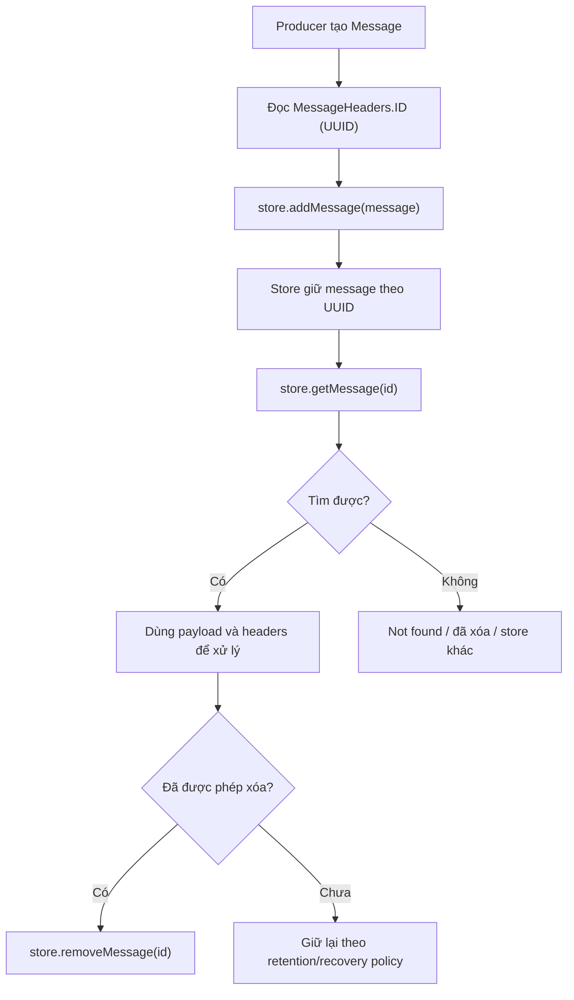
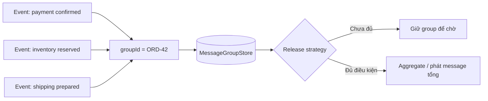
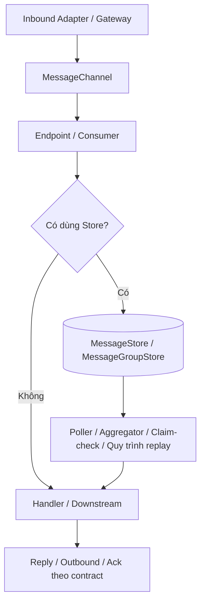
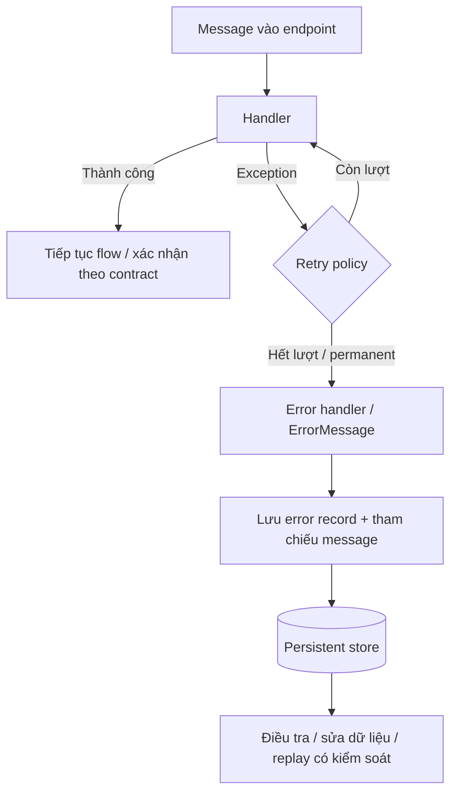

# MessageStore và lưu message theo key trong Spring Integration

## Mục tiêu học tập

Trong Spring Integration, message đi qua `MessageChannel` và các endpoint như transformer, router, service activator, aggregator hoặc consumer. Nhiều flow chỉ truyền message trong bộ nhớ, nhưng có những tình huống cần **giữ message lại để tra cứu, tập hợp, phát lại hoặc tiếp tục xử lý sau một thời gian**. `MessageStore` là một abstraction giúp quản lý vòng đời message đã được lưu theo định danh; các biến thể lưu *message group* cung cấp thêm khả năng tập hợp nhiều message bằng một group key.

Bài **MessageStore và lưu message theo key** thuộc chương **Message store** của module **SPRING_INTEGRATION_RUNTIME**. Bài học đặt việc lưu message vào đúng ngữ cảnh runtime: channel, endpoint, consumer, poller, executor, transaction, retry, lỗi và correlation. Từ “key” trong tiêu đề có ít nhất hai ý nghĩa cần phân biệt: **message ID** dùng tìm một message trong `MessageStore`, và **group ID/business key** dùng tập hợp hoặc tra cứu các message liên quan trong `MessageGroupStore` hay kho nghiệp vụ.

Sau bài học, bạn có thể:

- Giải thích `Message<T>`, `MessageHeaders.ID`, `MessageStore`, `MessageGroupStore` và các loại key mà chúng sử dụng.
- Ghi, đọc, xóa message theo UUID; lưu nhiều message vào nhóm theo `orderId`/correlation key.
- Chọn giữa kho in-memory và persistent store, hiểu giới hạn khi restart hoặc chạy nhiều instance.
- Xác định điểm lưu và điểm xóa sao cho phù hợp với flow đồng bộ, bất đồng bộ, transaction, retry và error flow.
- Phân tích tính nhất quán, khả năng duplicate, idempotency, serialization, dung lượng và hiệu năng.
- Chẩn đoán vì sao không tìm thấy message, vì sao một group chưa hoàn chỉnh, hoặc vì sao store có bản ghi nhưng downstream chưa xử lý.

## 1. Message được lưu theo key nào?

Một message Spring Messaging gồm **payload** và **headers**. Header `id` thường được sinh dưới dạng `UUID` khi tạo message.

```text
Message<OrderCreated>
  payload = OrderCreated(orderId="ORD-42", amount=120000)
  headers:
    id            = 7f...-...         <- định danh của message instance
    timestamp     = ...
    correlationId = "flow-42"        <- liên kết các bước trong flow
    businessKey   = "ORD-42"         <- định danh đơn hàng nghiệp vụ
```

**`MessageStore` cơ bản tra cứu message theo `MessageHeaders.ID` (UUID)**. Nó không tự tạo chỉ mục tìm theo header `businessKey`, `correlationId` hoặc payload `orderId`. Nếu cần tìm tất cả message của một đơn hàng, bạn cần cơ chế **grouping** hoặc chỉ mục nghiệp vụ được thiết kế riêng.

### 1.1. Phân biệt key và mục đích

| Khái niệm | Ví dụ | Chủ sở hữu | Ý nghĩa |
| --- | --- | --- | --- |
| Message ID | UUID do `MessageHeaders` sinh | Spring Messaging/message producer | Tra cứu một message instance qua API `getMessage(UUID)` |
| Correlation ID | `corr-42` | Ứng dụng hoặc thành phần correlation của Spring Integration | Ghép các message/nhánh của cùng một quá trình |
| Business key | `ORD-42` | Hợp đồng nghiệp vụ | Chống xử lý trùng và đối chiếu trạng thái đơn hàng |
| Message group ID | `ORD-42` hoặc correlation key | Thành phần nhóm/ứng dụng | Gom các message liên quan trong `MessageGroupStore` |
| Storage key vật lý | Primary key, Redis key, hàng DB... | Implementation của store | Chi tiết lưu trữ nội bộ; không đồng nhất với business key |

Có thể có **nhiều message ID cho cùng business key**: request, reply, sự kiện xác nhận, lần chuyển đổi payload hoặc lần giao lại từ nguồn có thể tạo message instance khác. Vì vậy không dùng `MessageHeaders.ID` làm khóa nghiệp vụ duy nhất nếu mục đích là idempotency hoặc tìm lại thông tin qua restart/replay.

### 1.2. MessageStore không phải một Map<String, Message<?>> tùy ý

Những lời gọi API cơ bản thể hiện rõ ý nghĩa (đây là cách sử dụng, không phải khai báo chính xác chữ ký interface):

```java
store.addMessage(message);             // lưu theo message ID
Message<?> loaded = store.getMessage(id); // đọc bằng UUID
store.removeMessage(id);               // xóa bằng UUID
```

Khi cần “`put("ORD-42", message)`”, đừng giả định `MessageStore` cung cấp phương thức đó. Nếu mục tiêu là chứa **nhiều** message chung một key, hãy dùng `MessageGroupStore`. Nếu mục tiêu là ánh xạ **duy nhất một bản ghi trạng thái nghiệp vụ** theo `orderId`, cân nhắc bảng hoặc kho key-value nghiệp vụ với unique key phù hợp.

> Trong phần code minh họa tiếp theo, chúng ta gọi các phương thức thật trên một bean `MessageStore`; thứ tự và chi tiết các phương thức có thể thay đổi theo implementation/phiên bản, nhưng `getMessage(UUID)` và `removeMessage(UUID)` biểu đạt mô hình tra cứu theo message ID.

## 2. Chu trình lưu, đọc và xóa một message



### 2.1. Ví dụ API với SimpleMessageStore

`SimpleMessageStore` là implementation **trong bộ nhớ**, phù hợp để tìm hiểu API và viết test đơn giản. Ví dụ độc lập:

```java
import java.math.BigDecimal;
import java.util.UUID;

import org.springframework.integration.store.MessageStore;
import org.springframework.integration.store.SimpleMessageStore;
import org.springframework.messaging.Message;
import org.springframework.messaging.support.MessageBuilder;

public class MessageStoreDemo {

    record OrderCreated(String orderId, BigDecimal amount) {}

    public static void main(String[] args) {
        MessageStore store = new SimpleMessageStore();

        Message<OrderCreated> original = MessageBuilder
                .withPayload(new OrderCreated(
                        "ORD-42", new BigDecimal("120000")))
                .setHeader("businessKey", "ORD-42")
                .setHeader("correlationId", "corr-42")
                .build();

        // Key tra cứu message là UUID của message này.
        UUID messageId = original.getHeaders().getId();

        // Lưu message vào store.
        store.addMessage(original);

        Message<?> loaded = store.getMessage(messageId);
        if (loaded == null) {
            throw new IllegalStateException("Message not found: " + messageId);
        }

        OrderCreated order = (OrderCreated) loaded.getPayload();
        System.out.println(order.orderId()); // ORD-42
        System.out.println(loaded.getHeaders().get("correlationId")); // corr-42

        // Chỉ xóa khi chính sách nghiệp vụ cho phép.
        store.removeMessage(messageId);

        System.out.println(store.getMessage(messageId)); // null
    }
}
```

Để chạy ví dụ, dự án cần dependency Spring Integration và Spring Messaging. `SimpleMessageStore` không phải kho dữ liệu bền vững: sau khi ứng dụng dừng, dữ liệu chỉ tồn tại trong RAM sẽ mất.

**Kết quả cần hiểu:**

1. `MessageBuilder` tạo message với `id` và `timestamp`.
2. `addMessage(original)` lưu message mà store quản lý theo `id`.
3. `getMessage(messageId)` lấy được message đã lưu nếu còn tồn tại và store phù hợp.
4. `removeMessage(messageId)` loại message khỏi store; thao tác này độc lập với việc handler downstream có thực sự thành công hay chưa.

Các đoạn code dùng `Message<?> loaded` vì kho chứa nhiều kiểu payload. Nếu application biết rõ hợp đồng, hãy kiểm tra `instanceof` và validation trước khi cast DTO. Một `MessageStore` không tự đảm bảo payload đúng schema.

### 2.2. Nếu getMessage trả về null

Có thể là một trong các trường hợp:

- Message chưa từng được `addMessage` vào đúng store đang truy vấn.
- ID dùng tra cứu là ID của message **khác** (ví dụ message mới tạo sau transformer có UUID khác).
- Message đã được `removeMessage` bởi consumer khác hoặc bước cleanup.
- Ứng dụng restart khi dùng in-memory store.
- Hai instance dùng **hai store khác nhau** hoặc có khác biệt về namespace/cấu hình lưu trữ.
- Retention/expiration hoặc cleanup job của ứng dụng đã dọn message theo chính sách.

Không nên chữa lỗi này bằng cách giả tạo một UUID mới rồi tra lại; cần xác định **ID gốc được lưu vào đâu, thời điểm nào, bởi thành phần nào và còn thuộc namespace đó không**.

### 2.3. Vì sao không xóa ngay sau khi đọc?

Đọc một message **không đồng nghĩa với xử lý thành công**. Nếu gọi `removeMessage` ngay sau `getMessage`, rồi handler gọi API thất bại hoặc process crash, có thể mất cơ hội recovery. Ngược lại, giữ mọi message mãi sẽ gây đầy store.

Một thiết kế an toàn cần xác định thời điểm xóa: sau khi transaction commit, sau khi nguồn xác nhận, sau khi ghi trạng thái hoàn tất, hoặc sau khi lưu thông tin phục hồi bền vững. Với nhiều consumer cạnh tranh, thao tác “đọc rồi xóa” riêng lẻ cũng không tự tạo một cơ chế **claim/lease độc quyền**.

## 3. Lưu nhiều message theo business key bằng MessageGroupStore

Khi nghiệp vụ yêu cầu gom nhiều message liên quan, `MessageGroupStore` cung cấp API quản lý *message group* theo `groupId`, là một `Object` do application hoặc component xác định.

Ví dụ một đơn hàng có ba sự kiện:

```text
groupId = "ORD-42"
    ├── Message<PaymentConfirmed>    id = UUID-A
    ├── Message<InventoryReserved>   id = UUID-B
    └── Message<ShippingPrepared>    id = UUID-C
```

Ba message khác nhau vẫn có ID riêng; chúng cùng thuộc group `ORD-42`. Group ID **không bắt buộc trùng** header `correlationId` hoặc `businessKey`, nhưng nên dùng một quy ước thống nhất.

### 3.1. Ví dụ gom message theo orderId

```java
import org.springframework.integration.store.MessageGroup;
import org.springframework.integration.store.MessageGroupStore;
import org.springframework.integration.store.SimpleMessageStore;
import org.springframework.messaging.Message;
import org.springframework.messaging.support.MessageBuilder;

public class GroupByOrderDemo {

    public static void main(String[] args) {
        MessageGroupStore groups = new SimpleMessageStore();

        String orderId = "ORD-42";

        Message<String> payment = MessageBuilder
                .withPayload("PAYMENT_CONFIRMED")
                .setHeader("businessKey", orderId)
                .build();

        Message<String> inventory = MessageBuilder
                .withPayload("INVENTORY_RESERVED")
                .setHeader("businessKey", orderId)
                .build();

        // Dùng group ID nghiệp vụ làm khóa nhóm.
        groups.addMessageToGroup(orderId, payment);
        groups.addMessageToGroup(orderId, inventory);

        MessageGroup group = groups.getMessageGroup(orderId);

        System.out.println(group.size()); // 2

        for (Message<?> item : group.getMessages()) {
            System.out.println(item.getPayload());
        }
    }
}
```

Với `MessageGroupStore`, từ khóa tra cứu trong `getMessageGroup(orderId)` là **group ID**. Đừng nhầm với `MessageStore.getMessage(UUID)`. Mỗi message trong group vẫn là một `Message<?>` có header `id` riêng.

Bảng phân biệt hai thao tác:

| Nhu cầu | API/mô hình thích hợp | Key | Kết quả |
| --- | --- | --- | --- |
| Lưu và lấy **một** message cụ thể | `MessageStore.addMessage` / `getMessage` | UUID của `MessageHeaders.ID` | Một message hoặc `null` |
| Gom **nhiều** message liên quan | `MessageGroupStore.addMessageToGroup` / `getMessageGroup` | `groupId`, ví dụ `ORD-42` | Một message group |
| Tìm trạng thái đơn hàng duy nhất | Repository/bảng nghiệp vụ hoặc key-value store thiết kế riêng | `orderId` | Một bản ghi với unique constraint |
| Lưu khóa → giá trị **metadata nhỏ** | `MetadataStore` phù hợp với metadata, không nhằm chứa payload message tùy ý | Key metadata | Giá trị metadata |

### 3.2. Grouping không tự biết khi nào đủ message

Việc gọi `addMessageToGroup` chỉ tạo hoặc cập nhật group. Nó không có nghĩa nghiệp vụ “đơn hàng hoàn tất”. Nếu cần đợi đủ các phần, Spring Integration thường dùng **aggregator** với correlation strategy và release strategy:



Ở aggregator, correlation strategy quyết định message nào thuộc cùng group; release strategy quyết định group khi nào được phép phát kết quả. Việc dọn group, hết hạn group, xử lý partial result và lưu trạng thái hoàn tất là các quyết định khác. **Không tự giả định mọi message group đều có ordering, exactly-once hoặc tự động expired**.

Nếu chỉ muốn tìm một message theo `orderId`, dùng group là một lựa chọn có thể được, nhưng phải quản lý khả năng nhiều message cùng key, duplicate và trường hợp chọn message nào. Đừng dựa vào thứ tự của collection trả về nếu không có hợp đồng sắp xếp cụ thể.

## 4. MessageStore tham gia runtime flow ra sao?

`MessageStore` không phải một `MessageChannel`. Một message có thể đi qua nhiều channel mà không hề được lưu, hoặc được một endpoint/adapter lưu lại ở điểm xác định.



Một số trường hợp thường gặp:

| Thành phần/mô hình | Vai trò của store | Lưu ý runtime |
| --- | --- | --- |
| **Claim check** | Cất message/payload lớn vào store, chuyển tiếp claim token tham chiếu | Phải kiểm soát thời điểm checkout, xóa và xử lý claim token không tìm thấy |
| **Aggregator / resequencer** | Giữ message trong group cho đến khi đủ điều kiện phát | Dễ có group chưa đầy đủ, hết hạn hoặc dư thừa |
| **Persistent queue/channel** | Một implementation store phù hợp có thể làm backend cho hàng đợi message | Cần đúng loại store/adapter; không chỉ truyền bất kỳ `MessageStore` vào `QueueChannel` |
| **Error/recovery** | Lưu message thất bại hoặc bản ghi tham chiếu để xử lý lại | Store không mặc nhiên là DLQ hoặc cung cấp lịch retry |
| **Custom tracking** | Ghi message theo UUID để lấy lại phục vụ tra cứu | Phải tự quyết định retention, security, index và ownership |

`MessageStore` **không tự thay thế** broker (JMS, RabbitMQ, Kafka), retry queue, inbound adapter hay transaction manager. Những thành phần này quyết định khi nào message được giao cho consumer, khi nào được ack và khi nào cần redeliver.

### 4.1. Claim-check: cất nội dung, chuyển key

Claim-check pattern dùng khi muốn tránh chuyển payload lớn qua nhiều thành phần:

```text
Message<LargePayload>
    -> Claim-check in: lưu message vào store
    -> Message<ClaimToken>
    -> Routing / transport
    -> Claim-check out: dùng token lấy message đã lưu
    -> Message<LargePayload> tiếp tục xử lý
```

Token cần đủ ổn định để tìm đúng bản ghi trong store được chia sẻ. Nếu một phía dùng in-memory `SimpleMessageStore` của process A còn phía kia chạy process B, checkout có thể không tìm thấy bản ghi. Nếu có xóa sau checkout, lỗi ở handler **sau** checkout có thể khiến việc lấy lại payload khó khăn; phải thiết kế chính sách lưu/ack tương ứng.

Chỉ dùng claim-check khi đã cân nhắc chi phí serialize, round-trip lưu trữ và vòng đời token. Chuyển một tham chiếu nhỏ đi khắp flow không có nghĩa dữ liệu payload đã được xử lý hoặc giao bền vững.

### 4.2. Aggregator và correlation

Một aggregator có thể giữ các nhánh của cùng request trong message group:

```text
Split order ORD-42 -> [item-1, item-2, item-3]
        |
        v
    correlationId = ORD-42
        |
        v
  MessageGroupStore[ORD-42]
        |
        v
 Release khi đủ 3 kết quả
        |
        v
  Message tổng hợp
```

Trong ứng dụng thật, correlation có thể dùng các header chuẩn hoặc custom strategy. Cần lưu ý việc một message được release/aggregate khác với việc mọi side effect từ các handler sau đó đã commit. Nếu chưa dọn group đúng policy, một message giao lại có thể vào group cũ hoặc bị coi là late arrival.

## 5. In-memory và persistent MessageStore

### 5.1. SimpleMessageStore dành cho gì?

`SimpleMessageStore` lưu trong bộ nhớ của process. Nó phù hợp cho demo, test, cache ngắn hạn hoặc flow mà mất dữ liệu khi restart đã được chấp nhận theo hợp đồng.

**Không nên** dùng in-memory store như nguồn tin bền vững cho workflow quan trọng nếu hệ thống phải phục hồi sau restart. Không thể giả định state tự đồng bộ giữa nhiều instance.

### 5.2. Persistent implementations

Spring Integration có các implementation kết nối backend bên ngoài như `JdbcMessageStore` và các lựa chọn tương ứng tùy module tích hợp/backend (ví dụ Redis hoặc MongoDB). Mỗi implementation có yêu cầu riêng về dependency, schema, serializer, transaction và mức hỗ trợ cho message/group/channel.

Ví dụ cấu hình bean với JDBC:

```java
import javax.sql.DataSource;

import org.springframework.context.annotation.Bean;
import org.springframework.context.annotation.Configuration;
import org.springframework.integration.jdbc.store.JdbcMessageStore;
import org.springframework.integration.store.MessageStore;

@Configuration
class JdbcStoreConfiguration {

    @Bean
    MessageStore orderMessageStore(DataSource dataSource) {
        return new JdbcMessageStore(dataSource);
    }
}
```

Đoạn cấu hình cần dependency Spring Integration JDBC, `DataSource` hợp lệ, **schema bảng lưu message/group phù hợp phiên bản** và các thiết lập serialize/transaction cần thiết. Tạo bean `JdbcMessageStore` không tự có nghĩa database đã được khởi tạo hoặc dữ liệu sẽ tồn tại đúng như mong đợi qua mọi kiểu restart.

Các câu hỏi phải chốt trước khi chọn backend:

- Backend có được chia sẻ bởi mọi replica xử lý cùng claim token/group ID không?
- Có transaction manager và commit boundary được cấu hình đúng không?
- Payload và headers có serialize/deserialize được sau deploy phiên bản mới không?
- Có cơ chế cleanup, retention, index, backup và giới hạn dung lượng không?
- Khi backend tạm mất kết nối, ứng dụng sẽ retry, rollback, trả lỗi hay chuyển sang degraded mode?
- Có rủi ro duplicate do adapter redelivery hoặc do hai consumer đọc cùng bản ghi không?

### 5.3. Một bảng quyết định

| Tiêu chí | In-memory (`SimpleMessageStore`) | Persistent (ví dụ JDBC) |
| --- | --- | --- |
| Sau khi process restart | Dữ liệu trong RAM mất | Có thể giữ dữ liệu đã commit nếu backend còn hoạt động |
| Dùng giữa nhiều replica | Mỗi process có state riêng | Có thể chia sẻ nếu cùng backend/namespace, đúng concurrency policy |
| Chi phí I/O | Thấp, truy cập RAM | Có I/O mạng/DB, serialization và contention |
| Transaction bền vững | Không tự cung cấp durability | Phụ thuộc transaction manager/DB và cách ghi |
| Schema/version payload | Dễ bỏ qua trong demo | Cần thiết kế để đọc lại dữ liệu cũ |
| Backup/retention | Chủ yếu theo vòng đời process | Cần chiến lược vận hành và cleanup rõ |
| Mức phù hợp | Demo, test, state có thể mất | Recovery, workflow dài, xử lý cần sống qua restart |

Lưu bền vững chỉ nghĩa **bản ghi có thể tồn tại qua restart** nếu đã được commit đúng. Nó không bảo đảm exactly-once, tự động ack source, giải quyết duplicate hoặc tái chạy handler an toàn.

## 6. Transaction: lưu message và xử lý nghiệp vụ có đồng bộ không?

Ví dụ producer nhận đơn hàng, lưu message rồi gọi downstream:

```text
Receive order
  -> store.addMessage(orderMessage)
  -> handler.reserveInventory()
  -> send confirmation
```

Có ít nhất ba thao tác với các trạng thái thành công/thất bại khác nhau. Nếu `addMessage` đã commit nhưng API thất bại, store giữ message chờ recovery. Nếu handler thành công nhưng app crash trước khi ghi trạng thái hoàn tất, message có thể được phát lại gây side effect trùng. Nếu store và nghiệp vụ ở hai hệ thống khác nhau, transaction thông thường của một `DataSource` **không bao trùm** cả hai một cách tự động.

### 6.1. Các cửa sổ lỗi

| Mốc lỗi | Trạng thái có thể xảy ra | Rủi ro |
| --- | --- | --- |
| Trước khi `addMessage` | Chưa có bản ghi trong store | Message có thể mất nếu nguồn đã ack sớm |
| Sau lưu, trước xử lý | Có bản ghi chưa xử lý | Cần scheduler/worker hoặc quy trình recovery để xử lý |
| Trong handler | Có thể đã tạo side effect một phần | Retry/redelivery có thể trùng nghiệp vụ |
| Sau handler, trước cập nhật trạng thái | Nghiệp vụ có thể thành công nhưng store vẫn pending | Replay có thể thực hiện lại thao tác |
| Trong xóa/cleanup | Message có thể còn hoặc đã bị xóa | Cần kiểm tra outcome thay vì đoán từ log |

Đối với workflow quan trọng, hãy viết rõ thứ tự **save → process → mark complete/ack → delete**, các transaction liên quan và chính sách khi từng bước thất bại. Không dựa vào một lời gọi `addMessage` thành công để kết luận request đã được xử lý.

### 6.2. Ranh giới thread và transaction

- **`DirectChannel`** thường chạy handler đồng bộ cùng thread của sender, vì vậy transaction ở caller có thể bao gồm bước xử lý nếu các resource phù hợp tham gia.
- **`ExecutorChannel`** chuyển handler sang thread khác; transaction gắn với thread caller thông thường **không tự chuyển sang worker**. Store ghi trước executor và DB ghi tại worker có thể nằm trong hai transaction.
- **Poller** có thể mở transaction cho từng lượt poll; việc commit/rollback phụ thuộc source và resource tham gia. Đọc message từ nguồn/queue không tự đồng nhất với `store.removeMessage`.
- **Message-driven adapter** có thể ack, nack hoặc redeliver theo contract của broker, container và lỗi truyền ra. Store riêng không tự điều khiển hành vi đó.

Khi dùng JDBC store và DB nghiệp vụ, có thể thiết kế chúng dùng chung transaction manager **nếu cùng datasource và boundary thực sự phù hợp**. Nếu một handler gọi HTTP bên ngoài, lời gọi ấy không tự nằm trong JDBC transaction. Cân nhắc transactional outbox, idempotency key hoặc workflow bù trừ khi cần đồng bộ với hệ thống ngoài.

## 7. Retry, error flow và lưu message thất bại

`MessageStore` hữu ích trong recovery, nhưng không phải cứ thêm store là lỗi tự được lưu.



Trong flow đồng bộ, exception thường đi ngược về caller; để có `ErrorMessage` cần error publisher/recovery thích hợp. Trong flow executor/poller, error handler ở biên bất đồng bộ có thể xuất bản `ErrorMessage` vào error channel. Ở cả hai trường hợp, **lưu vào `MessageStore` là hành động phải cấu hình rõ trong error flow hoặc thành phần recovery**.

### 7.1. ErrorMessage chứa message gốc ở đâu?

`ErrorMessage` có payload là một `Throwable`. Message nguồn có thể lấy từ `getOriginalMessage()` hoặc `MessagingException.getFailedMessage()` nếu có; hai giá trị có thể khác nhau hoặc `null`.

```java
import org.springframework.integration.store.MessageStore;
import org.springframework.messaging.Message;
import org.springframework.messaging.MessagingException;
import org.springframework.messaging.support.ErrorMessage;

class ErrorArchive {

    private final MessageStore store;

    ErrorArchive(MessageStore store) {
        this.store = store;
    }

    void archive(ErrorMessage error) {
        Throwable failure = error.getPayload();

        Message<?> failed = error.getOriginalMessage();
        if (failed == null && failure instanceof MessagingException messaging) {
            failed = messaging.getFailedMessage();
        }

        if (failed == null) {
            // Không đủ ngữ cảnh để lưu message gốc; dùng error record riêng.
            throw new IllegalStateException(
                    "Original message unavailable", failure);
        }

        // Minh họa lưu message; production cần error metadata và trạng thái.
        store.addMessage(failed);
    }
}
```

Đoạn code dùng `MessageStore` để minh họa lưu một message thất bại theo ID. Trong production, một **error record** thường còn cần `businessKey`, `correlationId`, endpoint, exception class/cause, timestamp, attempt/delivery count, tình trạng recovery và retention. Lưu message gốc **không tự lưu đủ lịch sử lỗi** và không tự có DLQ semantics như broker.

Cần chọn rõ liệu lưu nguyên message, snapshot đã chuẩn hóa hay chỉ giữ một tham chiếu đến payload. Đừng đẩy secrets, token hoặc dữ liệu cá nhân vào store không có retention/encryption/access control phù hợp.

### 7.2. Error store và message replay

Một quy trình replay đáng tin cậy:

1. Chọn bản ghi thất bại theo **business key** và trạng thái; xác minh nguyên nhân đã được sửa hoặc downstream đã phục hồi.
2. Dùng UUID/claim key đọc lại message gốc từ store.
3. Kiểm tra payload/schema version và trạng thái nghiệp vụ hiện tại.
4. Gửi lại message qua một flow có hợp đồng idempotency; mang theo correlation và thông tin lần replay.
5. Chỉ đánh dấu đã xử lý và cleanup bản ghi sau khi kết quả được commit/ghi nhận theo policy.

Không coi “send message lần nữa” là exactly-once. Nếu consumer đã xử lý trước khi crash, replay có thể chạy lần hai. Unique business key hoặc idempotency key là lớp bảo vệ quan trọng.

## 8. Concurrency: nhiều consumer cùng đọc một key

Một API `getMessage(id)` là **tra cứu**, không mặc nhiên cấp quyền độc quyền để một worker xử lý. Hai thread hoặc hai process có thể cùng nhìn thấy một message và cùng gọi downstream nếu orchestration không có cơ chế claim/lock.

```text
Worker A: getMessage(UUID-1) -> tìm thấy -> gọi API
Worker B: getMessage(UUID-1) -> tìm thấy -> gọi API
Worker A: removeMessage(UUID-1)
Worker B: removeMessage(UUID-1) -> có thể không còn
```

Hành vi này **không được giải quyết** bằng việc đổi UUID. Nếu cần một worker được quyền xử lý một key, thiết kế status transition có điều kiện trong DB (`PENDING -> CLAIMED -> DONE`), lock/lease, optimistic concurrency, queue/broker có ack semantics hoặc cơ chế claim nguyên tử do backend cung cấp.

### 8.1. Payload mutable và snapshot

`MessageHeaders` không cho sửa trực tiếp qua API, nhưng payload có thể là một `ArrayList` hoặc DTO mutable. Một in-memory store có thể giữ tham chiếu đến object trong cùng process; người viết code không nên mong một snapshot bất biến tự xuất hiện chỉ vì đã `addMessage`.

Ưu tiên immutable DTO/record, immutable collections và serializer nhất quán. Với persistent store, cần đo kích thước payload và xác minh bản đọc ra sau restart phản ánh đúng dữ liệu cần phục hồi.

### 8.2. Correlation và nhóm message chạy song song

Khi aggregator nhận cùng một `groupId` từ nhiều thread, store implementation, correlation strategy, release strategy và lock registry (nếu được cấu hình) đều ảnh hưởng đến tính nhất quán. Việc lưu được hai message vào cùng group chưa đảm bảo release được gọi đúng một lần hoặc output nghiệp vụ không bị xử lý lại. Kiểm thử các case duplicate, late arrival và concurrent release.

## 9. Serialization và vòng đời dữ liệu bền vững

Trong persistent store, payload và headers phải được chuyển thành dạng backend có thể lưu rồi dựng lại. Một `Message<T>` trong Java có thể mang:

- DTO tự định nghĩa theo phiên bản code hiện tại.
- Header `replyChannel` hoặc `errorChannel` chứa một đối tượng `MessageChannel` hoặc chuỗi tên channel.
- Object không thể serialize hoặc tham chiếu tới bean trong Spring context.
- Metadata schema/correlation cần duy trì qua restart.

Điều này dẫn đến các tình huống:

| Tình huống | Vấn đề | Gợi ý xử lý |
| --- | --- | --- |
| DTO đổi package/tên class | Bản ghi cũ có thể không deserialize được | Có schema version và định dạng dữ liệu ổn định |
| Header chứa object runtime | Serializer không hỗ trợ hoặc object không còn ý nghĩa sau restart | Lưu tên/định danh cần thiết; hạn chế lưu bean trực tiếp |
| Payload quá lớn | Tăng I/O, GC, DB size và thời gian khôi phục | Claim-check, reference payload hoặc giới hạn kích thước |
| Dữ liệu cũ không có TTL | Store tăng mãi | Retention và cleanup job có đo lường |
| Header có secret/PII | Rủi ro lộ dữ liệu và khó xóa | Masking, encryption, phân quyền và chính sách hủy |
| Schema thay đổi khi còn pending | Replay lỗi sau deploy mới | Migration hoặc compatibility mapping |

Đừng phụ thuộc vào native Java serialization tùy tiện cho các workflow dài hạn nếu không có kiểm soát tương thích. Định dạng JSON/Avro/Protobuf hay serializer chuyên dụng phải được chọn theo yêu cầu và khả năng của backend đang dùng.

## 10. Quan sát và chẩn đoán runtime của MessageStore

Một message đã được ghi vào store **không chứng minh** downstream hoàn tất. Khi quan sát flow, phân biệt bốn sự kiện:

```text
received != stored != delivered != business-committed
```

Bạn nên đo từng giai đoạn:

| Tín hiệu | Tại sao cần | Câu hỏi trả lời |
| --- | --- | --- |
| `store.add.success/failure` | Khả năng lưu dữ liệu | Message đã được ghi nhận chưa? |
| `store.get.hit/miss` | Tính đúng của key/retention | Vì sao không tìm thấy UUID? |
| `store.remove.success/failure` | Cleanup/recovery | Message có bị xóa quá sớm? |
| `store.message.count` | Sức chứa và retention | Store có tăng không kiểm soát? |
| `group.pending.count` / `group.age` | Khả năng aggregator chờ vô hạn | Group nào chưa đủ/không phát kết quả? |
| `store.operation.latency` | Nút thắt DB/Redis | Store có làm poller/consumer chậm? |
| `error.archive.count` / `replay.count` | Recovery | Có lỗi bị mất hoặc replay liên tục? |
| `duplicate.businessKey` | Idempotency | Bao nhiêu lần xử lý cùng nghiệp vụ? |

Tên metric là **gợi ý tự instrument**, không khẳng định chúng mặc định xuất hiện trong Spring Integration. Theo dõi thêm pool connection, DB lock, row count, transaction rollback, thread pool, queue depth và poller lag của ứng dụng. Hạn chế dùng `messageId` hoặc `correlationId` làm metric label có cardinality quá cao; ghi chúng trong log/tracing với retention phù hợp.

### 10.1. Bảng chẩn đoán theo triệu chứng

| Triệu chứng | Nguyên nhân khả dĩ | Điều cần kiểm tra |
| --- | --- | --- |
| `getMessage(id)` trả `null` | Sai UUID, đã cleanup, khác instance store | ID ở thời điểm lưu, backend, namespace, thời điểm xóa |
| Thấy message ở store nhưng handler chưa chạy | Chỉ lưu chứ không có consumer/replay worker | Endpoint, poller, queue, lịch xử lý và trạng thái |
| Restart mất tất cả message | Dùng in-memory store | `SimpleMessageStore` hay persistent implementation? |
| Aggregator chờ mãi | Thiếu một nhánh, correlation sai, release strategy không thỏa | Group ID, group size, sequence, timeout |
| Một order được xử lý hai lần | Redelivery, replay, hai consumer cùng đọc key | Business key, idempotency, claim/lease, transaction |
| JDBC store không đọc lại được DTO cũ | Serialization/version mismatch | Schema version, class mapping, serializer |
| Queue bị nghẽn dù handler nhanh | Store I/O chậm hoặc contention | Query latency, lock, transaction, connection pool |
| Error flow có log nhưng không lưu message | Chưa cấu hình archive thực sự, write thất bại | Error consumer, lưu bền vững, retry khi store lỗi |
| Message vừa lưu đã biến mất | Cleanup/expiration hoặc consumer xóa quá sớm | Retention/ack/commit/delete policy |
| Group key `ORD-42` không tìm thấy qua `getMessage` | Nhầm group ID String với message ID UUID | Dùng `getMessageGroup(groupId)` trên đúng group store |

### 10.2. Trình tự điều tra một message “mất tích”

1. Lấy **business key** và **correlation ID** từ request nghiệp vụ.
2. Tìm message ID (UUID) được ghi lại lúc `addMessage`, xác định store bean/backend/namespace.
3. Kiểm tra trạng thái commit, transaction và event cleanup/remove.
4. Nếu thuộc group, đối chiếu group ID, số message, correlation strategy, release strategy và trạng thái timeout/expiration.
5. Kiểm tra executor, poller, adapter và thread runtime xem có consumer nhận message chưa.
6. Nếu có retry/redelivery, đếm từng tầng và tìm replay trùng business key.
7. Đối chiếu trạng thái nghiệp vụ bền vững trước khi quyết định phát lại, sửa dữ liệu hay xóa message.

## 11. Thực hành với các kịch bản sát thực tế

### Bài A — Lưu và lấy một message bằng UUID

Tạo `SimpleMessageStore`, tạo một `Message<OrderCreated>` có `businessKey` và `correlationId`; lưu bằng `addMessage`, lấy `messageId` từ header, gọi `getMessage(id)`, đọc payload và xóa bằng `removeMessage(id)`.

**Kết quả mong đợi:** lấy được message khi dùng đúng UUID; sau khi remove thì `getMessage(id)` trả `null`. Thử gọi `getMessage` với UUID ngẫu nhiên và xác minh không có message.

### Bài B — Nhiều message cùng business key

Tạo ba message `PAYMENT_CONFIRMED`, `INVENTORY_RESERVED`, `SHIPPING_PREPARED` cùng `businessKey=ORD-42`, nhưng có ba UUID khác nhau. Lưu bằng `MessageGroupStore.addMessageToGroup("ORD-42", ...)`, rồi gọi `getMessageGroup("ORD-42")` và xem kích thước nhóm.

**Kết quả mong đợi:** group có ba message; việc trùng business key không làm chúng trở thành một message ID. Tự định nghĩa release condition và xử lý trường hợp thiếu một message.

### Bài C — Restart và phục hồi

Lặp lại bài A với in-memory store và persistent JDBC store đã cấu hình đầy đủ. Ghi message, khởi động lại ứng dụng, thử đọc lại bằng UUID trước đó. Thử thêm việc nâng phiên bản DTO để kiểm tra compatibility.

**Kết quả mong đợi:** in-memory store mất dữ liệu qua restart; store bền vững có thể đọc lại bản ghi **đã commit** nếu serializer/schema tương thích và backend vẫn lưu dữ liệu.

### Bài D — Lỗi ngay sau khi lưu và lỗi sau khi xử lý

Thiết kế flow `save -> call API -> mark DONE -> cleanup`. Giả lập crash ở từng vị trí; ghi rõ message còn trong store không, API đã được gọi chưa và điều kiện cho replay. Bật idempotency theo `orderId`, rồi chứng minh replay không tạo thêm side effect.

**Kết quả mong đợi:** khác biệt giữa “message đã lưu” và “nghiệp vụ đã commit” được chứng minh bằng trạng thái thật, không chỉ qua log.

### Bài E — Hai worker cùng tra cứu một UUID

Dùng hai worker đồng thời gọi `getMessage(id)` rồi gọi API giả. Ghi số lần gọi API. Sau đó bổ sung claim/lease hoặc optimistic update bằng backend nghiệp vụ rồi chạy lại.

**Kết quả mong đợi:** đọc theo UUID không tự bảo đảm độc quyền; cơ chế claim hoặc idempotency ngăn hai worker tạo side effect trùng.

### Bài F — Quan sát một aggregator có group chưa đủ

Giả lập ba nhánh của đơn hàng nhưng chỉ gửi hai nhánh vào group. Quan sát group ID, group size và release condition. Gửi nhánh cuối sau một khoảng trễ, sau đó thử một event trùng và một event đến sau expiration.

**Kết quả mong đợi:** phải quyết định rõ incomplete group, late arrival, duplicate, expiration và cleanup; không thể suy ra trạng thái nghiệp vụ chỉ từ việc có message trong group.

## 12. Câu hỏi tự kiểm tra

1. `MessageStore.getMessage(...)` dùng kiểu key nào? Vì sao `businessKey="ORD-42"` không tự tạo khả năng tra cứu bằng chuỗi này?
2. Hai message có cùng `correlationId` có bắt buộc cùng `MessageHeaders.ID` không?
3. `MessageGroupStore.getMessageGroup(groupId)` khác `MessageStore.getMessage(UUID)` ở đối tượng được trả về và mục đích gì?
4. Vì sao `SimpleMessageStore` không phù hợp làm kho phục hồi duy nhất của một workflow quan trọng qua restart?
5. Lưu message thành công có chứng minh consumer đã xử lý thành công không? Vì sao?
6. Khi có hai worker gọi `getMessage(id)`, API nào tự động biến việc đọc đó thành một claim độc quyền?
7. Tại sao cần transaction/idempotency khi sau `store.addMessage` còn phải gọi API ngoài?
8. Trong error flow, `ErrorMessage.getPayload()` có phải payload gốc cần lưu vào store không?
9. Điều gì xảy ra khi DTO hoặc header không deserialize được sau một lần deploy mới?
10. Những tín hiệu nào giúp xác định một message thất lạc do sai UUID, cleanup, transaction, thiếu consumer hay lỗi store?
11. Vì sao group lưu đủ ba message vẫn chưa đủ để kết luận order đã hoàn tất?
12. Message store, retry queue và dead-letter queue có cùng hợp đồng vận hành hay không?

**Ghi nhớ:** `MessageStore` giúp giữ và tra cứu **một message theo UUID của message ID**; `MessageGroupStore` cho phép quản lý **nhiều message theo group key** như correlation/business key. Để lưu trữ có giá trị trong runtime, phải xác định đúng **nơi lưu, nơi đọc, transaction, điểm xóa, concurrency, serializer, retention, retry/replay và idempotency**. Bản ghi tồn tại trong store là một trạng thái kỹ thuật; kết quả nghiệp vụ cần được xác minh riêng.

