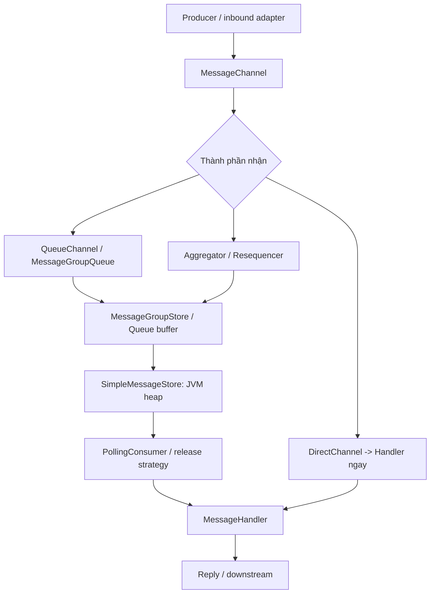
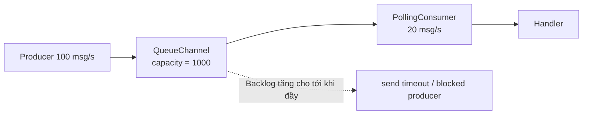
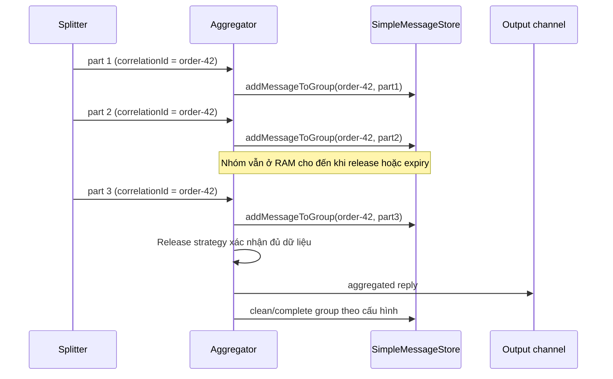

# SimpleMessageStore và giới hạn memory trong Spring Integration

## 1. Vai trò của SimpleMessageStore trong Spring Integration Runtime

Spring Integration vận chuyển `Message<?>` qua các channel, consumer endpoint, handler, poller và executor. Một số thành phần xử lý message **ngay khi nhận**; những thành phần khác cần **giữ message lại** vì consumer chưa sẵn sàng, vì phải gom đủ một nhóm correlation, hoặc vì phải chờ đến thời điểm tiếp tục xử lý.

`SimpleMessageStore` là một triển khai **lưu message trong bộ nhớ JVM** của Spring Integration. Nó đặc biệt hữu ích khi học, chạy thử, hoặc vận hành flow có tải nhỏ và có thể chấp nhận mất dữ liệu chưa xử lý sau khi process dừng. Việc lưu trong RAM tạo ra hai rủi ro:

- **Dữ liệu biến mất khi JVM/container bị dừng hoặc khởi động lại.** Không có bảo đảm durability chỉ vì message đã được đưa vào store.
- **Dữ liệu còn được tham chiếu trong heap sẽ không được GC thu hồi**, có thể làm heap tăng, gây GC pause và cuối cùng là `OutOfMemoryError`.

Bài **SimpleMessageStore và giới hạn memory**, thuộc chương **Message store** của `SPRING_INTEGRATION_RUNTIME`, giải thích cách đặt giới hạn lưu trữ, giới hạn nào thực sự được áp dụng, vì sao giới hạn số message chưa đủ để giới hạn dung lượng RAM và cách vận hành store trong flow có queue, aggregator, retry, transaction, correlation và lifecycle động.

**Kết quả học tập:**

1. Nhận biết các giao diện `MessageStore`, `MessageGroupStore` và `ChannelMessageStore`.
2. Hiểu constructor `SimpleMessageStore` và cách giới hạn riêng message/group.
3. Viết Java demo thêm, lấy, xóa message; mô phỏng tràn capacity.
4. Phân biệt bộ đệm `QueueChannel`, `MessageGroupQueue` và message group của aggregator.
5. Thiết kế monitoring, TTL/expiry, backpressure, persistent store và chiến lược recovery phù hợp với production.

Các API/ví dụ hướng đến **Spring Integration 6.x** (đối chiếu API 6.5), **Java 17+** và `spring-integration-core`.

## 2. Store nằm ở đâu trong runtime?

### 2.1. Hai nơi lưu message thường gặp



Ở đây có hai kiểu lưu phổ biến:

- **Message lưu riêng theo ID:** lưu và truy xuất qua `MessageStore.addMessage()`, `getMessage(UUID)`, `removeMessage(UUID)`.
- **Message thuộc một group:** lưu theo `groupId` qua `MessageGroupStore.addMessageToGroup()`, lấy qua `getMessageGroup()`; hữu ích cho aggregator, resequencer và queue có store nền.

Ví dụ `Aggregator` nhận các phần của một đơn hàng. Nó phải giữ `MessageGroup` của cùng `correlationId` đến khi đủ `sequenceSize`, timeout hoặc release strategy đánh dấu có thể phát kết quả. Nếu không xóa/expire nhóm đúng cách, cả payload lẫn headers vẫn chiếm heap.

### 2.2. So sánh các giao diện

| Giao diện / kiểu | Trách nhiệm chính | Ví dụ |
|---|---|---|
| `MessageStore` | Lưu/tra cứu message theo `UUID` | `addMessage`, `getMessage`, `removeMessage` |
| `BasicMessageGroupStore` | Lưu và đọc nhóm message theo key | `addMessageToGroup`, `getMessageGroup` |
| `MessageGroupStore` | Vận hành message groups với metadata, complete/expire, callback... | Aggregator, resequencer |
| `ChannelMessageStore` | Hợp đồng store có tối ưu/khả năng cho `QueueChannel` | `SimpleMessageStore`, các channel stores tương ứng |
| `MessageGroupQueue` | Adapter `BlockingQueue<Message<?>>` xây trên group store | Dùng với `QueueChannel(Queue<Message<?>>)` |
| `SimpleMessageStore` | Triển khai `MessageStore` và `MessageGroupStore` trong RAM | Demo/lưu message tạm thời |

`SimpleMessageStore` dùng cấu trúc dựa trên map trong bộ nhớ và triển khai cả `MessageStore`, `MessageGroupStore`, `ChannelMessageStore`. Nó không phải JDBC, Redis, MongoDB hay một broker durable.

**Không phải mọi buffer mặc định đều tạo một bean `SimpleMessageStore`.** Chẳng hạn `new QueueChannel()` có queue RAM mặc định; aggregator thông thường có message store trong bộ nhớ. Điều cần hiểu là **đều giữ tham chiếu trong heap**, dù triển khai cấu trúc cụ thể khác nhau.

## 3. Constructor và ba khái niệm capacity

### 3.1. Các constructor quan trọng

```java
SimpleMessageStore unlimited = new SimpleMessageStore();

SimpleMessageStore both100 = new SimpleMessageStore(100);

SimpleMessageStore separate =
        new SimpleMessageStore(500, 20);

SimpleMessageStore withWait =
        new SimpleMessageStore(500, 20, 200L);
```

| Constructor | Ý nghĩa trong Spring Integration 6.5 |
|---|---|
| `SimpleMessageStore()` | Không giới hạn capacity bằng bộ đếm message |
| `SimpleMessageStore(int capacity)` | Cùng một giá trị capacity cho message lưu riêng và **mỗi group** |
| `SimpleMessageStore(int individualCapacity, int groupCapacity)` | Đặt riêng giới hạn hai dạng lưu; giá trị nhỏ hơn 1 được xem là không giới hạn cho phần tương ứng |
| `SimpleMessageStore(int individualCapacity, int groupCapacity, long upperBoundTimeout)` | Thêm thời gian chờ (mili giây) khi phải đợi chỗ trống lúc chạm giới hạn |
| Constructor nhận `LockRegistry` | Cho phép cấu hình cơ chế lock phục vụ thao tác group đồng thời |

**Điểm đặc biệt quan trọng:** `individualCapacity` và `groupCapacity` **độc lập**.

- `individualCapacity = 500`: giới hạn số message được lưu theo đường `addMessage(message)`.
- `groupCapacity = 20`: giới hạn số message trong **mỗi message group**, khi lưu bằng `addMessageToGroup(groupId, message)`.
- Chúng **không phải** hai giá trị cùng áp cho tổng số message trong toàn store.
- Nếu có hàng nghìn group, mỗi group giữ tối đa 20 message thì tổng số message theo group có thể rất lớn.

Ví dụ `new SimpleMessageStore(100, 10)`:

| Tình trạng | Có thể tiếp tục lưu? |
|---|---|
| 99 message lưu riêng và muốn thêm message thứ 100 | Có, nếu không có xung đột ID hoặc điều kiện khác |
| 100 message lưu riêng và muốn thêm message thứ 101 | Vượt `individualCapacity` |
| Group A có 9 message và thêm 1 message | Có |
| Group A có 10 message và thêm 1 message | Vượt `groupCapacity` của A |
| Group A đã đủ 10 message, group B mới có 2 | Có thể tiếp tục thêm vào B |
| 50.000 group khác nhau, mỗi group 1 message | Không có hard limit **tổng số group** chỉ từ `groupCapacity=10` |

### 3.2. Capacity đếm message, không đếm byte

`individualCapacity = 100` chỉ giới hạn **số phần tử**, không đảm bảo “chỉ dùng dưới 100 MB”. Payload có thể là:

- Một `String` nhỏ vài chục byte.
- Một ảnh hoặc tập tin dạng `byte[]` nhiều MB.
- Một object graph lớn còn tham chiếu đến cache, collection, tài nguyên từ framework.
- Một message có nhiều headers hay dữ liệu tracing.

Ví dụ để ước lượng sơ bộ:

```text
Memory retained ~
  numberOfMessages * (payload retained size + headers + object/index overhead)
  + numberOfGroups * group metadata
  + queue/map/cache overhead
  + dữ liệu còn bị tham chiếu ở handler, executor, logs, retries...
```

Đây chỉ là mô hình ước lượng, không phải công thức chính xác của heap; object sharing, compressed pointers, GC và kiểu payload làm chi phí biến động đáng kể.

Ví dụ **20.000 groups × 50 message/group × 2 KB payload** tương đương khoảng **2 GB chỉ riêng dữ liệu payload** trước object overhead. Dù `groupCapacity=50`, toàn store vẫn có nguy cơ OOM nếu số group không được kiểm soát.

### 3.3. Điều gì xảy ra khi đầy?

Khi chạm capacity và cố lưu thêm message vượt giới hạn, store **không tự xóa message cũ**, **không tự đẩy message ra DLQ**, **không tự persist sang disk**. Tùy constructor và tình trạng có chỗ trống:

- Nếu không cho chờ hoặc chờ không đủ, thao tác lưu có thể **ném exception**.
- Với `upperBoundTimeout`, lời gọi có thể chờ chỗ trống tối đa khoảng timeout đã cấu hình.
- Nếu phía consumer không xóa message khỏi store hoặc group không bao giờ release, tăng timeout chỉ làm thread chờ lâu thêm.

Không nên mặc định mọi nơi gọi store đều có cùng exception ngoài cùng. `MessageStore` có thể báo lỗi ở cấp store; khi đi qua `QueueChannel`, poller hoặc handler, framework có thể bọc thành `MessagingException` hoặc xử lý theo nhánh error. Khi debug, đọc **root cause** và điều kiện đầy của buffer.

**Timeout chờ slot khác timeout của channel và poller**: `upperBoundTimeout` thuộc constructor của store; `MessageChannel.send(message, timeout)` thuộc channel; `PollableChannel.receive(timeout)` thuộc consumer; gateway `replyTimeout` thuộc caller đang chờ reply.

## 4. Thực hành 1: message lưu riêng theo ID

Ví dụ nhỏ này chỉ dùng `spring-integration-core` và `spring-messaging` có trong dependency graph. Nó không cần ApplicationContext hay poller.

```java
import org.springframework.integration.store.SimpleMessageStore;
import org.springframework.messaging.Message;
import org.springframework.messaging.support.MessageBuilder;

public class IndividualStoreDemo {

    public static void main(String[] args) {
        // 2 message lưu riêng; tối đa 2 message trong mỗi group.
        SimpleMessageStore store = new SimpleMessageStore(2, 2);

        Message<String> first =
                MessageBuilder.withPayload("order-A").build();
        Message<String> second =
                MessageBuilder.withPayload("order-B").build();
        Message<String> third =
                MessageBuilder.withPayload("order-C").build();

        store.addMessage(first);
        store.addMessage(second);

        System.out.println(store.getMessageCount()); // 2
        System.out.println(store.getMessage(
                first.getHeaders().getId()).getPayload()); // order-A

        // Cố thêm message thứ 3 vượt individualCapacity=2.
        try {
            store.addMessage(third);
            throw new AssertionError("Expected capacity failure");
        }
        catch (RuntimeException capacityFailure) {
            System.out.println("Cannot add third message: "
                    + capacityFailure.getClass().getSimpleName());
        }

        // Xóa một message để giải phóng slot.
        store.removeMessage(first.getHeaders().getId());
        store.addMessage(third);

        System.out.println(store.getMessageCount()); // 2
        System.out.println(store.getMessage(
                third.getHeaders().getId()).getPayload()); // order-C
    }
}
```

**Cách đọc:**

1. `MessageBuilder` tạo ba `Message<String>` có ID khác nhau.
2. `addMessage` đưa hai message đầu vào map trong RAM.
3. Lần lưu thứ ba vượt `individualCapacity`, nên bị từ chối khi không còn chỗ.
4. `removeMessage(id)` loại message theo ID; sau đó slot được giải phóng và có thể lưu tiếp.
5. `getMessageCount()` ở `SimpleMessageStore` báo số message của đường lưu riêng; để thống kê message trong groups cần xem group metrics riêng.

`MessageStore.addMessage()` có hợp đồng rằng lưu lại **cùng một message ID** nhiều lần là no-op; nó không phải lệnh enqueue lặp cùng ID. Nếu nghiệp vụ thật sự yêu cầu replay, tạo lại message có identity và idempotency strategy rõ ràng.

Demo dùng `catch (RuntimeException)` chỉ để cho thấy **hành vi overflow** ở mức học API; code production nên phân loại exception cụ thể theo framework version và context, tuyệt đối không gom mọi runtime exception thành lỗi “queue full”.

## 5. Thực hành 2: groupCapacity áp cho từng group

`SimpleMessageStore` cũng là `MessageGroupStore`. Một group có khóa nghiệp vụ, ví dụ `"batch-42"`, và chứa nhiều `Message<?>` cùng correlation.

```java
import org.springframework.integration.store.SimpleMessageStore;
import org.springframework.messaging.Message;
import org.springframework.messaging.support.MessageBuilder;

public class GroupCapacityDemo {

    static Message<String> part(String text) {
        return MessageBuilder.withPayload(text).build();
    }

    public static void main(String[] args) {
        // Dòng addMessage có capacity 1,
        // từng group riêng có capacity 2.
        SimpleMessageStore store = new SimpleMessageStore(1, 2);

        store.addMessageToGroup("batch-42", part("part-1"));
        store.addMessageToGroup("batch-42", part("part-2"));

        System.out.println(store.messageGroupSize("batch-42")); // 2

        try {
            store.addMessageToGroup("batch-42", part("part-3"));
            throw new AssertionError("Expected group capacity failure");
        }
        catch (RuntimeException capacityFailure) {
            System.out.println("Group full: "
                    + capacityFailure.getClass().getSimpleName());
        }

        // Group khác có giới hạn 2 RIÊNG, vẫn nhận được message.
        store.addMessageToGroup("batch-43", part("other-1"));
        System.out.println(store.messageGroupSize("batch-43")); // 1

        // Kết thúc bài thử: dọn message/group không còn cần dùng.
        store.removeMessageGroup("batch-42");
        store.removeMessageGroup("batch-43");
    }
}
```

Group A đầy không có nghĩa group B bị chặn. Điều này rất quan trọng khi một aggregator dùng `correlationId` khác nhau cho mỗi request: **groupCapacity chỉ chặn group quá lớn, không chặn số group mới**. Nếu sender tạo `correlationId` mới vô hạn hoặc missing release strategy khiến group không hoàn tất, heap vẫn tăng.

`MessageGroup` còn giữ metadata như group ID, timestamps, completeness và các cấu trúc collection/index. Ngay cả group không còn nhiều payload cũng có thể để lại chi phí nếu không được dọn theo lifecycle. Đừng chỉ theo dõi `messageGroupSize` của một key mà quên **số group toàn hệ thống**.

## 6. QueueChannel: giới hạn queue khác giới hạn SimpleMessageStore

### 6.1. Bounded QueueChannel không cần SimpleMessageStore

Đây là cách nhanh nhất tạo hàng đợi trong RAM với giới hạn số message:

```java
import org.springframework.integration.channel.QueueChannel;
import org.springframework.messaging.Message;
import org.springframework.messaging.support.MessageBuilder;

QueueChannel orders = new QueueChannel(2);

Message<String> first =
        MessageBuilder.withPayload("A").build();
Message<String> second =
        MessageBuilder.withPayload("B").build();
Message<String> third =
        MessageBuilder.withPayload("C").build();

System.out.println(orders.send(first, 0));  // true
System.out.println(orders.send(second, 0)); // true
System.out.println(orders.send(third, 0));  // false: queue đã đầy

System.out.println(orders.receive(0).getPayload()); // A
System.out.println(orders.send(third, 0));  // true: đã có slot
```

`QueueChannel(2)` cho queue RAM có capacity 2. Dùng `send(message, 0)` giúp **không chờ** khi queue đầy, trả `false`; `send(message)` mặc định có thể block đến khi có chỗ. Chương trình demo giả định không có consumer khác tranh chấp queue.

Giới hạn queue không bảo đảm không OOM nếu mỗi message rất lớn hoặc nếu hệ thống còn nhiều queue, message groups, HTTP buffers và executor tasks cùng chiếm heap.

### 6.2. QueueChannel đặt trên MessageGroupQueue

Một `QueueChannel` có thể dùng queue được backed bởi `MessageGroupStore` thông qua `MessageGroupQueue`:

```java
import org.springframework.integration.channel.QueueChannel;
import org.springframework.integration.store.MessageGroupQueue;
import org.springframework.integration.store.SimpleMessageStore;
import org.springframework.messaging.Message;
import org.springframework.messaging.support.MessageBuilder;

SimpleMessageStore memoryStore =
        new SimpleMessageStore(100, 3);

QueueChannel queued =
        new QueueChannel(new MessageGroupQueue(
                memoryStore, "orders.queue", 3));

queued.send(MessageBuilder.withPayload("ORD-1").build(), 0);
queued.send(MessageBuilder.withPayload("ORD-2").build(), 0);

Message<?> consumed = queued.receive(0);
System.out.println(consumed.getPayload()); // ORD-1
```

Mục đích của `MessageGroupQueue` là ánh xạ queue operations lên **một group có ID ổn định**; tham số capacity của queue và `groupCapacity` của store đều cần được hiểu khi áp dụng giới hạn. `MessageGroupQueue` có thể làm việc với store durable hoặc in-memory; **truyền `SimpleMessageStore` vẫn chỉ tạo queue RAM**.

Trong cấu hình XML, `QueueChannel` có thể khai báo `message-store` thay vì capacity trực tiếp:

```xml
<int:channel id="ordersQueue">
    <int:queue message-store="ordersStore"/>
</int:channel>

<bean id="ordersStore"
      class="org.springframework.integration.store.SimpleMessageStore">
    <constructor-arg value="100"/>
</bean>
```

Đoạn XML yêu cầu đã khai báo namespace Spring Integration và Spring Beans; đây là ví dụ thành phần cấu hình, chưa phải file XML hoàn chỉnh. Khi chỉ định `message-store`, không dùng thêm thuộc tính `capacity` trên cùng `<int:queue>`; capacity tương ứng cần được điều khiển bằng store/queue implementation và cấu hình thực tế.

### 6.3. Poller quyết định tốc độ lấy ra

`QueueChannel` là `PollableChannel`; consumer phía sau cần poller để kích hoạt handler. Một queue bounded với producer nhanh và poller chậm sẽ đầy.



Nếu tốc độ đến `λ` lớn hơn tốc độ xử lý `μ` đủ lâu, backlog tăng. Với ví dụ 100 msg/s đi vào và chỉ 20 msg/s ra, queue tăng khoảng **80 msg mỗi giây**, nếu không có cơ chế drop/throttle/scale. Giới hạn capacity chỉ khiến **sự quá tải xuất hiện có thể quan sát**, không tự sửa được chênh lệch tốc độ lâu dài.

**Phải thiết kế overload path:** áp dụng backpressure, tạm dừng producer, giảm kích thước burst, tăng consumer concurrency trong giới hạn tài nguyên, hoặc chuyển sang broker/persistent store theo nhu cầu reliability.

## 7. Aggregator, correlation và vòng đời của message group

### 7.1. Cơ chế giữ message theo nhóm

Aggregator thường giữ các message có cùng `correlationId` cho đến khi thỏa điều kiện release, chẳng hạn nhận đủ `sequenceSize` phần từ splitter.



Khi chưa có kết quả, mỗi group lưu lại các message và metadata. `groupCapacity` bảo vệ **mỗi group khỏi phình quá lớn**, nhưng nếu splitter tạo ra hàng trăm nghìn key khác nhau mà không đủ message để release, mỗi group có thể vẫn sống trong heap.

**Nguồn phát sinh group tăng bất thường:**

- Correlation strategy dùng mã không ổn định, mỗi message một key mới.
- Một số chunk bị mất hoặc gửi đến trễ, release strategy luôn chờ đủ.
- `sequenceSize` sai, không thể thỏa điều kiện hoàn tất.
- Group timeout/expiry chưa được cấu hình hoặc cấu hình chỉ đánh dấu, không dọn như kỳ vọng.
- Nhiều message không thuộc cùng request do header bị chuyển đổi, mapping sai hoặc không propagate correlation.
- Nhóm đã hoàn thành vẫn bị giữ theo chính sách cleanup/tombstone của aggregator.

### 7.2. Capacity không phải TTL

`SimpleMessageStore(100, 10)` **không** có nghĩa mỗi group được giữ trong 10 giây, được xóa sau 10 message, hay tự hết hạn sau 100 request. Hai tham số là **số message**, không phải thời gian sống.

Khác biệt giữa ba khái niệm:

| Khái niệm | Câu hỏi trả lời | Chủ thể chịu trách nhiệm |
|---|---|---|
| `groupCapacity` | Tối đa bao nhiêu message trong **một** group? | `SimpleMessageStore` |
| Release strategy | Nhóm đã đủ điều kiện tạo kết quả chưa? | Aggregator/resequencer |
| Expiry/cleanup | Khi nào nhóm hết hạn và sẽ bị xóa hay trả partial result? | Endpoint, message-group expiry/reaper và các callback được cấu hình |

`MessageGroupStoreReaper` là tiện ích kiểm tra và expire các nhóm theo thời gian, thông qua callback group expiry đã đăng ký. Cần cấu hình tần suất và hành vi expiry đúng với loại component; **không mặc định tự xóa mọi nhóm chỉ vì có một bean SimpleMessageStore**.

Ví dụ xử lý đơn hàng nhận tối đa năm phần: chọn `groupCapacity=5` vẫn không giải quyết trường hợp **một triệu orderId**, mỗi order chỉ có một phần. Cần group timeout, cleanup và giới hạn độ lớn tập các group đang mở ở cấp ứng dụng.

### 7.3. Release không luôn đồng nghĩa xóa sạch ngay

Một aggregator có thể được cấu hình đánh dấu group completed, phát partial result khi timeout, xóa group sau release hoặc giữ metadata để bảo vệ logic late arrival. Hành vi phụ thuộc `expireGroupsUponCompletion`, `groupTimeout`, `sendPartialResultOnExpiry`, `discardChannel` và release strategy ở endpoint thực tế.

Không tự gọi `removeMessageGroup(groupId)` trên một group đang được aggregator sử dụng: có thể làm mất dữ liệu hoặc tạo race condition. Hãy định nghĩa vòng đời từ **consumer của group**, rồi dùng monitoring để xác nhận message/group count giảm sau release hoặc expiry.

## 8. Vì sao vẫn có OutOfMemoryError dù đã đặt capacity?

### 8.1. Các nguồn giữ heap

`SimpleMessageStore` giữ tham chiếu đến `Message<?>`; một message lại có payload và headers. Dung lượng heap tiêu thụ không chỉ bằng số phần tử nhân kích thước payload:

- **Payload:** `byte[]`, JSON object graph, collection, dữ liệu binary hoặc DTO có tham chiếu con.
- **Headers:** correlation, reply/error channel reference, tracing và metadata khác.
- **Overhead:** `Message`, map entry, group object, index, lock và cấu trúc collection.
- **Số group:** mỗi group có ít message nhưng có thêm metadata riêng.
- **Bản sao/đối tượng trung gian:** transformer, serializer, logging, retry context, pending executor tasks.
- **Điểm tham chiếu ngoài store:** nếu handler/cache/queue khác còn giữ payload, xóa khỏi store chưa chắc giải phóng toàn bộ đối tượng.

Một message Java được xem là immutable ở cấp message wrapper, nhưng payload bên trong có thể là object mutable. Đổi payload từ nơi khác trong lúc store còn tham chiếu tới nó có thể tạo kết quả khó đoán và vấn đề thread-safety. Đừng dùng buffer memory làm nơi chia sẻ đối tượng mutable không kiểm soát.

### 8.2. Tính budget bằng giới hạn tổng thể

Ví dụ dự kiến:

```text
Số message lưu riêng tối đa:          1.000
Số group đang mở tối đa (từ hệ thống): 5.000
Số message/group tối đa:                 10
Tổng message có thể giữ:          ~51.000

Payload retained trung bình:           4 KB
Chi phí payload ước lượng:          ~204 MB
+ headers, index, metadata, duplicate references, GC headroom
```

Trong ví dụ, **`SimpleMessageStore` chỉ kiểm soát 1.000 message riêng và 10 message/group**. Mức **5.000 group** phải đến từ **quy tắc/giám sát bên ngoài**. Nếu group count tăng thành 50.000, ngân sách RAM thay đổi gấp nhiều lần dù constructor không đổi.

Để chọn giới hạn an toàn:

1. Đo payload retained size bằng profiling/heap analysis trên tải thật; không dùng `String.length()` làm số byte RAM.
2. Tính p95/p99 kích thước payload, không chỉ average.
3. Ước lượng lượng message chưa xử lý ở tải lớn nhất và thời gian backlog có thể chấp nhận.
4. Đặt queue/group capacities và số group đang mở phù hợp budget heap.
5. Giữ memory headroom cho application, class metadata, HTTP buffers, executor tasks và GC.
6. Chạy load/soak test và quan sát retained heap sau khi backlog được rút hết.

**Không chọn capacity bằng cách lấy toàn bộ `-Xmx` chia payload size.** Garbage collector và các thành phần còn lại của JVM cũng cần memory; nếu vận hành container, cần xét giới hạn memory container chứ không chỉ heap max.

### 8.3. Dấu hiệu rò giữ message

Nếu message đã được xử lý nhưng heap sau full GC vẫn tăng theo thời gian, có thể là:

- Group chưa được release hoặc expired.
- Nhóm completed/metadata không được cleanup.
- `QueueChannel` có consumer stop hoặc poller không chạy.
- Handler/flow khác giữ reference đến message, payload hoặc header.
- Retry/replay liên tục tạo message mới với correlation mới.
- Process có quá nhiều `IntegrationFlow` được đăng ký động mà không unregister bean/store.

Kiểm tra **số group**, **số message theo nhóm** và **queue backlog** cùng với heap dump/dominator tree. Không kết luận memory leak chỉ dựa vào GC trước khi các reference thực sự được thả.

## 9. Concurrency, LockRegistry và copyOnGet

### 9.1. Khi nhiều consumer cùng thao tác group

Hai thread có thể cùng add message tới một group, hoặc một thread release trong lúc thread khác gửi phần tiếp theo. `SimpleMessageStore` hỗ trợ đồng bộ hóa nhóm thông qua cơ chế lock của message group store; một số constructor nhận `LockRegistry` tùy chỉnh.

Ví dụ:

```java
import org.springframework.integration.store.SimpleMessageStore;
import org.springframework.integration.support.locks.DefaultLockRegistry;

SimpleMessageStore store =
        new SimpleMessageStore(
                100,                        // individualCapacity
                20,                         // groupCapacity
                100L,                       // upperBoundTimeout (ms)
                new DefaultLockRegistry()); // group operation lock registry
```

Với `SimpleMessageStore` in-memory, lock chỉ giải quyết phối hợp **các thread đang chia sẻ cùng instance/registry**. Nó không biến store thành distributed store và không giúp message sống qua restart. Khi scale nhiều replicas, mỗi JVM có memory store riêng; cùng `groupId` **không tự gom message giữa các pods**.

### 9.2. copyOnGet và nguy cơ sửa MessageGroup từ bên ngoài

Kể từ Spring Integration 4.1, `SimpleMessageStore.setCopyOnGet(false)` là mặc định. `getMessageGroup(groupId)` thường trả reference đến group mà aggregator đang thao tác thay vì tạo một bản sao lớn, giúp giảm thời gian/cấp phát trên các group nhiều message.

Đánh đổi:

- Đọc reference group từ code giám sát rồi **mutate trực tiếp** có thể phá trạng thái mà aggregator đang dùng.
- Duyệt collection ở nhiều thread khi group thay đổi có thể gây kết quả không nhất quán.
- Bật `setCopyOnGet(true)` có thể giảm rủi ro vô tình thao tác lên group sống, nhưng tăng overhead sao chép; không phải giải pháp thay cho thiết kế lifecycle/thread-safety.

```java
SimpleMessageStore store = new SimpleMessageStore(100, 20);
store.setCopyOnGet(true); // chỉ bật nếu có lý do đo được

// Khi theo dõi, ưu tiên API chỉ đọc:
// store.messageGroupSize(groupId)
// store.getMessageGroupCount()
```

Không để ứng dụng đọc group rồi tùy tiện xóa message qua reference collection. Thay đổi group qua API của store và theo quyền sở hữu của endpoint; tránh truy cập đồng thời trái với hợp đồng của component.

### 9.3. Lazy-load không phải giải pháp làm bộ nhớ “vô hạn”

`setLazyLoadMessageGroups(boolean)` là API liên quan đến biểu diễn `PersistentMessageGroup` và lazy loading. Không hiểu sai rằng bật lazy-load sẽ tự đưa payload từ RAM sang disk khi quá giới hạn. Đối với `SimpleMessageStore`, dữ liệu vẫn nằm trong JVM; lazy proxy không biến dữ liệu thành persistent.

## 10. Transaction, retry và độ bền dữ liệu

### 10.1. Memory store không có transaction durability

Khi một message nằm trong `SimpleMessageStore`, nó vẫn chỉ ở heap. Dù flow có `@Transactional` hay poller transaction advice, **rollback của database không thể phục hồi message đã biến mất do process crash**. Memory store không trở thành transactional durable store chỉ vì đang chạy trong một transaction.

Cần phân biệt:

| Sự kiện | `SimpleMessageStore` | Store durable/transactional được cấu hình đúng |
|---|---|---|
| JVM restart | Message trong RAM biến mất | Có thể phục hồi message đã commit |
| Consumer lấy message rồi lỗi | Tùy callback/flow, không có bảo đảm rollback bền vững | Có thể rollback thao tác lấy khỏi store |
| Một message được xử lý hai lần do retry | Vẫn có thể xảy ra | Vẫn có thể xảy ra nếu không idempotent |
| Thêm message vào store nhưng caller timeout | Message có thể vẫn tồn tại hoặc chưa lưu thành công | Cần truy vấn store và transaction state |
| Đột ngột hết heap | Có nguy cơ mất backlog | Store ngoài process có khả năng phục hồi, tùy consistency/ACK |

Spring Integration hỗ trợ nhiều persistent implementations như `JdbcMessageStore`, `JdbcChannelMessageStore`, Redis/MongoDB message stores. Với `QueueChannel` dựa trên transactional message group store và poller transaction, message lấy ra có thể **quay lại queue khi rollback**; hành vi này phụ thuộc store thật và ranh giới transaction, không phải mặc định của mọi store.

### 10.2. Chọn store theo pattern

- **Aggregator, resequencer, delayer:** thường cần `MessageGroupStore` phù hợp, correlation, release strategy, expiry và lock coordination.
- **QueueChannel:** cần store hỗ trợ queue semantics (`ChannelMessageStore`/`MessageGroupQueue`), có thể dùng `JdbcChannelMessageStore` hoặc implementation tương thích.
- **Message riêng:** `MessageStore` lưu/đọc theo ID khi use case cần.
- **High throughput/event streaming:** broker như Kafka/RabbitMQ có cơ chế persistence/acknowledgment riêng; không giả định thay trực tiếp bằng một bean `SimpleMessageStore`.

**Chỉ đưa store durable vào flow chưa đủ:** còn phải kiểm tra serialization, transaction boundaries, cluster locking, cleanup, throughput và monitoring.

### 10.3. Header replyChannel khi chuyển sang persistence

Message chứa `replyChannel`/`errorChannel` dạng đối tượng Java có thể không serialize/deserialize thành cùng instance khi dùng JDBC/Redis/MongoDB. Ví dụ gateway tạo temporary reply channel; sau khi lưu message qua database và restart, object reply channel cũ không còn hợp lệ.

Khi cần request-reply qua persistent queue:

1. Xác định có thực sự cần reply đồng bộ qua ranh giới restart hay không.
2. Dùng named channels/`HeaderChannelRegistry` và header enricher theo hướng dẫn Spring Integration nếu phải bảo quản return address.
3. Có timeout, dead-letter/correlation và cách trả kết quả trễ phù hợp.
4. Thử restart giữa lúc message còn chờ trong store.

Đừng dựa vào việc giữ nguyên object header in-memory để bảo đảm reply quay về caller sau khi khởi động lại.

## 11. Lifecycle và tác động lên vận hành IntegrationFlow

`SimpleMessageStore` là một bean hoặc object được endpoint dùng; nó không tự nhận message mới, tự poll hay tự start/stop flow. Người điều phối là channel, endpoint, poller, executor và `IntegrationFlowContext`/`SmartLifecycle`.

### 11.1. Khi stop endpoint

Khi một polling consumer dừng:

- Producer vẫn có thể gửi message vào `QueueChannel` nếu channel còn được dùng.
- Queue backlog tăng tới capacity.
- Nếu bounded queue đầy, `send()` có thể block hoặc thất bại theo timeout.
- Nếu unbounded memory buffer, heap có thể tăng không kiểm soát.
- Việc start lại consumer giúp lấy backlog ra nhưng không bảo đảm processing rate theo kịp producer.

Với aggregator không nhận đủ phần, group có thể tiếp tục chiếm heap ngay cả khi producer đã dừng. Cần xem expiry/correlation và group cleanup chứ không chỉ tình trạng consumer.

### 11.2. Dynamic IntegrationFlow và store bean

Khi đăng ký và hủy `IntegrationFlow` động, cần xác định lifetime của store:

- Store singleton dùng chung giữa nhiều flow có thể giữ state sau khi một flow bị unregister.
- Tạo store mới khi đăng ký lại flow sẽ mất state RAM cũ, trừ khi còn reference khác tới store.
- Group ID/queue ID dùng lại giữa flow có thể khiến state còn tồn tại bị diễn giải nhầm.
- Nếu có nhiều component cùng đọc/xóa một group store, phải định nghĩa ownership và cleanup rõ ràng.

Không coi `status` của metadata khóa học hay tên channel là trạng thái lưu trữ của runtime; cần quan sát bean và group thực sự.

## 12. Monitoring: cần đo gì để kiểm soát memory?

Những API cơ bản để đọc trạng thái:

```java
SimpleMessageStore store = ...;

long individuallyStored = store.getMessageCount();
int groups = store.getMessageGroupCount();
int groupedMessages = store.getMessageCountForAllMessageGroups();
int orderGroupSize = store.messageGroupSize("order-42");

System.out.printf(
        "individual=%d, groups=%d, grouped=%d, order42=%d%n",
        individuallyStored, groups, groupedMessages, orderGroupSize);
```

Trong ví dụ, các phép gọi có thể được dùng cho instrumentation trong ứng dụng; khi chuyển sang store khác, một số metric trong các interface được đánh dấu **optional** và có thể ném `UnsupportedOperationException`. Không viết monitoring chung mà giả định mọi backend đều hỗ trợ mọi metric giống nhau.

| Metric | Ý nghĩa | Dấu hiệu cần cảnh giác |
|---|---|---|
| `getMessageCount()` | Message lưu theo ID trong store | Tăng liên tục vì code không xóa |
| `getMessageGroupCount()` | Số nhóm trong group store | Nhiều nhóm không release/expire |
| `getMessageCountForAllMessageGroups()` | Tổng message thuộc các groups | Backlog aggregator/resequencer tăng |
| `messageGroupSize(key)` | Kích thước một group | Group cá biệt gần chạm capacity |
| `QueueChannel.getQueueSize()` | Số message đang chờ trong queue | Poller không kịp hoặc bị stop |
| `getRemainingCapacity()` | Chỗ trống của bounded queue | Gần 0 kéo dài |
| Heap used after GC, allocation rate | Bộ nhớ còn bị giữ và tốc độ cấp phát | Retained heap tăng, GC pause kéo dài |
| Consumer lag, poll count, processing latency | Tốc độ tiêu thụ và thời gian xử lý | Tốc độ đến lớn hơn tốc độ ra |
| Error-channel, retry, rejected send | Lỗi do tràn capacity hoặc downstream | Lỗi lặp, upstream retry bão hòa |

**Đo kết hợp, không đo đơn lẻ.** Heap tăng nhưng message count ổn định có thể do payload size tăng hoặc buffer khác. Message count tăng mà heap ít biến động có thể do payload nhỏ hoặc object sharing. Cần heap dump và queue/group metrics để xác định object graph nào giữ memory.

### 12.1. Alert và capacity planning

Một bộ alert đơn giản có thể dựa trên:

- Queue utilization vượt 70–80% trong nhiều phút, hoặc estimated time-to-full thấp.
- Số group tăng liên tục dù traffic đã giảm.
- Group age p95/p99 vượt business SLA.
- Heap after-GC tăng không giảm sau lúc backlog hết.
- Reject/send timeout hoặc `MessageStoreException` tăng nhanh.
- Consumer/poller stop ngoài kế hoạch, executor saturation.

Các ngưỡng chỉ là điểm khởi đầu để tune theo tải thực tế. Nếu message payload lớn đột biến, queue chỉ mới 50% capacity vẫn có thể tiêu thụ quá nhiều heap.

## 13. Bảng chẩn đoán sự cố

| Triệu chứng | Nguyên nhân dễ gặp | Cách xác minh / hành động |
|---|---|---|
| OOM dù đặt `groupCapacity` | Có quá nhiều group; mỗi group chưa vượt ngưỡng | Đo group count, group age, correlation strategy |
| OOM khi chỉ có 100 messages | Payload/header quá lớn, có bản sao khác | Profiling retained size, heap dump |
| `addMessage` bị từ chối | Hết `individualCapacity` | Đọc message count, đường xóa theo ID |
| `addMessageToGroup` lỗi ở một nhóm | Group cụ thể đạt `groupCapacity` | Xem group ID, release strategy, cấu hình ngưỡng |
| Store đầy dù consumer đã chạy | Tốc độ xử lý thấp hơn tốc độ đến; poller/retry chậm | Đo send/receive rate, queue depth, backoff |
| `send()` block lâu | Bounded queue/store đã đầy, producer chờ slot | Dùng send timeout, thread dump và metrics |
| Tất cả message biến mất sau restart | Store nằm trong RAM | Chuyển sang durable store nếu yêu cầu reliability |
| Có group completed nhưng RAM không giảm | Nhóm/metadata được giữ, expiry không dọn như kỳ vọng | Kiểm tra cleanup policy và callback reaper |
| Group A luôn không release | Correlation/sequence sai, mất một phần | Log group ID, size, expected sequence, timeout |
| Nhiều pods gom group thiếu dữ liệu | Các pod có SimpleMessageStore riêng | Distributed store/affinity/partitioning hợp đồng rõ |
| Sau khi chuyển JDBC, reply không trở về gateway | Temporary reply channel header không sống qua persistence | HeaderChannelRegistry/named reply channel |
| Poller có transaction mà RAM store vẫn mất dữ liệu | Transaction không tạo durability cho memory | Xác định store và transaction thực tế |
| CPU thấp nhưng request timeout | Thread đợi slot, queue tích backlog, poller stop | Thread dump, latency queue, lifecycle |
| Truy cập group từ monitoring gây lỗi bất thường | Thay đổi collection group sống khi `copyOnGet=false` | Chỉ đọc hoặc lấy snapshot, không mutate |

**Quy trình điều tra thực tế:**

1. Xác định **thành phần đang giữ message**: QueueChannel, aggregator, resequencer, delayer hay custom store.
2. Tìm instance `SimpleMessageStore` thực sự được inject; tránh đọc nhầm bean khác.
3. Đo message count, group count, kích thước/tuổi các nhóm lớn, queue depth.
4. Đối chiếu tốc độ message đến/ra, lifecycle endpoint, lịch poller, retry/backoff.
5. Xác nhận nguyên nhân lỗi: capacity overflow, timeout, lỗi nghiệp vụ hay exception của store backend.
6. Nếu memory bất thường, chụp heap dump và xác định **dominators/retained references**.
7. Đưa ra hành động theo nguyên nhân: release/expire group, điều tiết nguồn, giảm payload, tăng consumer hợp lý, giới hạn group count hoặc chuyển sang durable backend.

## 14. Bài tập thực hành

### Bài 1 — Individual capacity

Từ ví dụ mục 4, thay `SimpleMessageStore(2, 2)` bằng `SimpleMessageStore(3, 1)`. Dự đoán lúc nào lưu message riêng thất bại, rồi thử `removeMessage(id)` để tạo chỗ trống.

**Câu hỏi:** vì sao đổi `groupCapacity` không ảnh hưởng đến `addMessage` của bài thử này?

### Bài 2 — Nhiều groups, mỗi group nhỏ

Từ mục 5, tạo 1.000 group với mỗi group một message, dù `groupCapacity=2`. Quan sát group count và memory. Giải thích tại sao không group nào đầy nhưng heap vẫn tăng. Cuối bài, gọi `removeMessageGroup` cho các key vừa tạo.

### Bài 3 — QueueChannel đầy và send timeout

Tạo `new QueueChannel(2)`, gửi 3 message liên tiếp bằng `send(message, 0)` và ghi return value. Tạo consumer `receive(0)` lấy ra một message rồi gửi lại. So sánh với `send(message, 200)` nếu không có consumer; chú ý thời gian block và kết quả boolean.

### Bài 4 — Correlation sai

Mô phỏng 100 message cần gom thành 10 nhóm, nhưng mỗi message có `correlationId` khác nhau. Dự đoán kích thước/tổng số nhóm. Sau đó sửa correlation strategy để nhóm theo đúng request và cấu hình timeout/release phù hợp.

### Bài 5 — Expiry và cleanup

Tạo một nhóm chưa đủ phần, không gửi thêm message. Thiết kế chính sách `groupTimeout`/`MessageGroupStoreReaper` và kiểm tra group có được release, discard, lưu partial result hay xóa sau timeout. Quan sát group count sau đó.

### Bài 6 — Restart và transaction

Dùng `SimpleMessageStore` chứa message, restart process và quan sát mất state. Chuyển sang một `MessageGroupStore` durable có hỗ trợ transaction; thử poller rollback rồi redelivery, xác nhận chỉ tái xuất hiện khi ranh giới transaction được cấu hình đúng.

### Bài 7 — Đo hiệu năng và giới hạn heap

Đo memory với 1.000 message có payload 1 KB, sau đó với 1.000 message payload 1 MB; so sánh heap sau GC và tình trạng GC pause. Không thực hiện bài thử payload lớn trong môi trường production hoặc trên JVM có giới hạn heap thấp.

## 15. Các nguyên tắc cần nhớ

1. **`SimpleMessageStore` là in-memory store.** Nó không bảo đảm dữ liệu sống qua restart.
2. **Constructor không tham số là unbounded** theo số message; phải chủ động đặt giới hạn phù hợp.
3. **`individualCapacity` và `groupCapacity` áp dụng độc lập**; `groupCapacity` là giới hạn **theo từng group**.
4. **Capacity là số message, không phải byte.** Đặt thêm giới hạn payload size, số group và lifetime.
5. **Đầy capacity phải có chiến lược backpressure/error/recovery.** Không mặc định store tự evict hay tự retry.
6. **Queue và group có lifecycle khác nhau.** Queue cần consumer/poller; aggregator cần correlation, release và expiry.
7. **Không sửa MessageGroup từ reference đọc được** khi `copyOnGet=false` mà không bảo đảm locking/ownership.
8. **Transaction không biến RAM thành durable store.** Muốn rollback/persistence sau crash phải chọn backend phù hợp.
9. **Theo dõi heap cùng message/group metrics** và kiểm tra retained references khi thấy OOM.
10. **Trong môi trường nhiều replicas**, memory store không chia sẻ trạng thái; cần thiết kế phân vùng, định tuyến hoặc store phân tán.

Với `SPRING_INTEGRATION_RUNTIME`, mục tiêu không chỉ là “không để queue đầy” mà là biết **message đang bị giữ ở đâu, ai sẽ giải phóng nó, điều gì xảy ra khi hết bộ nhớ và cách recovery sau sự cố**. Đó là điều kiện để message flow có thể vận hành ổn định khi tải thay đổi.

## 16. Tài liệu Spring chính thức

- [Spring Integration 6.5 – SimpleMessageStore Javadoc](https://docs.spring.io/spring-integration/docs/6.5.0/api/org/springframework/integration/store/SimpleMessageStore.html): constructor, giới hạn `individualCapacity`/`groupCapacity`, `copyOnGet`.
- [Spring Integration 6.5 – Message Store](https://docs.spring.io/spring-integration/reference/6.5/message-store.html): message buffering, persistent implementations, warning về `SimpleMessageStore` và header serialization.
- [Spring Integration 6.5 – QueueChannel Javadoc](https://docs.spring.io/spring-integration/docs/6.5.0/api/org/springframework/integration/channel/QueueChannel.html): bounded queue, `send`/`receive`, queue size.
- [Spring Integration 6.5 – MessageGroupQueue Javadoc](https://docs.spring.io/spring-integration/docs/6.5.0/api/org/springframework/integration/store/MessageGroupQueue.html): queue backing bằng `BasicMessageGroupStore` và group ID.
- [Spring Integration 6.5 – MessageGroupStore Javadoc](https://docs.spring.io/spring-integration/docs/6.5.0/api/org/springframework/integration/store/MessageGroupStore.html): group metadata, số lượng group và expiry.
- [Spring Integration 6.5 – Configuring Message Channels](https://docs.spring.io/spring-integration/reference/6.5/channel/configuration.html): `QueueChannel` capacity và persistent message-store configuration.
- [Spring Integration 6.5 – Aggregator](https://docs.spring.io/spring-integration/reference/6.5/aggregator.html): correlation, release, group timeout/expiry và partial result.
