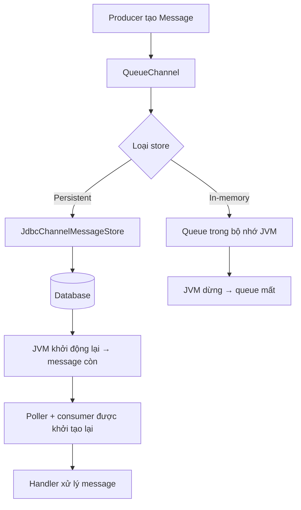
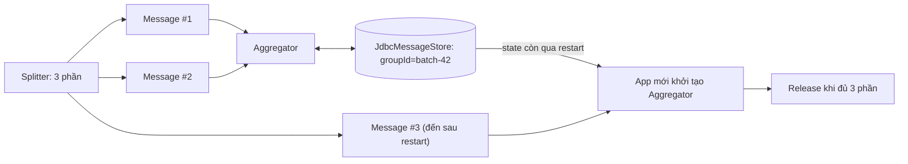

# Persistent MessageStore cho restart trong Spring Integration

## 1. Vì sao message store mặc định chưa đủ khi tiến trình dừng?

Trong Spring Integration, một message đi qua nhiều thành phần: **channel** nhận và chuyển message, **endpoint/consumer** thực hiện nghiệp vụ, **poller** lấy message từ kênh có khả năng polling, còn **executor** quyết định xử lý trên thread nào. Một số thành phần cần giữ message lâu hơn một lời gọi hàm: `QueueChannel` giữ công việc chưa được xử lý; **aggregator** giữ những phần chưa đủ điều kiện gộp; **resequencer** giữ các phần chưa thể phát theo thứ tự.

Nếu lưu trạng thái đó chỉ trong bộ nhớ JVM, khi ứng dụng restart, state đang chờ có thể biến mất:

- Message đã được đưa vào `QueueChannel` nhưng chưa kịp đến consumer.
- Một `MessageGroup` mới nhận 2/3 phần, còn phần cuối được gửi sau đó.
- Một nhóm resequencer nhận các sequence `1` và `3` nhưng chưa có `2`.
- Một error handler giữ message lỗi để điều tra/replay sau khi retry cạn.

**Persistent MessageStore** sử dụng kho lưu trữ bền vững như relational database hoặc Redis/MongoDB được cấu hình cho độ bền phù hợp, nhằm giữ message hoặc message group qua vòng đời của một tiến trình. Trong module **SPRING_INTEGRATION_RUNTIME**, đây là phần thiết kế quan trọng khi bàn về vòng đời IntegrationFlow, transaction, retry, correlation, polling và khả năng phục hồi runtime.

> **Ý chính:** Persistent store bảo vệ **dữ liệu được ghi và commit vào store**. Nó không tự tái tạo bean, IntegrationFlow động, thread, trạng thái transaction đang mở, TCP connection hay các side effect nằm ngoài store. “Message còn sau restart” và “nghiệp vụ xử lý đúng một lần” là hai bảo đảm khác nhau.

### Minh họa: cùng một queue, hai cách lưu



Sơ đồ giả định thao tác ghi message đã **commit thành công** trước khi JVM dừng và database vẫn hoạt động. Nếu ứng dụng dừng trước commit hoặc DB cũng mất dữ liệu chưa flush, không thể hứa sẽ khôi phục.

## 2. Ba loại store cần phân biệt

Spring Integration có một số giao diện và hiện thực khác nhau cho mục đích giữ message.

| Giao diện / loại | Phục vụ thành phần | Thông tin cần lưu | Ví dụ hiện thực |
| --- | --- | --- | --- |
| `MessageStore` | Lưu/truy xuất message riêng lẻ, claim-check và một số cơ chế khác | Message theo định danh | `SimpleMessageStore`, `JdbcMessageStore` |
| `MessageGroupStore` | Aggregator, resequencer và thành phần cần message group | Group key, thành viên, trạng thái nhóm | `SimpleMessageStore` / `JdbcMessageStore` tùy cấu hình |
| `ChannelMessageStore` | Queue channel có store | Message xếp theo queue/channel, thao tác đưa vào/lấy ra | `JdbcChannelMessageStore` |
| Kho lỗi do ứng dụng tự định nghĩa | Audit, dead-letter, replay có kiểm soát | Payload nghiệp vụ, nguyên nhân, attempt, trạng thái | Bảng `failed_messages` hoặc broker DLQ |

Một số implementation có thể hỗ trợ nhiều giao diện, nhưng **không vì cùng có từ “MessageStore” mà có thể thay thế tùy ý**. Ví dụ điển hình:

- Với **persistent `QueueChannel` trên JDBC**, dùng `JdbcChannelMessageStore`, lớp tối ưu cho hoạt động enqueue/dequeue của channel.
- Với **aggregator/resequencer cần persistent group**, dùng `JdbcMessageStore` hỗ trợ lưu và truy vấn `MessageGroup`.
- Với **`QueueChannel` mặc định**, message nằm trong memory. Một bean tên `messageStore` chưa được nối vào channel thì **không có tác dụng khôi phục**.

Cần kiểm tra cả tên channel, region/group ID, cấu hình store và dependency: store đã được tạo nhưng endpoint vẫn dùng default store là một lỗi cấu hình rất thường gặp.

### Bền vững là thuộc tính của toàn bộ đường đi

Có thể hình dung ba lớp bảo đảm:

1. **Storage durability:** message đã commit còn tồn tại khi restart ứng dụng hoặc host theo cơ chế lưu trữ.
2. **Processing reliability:** message bị lỗi được retry/rollback/requeue đúng chính sách.
3. **Business correctness:** replay không tạo hai hóa đơn, hai khoản thanh toán hoặc đảo thứ tự cập nhật.

Persistent store giải quyết chủ yếu lớp đầu tiên. Hai lớp sau cần transaction boundary, acknowledgment, idempotency, correlation và quan sát runtime.

## 3. Kịch bản thực tế: invoice queue sống qua restart

Giả sử dịch vụ nhận yêu cầu tạo hóa đơn. HTTP handler chỉ chuyển lệnh `CreateInvoiceCommand` vào channel có queue bền vững; worker poll định kỳ, ghi hóa đơn vào database.

```text
HTTP / Gateway
     |
     v
  MessageChannel.send()
     |
     v
  QueueChannel: durableInvoiceCommands
     |
     | enqueue vào JdbcChannelMessageStore → commit
     v
  Database: persistent channel rows
     |
     | polling (có transaction nếu được cấu hình)
     v
  Service Activator
     |
     v
  invoiceService.createInvoice(command)
```

Khi worker chưa poll mà tiến trình bị restart, message đã commit vẫn ở store. Sau khi Spring ApplicationContext được xây dựng lại, channel và consumer được đăng ký và poller hoạt động, message có thể được lấy ra để xử lý tiếp.

Điều kiện khôi phục gồm:

- **Database và schema** còn nguyên, connection hợp lệ.
- App mới dùng đúng tên channel, region và cấu hình store nhận diện các hàng đã lưu.
- Payload/header đọc được với code/serializer của phiên bản mới.
- Poller thực sự hoạt động; endpoint không bị dừng vì `autoStartup=false` hoặc chưa được đăng ký.
- Không có instance khác đã tiêu thụ message trước đó theo mô hình competing consumer.

Message có thể vẫn ở DB nhưng **không được xử lý** nếu một trong các điều kiện khởi tạo consumer/poller không thỏa.

## 4. Cấu hình persistent QueueChannel bằng JDBC

Spring Integration hỗ trợ `JdbcChannelMessageStore` trong module `spring-integration-jdbc`. Cách minh họa rõ ràng nhất là khai báo channel và store bằng XML namespace. Đoạn sau tập trung vào quan hệ giữa các bean; ứng dụng cần thêm XML namespace/schema và bean `dataSource` tương ứng.

```xml
<!-- Trích đoạn trong Spring context có namespace int:
     xmlns:int="http://www.springframework.org/schema/integration" -->

<bean id="invoiceChannelStore"
      class="org.springframework.integration.jdbc.store.JdbcChannelMessageStore">
    <constructor-arg ref="dataSource"/>

    <!-- Chọn SQL provider phù hợp với DB thực tế, ở đây là PostgreSQL -->
    <property name="channelMessageStoreQueryProvider">
        <bean class=
          "org.springframework.integration.jdbc.store.channel.PostgresChannelMessageStoreQueryProvider"/>
    </property>

    <!-- Giữ cố định qua restart để đọc lại vùng dữ liệu cũ -->
    <property name="region" value="INVOICES_V1"/>
</bean>

<int:channel id="durableInvoiceCommands">
    <int:queue message-store="invoiceChannelStore"/>
</int:channel>
```

Nếu cấu hình Java thay vì XML, API và method names cụ thể cần đối chiếu với Spring Integration version của dự án; cấu trúc vẫn gồm: `DataSource` → `JdbcChannelMessageStore` → `QueueChannel` → poller.

**Cần chuẩn bị trước khi chạy:**

1. Dependency `spring-integration-core` và `spring-integration-jdbc`; JDBC driver phù hợp database.
2. Schema bảng và index theo **DDL do đúng phiên bản Spring Integration JDBC cung cấp**. Không tự đoán cấu trúc bảng chỉ từ tên bean.
3. Bean `dataSource` có quyền ghi/đọc và connection pool phù hợp tải thực tế.
4. `PlatformTransactionManager` tương ứng cho poller/ghi nghiệp vụ nếu cần transaction.
5. Query provider phù hợp SQL dialect. Ví dụ PostgreSQL ở trên không dùng nguyên xi cho Oracle, SQL Server hoặc MySQL.

**Không dùng đồng thời `capacity` và `message-store` trong cùng `<int:queue>`.** Queue có message store bên ngoài không dùng giới hạn capacity trong memory giống queue thuần. Hãy kiểm soát áp lực bằng backlog, storage quota, rate limiting, cảnh báo và chính sách vận hành.

### Vì sao cần giữ cố định region và channel name?

Store thường dùng channel/group identity và **region** để phân tách dữ liệu. Nếu phiên bản triển khai mới đổi `durableInvoiceCommands` thành `invoiceCommandsV2` hoặc đổi `INVOICES_V1` thành một giá trị mới, message cũ có thể vẫn tồn tại trong DB nhưng consumer của bản mới không còn nhìn thấy.

Cần quy hoạch migration trước khi đổi tên bean/channel, prefix hoặc region; không “fix mất message” bằng cách đổi region ngẫu nhiên khi startup.

## 5. Poller và transaction quyết định message có bị xóa trước khi xử lý xong không

`QueueChannel` là một `PollableChannel`: producer gửi message, nhưng muốn xử lý cần một **polling consumer**. Một đoạn code cơ bản:

```java
import org.springframework.integration.annotation.MessageEndpoint;
import org.springframework.integration.annotation.Poller;
import org.springframework.integration.annotation.ServiceActivator;

@MessageEndpoint
public class InvoiceWorker {

    private final InvoiceService invoiceService;

    public InvoiceWorker(InvoiceService invoiceService) {
        this.invoiceService = invoiceService;
    }

    @ServiceActivator(
        inputChannel = "durableInvoiceCommands",
        poller = @Poller(fixedDelay = "1000", maxMessagesPerPoll = "5"))
    public void createInvoice(CreateInvoiceCommand command) {
        invoiceService.create(command);
    }
}
```

`InvoiceService` là service nghiệp vụ do ứng dụng cung cấp. Ví dụ này **chưa khai báo transaction cho poller**. `@ServiceActivator` chỉ xác định endpoint đọc queue; không nên suy luận mặc định dequeue, ghi invoice, retry và acknowledgment đã được bao trong một transaction.

Với cấu hình XML, có thể đặt transaction advice cho poller:

```xml
<!-- Lựa chọn thay thế cho @ServiceActivator ở ví dụ trên;
     không đăng ký cả hai consumer nếu không cố ý cạnh tranh lấy message. -->

<int:service-activator
        input-channel="durableInvoiceCommands"
        ref="invoiceWorker"
        method="createInvoice">
    <int:poller fixed-delay="1000" max-messages-per-poll="5">
        <int:transactional transaction-manager="transactionManager"/>
    </int:poller>
</int:service-activator>
```

Trong cấu hình có transaction hợp lệ:

- Poller bắt đầu transaction, lấy message từ channel store và gọi handler.
- Nếu exception **thoát ra khỏi phạm vi transaction** khiến transaction rollback, thao tác dequeue trên DB có thể rollback để message còn cho lần poll sau.
- Nếu handler xử lý thành công rồi transaction commit, thao tác lấy message được ghi nhận.
- Nếu handler **bắt exception rồi trả bình thường** hoặc recovery advice hấp thụ lỗi, transaction có thể commit; message được xem là đã xử lý ở tầng queue dù nghiệp vụ thất bại. Đây chỉ an toàn nếu recovery đã ghi state/DLQ đúng yêu cầu.

Sự phối hợp phụ thuộc transaction manager, cách store dùng connection, phạm vi advice và datasource. Với một DB dùng cho channel store và nghiệp vụ, có thể thiết kế cùng một local transaction. Với nhiều DB hoặc HTTP/broker bên ngoài, không có cam kết nguyên tử tự động.

### Phân biệt timeout

| Thuộc tính | Ý nghĩa |
| --- | --- |
| `fixedDelay`, `fixedRate` | Nhịp poll; không phải timeout khi handler đang chạy |
| `maxMessagesPerPoll` | Tối đa số message lấy trong một lần poll |
| Poller transaction timeout | Giới hạn transaction nếu transaction manager hỗ trợ |
| `receiveTimeout` / poll receive timeout | Thời gian chờ lấy message theo cấu hình endpoint/channel |
| Handler retry backoff | Khoảng chờ giữa các attempt; không làm message tự bền vững |
| Queue retention | Thời gian lưu trước xử lý/cleanup do thiết kế vận hành, không có TTL mặc định cho mọi store |

Không biến một `QueueChannel` thành một “scheduler trì hoãn” chỉ bằng cách tăng `fixedDelay`: muốn xử lý message ở thời điểm cụ thể hoặc hết hạn, cần thiết kế deadline/timestamp và chọn đúng cơ chế scheduling, filtering hoặc reaper.

## 6. Phân tích các cửa sổ crash

Persistent store cho restart chỉ có ý nghĩa khi xác định rõ **thời điểm tiến trình chết** so với các điểm commit.

| Thời điểm crash | Nếu dùng JDBC queue + transaction được cấu hình đúng | Việc cần kiểm chứng |
| --- | --- | --- |
| Trước khi enqueue được commit | Message có thể không tồn tại trong store | Producer có retry/confirm hay không |
| Sau commit enqueue, trước khi poll | Message còn trong DB | App mới đọc lại đúng channel/region |
| Sau khi poll nhưng trước commit dequeue | Rollback có thể đưa việc lấy message về trạng thái chưa tiêu thụ | Dequeue có nằm trong transaction không |
| Nghiệp vụ đã tạo side effect ngoài transaction, sau đó poll rollback | Message có thể được giao lại và side effect xảy ra hai lần | Idempotency key có bảo vệ side effect không |
| Dequeue commit thành công, app chết trước khi ghi đủ dấu vết thành công | Message đã được loại khỏi queue | Transaction boundary và outbox/inbox có phù hợp không |
| Hệ thống có nhiều instance cùng poll | Mỗi message cần được claim/consume đúng theo cơ chế DB | Query provider, locking, concurrency và duplicate |

Các bảo đảm trên có điều kiện: **message store dùng transaction thực tế** và database vẫn giữ dữ liệu sau crash. Một queue bền vững không cho phép khẳng định “exactly once end-to-end” khi flow chứa HTTP call, broker và database độc lập.

### Idempotency là lớp bảo vệ bắt buộc cho side effect

Giả sử thanh toán có khóa nghiệp vụ `paymentRequestId=PAY-123`. Consumer phải lưu trạng thái xử lý với unique constraint hoặc kiểm tra idempotency tại hệ thống nhận thanh toán để dù message được giao lại, không trừ tiền hai lần.

```sql
-- Ví dụ rút gọn trong database nghiệp vụ,
-- không phải schema nội bộ của Spring Integration.
CREATE TABLE processed_commands (
    command_id VARCHAR(100) PRIMARY KEY,
    processed_at TIMESTAMP NOT NULL
);
```

Chỉ dùng `SELECT` rồi xử lý mà không có cơ chế atomic/unique claim vẫn có race condition khi hai worker cùng nhận message. Trong luồng có nhiều side effect, cần quy tắc idempotency rõ ở **mỗi hệ thống đích**, có thể kết hợp transactional outbox.

## 7. Persistent MessageGroupStore cho aggregator và resequencer

`QueueChannel` chỉ giải quyết hàng đợi. Aggregator và resequencer có trạng thái **nhóm** riêng: chúng gom message theo `correlationId` và đợi `release strategy` quyết định khi nào phát output.

Nếu dùng store trong memory, restart có thể làm mất phần còn thiếu. Với `JdbcMessageStore` hoặc một `MessageGroupStore` bền vững khác, framework lưu group và thành viên qua tiến trình.



Ví dụ dùng Java DSL ở mức khái niệm:

```java
import javax.sql.DataSource;
import org.springframework.context.annotation.Bean;
import org.springframework.integration.dsl.IntegrationFlow;
import org.springframework.integration.jdbc.store.JdbcMessageStore;

@Bean
JdbcMessageStore aggregateStore(DataSource dataSource) {
    return new JdbcMessageStore(dataSource);
}

@Bean
IntegrationFlow aggregateParts(JdbcMessageStore aggregateStore) {
    return IntegrationFlow.from("incomingParts")
            .aggregate(spec -> spec.messageStore(aggregateStore))
            .channel("aggregatedResults")
            .get();
}
```

Ở ví dụ này, nguồn upstream phải cung cấp **sequence headers nhất quán**; nếu dùng splitter, framework thường gắn `correlationId`, `sequenceNumber` và `sequenceSize` cho chuỗi. Với ba phần có cùng correlation ID và sequence size 3, aggregator thường chỉ release sau khi nhóm đủ điều kiện theo strategy.

**Không lưu chỉ mỗi payload:** việc release đúng còn phụ thuộc header correlation, sequence, group metadata, release/expiry policy và code nghiệp vụ. Nếu bản mới đổi khóa correlation, nhóm cũ có thể không bao giờ nhận được message cuối cùng. Nếu `sequenceSize` sai, group có thể chờ mãi dù database đã lưu thành công.

### Resequencer và aggregator không có cùng đầu ra

- **Aggregator** thường tạo **một** output message cho mỗi lần release, ví dụ tổng tiền của 3 dòng.
- **Resequencer** phát **từng message** theo `sequenceNumber`, ví dụ thứ tự 1 → 2 → 3.

Cả hai đều có thể dùng `MessageGroupStore`, nhưng chiến lược release, giữ/loại group, xử lý late arrivals và output semantics khác nhau. Không tái sử dụng cùng một group namespace với các loại endpoint khác nhau nếu có nguy cơ khóa correlation đụng nhau.

## 8. Restart nhóm còn thiếu: điều gì được khôi phục, điều gì không?

Giả sử `batch-42` có `sequenceSize=3`, chỉ nhận `#1` và `#2` trước khi ứng dụng tắt.

1. Aggregator lưu `#1` và `#2` cùng thông tin nhóm vào persistent `MessageGroupStore`.
2. Ứng dụng dừng. Trạng thái Java trong memory mất, nhưng record đã commit còn trong database.
3. Ứng dụng mới tạo lại bean aggregator với **store và correlation strategy tương thích**.
4. `#3` đến cùng correlation ID; aggregator truy xuất nhóm cũ, thêm `#3` rồi đánh giá release.
5. Nếu điều kiện release đạt, output được gửi và group state được cập nhật/cleanup theo cấu hình.

**Nhóm còn trong database không có nghĩa nó tự release ngay lúc startup.** Thông thường, một message mới có thể kích hoạt xử lý group; nếu muốn timeout/expiry tác động đến group “mồ côi” sau restart, cần lên lịch tác vụ reaper/expiry hoặc cấu hình xử lý group timeout phù hợp và kiểm tra hành vi thực tế. Timer/scheduled task trong memory trước restart không phải một job bền vững được khôi phục tự động.

### MessageGroupStoreReaper và timeout

`MessageGroupStoreReaper` có thể hỗ trợ kiểm tra và expire những group quá hạn trong `MessageGroupStore`. Tuy nhiên, **expire không đồng nghĩa sẽ luôn phát partial result**:

- Có thể cấu hình chỉ discard nhóm.
- Có thể phát partial result theo yêu cầu nghiệp vụ và release strategy.
- Có thể giữ nhóm đã hoàn thành/metadata để nhận biết message đến trễ.
- Có thể cần cleanup riêng để không tích lũy group đã hết hạn.

Phải định nghĩa hành vi khi thiếu phần, message đến muộn, replay, message trùng và partial group trước khi bật reaper. Một timeout “cho chạy tiếp” có thể tạo kết quả nghiệp vụ sai nếu downstream coi partial result là kết quả đầy đủ.

### Lưu ý về replyChannel header

Message có `replyChannel`/`errorChannel` trỏ tới một object channel tạm thời, callback, anonymous reply channel hoặc kết nối in-memory. Qua restart, object đó có thể không serializable hoặc không còn tồn tại; **persistent message không có nghĩa reply path tồn tại**.

Với workflow dài, nên dùng tên destination ổn định, business correlation ID và một cơ chế trả kết quả bất đồng bộ (bảng trạng thái, webhook, event) phù hợp; đừng kỳ vọng kết quả cũ tự tìm lại được caller HTTP đã ngắt kết nối.

## 9. Lifecycle của IntegrationFlow và state bền vững

Spring Integration cho phép khởi tạo/dừng endpoint và quản lý flow trong application context. Nếu dùng `IntegrationFlowContext` đăng ký dynamic flow trong runtime, việc lưu message vào DB **không tự lưu lại mã/configuration của flow đã đăng ký**.

Sau restart cần:

- Tạo lại bean/channel/endpoint với định danh ổn định.
- Đăng ký lại các dynamic flows theo metadata/configuration do ứng dụng quản lý.
- Đảm bảo store được khởi tạo và schema migration hoàn tất trước khi poller bắt đầu tiêu thụ.
- Quyết định thứ tự startup/`autoStartup` để không poll khi dependency chưa sẵn sàng.
- Nếu dùng nhiều phiên bản app đồng thời, bảo đảm định dạng payload tương thích trong giai đoạn rolling deployment.

Ví dụ một `QueueChannel` còn 500 message ở database; deploy mới vô tình đổi channel name. 500 message **vẫn ở đó** nhưng metric queue của channel mới có thể bằng 0. Điều này là lỗi định danh/migration, không phải lỗi durability.

### Graceful shutdown và restart đột ngột

Graceful shutdown thường cho phép producer dừng tiếp nhận, chờ worker hoàn thành có giới hạn và commit/rollback transaction. Bất kể vậy, vẫn phải thử **kill process ngay giữa handler**, bởi mất điện, OOM hoặc container bị kill không tuân thủ chu trình đóng thông thường.

Để chạy integration test restart đúng nghĩa, cần ít nhất hai lần khởi động application context/process chia sẻ database thật; một unit test chỉ tạo mới object `SimpleMessageStore` trong cùng JVM không chứng minh persistence.

## 10. Multi-instance: dùng chung store không tự động bảo đảm đúng một lần

Khi nhiều instance cùng đọc persistent queue, hệ thống cần phối hợp để hai consumer không xử lý cùng message vượt quá delivery semantics đã chọn. `JdbcChannelMessageStore` sử dụng query/provider và transaction của database; khả năng cạnh tranh giữa poller phụ thuộc isolation, locking, SQL dialect và cấu hình thực tế.

Với aggregator/resequencer, hai node có thể đồng thời thêm phần vào cùng `MessageGroup` hoặc cùng kiểm tra điều kiện release. Ngoài persistent store, có thể cần `LockRegistry` phù hợp cho nhiều node (ví dụ dạng JDBC) để điều phối thao tác trên cùng group key. `DefaultLockRegistry` chỉ quản lý lock trong một JVM, không tạo đồng bộ liên tiến trình.

| Tình huống | Nguy cơ | Giải pháp/kiểm tra |
| --- | --- | --- |
| Hai poller đọc queue cùng DB | Duplicate claim hoặc contention | Dùng query provider và transaction đúng DB; test cạnh tranh hai instance |
| Hai aggregator cùng group | Lost update, release hai lần | Distributed `LockRegistry`, group key nhất quán, idempotent output |
| Một instance giữ message đang xử lý khi crash | Redelivery | Transaction rollback + idempotency |
| Rolling deploy đổi payload class | Deserialization error | Schema version, migration, backward compatibility |
| Một instance đổi region | Không thấy backlog cũ | Giữ region/channel identity và quy trình migration |
| Một node không chạy poller | Backlog lâu, nhìn như “mất message” | Liveness, endpoint running state, last poll timestamp |

**Không dùng local in-memory lock** để kết luận transaction an toàn trên cluster. Ngoài distributed lock, business layer vẫn cần chống duplicate ở nơi tạo side effect.

## 11. Serialization và schema evolution

Persistent store phải chuyển `Message<?>` từ object trong JVM thành dữ liệu có thể lưu. Một số vấn đề thường xuất hiện khi nâng version:

- Payload là domain object Java có field/class/package bị đổi và serializer cũ không đọc lại được.
- Header chứa object không tương thích serialization, ví dụ temporary channel, session hoặc service object.
- Message từ phiên bản cũ có schema version khác nhưng code mới không có migration.
- Code lưu dữ liệu bảo mật vào headers hoặc payload rồi tồn tại lâu hơn dự kiến.

Một thiết kế dễ phục hồi dùng **message payload dạng command bất biến, version rõ ràng**:

```java
public record CreateInvoiceCommand(
        String commandId,
        String invoiceId,
        String customerId,
        int schemaVersion
) implements java.io.Serializable {}
```

Ví dụ record chỉ minh họa shape dữ liệu; việc gắn `Serializable` không tự tạo một định dạng tương thích vĩnh viễn. Với hệ thống có rolling deployment hoặc lưu lâu, cân nhắc JSON/Avro/Protobuf với schema/version và codec được kiểm soát, đồng thời thử đọc **dữ liệu từ bản cũ bằng bản mới** trước mỗi rollout.

Đối với dữ liệu nhạy cảm, cần mã hóa at rest, giới hạn quyền DB, retention và hạn chế đưa token/PII vào message headers. Persistent store biến một object tạm thời thành dữ liệu có vòng đời dài hơn, vì vậy chính sách bảo mật và xóa dữ liệu cũng phải thay đổi.

## 12. Retry, error channel và nơi lưu message lỗi

Với `ExecutorChannel`, exception thường phát sinh trên worker thread và được framework publish dưới dạng `ErrorMessage` vào error channel phù hợp. Với `DirectChannel` đồng bộ, exception thường ném ngược về caller. Với poller có error handler, exception có thể được gửi đến error channel theo cơ chế của poller.

Nhưng:

- **`errorChannel` mặc định không phải persistent DLQ.** Một `PublishSubscribeChannel` có subscriber log lỗi không tự lưu message qua restart.
- **Retry advice** chỉ điều khiển số lần gọi lại handler; nó không làm message của handler tự động vào persistent queue.
- **Recovery callback** có thể gửi một `ErrorMessage` sang recovery channel riêng; nếu consumer chỉ log rồi trả về, hệ thống có thể coi lỗi đã được xử lý nhưng không có bản ghi bền vững.
- **DB-backed QueueChannel** có thể dùng để lưu bản ghi lỗi, nhưng nên chuẩn hóa thành một failure record có schema ổn định thay vì cố serialize mọi `Throwable`.

Ví dụ bản ghi dùng cho dead letter:

```java
public record FailedCommand(
        String failureId,
        String commandId,
        String sourceFlow,
        String errorCode,
        String errorSummary,
        String correlationId,
        int attemptCount,
        String failedAt,
        int payloadSchemaVersion
) implements java.io.Serializable {}
```

Nếu muốn replay, bản ghi cần đủ **business command gốc** hoặc một tham chiếu bền vững để lấy lại payload; chỉ giữ exception class và error summary không đủ để gửi lại yêu cầu.

Khi handler đã lấy message ra khỏi persistent queue, transaction commit vì recovery “thành công”, message nguồn có thể không còn. Hãy bảo đảm đường ghi failure record **đã commit an toàn trước hoặc cùng với quyết định xác nhận nguồn**, hoặc thiết kế idempotent outbox/reconciliation nếu liên quan nhiều hệ thống.

## 13. Capacity, hiệu năng và tuning

Persistent store chuyển một phần áp lực từ RAM sang DB, nhưng không xóa giới hạn năng lực hệ thống. Thường có thêm latency serialization, network, transaction log, row lock và index lookup.

### Thước đo cần theo dõi

| Metric | Nó giúp trả lời câu hỏi gì? |
| --- | --- |
| Queue backlog / group count | Bao nhiêu message/group đang đợi? |
| Oldest message age | Có message nào bị kẹt lâu hơn SLA? |
| Enqueue/dequeue duration (p50/p95/p99) | Store hoặc DB có trở thành bottleneck? |
| Poll rate, empty polls và poll lag | Poller có theo kịp producer? |
| Consumer success/failure/retry rate | Có lỗi tạo vòng lặp hoặc redelivery không? |
| DB pool usage, lock wait, deadlocks | Có tranh chấp transaction giữa instance? |
| Store row count/bytes và retention | DB có tăng mãi vì không cleanup? |
| Deserialization failures | Rolling deploy/schema evolution có phá dữ liệu cũ? |
| Group expiry, late messages và partial release | Aggregator có thể gộp sai hoặc giữ group vĩnh viễn? |
| Duplicate business key rate | Có side effect trùng sau retry/restart? |

Ước tính capacity thô cho queue: `số message tồn × kích thước payload serialize trung bình`, cộng metadata, index và overhead database. Đối với aggregator: `số group đang mở × số phần giữ trung bình × kích thước message`, cộng metadata group. Dung lượng thực tế nên đo từ dữ liệu production-like và kế hoạch retention, không chỉ công thức.

### Các trade-off vận hành

- Poll quá nhanh có thể tạo nhiều truy vấn rỗng; poll quá chậm làm backlog tăng.
- `maxMessagesPerPoll` quá lớn với transaction dài có thể tăng lock duration; quá nhỏ làm tăng overhead.
- Persistent store có thể giảm rủi ro mất message nhưng làm throughput thấp hơn queue memory; cần load test.
- Cleanup thiếu kiểm soát có thể xóa message đang cần replay; giữ mãi mọi message làm DB nở vô hạn.
- Nhiều node đọc chung group/store cần phân biệt **scale throughput** và **contend cùng một correlation key**.

Không dùng queue bền vững như một cách thay thế hoàn toàn cho flow control: producer có thể đẩy nhanh hơn consumer trong nhiều ngày khiến DB đầy, dù mọi message đều “persistent”.

## 14. Quy trình kiểm thử restart thực tế

Một lab đủ mạnh nên dùng **database thật với schema chuẩn** và hai lần chạy ứng dụng hoặc hai application context tách biệt, cùng trỏ đến store.

### Lab A: message còn trong queue khi restart

1. Cấu hình `durableInvoiceCommands` bằng `JdbcChannelMessageStore`, giữ cố định `region` và channel ID.
2. Cho producer gửi `commandId=INV-001`; đảm bảo thao tác enqueue đã commit.
3. **Dừng poller/consumer** (không gọi `receive()` để “xem”, vì đó là thao tác tiêu thụ).
4. Restart toàn bộ application process, không xóa DB.
5. Khởi động lại poller và kiểm tra handler nhận được `INV-001`.
6. Kiểm tra số lần xử lý theo business key và backlog trở về đúng trạng thái sau commit.

Kỳ vọng: **message đã commit còn sau restart và cuối cùng được xử lý**, với điều kiện store và worker được phục hồi đúng.

### Lab B: crash giữa xử lý

1. Gửi `INV-002` vào persistent queue.
2. Bật poller với transaction, cho handler cố ý ném exception sau khi đã đọc message.
3. Kill app trước commit, khởi động lại rồi quan sát message có được re-deliver.
4. Chạy cùng lab nhưng side effect là một API ngoài transaction; xác minh idempotency khi message được giao lại.

Kỳ vọng: rollback bảo vệ thao tác store nằm trong transaction. **Không kỳ vọng** external API side effect tự rollback.

### Lab C: aggregator lưu nhóm qua restart

1. Tạo ba message có `correlationId=BATCH-7`, `sequenceSize=3`.
2. Gửi phần `#1` và `#2` rồi xác minh group đã được lưu/commit.
3. Restart app, dùng lại cùng persistent `MessageGroupStore` và correlation strategy.
4. Gửi phần `#3`; xác nhận aggregator release đúng một nhóm dữ liệu.
5. Gửi thêm message đến trễ hoặc trùng; xác minh completion/expiry policy không gộp nhầm.

Kỳ vọng: group có thể hoàn tất sau restart; không đòi hỏi một scheduled timeout cũ trong memory tự sống lại.

### Lab D: migration và multi-instance

1. Lưu message bằng phiên bản ứng dụng A; đọc bằng phiên bản B sau khi thay đổi domain class.
2. Gửi tải đồng thời lên hai instance dùng chung store, mỗi instance có poller; kiểm tra duplicate và lock behavior.
3. Đổi tên channel/region trong môi trường thử nghiệm; quan sát backlog cũ không còn được tham chiếu và lên kế hoạch migration trước khi làm trên production.
4. Làm DB unavailable khi gửi/poll; xác minh exception, transaction rollback và đường error/alert đúng thiết kế.

### Các phép đo cần ghi lại cho mỗi lab

- Số message trước/sau restart theo store.
- Số lần handler chạy và số business operation thực sự commit.
- Correlation key, command ID, delivery/attempt count, timestamp.
- Trạng thái endpoint/poller sau startup.
- Thời gian enqueue/dequeue, queue age, retry và rollback.
- Lỗi deserialize, mất header, lỗi connection, trạng thái reaper/expiry.

## 15. Bảng chẩn đoán thường gặp

| Triệu chứng | Nguyên nhân phổ biến | Cách tìm đúng nguyên nhân |
| --- | --- | --- |
| Restart xong queue rỗng | Vẫn dùng in-memory queue, sai channel/region, enqueue chưa commit | Kiểm tra bean channel, store thực tế, các record DB và transaction |
| DB có record nhưng handler không chạy | Poller chưa startup, flow động chưa đăng ký, không có consumer | Kiểm tra `SmartLifecycle`, `autoStartup`, endpoint status, poll logs |
| Deserialize lỗi sau deploy | Payload class/schema/serializer không tương thích | Thử đọc record cũ bằng codec mới trong staging |
| Một message tạo hai hóa đơn | Crash/rollback/redelivery sau side effect | Trace business key; thêm unique constraint/idempotency |
| Aggregator không release dù còn group | Thiếu phần, sequenceSize/correlation sai, strategy thay đổi | Kiểm tra message group state và headers |
| Group không expire sau restart | Không có reaper hoặc scheduler không được cấu hình/khởi tạo lại | Kiểm tra lifecycle và lịch expiry |
| Multi-instance xử lý không ổn định | Lock/store/transaction không phù hợp cluster | Test cạnh tranh, kiểm tra distributed lock và DB provider |
| Error flow có log nhưng không có record lỗi | `errorChannel` chỉ log, recovery sink không persistent | Kiểm tra đường chuyển sang DLQ và độ bền khi commit |
| Store backlog tăng nhanh | Producer nhanh hơn consumer, poller chậm, DB lock hoặc downstream lỗi | Quan sát queue age, throughput, DB wait và retry rate |
| Đổi region khiến backlog “mất” | Record cũ vẫn thuộc region/channel cũ | So sánh khóa store trước và sau deploy, thực hiện migration |

Một câu hỏi vận hành quan trọng: **“Sau restart, dữ liệu đang nằm ở đâu, ai có trách nhiệm lấy ra, và sự kiện nào chứng minh xử lý đã commit?”** Trả lời được cả ba câu mới đủ để đánh giá recovery.

## 16. Checklist thiết kế trước production

- **Đúng store:** `JdbcChannelMessageStore` cho queue; `JdbcMessageStore`/`MessageGroupStore` cho aggregator hoặc resequencer; tránh mặc định in-memory.
- **Đúng danh tính:** channel name, region, group/correlation strategy ổn định qua deployment.
- **Có schema và compatibility:** DDL đúng version, codec/schema version, thử rolling deployment.
- **Có transaction:** xác định boundary enqueue/dequeue/handler và tình huống rollback; kiểm tra DB và broker khác nhau.
- **Có idempotency:** business key và unique handling cho message có thể re-deliver.
- **Có lifecycle:** endpoint, poller, dynamic flow, scheduler/reaper được khởi tạo lại.
- **Có error/recovery path:** lỗi ghi store, lỗi deserialize, retry exhausted và DLQ được quan sát, lưu hoặc cảnh báo phù hợp.
- **Có capacity plan:** backlog, oldest age, retention, storage, lock contention và load test.
- **Có test crash thật:** kill process giữa giao dịch, restart DB/app, hai instance cạnh tranh.
- **Có runbook:** tìm record chờ, khởi động lại poller, replay có kiểm soát, không tiêu thụ dữ liệu chỉ để debug.

## 17. Kết luận

Persistent MessageStore là nền tảng giúp Spring Integration khôi phục **message đang chờ** và **message group chưa hoàn tất** sau khi tiến trình dừng. Với queue JDBC, `JdbcChannelMessageStore` giữ dữ liệu cho `QueueChannel`; với aggregator/resequencer, `JdbcMessageStore` cung cấp persistence cho group. Hai trường hợp phục hồi khác nhau về cấu trúc state và điều kiện release.

Thiết kế restart an toàn phải đặt persistence trong bức tranh runtime đầy đủ: **channel → poller/endpoint → consumer → transaction → retry/error flow**. Store chỉ bảo đảm những gì thực sự được ghi và commit. Để tránh mất việc, xử lý trùng và nhóm bị treo, cần bổ sung định danh ổn định, khởi tạo lại flow, schema compatibility, locking khi nhiều instance, idempotency và thử nghiệm crash bằng database thật.

## Tài liệu tham khảo

- [Spring Integration Reference — JDBC Message Store](https://docs.spring.io/spring-integration/reference/jdbc/message-store.html)
- [Spring Integration Reference — Configuring Message Channels](https://docs.spring.io/spring-integration/reference/channel/configuration.html)
- [Spring Integration Reference — Aggregator](https://docs.spring.io/spring-integration/reference/aggregator.html)
- [Spring Integration Reference — Resequencer](https://docs.spring.io/spring-integration/reference/resequencer.html)
- [Spring Integration Reference — Transaction Support](https://docs.spring.io/spring-integration/reference/transactions.html)

