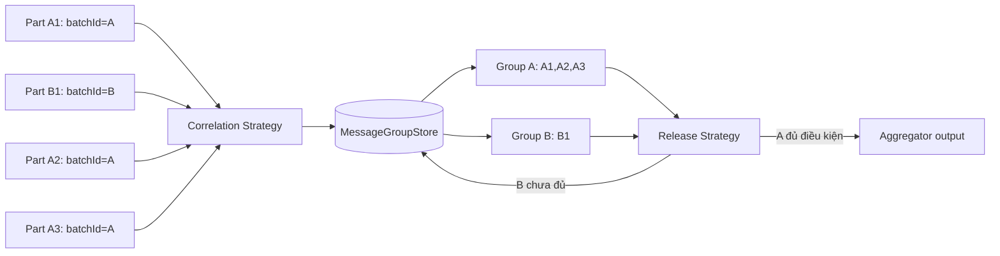
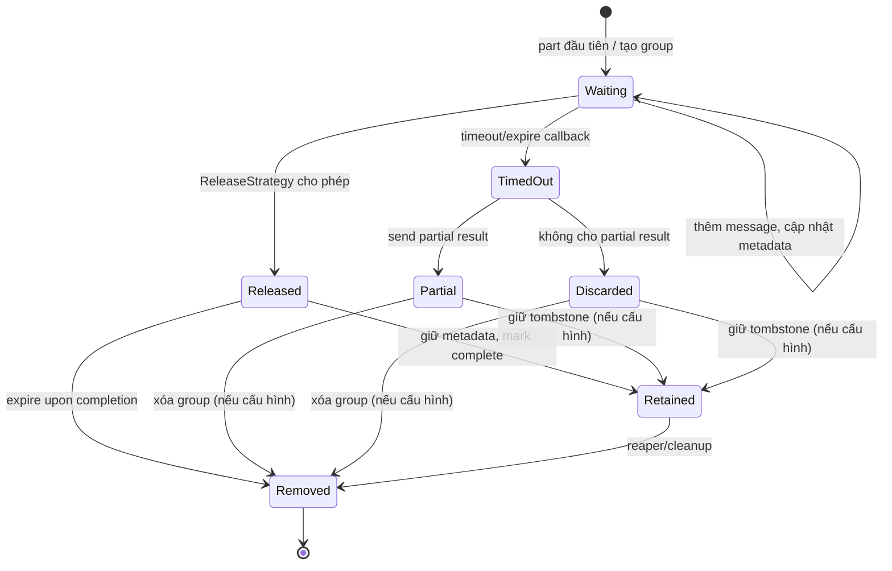
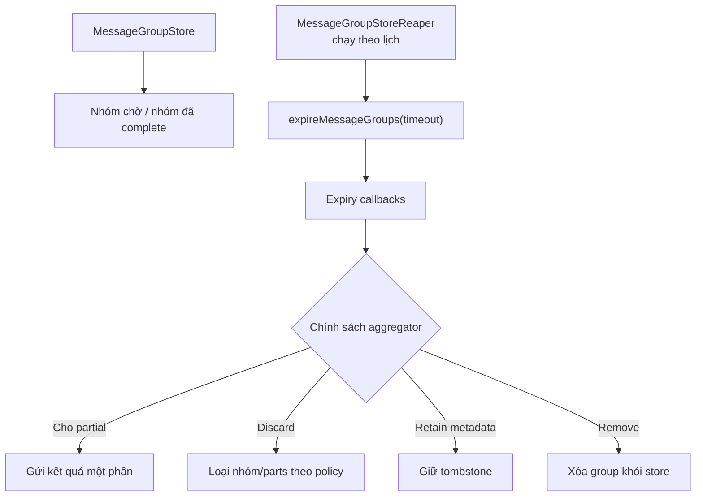

# MessageGroupStore và trạng thái nhóm trong Spring Integration Runtime

## 1. Khi nào message flow cần lưu trạng thái nhóm?

Hãy hình dung một yêu cầu đặt hàng được tách thành ba message kiểm tra giá, tồn kho và vận chuyển. Các message có thể chạy qua những channel, executor hoặc consumer khác nhau, đến không đúng thứ tự và cách nhau nhiều giây. Ứng dụng phải nhớ **message nào thuộc đơn hàng nào**, đã nhận bao nhiêu phần, có đủ điều kiện hợp nhất hay chưa và làm gì với phần còn đến muộn.

Trong module **SPRING_INTEGRATION_RUNTIME**, các endpoint stateful như **aggregator** và **resequencer** giải quyết bài toán này bằng một kho lưu trạng thái nhóm: `MessageGroupStore`. Kho này giữ các `MessageGroup` cho đến khi flow có thể release, discard hoặc expire chúng theo chính sách. Việc nhóm message là một phần của runtime: nó chịu ảnh hưởng của channel, endpoint, consumer, transaction, retry, message store, correlation key, thread và khả năng khôi phục sau restart.

Sau bài học, bạn có thể:

1. Phân biệt `MessageStore`, `MessageGroupStore`, `ChannelMessageStore` và `MessageGroup`.
2. Hiểu metadata của nhóm: group ID, size, creation time, last modified, complete, sequence size, last released sequence và condition.
3. Phân biệt **release** với **complete**, **retain metadata**, **expire** và **remove**.
4. Viết ví dụ đọc/ghi trạng thái bằng `SimpleMessageStore` và cấu hình aggregator dùng `JdbcMessageStore`.
5. Chọn cách xử lý timeout, nhóm thiếu message và message đến muộn.
6. Chẩn đoán concurrency, persistence, serialization, transaction, retry, throughput và trạng thái nhóm trong production.

Chủ đề thuộc chương **Message store**, tập trung trực tiếp vào **MessageGroupStore và trạng thái nhóm**. Ví dụ dùng Spring Integration các phiên bản 6.x làm định hướng; một số API/cấu hình có thể khác giữa những minor version, vì vậy nên đối chiếu với phiên bản dự án đang chạy.

## 2. Mô hình dữ liệu: một nhóm mang cả message lẫn metadata

`MessageGroupStore` không chỉ là một collection. Nó liên kết các message bởi **group ID** và lưu những thông tin để endpoint có thể đưa ra quyết định sau nhiều lần nhận.



Ở mức khái niệm:

```text
MessageGroupStore
 ├── groupId = "A"
 │    ├── messages = [A1, A2, A3]
 │    └── metadata = {createdAt, lastModified, complete, condition, ...}
 └── groupId = "B"
      ├── messages = [B1]
      └── metadata = {createdAt, lastModified, complete, condition, ...}
```

| Khái niệm | Vai trò |
| --- | --- |
| `Message<?>` | Một đơn vị dữ liệu và headers di chuyển trong flow. |
| `groupId` | Khóa liên kết những message cần xử lý cùng ngữ cảnh, thường lấy từ correlation header hoặc chiến lược tùy biến. |
| `MessageGroup` | Nhóm chứa message chưa được release cùng metadata của nhóm. |
| `MessageGroupStore` | Giao diện lưu/truy xuất các nhóm và thao tác với vòng đời của chúng. |
| `CorrelationStrategy` | Xác định message mới đi vào nhóm nào; bản thân strategy không thay thế store. |
| `ReleaseStrategy` | Quyết định thời điểm một nhóm đủ điều kiện release. |
| `MessageGroupProcessor` | Tổng hợp các message được release thành kết quả nghiệp vụ. |

**Ví dụ correlation:** ba message có `headers["orderId"] = "SO-42"` có thể cùng group `"SO-42"`. Nếu sender vô tình dùng `UUID` ở một nhánh và `String` ở nhánh khác, group ID có thể không bằng nhau dù cùng hiển thị một chuỗi trên log. Correlation contract cần quy định cả **tên header và kiểu giá trị**.

## 3. `MessageGroupStore` khác những loại message store nào?

Spring Integration có nhiều abstraction vì việc giữ một message riêng lẻ và việc giữ một **nhóm** có những ràng buộc khác nhau.

| Interface / implementation | Phạm vi chính | Trường hợp dùng |
| --- | --- | --- |
| `MessageStore` | Lưu/truy xuất `Message<?>` riêng lẻ theo message ID | Claim check hoặc các cơ chế cần lưu message độc lập. |
| `MessageGroupStore` | Lưu message theo group ID, metadata nhóm, thao tác complete/expire | Aggregator, resequencer và các stateful correlation endpoint. |
| `BasicMessageGroupStore` | API nhóm tối thiểu, gồm thêm/nhận/xóa nhóm và kích thước | Nền tảng cho những contract chuyên biệt khác. |
| `ChannelMessageStore` | Lưu message cho channel dạng queue có thể poll | `QueueChannel` với message store. |
| `SimpleMessageStore` | Store trong bộ nhớ, hỗ trợ các interface trên | Demo, test và workload không cần bền vững qua restart. |
| `JdbcMessageStore` | Store JDBC tổng quát, hỗ trợ message và message group | Aggregator/resequencer cần persistence. |
| `JdbcChannelMessageStore` | Store JDBC tối ưu cho channel polling | Queue backed by JDBC, có đặc tính ordering/receive riêng. |

Không nên thay `JdbcMessageStore` bằng `JdbcChannelMessageStore` trong một aggregator chỉ vì cả hai cùng có tên “JDBC store”. Spring Integration phân biệt **generic group persistence** và **channel-oriented polling storage**. Xem [JDBC Message Store](https://docs.spring.io/spring-integration/reference/jdbc/message-store.html).

Trong `SimpleMessageStore`, dữ liệu nằm trong memory của ứng dụng; restart làm mất những nhóm chưa được persist. `JdbcMessageStore` giúp duy trì nhóm trong database, nhưng durability còn phụ thuộc schema, serializer, transaction, việc restore endpoint và cách xử lý message trùng.

## 4. Những thuộc tính tạo nên trạng thái của `MessageGroup`

API `org.springframework.integration.store.MessageGroup` cung cấp các thông tin thường dùng:

| API | Ý nghĩa | Giá trị thực hành |
| --- | --- | --- |
| `getGroupId()` | Khóa correlation của nhóm | Tìm nhóm, trace, shard và lock. |
| `size()` | Số message hiện đang giữ trong nhóm | Đo backlog hoặc đánh giá điều kiện release. |
| `getMessages()` | Collection message hiện có | Xây kết quả từ payload; có thể tốn I/O trên persistent store. |
| `getTimestamp()` | Thời điểm nhóm được tạo, dạng epoch milliseconds | Phân tích tuổi nhóm. |
| `getLastModified()` | Thời điểm nhóm được cập nhật gần nhất | Quan sát nhóm ngừng tiến triển. |
| `isComplete()` | Nhóm đã được đánh dấu hoàn tất | Phát hiện late arrivals; không đồng nghĩa dữ liệu đã xóa. |
| `getSequenceSize()` | Số phần được kỳ vọng nếu có thông tin sequence; `0` nếu chưa xác định | Dùng trong một số release strategy. |
| `getLastReleasedMessageSequenceNumber()` | Số thứ tự cuối đã được release | Chủ yếu phục vụ resequencer/partial sequence. |
| `getCondition()` | Chuỗi điều kiện bổ sung, có thể `null` | Tối ưu quyết định release theo contract tùy biến. |

Những giá trị này phản ánh **state ở thời điểm đọc**. Với nhiều consumer hoặc nhiều JVM cùng truy cập store, thông tin có thể đổi ngay sau lệnh đọc; tránh dùng `size()` rồi thao tác riêng rẽ mà không có cơ chế đồng bộ nếu yêu cầu atomicity.

### 4.1. `complete` không đồng nghĩa `size() == 0`

Một nhóm có thể:

- Đang chờ thêm message và `isComplete() == false`.
- Đã đủ điều kiện release nhưng chưa xử lý thành công bước gửi output.
- Đã được release, message được loại khỏi nhóm, **nhưng metadata vẫn còn** để chặn message đến muộn.
- Đã bị xóa hoàn toàn khỏi store, không còn marker “nhóm này từng hoàn tất”.

Vì thế, **“nhóm rỗng”**, **“nhóm hoàn tất”** và **“không tồn tại nhóm”** là ba trạng thái khác nhau.

### 4.2. `condition` là metadata, không tự là rule engine

Từ Spring Integration 5.5, group có thể giữ một **condition dạng `String`**. `MessageGroupStore.setGroupCondition(groupId, condition)` đặt thông tin đó; một `ReleaseStrategy` hoặc processor do ứng dụng cấu hình mới quyết định cách hiểu nó.

Ví dụ condition `"expected=3"` có thể mô tả số phần cần nhận, nhưng framework không tự parse chuỗi đó và release nhóm. Nếu muốn tự động thay đổi condition theo message đến, các correlation handler có cơ chế `setGroupConditionSupplier(...)` ở những phiên bản hỗ trợ; cần thiết kế cách cập nhật khi nhiều message đến cùng lúc.

## 5. Vòng đời một nhóm: waiting → release/complete → retain/expire

Một mô hình hữu ích để quan sát lifecycle:



*Waiting, Released, Retained, TimedOut* trong sơ đồ là **tên trạng thái giải thích nghiệp vụ**, **không phải enum** trong API `MessageGroup`. API thực sự có cờ `isComplete()`, collection message và metadata khác; việc release là hành động của endpoint.

### 5.1. Release: nhóm đủ điều kiện phát kết quả

`ReleaseStrategy.canRelease(MessageGroup group)` trả `true` khi các message hiện có đáp ứng điều kiện:

```java
import org.springframework.integration.aggregator.ReleaseStrategy;
import org.springframework.integration.store.MessageGroup;

public class ThreePartReleaseStrategy implements ReleaseStrategy {
    @Override
    public boolean canRelease(MessageGroup group) {
        return group.size() >= 3;
    }
}
```

Đây là chiến lược đơn giản khi mỗi group mong đợi ba message hợp lệ. Trong production, cần chống duplicate và kiểm tra **đúng các phần** được yêu cầu; chỉ đếm ba message có thể cho release sai nếu một phần bị gửi lặp.

Với message từ splitter, các header `sequenceNumber` và `sequenceSize` hỗ trợ default release strategy (khi upstream cung cấp đủ sequence metadata). `getSequenceSize()` bằng `0` thể hiện kích thước sequence chưa biết, nên không thể suy ra số phần bắt buộc chỉ từ đó.

### 5.2. Complete: đánh dấu không còn nhận thêm

Sau khi tất cả các phần cần thiết được xử lý, endpoint có thể đánh dấu nhóm **complete**. Khi sử dụng store API trực tiếp, `completeGroup(groupId)` cập nhật trạng thái complete; nó **không tự gọi processor, không sinh output message và không thay cho aggregator**.

Một aggregator có thể giữ nhóm đã complete nhưng đã loại bỏ messages được release, tạo dạng **empty group metadata/tombstone** để phát hiện late-arriving messages có cùng group ID.

### 5.3. Remove / expire: bỏ cả dữ liệu lẫn dấu vết nhóm

`removeMessageGroup(groupId)` xóa group khỏi store theo semantics của implementation. Khi đó, nếu nhận message có cùng correlation key, aggregator có thể tạo **group mới** vì nó không còn biết nhóm cũ đã kết thúc.

Trong trường hợp cần chặn late arrivals, xóa ngay sau completion có thể sai nghiệp vụ. Ngược lại, giữ tombstone vô hạn làm store phình to.

## 6. Ví dụ Java: tạo, quan sát và đóng một nhóm

Đoạn code sau dùng `SimpleMessageStore` để hiểu trạng thái nhóm mà **không cần khởi tạo Spring ApplicationContext**. Nó là demo API store; release theo nghiệp vụ và gửi output sẽ được minh họa qua aggregator ở mục sau.

```java
import org.springframework.integration.store.MessageGroup;
import org.springframework.integration.store.MessageGroupStore;
import org.springframework.integration.store.SimpleMessageStore;
import org.springframework.messaging.Message;
import org.springframework.messaging.support.MessageBuilder;

public final class GroupStateDemo {

    public static void main(String[] args) {
        MessageGroupStore store = new SimpleMessageStore();
        String groupId = "SO-42";

        Message<String> pricing = MessageBuilder.withPayload("pricing-ok")
                .setHeader("orderId", groupId)
                .setHeader("partName", "pricing")
                .build();

        Message<String> inventory = MessageBuilder.withPayload("inventory-ok")
                .setHeader("orderId", groupId)
                .setHeader("partName", "inventory")
                .build();

        store.addMessageToGroup(groupId, pricing);
        store.addMessageToGroup(groupId, inventory);
        store.setGroupCondition(groupId, "expected=3");

        MessageGroup group = store.getMessageGroup(groupId);
        System.out.println("id=" + group.getGroupId());
        System.out.println("size=" + group.size());          // 2
        System.out.println("complete=" + group.isComplete()); // false
        System.out.println("condition=" + group.getCondition());
        System.out.println("created=" + group.getTimestamp());
        System.out.println("modified=" + group.getLastModified());

        Message<String> shipping = MessageBuilder.withPayload("shipping-ok")
                .setHeader("orderId", groupId)
                .setHeader("partName", "shipping")
                .build();

        store.addMessageToGroup(groupId, shipping);
        System.out.println("size-after=" + store.messageGroupSize(groupId)); // 3

        // Chỉ đánh dấu trạng thái của store; chưa sinh aggregator output.
        store.completeGroup(groupId);
        System.out.println("complete-after="
                + store.getMessageGroup(groupId).isComplete()); // true

        // Dọn dẹp thủ công sau khi ứng dụng xác định có thể xóa.
        store.removeMessageGroup(groupId);
    }
}
```

Ở đây `groupId` được truyền trực tiếp cho store. Trong flow thật, `CorrelationStrategy` xác định ID đó từ message; ví dụ header `"orderId"`. Khi đã complete, **không thêm message mới vào nhóm** chỉ vì vẫn giữ reference cũ tới `MessageGroup`.

**Cảnh báo về tính mutable:** `SimpleMessageStore` có `copyOnGet = false` theo mặc định. `getMessageGroup(...)` có thể trả về reference trực tiếp của group nội bộ. Việc tự chỉnh sửa group bằng `group.add(...)` hoặc `group.clear()` bên ngoài flow có thể làm trạng thái aggregator không nhất quán. Ưu tiên đi qua `MessageGroupStore` API và để endpoint quản lý lifecycle. Xem [Message Store](https://docs.spring.io/spring-integration/reference/message-store.html).

## 7. Ví dụ aggregator: group store điều phối release và late messages

Ví dụ XML bên dưới giả định application đã khai báo Spring Integration namespaces `int` và `int-jdbc`, có bean `dataSource`. Mỗi message phải có header `orderId`; ba phần khác nhau của một đơn hàng sẽ được ghép lại khi đủ ba message.

```xml
<int:channel id="partsIn"/>
<int:channel id="ordersOut"/>

<int-jdbc:message-store id="groupStore"
                        data-source="dataSource"/>

<int:aggregator id="orderAggregator"
                input-channel="partsIn"
                output-channel="ordersOut"
                message-store="groupStore"
                correlation-strategy-expression="headers['orderId']"
                release-strategy-expression="size() >= 3"
                expire-groups-upon-completion="false"
                group-timeout="15000"
                send-partial-result-on-expiry="false"
                expire-groups-upon-timeout="true"/>
```

**Điều gì xảy ra?**

1. Message `pricing(orderId=SO-42)` tạo group `SO-42` trong `groupStore`.
2. Message `inventory(orderId=SO-42)` làm group đó tăng lên hai phần.
3. Message `shipping(orderId=SO-42)` đưa nhóm lên ba phần và `ReleaseStrategy` cho phép xử lý.
4. Aggregator tạo kết quả theo processor/default aggregation strategy rồi gửi tới `ordersOut`. Nội dung kết quả phụ thuộc strategy (mặc định thường tổng hợp các payload).
5. Vì `expire-groups-upon-completion="false"`, framework có thể **giữ metadata nhóm hoàn tất** để message `SO-42` đến muộn bị discard theo chính sách.
6. Nếu nhóm chưa đủ trong timeout đã cấu hình, nhánh timeout được xử lý theo `send-partial-result-on-expiry` và `expire-groups-upon-timeout`. Ở ví dụ này, nhóm thiếu phần không phát partial result, sau đó bị expire; message cùng key đến muộn có thể bắt đầu nhóm mới.

**Đây là cấu hình minh họa chính sách**, chưa đủ để chạy production: phải tạo schema JDBC phù hợp phiên bản, cấu hình serializer/transaction manager, correlation contract, business processor, discard/error channel và kiểm thử duplicate/timeout.

Trong ví dụ, release condition chỉ đếm message. Nếu đã có `pricing` hai lần rồi `inventory` một lần thì size bằng ba nhưng chưa có `shipping`. Nên dùng business identity của từng phần hoặc sequence metadata kết hợp `ReleaseStrategy` chặt chẽ hơn.

### Default correlation và default release strategy

Nếu không cung cấp `correlation-strategy-expression`, aggregator thường dùng `IntegrationMessageHeaderAccessor.CORRELATION_ID`. Khi splitter tạo sequence headers phù hợp, framework có thể dựa vào `sequenceSize` và `sequenceNumber` để quyết định release.

Nếu upstream filter loại mất một phần của sequence, chiến lược chờ đủ sequence có thể **không bao giờ release**. Lúc đó cần chính sách timeout, compensation message hoặc custom release strategy.

## 8. Group metadata còn lại sau release dùng để làm gì?

Giả sử một đơn hàng cần ba kết quả và chúng đã đến đủ:

```text
10:00:00 Group SO-42: [pricing]                 waiting
10:00:02 Group SO-42: [pricing, inventory]      waiting
10:00:04 Group SO-42: [pricing, inventory, ship] release
10:00:04 Group SO-42: [] + complete=true        retain metadata
10:00:06 Part pricing bị gửi lặp (same groupId) discard late arrival
```

Nếu lựa chọn **remove group ngay** sau release:

```text
10:00:04 Group SO-42: removed
10:00:06 Part pricing trễ tới -> group SO-42 mới được tạo
```

Hệ quả là một group “mồ côi” có thể treo mãi hoặc tạo thêm kết quả không mong đợi khi các message khác bị redeliver. Quyết định giữ tombstone cần dựa vào **cửa sổ message đến muộn** và chính sách reuse group ID.

### Hai cờ dễ nhầm

| Cờ aggregator | Tác dụng | Tham khảo mặc định trên các bản 6.x |
| --- | --- | --- |
| `expireGroupsUponCompletion` | Xóa group sau **normal completion** hay giữ metadata complete để chặn late arrivals | `false` (giữ metadata). |
| `expireGroupsUponTimeout` | Xóa group khi bị buộc hoàn tất/expire do timeout và release strategy vẫn chưa cho release | `true` (xóa group). |

Thứ tự kiểm tra khi timeout quan trọng: framework có thể đánh giá release strategy thêm một lần trước khi quyết định partial release/discard. Nếu lúc đó release strategy đã cho phép release bình thường, cờ kiểm soát completion sẽ áp dụng theo semantics tương ứng. Xem [Aggregator](https://docs.spring.io/spring-integration/reference/aggregator.html).

**Không dùng cùng một correlation key lặp lại cho nhiều lần chạy nghiệp vụ độc lập** trừ khi bạn chủ động thiết kế version/epoch. Ví dụ `"orderId"` có thể cần kết hợp `"attemptGroupVersion"` nếu một đơn được xử lý thành nhiều batch qua nhiều ngày.

## 9. Timeout, reaper và dọn những nhóm tồn đọng

Một group có thể tồn tại mãi nếu không đủ message. `MessageGroupStore` cung cấp API `expireMessageGroups(timeout)` để tìm những nhóm hết hạn và gọi những **expiry callbacks đã đăng ký**. Việc hoàn thành, discard, release partial hay xóa được quyết định bởi các callbacks và cấu hình endpoint, không phải một thao tác xóa vô điều kiện.

`MessageGroupStoreReaper` là thành phần có thể được lên lịch để gọi cơ chế expire định kỳ.



### 9.1. Ví dụ khai báo reaper bằng Java

```java
import org.springframework.context.annotation.Bean;
import org.springframework.context.annotation.Configuration;
import org.springframework.integration.store.MessageGroupStore;
import org.springframework.integration.store.MessageGroupStoreReaper;

@Configuration
public class GroupExpiryConfiguration {

    @Bean
    public MessageGroupStoreReaper groupReaper(MessageGroupStore groupStore) {
        MessageGroupStoreReaper reaper = new MessageGroupStoreReaper(groupStore);
        reaper.setTimeout(60_000); // 60 giây; thời gian hết hạn gần đúng
        return reaper;
    }
}
```

Class `MessageGroupStoreReaper` có method `run()`. Cần **lên lịch gọi `run()`** (ví dụ qua `@Scheduled` hay scheduler của Spring) nếu muốn quét định kỳ; chỉ khởi tạo bean không chứng minh scheduler sẽ tự gọi theo chu kỳ bạn mong muốn.

Thời gian hết hạn **không chính xác đến từng mili giây**: nếu timeout 60 giây nhưng reaper mỗi 5 phút mới chạy, nhóm có thể tồn tại lâu hơn trước khi bị quét. Đồng thời phải phân biệt cơ chế `groupTimeout` trên từng aggregator group với một reaper quét nhiều group theo lịch.

### 9.2. Không dùng một store chung tùy tiện cho nhiều aggregators

Một `AbstractCorrelatingMessageHandler` có thể đăng ký expiry callback lên store của nó. Nếu nhiều aggregator/resequencer **cùng dùng một instance store** rồi reaper expire nhóm, callback thuộc endpoint này có thể bị áp cho nhóm của endpoint khác. Framework có kiểm soát/giới hạn ở những phiên bản hỗ trợ, nhưng thiết kế an toàn thường là **tách store/logical region theo lifecycle của từng stateful endpoint** hoặc quản lý routing/expiry thật rõ ràng.

### 9.3. Cleanup nhóm đã complete

Để chống late arrivals, nhiều flow giữ empty complete groups, rồi dọn sau một khoảng đủ dài. Cân nhắc cấu hình `minimumTimeoutForEmptyGroups`/`empty-group-min-timeout` theo phiên bản và endpoint, hoặc một cơ chế cleanup riêng được kiểm soát. Nếu xóa tombstone quá sớm, duplicate cũ có thể tạo group mới. Nếu không xóa, số groups tăng dù số messages đang chờ bằng 0.

Đo **active group count** và **empty complete group count** riêng nếu monitoring cho phép, thay vì chỉ xem tổng message count.

## 10. Persistence: `SimpleMessageStore` và `JdbcMessageStore`

### 10.1. Chọn store theo tính chất runtime

| Đặc tính | `SimpleMessageStore` | `JdbcMessageStore` |
| --- | --- | --- |
| Nơi lưu | Bộ nhớ JVM | Database quan hệ. |
| Qua restart | Thường mất state | Có thể khôi phục state nếu cấu hình đúng. |
| Latency cơ bản | Thấp, local | Có I/O, serialization, network DB. |
| Nhiều JVM cùng dùng | Không chia sẻ tự động | Có thể cùng truy cập DB nhưng cần quản lý lock và concurrency. |
| Transaction | Không đồng nghĩa rollback DB | Có thể tham gia transaction JDBC nếu cùng resource/manager phù hợp. |
| Khả năng chứa group lớn | Bị giới hạn bởi heap | Bị giới hạn bởi DB, index, serializer và truy vấn. |
| Use case | Demo, test, workload không cần durability | Aggregation dài, khôi phục sau restart, yêu cầu lưu bền. |

**JDBC không tự tạo exactly-once.** Giả sử aggregator đã gửi output sang broker thành công, nhưng transaction cập nhật trạng thái nhóm rollback hoặc caller retry. Group có thể được release lại, tạo duplicate output. Đầu ra nên có business/event ID, downstream idempotent và transaction/outbox phù hợp.

### 10.2. Schema và serialization

`JdbcMessageStore` yêu cầu các bảng/index theo schema Spring Integration tương ứng database và phiên bản. Thư viện cung cấp những script mẫu để khởi tạo. Mặc định, message payload/header cần **serialize được** theo chiến lược store; có thể xảy ra lỗi hoặc mất header không serializable.

Cẩn thận với các header mang Java object cục bộ như `replyChannel` và `errorChannel`, các đối tượng không serializable, class thay đổi giữa những lần deploy, payload quá lớn và thông tin nhạy cảm. Với reply channel nội bộ, có thể cần `HeaderChannelRegistry`/channel name mapping tùy kiến trúc; một local channel reference không tự tồn tại qua restart hay qua nhiều instance.

Nếu có thể, chỉ lưu dữ liệu nghiệp vụ ổn định, ít phụ thuộc implementation detail của Java class. Đưa những blob lớn ra object storage hoặc hệ thống chuyên dụng, rồi lưu tham chiếu có kiểm soát trong payload/group.

### 10.3. Lazy-load và metadata-only

Persistent group store có thể tải message theo kiểu **lazy**; việc gọi `getMessageGroup(groupId)` để kiểm tra metadata thường khác với truy cập `group.getMessages()` phải tải toàn bộ message. Khi cần chỉ biết groupId, size, complete và thời gian, cân nhắc `getGroupMetadata(groupId)` nếu implementation hỗ trợ hiệu quả.

Điều này quan trọng khi một group có 100.000 message: strategy chỉ kiểm tra `size()` có thể nhẹ hơn strategy liên tục duyệt tất cả payload mỗi lần có message mới.

## 11. Concurrency: nhiều message cùng correlation đến đồng thời

Nếu hai consumer cùng thêm message cho group `SO-42`, bạn cần bảo vệ thao tác:

```text
Worker-1: read group size=2
Worker-2: read group size=2
Worker-1: add part P3 → size=3
Worker-2: add part P4 → size=4
```

Nếu release/check/update không đồng bộ đúng, output có thể bị phát hai lần hoặc metadata bị lệch. Spring Integration sử dụng **`LockRegistry`** để điều phối xử lý group theo correlation key trong những correlation handler phù hợp:

- Trên một JVM, registry local có thể đồng bộ các thread cùng group.
- Trên nhiều JVM cùng dùng persistent store, cần **shared/distributed lock registry** phù hợp, kết hợp transaction và cơ chế concurrency của backend.
- Khóa trên group không thay thế unique constraint, idempotency và atomic update ở database/broker.
- Timeout/forceComplete chạy đồng thời với message đến cũng cần đi qua cơ chế đồng bộ trạng thái.

Các phiên bản hiện đại của `AbstractMessageGroupStore` có hỗ trợ cấu hình `LockRegistry` cho thao tác metadata nhóm; kiểm tra API của phiên bản đang sử dụng. Xem [Message Store](https://docs.spring.io/spring-integration/reference/message-store.html).

### `copyOnGet` và việc chỉnh sửa group bên ngoài

Với `SimpleMessageStore`, default `copyOnGet=false` giúp giảm chi phí copy group lớn, nhưng cũng có nghĩa nhóm đọc từ store có thể là cùng object mà aggregator đang dùng. **Không gọi `MessageGroup.add/remove/clear` trực tiếp trong monitoring code**. Khi cần sửa state, dùng API store hoặc luồng xử lý chính thức, và bảo đảm concurrency/locking phù hợp.

## 12. Kết hợp transaction, retry và error handling

`MessageGroupStore` lưu trạng thái; nó **không tự mở transaction, retry hay gửi ErrorMessage**. Những cơ chế runtime này cần cấu hình ở surrounding endpoint và backend.

### 12.1. Khi cập nhật nhóm thất bại

Ví dụ một message đã đến aggregator:

```text
Receive M-3 → tìm group SO-42 → lưu M-3 → kiểm tra ReleaseStrategy
         ├── DB/store exception
         ├── ReleaseStrategy exception
         └── Processor / gửi output exception
```

Những lỗi này có thể xảy ra ở **giai đoạn khác nhau**. Có lúc message đã persist nhưng output chưa được gửi; có lúc output đã đi mà commit DB chưa hoàn tất. Vì vậy, retry ở consumer khác với redelivery từ broker, và việc phát lại có thể làm nhóm nhận duplicate.

**Câu hỏi phải trả lời:**

1. Thao tác lưu group và ack message nguồn có cùng transaction không?
2. Release output có cùng transaction với cập nhật group state không?
3. Error được truyền tới caller đồng bộ hay qua `errorChannel` ở executor/poller?
4. Retry advice bao quanh **handler**, **aggregator**, hay **poller**; mỗi lần retry có receive lại message không?
5. Khi worker restart, có phải rebuild/expire orphaned groups không?

### 12.2. Thread boundary

`DirectChannel` thường gọi subscriber trên thread sender. Nếu transaction được mở trước khi send, các thao tác đồng bộ phía sau có thể tham gia transaction đó nếu dùng resource/propagation tương thích.

`ExecutorChannel` tạo bước chuyển sang thread khác; transaction upstream thường không tự đi theo worker. `QueueChannel` cùng poller cũng tách việc send và việc consume. Nếu aggregator nằm sau boundary async, cần xem transaction của **consumer worker** chứ không suy luận nó đang dùng transaction của producer.

### 12.3. Recovery và message tới muộn

Nếu một phần bị dead-letter sau khi retry cạn, group có thể thiếu mãi phần đó. Cần policy timeout/partial release, compensation message hoặc cleanup. Khi lỗi được phục hồi bằng replay, nên bảo đảm **part ID** ổn định để loại duplicate và quyết định có chấp nhận message đến muộn hay không.

Không coi việc một ErrorMessage đã được gửi thành công là bằng chứng group đã commit hoặc source đã ack. Theo dõi error flow và transaction completion riêng biệt.

## 13. Resequencer cũng dựa trên trạng thái nhóm

Aggregator và resequencer đều cần correlation, nhưng mục tiêu khác nhau:

| Endpoint | Quyết định dựa trên group | Ý nghĩa của state |
| --- | --- | --- |
| Aggregator | Chờ đủ message rồi tạo một kết quả tổng hợp | Group chứa các phần chưa được xử lý chung. |
| Resequencer | Chờ message đến đúng thứ tự trước khi release theo sequence | Theo dõi sequence size, số thứ tự đã release gần nhất và các khoảng trống. |

`MessageGroup.getLastReleasedMessageSequenceNumber()` và `MessageGroupStore.setLastReleasedSequenceNumberForGroup(...)` phục vụ tình huống resequencer. Chúng **không phải** biến đếm retry hoặc số nhóm đã release của aggregator.

Một resequencer có thể release những sequence liên tục đã nhận được trước khi toàn bộ sequence kết thúc (tùy cấu hình), trong khi aggregator tạo kết quả từ group. Khi lưu state bền vững, cần chú ý cả nhóm còn messages lẫn metadata last released để sau restart không phát lại sai thứ tự.

## 14. Observability: những con số cần theo dõi

| Metric/khái niệm | Ý nghĩa | Rủi ro nếu chỉ xem riêng metric này |
| --- | --- | --- |
| Số group đang tồn tại | Số correlation contexts trong store | Có thể bao gồm nhiều empty complete groups. |
| Tổng message đang lưu | Backlog của các group chưa xử lý hết | Có thể thấp dù số tombstone tăng. |
| Group size theo percentiles | Nhóm lớn nhất, p95, p99 | Nhóm lớn có thể do thiếu release condition hoặc duplicate. |
| Tuổi group / last modified age | Nhóm chờ bao lâu và bao lâu không nhận phần mới | Cần phân biệt waiting group và tombstone. |
| Complete vs incomplete count | Trạng thái lifecycle | Complete không đồng nghĩa output đã được downstream commit. |
| Timeout/expired group rate | Nhóm không đạt release đúng hạn | Có thể do missing source part hoặc backpressure. |
| Late arrival/discard rate | Message đến sau khi group hoàn tất | Tăng có thể do retry/redelivery, network delay hoặc timeout quá ngắn. |
| Store query latency / load bytes | Chi phí JDBC/Redis/Mongo | Group lớn khiến lazy load hoặc full scan đắt đỏ. |
| Group lock wait / contention | Nhiều workers tranh chấp cùng correlation key | Tăng executor threads chưa chắc tăng throughput. |

Các hàm như `getMessageGroupCount()` và `getMessageCountForAllMessageGroups()` có thể không được mọi implementation hỗ trợ đầy đủ (một số API đánh dấu optional). Đừng giả định mọi metric đều có sẵn. Với JDBC, có thể xây dashboard bằng truy vấn an toàn theo schema được hỗ trợ và chính sách read-only của hệ thống.

### Mẫu thông tin log an toàn

```text
groupId=SO-42 endpoint=orderAggregator state=waiting
  size=2 expected=3 lastModifiedAgeMs=9500

groupId=SO-42 endpoint=orderAggregator event=release
  size=3 durationMs=10850

groupId=SO-42 endpoint=orderAggregator event=late-discard
  partId=pricing-1
```

Đây là **định dạng instrumentation gợi ý**, không phải log framework tự động sinh. Tránh log toàn bộ payload/header trong group, nhất là dữ liệu cá nhân hoặc token.

## 15. Bảng chẩn đoán trạng thái nhóm

| Triệu chứng | Nguyên nhân có thể | Kiểm tra và hành động |
| --- | --- | --- |
| Nhóm không bao giờ release | Thiếu một phần; sequence size sai; release strategy không đạt | So sánh expected parts/sequence với actual messages, thêm timeout/compensation. |
| Nhóm được release quá sớm | Release strategy chỉ đếm size, duplicate parts | Validate part ID và business predicate trước khi release. |
| Cùng order tạo nhiều group | Correlation key khác tên/kiểu hoặc bị đổi qua mapper | Chuẩn hóa correlation ID, kiểm tra header type tại adapter boundary. |
| Message đến muộn bị discard | Group đã complete và giữ metadata | Kiểm tra `expireGroupsUponCompletion`, expected latency và chính sách late arrival. |
| Message đến muộn bắt đầu group mới | Group cũ đã remove/expire | Xem timeout, reaper, reuse group ID và idempotency. |
| Message group biến mất sau restart | Dùng `SimpleMessageStore`/store không bền | Chọn persistent store và kiểm tra restore/serializer. |
| Persistent group đọc lỗi sau deploy | Class/serializer/payload schema thay đổi | Thiết kế versioning, migration, deserialization compatibility. |
| Nhiều empty groups nhưng ít messages | Giữ metadata hoàn tất quá lâu | Theo dõi tombstone count, cấu hình cleanup phù hợp late arrival window. |
| Duplicate output sau retry | Transaction store và output không cùng atomic boundary | Dùng outbox/idempotency, xem retry/ack timeline. |
| Executor pool tăng nhưng throughput không tăng | Lock contention theo group ID hoặc DB store chậm | Đo lock wait, query latency, phân phối correlation keys. |
| Reaper dọn group sai endpoint | Dùng một store cho nhiều stateful handlers với callbacks | Tách store/region hoặc cấu hình expiry chuyên biệt. |
| Hết hạn group nhưng không có partial output | `sendPartialResultOnExpiry=false` hoặc không có scheduler/callback | Kiểm tra `groupTimeout`, reaper, release strategy và discard channel. |

### Quy trình điều tra

1. **Xác định group ID** của message lỗi và endpoint mà message đi vào.
2. **Đọc metadata nhóm**: `size`, `complete`, `timestamp`, `lastModified`, `condition`, sequence info.
3. **Đối chiếu release strategy** với các part ID thật, không chỉ đếm message.
4. **Kiểm tra timeout và cleanup**: group timeout, reaper, callback, cờ expire-on-completion/timeout.
5. **Kiểm tra store thực tế**: in-memory/JDBC, serialization, lazy load, transaction và lifecycle sau restart.
6. **Kiểm tra concurrency và thread**: lock registry, JVM instances, `ExecutorChannel`, poller, backend contention.
7. **Xem retry/redelivery và output**: nhóm đã được release một lần hay nhiều lần, ack/commit ở đâu, có idempotency key không.

## 16. Bài tập thực hành

### Bài A — Thao tác trực tiếp với store

1. Chạy `GroupStateDemo` ở mục 6, quan sát `size`, `condition`, `isComplete`.
2. Gọi `getGroupMetadata(groupId)` và so sánh với `getMessageGroup(groupId)`.
3. Đánh dấu complete rồi thử thêm một message cùng group ID. Quan sát behavior của implementation thay vì giả định mutation luôn được cho phép.
4. Xóa group rồi đọc lại trạng thái. Giải thích vì sao delete khác retain tombstone.

### Bài B — So sánh group release và timeout

1. Cấu hình aggregator đợi ba phần, cho `SO-42` nhận đủ A/B/C và `SO-43` chỉ nhận A/B.
2. Cho `SO-42` nhận lại A sau completion. Kiểm tra liệu late message bị discard khi giữ metadata.
3. Dùng `groupTimeout` cho `SO-43` với `sendPartialResultOnExpiry=false`, sau đó đổi thành `true` và quan sát output/discard.
4. Thử `expireGroupsUponTimeout` bật/tắt và giải thích khi nào message cùng correlation key tạo nhóm mới.

### Bài C — Restart, concurrency và retry

1. Dùng `SimpleMessageStore`, gửi hai phần rồi restart app: xác định state còn hay mất.
2. Thay bằng `JdbcMessageStore` với schema thích hợp, gửi hai phần, restart rồi gửi phần thứ ba.
3. Cho hai workers gửi message cùng correlation key đồng thời, kiểm tra output và độ trễ lock.
4. Gây lỗi ngay sau khi aggregator phát output; dùng stable `eventId`/idempotent consumer để ngăn duplicate downstream.
5. So sánh số group tồn tại với số message đang lưu sau khi tạo hàng trăm complete groups.

### Câu hỏi tự kiểm tra

1. Vì sao một `MessageGroup` có thể `isComplete() == true` và `size() == 0` nhưng vẫn tồn tại trong store?
2. `ReleaseStrategy` và `MessageGroupStore.completeGroup(...)` khác nhau ở điểm nào?
3. Nếu xóa metadata nhóm ngay sau release, vì sao một duplicate message có thể tạo nhóm mới?
4. `getLastReleasedMessageSequenceNumber()` thường liên quan đến endpoint nào?
5. Tại sao `JdbcChannelMessageStore` không phải lựa chọn mặc định cho aggregator dùng JDBC?
6. `condition` dạng `String` có tự được framework giải nghĩa thành release policy không?
7. Cần bổ sung những gì để một nhóm tồn tại qua restart nhưng không phát duplicate output?
8. Tại sao một `LockRegistry` local không đủ khi nhiều JVM cùng dùng persistent group store?

## 17. Tài liệu tham khảo

- [Spring Integration Reference — Message Store](https://docs.spring.io/spring-integration/reference/message-store.html)
- [Spring Integration Reference — Aggregator và Managing State](https://docs.spring.io/spring-integration/reference/aggregator.html)
- [Spring Integration Reference — JDBC Message Store](https://docs.spring.io/spring-integration/reference/jdbc/message-store.html)
- [Spring Integration API — MessageGroupStore (6.4.x)](https://docs.spring.io/spring-integration/docs/6.4.x/api/org/springframework/integration/store/MessageGroupStore.html)
- [Spring Integration API — MessageGroup (6.4.x)](https://docs.spring.io/spring-integration/docs/6.4.x/api/org/springframework/integration/store/MessageGroup.html)
- [Spring Integration API — SimpleMessageStore (6.4.x)](https://docs.spring.io/spring-integration/docs/6.4.x/api/org/springframework/integration/store/SimpleMessageStore.html)
- [Spring Integration API — MessageGroupStoreReaper (6.4.x)](https://docs.spring.io/spring-integration/docs/6.4.x/api/org/springframework/integration/store/MessageGroupStoreReaper.html)
