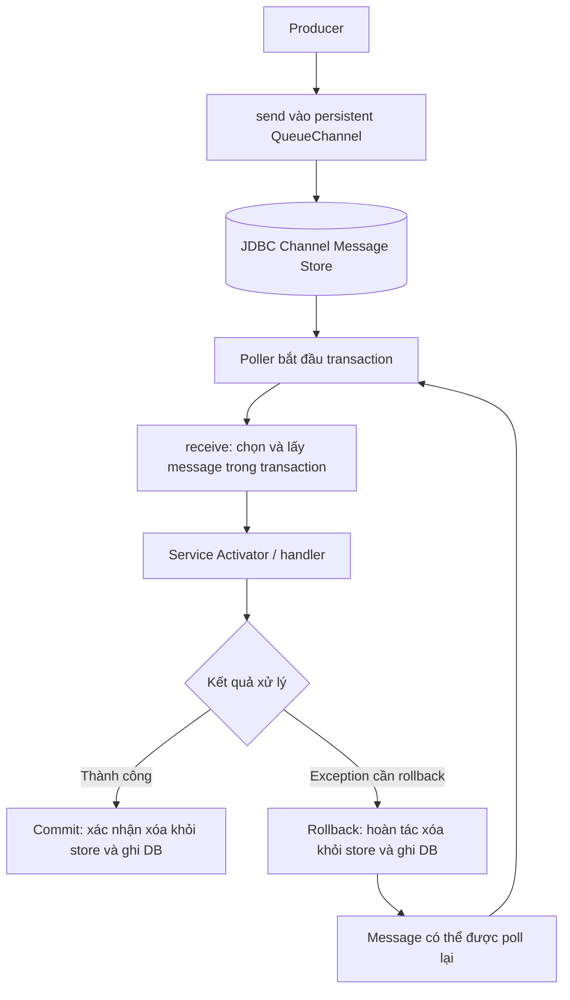
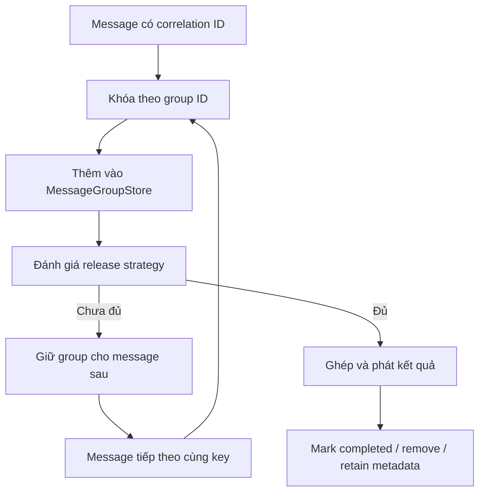
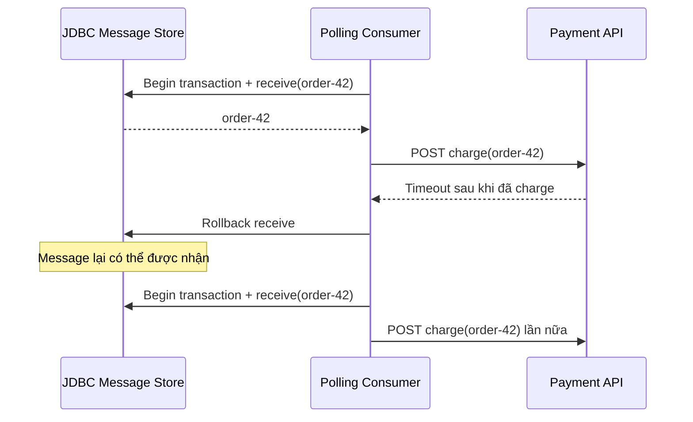

# Store transaction và consistency trong Spring Integration runtime

## 1. Bài toán: lưu message bền vững chưa đồng nghĩa xử lý nhất quán

Một `MessageChannel` có thể tiếp nhận message trước khi consumer sẵn sàng. Chẳng hạn, `QueueChannel` giữ message cho một `PollingConsumer` lấy sau. Aggregator lại giữ một **nhóm message** đến khi đủ điều kiện kết hợp. Nếu tiến trình dừng đột ngột trong khi dữ liệu còn ở bộ nhớ, message có thể biến mất. **Message store** là cơ chế chuyển trạng thái cần giữ từ bộ nhớ sang nơi lưu như cơ sở dữ liệu hoặc datastore khác.

Nhưng chọn store bền vững mới giải quyết **khả năng tồn tại sau restart**. Để flow xử lý chính xác trong lúc có lỗi, cần hiểu hai ý khác:

- **Transaction (giao dịch):** nhiều thao tác trên *tài nguyên tham gia cùng transaction* được commit hoặc rollback như một đơn vị. Với JDBC queue, transaction có thể bao trùm việc **lấy message khỏi store** và cập nhật dữ liệu nghiệp vụ.
- **Consistency (tính nhất quán):** các bất biến nghiệp vụ và trạng thái được giữ đúng qua đồng thời, retry, rollback, crash, redelivery, thay đổi schema và nhiều instance. Ví dụ, một `orderId` chỉ được ghi nhận thanh toán một lần.

Chủ đề **Store transaction và consistency** thuộc chương **Message store** của module **SPRING_INTEGRATION_RUNTIME**. Nó liên kết trực tiếp với luồng chạy channel → consumer → poller/executor, transaction, retry/recovery, correlation và chẩn đoán hiệu năng/trạng thái runtime.

> **Giới hạn cần nhớ:** persistent message store không tự cung cấp *exactly-once end-to-end*. Nó chỉ cung cấp mức bảo đảm phù hợp với **store implementation**, cấu hình transaction, database, nguồn/đích và logic idempotency. Phải xem cụ thể ai commit, ai rollback và có hành động bên ngoài nào không nằm trong transaction.

Sau bài này, bạn có thể phân tích một chuỗi gửi/lấy/xử lý message khi gặp lỗi, cấu hình một `QueueChannel` JDBC với poller có transaction, kiểm thử rollback/redelivery, xử lý cạnh tranh trên `MessageGroupStore` và đánh giá rủi ro mất/trùng message.

## 2. Phân biệt các store và phạm vi sử dụng

| Thành phần | Dùng để làm gì? | Điểm cần chú ý về consistency |
| --- | --- | --- |
| `SimpleMessageStore` | Store trong bộ nhớ, lưu message và nhóm message. | Không bền sau restart. Không giả định transaction JDBC có thể rollback trạng thái trong RAM. |
| `MessageStore` | Hợp đồng lưu và lấy message theo ID (ví dụ claim-check). | Lưu message khác với cam kết sẽ giao message đúng một lần. |
| `MessageGroupStore` | Lưu nhóm theo group ID cho aggregator, resequencer, delayer và các thành phần có trạng thái. | Đồng bộ khi thêm/xóa, quyết định release, expire và xử lý message đến muộn. |
| `ChannelMessageStore` | Hợp đồng tối ưu cho channel có hàng đợi. | Cần xét thao tác thêm, poll, khóa và transaction riêng của implementation. |
| `JdbcMessageStore` | JDBC store tổng quát, phù hợp aggregator/claim-check. | Gắn với DataSource, serialization, bảng và transaction. |
| `JdbcChannelMessageStore` | JDBC store tối ưu cho `QueueChannel` hoặc `PriorityChannel`. | Cần SQL query provider theo database, poller transaction, concurrency và chỉ mục. |
| Redis/MongoDB/Hazelcast message store | Store dựa trên datastore khác. | Semantics atomicity/transaction/durability khác JDBC; không áp quy tắc JDBC mặc định. |

Trong tài liệu Spring Integration 6.5, `JdbcMessageStore` được khuyên dùng cho aggregator và claim-check, còn `JdbcChannelMessageStore` dành cho channel. Không chọn store chỉ vì class tên gần giống nhau. `MessageGroupQueue` là một hàng đợi dựa trên `BasicMessageGroupStore`; `QueueChannel` có constructor nhận một `Queue<Message<?>>`, nên có thể dùng `MessageGroupQueue` làm backing queue.

**Phân biệt ba sự kiện:**

1. Producer gọi `send(message)`: message được chấp nhận vào channel/store; nếu thao tác ghi nằm trong transaction chưa commit thì chưa thể coi dữ liệu bền vững đã được commit.
2. Consumer gọi `receive()`: message được lấy khỏi queue/store. Với JDBC transactional store, việc xóa có thể thuộc transaction hiện tại.
3. Consumer xử lý xong và transaction **commit**: thao tác xóa khỏi queue mới là kết quả cuối cùng. Nếu rollback được áp đúng trên cùng tài nguyên, message có thể lại được nhận.

## 3. Ranh giới transaction trong message flow



Sơ đồ mô tả trường hợp **JDBC store và cập nhật nghiệp vụ cùng tham gia một transaction**. Dữ liệu message vẫn có thể bị xử lý nhiều lần khi transaction trước bị rollback hoặc kết quả bên ngoài không rõ ràng.

### 3.1. Vì sao transaction cần bắt đầu trước `receive()`?

Nếu poller lấy message ra khỏi một store có hỗ trợ transaction nhưng không có transaction bao quanh `receive()`, thao tác xóa có thể được commit ngay. Handler ném exception sau đó không tự khôi phục message đã bị xóa. Ngược lại, khi poller bắt đầu transaction *trước* lần receive và dùng `DataSourceTransactionManager` của đúng DataSource, rollback có thể hoàn tác thao tác xóa message.

Spring Integration cung cấp transactional poller để khoanh vùng **receive + xử lý đồng bộ tiếp theo**. Transaction của Spring gắn với **thread thực thi**:

- Với `DirectChannel`, việc dispatch tiếp tục trên cùng thread nên có thể tham gia transaction đang mở nếu tài nguyên và propagation phù hợp.
- Với `ExecutorChannel`, pollable channel tiếp theo hoặc một thread được tạo riêng, thread boundary có thể làm transaction hiện tại kết thúc mà downstream chưa xong.
- Một advice transaction chỉ bao handler **không đảm bảo** thao tác `receive()` đã nằm trong giao dịch. Cần xem transaction đặt ở **poller** hay tại handler.
- Nếu dùng transaction manager khác DataSource của `JdbcChannelMessageStore`, không thể suy ra thao tác xóa trong store sẽ rollback cùng transaction nghiệp vụ.

### 3.2. Bảng trạng thái commit/rollback

Giả sử `ordersIn` được backed bởi JDBC store và `orders_processed` là bảng nghiệp vụ trong **cùng DataSource**:

| Thời điểm | Dòng trong store | Dòng trong `orders_processed` | Kết quả |
| --- | --- | --- | --- |
| Message đã được gửi và commit | Có | Chưa | Đợi consumer. |
| Poller đã `receive()` nhưng transaction chưa commit | Đang bị xử lý/xóa trong transaction; khả năng nhìn thấy phụ thuộc isolation | Có thể chưa có | Chưa thể coi là xử lý xong. |
| Handler ghi DB rồi transaction commit | Đã xóa | Có | Hoàn tất một transaction xử lý. |
| Handler ném exception và transaction rollback | Việc xóa được hoàn tác | Việc ghi được hoàn tác | Có thể nhận lại và thử xử lý. |
| Handler gọi HTTP ngoài thành công nhưng DB rollback | Message có thể quay lại | Ghi JDBC đã rollback | Hành động HTTP **không tự rollback**, cần idempotency/reconciliation. |

Trong PostgreSQL với MVCC, transaction/isolation ảnh hưởng cách những consumer khác nhìn thấy dòng đang được poll. Đừng dùng một truy vấn `SELECT COUNT(*)` chạy từ connection khác để kết luận message đã “biến mất vĩnh viễn” khi transaction chưa kết thúc.

## 4. Ví dụ cấu hình Java: PostgreSQL-backed QueueChannel có transaction

Ví dụ này dùng **Spring Integration 6.5.x**, PostgreSQL, `spring-integration-jdbc` và một `DataSource` được cấu hình sẵn. Trước khi chạy, phải **tạo các bảng Spring Integration** bằng DDL mẫu phù hợp PostgreSQL trong module JDBC, cùng bảng nghiệp vụ riêng nếu cần; ứng dụng không tự tạo schema ở ví dụ này.

```java
import java.time.Duration;
import javax.sql.DataSource;

import org.springframework.context.annotation.Bean;
import org.springframework.context.annotation.Configuration;
import org.springframework.integration.annotation.EnableIntegration;
import org.springframework.integration.channel.QueueChannel;
import org.springframework.integration.dsl.IntegrationFlow;
import org.springframework.integration.dsl.Pollers;
import org.springframework.integration.jdbc.store.JdbcChannelMessageStore;
import org.springframework.integration.jdbc.store.channel.PostgresChannelMessageStoreQueryProvider;
import org.springframework.integration.store.MessageGroupQueue;
import org.springframework.jdbc.datasource.DataSourceTransactionManager;
import org.springframework.messaging.PollableChannel;
import org.springframework.transaction.PlatformTransactionManager;

@Configuration
@EnableIntegration
class OrderQueueConfiguration {

    @Bean
    JdbcChannelMessageStore orderChannelStore(DataSource dataSource) {
        JdbcChannelMessageStore store = new JdbcChannelMessageStore(dataSource);
        store.setChannelMessageStoreQueryProvider(
                new PostgresChannelMessageStoreQueryProvider());
        store.setRegion("ORDERS_APP_V1");
        return store;
    }

    @Bean
    PollableChannel ordersIn(JdbcChannelMessageStore orderChannelStore) {
        // Giữ ổn định group ID qua restart để đọc lại cùng logical queue.
        return new QueueChannel(
                new MessageGroupQueue(orderChannelStore, "orders.in.v1"));
    }

    @Bean
    PlatformTransactionManager orderTransactionManager(DataSource dataSource) {
        return new DataSourceTransactionManager(dataSource);
    }

    @Bean
    IntegrationFlow orderWorkerFlow(
            PollableChannel ordersIn,
            OrderProcessor orderProcessor,
            PlatformTransactionManager orderTransactionManager) {
        return IntegrationFlow.from(ordersIn)
                .handle(orderProcessor, "process",
                        endpoint -> endpoint.poller(
                                Pollers.fixedDelay(Duration.ofMillis(500))
                                        .maxMessagesPerPoll(1)
                                        .transactional(orderTransactionManager)))
                .get();
    }
}
```

Giả định `OrderProcessor` là bean có method `public void process(String orderId)`. Đối tượng `OrderProcessor` có thể ghi dữ liệu bằng `JdbcTemplate` **dùng cùng DataSource**, ví dụ:

```java
import org.springframework.jdbc.core.JdbcTemplate;
import org.springframework.stereotype.Component;

@Component
class OrderProcessor {
    private final JdbcTemplate jdbc;

    OrderProcessor(JdbcTemplate jdbc) {
        this.jdbc = jdbc;
    }

    public void process(String orderId) {
        jdbc.update(
                "INSERT INTO orders_processed (order_id) VALUES (?)",
                orderId);
        if (orderId.startsWith("fail-")) {
            throw new IllegalStateException("Simulated failure after DB write");
        }
    }
}
```

Bảng `orders_processed` cần được tạo riêng, chẳng hạn `order_id VARCHAR(100) PRIMARY KEY`; unique key cũng hỗ trợ chống ghi trùng. Khi gửi payload `"fail-42"`, handler thực hiện `INSERT` rồi ném lỗi. Nếu poller transaction đúng:

1. Lấy message từ store và `INSERT` nằm trong cùng JDBC transaction.
2. Exception truyền tới poller, gây rollback: row trong `orders_processed` không được commit; thao tác xóa message cũng được hoàn tác.
3. Message có thể bị poll lại. Vì payload luôn có tiền tố `fail-`, đây là **poison message**; cần chính sách retry, backoff, quarantine/dead-letter và giới hạn attempts để tránh lặp vô hạn.

**Phạm vi rõ ràng:** ví dụ đang cấu hình giao dịch poller, chưa thiết kế recovery. Không tự hiểu rằng retry do `RetryTemplate` quyết định khi chưa gắn retry advice. Ở mức ứng dụng thật, `OrderProcessor` cần idempotency và phân loại lỗi nghiệp vụ. Nếu cần endpoint kiểm thử tự điều khiển thời điểm `receive()`, hãy chạy một cấu hình **không kích hoạt poller** để tránh hai consumer tranh cùng queue.

### 4.1. Hai định danh quan trọng: `region` và `groupId`

`JdbcChannelMessageStore` có `region` để cô lập vùng dữ liệu; `MessageGroupQueue` có group ID riêng cho logical queue. Khi nhiều service/node cùng dùng bảng và store, cả hai cần được xác định có chủ đích. Group ID phải **ổn định qua restart** cho cùng queue, nhưng không được vô tình trùng với một queue không liên quan. Đổi region/group ID sau deploy có thể khiến các message cũ **vẫn nằm trong bảng nhưng không còn được queue mới đọc tới**.

`JdbcChannelMessageStore` dùng SQL chuyên biệt theo database; bắt buộc chọn `ChannelMessageStoreQueryProvider` thích hợp. Với PostgreSQL, từ 6.2 query poll dùng một câu `DELETE ... RETURNING` theo tài liệu. Các database khác có chiến lược/khả năng khóa và hiệu năng khác nhau.

## 5. Kiểm thử rollback và commit của store một cách có kiểm soát

Để kiểm chứng tính chất quan trọng nhất — *rollback thao tác nhận trả message về store* — nên viết integration test trên database thật hoặc test database tương thích và **không chạy poller đồng thời trong test này**. Test sử dụng `TransactionTemplate`, `PollableChannel` backed bởi `JdbcChannelMessageStore` và đúng transaction manager của DataSource đó.

Ví dụ sau là một phương thức trong test được khởi tạo Spring context với `ordersIn` và `orderTransactionManager` như mục 4. Cần inject các bean thích hợp và cấu hình database test sạch, không có poller khác đang tranh queue:

```java
import org.junit.jupiter.api.Test;
import org.springframework.beans.factory.annotation.Autowired;
import org.springframework.beans.factory.annotation.Qualifier;
import org.springframework.messaging.Message;
import org.springframework.messaging.PollableChannel;
import org.springframework.messaging.support.GenericMessage;
import org.springframework.transaction.PlatformTransactionManager;
import org.springframework.transaction.support.TransactionTemplate;

import static org.junit.jupiter.api.Assertions.*;

class StoreTransactionTest {
    @Autowired
    @Qualifier("ordersIn")
    PollableChannel queue;

    @Autowired
    @Qualifier("orderTransactionManager")
    PlatformTransactionManager transactionManager;

    @Test
    void rolledBackReceiveReturnsMessageToStore() {
        assertTrue(queue.send(new GenericMessage<>("order-42")));

        TransactionTemplate tx = new TransactionTemplate(transactionManager);

        assertThrows(IllegalStateException.class, () ->
                tx.execute(status -> {
                    Message<?> received = queue.receive(1_000);
                    assertNotNull(received);
                    assertEquals("order-42", received.getPayload());
                    throw new IllegalStateException("Force rollback");
                }));

        // Transaction trước đã rollback thao tác xóa khỏi store.
        Message<?> redelivered = tx.execute(status -> queue.receive(1_000));
        assertNotNull(redelivered);
        assertEquals("order-42", redelivered.getPayload());

        // Lần receive thứ hai commit khi tx.execute() hoàn tất bình thường.
        assertNull(tx.execute(status -> queue.receive(0)));
    }
}
```

Đây là **mẫu kiểm tra hành vi**, không phải chứng minh bằng list trong bộ nhớ. Khi chạy thực tế:

- DDL cho store phải có sẵn; với Spring Integration 6.2+, bean JDBC store có thể kiểm tra sự tồn tại của bảng lúc khởi tạo và fail fast nếu thiếu.
- Trước mỗi test cần cô lập `region`/`groupId` hoặc dọn dữ liệu test, đồng thời tắt/không tạo polling consumer cho queue này.
- Với mỗi test, phải bảo đảm phiên bản database và query provider tương thích; test H2 thành công chưa chứng minh PostgreSQL/MySQL có cùng locking/performance.
- Không chỉ kiểm tra `receive() != null`; cần xác nhận payload, business key và điều kiện queue thực sự rỗng sau commit.
- Trên cùng DataSource, thêm thao tác `JdbcTemplate.update(...)` trong block transaction để kiểm tra **message receive và cập nhật nghiệp vụ cùng rollback/commit**.

### 5.1. Các kịch bản transaction bắt buộc thử

| Thao tác giả lập | Kết quả mong đợi | Bất biến cần giữ |
| --- | --- | --- |
| Producer gửi message, transaction ghi store rollback | Message không được commit vào store. | Không nhận một message mà producer đã hủy giao dịch. |
| Poller nhận message, handler thành công, commit | Message bị xóa và dữ liệu nghiệp vụ được commit. | Không xử lý lại nếu không có nguồn phát lặp khác. |
| Poller nhận message, handler lỗi, rollback | Message còn/được khôi phục trong store, cập nhật JDBC rollback. | Có thể redeliver và thử lại. |
| Consumer crash **trước** commit | Database rollback giao dịch chưa commit. | Message có thể nhận lại sau restart, phụ thuộc driver/store và transaction thực tế. |
| Consumer crash **sau** commit | Message đã bị xóa khỏi store. | Nếu business side effect cùng JDBC transaction thì kết quả cũng đã commit. |
| Không có transaction quanh `receive()` | Việc nhận có thể được commit riêng. | Có nguy cơ mất message nếu handler lỗi sau khi xóa. |

Khi test retry/redelivery, tránh assert số lần handler gọi luôn là một. Với transactional store, xử lý **ít nhất một lần** là kỳ vọng thường gặp khi có lỗi; mục tiêu là dữ liệu nghiệp vụ cuối cùng nhất quán.

## 6. Consistency khi nhiều thread hoặc nhiều instance cùng dùng store

Hai consumer cùng lấy từ một queue đặt ra hai loại tranh chấp:

1. **Claim một message:** hai worker không được nhận cùng một bản ghi đã được lấy thành công theo hợp đồng của store. Việc này dựa vào SQL, row locks, isolation và implementation cụ thể.
2. **Cập nhật state liên quan:** hai worker dù nhận hai message khác nhau có thể đồng thời cập nhật cùng business key hoặc cùng một message group. Database constraint, transaction và lock registry phải bảo vệ bất biến cuối.

Một `QueueChannel` có semantics point-to-point, nhưng không đồng nghĩa hệ thống bảo đảm **một xử lý duy nhất trọn đời**: transaction rollback, timeout hoặc nguồn phát lặp có thể dẫn đến nhận lại cùng business event.

### 6.1. Khóa, isolation và cơ chế nhận message JDBC

Theo tài liệu Spring Integration JDBC 6.5:

- `JdbcChannelMessageStore` dùng query provider riêng cho database. Với PostgreSQL, query poll từ Spring Integration 6.2 dùng một lệnh `DELETE ... RETURNING`.
- Khi polling transactional song song, database hỗ trợ **MVCC** thường phù hợp hơn; database không hỗ trợ tốt có thể chịu lock contention nghiêm trọng.
- Với một số database không hỗ trợ MVCC, tùy nhu cầu có thể cấu hình `usingIdCache=true` cho `JdbcChannelMessageStore` và giải phóng ID khỏi cache bằng transaction synchronization sau **commit và rollback**. Đặt `usingIdCache` mà không quản lý cache lifecycle có thể gây message bị bỏ qua hoặc nghẽn xử lý.
- Cần đo hành vi thực tế khi tăng poller concurrency; số thread tăng không chắc tăng throughput do tranh khóa, chờ kết nối JDBC và I/O.

Với nhiều tiến trình cùng dùng database, đừng giả định lock trong một JVM bảo vệ được ứng dụng khác. Chọn chiến lược concurrency và isolation theo store, rồi chạy test với **nhiều connection/nhiều instance**. Khi xác nhận bất biến nghiệp vụ, ưu tiên unique constraint trên business ID như một lớp bảo vệ bắt buộc.

### 6.2. Consistency của aggregator/resequencer

`MessageGroupStore` không chỉ chứa danh sách message, mà còn chứa metadata: group ID, trạng thái hoàn tất, thời điểm thay đổi, điều kiện release và các thông tin liên quan. Với aggregator:



Nếu hai node cùng xử lý một `correlationId` nhưng chỉ dùng `DefaultLockRegistry` cục bộ, mỗi JVM có thể cho rằng mình đang giữ khóa độc quyền, dẫn đến tranh chấp release hoặc sai group state. Cần cấu hình **LockRegistry chia sẻ giữa các node** khi dùng persistent `MessageGroupStore` chia sẻ. Từ Spring Integration 6.5, `AbstractMessageGroupStore` dùng lock cho thao tác metadata theo group ID; mặc định vẫn là local lock nên điều phối xuyên node vẫn cần thiết kế riêng.

**Một số invariant cho aggregator:**

- Message cùng một nhóm phải dùng cùng correlation key có semantics ổn định.
- Một nhóm chỉ được release khi đúng điều kiện; cần test duplicate, thiếu sequence và thứ tự đến khác nhau.
- Với late message sau khi group hoàn tất, cấu hình có thể giữ metadata đã hoàn tất để loại bỏ/điều hướng message đến muộn. Xóa metadata quá sớm có thể làm late messages lập thành group mới sai nghiệp vụ.
- Expiry hoặc `MessageGroupStoreReaper` có thể làm mất message chưa đủ nhóm nếu không có policy partial-result/discard rõ ràng.
- Nếu phải đảm bảo *release group + ghi business result* là nguyên tử, hãy kiểm tra tất cả thao tác có cùng transactional resource/boundary hay không; nếu output đi qua transport khác, cần thiết kế bảo đảm bổ sung.

**Ví dụ thực tế:** một đơn hàng cần ba event `reserved`, `charged`, `packed`. Hai instance đồng thời nhận `charged` và `packed`. Nếu mỗi node giữ lock riêng, cả hai có thể đánh giá điều kiện release trên trạng thái khác nhau. Shared lock bảo vệ phần xử lý group, còn unique constraint/idempotency ở nơi ghi kết quả vẫn cần để xử lý tình huống message được phát lại sau rollback.

## 7. Serialization, headers và consistency sau restart

Một message gồm **payload và headers**. Store bền vững phải serialize/deserialize cả dữ liệu cần thiết, nên cần kiểm tra **round-trip**, không chỉ kiểm tra `send()` thành công.

Các điểm dễ gây lỗi:

- Với `JdbcMessageStore` theo cơ chế mặc định, dữ liệu phải hỗ trợ serialization thích hợp (thường dựa vào `Serializable`). Một số header không serializable có thể bị bỏ trước khi lưu.
- Header do HTTP/JMS/FTP hoặc adapter khác thêm vào có thể chứa đối tượng framework hay bean không phù hợp để serialize.
- `replyChannel` và `errorChannel` đôi khi chứa tham chiếu trực tiếp tới channel hoặc temporary channel của một gateway. Khôi phục từ database sau restart **không tự khôi phục một temporary channel** ở tiến trình cũ. Có thể dùng `HeaderChannelRegistry` và header enricher để thay tham chiếu bằng tên/string có thể giải quyết, đồng thời phải xem vòng đời registry.
- Class/package của payload có thể thay đổi giữa các phiên bản deploy; dữ liệu đã serialize bằng phiên bản cũ có thể không deserialize được.
- Nếu cần JSON/binary schema ổn định, hãy quản lý serializer/deserializer/mapper phù hợp với store implementation; không tự giả định mọi store dùng chung codec.

### 7.1. Kiểm thử round-trip

Một test persistence đúng nghĩa cần:

1. Gửi message có `businessKey`, `correlationId`, `contentType` và payload tương thích serializer; commit vào store.
2. Đóng/restart application context hoặc tạo consumer dùng **cùng database, table prefix, region, group ID**.
3. Nhận lại message, kiểm tra payload và những headers thực sự cần cho nghiệp vụ.
4. Xác minh reply/error routing còn hợp lệ qua registry/name, tránh dựa vào temporary channel cũ.
5. Tiêm payload/header không serialize được và theo dõi việc store từ chối hay bỏ header theo hợp đồng thực tế.

Đổi `region`, `groupId` hoặc table prefix trong test restart có thể khiến kết quả giả như message bị mất, dù nó vẫn tồn tại ở vùng lưu cũ. Cần ghi lại các giá trị này cùng schema/database version khi kiểm thử.

## 8. Consistency giữa message store và hệ thống bên ngoài

Giả sử consumer lấy một lệnh `charge(orderId)` từ JDBC queue và gọi hệ thống thanh toán qua HTTP:



Ngay cả khi rollback JDBC hoàn hảo, HTTP request bên ngoài **không nằm trong transaction JDBC**. Kết quả có thể là charge hai lần nếu API không có idempotency. Điều này tạo ra một khoảng cách quan trọng giữa **local transactional consistency** và **end-to-end consistency**.

### 8.1. Những guarantee nên mô tả chính xác

| Mức bảo đảm | Ý nghĩa thực tiễn | Điều kiện/giới hạn |
| --- | --- | --- |
| **Durable after commit** | Dữ liệu đã commit có thể tồn tại qua restart/crash. | Phụ thuộc DB, chính sách durability/replication/backup và serializer. |
| **Atomicity trong cùng JDBC transaction** | `receive()` và cập nhật bảng nghiệp vụ cùng commit/rollback. | Cùng DataSource và transaction manager, cùng thread/boundary; không tự bao HTTP. |
| **At-least-once processing/delivery** | Message có thể nhận lại sau lỗi/rollback để không mất việc. | Có thể xử lý trùng; poison message cần policy giới hạn và DLQ. |
| **Effectively-once business effect** | Nhiều attempts vẫn chỉ có một kết quả nghiệp vụ hợp lệ. | Cần idempotency key, unique constraint, transaction/inbox hoặc phía nhận hỗ trợ dedup. |
| **Exactly-once end-to-end** | Một sự kiện có đúng một tác động trên toàn bộ hệ thống phân tán. | Không được suy ra chỉ từ việc dùng persistent `MessageStore`; cần hợp đồng chuyên biệt và kiểm chứng mọi ranh giới. |

**Mẫu Inbox/Deduplication:** đặt unique constraint trên `business_event_id`; trong cùng JDBC transaction, consumer ghi ID vào inbox và cập nhật business row. Nếu nhận lại ID đã có, bỏ qua hoặc trả kết quả đã lưu. Lưu ý unique constraint chỉ có tác dụng nếu cả hai bước dùng cùng transaction đúng và xử lý lỗi trùng có chủ đích.

**Transactional Outbox:** producer ghi business state và một dòng outbox trong **cùng transaction**. Một tiến trình riêng sau commit phát event từ outbox; nguồn phát có thể retry nên receiver vẫn cần idempotency. Outbox giải quyết khoảng trống giữa cập nhật DB và phát event, nhưng không tự tạo exactly-once ở downstream.

**Reconciliation:** với thao tác HTTP bên ngoài không thể rollback, lưu trạng thái như `PENDING_CONFIRMATION` cùng business key và tra cứu kết quả thật ở hệ thống xa trước khi quyết định phát lại.

### 8.2. Transaction synchronization không thay thế distributed transaction

Spring Integration có `TransactionSynchronizationFactory` để chạy hành động trước/sau commit/rollback của poller. Ví dụ, sau commit có thể phát thông báo hoặc chuyển file. Nhưng callback `afterCommit` **không biến** thao tác sang resource khác thành một phần atomic với JDBC transaction: nếu tiến trình chết ngay sau commit mà trước callback gửi message, thông báo có thể mất. Những trường hợp cần độ tin cậy mạnh thường dùng outbox hoặc queue/broker bền vững có quy trình replay.

## 9. Retry, recovery và “poison message” tác động lên store ra sao?

Một handler có thể luôn lỗi do dữ liệu sai hoặc lỗi code. Nếu poller rollback mỗi lần, cùng message có thể được lấy đi lấy lại liên tục:

```text
poll -> lỗi -> rollback -> poll lại -> lỗi -> rollback -> ...
```

Rollback bảo vệ **không mất message**, nhưng không cung cấp chiến lược **khi nào dừng**. Cần phân biệt:

- Lỗi tạm thời: timeout, deadlock có thể phục hồi, downstream quá tải. Có thể retry giới hạn với backoff/jitter.
- Lỗi dữ liệu cố định: schema sai, business validation lỗi. Nên chuyển vào quarantine hoặc dead-letter để không chiếm worker liên tục.
- Lỗi hệ thống còn mơ hồ: side effect bên ngoài có thể đã thực hiện. Cần reconciliation/idempotency trước khi gửi lại.

Trong Spring Integration, retry có thể đặt ở `RequestHandlerRetryAdvice` hoặc ở cơ chế redelivery của nguồn. Nếu advice **nuốt exception** bằng recovery callback rồi trả thành công, poller transaction có thể **commit xóa message**. Điều đó đúng nếu recovery thực sự đã ghi lỗi vào một nơi đáng tin cậy và nghiệp vụ chấp nhận xử lý tiếp theo tại đó; sai nếu chỉ log rồi bỏ.

| Thiết kế recovery | Điều có thể xảy ra với JDBC queue | Cần kiểm chứng |
| --- | --- | --- |
| Handler lỗi và exception truyền ra poller | Rollback `receive()`; message có thể được poll lại. | Số lần redelivery, delay, trạng thái transaction. |
| Handler advice retry rồi vẫn ném exception | Cuối cùng poller rollback. | Tổng attempts = retries nội bộ × số lần redelivery (nếu cả hai không giới hạn phù hợp). |
| Recovery callback phát error event rồi trả `null` | Poller có thể commit và xóa message đầu vào. | Recovery event đã được lưu bền vững chưa, có giữ business key và payload cần thiết không? |
| Recovery ghi vào bảng quarantine cùng JDBC transaction | Có thể commit cả việc ghi quarantine và xóa message. | Một transaction duy nhất, unique key, không sinh duplicate quarantine rows. |
| Recovery gọi HTTP để báo lỗi | HTTP không tự tham gia JDBC transaction. | Retry/idempotency của kênh báo lỗi và tình huống crash giữa hai bước. |

**Giới hạn attempts:** `RetryTemplate.maxAttempts(3)` thường tính cả attempt đầu tiên; broker redelivery và poller rollback lại là một tầng khác. Nếu một message được redeliver 5 lần và handler nội bộ retry 3 lần mỗi lượt, tổng lời gọi có thể lên tới **15**. Khi thiết kế chính sách, cần tính cả hai tầng và timeout tổng.

## 10. Lựa chọn isolation, locking và giới hạn hiệu năng

Nên chọn theo yêu cầu bất biến, throughput và DB thực tế:

| Quyết định | Lợi ích | Chi phí/rủi ro |
| --- | --- | --- |
| `READ_COMMITTED` với SQL poll phù hợp | Thường giảm contention và phù hợp nhiều workload queue. | Không tự bảo vệ mọi race ở business tables. |
| Isolation cao hơn | Giảm một số bất thường đọc/ghi. | Có thể tăng blocking, deadlock, retry transaction. |
| Nhiều poller threads | Tăng khả năng xử lý khi bottleneck ở I/O/handler. | Tăng tranh khóa DB, pool connection, retry thừa; không hứa tuyến tính. |
| Index đúng theo region/group/priority/sequence | Tăng hiệu quả tìm message tiếp theo. | Tăng chi phí ghi, dung lượng và bảo trì. |
| Backoff khi lỗi tạm thời | Giảm áp lực vào downstream. | Có thể giữ thread/poller và kéo dài thời gian sống của transaction nếu bố trí sai. |
| Shared lock registry cho message group | Ngăn race giữa nhiều instance khi cập nhật group. | Tăng round-trip/lock contention, cần cơ chế expiry/renewal. |
| Bounded backlog/DLQ | Giới hạn ảnh hưởng poison message. | Cần vận hành, cảnh báo và quy trình replay. |

### 10.1. Khi nào không nên dùng JDBC làm queue chính?

Spring Integration lưu ý không nên mặc nhiên chọn relational database làm hệ thống queue thông lượng cao. Với throughput lớn, nhiều consumer và redelivery phức tạp, JMS/AMQP broker chuyên dụng có thể phù hợp hơn. JDBC queue vẫn hữu ích khi số lượng message vừa phải, muốn giữ message và business writes trong một DB transaction hoặc muốn đơn giản hóa hạ tầng.

Nếu dùng `JdbcChannelMessageStore`:

- Provision schema theo phiên bản đang chạy; đừng để migration giữa chừng làm mất tương thích message cũ.
- Theo dõi bảng/chỉ mục và số message tồn; phân vùng hoặc dọn data cũ theo hợp đồng, không xóa tùy ý message chưa ack.
- Đặt database connection pool đủ cho poller concurrency cộng tác vụ JDBC khác; đo `connection wait time`.
- Đo thời gian `send()`, `receive()`, commit, rollback, lock wait, serialization, business handler và backlog theo region/group ID.
- Nếu phải thay schema/serializer, thử đọc các message đã ghi từ phiên bản trước; có kế hoạch drain, migration hoặc chuyển đổi dữ liệu.

### 10.2. Một số metric giúp đọc trạng thái runtime

| Metric/traces | Dấu hiệu cần chú ý |
| --- | --- |
| Message backlog và age của message cũ nhất | Consumer không theo kịp hoặc poison message liên tục quay lại. |
| Số lần rollback/redelivery theo business key | Lỗi cố định, transaction sai hoặc downstream bất ổn. |
| Thời gian poll/commit/lock wait | Database contention, index hoặc isolation chưa phù hợp. |
| Active pollers/executor queue/connection pool | Bottleneck từ thread hoặc connection. |
| Số nhóm aggregator đang mở và tuổi group | Correlation thiếu message, release/expiry policy không hợp lý. |
| Serialization/deserialization failures | Header/payload không tương thích hoặc class version thay đổi. |
| Recovery/DLQ/quarantine rate | Lỗi dữ liệu hoặc thiết kế retry đang gây lặp liên tục. |

Không dùng `correlationId` hoặc message ID duy nhất làm **metric label** vì số lượng giá trị sẽ rất lớn. Đưa chúng vào log/trace có kiểm soát để truy vết; metric nên tổng hợp theo endpoint, loại lỗi, nguồn và phiên bản schema.

## 11. Chẩn đoán khi “message biến mất”, “bị trùng” hoặc “kẹt group”

Khi sự cố xảy ra, đi theo thứ tự giúp tìm đúng tầng:

1. **Xác minh message đã commit vào store chưa:** kiểm tra sender transaction, lỗi `send()`, bảng/region/group ID và thời điểm commit. Có thể message chưa từng được lưu bền.
2. **Xác định ai là consumer thực sự:** poller nào, endpoint ID, số node/threads; xem có hai consumer cùng group ID hoặc nhầm region.
3. **Kiểm tra transaction của poller:** có bắt đầu **trước** `receive()` không, dùng transaction manager/DataSource nào, có `ExecutorChannel` tạo thread boundary không?
4. **Xem exception và recovery:** lỗi tới poller làm rollback hay đã được handler advice/recovery callback nuốt? Có retry tại nhiều tầng không?
5. **Đối chiếu trạng thái DB và side effect:** row nghiệp vụ đã commit chưa, HTTP phía xa đã xử lý chưa, có unique business key/inbox không?
6. **Nếu là aggregator:** kiểm tra correlation ID, số message trong group, release strategy, expiry/reaper, shared lock registry và message đến muộn.
7. **Kiểm tra persistence format:** payload/headers đã serialize và deserialize được chưa; reply/error channel còn dùng được sau restart không?
8. **Đọc thống kê hiệu năng:** backlog, tuổi message, DB lock, connection pool, poller concurrency, message table indexes và lỗi schema.

### Bảng triệu chứng nhanh

| Triệu chứng | Nguyên nhân khả dĩ | Hướng xử lý |
| --- | --- | --- |
| Handler lỗi và message không còn trong JDBC queue | Không có transaction quanh receive hoặc recovery đã trả thành công. | Gắn transaction vào poller; xác minh đường error/recovery. |
| Một event được xử lý hai lần | Rollback/redelivery hoặc producer gửi trùng. | Dùng idempotency key, unique constraint/inbox; truy nguyên attempts. |
| Sau restart không nhận message cũ | Sai region/group ID/table prefix hoặc payload không deserialize được. | Đối chiếu cấu hình và format lưu trữ của phiên bản cũ. |
| Reply của gateway timeout sau queue bền vững | Temporary `replyChannel` mất hoặc bị serialize không đúng. | Dùng channel registry/tên channel và thiết kế request-reply qua restart. |
| Poller chạy nhưng backlog tăng | Lock contention, slow handler, connection pool thiếu, poison message. | Phân tích DB, throughput và retry/backoff. |
| Aggregator release hai lần hoặc kẹt group | Khóa chỉ ở JVM, correlation key sai, expiry/late arrivals. | Shared `LockRegistry`, test nhiều node, release strategy và xử lý late message. |
| Dữ liệu đã ghi nhưng queue rollback | Side effect ngoài transaction hoặc sai DataSource/tm. | Chốt transaction boundary và bảo vệ idempotency/reconciliation. |
| Startup fail do bảng store | DDL thiếu/sai prefix/schema hoặc DB chưa sẵn sàng. | Provision migration phù hợp trước khi bật worker. |

## 12. Bài tập thực hành theo cấp độ

**Bài tập 1 — So sánh RAM và JDBC store:** chạy một `QueueChannel` mặc định và một queue backed bởi `JdbcChannelMessageStore`, gửi cùng message, restart context. Quan sát message nào còn, đồng thời chứng minh message phải được **commit trước restart**.

**Bài tập 2 — Transaction tại poller:** tạo handler ghi `orders_processed` rồi chủ động ném lỗi. So sánh flow có và không có `.transactional(transactionManager)` trên poller; kiểm tra số row đã commit và khả năng redelivery của message.

**Bài tập 3 — Phân biệt thất bại trước/sau commit:** dùng `TransactionTemplate` để ép rollback ở `receive()` như mục 5; sau đó nhận và commit bình thường. Chạy kịch bản sender rollback để xác minh không có message mới trong store.

**Bài tập 4 — Idempotency:** giả lập HTTP charge thành công nhưng response timeout. Cho consumer thử lại cùng `orderId`, dùng bảng inbox hoặc unique business key chứng minh chỉ một charge được ghi nhận, và viết quy trình reconciliation khi kết quả phía xa chưa rõ.

**Bài tập 5 — Nhiều consumer:** chạy hai worker trên cùng region/group ID với database và query provider giống nhau. Gửi 100 business keys khác nhau, test không mất key, kiểm tra số lần xử lý thực tế và uniqueness của kết quả cuối. Tiêm lỗi ở giữa xử lý để quan sát redelivery.

**Bài tập 6 — Aggregator consistency:** phát ba messages cùng `correlationId` từ hai threads/nodes. Bật một shared `LockRegistry`, kiểm tra release một lần và xử lý message đến muộn. Thử tắt shared lock trong môi trường test để hiểu rủi ro.

**Bài tập 7 — Serialization và nâng cấp:** gửi message với payload và header serializable, restart context, kiểm tra round-trip; sau đó thay class version hoặc thêm header chứa Spring bean và ghi nhận lỗi. Thiết kế schema version hoặc serializer thích hợp.

**Bài tập 8 — Recovery đáng tin cậy:** tạo poison message không retryable, chuyển nó vào một bảng quarantine **trong cùng JDBC transaction** rồi commit việc xóa khỏi queue. Test crash/rollback trước commit: hoặc cả hai thao tác được commit, hoặc cả hai được rollback.

### Câu hỏi tự kiểm tra

1. Vì sao persistent store không đủ để khẳng định xử lý exactly-once?
2. Vì sao transaction phải bao trùm `receive()` của transactional JDBC queue?
3. Điều gì xảy ra khi `ExecutorChannel` nằm giữa poller transaction và business handler?
4. Khi dùng `JdbcChannelMessageStore`, `region` và `groupId` có ý nghĩa gì qua restart?
5. Tại sao hai aggregator ở hai JVM cần shared `LockRegistry` khi dùng chung group store?
6. Tại sao header `replyChannel` tạm thời có thể làm request-reply thất bại dù payload còn trong DB?
7. Khi recovery callback nuốt exception, poller transaction sẽ có nguy cơ gì?
8. Dùng inbox/outbox và idempotency giải quyết khoảng trống nào mà transaction JDBC không bao phủ?

## 13. Tài liệu chính thức

- Spring Integration 6.5 — [Message Store](https://docs.spring.io/spring-integration/reference/6.5/message-store.html): nhóm message, serialization, `MessageGroupStore` và `LockRegistry`.
- Spring Integration 6.5 — [JDBC Message Store](https://docs.spring.io/spring-integration/reference/6.5/jdbc/message-store.html): `JdbcMessageStore`, `JdbcChannelMessageStore`, query provider, concurrency và id cache.
- Spring Integration 6.5 — [Configuring Message Channels](https://docs.spring.io/spring-integration/reference/6.5/channel/configuration.html): persistent `QueueChannel` và transactional receive.
- Spring Integration 6.5 — [Transaction Support](https://docs.spring.io/spring-integration/reference/6.5/transactions.html): poller transaction, ranh giới thread và transaction synchronization.
- Spring Integration 6.5 — [Aggregator](https://docs.spring.io/spring-integration/reference/6.5/aggregator.html): correlation, release strategy, group expiry và locking.
- Spring Integration 6.5 API — [`MessageGroupQueue`](https://docs.spring.io/spring-integration/docs/6.5.0/api/org/springframework/integration/store/MessageGroupQueue.html) và [`QueueChannel`](https://docs.spring.io/spring-integration/docs/6.5.0/api/org/springframework/integration/channel/QueueChannel.html).
- Spring Integration 6.5 API — [`PollerSpec`](https://docs.spring.io/spring-integration/docs/6.5.0/api/org/springframework/integration/dsl/PollerSpec.html).
