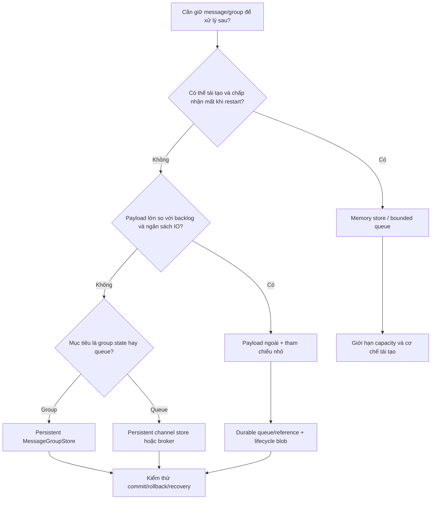
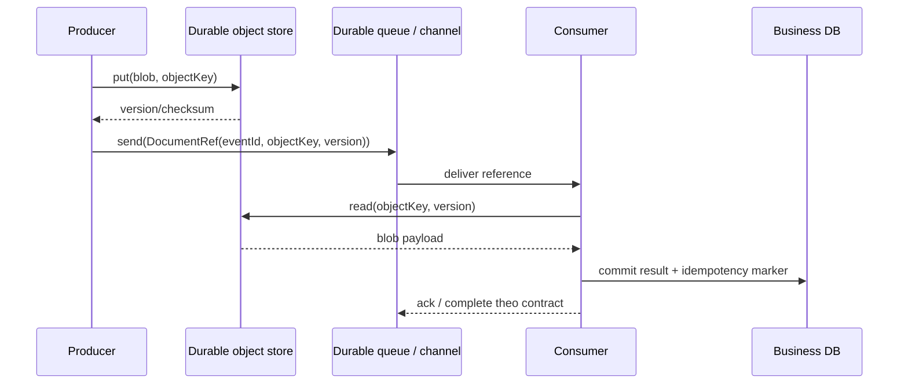
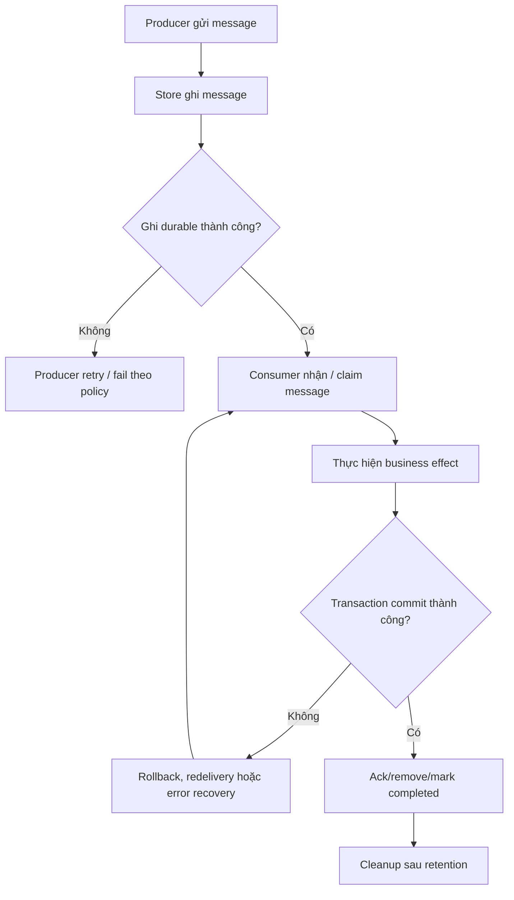

# Chọn store theo kích thước message và khả năng khôi phục trong Spring Integration

## 1. Vì sao kích thước message và khả năng khôi phục phải được xem cùng nhau?

Trong mô-đun `SPRING_INTEGRATION_RUNTIME`, message di chuyển qua channel, endpoint, consumer, poller và executor; tùy thiết kế, message còn được giữ trong queue, message group hoặc claim-check store. Khi luồng chạy bình thường, nhiều lựa chọn lưu trữ đều có vẻ đáp ứng được. Sự khác biệt bộc lộ rõ khi **message lớn, backlog tăng, ứng dụng khởi động lại hoặc consumer chết giữa chừng**.

Xét một dịch vụ xử lý hóa đơn: mỗi message nhỏ chứa `invoiceId` và thông tin định tuyến, nhưng đôi lúc chứa luôn file PDF 8 MiB. Giả sử 30.000 message đang chờ xử lý:

- Nếu chỉ lưu tham chiếu đến PDF, dữ liệu chờ trên queue có thể tương đối nhỏ.
- Nếu nhét mọi PDF vào hàng đợi trong bộ nhớ, lượng payload thô đã khoảng **240 GiB**; mức dùng heap thực tế còn có overhead của Java object, headers và các bản sao.
- Nếu đưa toàn bộ PDF vào các row database, ta đổi rủi ro tràn heap thành áp lực ghi/đọc, transaction log, backup và phục hồi database.
- Nếu chỉ lưu queue trong memory, restart tiến trình có thể làm mất mọi message chưa được xử lý, dù message nhỏ.

Do đó, chọn `MessageStore` không chỉ là chọn API. Ta phải quyết định **dữ liệu gì cần lưu**, **lưu đến bao lâu**, **khả năng mất mát chấp nhận được**, **làm sao replay sau sự cố** và **đường đi của message qua transaction**.

Sau bài học, bạn sẽ có thể:

1. Phân biệt store chứa message, store chứa message group, store cho channel và metadata store.
2. Ước lượng chi phí lưu trữ từ kích thước payload, số message chờ và thời gian backlog.
3. Lập ma trận chọn in-memory, JDBC-backed store hoặc mô hình **payload ngoài + message tham chiếu**.
4. Thiết kế khôi phục sau restart, crash trong lúc xử lý, retry/redelivery và mất kết nối kho lưu trữ.
5. Kiểm chứng lựa chọn qua mã cấu hình, fault injection, metric và thử tải.

## 2. Hiểu đúng các vai trò store ở runtime

Spring Integration cung cấp một số abstraction liên quan đến việc lưu message. Chúng giải quyết các **hợp đồng khác nhau**:

| Vai trò | Nội dung lưu | Dùng trong trường hợp | Điều cần kiểm chứng |
|---|---|---|---|
| `MessageStore` | Một message định danh bằng message ID cùng payload/headers theo cơ chế store | Lưu và lấy lại message, claim-check | Có serialize/deserialize lại được sau restart không? |
| `MessageGroupStore` | Các message được gom thành nhóm và metadata nhóm | Aggregator, resequencer, các thành phần quản lý group | Group ID/correlation, timeout, completion, cleanup có bền vững không? |
| Store phục vụ `QueueChannel`, ví dụ `JdbcChannelMessageStore` | Các message đang chờ trong một channel/queue | Polling consumer cần hàng đợi bền vững | Nhận message, commit/rollback và consumer cạnh tranh hoạt động ra sao? |
| `MetadataStore` | Key/value metadata, ví dụ offset, marker, checkpoint | Idempotent receiver, poller metadata, lock/checkpoint | Metadata có đủ để khôi phục không, hay vẫn thiếu payload? |
| Nguồn bên ngoài như broker/object store | Message hoặc payload theo hợp đồng riêng của hệ thống đó | Tích hợp đa dịch vụ, message lớn, lưu trữ lâu | Delivery guarantee, retention, ack và khả năng truy xuất thực tế |

**Không thay thế các khái niệm trên chỉ vì đều có chữ “store”.** `JdbcMessageStore` phục vụ lưu message và message group; `JdbcChannelMessageStore` là triển khai chuyên cho kênh queue bền vững. `SimpleMessageStore` lưu trong tiến trình, hữu ích khi cần nhanh và chấp nhận mất dữ liệu lúc restart. `MetadataStore` chỉ giữ metadata, không thể dựng lại toàn bộ payload nếu nguồn gốc payload đã mất.

Cần phân biệt thêm:

- **Channel** xác định cách truyền message. `DirectChannel` gửi đồng bộ, thường không giữ backlog; `QueueChannel` lưu tạm để polling consumer lấy; `ExecutorChannel` giao công việc vào executor queue, vốn **không tự trở thành durable message store**.
- **Store** quyết định khả năng giữ dữ liệu và truy xuất lại; **poller** quyết định khi nào lấy message; **transaction/ack** quyết định thời điểm một message được xem là đã xử lý thành công.
- **Persistence** nghĩa là dữ liệu được ghi vào tài nguyên bền vững theo hợp đồng; **recovery** còn bao gồm tìm lại message, xử lý inflight, khôi phục consumer và tránh tác dụng nghiệp vụ lặp.

## 3. Kích thước message phải đo thế nào?

Đừng chỉ gọi `payload.length` rồi dùng số đó để tính dung lượng store. Trong một message thật có ít nhất ba lớp chi phí:

```text
Message = payload + headers + representation/serialization overhead
Store   = serialized message + index/metadata + transaction log/replication/backup
Runtime = object graph + queue references + deserialization buffers + concurrent copies
```

Với payload JSON, kích thước chuỗi ký tự ở Java khác số byte UTF-8 thực gửi. Với DTO phức tạp, serializer có thể tăng hoặc giảm kích thước so với object ban đầu. Với `byte[]`, kích thước thô dễ đo hơn nhưng vẫn phải tính headers và bản sao khi chuyển đổi. Với message group, chi phí phát sinh thêm từ correlation/group metadata.

### 3.1. Ước lượng backlog trước khi chọn store

Đặt:

- `λ`: tốc độ message đến trung bình (message/giây).
- `μ`: tốc độ xử lý hoàn tất (message/giây).
- `T`: thời gian hệ thống có thể phải giữ backlog (giây).
- `S`: kích thước message trung bình *sau khi serialize* (byte).
- `B`: số message tồn đọng cao nhất cần thiết kế để chịu được.

Một ước lượng khi tải đến liên tục vượt năng lực xử lý:

\[
B \approx \max(0,\lambda-\mu)\times T
\]

Và dung lượng dữ liệu thô của backlog:

\[
D_{\text{raw}}\approx B\times S
\]

Hai biểu thức chỉ là **ước lượng ban đầu**. Tải thực tế có burst, độ lệch kích thước, message lỗi bị retry, transaction log, index, object overhead và bản sao do replication. Khi chọn capacity, phải đo thêm **p95/p99 message size** và đặt biên dự phòng.

**Ví dụ 1 — message nhỏ:** 50.000 message × 20 KiB ≈ 977 MiB dữ liệu thô. Nếu nằm trong Java heap, lượng heap cần cấp có thể lớn hơn đáng kể vì object/header/queue overhead. Nếu nằm trong JDBC, cần tính index, WAL/transaction log, backup và thời gian quét queue.

**Ví dụ 2 — payload lớn:** 50.000 message × 8 MiB ≈ 391 GiB dữ liệu thô. Thay vì nhét payload vào mọi message, thiết kế lưu PDF ở object store rồi truyền một `DocumentRef` nhỏ hơn nhiều.

### 3.2. Đừng hiểu bảng kích thước như ngưỡng chuẩn của framework

Các mốc dưới đây chỉ là **điểm khởi đầu cho thiết kế** trên hệ thống thực tế, **không phải giới hạn hoặc khuyến cáo mặc định của Spring Integration**:

| Mức size tham khảo | Ưu tiên khảo sát | Vì sao |
|---|---|---|
| Vài KiB đến vài chục KiB/message | Bounded memory queue nếu mất queue khi restart được phép; JDBC store nếu cần restart recovery | Payload nhỏ, chi phí serialization và database có thể quản lý được. |
| Hàng trăm KiB đến khoảng MiB/message | Đo throughput của JDBC/broker, batch size, heap, mạng và row/LOB overhead | Khi backlog lớn, số byte còn quan trọng hơn message count. |
| Nhiều MiB đến hàng chục MiB hoặc hơn | Payload storage chuyên dụng + message mang reference/claim-check | Giảm pressure lên channel, JDBC transaction log, network và GC. |

Một message 5 MiB có thể phù hợp với một hệ thống thông lượng thấp; một message 20 KiB vẫn có thể quá nặng nếu tồn hàng triệu bản. Luôn quyết định theo **size × backlog × SLA × khả năng khôi phục**.

## 4. “Khôi phục được” phải định nghĩa theo kịch bản sự cố

Trước khi chọn store, viết rõ các tình huống mà hệ thống phải vượt qua:

| Sự cố | Câu hỏi phải trả lời | Memory-only | JDBC/broker durable khi cấu hình đúng |
|---|---|---|---|
| Consumer ném exception | Message có còn để retry không? | Phụ thuộc nơi giữ message và logic retry; không mặc định | Có thể rollback/đưa xử lý lại nếu receive, transaction và ack phù hợp |
| Ứng dụng restart có kiểm soát | Message tồn đọng có còn không? | Thường mất theo tiến trình | Có thể phục hồi từ dữ liệu đã commit |
| Process bị kill giữa xử lý | Message inflight có xuất hiện lại không? | Không được bảo đảm | Phụ thuộc transaction, claim/visibility và cách nhận message |
| Mất host/container | Store còn truy cập được từ instance khác không? | Không | Có nếu dữ liệu nằm ở storage dùng chung bền vững và còn khả dụng |
| Database hoặc broker ngừng hoạt động | Có thể nhận/gửi tiếp hay phải backpressure? | Có thể giữ tạm rất giới hạn; dễ mất khi crash | Cần chính sách retry, failover và giám sát sự cố kho lưu trữ |
| Khôi phục backup cũ | Queue và nghiệp vụ có còn nhất quán không? | Không áp dụng nếu không backup memory | Cần xác định RPO, restore point và đối soát với database nghiệp vụ |

Hai chỉ tiêu quan trọng:

- **RPO (Recovery Point Objective):** có thể mất tối đa bao nhiêu dữ liệu/sự kiện khi khôi phục? Ví dụ RPO = 0 với message đã được xác nhận nhận đòi hỏi thiết kế commit/ack và lưu trữ tương ứng; chỉ gọi một store là “durable” chưa đủ.
- **RTO (Recovery Time Objective):** tối đa bao lâu để hệ thống xử lý lại backlog sau sự cố? Store có thể giữ được 10 triệu message, nhưng mất nhiều giờ rebuild index hoặc quét lại queue thì RTO có thể không đạt.

Bổ sung **cửa sổ replay**: sự kiện có thể bị gửi lại sau bao lâu (giờ, ngày, tuần)? Retention của message store, object store và ledger idempotency phải đủ dài theo cùng hợp đồng.

## 5. Ma trận lựa chọn store

| Phương án | Kích thước/backlog phù hợp | Restart recovery | Chi phí/giới hạn chính | Khi nên chọn |
|---|---|---|---|---|
| `SimpleMessageStore`, `QueueChannel` trong bộ nhớ | Nhỏ, bounded và chấp nhận mất pending work | Không bảo đảm qua restart | Heap, GC, nguy cơ tràn bộ nhớ, mất data khi process chết | Demo, cache, xử lý tạm có thể tái tạo dễ dàng |
| `JdbcMessageStore` cho message group | Nhỏ/vừa, group state cần tồn tại qua restart | Có, nếu store dùng schema/DB bền vững và quản lý group đúng | DB reads/writes, lock, serialization, cleanup group | Aggregator/resequencer cần khôi phục group |
| `JdbcChannelMessageStore` cho queue | Nhỏ/vừa, backlog cần lưu bền | Có, phụ thuộc commit/transaction/consumer | DB contention, polling, log, index và cleanup | Work queue JDBC với RPO/RTO phù hợp |
| Store phân tán khác được Spring Integration hỗ trợ cho use case đó | Tùy adapter, cấu hình và kích thước | Phụ thuộc persistence/replication/retention thật | Consistency, cấu hình failover, phụ thuộc hệ thống ngoài | Đã có hệ thống lưu trữ chung, cần chia sẻ state giữa instance |
| Durable broker + message nhỏ | Nhiều producer/consumer, throughput hoặc cross-service | Có theo chính sách broker, ack và retention | Vận hành broker, ordering, redelivery, DLQ | Truyền sự kiện/liên kết dịch vụ, queue xuyên tiến trình |
| Object/blob store cho payload + durable message tham chiếu | Payload lớn; backlog dài | Có nếu **cả tham chiếu lẫn blob** bền vững và có lifecycle phù hợp | Quản lý vòng đời blob, orphan, bảo mật truy cập, retry | PDF, ảnh, file log, binary payload lớn |

**Cảnh báo về cột “Restart recovery”:** đây là **khả năng có thể đạt được khi cấu hình và kiểm thử đúng**, không phải mặc định tuyệt đối. Ví dụ JDBC store có dữ liệu bền nhưng process có thể mất message đã lấy khỏi queue nếu poller/ack không nằm trong transaction đúng. Broker có thể giao lại message và làm handler chạy nhiều lần; đây là lúc cần idempotency.

### Quy trình chọn nhanh



## 6. Ví dụ A: queue trong bộ nhớ khi việc có thể tạo lại

Với công việc có thể tái sinh từ nguồn chuẩn và không cần lưu pending queue sau restart, có thể dùng `QueueChannel` trong bộ nhớ với sức chứa giới hạn:

```xml
<int:channel id="previewQueue">
    <int:queue capacity="500"/>
</int:channel>
```

Đây là cấu hình sử dụng **Spring Integration XML namespace** (cần khai báo namespace `int` và hạ tầng ứng dụng tương ứng). Channel nhận message và polling consumer sẽ lấy sau; `capacity` giới hạn số lượng message, **không giới hạn byte**. Nếu mỗi message bất ngờ tăng từ 10 KiB lên 10 MiB, giới hạn 500 message vẫn có thể gây pressure lên heap rất lớn.

Điểm phải thiết kế kèm:

- Khi queue đầy, `send()` có thể chặn đến timeout hoặc thất bại tùy cách gửi; cần chính sách backpressure và khả năng retry ở producer.
- Restart/crash thường làm mất message chưa xử lý của in-memory queue. Nếu nguồn có thể replay, kiểm tra watermark/cursor ở nguồn để tái tạo; nếu nguồn không replay được, phương án này không đáp ứng durability.
- `SimpleMessageStore` chứa message/group trong memory cũng thuộc lớp rủi ro này: **không nên kết luận message đã bền vững chỉ vì đã được “store”**.
- Nếu cần gửi và nhận ngay trong cùng stack, `DirectChannel` có thể đơn giản hơn queue, nhưng không xử lý yêu cầu giữ backlog.

**Phù hợp:** thông báo làm mới cache, bản preview có thể sinh lại, hoặc dữ liệu thử nghiệm. **Không phù hợp:** công việc thanh toán, hóa đơn duy nhất, event không thể phát lại mà bắt buộc không mất sau restart.

## 7. Ví dụ B: QueueChannel có JDBC store để khôi phục backlog

Khi message nhỏ/vừa và yêu cầu lưu pending work qua restart, một phương án là dùng `JdbcChannelMessageStore` với `QueueChannel`.

Ví dụ XML minh họa:

```xml
<bean id="jdbcChannelStore"
      class="org.springframework.integration.jdbc.store.JdbcChannelMessageStore">
    <constructor-arg ref="dataSource"/>
</bean>

<int:channel id="durableWorkQueue">
    <int:queue message-store="jdbcChannelStore"/>
</int:channel>

<int:service-activator input-channel="durableWorkQueue"
                       ref="workHandler"
                       method="process">
    <int:poller fixed-delay="500" max-messages-per-poll="1">
        <int:transactional transaction-manager="transactionManager"/>
    </int:poller>
</int:service-activator>
```

**Điều kiện để áp dụng ví dụ:**

1. Dự án đã cấu hình XML namespace Spring Integration, bean `dataSource`, `transactionManager` và bean `workHandler` với phương thức `process(...)` tương thích payload.
2. Schema JDBC cho Spring Integration message store phải được tạo theo **đúng phiên bản và hệ database** đang dùng (thường bằng script schema đi kèm library/migration tool); không tùy ý tự viết bảng gần giống.
3. Poller bắt đầu transaction **trước `receive()`**; xử lý đồng bộ ở thread poller có thể tham gia transaction nếu dùng đúng tài nguyên/manager.
4. Với các thao tác JDBC nghiệp vụ cần atomic cùng việc lấy message, phải bảo đảm chúng dùng **cùng datasource và transaction**. Nếu nghiệp vụ ở resource khác, một JDBC transaction manager đơn lẻ không thể rollback tất cả.
5. Nếu `workHandler` chuyển công việc tiếp qua `ExecutorChannel` rồi trả về ngay, transaction poller có thể kết thúc **trước khi worker xử lý xong**; lỗi ở worker không tự rollback receive đã commit.

Ở ví dụ này, việc lấy message ra khỏi queue bền vững và cập nhật database có thể cùng transaction. Nếu handler ném unchecked exception và transaction rollback, việc lấy message từ JDBC store **có thể được hoàn tác**, tạo điều kiện cho lần poll sau lấy lại. Cần kiểm tra kỹ semantics của store, polling advice, schema và phiên bản ứng dụng bằng thử nghiệm crash/restart.

### 7.1. Một worker đơn giản có idempotency

Giả sử message chỉ chứa thông tin tham chiếu thay vì payload lớn:

```java
package example.integration;

public record WorkRef(String eventId, String objectKey, long sizeBytes) {}
```

Một service xử lý có thể dùng business key `eventId` để tránh tạo side effect trùng khi message được redeliver:

```java
package example.integration;

import org.springframework.jdbc.core.JdbcTemplate;

public class WorkHandler {

    private final JdbcTemplate jdbc;

    public WorkHandler(JdbcTemplate jdbc) {
        this.jdbc = jdbc;
    }

    public void process(WorkRef work) {
        if (work.eventId() == null || work.eventId().isBlank()) {
            throw new IllegalArgumentException("eventId is required");
        }
        jdbc.update(
            "INSERT INTO completed_work(event_id, object_key) " +
            "VALUES (?, ?) ON CONFLICT DO NOTHING",
            work.eventId(), work.objectKey());
    }
}
```

Đoạn ví dụ dùng PostgreSQL `ON CONFLICT DO NOTHING` và giả định bảng `completed_work` có ràng buộc unique/primary key trên `event_id`. Cần đăng ký `WorkHandler` dưới tên `workHandler` và inject `JdbcTemplate` từ cùng datasource nếu dùng XML mục 7; mã `WorkRef` không thể tự lấy lại blob từ object store nếu bạn chưa triển khai client đọc blob.

`ON CONFLICT DO NOTHING` chỉ chống insert trùng trên bảng được minh họa; nếu handler đồng thời gửi email, gọi HTTP hoặc trừ tiền thì **side effect khác vẫn phải idempotent riêng**. Một transaction không tự giải quyết end-to-end exactly-once.

### 7.2. Các tình huống cần tự thử

| Thời điểm sự cố | Điều cần quan sát |
|---|---|
| Sau khi producer gửi thành công nhưng trước khi consumer nhận | Message được lưu bền vững chưa? Có còn sau restart không? |
| Consumer lấy message rồi ném exception trước commit | Poller rollback có làm message xuất hiện lại không? |
| Consumer đã commit rồi process bị kill trước khi upstream biết kết quả | Upstream có phát trùng không? Ledger idempotency có giữ tác dụng đúng một lần không? |
| Database mất kết nối lúc đang poll | Poller có backoff/khôi phục không? Queue backlog có tăng không? |
| Hai instance cùng poll một queue | Có tranh chấp, starvation hoặc reorder không? Có dựa sai vào FIFO tuyệt đối không? |

**Lưu ý thứ tự:** queue bền vững không đồng nghĩa global FIFO tuyệt đối khi có nhiều consumer, retry hoặc transaction rollback. Cần thiết kế thứ tự ở **tầng nghiệp vụ** nếu yêu cầu xử lý theo `customerId`/`aggregateId`.

## 8. Ví dụ C: message group phải phục hồi cùng correlation state

Một aggregator gom nhiều message theo `correlationId` cho đến khi đủ số lượng, timeout hoặc điều kiện release. Nếu state group chỉ nằm trong RAM, restart có thể làm mất những message đã đến nhưng chưa đủ nhóm.

```text
Message A1 (correlationId=ORDER-7, sequenceNumber=1)
Message A2 (correlationId=ORDER-7, sequenceNumber=2)
... restart ...
Message A3 (correlationId=ORDER-7, sequenceNumber=3)
```

Nếu store trong memory mất A1 và A2, A3 không thể tự tạo lại cả nhóm. Với nhu cầu phục hồi, cần `MessageGroupStore` bền vững (ví dụ `JdbcMessageStore` khi cấu hình làm group store), cùng chính sách:

- **Correlation/release:** group key giữ nguyên qua redelivery và restart; biết chính xác điều kiện kết thúc.
- **Timeout:** sau restart, scheduled task có thể không còn như trước; kiểm tra cách framework quét/khởi động lại việc expire/release group.
- **Khối lượng state:** một nhóm có thể chứa nhiều message, khiến byte size tăng rất nhanh dù từng payload nhỏ.
- **Cleanup:** hoàn tất nhóm có xóa message và metadata hay giữ để phục vụ duplicate detection? Việc xóa quá sớm có thể làm lại nhóm khi message cũ đến muộn.
- **Transaction:** đảm bảo update group state và message consumption phù hợp với khả năng retry/replay.

**Không dùng `JdbcChannelMessageStore` như thể nó là một `MessageGroupStore` chuyên cho mọi aggregator**; hãy cấu hình bean đúng hợp đồng API mà endpoint đó yêu cầu. Ngược lại, không mặc nhiên dùng `JdbcMessageStore` thông thường làm queue store mà bỏ qua cấu hình được thiết kế cho channel queue.

## 9. Ví dụ D: payload lớn — lưu blob riêng và truyền tham chiếu

Khi một payload dài nhiều MiB, phương án thường bền vững và dễ mở rộng hơn là đặt **payload trong blob/object store**, còn channel chỉ mang **key và metadata đủ để lấy lại**.

Có hai cách tiếp cận liên quan:

1. **Claim-check pattern** của Spring Integration: dùng message store để cất payload/message và đưa một claim check (ticket) vào flow; bước sau dùng ticket để lấy dữ liệu. Các transformer claim-check của Spring Integration hỗ trợ mô hình này.
2. **External object reference**: producer ghi file/binary vào object store, phát một message nhỏ `DocumentRef` với `objectKey`/version/checksum; consumer đọc payload từ object store.

Dù gọi là claim-check hay reference, **store chứa payload cũng phải có durability, retention và cơ chế cleanup đáp ứng yêu cầu**. Nếu claim-check dùng memory store, ticket tồn tại sau restart vẫn vô ích khi payload đã mất.



**Điểm đáng chú ý:** nếu producer đã lưu blob nhưng thất bại trước khi gửi message, có một **orphan blob**. Nếu đã phát message nhưng blob chưa sẵn sàng, consumer có **dangling reference**. Hai bước ghi vào hệ thống khác nhau không tự atomic. Có thể dùng outbox/transactional producer, trạng thái `PENDING/READY`, retention grace period và đối soát định kỳ để làm sạch/khôi phục an toàn.

### 9.1. Cấu trúc message tham chiếu

Ví dụ Java:

```java
public record DocumentRef(
        String eventId,
        String objectKey,
        String objectVersion,
        String sha256,
        long lengthBytes
) {}
```

Tạo message mà các header hữu ích vẫn được bảo toàn:

```java
import org.springframework.messaging.Message;
import org.springframework.messaging.support.MessageBuilder;

Message<DocumentRef> toReference(
        Message<byte[]> input,
        DocumentRef reference) {
    return MessageBuilder.withPayload(reference)
            .copyHeaders(input.getHeaders())
            .setHeader("payloadStorage", "object-store")
            .build();
}
```

Đây chỉ là bước **đổi payload đã có thành tham chiếu**; mã không tự ghi blob lên object store. Trong triển khai thực, phải upload/verify blob trước, rồi mới công bố `DocumentRef` theo giao thức producer đã chọn.

**Không coi header chứa `replyChannel` hoặc `errorChannel` là một địa chỉ có thể serialize vô thời hạn.** Nếu header giữ trực tiếp đối tượng `MessageChannel`, việc ghi lâu dài hoặc chuyển qua tiến trình khác có thể thất bại hoặc không resolve lại được. Khi cần, dùng cơ chế chuyển header channel thành chuỗi/registry có lifecycle phù hợp hoặc thiết kế reply/error destination ổn định.

### 9.2. Retention của blob khác retention của message

Giả sử queue giữ message 3 ngày nhưng blob bị xóa sau 24 giờ. Message vẫn tồn tại và recover được từ queue nhưng **không còn payload để xử lý**. Quy tắc thiết kế là:

```text
retention(payload) >= thời gian message có thể được dùng lại
                      + thời gian retry/replay/DLQ/đối soát cần hỗ trợ
```

Cần tính cả phiên bản object/immutable key, quyền đọc, checksum, mã hóa, khả năng khôi phục backup và vòng đời của blob sau xử lý. Xóa blob ngay sau khi consumer hoàn tất có thể gây lỗi nếu có replica hoặc message khác còn tham chiếu tới cùng object.

### 9.3. Vì sao không đặt blob vào header?

Header thường đi kèm mỗi message qua nhiều endpoint, adapter và log. Đưa `byte[]` lớn vào header vừa tăng chi phí truyền/lưu, vừa dễ mất khả năng serialize, đồng thời làm phức tạp observability. Chỉ đặt **reference, metadata cần thiết và mã correlation** vào message; tải payload khi cần xử lý.

## 10. So sánh recovery: message đã “lưu” và message đã “hoàn thành”

Một timeline có transaction giúp thấy rõ sự khác biệt:



Có ít nhất ba mốc khác nhau:

- **Durably accepted:** hệ thống lưu trữ đã xác nhận lưu message theo hợp đồng durability của nó.
- **Business completed:** thay đổi nghiệp vụ liên quan đã commit thành công.
- **Delivery completed:** nguồn/queue đã nhận ack hoặc message đã được loại khỏi pending state theo hợp đồng của nguồn.

Crash có thể xảy ra giữa các mốc. Nếu nghiệp vụ đã commit nhưng ack bị mất, redelivery vẫn có thể xảy ra. Do đó cần **idempotency key** ổn định qua các lần nhận và atomic marker+effect nếu có thể. Khôi phục “không mất message” có thể đổi lại thành “message có khả năng đến nhiều lần”; hai mục tiêu này cùng tồn tại.

**Không đặt mục tiêu exactly-once end-to-end chỉ từ việc chọn JDBC store.** Nguồn, store, handler, transaction manager, external API và error/retry flow đều tác động tới tác dụng cuối.

## 11. Cấu hình transaction, retry và poller phải khớp loại store

| Thành phần | Chọn lựa cần nhất quán | Lỗi thường gặp |
|---|---|---|
| `MessageStore` / `ChannelMessageStore` | Dùng store đúng interface, serializer và schema | Chọn wrong store type, không khôi phục được group hoặc queue |
| `PlatformTransactionManager` | Điều khiển đúng datasource/resource chứa message và business state | Transaction của DB A không bảo vệ DB B hoặc broker |
| Poller | Transaction bắt đầu trước receive khi cần transactional polling | Remove message khỏi queue rồi business fail nhưng không đưa lại được |
| Retry advice | Giới hạn attempt, backoff; transaction mỗi attempt phù hợp | Retry trong transaction đã rollback-only hoặc lặp vô hạn |
| `errorChannel`/DLQ | Phân biệt lỗi tạm thời và lỗi cuối | Message poison chiếm queue mãi, không có operator action |
| Idempotency ledger | Cùng logical event giữ một key xuyên restart | Duplicate tạo lại side effect khi replay |
| Executor/channel handoff | Biết ranh giới thread trước khi kết luận atomic | Transaction thread poller commit trước worker xử lý |

**Ví dụ:** một polling consumer đọc từ `QueueChannel` backed by `JdbcChannelMessageStore`, chạy handler JDBC cùng datasource trong thread poller. Nếu poller áp dụng transaction advice đúng phạm vi và handler ném unchecked exception, transaction có thể rollback việc lấy message và business updates. Nếu handler chỉ gửi sang `ExecutorChannel` rồi trả về, transaction poller có thể commit ngay khi dispatch, trong khi business logic vẫn chưa thực thi. Khi đó phải thiết kế transaction và retry tại **worker**, hoặc thay topology theo yêu cầu atomicity.

Với `SimpleMessageStore`/queue in-memory, gắn `JdbcTransactionManager` vào poller **không biến việc dequeue trong RAM thành thao tác JDBC có thể rollback**. Đây là lỗi suy luận phổ biến khi đánh giá durability.

## 12. Serialization, schema và bảo mật dữ liệu

Một store durable chỉ có ích nếu **message khôi phục được thành đúng kiểu dữ liệu** khi ứng dụng ở phiên bản mới. Cần kiểm tra:

1. **Payload type:** DTO Java, record, JSON, Avro/Protobuf hoặc binary; serializer có giữ tương thích giữa các phiên bản code hay không?
2. **Header:** header nào cần truyền qua store, giá trị header nào là đối tượng không serializable, có cần lọc hoặc chuyển sang String?
3. **Schema/database:** JDBC store cần DDL/index đúng phiên bản Spring Integration và DBMS; cần migration có kiểm soát, không để hai phiên bản ứng dụng cùng thay schema một cách tùy tiện.
4. **Message size limit:** DB column/LOB/packet limit, driver buffer, broker message max size và giới hạn từ mạng hoặc API; kiểm tra bằng payload thật.
5. **Security:** quyền truy cập bảng/object bucket, mã hóa khi truyền/lưu, bảo vệ dữ liệu cá nhân, tránh log payload nhạy cảm.
6. **Data retention:** policy xóa message/group/metadata, backup và restore; dữ liệu lâu ngày khiến query của store chậm hơn dù message rate không đổi.

**Không xem Java serialization là giao thức lưu trữ lâu dài giữa các phiên bản ứng dụng.** Nếu phải giữ message qua nâng cấp hoặc trao đổi giữa nhiều hệ thống, hãy ưu tiên representation có version/schema rõ ràng và test tương thích trước/sau deploy. Cũng nên kiểm tra hành vi khi deserialize thất bại: message bị kẹt, error channel, DLQ hay cần thao tác thủ công?

## 13. Sizing, hiệu năng và observability theo từng loại store

### 13.1. Chỉ số nên thu thập

| Chỉ số | Memory queue | JDBC store | External payload/reference |
|---|---|---|---|
| Backlog count và age (oldest message) | Có | Có | Có ở queue chứa reference |
| Serialized message size p50/p95/p99 | Có | Có | Reference size và blob size riêng |
| Heap/GC pause | Rất quan trọng | Vẫn cần đo buffer/deserialization | Thường giảm áp lực payload lớn trên channel |
| Insert/receive/ack latency | Thường thấp, phụ thuộc lock/consumer | Quan trọng; phụ thuộc DB IO/lock/index | Thêm blob put/get latency |
| Disk/transaction log/replication lag | Không áp dụng cho queue RAM | Rất quan trọng | Quan trọng cho cả queue và object storage |
| Retry, duplicate, DLQ, poison message | Quan trọng | Quan trọng | Quan trọng |
| Recovery backlog drain time | Tái tạo từ nguồn | Đo sau restart | Đo queue recovery và tốc độ tải blob |

Theo dõi đồng thời **tốc độ vào**, **tốc độ ra** và **độ tuổi message già nhất**. Queue count ổn định không có nghĩa hệ thống khỏe nếu có một nhóm message bị kẹt rất lâu.

### 13.2. Capacity planning: kiểm thử cả peak và recovery

Một bài thử đủ thực tế cần có:

- **Tải bình thường:** đo throughput, p95 latency, CPU, heap và storage IO.
- **Burst:** tăng tốc độ nhận trong thời gian đủ lâu để tạo backlog dự kiến; kiểm tra backpressure.
- **Long outage:** dừng consumer, tiếp tục gửi có kiểm soát rồi đo dung lượng/IO tăng.
- **Cold restart:** restart ứng dụng trong khi queue/group còn message; kiểm tra số message còn và thời gian phục hồi.
- **Crash during processing:** kill consumer ở các điểm trước/sau business commit; kiểm tra redelivery và idempotency.
- **Schema/serializer upgrade:** lưu message bằng phiên bản cũ, khởi động phiên bản mới và deserialize/replay.
- **Store outage/failover:** kiểm tra producer phản ứng thế nào, retry/backoff và alert có kích hoạt không.

Với database, nên kiểm tra lock contention, cleanup/vacuum, index bloat và replica lag khi backlog lớn. Với object store, kiểm tra khả năng lấy blob trong điều kiện giới hạn mạng và chính sách lifecycle.

### 13.3. Backpressure và giới hạn byte

Giới hạn `QueueChannel` thường biểu diễn bằng **số message**. Điều này không chặn tổng dung lượng nếu size mỗi message biến động lớn. Có thể cần giới hạn payload size tại đầu vào, tách luồng dành cho blob lớn, giới hạn concurrent processing, giới hạn tốc độ producer và đặt quota theo byte ở lớp riêng.

Ví dụ, nếu chỉ dựa vào `capacity=500`, queue gồm 500 message 2 KiB khác xa 500 message 20 MiB. Capacity planning phải theo **byte, số lượng và thời gian giữ**, không theo một chiều duy nhất.

## 14. Playbook chẩn đoán khi store không khôi phục đúng

| Triệu chứng | Khả năng nguyên nhân | Kiểm tra đầu tiên |
|---|---|---|
| Queue rỗng sau restart | Đã dùng queue/store in-memory; chưa ghi persistent message | Bean store thực tế, cấu hình `message-store`, trạng thái commit |
| DB còn row nhưng consumer không nhận | Poller chưa chạy, store query/schema không phù hợp, message lỗi deserialize | Log poller, SQL, schema version, exception converter |
| DB rollback nhưng message vẫn mất | Receive và business không cùng transaction; queue in-memory | Transaction manager, datasource, thread và loại channel |
| Message bị xử lý hai lần sau crash | Business commit trước ack, hoặc nguồn redeliver | Timeline commit/ack, idempotency key và ledger |
| Aggregator thiếu message sau restart | Message group lưu trong memory; correlation/timeout/cleanup sai | `MessageGroupStore`, group IDs, trạng thái expired/released |
| CPU/GC cao khi backlog tăng | Payload quá lớn trong heap, copy/serialization nhiều | Size p99, heap histogram, queue byte estimate |
| DB log và backup tăng quá nhanh | Payload blob lớn hoặc giữ row lâu, retry tần suất cao | Stored bytes, index/log, retention và claim-check |
| Consumer nhận reference nhưng blob không tồn tại | Blob xóa sớm, upload chưa commit/available, key/version đổi | Object lifecycle, checksum, producer publish order |
| Restore dữ liệu thành công nhưng message không đọc được | Version DTO/serializer/schema không tương thích | Deserialization logs, compatibility migration |
| Poison message retry mãi | Retry không hữu hạn, không có DLQ/quarantine | Error flow, retry policy, dedup và operator tooling |

Khi điều tra, cần dựng timeline trên **cùng business event ID**:

```text
produced_at -> stored_at -> enqueued_at -> received_at
            -> business_committed_at -> acked_at -> cleaned_at
```

Các timestamp là khái niệm cần instrument, không phải những header Spring Integration tự bảo đảm cung cấp đầy đủ. Kết hợp chúng với thread name, poller ID, correlation ID, transaction outcome và store record ID để tìm nơi dữ liệu bị thất lạc hoặc xử lý lặp.

## 15. Bài thực hành quyết định store bằng kịch bản

Hãy giải lần lượt các tình huống sau, nêu rõ **loại store, cách recovery, cách đo và giới hạn còn lại**:

1. **Cache invalidation:** 1.000 message nhỏ, nguồn có thể phát lại toàn bộ, mất pending queue khi restart được chấp nhận. Chọn memory queue có capacity và mô tả backpressure.
2. **Đơn hàng:** 200.000 event nhỏ, không được mất message chưa xử lý khi restart, consumer JDBC cần retry. Chọn durable queue/broker, xác định transaction/ack và idempotency.
3. **PDF processing:** 10.000 file, mỗi file 8 MiB, cần retry trong 7 ngày. Chọn object store + durable reference, tính dung lượng thô khoảng 80 GiB và thiết kế retention.
4. **Aggregator:** nhận ba mảnh theo `correlationId`, nhóm có thể tồn tại hàng giờ và ứng dụng thường deploy lại. Chọn `MessageGroupStore` bền vững, kiểm tra timeout/correlation/completion.
5. **Mất DB 20 phút:** producer vẫn gửi vào queue JDBC. Xác định phải backpressure/thất bại có retry hay chuyển qua nguồn durable khác; không giả định queue tự nhận được khi database mất kết nối.
6. **Crash giữa commit và ack:** thiết kế bài test kill process, xác minh xử lý lại không tạo invoice/email/charge trùng.
7. **Nâng cấp phiên bản:** ghi message bằng bản cũ, deploy bản mới, kiểm tra deserialize và khả năng xử lý tiếp backlog.
8. **Cleanup:** xác định khi nào được xóa queue row, group state, blob, idempotency ledger và DLQ; thử replay message muộn hơn thời gian dự kiến.

Bảng báo cáo mẫu:

| Quyết định | Câu trả lời cần có |
|---|---|
| Message contract | Payload nằm trong message hay chỉ là reference? |
| Size/backlog | p50/p95/p99 byte, peak count, age, growth rate? |
| Store API/type | Queue, group, metadata hay payload store? |
| Durability/RPO/RTO | Phải vượt qua những failure nào? |
| Transaction/ack | Khi nào coi message đã được nhận và hoàn tất? |
| Retry/idempotency | Trùng message có gây side effect trùng không? |
| Lifecycle | Bao lâu mới xóa và ai chịu trách nhiệm cleanup? |
| Observability | Đo gì để chứng minh recovery đạt yêu cầu? |

## 16. Checklist kiến trúc trước khi đưa vào vận hành

- Chọn đúng **hợp đồng store**: queue, group, payload/claim-check hoặc metadata.
- Ước lượng **serialized byte × peak backlog** cùng phân phối size p95/p99; tính thêm replication, index, transaction log và memory overhead.
- Nêu cụ thể failure cần chịu được, **RPO/RTO** và thời gian replay; kiểm chứng bằng restart/crash thật.
- Với queue JDBC, đảm bảo **schema, transaction manager, poller, receive và business work** nhất quán; không mặc định transaction đi qua executor.
- Với payload lớn, đặt blob tại storage chuyên dụng, để channel mang reference nhỏ và quản lý **upload, checksum, retention, cleanup và orphan**.
- Dự phòng **retry/redelivery** bằng idempotency key ổn định; kho lưu bền không tự bảo đảm exactly-once nghiệp vụ.
- Giới hạn backlog/backpressure, giám sát queue age/size/IO và có quy trình DLQ/replay/restore kiểm thử được.

### Tài liệu tham khảo chính thức

- [Spring Integration Reference — Message Store](https://docs.spring.io/spring-integration/reference/message-store.html): các khái niệm lưu message và message group, triển khai in-memory/persistent.
- [Spring Integration Reference — Message Channels](https://docs.spring.io/spring-integration/reference/channel.html): channel, queue và lựa chọn truyền message.
- [Spring Integration Reference — JDBC Message Store](https://docs.spring.io/spring-integration/reference/jdbc/message-store.html): cấu hình message store JDBC và schema liên quan.
- [Spring Integration Reference — Claim Check](https://docs.spring.io/spring-integration/reference/claim-check.html): lưu payload riêng và luân chuyển claim-check ticket.
- [Spring Integration Reference — Transaction Support](https://docs.spring.io/spring-integration/reference/transactions.html): transaction của polling consumer và các ranh giới xử lý.
- [Spring Integration Reference — Aggregator](https://docs.spring.io/spring-integration/reference/aggregator.html): quản lý message group, correlation, release và state.
