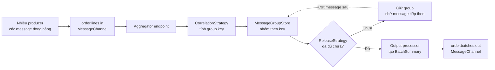
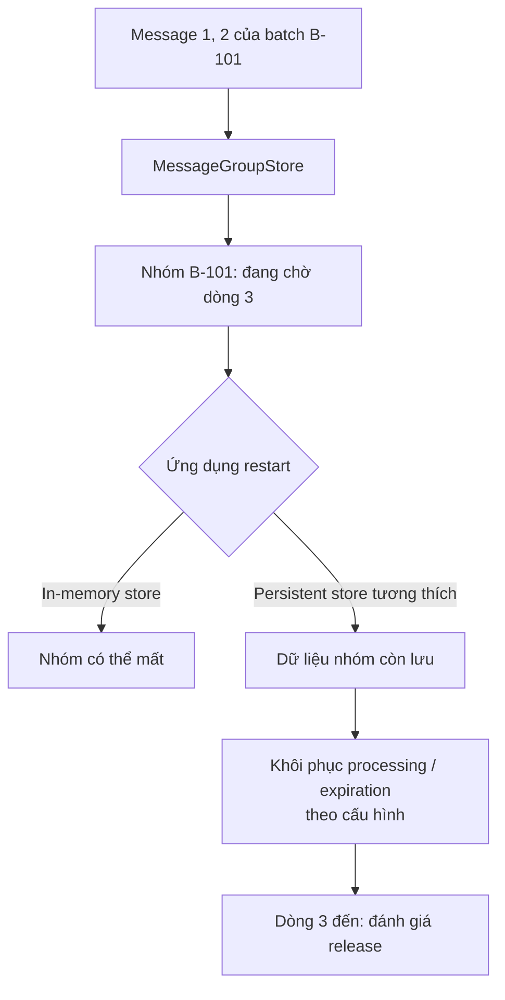

# CorrelationStrategy và correlation key

## 1. Vì sao runtime cần correlation?

Trong Spring Integration, một `Message<?>` có payload và headers, được truyền qua channel tới endpoint/consumer. Một handler đơn giản có thể xử lý từng message độc lập. Tuy nhiên, các thành phần như **aggregator** và **resequencer** phải nhận nhiều message khác nhau, nhận biết **message nào thuộc cùng một nhóm**, rồi lưu trạng thái cho đến lúc đủ điều kiện xử lý hoặc sắp xếp lại.

Ví dụ, hệ thống nhận ba dòng hàng của một lô nhập hàng: dòng số 1, 2 và 3 có thể đến không đúng thứ tự. Khi hai lô cùng gửi vào một channel, aggregator cần đặt dòng của mỗi lô vào đúng nhóm. **`CorrelationStrategy`** quyết định khóa định danh nhóm, còn **`ReleaseStrategy`** quyết định khi nào nhóm có thể được giải phóng để xuất kết quả.

Trong module **SPRING_INTEGRATION_RUNTIME**, bài này gắn việc nhóm message với điều phối qua channel, endpoint, consumer, poller, executor; trạng thái `MessageGroupStore`, vòng đời `IntegrationFlow`, transaction, retry, error channel, quan sát threading và hiệu năng.

Các mục tiêu thực hành:

1. Hiểu sự khác nhau giữa message ID, correlation ID, correlation key và trace ID.
2. Chọn `CorrelationStrategy` ổn định để gom message đúng nhóm.
3. Kết hợp correlation với release, timeout và lưu nhóm.
4. Chẩn đoán các nhóm bị treo, nhóm trộn sai dữ liệu, message đến trễ, lặp hoặc mất sau restart.

> **Nguyên tắc quan trọng:** correlation key chỉ trả lời câu hỏi **“message thuộc nhóm nào?”**. Nó không tự trả lời **“nhóm đã đủ chưa?”**, cũng không bảo đảm thứ tự, tính duy nhất, khả năng lưu bền vững hay xử lý đúng một lần.

## 2. Đường đi của message qua một correlating endpoint



Mỗi message đi vào aggregator thường trải qua các thao tác logic:

1. Aggregator nhận `Message<?>` trên input channel.
2. `CorrelationStrategy.getCorrelationKey(Message<?>)` tạo ra một **object làm khóa nhóm**.
3. `MessageGroupStore` định vị hoặc tạo `MessageGroup` tương ứng với khóa đó.
4. Message được ghi vào nhóm, có thể phải đồng bộ hóa quyền truy cập nhóm nếu nhiều thread gửi đồng thời.
5. `ReleaseStrategy` kiểm tra nhóm đã đủ điều kiện phát kết quả chưa.
6. Nếu đủ, output processor kết hợp các payload và gửi reply đi tiếp; nhóm được đánh dấu hoàn tất hoặc bị xóa theo chính sách.
7. Nếu chưa đủ, nhóm giữ trạng thái để chờ message khác; có thể có cơ chế timeout/expiration riêng.

**`CorrelationStrategy` không trực tiếp gửi reply** và không điều khiển lịch polling. Nó chỉ tính khóa; phần quản lý nhóm, quyết định release và việc dispatch do correlating handler cùng channel/endpoint đảm nhận.

## 3. Phân biệt những định danh dễ nhầm

| Khái niệm | Dùng cho việc gì? | Có nên dùng làm correlation key? |
| --- | --- | --- |
| `MessageHeaders.ID` / `id` | Định danh một message cụ thể do framework tạo | Thường **không**, vì mỗi dòng có một message ID riêng; một splitter có thể dùng ID của message gốc để tạo correlation ID cho các message con. |
| `correlationId` | Header thường dùng để chỉ nhóm message có liên quan | **Có**, nếu tất cả message thuộc nhóm cùng mang giá trị ổn định, đúng phạm vi. |
| **Correlation key** | Giá trị mà `CorrelationStrategy` trả về để định danh `MessageGroup` | Đây là khóa thực tế của group; có thể lấy từ header hoặc tính từ payload và metadata. |
| `sequenceNumber` | Vị trí của message trong một chuỗi | Dùng cho thứ tự/kiểm tra thiếu phần tử; **không** làm khóa nhóm chung. |
| `sequenceSize` | Số phần tử dự kiến trong chuỗi | Dùng khi đánh giá điều kiện release; **không** làm khóa nhóm. |
| `traceId` | Truy vết request qua nhiều dịch vụ | Chỉ dùng làm khóa nếu đúng quy tắc phân nhóm nghiệp vụ; một trace có thể chứa nhiều group. |
| `replyChannel` / `errorChannel` | Địa chỉ trả lời hoặc xử lý lỗi | Không phải khóa nhóm. |
| `orderId`, `batchId`, `tenantId` | Định danh nghiệp vụ hoặc phạm vi tenant | Có thể dùng, nhưng phải đánh giá va chạm, tái sử dụng và tính bền vững qua restart. |

**Cùng chuỗi ký tự chưa chắc cùng ý nghĩa.** Ví dụ `orderId=42` ở tenant A và tenant B không được gộp nếu hệ thống dùng chung message store. Hoặc một đơn hàng có hai lần xử lý, cùng `orderId` nhưng khác `batchId`: gộp theo `orderId` sẽ nhầm kết quả hai lần chạy.

Hãy thiết kế correlation key dựa trên **đơn vị công việc phải tập hợp**: một lần yêu cầu, một lô, một batch/window hoặc một tập fragment. Nếu khóa được tái sử dụng, phải quy định rõ khi nào group cũ kết thúc và cách đối phó message đến muộn.

## 4. `CorrelationStrategy` trong Spring Integration

Giao diện trung tâm:

```java
import org.springframework.integration.aggregator.CorrelationStrategy;
import org.springframework.messaging.Message;

CorrelationStrategy byBatch =
    (Message<?> message) -> message.getHeaders().get("batchId");
```

`CorrelationStrategy` có phương thức `getCorrelationKey(Message<?> message)`; kết quả là object được dùng để xác định group. Trong nhiều cấu hình correlating handler, chiến lược mặc định dựa trên header `correlationId`. Cần **kiểm tra message thực tế** ở đầu vào; đừng giả định mọi inbound adapter hoặc producer tự tạo header đó.

Có thể lựa chọn ba kiểu chiến lược:

### A. Dựa vào header `correlationId`

Khi message được sinh từ splitter hoặc một producer đã đặt correlation ID nhất quán, có thể dùng quy tắc mặc định hoặc chỉ định rõ:

```java
import org.springframework.integration.aggregator.CorrelationStrategy;
import org.springframework.integration.IntegrationMessageHeaderAccessor;

CorrelationStrategy fromCorrelationHeader = message ->
    message.getHeaders().get(IntegrationMessageHeaderAccessor.CORRELATION_ID);
```

Dùng cách này nếu correlation header đã mang đúng định danh của **nhóm cần kết hợp**. Nếu tất cả message đều thiếu header, group có thể không xác định được hoặc gây lỗi theo cơ chế đang dùng; không xem `null` là một khóa nghiệp vụ hợp lệ.

### B. Dựa vào khóa nghiệp vụ

```java
CorrelationStrategy byBusinessBatch = message -> {
    Object key = message.getHeaders().get("batchId");
    if (!(key instanceof String batchId) || batchId.isBlank()) {
        throw new IllegalArgumentException("Thieu batchId");
    }
    return batchId;
};
```

Cách này phù hợp khi các message được sinh độc lập từ nhiều nguồn nhưng cùng thuộc một batch. Nên validate tại ranh giới inbound để lỗi thiếu khóa xuất hiện sớm; tránh dùng giá trị mặc định như `unknown` vì nó có thể trộn tất cả message lỗi vào một nhóm.

### C. Khóa tổng hợp có tính đến tenant hoặc version

```java
import java.io.Serializable;

record BatchKey(String tenantId, String batchId)
        implements Serializable {}

CorrelationStrategy byTenantAndBatch = message -> {
    String tenantId = message.getHeaders().get("tenantId", String.class);
    String batchId = message.getHeaders().get("batchId", String.class);

    if (tenantId == null || tenantId.isBlank() ||
        batchId == null || batchId.isBlank()) {
        throw new IllegalArgumentException("Thieu tenantId hoac batchId");
    }

    return new BatchKey(tenantId, batchId);
};
```

Với `record`, `equals`/`hashCode` dựa trên giá trị của thành phần. Khóa tổng hợp tránh va chạm giữa hai tenant. Khi dùng persistent message store hoặc clustering, cần kiểm tra yêu cầu serialization, kiểu lưu khóa và khả năng tương thích phiên bản; `implements Serializable` ở ví dụ chỉ là một phần của kiểm tra đó.

**Không dùng:** object mutable có `equals/hashCode` thay đổi trong lúc nhóm đang tồn tại, giá trị random tạo mới cho mỗi message, hoặc bộ đếm theo thời gian không thống nhất giữa producer. Những lựa chọn này khiến message cùng batch bị tách thành nhiều nhóm.

## 5. Ví dụ Java DSL: gom ba dòng hàng thành một batch

Giả sử mỗi lô nhận đúng **ba dòng hàng**, có thể đến không theo thứ tự. Một producer gửi header `batchId` nhất quán trên mỗi message. Ta dùng `CorrelationStrategy` đọc `batchId`, `ReleaseStrategy` phát kết quả khi nhóm có ba message và `outputProcessor` sắp xếp dòng theo `lineNumber`.

Mẫu dùng Spring Integration Java DSL và Java `record` (Java 16+):

```java
import java.util.Comparator;
import java.util.List;
import java.util.stream.Collectors;

import org.springframework.context.annotation.Bean;
import org.springframework.context.annotation.Configuration;
import org.springframework.integration.channel.DirectChannel;
import org.springframework.integration.channel.QueueChannel;
import org.springframework.integration.config.EnableIntegration;
import org.springframework.integration.dsl.IntegrationFlow;
import org.springframework.messaging.MessageChannel;
import org.springframework.messaging.PollableChannel;

@Configuration
@EnableIntegration
public class BatchCorrelationConfiguration {

    public record OrderLine(int lineNumber, String sku, int quantity) {}

    public record BatchSummary(String batchId, List<OrderLine> lines) {}

    @Bean("order.lines.in")
    MessageChannel inputLines() {
        return new DirectChannel();
    }

    @Bean("order.batches.out")
    PollableChannel outputBatches() {
        // Chỉ là queue trong bộ nhớ để nhận kết quả khi thực hành.
        return new QueueChannel(100);
    }

    @Bean
    IntegrationFlow combineLines() {
        return IntegrationFlow.from("order.lines.in")
            .aggregate(spec -> spec
                .correlationStrategy(message -> {
                    Object key = message.getHeaders().get("batchId");
                    if (!(key instanceof String batchId)
                            || batchId.isBlank()) {
                        throw new IllegalArgumentException("Missing batchId");
                    }
                    return batchId;
                })
                // Đề bài demo cố định ba phần tử mỗi batch.
                .releaseStrategy(group -> group.size() == 3)
                .outputProcessor(group -> {
                    List<OrderLine> sorted = group.getMessages().stream()
                        .map(message -> (OrderLine) message.getPayload())
                        .sorted(Comparator.comparingInt(OrderLine::lineNumber))
                        .collect(Collectors.toList());

                    return new BatchSummary(
                        String.valueOf(group.getGroupId()), sorted);
                })
                .expireGroupsUponCompletion(true))
            .channel("order.batches.out")
            .get();
    }
}
```

**Đọc code theo thứ tự runtime:**

1. `order.lines.in` là `DirectChannel`; với ví dụ mặc định, mỗi lời gọi `send()` dispatch vào aggregator trên thread producer.
2. `correlationStrategy` đọc `batchId` và kiểm tra khóa không rỗng.
3. Aggregator cập nhật group cho batch, giữ trạng thái giữa các message. Vì `releaseStrategy` chỉ trả `true` tại size 3, hai message đầu không tạo output.
4. Message thứ ba làm group đủ điều kiện. `outputProcessor` biến các payload `OrderLine` thành danh sách đã sắp xếp và trả `BatchSummary`.
5. Reply được gửi đến `order.batches.out`; `QueueChannel` ở đây phục vụ việc gọi `receive()` trong ví dụ.
6. `expireGroupsUponCompletion(true)` xóa group sau khi hoàn tất theo chính sách của handler/store. Điều này có hệ quả khi có message đến trễ cùng khóa; sẽ xét ở phần sau.

**Giới hạn cố ý của ví dụ:** điều kiện `group.size() == 3` chỉ đúng nếu mỗi batch có đúng ba message **khác nhau** và không có duplicate. Trong production, cần kiểm tra `expectedCount`/sequence và phát hiện các dòng trùng `lineNumber` hoặc cùng business key, nếu không hai bản sao của một dòng có thể khiến group phát kết quả thiếu dòng còn lại.

### Gửi xen kẽ hai batch và kiểm tra output

```java
import org.springframework.messaging.Message;
import org.springframework.messaging.MessageChannel;
import org.springframework.messaging.PollableChannel;
import org.springframework.messaging.support.MessageBuilder;

MessageChannel input =
    context.getBean("order.lines.in", MessageChannel.class);
PollableChannel output =
    context.getBean("order.batches.out", PollableChannel.class);

input.send(MessageBuilder
    .withPayload(new BatchCorrelationConfiguration.OrderLine(
        2, "SKU-B", 1))
    .setHeader("batchId", "B-101")
    .setHeader("traceId", "trace-7")
    .build());

input.send(MessageBuilder
    .withPayload(new BatchCorrelationConfiguration.OrderLine(
        1, "SKU-X", 4))
    .setHeader("batchId", "B-202")
    .build());

input.send(MessageBuilder
    .withPayload(new BatchCorrelationConfiguration.OrderLine(
        1, "SKU-A", 2))
    .setHeader("batchId", "B-101")
    .build());

// B-101 có hai dòng, B-202 có một dòng: chưa có batch nào hoàn tất.
Message<?> early = output.receive(100); // null nếu queue còn rỗng

input.send(MessageBuilder
    .withPayload(new BatchCorrelationConfiguration.OrderLine(
        3, "SKU-C", 1))
    .setHeader("batchId", "B-101")
    .build());

Message<?> done = output.receive(1_000);
BatchCorrelationConfiguration.BatchSummary summary =
    (BatchCorrelationConfiguration.BatchSummary) done.getPayload();

// summary.batchId() == "B-101"
// summary.lines().size() == 3
// lineNumber lần lượt là 1, 2, 3
```

Ở ví dụ, `context` là `ApplicationContext` đang chạy. Batch `B-202` vẫn chờ; message từ B-202 không “đếm vào” B-101 vì chúng có correlation key khác nhau.

Nên bổ sung assertion rằng `early == null` và `done != null` khi viết bài kiểm thử; nếu gửi message bất đồng bộ hoặc dùng message store đã có dữ liệu trước đó, phải reset môi trường thử nghiệm để kết quả xác định.

## 6. Phân biệt `CorrelationStrategy`, `ReleaseStrategy` và `MessageGroupProcessor`

Đây là ba trách nhiệm độc lập:

| Thành phần | Input | Output | Câu hỏi giải quyết |
| --- | --- | --- | --- |
| `CorrelationStrategy` | Từng `Message<?>` | Object correlation key | Message thuộc group nào? |
| `MessageGroupStore` | Khóa và các message | `MessageGroup`/trạng thái nhóm | Những message nào đã đến, nhóm nào đang chờ? |
| `ReleaseStrategy` | `MessageGroup` | Boolean | Nhóm đã đủ để phát kết quả chưa? |
| `MessageGroupProcessor` / output processor | Nhóm đã được release | Payload hoặc message kết quả | Làm thế nào tạo output từ các thành viên trong nhóm? |

Giả sử ba message cùng `batchId`, `CorrelationStrategy` đã gom đúng nhưng hệ thống vẫn không xuất kết quả. Lỗi có thể ở **release condition**, không phải correlation. Ngược lại, release có vẻ đúng nhưng dữ liệu từ hai tenant bị lẫn, nguyên nhân có thể ở **khóa nhóm quá rộng**.

### Hệ thống có `sequenceNumber` và `sequenceSize`

Khi splitter tách một message thành nhiều phần, Spring Integration thường gắn các header liên quan như `correlationId`, `sequenceNumber` và `sequenceSize` nếu kích thước chuỗi xác định được và cấu hình hỗ trợ. Aggregator có thể dùng thông tin chuỗi đó cùng release strategy phù hợp để quyết định nhóm đủ hay chưa.

Cần lưu ý:

- `sequenceSize` có thể vắng hoặc không xác định ở một số nguồn streaming/splitting; không mặc định group sẽ tự phát khi đủ “theo ý nghĩ nghiệp vụ”.
- `sequenceNumber` phản ánh thứ tự logic trong chuỗi, còn **thứ tự đến** phụ thuộc thread, queue, network và retry.
- Correlation ID sinh từ splitter thường phù hợp để ghép lại **một lượt tách message gốc**; nó không tự đồng nhất với `orderId` nghiệp vụ.
- Nếu producer độc lập gửi message, hãy khai báo quy tắc `expectedCount` rõ ràng. Khi mọi batch có số phần tử khác nhau, không dùng `group.size() == 3` của ví dụ production.

Nếu cần chỉ phát khi đủ các sequence number khác nhau, nên dùng `ReleaseStrategy` có kiểm tra completeness và xử lý duplicate rõ ràng; so sánh raw size không đủ để bảo đảm.

## 7. Chọn correlation key: tính ổn định, phạm vi và vòng đời

Một khóa tốt nên đáp ứng các điều kiện sau:

1. **Cùng nhóm → cùng key:** mọi fragment thuộc batch phải tính được cùng giá trị, dù qua transformer hoặc được gửi bởi các producer khác nhau.
2. **Khác nhóm → khác key:** ít nhất trong khoảng thời gian nhóm còn sống hoặc message muộn có thể quay lại. Nếu có nhiều tenant, version hoặc lần chạy, key cần phản ánh điều đó.
3. **Giá trị ổn định:** không phụ thuộc object mutable, time-based hash thay đổi liên tục, request-local counter hay message ID mới được tạo sau mỗi transform.
4. **Có thể so sánh và lưu:** `equals/hashCode` phù hợp; nếu dùng `MessageGroupStore` bền vững, phải xét serialization và tương thích giữa các phiên bản khi restart.
5. **Có thể chẩn đoán:** log/metric đủ nhận diện nhóm nhưng không làm lộ dữ liệu nhạy cảm; nếu key chứa thông tin cá nhân, cân nhắc mã hóa/ẩn một phần.

Ví dụ sai:

```java
// SAI: mỗi message sinh key ngẫu nhiên, nên ba dòng cùng batch không gặp nhau.
CorrelationStrategy bad = message -> java.util.UUID.randomUUID();
```

Ví dụ khác: chỉ dùng `orderId` trong hệ thống đa tenant, khiến hai người dùng có cùng mã đơn hàng bị trộn. Cần dùng key tổng hợp như `BatchKey(tenantId, batchId)`.

**Thiết kế namespace/định danh lần chạy:** ngay cả khi `batchId` là duy nhất trong một ngày, replay dữ liệu cũ sau vài ngày có thể gặp lại batch cùng ID. Nếu chính sách xử lý cho phép tái sử dụng ID, cần thêm `runId`/version hoặc cơ chế deduplication rõ ràng.

## 8. MessageGroupStore, persistence và khôi phục sau restart

Aggregator là **stateful endpoint**: nó phải nhớ message đã nhận nhưng chưa đủ điều kiện release. Mặc định, nhiều cấu hình dùng message store trong bộ nhớ; stop/restart có thể làm mất nhóm chưa hoàn thành nếu không có persistent store tương ứng.



Dùng `JdbcMessageStore` hoặc một `MessageGroupStore` bền vững thích hợp có thể giữ dữ liệu nhóm qua restart, nhưng cần kiểm tra:

- Serializer cho payload, headers và group key; object key khó serialize hoặc đổi class structure giữa các phiên bản có thể khiến khôi phục thất bại.
- Nhiều instance cùng truy cập message store có cần lock/`LockRegistry` phân tán không; một database chung **không tự giải quyết** mọi race của việc release group.
- Group metadata, completion marker, expiry và chính sách retention có còn khớp khi triển khai phiên bản ứng dụng mới hay không.
- Transaction giữa ghi group, nhận message từ broker/queue và phát output có thể không cùng một transaction; cần ack/retry/idempotency hợp lý.
- Có cần khởi động scheduler/reaper để xử lý group quá hạn sau restart hay không.

Đừng đồng nhất **message store bền vững** với **exactly-once processing**. Nếu message đầu vào được broker phát lại sau crash, một message trùng có thể được lưu hoặc đếm lại, tùy khóa định danh và chính sách duplicate.

## 9. Group timeout, expiration và message đến muộn

Có những nhóm không bao giờ đủ `expectedCount` vì producer mất kết nối hoặc một fragment lỗi. Nếu không có chính sách hết hạn, message store có thể tích lũy nhóm vô thời hạn.

Các cơ chế cần phân biệt:

| Cơ chế | Ý nghĩa | Quyết định vận hành cần đưa ra |
| --- | --- | --- |
| Group timeout | Kích hoạt xử lý/đánh giá nhóm khi hết khoảng chờ cấu hình | Có release partial result hay chỉ expire? Có scheduling phù hợp không? |
| `sendPartialResultOnExpiry` | Có thể phát nhóm chưa đủ khi nhóm bị expire, theo cấu hình | Business có chấp nhận batch thiếu dữ liệu không? |
| `expireGroupsUponCompletion` | Quy định việc loại bỏ nhóm đã hoàn thành | Key tái sử dụng và xử lý message đến muộn sẽ ra sao? |
| Group store reaper/expiration | Quét hoặc xử lý nhóm tồn đọng theo chính sách | Bao lâu giữ group, đánh dấu hoàn tất và dọn tài nguyên? |
| Discard/error channel | Đưa message lỗi/hết hạn đến nhánh quan sát phù hợp | Có log/truy vết và lưu những fragment chưa hoàn thành không? |

**Không đặt timeout rồi mặc định an toàn.** Nếu bật gửi partial result, downstream có thể nhận đơn hàng thiếu dòng mà không biết. Nếu không gửi partial result, doanh nghiệp có thể cần một nhánh cảnh báo hoặc phục hồi để không mất thông tin.

**Message đến trễ sau khi group hoàn tất:** một group đã đóng có thể bị đánh dấu completed trong store, hoặc được xóa nếu cấu hình cho phép. Message cùng key đến sau đó có thể bị từ chối/bỏ qua, hoặc tạo **nhóm mới** khi group cũ đã được dọn. Hành vi cụ thể phụ thuộc các tùy chọn completion/expiry và phiên bản framework; cần kiểm tra thực nghiệm với đúng cấu hình.

Vì thế, `expireGroupsUponCompletion(true)` của demo chỉ phù hợp khi mỗi `batchId` là duy nhất và producer không gửi lại phần tử sau hoàn tất. Trong production có redelivery, nên phối hợp **dedupe key**, retention hợp lý và chính sách late arrival. Không xóa group metadata sớm nếu việc đó tạo lỗ hổng duplicate.

## 10. Concurrency, executor và thứ tự message

`CorrelationStrategy` được gọi khi message vào correlating handler; nó không tự tuần tự hóa producer hoặc bảo đảm thứ tự đầu vào.

| Đường gửi | Khả năng nhận đồng thời | Hệ quả với aggregator |
| --- | --- | --- |
| Một thread gửi qua `DirectChannel` | Thứ tự các lời `send` tuần tự thường được giữ trên chính thread đó | Dễ quan sát, nhưng không đại diện cho production nhiều producer. |
| Nhiều producer cùng `DirectChannel` | Nhiều thread có thể vào endpoint cùng lúc | Group store/locking phải xử lý tranh chấp trên cùng key. |
| `ExecutorChannel` trước aggregator | Worker có thể xử lý message không theo thứ tự gửi | Correlation vẫn theo key, nhưng release và output phải chịu thứ tự bất định. |
| `QueueChannel` và poller nhiều worker | Polling/concurrent processing phụ thuộc cấu hình | Cần hiểu số consumer, lock/transaction của store và ordering. |

Ví dụ, ba dòng `lineNumber = 3, 1, 2` có thể đến theo thứ tự bất kỳ. `CorrelationStrategy` đưa chúng vào cùng group, nhưng **không sắp xếp payload**. Trong demo, output processor sắp xếp theo `lineNumber`. Nếu ứng dụng cần theo dõi dòng thiếu, hãy kiểm tra bộ số thứ tự logic chứ không dựa vào thời điểm arrive.

Khi scale ngang nhiều instance aggregator cùng dùng một persistent message store, việc tránh hai worker cùng release một group yêu cầu cơ chế đồng bộ phù hợp và cấu hình đúng khóa group. Persistent store và khóa business không tự bảo đảm transaction hay atomic release liên instance.

## 11. Retry, transaction, lỗi và khả năng xử lý lặp

Một group có thể gặp nhiều tình huống lỗi:

- `CorrelationStrategy` không tính được key vì thiếu header hoặc payload không hợp lệ.
- Lưu message vào `MessageGroupStore` thất bại do database/network.
- `ReleaseStrategy` ném exception hoặc trả sai trạng thái.
- `outputProcessor` thất bại khi kết hợp payload.
- Group đã release nhưng gửi reply ra downstream thất bại.
- Producer/broker redeliver message sau timeout, rollback hoặc mất acknowledgement.

Các tình huống này **không có cùng điểm retry**. Nếu retry bao cả việc lưu group, phải hiểu lần chạy lại có đưa message trùng vào nhóm không. Nếu output đã được gửi đến một hệ thống ngoài rồi lỗi xảy ra trước khi acknowledge input, việc xử lý lại có thể tạo output trùng.

### Transaction có thể bao những gì?

Trong đường đồng bộ qua `DirectChannel`, transaction đang hoạt động trên thread có thể được các thao tác `MessageGroupStore` tương thích cùng transaction manager tham gia. Nếu message đi qua `ExecutorChannel`, transaction context gắn thread producer thường không tự đi theo worker. Một `QueueChannel` in-memory không biến thành nguồn transactional chỉ nhờ handler được đánh `@Transactional`.

Cần kiểm tra ranh giới **receive → store group → release → publish reply → acknowledge**. Với message store database, một số thao tác có thể cùng transaction; với broker hoặc HTTP ở đầu ra, transaction JDBC không tự hoàn tác side effect bên ngoài. Thiết kế idempotency/outbox hoặc cách phối hợp giao dịch khác nếu cần đảm bảo mạnh hơn.

### Error channel và correlation sau lỗi

Với `DirectChannel` đồng bộ, exception chưa được xử lý có thể lan về `send()`/gateway. Với poller, executor hoặc adapter bất đồng bộ, lỗi có thể được đóng gói thành `ErrorMessage` theo cơ chế error handler được cấu hình. Nếu `ErrorMessage` chứa `MessagingException.failedMessage`, đối chiếu message gốc để lấy `batchId`, `correlationId`, `traceId` và vị trí lỗi.

Không mặc định ErrorMessage tự có đủ các header nghiệp vụ; correlation key của group cũng không phải routing address của error channel. Một số lỗi có thể xảy ra trước khi message kịp ghi vào store, số khác xảy ra sau khi group đã bị đánh dấu completed, nên phải kiểm tra trạng thái thực tế.

## 12. Quan sát runtime và chẩn đoán nhóm bị kẹt

### Những chỉ số cần theo dõi

- **Số nhóm đang mở**, số message đang chờ, tuổi của group lâu nhất và phân phối kích thước group.
- **Tỷ lệ completion** và thời gian từ message đầu tiên đến lần release.
- **Tỷ lệ expired/partial group**, message đến trễ, duplicate và group bị discard.
- **Độ sâu queue**, thread pool saturation, lock wait, thời gian ghi/read `MessageGroupStore`.
- **Số lỗi correlation/release/output processor** và số lần retry/redelivery.
- **Store growth** và tốc độ cleanup group metadata sau hoàn tất.

Một ví dụ ước tính dung lượng: nếu có trung bình **50 batch/giây**, mỗi batch có **4 message**, và message cuối thường đến sau **30 giây**, số nhóm đang chờ trung bình khoảng `50 × 30 = 1.500` nhóm. Nếu mỗi nhóm đang chờ trung bình 3 message, message store giữ khoảng `4.500` message, chưa tính headers, serialization, index và retention. Đây chỉ là ước tính vận hành, không phải cam kết hiệu năng; phải đo trên workload thật.

### Bảng chẩn đoán

| Triệu chứng | Nghi ngờ chính | Cách kiểm chứng |
| --- | --- | --- |
| Hai batch bị gộp thành một | Khóa nhóm quá rộng, thiếu tenant/run ID | Log correlation key cho từng message, đối chiếu payload/header. |
| Mỗi message nằm một group | Dùng `message.id` hoặc key random thay vì batch ID | So sánh key của ba message cùng batch. |
| Không có output dù đủ message | `ReleaseStrategy` không đạt, `sequenceSize` thiếu, duplicate hoặc output dispatch lỗi | Xem `group.size`, sequence và log output processor. |
| Output có sai thứ tự dòng | Dựa vào thứ tự đến thay vì sequence | Sắp xếp ở output processor hoặc dùng resequencer theo yêu cầu. |
| Group tăng mãi | Thiếu timeout/expiry, message cuối mất, store cleanup sai | Theo dõi group age và scheduler/reaper. |
| Group mất sau restart | Dùng store in-memory | Xác minh store, dữ liệu bền vững và cách khôi phục. |
| Duplicate làm release sớm | Chỉ dùng `group.size` mà không dedupe | So sánh business item ID/`sequenceNumber` trong group. |
| Message đến muộn tạo batch mới | Group cũ đã expire và key được tái sử dụng | Xem completion marker, late-arrival policy, TTL/dedupe. |
| Lỗi chỉ khi tăng concurrency | Race condition, lock registry hoặc transaction store | Kiểm tra cùng key trên nhiều thread/instance, lock wait, duplicate output. |
| Correlation key đọc được nhưng reply mất | Reply channel/header không còn, downstream không có consumer | Kiểm tra outputChannel, replyChannel, errorChannel và exception dispatch. |
| Hệ thống chậm khi lượng nhóm tăng | Store query/index, serialization, lock contention | Đo latency store, số nhóm mở, DB pool và heap. |

Quy trình điều tra một message đang chờ:

1. Ghi lại **message ID**, correlation key đã tính được, header `correlationId`, sequence và business ID.
2. Xem đúng group trong `MessageGroupStore`: group ID, size, thời gian tạo/cập nhật, trạng thái completed.
3. Kiểm tra điều kiện `ReleaseStrategy` và số phần tử dự kiến thực tế; đừng suy từ số lời gọi `send()` của producer.
4. Đối chiếu các mốc thread/poller/executor, lỗi bị retry, message redelivery và store write.
5. Kiểm tra timeout/expiry, output channel, error channel và khả năng gửi reply.
6. Xác minh kết quả downstream, bao gồm duplicate và partial result trước khi sửa production logic.

## 13. Bài thực hành: thiết kế key, release và lifecycle

**Bài tập 1 — Hai batch xen kẽ.** Chạy ví dụ phần 5 với `B-101` và `B-202`. Thêm đủ ba dòng cho B-202. Xác nhận hai `BatchSummary` có đúng dòng, đúng thứ tự và không bị lẫn.

**Bài tập 2 — Thiếu khóa.** Gửi một `OrderLine` không có header `batchId`. Dự đoán nơi `IllegalArgumentException` xuất hiện trong đường `DirectChannel`; sau đó thử đưa `ExecutorChannel` trước aggregator và kiểm tra cách xử lý lỗi trên worker.

**Bài tập 3 — Tenant collision.** Cho hai tenant cùng gửi `batchId=B-101`. Quan sát rủi ro nếu chỉ dùng `batchId`, rồi thay bằng khóa `BatchKey(tenantId, batchId)`. Ghi lại kiểu và giá trị group ID.

**Bài tập 4 — Duplicate và release sai.** Gửi dòng 1 hai lần, rồi dòng 2 cho cùng batch. Với `group.size()==3`, dự đoán output; bổ sung kiểm tra uniqueness theo `lineNumber` hoặc business event ID và thiết kế cách từ chối duplicate.

**Bài tập 5 — Thời gian sống của group.** Trong môi trường thử nghiệm, tạo batch chỉ có hai dòng. Cấu hình timeout/expiration với chính sách chấp nhận hoặc từ chối partial result. Theo dõi group state và kiểm tra một message thứ ba đến **sau** thời điểm expiry.

**Bài tập 6 — Khôi phục và retry.** Chạy thử với persistent `MessageGroupStore` phù hợp, gửi hai phần tử rồi restart ứng dụng. Xác minh group còn lưu và được hoàn tất khi gửi phần tử còn lại. Sau đó tạo lỗi ở output processor, đo các lần retry và kiểm tra trùng message trước khi sử dụng cấu hình thật.

### Câu hỏi tự kiểm tra

1. Correlation strategy quyết định điều gì, và vì sao nó không thay thế release strategy?
2. Tại sao `MessageHeaders.ID` thường không phù hợp để gom nhiều message do các producer độc lập gửi?
3. Header `correlationId` từ splitter khác gì một `batchId` nghiệp vụ?
4. Khi nào cần khóa `(tenantId, batchId, runId)` thay vì một chuỗi `orderId`?
5. Vì sao nhóm có ba message chưa chắc chứa ba dòng hàng **khác nhau**?
6. Khi chuyển sang `ExecutorChannel`, thứ tự message và transaction của thread producer thay đổi ra sao?
7. Vì sao persistent `MessageGroupStore` vẫn chưa đủ để bảo đảm không phát output trùng sau crash?
8. Nhóm completed có thể tác động như thế nào đến message đến trễ cùng key?
9. Những metric nào giúp phân biệt “group không đủ message” với “đủ message nhưng release lỗi”?
10. Bạn sẽ thiết kế timeout, partial result và xử lý duplicate như thế nào nếu nghiệp vụ không chấp nhận thiếu một dòng?

**Nguyên tắc vận hành:** dùng `CorrelationStrategy` để đặt ranh giới nhóm đúng theo nghiệp vụ và tenant; dùng `ReleaseStrategy` để định nghĩa điều kiện hoàn tất; dùng `MessageGroupStore`, timeout, đồng bộ hóa và quan sát để quản lý trạng thái. Sau cùng, thiết kế retry, transaction, error channel và idempotency dựa trên thực tế message có thể **đến trễ, lặp, không đúng thứ tự hoặc phát lại sau restart**.
