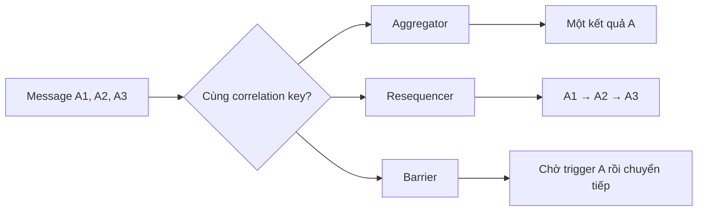
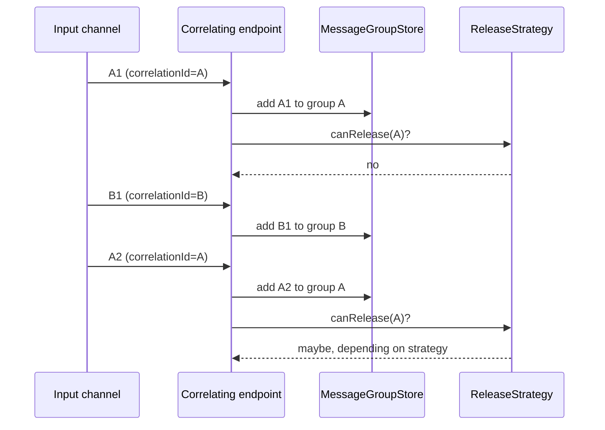
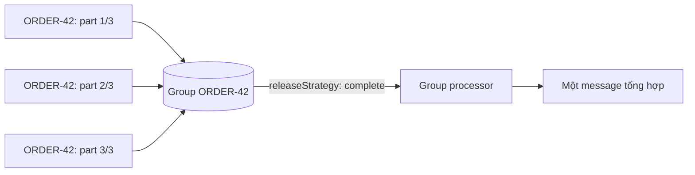
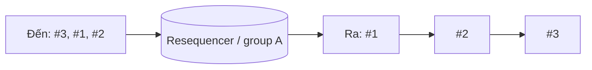
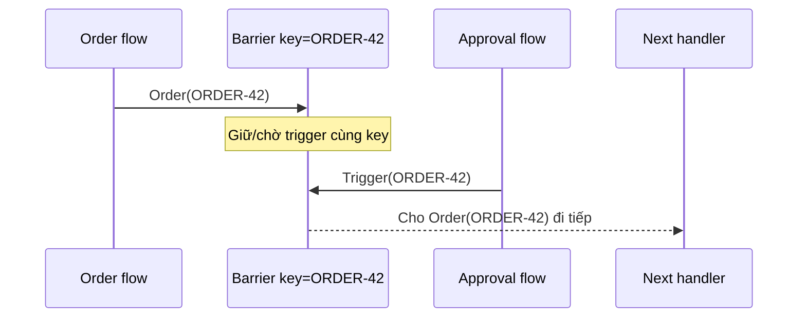
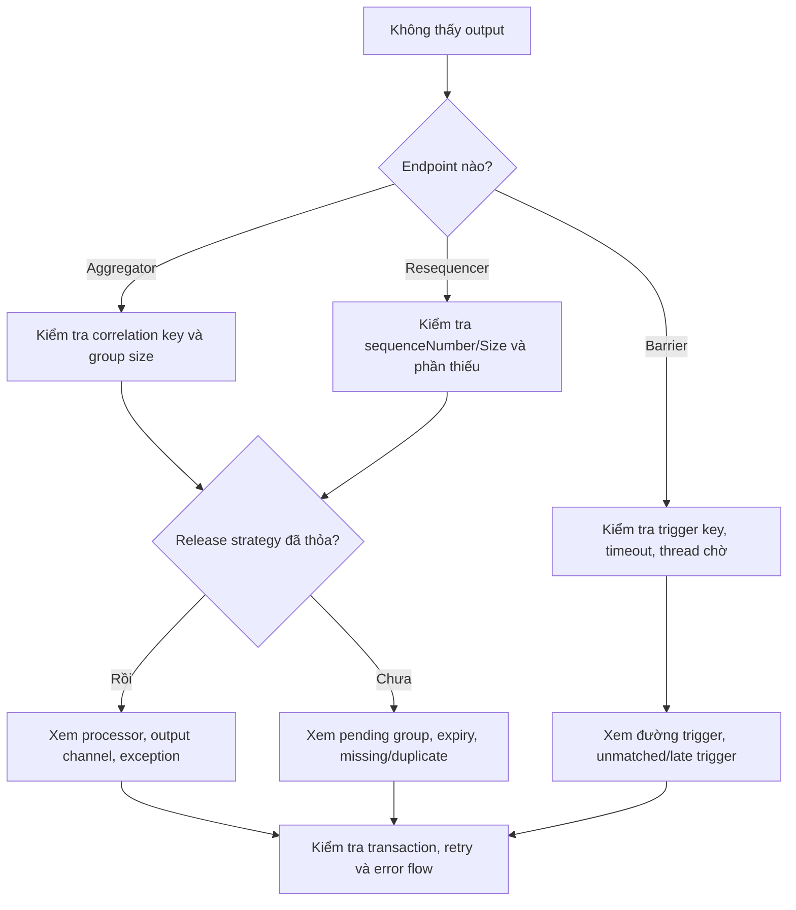

# Correlation trong aggregator, resequencer và barrier

Trong **Spring Integration runtime**, message có thể đến từ nhiều channel, consumer, poller và executor khác nhau; thứ tự đến không nhất thiết trùng với thứ tự nghiệp vụ. Khi một tác vụ được chia thành nhiều message, hệ thống cần biết **những message nào thuộc cùng một công việc**, **đã nhận đủ chưa** và **khi nào cho phép đi tiếp**. Cơ chế **correlation** cung cấp khóa liên kết các message, nhưng mỗi endpoint dùng khóa đó theo một cách khác nhau.

Bài thuộc chương **Correlation runtime** của module `SPRING_INTEGRATION_RUNTIME`, đi sâu vào ba thành phần dễ nhầm: **aggregator** gom message thành một kết quả, **resequencer** sắp xếp message theo thứ tự chuỗi, còn **barrier** giữ một luồng xử lý cho đến khi có tín hiệu giải phóng tương ứng. Ngoài cấu hình cơ bản, bài cũng đề cập vòng đời message group, message store, timeout, duplicate, transaction, retry, threading, lỗi và các dấu hiệu chẩn đoán runtime.

## 1. Correlation là gì và khác Message ID như thế nào?

Một message trong Spring Integration gồm payload và headers. `MessageHeaders.ID` định danh **một message cụ thể**; correlation key liên kết **nhiều message thuộc cùng một nhóm hoặc phiên xử lý**.

Giả sử đơn hàng `ORDER-42` được chia thành ba phần, mỗi phần chạy trên một worker riêng:

| Message | `id` | `correlationId` | `sequenceNumber` | `sequenceSize` |
| --- | --- | --- | --- | --- |
| Phần A | `m-101` | `ORDER-42` | 1 | 3 |
| Phần B | `m-102` | `ORDER-42` | 2 | 3 |
| Phần C | `m-103` | `ORDER-42` | 3 | 3 |

*Các giá trị `m-101`, `m-102` và `m-103` chỉ là định danh minh họa; header `id` thực tế của Spring Messaging thường dùng UUID.*

Ba message có ID khác nhau nhưng cùng `correlationId`. Nếu thêm một đơn hàng `ORDER-43` cũng có ba phần, các message của hai đơn hàng **không được trộn thành một nhóm**.

### 1.1. Các header cần nhận diện

| Header / giá trị | Ý nghĩa | Có phải bảo đảm runtime không? |
| --- | --- | --- |
| `id` | Định danh từng message | Không phải khóa nhóm nghiệp vụ mặc định |
| `correlationId` | Khóa để liên kết các message cùng một nhóm | Không tự bảo đảm thứ tự, độ bền hoặc tính duy nhất toàn hệ thống |
| `sequenceNumber` | Vị trí của một message trong chuỗi, thường bắt đầu từ 1 | Phải được gắn đúng và nhất quán để resequence |
| `sequenceSize` | Tổng số phần được kỳ vọng trong chuỗi, khi biết trước | Nếu thiếu hoặc sai, điều kiện release có thể không thỏa |
| `traceId` / business key | Dùng để truy vết hoặc định danh nghiệp vụ | Có thể khác khóa correlation mà endpoint sử dụng |

Trong Spring Integration, các key correlation/sequence chuẩn có thể truy cập bằng `IntegrationMessageHeaderAccessor.CORRELATION_ID`, `SEQUENCE_NUMBER` và `SEQUENCE_SIZE`. Với `@Header`, tên key thường là `"correlationId"`, `"sequenceNumber"` và `"sequenceSize"`.

**Lưu ý:** Không nên tự coi `traceId`, `correlationId` và `orderId` là ba tên gọi của một thứ. Một trace có thể bao gồm nhiều nhóm; một đơn hàng có thể cần nhiều đợt gom riêng. Khóa correlation phải được chọn cho đúng **ranh giới nhóm của từng endpoint**.

## 2. Ba thành phần: cùng correlation, khác hành vi



| Thành phần | Dùng correlation để làm gì? | Đầu ra điển hình | Điều kiện tiếp tục |
| --- | --- | --- | --- |
| **Aggregator** | Gom các message cùng key thành `MessageGroup` | Một message kết quả từ nhóm | `ReleaseStrategy` xác định đủ điều kiện |
| **Resequencer** | Phân vùng các message thành các chuỗi riêng để sắp lại | Nhiều message, theo thứ tự chuỗi | Dữ liệu sequence và chiến lược release |
| **Barrier** | Ghép một message đang chờ với trigger có cùng key | Message đang chờ được cho đi tiếp | Trigger tương ứng tới hoặc hết thời gian chờ |

**Nhầm lẫn hay gặp:** aggregator và resequencer đều có thể sử dụng message group store, nhưng aggregator **kết hợp** thành một kết quả còn resequencer chủ yếu **sắp xếp rồi phát từng message**. Barrier không tự gom đủ `N` phần và cũng không tự sắp thứ tự; nó là một cơ chế **đồng bộ hóa bằng tín hiệu**.

## 3. Mô hình message group trong runtime

Với aggregator/resequencer, có thể hình dung mỗi correlation key ứng với một `MessageGroup` trong `MessageGroupStore`:

```text
MessageGroupStore
  group "ORDER-42"
    message A1: sequenceNumber=1, sequenceSize=3
    message A3: sequenceNumber=3, sequenceSize=3
    trạng thái: đang chờ A2

  group "ORDER-43"
    message B1: sequenceNumber=1, sequenceSize=2
    message B2: sequenceNumber=2, sequenceSize=2
    trạng thái: có thể release
```

Một endpoint kiểu correlating thường có các quyết định:

1. **CorrelationStrategy**: tính khóa nhóm cho mỗi message.
2. **MessageGroupStore**: giữ các message và metadata nhóm giữa các lượt nhận.
3. **ReleaseStrategy**: xác định điều kiện nhóm được phát kết quả.
4. **MessageGroupProcessor** (đối với aggregator): xây payload/output message từ nhóm đã release.
5. **Expiry / discard / completion policy**: quyết định phải làm gì với nhóm thiếu message, message đến muộn hoặc nhóm đã hoàn tất.



Đây là mô hình khái niệm. Cơ chế lưu, khóa nhóm, transaction và thời điểm gọi release strategy phụ thuộc phiên bản Spring Integration cùng cấu hình endpoint. Correlation **không tự tạo một transaction** xuyên qua các message.

## 4. Aggregator: gom các message cùng một khóa

**Aggregator** được dùng khi cần một kết quả tổng hợp: ba dòng hàng thành một hóa đơn, nhiều phản hồi dịch vụ thành một báo cáo, hoặc nhiều phép tính thành một kết quả.



### 4.1. Correlation và release mặc định

Trong flow phổ biến `splitter → aggregator`, splitter có thể sinh các message con và gắn `correlationId`, `sequenceNumber`, `sequenceSize` (khi áp dụng sequence headers). Aggregator mặc định thường dùng **correlation ID trong header** để chọn nhóm và **thông tin sequence size** để biết khi nào nhóm hoàn chỉnh.

Ví dụ một payload dạng `List.of("A", "B", "C")` được splitter chia thành ba message. Nếu mỗi message có cùng key và `sequenceSize=3`, aggregator có thể phát kết quả sau khi nhận đủ các phần.

**Không suy diễn rằng mọi message tự động có correlation header.** Nếu producer bên ngoài tự gửi từng message mà không thiết lập header hoặc correlation strategy, aggregator không thể tự đoán những message nào cùng một nhóm. Tương tự, `sequenceSize` phải thể hiện số phần thực sự kỳ vọng; sai size có thể khiến nhóm bị giữ mãi hoặc release không đúng thời điểm.

### 4.2. Ví dụ Java DSL: split rồi aggregate

Ví dụ dưới đây minh họa flow Java 17+ với `spring-integration-core` và cấu hình `@EnableIntegration`. Producer gửi một collection, splitter chia message và aggregator ghép lại. `QueueChannel` ở cuối giúp kiểm tra kết quả bằng `receive()`.

```java
import java.util.List;
import org.springframework.beans.factory.annotation.Qualifier;
import org.springframework.context.annotation.Bean;
import org.springframework.context.annotation.Configuration;
import org.springframework.integration.annotation.EnableIntegration;
import org.springframework.integration.channel.DirectChannel;
import org.springframework.integration.channel.QueueChannel;
import org.springframework.integration.dsl.IntegrationFlow;
import org.springframework.messaging.Message;
import org.springframework.messaging.MessageChannel;
import org.springframework.messaging.PollableChannel;
import org.springframework.messaging.support.MessageBuilder;

@Configuration
@EnableIntegration
class BatchAggregationConfig {
    @Bean
    MessageChannel batchRequests() {
        return new DirectChannel();
    }

    @Bean
    QueueChannel batchResults() {
        return new QueueChannel();
    }

    @Bean
    IntegrationFlow batchAggregationFlow() {
        return IntegrationFlow.from("batchRequests")
                .split()
                .aggregate()
                .channel("batchResults")
                .get();
    }
}

// Ví dụ gọi từ producer sau khi Spring context khởi động:
void sendBatch(MessageChannel batchRequests, PollableChannel batchResults) {
    batchRequests.send(MessageBuilder
            .withPayload(List.of("item-A", "item-B", "item-C"))
            .build());

    Message<?> result = batchResults.receive(2_000);
    if (result == null) {
        throw new IllegalStateException("No aggregated result before timeout");
    }
    System.out.println(result.getPayload());
}
```

`sendBatch(...)` là phương thức minh họa gọi bằng các bean đã inject (ví dụ `@Qualifier("batchRequests")` và `@Qualifier("batchResults")`); không phải method được Spring tự gọi nếu chưa đăng ký runner. Trong flow này, splitter tạo sequence headers theo cấu hình thông thường; aggregator mặc định tổng hợp payload các phần. Kiểu payload đầu ra cụ thể nên được xác nhận bằng test theo processor/phiên bản đã cấu hình, thay vì ép kiểu DTO mà không kiểm tra.

### 4.3. Tùy chỉnh correlation theo khóa nghiệp vụ

Nếu nhận message độc lập từ nhiều nguồn, ta có thể chọn khóa khác `correlationId` mặc định, ví dụ `batchId`:

```java
// Minh họa phần cấu hình aggregator Java DSL trong một IntegrationFlow:
.aggregate(spec -> spec
        .correlationStrategy(
                message -> message.getHeaders().get("batchId"))
        .releaseStrategy(group -> group.size() >= 3))
```

Đây là **fragment DSL**, không phải một câu lệnh Java độc lập. Nếu dùng cách này, producer phải đặt `batchId` nhất quán cho tất cả phần thuộc một batch, đồng thời số `3` phải đúng với hợp đồng nghiệp vụ. Trong ứng dụng production, kiểm tra cả `null`/khóa thiếu, duplicate, thành viên không hợp lệ và trường hợp batch có số phần động.

Một `ReleaseStrategy` chỉ kiểm tra `group.size() >= 3` **không chứng minh** ba phần mong muốn đã xuất hiện: ba message trùng nhau về nội dung hoặc sequence có thể khiến size đủ nhưng dữ liệu chưa đúng. Khi có khả năng duplicate, nên kết hợp khóa thành viên, sequence validation và idempotency trước hoặc trong bước gom nhóm.

## 5. Khi nào aggregator không thể hoàn tất?

Nhóm `ORDER-42` kỳ vọng ba phần nhưng chỉ nhận được `1/3` và `3/3`. Nếu không có chính sách timeout/expiry, nhóm có thể tồn tại trong store và tiếp tục tiêu tốn bộ nhớ/tài nguyên.

| Triệu chứng | Nguyên nhân thường gặp | Cách quan sát |
| --- | --- | --- |
| Không thấy output mặc dù đã gửi message | Chưa đủ phần theo release strategy | Kiểm tra group size, expected sequenceSize |
| Hai đơn hàng bị gộp chung | Khóa correlation không đủ phân biệt | Log correlation key và business key |
| Nhóm còn trong store rất lâu | Thiếu message, timeout hoặc expiry policy không phù hợp | Theo dõi tuổi nhóm và số group pending |
| Output có phần lặp | Producer redelivery/duplicate, thiếu dedup | Kiểm tra message ID và khóa thành viên |
| Message đến sau khi nhóm hoàn tất bị bỏ/nhóm lại | Chính sách giữ/expire completed group và late-arrival | Kiểm tra cấu hình completion/expiry và discard |

Spring Integration hỗ trợ các lựa chọn như `groupTimeout`, chính sách phát kết quả chưa đủ khi hết hạn, discard channel và cơ chế dọn message group (ví dụ `MessageGroupStoreReaper` khi phù hợp). **Timeout không tự đồng nghĩa “gửi nhóm một phần”.** Tùy cấu hình, nhóm có thể bị loại, đưa vào discard flow, hoặc phát partial result. Luồng kinh doanh cần định nghĩa rõ hành vi với dữ liệu thiếu.

### 5.1. Vòng đời nhóm sau release

Sau khi aggregator phát kết quả, store có thể lưu thông tin nhóm hoàn tất trong một thời gian hoặc xóa nhóm tùy cấu hình. Điều này ảnh hưởng đến **message đến muộn** và **trùng correlation key**:

- Nếu tái sử dụng cùng `batchId` cho một đợt mới, message có thể bị hiểu là thành viên của nhóm cũ hoặc bị loại tùy chính sách.
- Nếu xóa ngay dấu vết nhóm hoàn tất, message redeliver cũ có thể tạo nhóm mới và phát kết quả trùng.
- Nếu giữ nhóm hoàn tất mãi, số nhóm tồn đọng có thể tăng liên tục.

Vì vậy phải quy định **vòng đời của correlation key**: tạo mới theo từng batch nghiệp vụ, giữ dấu dedup đủ lâu và có chính sách expiry/reaper phù hợp.

## 6. Resequencer: giữ message riêng lẻ nhưng phát đúng thứ tự

**Resequencer** giải quyết bài toán các message của cùng một chuỗi đến sai thứ tự, ví dụ mạng hoặc nhiều executor đưa `3/3` đến trước `1/3`. Nó dùng correlation key để không trộn hai chuỗi và thông tin `sequenceNumber` để quyết định thứ tự phát.



Khác aggregator, resequencer **không có mục tiêu gộp ba payload thành một DTO**. Nó thường trả từng message đầu vào theo thứ tự đúng; các headers liên quan có thể được giữ/chuyển theo quy tắc endpoint.

### 6.1. Điều kiện cần để resequence

1. Mỗi message của chuỗi có **correlation key giống nhau**.
2. `sequenceNumber` là số hợp lệ, bắt đầu từ 1 trong mẫu thông thường và nhất quán trong nhóm.
3. `sequenceSize` hoặc chính sách nhận biết kết thúc chuỗi phải đáng tin cậy.
4. Luồng phải có chính sách với **message thiếu**, **message tới muộn**, **duplicate sequence number** và **timeout**.
5. Downstream phải có đúng kỳ vọng về ordering: “được phát theo thứ tự” không tự bảo đảm **hoàn thành nghiệp vụ theo thứ tự** nếu tiếp theo là `ExecutorChannel` chạy song song.

### 6.2. Ví dụ Java DSL: resequence message đến đảo thứ tự

```java
import org.springframework.context.annotation.Bean;
import org.springframework.context.annotation.Configuration;
import org.springframework.integration.annotation.EnableIntegration;
import org.springframework.integration.channel.DirectChannel;
import org.springframework.integration.channel.QueueChannel;
import org.springframework.integration.dsl.IntegrationFlow;
import org.springframework.messaging.MessageChannel;
import org.springframework.messaging.PollableChannel;
import org.springframework.messaging.support.MessageBuilder;

@Configuration
@EnableIntegration
class ResequenceConfig {
    @Bean
    MessageChannel outOfOrder() {
        return new DirectChannel();
    }

    @Bean
    QueueChannel inSequence() {
        return new QueueChannel();
    }

    @Bean
    IntegrationFlow resequencingFlow() {
        return IntegrationFlow.from("outOfOrder")
                .resequence()
                .channel("inSequence")
                .get();
    }
}

// Producer minh họa: gửi thứ tự 3, 1, 2 nhưng cùng một group key.
void sendOutOfOrder(MessageChannel outOfOrder, PollableChannel inSequence) {
    for (int seq : new int[]{3, 1, 2}) {
        outOfOrder.send(MessageBuilder.withPayload("part-" + seq)
                .setHeader("correlationId", "batch-9")
                .setHeader("sequenceNumber", seq)
                .setHeader("sequenceSize", 3)
                .build());
    }

    for (int i = 0; i < 3; i++) {
        var next = inSequence.receive(2_000);
        System.out.println(next == null ? "missing" : next.getPayload());
    }
}
```

Khi đủ chuỗi và release strategy cho phép, **kỳ vọng** đầu ra có thứ tự `part-1`, `part-2`, `part-3`. Đây là ví dụ độc lập với flow aggregator phía trên. Cấu hình policy về partial release/expiry có thể thay đổi thời điểm đầu ra được phát; vì vậy nên kiểm tra thứ tự **và số phần** thay vì chỉ đợi một message xuất hiện.

Không nên dùng resequencer làm “khóa đồng bộ” cho mọi handler phía sau. Khi downstream xử lý bất đồng bộ hoặc dùng nhiều consumer, các message có thể **bắt đầu theo thứ tự** nhưng **hoàn tất khác thứ tự**. Muốn bảo đảm thứ tự commit/side effect, cần thiết kế serial processing hoặc partition theo business key.

## 7. Aggregator và resequencer: so sánh điểm lưu và giải phóng

| Câu hỏi | Aggregator | Resequencer |
| --- | --- | --- |
| Nhóm theo gì? | Correlation key từ header hoặc strategy | Correlation key của chuỗi |
| Dựa vào thứ tự không? | Không nhất thiết; processor/strategy có thể yêu cầu thứ tự | Có, cần sequence number đúng |
| Chờ bao lâu? | Đến khi release strategy thỏa hoặc áp dụng timeout/expiry | Đến khi có thể phát theo policy và dữ liệu chuỗi |
| Đầu ra bao nhiêu message? | Thường một message tổng hợp cho một lần release | Thường nhiều message theo thứ tự |
| Nhóm thiếu phần có rủi ro gì? | Không release hoặc phát partial không đủ | Bị kẹt chờ số còn thiếu, có thể ảnh hưởng toàn chuỗi |
| Cần message store không? | Có để giữ nhóm giữa các lượt xử lý | Có thể cần giữ message chưa tới lượt phát |
| Giữ thứ tự downstream? | Tùy processor và channel tiếp theo | Không bảo đảm sau một ranh giới xử lý song song |

Mô hình “cùng một group key” không có nghĩa hai endpoint tự chia sẻ cùng một nhóm. Mỗi endpoint có thể có store/region và vòng đời riêng. Nếu dùng chung một store vật lý, cần cấu hình cô lập namespace/region phù hợp để tránh nhóm của aggregator bị lẫn với nhóm của resequencer.

## 8. Barrier: correlation để chờ và giải phóng

Một **barrier** khác hai thành phần trên: một message đang xử lý phải **chờ tín hiệu** tương ứng, ví dụ:

- Đơn hàng đã được tạo nhưng cần phê duyệt trước khi xuất kho.
- Một thao tác đã gửi yêu cầu ra hệ thống khác, đang đợi callback xác nhận.
- Workflow chạy đến bước cần chờ một sự kiện ngoài trước khi đi tiếp.

Trong Spring Integration, barrier endpoint được biểu diễn bởi `BarrierMessageHandler`. Thành phần này phối hợp một **message đang chờ** với **trigger message** có correlation key tương ứng. Nó có timeout, và trong thiết kế đồng bộ cần chú ý vì luồng xử lý có thể bị giữ trong lúc chờ.



### 8.1. Hai loại message trong tình huống barrier

| Message | Mục đích | Khóa cần khớp |
| --- | --- | --- |
| **Message đang chờ** | Là message nghiệp vụ bị tạm dừng trước bước kế tiếp | Ví dụ `orderId=ORDER-42` |
| **Trigger message** | Báo điều kiện được thỏa để giải phóng | Cũng `orderId=ORDER-42` |

Trigger `ORDER-43` không được phép mở barrier của `ORDER-42`. Correlation strategy phải tính **cùng loại khóa** cho cả message đang chờ và trigger; việc chỉ có cùng `traceId` không đủ nếu strategy thực tế lấy `orderId`.

### 8.2. Cách nối trigger về mặt khái niệm

Với một barrier được cấu hình tên `approvalBarrier`, có thể mô tả logic tích hợp như sau:

```text
ordersWaitingForApproval
  -> approvalBarrier.handleMessage(orderMessage)
     (chờ trigger / hết timeout)
  -> approvedOrders

approvalEvents
  -> triggerAdapter
  -> approvalBarrier.trigger(approvalMessage)
```

Đây là **sơ đồ API**, không phải cấu hình Spring đầy đủ. Khi triển khai, cần tạo `BarrierMessageHandler`, chọn correlation strategy, đăng ký endpoint cho message chính và định tuyến trigger đến phương thức trigger theo API/version đang sử dụng. Không nên chỉ gửi trigger vào cùng input channel với message đang chờ rồi kỳ vọng framework tự biết đó là trigger.

**Quan trọng:** barrier không phải aggregator hai message trả ra một cặp payload. Trigger là **điều kiện mở khóa**, không mặc nhiên là một thành viên được cộng vào một `MessageGroup` giống aggregator.

### 8.3. Timeout và chi phí giữ thread

Khi barrier chờ trong thread xử lý, một số hệ quả cần xem xét:

- Với `DirectChannel`, lời gọi producer có thể bị block đến khi trigger đến hoặc hết timeout.
- Nếu trigger cần được tạo **trên chính thread đang chờ**, ứng dụng có nguy cơ deadlock; nên đảm bảo luồng trigger có đường thực thi độc lập.
- Nếu nhiều request chờ trong executor pool nhỏ, các thread có thể bị chiếm hết dù CPU thấp.
- Cần xác định hành vi timeout/exception/discard theo cấu hình barrier và xử lý tình huống trigger đến trễ.
- Một thread đang chờ **không phải trạng thái workflow bền vững sau restart**. Nếu yêu cầu chờ hàng giờ/ngày hoặc phải tiếp tục sau crash, thường nên dùng state machine/workflow hoặc store bền vững thay vì giữ một thread.

Khả năng trigger đến trước message đang chờ, trigger bị lặp, hoặc trigger sau timeout phải được **kiểm thử theo implementation và cấu hình cụ thể**. Không nên giả định tín hiệu sớm được nhớ vô hạn hoặc tự mở barrier của lần chờ tiếp theo.

## 9. Chọn correlation key đúng cho từng cơ chế

Một hệ thống có các định danh sau:

```text
traceId     = trace-993
orderId     = ORDER-42
shipmentId  = SHIPMENT-42-1
batchId     = PICK-BATCH-2026-11-22-01
```

Có thể chọn:

- Aggregator gom phản hồi các kho cho **một shipment**: dùng `shipmentId`.
- Resequencer sắp các bước cập nhật của **một batch picking**: dùng `batchId` kết hợp `sequenceNumber`.
- Barrier đợi phê duyệt xuất hàng cho **một order**: dùng `orderId` nếu đó là phạm vi được phê duyệt.
- Log/tracing xuyên hệ thống: giữ `traceId` riêng, không tự thay thế key nhóm.

| Tiêu chí chọn key | Vì sao cần? |
| --- | --- |
| Ổn định qua retry/redelivery | Cùng một công việc không bị tách thành nhiều nhóm khi lỗi |
| Đủ đặc hiệu | Tránh trộn hai đơn hàng/đợt xử lý khác nhau |
| Kiểu giá trị nhất quán | `"42"` (String) không đương nhiên bằng `42` (Integer) |
| Có vòng đời rõ | Tránh reuse key cũ trước khi completed group được dọn |
| Có thể lưu/serialize nếu dùng store bền vững | Khôi phục message groups sau restart |
| Không chứa thông tin nhạy cảm không cần thiết | Không rò rỉ token/PII qua logs/metrics |

Nếu key thiếu hoặc `null`, nên coi đó là lỗi validation cần xử lý có chủ đích, thay vì âm thầm đưa mọi message thiếu khóa vào một nhóm “null”. Với input không tin cậy, xác thực header trước endpoint correlation là một lựa chọn an toàn.

## 10. Duplicate, late arrival và out-of-order

Correlation key giải quyết **phân nhóm**; không tự giải quyết **đúng một lần** hoặc **thứ tự hoàn tất**.

### 10.1. Duplicate cùng correlation ID

Giả sử producer gửi hai lần `part-2` vì timeout:

```text
Group ORDER-42:
  part-1
  part-2 (delivery đầu)
  part-2 (redelivery)
  part-3
```

Nếu release strategy chỉ đếm size và thiếu deduplication theo thành viên, nhóm có thể được release khi dữ liệu còn thiếu hoặc tạo output không đúng. Cần chọn một **member key** ổn định (ví dụ `orderId + lineId` hoặc `batchId + sequenceNumber`), kiểm tra sự trùng lặp và quyết định rõ là bỏ qua, ghi nhận hay ném lỗi.

### 10.2. Message đến sau khi nhóm đã hoàn tất

Message đến muộn có thể gặp nhóm đã release, nhóm đã expire hoặc key đã được tái sử dụng:

- Aggregator cần chiến lược late arrival phù hợp với chính sách completed groups.
- Resequencer cần biết có còn tiếp nhận `sequenceNumber` cũ hay không và tránh phát trùng.
- Barrier cần xác định trigger quá muộn có còn giá trị không, và trạng thái chờ có còn tồn tại không.

Ở tất cả trường hợp, cần quan sát **business key**, `correlationId`, member/sequence ID và trạng thái nhóm/trigger. Message ID mới không chứng minh sự kiện nghiệp vụ là mới.

### 10.3. Không có bảo đảm exactly-once chỉ nhờ MessageGroupStore

Một JDBC/Redis/Mongo message group store giúp giữ trạng thái ngoài RAM, nhưng chưa tự bảo đảm commit nguyên tử giữa:

1. Nhận message từ broker;
2. Lưu message vào group;
3. Release output;
4. Gửi output sang broker khác;
5. Ghi cập nhật nghiệp vụ.

Nếu tiến trình crash giữa các bước, các message có thể được giao lại hoặc output bị phát lại. Cần transaction boundary, idempotency, deduplication và đôi khi outbox/inbox theo yêu cầu nhất quán.

## 11. MessageStore và vòng đời group

Mặc định, các endpoint correlating thường dùng một **message group store trong bộ nhớ** nếu không cấu hình store phù hợp. Điều này đơn giản để học nhưng có hệ quả:

- Các nhóm đang chờ có thể mất khi ứng dụng restart.
- Nhiều instance không tự chia sẻ trạng thái nhóm.
- Nhóm không hoàn tất chiếm bộ nhớ cho tới khi được release/expire/dọn.
- Message tới các instance khác nhau có thể bị phân thành nhiều nhóm cục bộ không đầy đủ.

Khi yêu cầu độ bền, dùng một `MessageGroupStore` phù hợp, ví dụ `JdbcMessageStore`; **khác với** `JdbcChannelMessageStore` thường dùng cho queue channel. Việc cấu hình persistence cần xem schema, serializer, transaction manager và tương thích khi nâng cấp.

| Chiến lược lưu | Ưu điểm | Điều cần giám sát |
| --- | --- | --- |
| In-memory group store | Ít phụ thuộc, độ trễ thấp | Memory, mất state khi restart |
| JDBC message group store | Có thể lưu nhóm trong DB, chia sẻ trạng thái nếu cấu hình đúng | Lock contention, transaction, cleanup, truy vấn chậm |
| Distributed store phù hợp | Có thể hỗ trợ nhiều node | Serialization, consistency, TTL, network latency |

Chỉ dùng chung một database không bảo đảm hai endpoint có cùng trạng thái group hợp lệ. Mỗi aggregator/resequencer cần **định danh store/region hoặc scope nhóm** rõ, tránh va chạm các correlation key của nhiều flow.

### 11.1. Group expiry không đồng nghĩa business completion

Một nhóm hết hạn do thiếu thành viên **không có nghĩa nghiệp vụ hoàn tất**. Hãy định nghĩa một trong các trạng thái cuối:

- `COMPLETED`: đủ dữ liệu và phát kết quả hợp lệ.
- `PARTIAL`: chỉ phát kết quả thiếu khi nghiệp vụ chấp nhận, có cờ trạng thái rõ.
- `TIMED_OUT`: ghi record lỗi để chờ can thiệp.
- `DISCARDED`: bỏ có chủ đích theo policy, có audit.

Nếu phát partial result, downstream phải nhận biết đó là kết quả chưa đủ, tránh coi một tập 2/3 là kết quả đầy đủ. Nếu bỏ nhóm, phải xác định có cần DLQ/quarantine hay tái thu thập phần thiếu không.

## 12. Threading, poller và executor

Các cơ chế correlation rất dễ bị đánh giá sai khi nhìn vào thời điểm `send()` thay vì trạng thái group và worker.

| Ngữ cảnh | Đặc điểm runtime | Nguy cơ |
| --- | --- | --- |
| `DirectChannel` + aggregator | Có thể xử lý trên thread sender, nhóm chờ trong store | Producer gửi xong nhưng chưa có output vì chưa đủ phần |
| `QueueChannel` + polling endpoint | Poller lấy message theo lịch, chậm hoặc theo batch | Backlog trước group làm tăng thời gian hoàn tất |
| `ExecutorChannel` trước resequencer | Message tới endpoint theo thứ tự không xác định | Cần sequence headers chính xác |
| `ExecutorChannel` sau resequencer | Output được phát theo thứ tự tại boundary, downstream chạy song song | Thứ tự hoàn tất không còn bảo đảm |
| Barrier trên pool hữu hạn | Một worker có thể bị giữ để đợi trigger | Starvation, timeout và khó dừng service |

Correlation strategy không tự khóa một `business key` trên toàn hệ thống. Ngay cả khi MessageGroupStore có cơ chế đồng bộ ở cấp group, các thao tác ngoài store (database update, HTTP request) vẫn cần transaction/idempotency và giới hạn concurrency phù hợp.

Khi có nhiều poller/executor, cần tách **sequence của message** khỏi **thứ tự commit side effect**. Một downstream handler xử lý `part-1` lâu hơn `part-2` vẫn có thể hoàn thành sau dù đầu vào đã được resequence đúng.

## 13. Retry, transaction và error channel

### 13.1. Retry trong một group

Nếu aggregator đang lưu `part-1` và `part-2`, retry `part-2` không được biến một phần nghiệp vụ thành hai thành viên khác nhau. Retry advice có thể gọi lại handler nhiều lần; source redelivery còn có thể tạo message ID mới. Dùng member key/idempotency để phân biệt retry với phần tử mới.

Nếu việc lưu group tham gia transaction mà transaction rollback, message có thể cần được source redeliver để thử lại; điều này phụ thuộc broker, message store, poller transaction và thứ tự advice. Không mặc nhiên cho rằng retry luôn đọc lại `QueueChannel`.

### 13.2. Lỗi trong release strategy hoặc output processor

Một exception có thể xuất hiện khi:

1. Tính correlation key (header thiếu, sai kiểu);
2. Ghi vào `MessageGroupStore` (DB lỗi, serialization lỗi);
3. Kiểm tra release strategy;
4. Tổng hợp payload;
5. Gửi message kết quả sang output channel.

Lỗi ở mỗi bước có hậu quả khác nhau. Nếu group đã bị đánh dấu completed hoặc output đã gửi trước khi transaction lỗi, retry có thể gây duplicate output. Cần kiểm tra transaction boundary và idempotency ở cả **đầu vào và đầu ra**.

### 13.3. ErrorMessage và trạng thái nhóm

Một error channel có thể nhận `ErrorMessage` khi exception được framework publish theo ngữ cảnh; với flow đồng bộ qua `DirectChannel`, exception cũng có thể truyền thẳng về caller. Log `ErrorMessage` **không tự xóa group**, **không mặc nhiên retry** và **không bảo đảm rollback** message store.

Khi nhóm timeout hoặc barrier hết chờ, hãy thiết kế đường báo lỗi và phục hồi rõ: message nào cần replay, group key nào bị ảnh hưởng, trạng thái store còn gì, trigger có thể đến muộn ra sao.

## 14. Chẩn đoán một nhóm không phát output

Khi không có dữ liệu từ aggregator/resequencer hoặc barrier không mở, nên điều tra từ **đúng key** trước:



### 14.1. Dữ liệu nên quan sát

| Signal | Hữu ích để trả lời |
| --- | --- |
| `correlationId` + business key | Message thuộc đúng nhóm không? |
| `messageId` và member key | Có duplicate hoặc redelivery không? |
| `sequenceNumber` / `sequenceSize` | Có thiếu phần hoặc số thứ tự bất hợp lệ không? |
| Group size, age, completed status | Nhóm đã đủ, chờ quá lâu hay đã hết hạn? |
| Store size / số group pending | Có rò rỉ nhóm hoặc backlog không? |
| Release/expiry/discard counts | Vì sao không thấy output? |
| Thread name, queue depth, poller delay | Message đã tới correlating endpoint chưa? |
| Trigger received / timeout / wait duration | Barrier có được mở đúng key không? |
| Output message ID và correlation | Kết quả đã được tạo và dispatch chưa? |

Tránh log toàn bộ payload hoặc header nhạy cảm; nên dùng ID và error code tối thiểu. Với distributed store, việc đếm group hoặc truy trạng thái từ dashboard có thể có độ trễ; kết hợp metrics với log của endpoint và store khi cần.

## 15. Bài thực hành

### Bài 1 — Hai nhóm xen kẽ

Tạo hai batch `A` và `B`, mỗi batch có ba message. Gửi theo thứ tự `A1, B1, A3, B2, A2, B3`. Kiểm tra aggregator tạo **hai** output và không trộn payload. Thay correlation key của `B2` thành `A` để quan sát lỗi nhóm và giải thích vì sao thông tin sequence hợp lệ vẫn không cứu được key sai.

### Bài 2 — Một phần bị thiếu

Với `A` kỳ vọng ba phần, chỉ gửi `A1` và `A3`. Quan sát số group pending; thiết lập timeout/expiry và chọn **một** chính sách rõ: báo lỗi, discard có audit hoặc phát partial result có đánh dấu trạng thái. Giải thích vì sao timeout không tự đồng nghĩa hoàn tất.

### Bài 3 — Resequence trước và sau executor

Gửi ba phần của một batch theo thứ tự `3, 1, 2`. Xác nhận resequencer phát đúng `1, 2, 3`; sau đó đặt `ExecutorChannel` với handler có độ trễ khác nhau **sau resequencer**. Ghi thứ tự bắt đầu và hoàn thành để chứng minh output ordering ở một boundary không tự bảo đảm thứ tự commit downstream.

### Bài 4 — Duplicate và redelivery

Gửi hai lần cùng phần `A2` với message IDs khác nhau nhưng cùng business member key. Kiểm thử group release của aggregator và xác định nơi cần deduplication. Khi dùng broker với redelivery, phân biệt số lần source gửi message với số phần nghiệp vụ thực sự.

### Bài 5 — Barrier cùng key, khác key và timeout

Tạo hai message cần chờ phê duyệt `ORDER-42` và `ORDER-43`. Gửi trigger cho `ORDER-43` trước, xác minh nó không giải phóng `ORDER-42`; sau đó gửi trigger đúng key. Thử trigger đến sau timeout và quan sát trạng thái. Khi triển khai, bảo đảm trigger có đường thread độc lập để tránh deadlock.

### Bài 6 — Crash và trạng thái group

So sánh group store trong RAM với một `MessageGroupStore` bền vững. Gửi nửa batch, restart rồi gửi phần còn lại. Theo dõi khả năng release và các message còn trong store. Thêm retry/redelivery để kiểm tra idempotency và completed-group policy.

## 16. Những lỗi thiết kế thường gặp

| Sai lầm | Hậu quả | Cách xử lý |
| --- | --- | --- |
| Dùng `MessageHeaders.ID` thay cho correlation key chung | Mỗi message thành một nhóm riêng | Dùng key nghiệp vụ/correlation ID thống nhất |
| Chỉ đặt `correlationId` mà quên sequence headers cho resequencer | Không đủ dữ kiện sắp xếp | Gắn số thứ tự và kích thước chuỗi đáng tin cậy |
| Đếm `group.size()` mà không kiểm tra duplicate | Release nhầm hoặc phát kết quả sai | Member key, dedup và validation |
| Không thiết kế expiry cho nhóm thiếu phần | Rò rỉ bộ nhớ/store, output bị kẹt | Group timeout, cleanup và recovery policy |
| Cho rằng aggregator và resequencer tạo cùng kiểu output | Downstream nhận sai kiểu hoặc sai số lượng message | Xác định contract đầu ra của từng endpoint |
| Cho rằng barrier tự nhớ trigger sớm hoặc tồn tại sau restart | Mất tín hiệu/chờ mãi | Kiểm thử race, timeout và dùng durable workflow nếu cần |
| Chờ trigger trong một pool nhỏ rồi trigger dùng chính pool đó | Worker starvation/deadlock | Tách đường thực thi trigger |
| Dùng cùng correlation key ở nhiều flow mà không cô lập store/region | Va chạm nhóm | Cấu hình scope/region riêng |
| Đo thứ tự phát tại resequencer rồi suy ra thứ tự commit downstream | Side effect có thể lệch thứ tự | Serial/partitioned processing khi bắt buộc |
| Tin rằng durable store tự bảo đảm exactly-once | Duplicate output sau crash/retry | Idempotency, transaction/outbox và test sự cố |

## 17. Câu hỏi tự kiểm tra

1. **Aggregator dùng correlation để làm gì?** Để gom những message thuộc cùng `MessageGroup` và release một kết quả khi chiến lược cho phép.
2. **Resequencer khác aggregator ở đầu ra ra sao?** Nó sắp xếp rồi phát các message theo sequence thay vì bắt buộc gộp thành một payload duy nhất.
3. **Barrier được giải phóng bởi điều gì?** Một trigger phù hợp correlation key, theo cơ chế/timeout được cấu hình.
4. **`correlationId` có thay thế `sequenceNumber` không?** Không. Key nhóm và thứ tự trong nhóm là hai thông tin khác nhau.
5. **Nhóm thiếu một phần có tự hoàn thành khi hết giờ không?** Không thể giả định; còn tùy timeout, expiry, release/discard policy.
6. **Resequencer có đảm bảo handler chạy song song phía sau commit đúng thứ tự không?** Không.
7. **Message group store trong RAM có giữ nhóm qua restart không?** Không.
8. **Có thể dùng `traceId` thay correlation key cho mọi endpoint không?** Chỉ khi trace thực sự trùng đúng phạm vi nhóm; thường cần business/group key riêng.
9. **Vì sao redelivery có thể làm aggregator sai?** Duplicate có thể tăng số thành viên hoặc tạo output lặp nếu thiếu dedup/completion policy.
10. **Muốn chẩn đoán barrier không mở nên xem gì đầu tiên?** Correlation key của message đang chờ và trigger, đường trigger, timeout và thread đang chờ.

## 18. Tổng kết

**Correlation là cách các endpoint liên hệ message, không phải một bảo đảm giao hàng.** Aggregator dùng key để **gom**, resequencer dùng key và sequence để **sắp thứ tự**, còn barrier dùng key để **đối chiếu trigger và giải phóng luồng chờ**. Muốn xử lý runtime đáng tin cậy, cần chọn key đúng phạm vi, xác thực sequence/duplicate, quản lý vòng đời group và timeout, hiểu ranh giới thread/transaction, đồng thời quan sát message store, error flow, retry và idempotency.

Khi một output không xuất hiện, đừng chỉ kiểm tra “message đã `send()` thành công chưa”. Hãy hỏi tiếp: **message đã đến endpoint chưa, thuộc group nào, còn thiếu gì, release condition có đạt chưa, có trigger đúng key chưa, và transaction/error flow đã tác động gì đến state?** Đó là quy trình cốt lõi để chẩn đoán correlation trong Spring Integration runtime.
