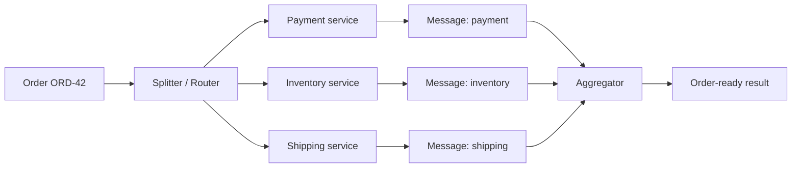
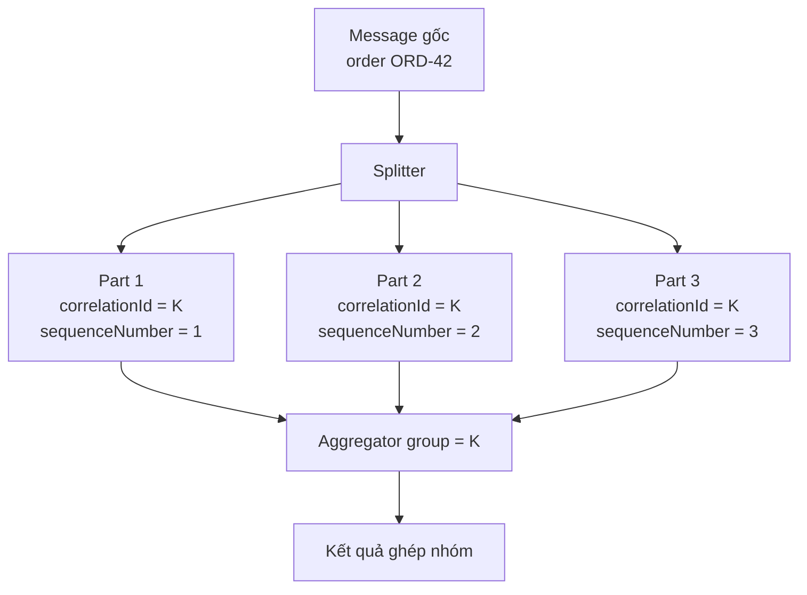

# Header correlation id và expression trong Spring Integration

## Mục tiêu học tập

Một message có thể đi qua nhiều channel, transformer, router, executor, poller và handler trước khi tạo ra kết quả cuối. Khi một yêu cầu được tách thành nhiều nhánh, hệ thống cần trả lời câu hỏi: **những message nào cùng thuộc một yêu cầu hoặc cùng một nhóm nghiệp vụ?** Spring Integration sử dụng thông tin *correlation* và những chiến lược tính correlation key để trả lời câu hỏi này.

Bài **Header correlation id và expression** thuộc chương **Correlation runtime** của module **SPRING_INTEGRATION_RUNTIME**. Trọng tâm là phân biệt header `correlationId` với message ID, hiểu expression (thường là SpEL) chọn key ra sao và quan sát hậu quả của việc đặt sai key khi flow dùng splitter, aggregator, message store, retry, error handling, transaction và executor.

Sau bài này, bạn có thể:

- Đọc và đặt header `correlationId` trên một `Message`, phân biệt nó với `id`, `sequenceNumber`, `sequenceSize`, business key và trace ID.
- Viết expression lấy correlation key từ `headers` hoặc `payload`; hiểu rằng việc **tính key** và việc **ghi header** là hai hành động khác nhau.
- Dùng Java DSL để enrich header hoặc cung cấp `CorrelationStrategy` cho aggregator.
- Giải thích cách splitter/aggregator nhóm message, khi nào một group ID bị trùng và vì sao số lượng message chưa chắc đủ để release.
- Duy trì correlation qua transformer, executor, poller, retry và error flow; chẩn đoán message lạc nhóm, group tồn đọng hoặc kết quả bị trộn giữa các yêu cầu.
- Thiết kế các tình huống kiểm thử có nhiều tenant, nhiều thread, message trùng và message đến muộn.

## 1. Correlation giải quyết vấn đề gì tại runtime?

Giả sử một đơn hàng `ORD-42` cần ba kết quả song song: thanh toán thành công, tồn kho được giữ và phí vận chuyển đã tính. Mỗi nhánh có một message riêng, có thể đến từ các endpoint và thread khác nhau:



Aggregator phải biết message `payment`, `inventory`, `shipping` của `ORD-42` được phép ghép với nhau, nhưng **không được ghép** với một message của `ORD-43`. Đó là nhiệm vụ của correlation key. Nếu chọn key quá rộng, kết quả các đơn hàng có thể bị trộn; nếu chọn key quá hẹp hoặc không ổn định, các phần của cùng một đơn hàng lại bị tách thành nhiều nhóm và chờ mãi.

Một message có thể mang những header như:

```text
payload:
  kind          = "PAYMENT_CONFIRMED"
  orderId       = "ORD-42"

headers:
  id            = UUID của riêng message PAYMENT_CONFIRMED
  correlationId = "tenant-a:ORD-42"
  sequenceNumber = 1
  sequenceSize   = 3
  businessKey    = "ORD-42"
```

Những trường này không đồng nghĩa với nhau. `correlationId` có ý nghĩa kết nối các message ở một phạm vi do flow/ứng dụng định nghĩa, còn message ID định danh từng message riêng lẻ.

## 2. Các loại định danh dễ nhầm

| Trường hoặc khái niệm | Ai tạo hoặc quản lý? | Dùng để làm gì? | Có bắt buộc giữ nguyên khi tạo message mới? |
| --- | --- | --- | --- |
| `MessageHeaders.ID` (`id`) | Thường được Spring Messaging tạo cho message instance | Nhận diện một message cụ thể, tra cứu bằng UUID trong một `MessageStore` | Không; message mới thường có ID mới |
| `IntegrationMessageHeaderAccessor.CORRELATION_ID` (`correlationId`) | Splitter/integration component hoặc ứng dụng, tùy flow | Liên kết message của cùng quá trình/nhóm | Có khi contract yêu cầu, nhưng phải chủ động kiểm tra |
| `sequenceNumber` | Thường do component tạo sequence như splitter | Vị trí phần tử trong một chuỗi/nhóm | Giữ khi release/grouping cần nó |
| `sequenceSize` | Thường do component tạo sequence | Số phần tử dự kiến của nhóm, khi biết | Không đồng nghĩa với số message đã nhận |
| `businessKey`, `orderId` | Ứng dụng | Định danh nghiệp vụ, idempotency, tra cứu | Thường cần xuyên suốt vòng đời nghiệp vụ |
| `traceId` / `spanId` | Tracing/observability | Liên kết log, span và request phân tán | Theo cơ chế truyền trace, không tự thay correlation strategy |
| `MessageGroupStore` group ID | Correlation strategy của endpoint | Khóa lưu một nhóm message trong store | Có thể bằng header `correlationId`, hoặc là kết quả expression khác |

**Điểm quan trọng:** Spring Integration có header chuẩn tên `correlationId`, nhưng **một header tồn tại không tự tạo group**. Chỉ khi một thành phần (ví dụ aggregator) đọc header này hoặc dùng một `CorrelationStrategy` phù hợp thì nó mới trở thành group key trong xử lý.

Ngược lại, một aggregator có thể tính group ID trực tiếp từ `payload.orderId` mà **không cần thêm** header `correlationId` vào message trước đó. Khi điều tra lỗi, hãy phân biệt “message mang header gì?” với “endpoint thực sự chọn key nào?”.

### 2.1. Correlation ID không nhất thiết là UUID

Giá trị correlation có thể là `String`, `UUID`, số hoặc một object dùng làm group key, tùy producer và component. Vì thế:

```text
UUID("...")             khác String("...")
String("42")            khác Integer(42)
"tenant-a:ORD-42"       khác "tenant-b:ORD-42"
```

Hai giá trị trông giống nhau trong log chưa chắc bằng nhau khi so sánh bằng `equals()`. Nếu một nhánh gửi UUID còn nhánh khác gửi chuỗi biểu diễn UUID, aggregator có thể tạo hai group tách biệt. Quy định **kiểu và format cố định của key** là một phần của hợp đồng message.

### 2.2. Correlation ID và trace ID

`correlationId` thường đại diện cho một nhóm message theo nghiệp vụ hoặc một vòng tổng hợp. Trace ID đại diện cho chuỗi quan sát trong distributed tracing. Một trace có thể chứa nhiều đơn hàng và một đơn hàng có thể trải qua nhiều trace khi retry/replay. Không dùng trace ID làm business key trừ khi hợp đồng thực sự bảo đảm quan hệ đó.

## 3. Đọc và gắn header correlationId lên Message

Spring Integration định nghĩa tên header thông qua `IntegrationMessageHeaderAccessor.CORRELATION_ID`. Bạn có thể dùng hằng số này để tránh nhập sai chuỗi `"correlationId"`.

Ví dụ tạo hai message độc lập cùng correlation ID:

```java
import org.springframework.integration.IntegrationMessageHeaderAccessor;
import org.springframework.messaging.Message;
import org.springframework.messaging.support.MessageBuilder;

Message<String> payment = MessageBuilder
        .withPayload("PAYMENT_CONFIRMED")
        .setHeader(IntegrationMessageHeaderAccessor.CORRELATION_ID,
                "tenant-a:ORD-42")
        .setHeader("businessKey", "ORD-42")
        .build();

Message<String> inventory = MessageBuilder
        .withPayload("INVENTORY_RESERVED")
        .setHeader(IntegrationMessageHeaderAccessor.CORRELATION_ID,
                "tenant-a:ORD-42")
        .setHeader("businessKey", "ORD-42")
        .build();

Object paymentCorrelation =
        payment.getHeaders().get(IntegrationMessageHeaderAccessor.CORRELATION_ID);
Object inventoryCorrelation =
        inventory.getHeaders().get(IntegrationMessageHeaderAccessor.CORRELATION_ID);

System.out.println(paymentCorrelation.equals(inventoryCorrelation)); // true
System.out.println(payment.getHeaders().getId()
        .equals(inventory.getHeaders().getId()));                  // false
```

Hai message cùng correlation key nên có thể được nhóm **nếu** chúng đi vào cùng endpoint/grouping policy; chúng vẫn có hai message ID riêng. Trong thực tế, không nên dựa vào xác suất UUID khác nhau để xây invariant nghiệp vụ; điều cần kiểm thử là các message nhận ID riêng và correlation được bảo toàn theo contract.

### 3.1. Giữ header khi tạo payload mới

Transformer hoặc handler thường tạo một message mới sau khi chuyển đổi dữ liệu. Hãy truyền correlation một cách rõ ràng khi đó là trách nhiệm của ứng dụng:

```java
import org.springframework.integration.IntegrationMessageHeaderAccessor;
import org.springframework.messaging.Message;
import org.springframework.messaging.support.MessageBuilder;

record InventoryResult(String orderId, boolean reserved) {}

Message<InventoryResult> toResult(Message<String> input) {
    Object key = input.getHeaders()
            .get(IntegrationMessageHeaderAccessor.CORRELATION_ID);

    if (key == null) {
        throw new IllegalArgumentException("Missing correlationId");
    }

    return MessageBuilder
            .withPayload(new InventoryResult("ORD-42", true))
            .setHeader(IntegrationMessageHeaderAccessor.CORRELATION_ID, key)
            .setHeader("businessKey", input.getHeaders().get("businessKey"))
            .build();
}
```

Khi bạn chỉ trả về một payload từ transformer Spring Integration, framework thường có chính sách sao chép headers của message đầu vào vào message đầu ra. Nhưng nếu bạn tạo `Message<?>` thủ công, dùng interceptor thay đổi headers, đi qua adapter bên ngoài hoặc message converter, **cần xác minh header nào thực sự còn lại**. Đừng dựa vào giả định rằng mọi channel/adapter tự giữ correlation.

Một `MessageHeaders` không cho sửa trực tiếp qua API, nhưng message mới có thể có bộ headers khác. Hãy dùng `MessageBuilder` hoặc header enricher thay vì cố gọi `put()` trên `getHeaders()`.

### 3.2. Khi nào đặt correlation ID?

Có hai thời điểm thường dùng:

1. **Tại biên nhận yêu cầu:** đặt key bền vững như `tenantId:orderId`, để tất cả nhánh xử lý sau đó cùng tham chiếu.
2. **Tại điểm tạo nhóm:** splitter hoặc aggregator có thể gán/tính correlation theo message cha, ID của request hoặc expression chuyên biệt. Cách này phù hợp với những message group có vòng đời cục bộ.

Khi đặt ở cả hai nơi, hãy xác định **ưu tiên và chính sách ghi đè**. Một splitter có thể gắn correlation/sequence headers phục vụ chính nhóm nó sinh ra; không nên mặc nhiên suy luận rằng giá trị correlation ban đầu từ producer sẽ luôn giữ nguyên sau mọi splitter.

## 4. Expression tính correlation key là gì?

Spring Integration hỗ trợ **Spring Expression Language (SpEL)** trong nhiều endpoint và strategy. Với correlation, expression thường được đánh giá trên message để trả về một **key có tính ổn định và so sánh được**. Những biểu thức thường gặp:

| Expression | Ý nghĩa | Điều kiện |
| --- | --- | --- |
| `headers['correlationId']` | Lấy header correlation chuẩn | Header có giá trị |
| `headers['businessKey']` | Nhóm theo một header nghiệp vụ | Header được gắn và giữ ổn định |
| `payload['orderId']` | Lấy order ID từ payload kiểu `Map` | Payload là Map có key `orderId` |
| `payload.orderId` | Lấy property JavaBean `orderId` | Payload có getter/property mà SpEL truy cập được |
| `headers['tenantId'] + ':' + headers['orderId']` | Tạo key ghép tenant + order | Hai trường đều có, kiểu/format nhất quán |
| `headers['correlationId'] ?: headers['businessKey']` | Dùng correlation nếu có, dự phòng business key | Phải kiểm soát trường hợp cả hai đều thiếu |

Trong các ví dụ expression trên, root object được đặt là `Message` theo ngữ cảnh của **correlation strategy / header enricher đang sử dụng**. Không nên sao chép expression sang một thành phần khác mà chưa xem root object và evaluation context của thành phần đó; có nơi expression được đánh giá trên `MessageGroup` hoặc payload thay vì `Message`.

### 4.1. Tính key khác với gắn header

Hai câu sau không có cùng tác dụng:

- **Correlation strategy:** đánh giá `headers['correlationId']` hoặc `payload['orderId']`, rồi dùng giá trị trả về làm **group ID** của aggregator. Nó không nhất thiết viết lại message headers.
- **Header enricher:** đánh giá expression trên message để **đặt một header** cho message đầu ra. Nó không tự tạo group trong `MessageGroupStore`.

Ví dụ, một message có `payload.orderId=ORD-42` nhưng không có header correlation:

```text
Strategy expression: payload.orderId
    -> group ID = "ORD-42" khi aggregator nhận message
    -> message gốc vẫn có thể không có header correlationId

Header enricher expression: payload.orderId
    -> message mới có header correlationId = "ORD-42"
    -> vẫn cần aggregator/correlation strategy dùng header ấy
```

Đây là khác biệt cốt lõi của chủ đề **Header correlation id và expression**: một expression có thể **lấy ra khóa** hoặc **tạo ra metadata**, tùy nó được gắn vào thành phần nào.

## 5. Header Enricher: tạo correlationId từ expression

Trong luồng tiếp nhận message có payload `Map`, ta muốn mọi message cùng tenant và order có một correlation key ổn định.

```java
import org.springframework.context.annotation.Bean;
import org.springframework.context.annotation.Configuration;
import org.springframework.integration.IntegrationMessageHeaderAccessor;
import org.springframework.integration.channel.DirectChannel;
import org.springframework.integration.config.EnableIntegration;
import org.springframework.integration.dsl.IntegrationFlow;
import org.springframework.messaging.Message;
import org.springframework.messaging.MessageChannel;
import org.springframework.messaging.MessageHandler;

@Configuration
@EnableIntegration
class CorrelationFlowConfig {

    @Bean("ordersInput")
    MessageChannel ordersInput() {
        return new DirectChannel();
    }

    @Bean
    IntegrationFlow enrichCorrelationFlow() {
        MessageHandler sink = message -> {
            Object key = message.getHeaders()
                    .get(IntegrationMessageHeaderAccessor.CORRELATION_ID);
            System.out.println("Correlation=" + key
                    + ", thread=" + Thread.currentThread().getName());
        };

        return IntegrationFlow.from("ordersInput")
                .enrichHeaders(headers -> headers.headerExpression(
                        IntegrationMessageHeaderAccessor.CORRELATION_ID,
                        "payload['tenantId'] + ':' + payload['orderId']"))
                .handle(sink)
                .get();
    }
}
```

Producer có thể gửi:

```java
import java.util.Map;
import org.springframework.messaging.Message;
import org.springframework.messaging.MessageChannel;
import org.springframework.messaging.support.MessageBuilder;

// ordersInput được inject từ Spring context.
Message<Map<String, String>> incoming = MessageBuilder
        .withPayload(Map.of(
                "tenantId", "tenant-a",
                "orderId", "ORD-42",
                "event", "PAYMENT_CONFIRMED"))
        .build();

ordersInput.send(incoming);
```

Khi expression thực thi thành công, header `correlationId` được tính thành `"tenant-a:ORD-42"`. Vì ví dụ chưa có header này ở input, không phát sinh mâu thuẫn về ghi đè. Trong production, hãy quy định rõ header enricher có được overwrite header `correlationId` đã có hay không; dùng tính năng override theo cấu hình và kiểm thử thực tế.

**Điều cần xác minh:** `payload['tenantId']` và `payload['orderId']` phải tồn tại, trả về kiểu string dự kiến. Nếu thiếu trường, expression có thể tạo key không hợp lệ hoặc ném lỗi tùy dữ liệu/cấu hình. Nên validate đầu vào trước khi enrich, chuẩn hóa tenant ID/order ID và cấm key rỗng.

### 5.1. Tại sao key ghép tenant + order an toàn hơn?

Nếu chỉ dùng `orderId="42"`, hai tenant có thể tạo cùng order ID. Aggregator dùng key `42` có thể ghép nhầm dữ liệu giữa tenant A và tenant B, dẫn tới lỗi nghiệp vụ và rủi ro cô lập dữ liệu. Sử dụng namespace phù hợp như `tenant-a:42` bảo đảm các nhóm thuộc hai phạm vi khác nhau được phân biệt.

Key nên ổn định và có cấu trúc rõ ràng. Nếu các trường có thể chứa ký tự phân cách `:`, hãy dùng encoding có độ dài, format chuẩn hoặc một key object có `equals/hashCode` đúng, thay vì nối chuỗi tùy tiện. Tất cả producer phải thống nhất cách viết hoa/thường, Unicode normalization và kiểu dữ liệu.

## 6. CorrelationStrategy và aggregator chọn group ID

Khi message đến aggregator, một `CorrelationStrategy` quyết định **group ID**. Spring Integration cung cấp chiến lược dựa trên header và dựa trên expression. Ví dụ với `ExpressionEvaluatingCorrelationStrategy`:

```java
import org.springframework.integration.aggregator.CorrelationStrategy;
import org.springframework.integration.aggregator.ExpressionEvaluatingCorrelationStrategy;
import org.springframework.messaging.Message;

CorrelationStrategy strategy =
        new ExpressionEvaluatingCorrelationStrategy(
                "headers['correlationId']");

Object groupKey = strategy.getCorrelationKey(incomingMessage);
System.out.println("groupId=" + groupKey);
```

Đây là snippet minh họa cho một `incomingMessage` đã được tạo trong flow. Strategy **đọc message để trả key**; không có thao tác `setHeader` ở đây.

### 6.1. Dùng strategy trong IntegrationFlow

Ví dụ cấu hình aggregator nhận các phần sự kiện thuộc cùng order, rồi release khi đủ ba message:

```java
import org.springframework.context.annotation.Bean;
import org.springframework.integration.aggregator.ExpressionEvaluatingCorrelationStrategy;
import org.springframework.integration.dsl.IntegrationFlow;
import org.springframework.messaging.Message;
import org.springframework.messaging.MessageHandler;

@Bean
IntegrationFlow groupOrderPartsFlow() {
    MessageHandler sink = message -> {
        System.out.println("Aggregated payload=" + message.getPayload());
    };

    return IntegrationFlow.from("orderParts")
            .aggregate(spec -> spec
                    .correlationStrategy(
                            new ExpressionEvaluatingCorrelationStrategy(
                                    "headers['correlationId']"))
                    .releaseStrategy(group -> group.size() >= 3))
            .handle(sink)
            .get();
}
```

Ví dụ dùng `group.size() >= 3` **chỉ để minh họa release strategy** khi mỗi order chắc chắn có đúng ba phần hợp lệ. Trong hệ thống thật, một message bị gửi trùng có thể khiến group đạt kích thước 3 dù vẫn thiếu một loại sự kiện. Cần release strategy kiểm tra **đủ các loại kết quả**, quản lý duplicate/late arrival và timeout. Nếu dùng splitter tạo các phần có `sequenceSize`, có thể áp dụng chiến lược phát theo sequence tương ứng, nhưng vẫn cần hiểu nguồn có bảo đảm sequence đầy đủ hay không.

Nếu các phần vào một aggregator đã có header `correlationId` phù hợp, bạn cũng có thể dùng chiến lược correlation mặc định theo header của thành phần đó. Cấu hình rõ expression hữu ích khi muốn đổi sang `businessKey`, key ghép tenant/order hoặc một quy tắc chuyên biệt; không phải để làm cho message “có correlation” một cách tự động.

### 6.2. Message group và key

```text
Aggregator / CorrelationStrategy
             |
             v
getCorrelationKey(message) -> "tenant-a:ORD-42"
             |
             v
MessageGroupStore[groupId="tenant-a:ORD-42"]
             ├── Message<PaymentConfirmed>    id=UUID-A
             ├── Message<InventoryReserved>   id=UUID-B
             └── Message<ShippingQuoted>      id=UUID-C
             |
             v
ReleaseStrategy -> aggregate / publish output
```

Một `MessageGroupStore` quản lý nhóm theo `groupId`. Ngược lại, `MessageStore.getMessage(UUID)` tra cứu từng message bằng message ID. Không thể tự lấy một `groupId` kiểu string truyền vào `MessageStore.getMessage(UUID)` và mong nó trả về toàn bộ group.

**Quy tắc quan trọng:** group ID phải giữ cùng kiểu và giá trị cho mọi message được dự kiến ghép với nhau. Nếu `correlationId` thay đổi qua transformer hoặc mỗi nhánh tự tạo UUID mới làm correlation, group sẽ bị chia tách.

## 7. Splitter, sequence headers và correlation ở các nhánh

Một splitter nhận message đầu vào và phát nhiều phần. Nhiều cấu hình splitter của Spring Integration có thể gắn metadata chuỗi gồm `correlationId`, `sequenceNumber`, `sequenceSize` để hỗ trợ tổng hợp lại.



Trong splitter có sequence, `K` thường liên quan đến định danh message gốc hoặc correlation context do splitter xác lập. **Không mặc nhiên đồng nhất K với `orderId` từ payload**. Nếu flow cần group theo business key, cấu hình correlation strategy rõ ràng tại aggregator hoặc bổ sung header nghiệp vụ riêng với quy tắc ổn định.

| Header | Ý nghĩa trong một chuỗi | Ngộ nhận cần tránh |
| --- | --- | --- |
| `correlationId` | Định danh nhóm các phần | Không bắt buộc là ID đơn hàng |
| `sequenceNumber` | Vị trí/nhãn thứ tự của phần | Không bảo đảm message được giao tới theo đúng thứ tự |
| `sequenceSize` | Tổng số phần được công bố/ước tính theo cơ chế tạo chuỗi | Không tự bảo đảm các phần đều đến nơi |
| `id` | Định danh từng message phần | Không dùng làm group key nếu mỗi phần có ID riêng |

Một message có `sequenceNumber=3` có thể tới trước message có `sequenceNumber=1` khi đi qua executor, broker hoặc thread pool. Aggregator cần xử lý out-of-order delivery và phải có cơ chế phù hợp cho duplicate và message đến muộn.

### 7.1. Tạo các phần thủ công

Khi tự tạo message cho từng nhánh, bạn có thể gắn correlation và sequence rõ ràng:

```java
import org.springframework.integration.IntegrationMessageHeaderAccessor;
import org.springframework.messaging.Message;
import org.springframework.messaging.support.MessageBuilder;

Message<String> part1 = MessageBuilder
        .withPayload("PAYMENT_CONFIRMED")
        .setHeader(IntegrationMessageHeaderAccessor.CORRELATION_ID,
                "tenant-a:ORD-42")
        .setHeader(IntegrationMessageHeaderAccessor.SEQUENCE_NUMBER, 1)
        .setHeader(IntegrationMessageHeaderAccessor.SEQUENCE_SIZE, 3)
        .build();

Message<String> part2 = MessageBuilder
        .withPayload("INVENTORY_RESERVED")
        .setHeader(IntegrationMessageHeaderAccessor.CORRELATION_ID,
                "tenant-a:ORD-42")
        .setHeader(IntegrationMessageHeaderAccessor.SEQUENCE_NUMBER, 2)
        .setHeader(IntegrationMessageHeaderAccessor.SEQUENCE_SIZE, 3)
        .build();
```

Đây là hai trong ba phần dự kiến; chúng chưa đủ để release theo `sequenceSize=3`. Khi triển khai, hãy đảm bảo thông tin sequence phản ánh đúng số lượng phần thực tế và không bị ghi đè nhầm ở downstream.

## 8. Expression lựa chọn correlation key: các tình huống cần suy nghĩ

### 8.1. Header thiếu hoặc có giá trị null

Với expression `headers['correlationId']`, một message không có header có thể không tạo được key hợp lệ để group. Kết quả cụ thể tùy evaluator/endpoint; không nên để nhiều message thiếu correlation đều vô tình bị gom vào một “nhóm null” hoặc silently ignored.

Chiến lược an toàn:

1. Validate correlation header ngay tại biên vào aggregator.
2. Nếu có thể tính từ business key, dùng một expression fallback **được định nghĩa trong contract**; đừng tự chọn fallback bất kỳ.
3. Nếu vẫn không có key hợp lệ, route sang validation/error flow với bản ghi nguyên nhân.
4. Theo dõi chỉ số thiếu correlation và báo lỗi sớm thay vì để group tồn tại vô hạn.

Ví dụ expression fallback:

```spel
headers['correlationId'] ?: headers['businessKey']
```

Trong flow nhiều tenant, chỉ fallback sang `businessKey` nếu business key đã chứa namespace/tenant. Nếu không, cần expression như `headers['tenantId'] + ':' + headers['businessKey']`.

### 8.2. Key có thể thay đổi giữa các bước

Nếu expression dùng `payload.status` hoặc thời gian hiện tại để tạo key, cùng một order có thể thành hai group khác nhau khi trạng thái thay đổi. Correlation key nên được lấy từ **định danh ổn định**, không phải field biến đổi theo tiến trình.

Đặc biệt với transform `Message<Order>` thành `Message<PaymentResult>`, `payload.orderId` có thể không còn là property hợp lệ. Khi đó lấy key từ header nghiệp vụ đã chuẩn hóa thường bền vững hơn expression phụ thuộc schema của mọi payload.

### 8.3. Kiểu key khác nhau hoặc format không đồng nhất

`42` (Integer), `"42"` (String), `"042"` và `" 42 "` không nên được coi như một key chỉ vì hiển thị gần giống nhau. Hãy định nghĩa chuẩn canonical representation tại producer hoặc một bước normalization trước aggregator, sau đó kiểm thử bằng dữ liệu thực tế.

### 8.4. Key trùng giữa hai quy trình độc lập

Hai request khác thời điểm có thể cùng `orderId`, ví dụ một đợt tái xử lý hoặc một workflow mới cho cùng đơn hàng. Nếu dùng `orderId` duy nhất làm group ID, message của đợt cũ có thể đi vào group mới hoặc bị coi là late arrival.

Có thể thêm `workflowId`/version/generation vào key khi business contract yêu cầu tách hai phiên xử lý. Tuy nhiên, nếu muốn retry **cùng một** workflow, không tạo key mới mỗi attempt; nếu không, các phần của một request bị tách nhóm.

### 8.5. Biểu thức do người dùng ngoài kiểm soát

SpEL có khả năng truy cập property/method và các tính năng nâng cao. Expression được dùng trong cấu hình nên là **mã tin cậy của ứng dụng**, không nhận trực tiếp expression tùy ý từ payload hoặc người dùng không tin cậy. Với nhu cầu chọn key từ dữ liệu ngoài, hãy nhận **giá trị** như orderId, validate rồi dùng expression tĩnh hoặc một hàm chuẩn hóa có kiểm soát.

## 9. Correlation qua channel, executor, poller và transaction

Correlation là metadata **đi cùng message**, còn thread và transaction là **ngữ cảnh thực thi**. Phân biệt rõ hai nhóm này:

| Thành phần runtime | Điều xảy ra với execution | Điều xảy ra với correlation |
| --- | --- | --- |
| `DirectChannel` | Handler thường chạy trên thread của sender | Headers được chuyển cùng message; không tự tạo key mới |
| `ExecutorChannel` | Giao handler sang thread worker; caller có thể trả về trước | Message chuyển sang worker vẫn mang headers; MDC/ThreadLocal không tự bảo đảm được chuyển theo |
| `QueueChannel` và polling consumer | Message chờ trong queue rồi được poller lấy | Correlation đi trong message nếu không bị thay thế; ordering có thể đổi khi xử lý nhiều worker |
| Transformer | Biến đổi payload, có thể tạo message mới | Phải kiểm tra header propagation và định danh mới |
| Splitter | Tạo nhiều message phần | Có thể thiết lập correlation/sequence riêng cho nhóm được tách |
| Aggregator | Gom message theo correlation strategy | Dùng kết quả expression/strategy làm group ID, lưu group và release theo policy |
| Outbound adapter/broker | Message có thể được serialize và chuyển ra process khác | Phải map/serialize header cần thiết; không mặc nhiên mọi adapter giữ được object header tùy ý |

### 9.1. ThreadLocal, MDC và trace context

Một số ứng dụng đặt `correlationId` vào MDC hoặc `ThreadLocal` để ghi log. Sau `ExecutorChannel`, thread đã đổi nên MDC thường **không tự động truyền đúng** nếu không cấu hình task decorator/tracing context propagation. Nhưng `message.getHeaders().get("correlationId")` vẫn có thể được đọc ở worker nếu message giữ header ấy.

Do đó, hãy dùng header làm nguồn dữ liệu cho correlation nghiệp vụ, rồi đưa nó vào logging context trong phạm vi xử lý thích hợp. Không lấy một ThreadLocal của thread HTTP producer làm nguồn duy nhất để aggregator nhóm message.

### 9.2. Transaction và điểm ghi correlation

Một transaction có thể rollback thao tác ghi DB, nhưng correlation header của message đã tạo không tự biến thành một bản ghi bền vững. Với `ExecutorChannel`, transaction của caller thông thường không đi theo sang thread worker. Nếu lưu `MessageGroupStore` bằng JDBC, cần biết transaction nào quản lý ghi group và thời điểm commit/rollback.

Nếu process crash sau khi xử lý một nhánh nhưng trước khi aggregator release, message có thể được redeliver. Correlation ổn định giúp định vị đúng group, nhưng **không tự cung cấp exactly-once**. Cần idempotency theo business key và quy tắc xử lý duplicate.

## 10. Correlation trong retry, recovery và error flow

Khi handler ném exception, cần truy lại message nguồn và correlation để biết đang lỗi ở nhóm nào. Trong Spring Integration:

- Lỗi trong flow đồng bộ thường truyền ngược về caller theo call stack.
- Lỗi sau executor/poller có thể được error handler xuất bản dưới dạng `ErrorMessage`.
- `ErrorMessage` chứa `Throwable` làm payload; message nghiệp vụ gốc không phải payload của error message.
- Khi retry/redelivery, một invocation mới có thể dùng message instance mới; nên lưu **business key/correlation ID ổn định** và số attempt riêng biệt.

Ví dụ trích correlation từ error message:

```java
import org.springframework.integration.IntegrationMessageHeaderAccessor;
import org.springframework.messaging.Message;
import org.springframework.messaging.MessagingException;
import org.springframework.messaging.support.ErrorMessage;

void logError(ErrorMessage error) {
    Throwable failure = error.getPayload();

    Message<?> failed = error.getOriginalMessage();
    if (failed == null && failure instanceof MessagingException messaging) {
        failed = messaging.getFailedMessage();
    }

    Object correlation = failed == null
            ? "missing"
            : failed.getHeaders().get(
                    IntegrationMessageHeaderAccessor.CORRELATION_ID);

    System.err.printf("correlation=%s cause=%s%n",
            correlation, failure.getClass().getName());
}
```

`getOriginalMessage()` hoặc `getFailedMessage()` có thể `null`, hoặc chứa message tại các bước khác nhau của flow. Nếu exception được bọc nhiều lớp, cần duyệt cause chain có kiểm soát để tìm `MessagingException` phù hợp. Error flow cũng có thể thất bại; phải xác minh nơi lưu error record khi cần replay.

### 10.1. Retry không nên tạo correlation ID mới mỗi attempt

Giả sử một đơn hàng `ORD-42` được retry ba lần. Nếu mỗi attempt tạo một correlation UUID ngẫu nhiên, log và group của một workflow sẽ phân mảnh. Giữ `businessKey` và `correlationId` của workflow ổn định qua retry thông thường; ghi `attempt`/delivery count riêng.

Nếu một thao tác **tạo workflow nghiệp vụ mới có chủ đích**, có thể dùng `workflowRunId` mới để tách group, đồng thời giữ `orderId` để đối chiếu. Điều này phải được mô tả trong contract, không làm ngầm trong retry handler.

### 10.2. Error record và replay

Một error record nên có `businessKey`, `correlationId`, `workflowRunId` khi cần, message ID, endpoint, exception type, timestamp, attempt, delivery count, group ID và trạng thái replay. Hạn chế lưu toàn bộ payload nhạy cảm trong log; sử dụng kho lỗi có retention/permissions hợp lý.

Việc phát lại cùng message có correlation ID cũ có thể khiến nó đi vào group đã release hoặc group đang chờ khác. Trước replay, cần kiểm tra lifecycle của group và áp dụng chính sách duplicate/late arrival. Không coi correlation đúng là điều kiện đủ để replay an toàn.

## 11. MessageGroupStore, thời gian chờ và group bị kẹt

Một aggregator thường dùng `MessageGroupStore` để giữ các phần chưa đủ điều kiện release. `SimpleMessageStore` giữ state trong bộ nhớ; một persistent store phù hợp có thể giữ message group qua restart nếu serialization/schema/transaction được cấu hình đúng.

```text
groupId = tenant-a:ORD-42
received:
  PAYMENT_CONFIRMED
  INVENTORY_RESERVED
missing:
  SHIPPING_QUOTED

status:
  pending / waiting
```

Nếu `SHIPPING_QUOTED` không đến vì lỗi ở một nhánh, group có thể tồn tại lâu. Nếu expression ở nhánh shipping tạo key `ORD-42` thay vì `tenant-a:ORD-42`, group thiếu phần sẽ không thể hoàn tất dù downstream đã thực sự gửi message.

Cần chính sách cho:

- **Group timeout/expiration:** chờ đến đâu, release một phần hay báo lỗi?
- **Partial results:** nghiệp vụ có chấp nhận thiếu nhánh hay không?
- **Late arrival:** message đến sau khi group release/expire được xử lý thế nào?
- **Duplicate:** một loại kết quả gửi hai lần có được tính thành hai phần không?
- **Release và cleanup:** khi nào xóa message/group, khi nào giữ dấu vết đã hoàn tất?
- **Persistent store:** header, payload và key có serialize ổn định qua restart và multi-instance không?

Một group có đủ ba message **không tự bảo đảm** ba loại kết quả khác nhau đều tồn tại. Release dựa trên `group.size()` phù hợp cho demo; production nên xác nhận các part type hoặc correlation/sequence contract phù hợp, rồi thiết kế idempotency của bước aggregate output.

## 12. Quan sát, đo đạc và chẩn đoán correlation runtime

Để điều tra một order bị kẹt, ít nhất cần theo dõi:

| Dữ liệu | Nên thu ở đâu | Mục đích |
| --- | --- | --- |
| `messageId` | Mỗi điểm tạo message mới | Biết message instance nào đã đi qua bước nào |
| `correlationId` | Ingress, transformer, branch, aggregator, error flow | Kết nối các sự kiện thuộc một workflow |
| `businessKey` / `tenantId` | Biên nghiệp vụ và error record | Không nhầm dữ liệu hai khách hàng hoặc hai order |
| `groupId` thực tế | Correlation strategy/aggregator | Xác nhận key do expression thực sự trả về |
| `sequenceNumber` / `sequenceSize` | Sau splitter và trước aggregator | Kiểm tra thiếu/mất thứ tự |
| `endpointId` / `threadName` | Mỗi handler quan trọng | Xác định ranh giới thread và vị trí lỗi |
| `attempt` / delivery count | Retry advice, adapter/broker | Phân biệt retry trong handler với redelivery |
| `group.size`, `group.age`, timeout | Aggregator/store | Phát hiện group không release |
| `errorType`, `cause` | Error flow | Nhận diện lỗi expression/schema và failure của downstream |

Tên trường là gợi ý cho instrumentation; chúng không đồng nghĩa với việc Spring Integration tự cung cấp tất cả các metric trên. Để tránh cardinality cao, đưa correlation ID/message ID vào log hoặc trace có kiểm soát thay vì biến mỗi giá trị thành một metric label.

### 12.1. Bảng triệu chứng thường gặp

| Triệu chứng | Nguyên nhân có thể | Bước kiểm tra đầu tiên |
| --- | --- | --- |
| Aggregator không release dù đủ ba event nghiệp vụ | Ba event vào **khác group ID**, hoặc key kiểu khác nhau | Log kết quả `getCorrelationKey(message)` ở mọi nhánh |
| Hai order bị ghép chung | Dùng key quá rộng hoặc thiếu tenant namespace | So sánh tenant/order/workflow key và expression |
| Header correlation có ở ingress nhưng mất sau transform | Tạo `Message` mới và không giữ header, adapter filter header | So sánh headers trước/sau endpoint |
| Correlation trông đúng trên log nhưng group khác nhau | `UUID` vs `String`, case/whitespace/format khác | Log cả value và `getClass().getName()` |
| Một group thiếu đúng một nhánh | Lỗi downstream, group key sai hoặc message đến muộn | Trace branch theo business key và group ID |
| Group release sai khi có message trùng | Release theo `size()` mà không dedup/kiểm part type | Kiểm tra sequence/part type và idempotency |
| Expression lỗi khi truy `payload.orderId` | Transformer thay payload schema hoặc payload null/sai kiểu | Kiểm tra kiểu payload tại endpoint đánh giá expression |
| Không thấy correlation trong log worker | Chỉ dùng MDC/ThreadLocal ở thread producer | Đọc trực tiếp message header ở worker, cấu hình context propagation |
| Error flow không tìm thấy correlation | `ErrorMessage` chỉ mang exception; original/failed message thiếu | Kiểm `originalMessage`, `failedMessage` và cause chain |
| Group state mất sau restart | Store in-memory | Kiểm tra store bean/backend/transaction |
| Retry tạo nhiều group | Sinh correlation ID mới ở mỗi attempt | Giữ workflow correlation ổn định; tách attempt metadata |
| Group tồn đọng mãi | Không có timeout/expiration/release policy phù hợp | Group age, pending count và error rate |

### 12.2. Trình tự điều tra khi message bị lạc nhóm

1. Chọn một `businessKey` (ví dụ `ORD-42`) và tìm message ở ingress.
2. Ghi `id`, `correlationId`, tenant, kiểu payload và vị trí endpoint đã nhận.
3. Theo từng nhánh qua splitter/transformer/executor; ghi lại message ID mới và headers được chuyển tiếp.
4. Ở aggregator, log **kết quả thực của correlation strategy** cùng kiểu Java, không chỉ header mà bạn nghĩ nó dùng.
5. Tra group ID tương ứng trong `MessageGroupStore`; xem group size, sequence, release condition, timeout và late arrival.
6. Kiểm tra exception/retry/error flow tại nhánh thiếu; phân biệt message chưa tới với message tới sai group.
7. Xác nhận trạng thái nghiệp vụ bền vững và idempotency trước khi phát lại một phần hoặc toàn bộ workflow.

## 13. Thực hành có hướng dẫn

### Bài A — Một workflow, nhiều message ID

Tạo ba message `PAYMENT_CONFIRMED`, `INVENTORY_RESERVED`, `SHIPPING_QUOTED`, mỗi message có UUID riêng nhưng cùng `correlationId="tenant-a:ORD-42"`. Log `id`, `correlationId`, `businessKey`.

**Kết quả mong đợi:** ID khác nhau; correlation bằng nhau; khi đưa vào aggregator có strategy `headers['correlationId']`, cả ba được gán vào một group ID.

### Bài B — Header enricher bằng SpEL

Cho payload là `Map` có `tenantId`, `orderId` và `event`. Dùng `headerExpression` của mục 5 để tạo `correlationId`. Thử input hợp lệ, input thiếu `orderId`, input có sẵn correlation khác giá trị và input có `orderId` mang kiểu số.

**Kết quả mong đợi:** xác định được policy validate, normalize và overwrite; mọi nhánh có key cùng kiểu/format, còn input thiếu định danh được đưa sang lỗi có thể quan sát.

### Bài C — Correlation strategy khác nhau

Chạy ba chiến lược: `headers['correlationId']`, `headers['businessKey']` và `headers['tenantId'] + ':' + headers['businessKey']`. Gửi message của hai tenant cùng `orderId=42`.

**Kết quả mong đợi:** strategy chỉ dùng business key có thể trộn hai tenant; key ghép tách đúng nhóm. Quan sát group ID tại store thay vì chỉ tin vào code.

### Bài D — Splitter/aggregator và message đến sai thứ tự

Tạo ba phần kèm `sequenceNumber=1/2/3`, `sequenceSize=3`, cùng correlation key. Gửi theo thứ tự 3, 1, 2; sau đó gửi trùng phần 2 và quan sát release strategy của demo so với policy đã kiểm tra đủ loại kết quả.

**Kết quả mong đợi:** thứ tự đến không làm đổi correlation; duplicate có thể gây release sai nếu chỉ đếm `size()`; cần cơ chế đối chiếu part type/sequence và dedup.

### Bài E — Executor, error flow và log correlation

Chuyển một đoạn flow sang `ExecutorChannel`, để handler của một nhánh ném exception. Quan sát `threadName`, headers tại worker, `ErrorMessage`, `originalMessage`/`failedMessage` và log của caller.

**Kết quả mong đợi:** thread thay đổi không bắt buộc làm mất correlation header, nhưng MDC không tự bảo đảm truyền theo; error flow phải chủ động tìm message nguồn để ghi correlation.

### Bài F — Group persistence và replay

Dùng store có khả năng lưu nhóm bền vững, gửi hai trong ba phần rồi mô phỏng restart. Xác minh group có thể được đọc lại nếu đã commit và serializer hợp lệ. Gửi phần còn thiếu, sau đó phát lại một phần đã nhận để kiểm tra late arrival/duplicate.

**Kết quả mong đợi:** correlation ổn định hỗ trợ phục hồi đúng group, nhưng persistence và idempotency là các cơ chế riêng; message đã release không tự được phục hồi an toàn nếu replay không có policy.

## 14. Câu hỏi tự kiểm tra

1. `MessageHeaders.ID` và `correlationId` khác nhau thế nào về vòng đời và mục đích?
2. Khi nào `headers['correlationId']` trả về group key và khi nào expression này chỉ là bước lấy giá trị header?
3. Header enricher dùng `payload['orderId']` có tự tạo `MessageGroupStore` hay không?
4. Vì sao key `ORD-42` có thể không đủ trong hệ thống nhiều tenant?
5. Một splitter tạo ba message có `sequenceNumber` khác nhau; vì sao chúng vẫn phải dùng cùng correlation key để aggregator ghép lại?
6. Correlation strategy trả `UUID` ở nhánh A nhưng `String` ở nhánh B sẽ gây hậu quả gì?
7. Vì sao một aggregator dùng `group.size() >= 3` có thể release thiếu dữ liệu khi nhận duplicate?
8. Vì sao correlation header vẫn có thể được đọc sau `ExecutorChannel` trong khi MDC lại thiếu?
9. Nếu transformer thay `Order` thành `PaymentResult`, expression `payload.orderId` có còn chắc chắn hoạt động không?
10. Tại sao mỗi retry không nên sinh một correlation ID mới cho cùng workflow?
11. `MessageStore.getMessage(UUID)` và `MessageGroupStore.getMessageGroup(groupId)` khác nhau thế nào?
12. Một group còn tồn tại trong persistent store có chứng minh nghiệp vụ của order đã commit thành công chưa?
13. Làm thế nào phân biệt message chưa tới aggregator với message đã tới nhưng thuộc sai group?
14. Khi expression bị thiếu header hoặc trả key không hợp lệ, flow nên ghi nhận và xử lý thế nào?

**Ghi nhớ:** `correlationId` là **metadata liên kết message**, còn **correlation expression/strategy** xác định key mà endpoint thực sự sử dụng để nhóm. Hãy chuẩn hóa **kiểu và phạm vi key**, giữ key qua các ranh giới runtime, thiết kế sequence/release/timeout và kiểm chứng group ID ở điểm aggregator. Correlation hỗ trợ truy vết và tổng hợp; **transaction, persistence, retry và idempotency** vẫn phải được thiết kế riêng để bảo vệ kết quả nghiệp vụ.

