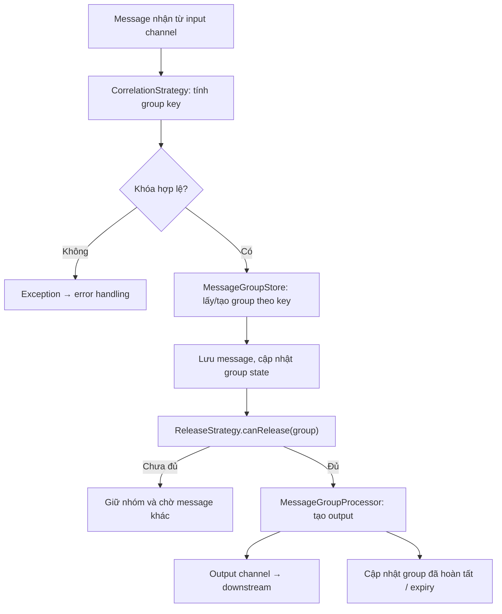

# Custom CorrelationStrategy trong Spring Integration

## 1. Vì sao cần tự định nghĩa correlation?

Trong Spring Integration, **correlation** là cơ chế xác định các message thuộc cùng một **nhóm logic** (*message group*). Khi hệ thống chia một yêu cầu thành nhiều phần, nhận kết quả song song từ các nguồn, hoặc gom sự kiện theo mã giao dịch, runtime phải quyết định message mới thuộc nhóm nào trước khi quyết định có thể phát nhóm đó đi tiếp hay chưa.

Bài này thuộc chương **Correlation runtime** trong module `SPRING_INTEGRATION_RUNTIME`. Nội dung gắn trực tiếp với việc điều phối flow qua channel, endpoint, consumer, poller, executor; quản lý vòng đời `IntegrationFlow`, transaction, retry, message store, lỗi, correlation và chẩn đoán trạng thái runtime.

**Custom `CorrelationStrategy`** cần thiết khi quy tắc nhóm mặc định dựa trên header `correlationId` không diễn đạt được khóa nghiệp vụ. Ví dụ:

- Gom nhiều dòng của cùng **lô nhập hàng** theo `tenantId + batchId`, kể cả khi mỗi message được phát ra từ một request khác nhau.
- Gom các mảnh do nhiều adapter gửi về cùng **orderId**, không có header correlation chuẩn từ `Splitter`.
- Đảm bảo hai tenant cùng có mã batch `B-17` vẫn nằm **hai nhóm riêng**.
- Ghép kết quả tính toán song song theo `jobId + runId`, không trộn những lần chạy lại của cùng job.
- Dùng nhóm tương ứng cho resequencer, nhưng giữ việc sắp xếp theo `sequenceNumber` tách biệt.

Mục tiêu bài học: hiểu chính xác contract của interface; tạo khóa an toàn, ổn định; cấu hình aggregator bằng Java DSL/annotation; phân biệt correlation, release và output; kiểm thử nhóm độc lập; xử lý timeout, late message, concurrency và persistent store.

> **Giới hạn:** `CorrelationStrategy` chỉ **xác định khóa nhóm** cho một correlation handler như `Aggregator` hoặc `Resequencer`. Nó không tự động tạo `correlationId` mới trong headers, không quyết định khi nào đủ message và không thay thế cơ chế request–reply correlation của gateway/broker.

## 2. Correlation, release và processing là ba quyết định khác nhau

Một aggregator tiêu biểu có ba điểm mở rộng:

| Thành phần | Câu hỏi được trả lời | API liên quan |
|---|---|---|
| **CorrelationStrategy** | Message này thuộc nhóm nào? | `getCorrelationKey(Message<?>)` |
| **ReleaseStrategy** | Nhóm này đã đủ điều kiện xuất kết quả chưa? | `canRelease(MessageGroup)` |
| **MessageGroupProcessor** | Khi đủ điều kiện, kết hợp các message thành giá trị nào? | `processMessageGroup(MessageGroup)` |



**Ví dụ:** Có sáu message về hai lô:

| Message | tenantId | batchId | partId | Khóa |
|---|---|---|---|---|
| M1 | shop-a | B-17 | P1 | (shop-a, B-17) |
| M2 | shop-b | B-17 | Q1 | (shop-b, B-17) |
| M3 | shop-a | B-17 | P2 | (shop-a, B-17) |
| M4 | shop-a | B-17 | P3 | (shop-a, B-17) |
| M5 | shop-b | B-17 | Q2 | (shop-b, B-17) |
| M6 | shop-b | B-17 | Q3 | (shop-b, B-17) |

Khi `ReleaseStrategy` đặt `group.size() >= 3`:

- Nhóm `(shop-a, B-17)` được release khi M4 đến.
- Nhóm `(shop-b, B-17)` được release khi M6 đến.
- Mỗi output chứa ba phần của **một tenant**, dù các message tới xen kẽ.

Nếu chỉ dùng `batchId` làm khóa, hai tenant sẽ vô tình nhập chung nhóm. Nếu dùng `MessageHeaders.ID` làm khóa, gần như mỗi message thành một nhóm riêng và không bao giờ đạt kích thước mong đợi.

### Correlation không phải release

Mặc định, aggregator thường lấy khóa từ header `IntegrationMessageHeaderAccessor.CORRELATION_ID` và dùng cơ chế sequence-size release. Sau khi thay **chỉ** correlation strategy, release strategy mặc định vẫn vận hành theo thông tin sequence của message; nó **không** tự suy ra lô có ba phần từ `batchId`.

Nếu message phát ra bởi `Splitter` chuẩn, các header `CORRELATION_ID`, `SEQUENCE_NUMBER` và `SEQUENCE_SIZE` thường đã được thiết lập. Nếu message đến từ nhiều nguồn tự do, phải tự định nghĩa điều kiện release bằng expected count, end marker, deadline hoặc quy tắc nghiệp vụ.

## 3. Contract của interface `CorrelationStrategy`

API Spring Integration 6.5:

```java
package org.springframework.integration.aggregator;

import org.springframework.messaging.Message;

@FunctionalInterface
public interface CorrelationStrategy {
    Object getCorrelationKey(Message<?> message);
}
```

Giá trị trả về là một `Object` được dùng làm **group ID**; không bắt buộc là `String`. Tuy nhiên object khóa **phải** thỏa hợp đồng dùng làm key của `Map`: `equals()` và `hashCode()` ổn định, có tính phân biệt các nhóm cần tách riêng. Tài liệu API yêu cầu: nếu không xác định được khóa thì **throw exception**, không return `null`.

### 3.1. Những bất biến cần giữ

1. **Khác null:** không sử dụng key rỗng/không rõ như một nhóm “unknown” chung cho mọi message lỗi.
2. **Deterministic:** cùng thông tin nghiệp vụ thì tạo cùng group ID, kể cả sau retry/redelivery/restart.
3. **Đúng phạm vi nghiệp vụ:** thêm tenant, phiên bản run, loại event hoặc namespace khi cần để tránh trộn hai nhóm không liên quan.
4. **Bất biến:** object khóa không được thay đổi các field tham gia `equals()/hashCode()` sau khi được đưa vào store.
5. **Phù hợp store:** với persistent store, khóa cần có dạng/codec serialization ổn định qua phiên bản và phù hợp cấu hình store.
6. **Không có side effect:** việc tính khóa không nên gọi API mạng, cập nhật DB hay dùng biến đếm toàn cục.
7. **Nhanh và thread-safe:** strategy có thể được gọi đồng thời bởi nhiều consumer/thread cho các message khác nhau.

**Lỗi điển hình:**

```java
// SAI: mỗi lần nhận cùng đơn lại tạo key khác nhau.
CorrelationStrategy wrong = message -> UUID.randomUUID().toString();

// SAI: tất cả message không có batch bị dồn vào một nhóm.
CorrelationStrategy alsoWrong =
        message -> message.getHeaders().getOrDefault("batchId", "UNKNOWN");

// SAI: key có thể null, vi phạm contract.
CorrelationStrategy nullable =
        message -> message.getHeaders().get("batchId");
```

Một loại lỗi khác là dùng class mutable chứa field tham gia hash. Nếu field đổi sau khi key đã được lưu, lần lookup sau không tìm được nhóm cũ hoặc tạo nhóm mới bất ngờ.

### 3.2. Vì sao một record là kiểu key tốt?

```java
import java.io.Serializable;

public record BatchKey(String tenantId, String batchId)
        implements Serializable {
}
```

Record Java tạo `equals()` và `hashCode()` theo các component, không có setter, dễ so sánh và kiểm thử. Thêm `Serializable` là một lựa chọn khi triển khai store hỗ trợ Java serialization, nhưng **không tự đảm bảo** mọi persistent store đều tương thích: phải kiểm tra serializer, schema/codec và chính sách nâng cấp phiên bản.

Dùng `String` dạng `tenant + ":" + batch` cũng được nếu đảm bảo encoding không đụng nhau. Ví dụ `("a:b", "c")` và `("a", "b:c")` cho cùng `"a:b:c"`; một record/composite key sẽ tránh lỗi này. Với SQL-backed group store yêu cầu `String`, dùng một chuẩn mã hóa không mơ hồ như chiều dài từng phần hoặc namespace hash chuẩn hóa.

## 4. Các cách cấu hình correlation có sẵn

Trước khi viết class custom, xem mức độ phức tạp của quy tắc nhóm.

| Cách chọn khóa | Khi dùng | Ví dụ |
|---|---|---|
| Mặc định qua `CORRELATION_ID` | `Splitter`/gateway đã tạo correlation header chính xác | Không cần cấu hình thêm |
| `HeaderAttributeCorrelationStrategy` | Dùng một header tùy chỉnh, đủ duy nhất | `new HeaderAttributeCorrelationStrategy("batchId")` |
| `correlationExpression(...)` | Khóa từ payload/header với SpEL đơn giản | `"payload.batchId"` |
| Lambda/`CorrelationStrategy` bean | Composite key, validate, normalize, logic cần test | `message -> new BatchKey(...)` |
| POJO method + `@CorrelationStrategy` | Dùng annotation-driven aggregator với method được đánh dấu | `public String correlateBy(Part p)` |

Tài liệu Spring Integration có `ExpressionEvaluatingCorrelationStrategy` và `MethodInvokingCorrelationStrategy`; Java DSL có các overload như `correlationStrategy(CorrelationStrategy)`, `correlationStrategy(target, methodName)` và `correlationExpression(String)`.

**Ví dụ lấy một header:**

```java
import org.springframework.integration.aggregator.HeaderAttributeCorrelationStrategy;

// Chỉ an toàn khi batchId đã unique trong mọi tenant/run.
var strategy = new HeaderAttributeCorrelationStrategy("batchId");
```

**Ví dụ SpEL dùng payload:**

```java
.aggregate(spec -> spec
        .correlationExpression("payload.batchId")
        .releaseStrategy(group -> group.size() >= 3))
```

Ở ví dụ này, không có điều kiện đảm bảo đa tenant, vì vậy chỉ dùng khi `batchId` đã có tính toàn cục. Với composite key và validation, một lớp `CorrelationStrategy` rõ ràng thường dễ review và test hơn.

## 5. Ví dụ đầy đủ: nhóm ba phần theo tenant và batch

Ta xây một flow nhận `BatchPart` từ nhiều producer, gom thành `List<BatchPart>` khi đủ **ba** message trong cùng nhóm. Ví dụ dùng Spring Integration 6.5, Java 17, Spring Boot có `spring-boot-starter-integration`. Đây là **bài thực hành với số lượng nhóm cố định**; production cần xử lý duplicate, phần bị thiếu và thông tin expected count riêng.

### 5.1. Định nghĩa payload và composite key

```java
import java.io.Serializable;

public record BatchPart(
        String tenantId,
        String batchId,
        String partId,
        long amount
) {
}

public record BatchKey(String tenantId, String batchId)
        implements Serializable {
}
```

Với schema này:

- `tenantId`: ranh giới giữa khách hàng/tenant.
- `batchId`: một lô xử lý của tenant.
- `partId`: danh tính của một phần, dùng kiểm tra duplicate trong nghiệp vụ.
- `amount`: dữ liệu ví dụ để tổng hợp.

Không gộp theo `partId`, vì mỗi phần có ID khác nhau. Cũng không đưa `amount` vào key, vì nó không thuộc danh tính nhóm.

### 5.2. Cài đặt `CorrelationStrategy`

```java
import org.springframework.integration.aggregator.CorrelationStrategy;
import org.springframework.messaging.Message;
import org.springframework.stereotype.Component;

@Component
public final class BatchCorrelationStrategy implements CorrelationStrategy {

    @Override
    public Object getCorrelationKey(Message<?> message) {
        if (!(message.getPayload() instanceof BatchPart part)) {
            throw new IllegalArgumentException(
                    "Expected BatchPart payload");
        }

        return new BatchKey(
                requireNonBlank(part.tenantId(), "tenantId"),
                requireNonBlank(part.batchId(), "batchId")
        );
    }

    private static String requireNonBlank(String value, String field) {
        if (value == null || value.isBlank()) {
            throw new IllegalArgumentException(
                    "Missing required correlation field: " + field);
        }
        return value.strip();
    }
}
```

**Điểm đáng chú ý:**

- Sai loại payload hoặc thiếu key → exception **tại correlation boundary**, tránh tạo nhóm giả.
- `strip()` xử lý khoảng trắng đầu/cuối nhất quán. Không tự đổi chữ hoa/chữ thường nếu miền nghiệp vụ xem `Batch-A` khác `batch-a`.
- Logic không phụ thuộc current time, message UUID, thứ tự nhận hoặc state bên ngoài.
- Mỗi message thuộc nhóm cố định theo `tenantId + batchId`; dù payload đến từ `ExecutorChannel` ở thread khác, cùng key vẫn được nhóm với nhau.

**Kiểm tra thiết kế:** Trong hệ thống cho phép cùng `batchId` được tái sử dụng theo chu kỳ, thêm `runId` hoặc `batchVersion` vào key. Nếu không, các message đến muộn của đợt cũ có thể bị gộp vào đợt mới sau khi group cũ bị xóa.

### 5.3. Khai báo flow Java DSL

```java
import java.util.Comparator;

import org.springframework.context.annotation.Bean;
import org.springframework.context.annotation.Configuration;
import org.springframework.integration.channel.DirectChannel;
import org.springframework.integration.channel.QueueChannel;
import org.springframework.integration.dsl.IntegrationFlow;
import org.springframework.messaging.MessageChannel;
import org.springframework.messaging.PollableChannel;

@Configuration
public class BatchFlowConfig {

    @Bean("parts.in")
    MessageChannel partsIn() {
        return new DirectChannel();
    }

    @Bean("parts.completed")
    PollableChannel partsCompleted() {
        return new QueueChannel();
    }

    @Bean
    IntegrationFlow batchFlow(BatchCorrelationStrategy correlationStrategy) {
        return IntegrationFlow.from("parts.in")
                .aggregate(spec -> spec
                        .correlationStrategy(correlationStrategy)
                        .releaseStrategy(group -> group.size() >= 3)
                        .outputProcessor(group -> group.getMessages()
                                .stream()
                                .map(m -> (BatchPart) m.getPayload())
                                .sorted(Comparator.comparing(BatchPart::partId))
                                .toList())
                        .expireGroupsUponCompletion(false))
                .channel("parts.completed")
                .get();
    }
}
```

**Giải thích runtime:**

1. Producer gửi một `Message<BatchPart>` vào `parts.in` (`DirectChannel`).
2. Endpoint aggregator gọi `BatchCorrelationStrategy.getCorrelationKey(...)`.
3. `MessageGroupStore` mặc định lưu phần vào group có ID `BatchKey(tenantId, batchId)`.
4. Sau mỗi message, `ReleaseStrategy` kiểm tra `group.size() >= 3`.
5. Khi nhóm có ba message, `MessageGroupProcessor` tạo danh sách `BatchPart` đã sắp theo `partId`; output được đặt vào `parts.completed` (`QueueChannel`).
6. `expireGroupsUponCompletion(false)` giữ metadata nhóm hoàn tất để framework có thể nhận biết message đến muộn thay vì ngay lập tức tạo một group mới. Cần quản lý thời gian sống metadata khi chạy lâu.

Một `QueueChannel` phía output giúp test nhận message bằng `receive()`. Trong ứng dụng thật, thay bằng channel tới service activator, outbound adapter hoặc flow tiếp theo. Không nên dùng `QueueChannel` in-memory làm kho bền vững qua restart.

**Giới hạn của ví dụ:** `group.size() >= 3` là *đếm message*, không phải đếm ba `partId` duy nhất. Nếu producer gửi hai lần cùng `partId` với message ID khác nhau, group có thể release sớm. Thiết kế production phải có cơ chế dedup/unique part và xác định chính xác quy tắc hoàn thành.

### 5.4. Bật hạ tầng Spring Integration

Trong Spring Boot, annotation infrastructure thường được auto-configure khi có starter, nhưng ví dụ có thể bật tường minh:

```java
import org.springframework.boot.SpringApplication;
import org.springframework.boot.autoconfigure.SpringBootApplication;
import org.springframework.integration.config.EnableIntegration;

@SpringBootApplication
@EnableIntegration
public class CorrelationDemoApplication {

    public static void main(String[] args) {
        SpringApplication.run(CorrelationDemoApplication.class, args);
    }
}
```

Đặt các class cùng package hoặc package con được scan. Với Spring Boot, cấu hình input/output channel và integration flow như trên đủ cho ví dụ; không đăng ký thêm aggregator khác nghe cùng `parts.in` nếu không có chủ đích cạnh tranh.

## 6. Kiểm thử custom correlation bằng JUnit 5

### 6.1. Unit test xác nhận tính chất khóa

Trước khi test flow, kiểm tra key có đúng bất biến:

```java
import static org.junit.jupiter.api.Assertions.*;

import org.junit.jupiter.api.Test;
import org.springframework.messaging.support.MessageBuilder;

class BatchCorrelationStrategyTest {

    private final BatchCorrelationStrategy strategy =
            new BatchCorrelationStrategy();

    private Object key(String tenant, String batch, String part) {
        return strategy.getCorrelationKey(
                MessageBuilder.withPayload(
                        new BatchPart(tenant, batch, part, 10L))
                        .build());
    }

    @Test
    void sameTenantAndBatchShareAKey() {
        Object first = key("shop-a", "B-17", "P1");
        Object second = key("shop-a", "B-17", "P2");

        assertEquals(first, second);
        assertEquals(first.hashCode(), second.hashCode());
    }

    @Test
    void tenantAndBatchBothPartitionGroups() {
        Object first = key("shop-a", "B-17", "P1");

        assertNotEquals(first, key("shop-b", "B-17", "P1"));
        assertNotEquals(first, key("shop-a", "B-18", "P1"));
    }

    @Test
    void rejectsMissingCorrelationIdentity() {
        assertThrows(IllegalArgumentException.class,
                () -> key("shop-a", " ", "P1"));
    }
}
```

Kiểm thử này không cần Spring context. Nó chứng minh: hai phần cùng batch được nhóm; hai tenant không trộn; key sai bị từ chối. Không nên kiểm tra `==` (cùng object instance), bởi hai record riêng có thể bằng nhau theo giá trị.

### 6.2. Integration test gửi message xen kẽ

```java
import static org.junit.jupiter.api.Assertions.*;

import java.util.List;
import java.util.Set;
import java.util.stream.Collectors;

import org.junit.jupiter.api.Test;
import org.springframework.beans.factory.annotation.Autowired;
import org.springframework.beans.factory.annotation.Qualifier;
import org.springframework.boot.test.context.SpringBootTest;
import org.springframework.messaging.Message;
import org.springframework.messaging.MessageChannel;
import org.springframework.messaging.PollableChannel;
import org.springframework.messaging.support.MessageBuilder;

@SpringBootTest(classes = CorrelationDemoApplication.class)
class BatchFlowIntegrationTest {

    @Autowired
    @Qualifier("parts.in")
    MessageChannel input;

    @Autowired
    @Qualifier("parts.completed")
    PollableChannel output;

    void send(String tenant, String batch, String part) {
        assertTrue(input.send(MessageBuilder.withPayload(
                new BatchPart(tenant, batch, part, 1L)).build()));
    }

    @Test
    void groupsByTenantAndBatchEvenWhenInterleaved() {
        send("shop-a", "B-17", "A1");
        send("shop-b", "B-17", "B1");
        send("shop-a", "B-17", "A2");

        assertNull(output.receive(0)); // Chưa nhóm nào đủ ba phần.

        send("shop-a", "B-17", "A3");
        Message<?> aResult = output.receive(1_000);

        assertNotNull(aResult);
        @SuppressWarnings("unchecked")
        List<BatchPart> aParts =
                (List<BatchPart>) aResult.getPayload();

        assertEquals(
                Set.of("A1", "A2", "A3"),
                aParts.stream()
                        .map(BatchPart::partId)
                        .collect(Collectors.toSet()));
        assertTrue(aParts.stream()
                .allMatch(p -> p.tenantId().equals("shop-a")));

        send("shop-b", "B-17", "B2");
        send("shop-b", "B-17", "B3");

        Message<?> bResult = output.receive(1_000);
        assertNotNull(bResult);

        @SuppressWarnings("unchecked")
        List<BatchPart> bParts =
                (List<BatchPart>) bResult.getPayload();

        assertEquals(
                Set.of("B1", "B2", "B3"),
                bParts.stream()
                        .map(BatchPart::partId)
                        .collect(Collectors.toSet()));
        assertTrue(bParts.stream()
                .allMatch(p -> p.tenantId().equals("shop-b")));
    }
}
```

**Vì sao test có ý nghĩa?** Có hai nhóm cùng `batchId` được gửi xen kẽ. Với strategy sai chỉ lấy `batchId`, kết quả đầu tiên sẽ trộn hai tenant và assertion thất bại. Với strategy đúng, nhóm A được release ở message thứ tư, nhóm B ở message thứ sáu.

Đây là test trực tiếp qua `DirectChannel` và `QueueChannel` in-memory; không có broker, poller hoặc persistent store. Khi viết nhiều test trong một context, dùng batch ID duy nhất hoặc cô lập context/store; đừng để output từ test trước còn lại trong `QueueChannel`. Khi chạy CI, `receive(1_000)` là deadline bảo vệ test, không phải SLA production.

### 6.3. Nên bổ sung các trường hợp nào?

| Test | Input | Kết quả cần xác minh |
|---|---|---|
| Sai payload type | Payload khác `BatchPart` | Exception ở strategy; message không âm thầm rơi vào nhóm không rõ key. |
| Thiếu tenant | `tenantId=""` hoặc `null` | Không sinh group `UNKNOWN`, error flow nhận lỗi theo channel/thread. |
| Khác batch, cùng tenant | `B-17` và `B-18` | Không release chéo. |
| Message tới trễ sau completion | Gửi thêm `A4` cho nhóm đã release | Kiểm tra discard/metadata theo policy; không có batch trùng. |
| Duplicate part | Gửi `P1, P1, P2` | Không release sai nếu business yêu cầu ba phần **duy nhất**; cần dedup bổ sung. |
| Cùng batch sau restart | Persistent store chứa hai phần, gửi phần thứ ba sau restart | Resume đúng group ID/serializer, không mất hoặc trộn message. |
| Concurrent messages | Hai thread gửi tới cùng key | Không mất message, group release đúng một lần theo contract và lock setup. |
| Retry/redelivery | Nhận lại cùng business part ID | Side effect cuối cùng idempotent, không tạo nhóm sai. |

## 7. ReleaseStrategy: điều kiện để nhóm hoàn tất

Một `CorrelationStrategy` đúng vẫn có thể khiến nhóm không được gửi đi nếu `ReleaseStrategy` không phù hợp.

### 7.1. Default sequence release

Với flow `split() -> aggregate()`, splitter thường gắn sequence headers. Release mặc định dựa vào số phần kỳ vọng. Tuy nhiên nếu custom correlation gộp message thuộc **hai splitter invocation khác nhau** vào cùng một group, các header sequence có thể không tương ứng. Đừng giữ default release một cách vô ý sau khi đổi group identity.

### 7.2. Release bằng expected count

Khi mỗi batch có số phần khác nhau, một phương án là message mang `expectedCount` và release khi nhận đủ phần hợp lệ. Kiểm tra đồng nhất expected count giữa các message cùng group, không tin giá trị đầu tiên một cách mù quáng.

Ví dụ minh họa kiểm tra group mà mỗi payload có thêm phương thức `expectedCount()`:

```java
ReleaseStrategy ready = group -> {
    var parts = group.getMessages().stream()
            .map(m -> (CountedPart) m.getPayload())
            .toList();

    if (parts.isEmpty()) {
        return false;
    }

    int expected = parts.get(0).expectedCount();

    boolean consistentCount = parts.stream()
            .allMatch(p -> p.expectedCount() == expected);

    long distinctParts = parts.stream()
            .map(CountedPart::partId)
            .distinct()
            .count();

    return expected > 0
            && consistentCount
            && distinctParts == expected;
};
```

Trong đoạn này, `CountedPart` là DTO minh họa khác với `BatchPart` của bài thực hành trước. Nó có `expectedCount()` và `partId()`. Logic chỉ return `false` nếu chưa đủ, nhưng **không tự loại duplicate khỏi store**: cần một bước idempotent filter hoặc thiết kế group processor phù hợp.

Khi message lớn và group đông, mỗi lần tính `distinct()` sẽ tốn CPU/bộ nhớ; cân nhắc group condition/metadata được cập nhật có kiểm soát. Nếu receiver chỉ biết “đã có end marker”, có thể release khi marker đến và đủ các phần cần thiết thay vì dựa vào số lượng cứng.

### 7.3. Output processor khác correlation key

Sau khi release, output mặc định thường là collection payload của các message trong group. Một custom output processor có thể tạo DTO:

```java
public record BatchSummary(
        String tenantId,
        String batchId,
        int partCount,
        long totalAmount
) {
}
```

```java
MessageGroupProcessor summarize = group -> {
    var parts = group.getMessages().stream()
            .map(m -> (BatchPart) m.getPayload())
            .toList();

    if (parts.isEmpty()) {
        throw new IllegalStateException("Empty released group");
    }

    BatchPart first = parts.get(0);
    long total = parts.stream().mapToLong(BatchPart::amount).sum();

    return new BatchSummary(
            first.tenantId(), first.batchId(), parts.size(), total);
};
```

Cần xác nhận mọi phần trong group có cùng tenant/batch. Key đảm bảo việc phân nhóm nếu strategy đúng, nhưng không thay thế validation nghiệp vụ hoặc bảo vệ trước dữ liệu/store bị hỏng.

## 8. Message store và vòng đời của group

Aggregator và resequencer là stateful endpoints. `CorrelationStrategy` quyết định **group ID**, còn `MessageGroupStore` giữ message và metadata theo group ID.

### 8.1. In-memory vs persistent store

| Kiểu store | Đặc điểm | Rủi ro |
|---|---|---|
| In-memory `SimpleMessageStore` | Dễ thử nghiệm, nhanh trong JVM | Restart làm mất nhóm đang chờ; nhiều instance có state riêng. |
| JDBC-backed `JdbcMessageStore` | Nhóm và message có thể lưu bền trong DB | Cần schema, transaction manager, serialization/codec, lock và cleanup. |
| Redis/Mongo hoặc store khác được hỗ trợ | Chia sẻ state qua process khi cấu hình đúng | Cần chính sách đồng bộ/atomicity, connectivity và version compatibility. |

Một khóa `BatchKey` dùng record trong bộ nhớ có thể hoạt động, nhưng khi lưu vào database cần kiểm tra dạng lưu group ID, serializer/codec và tương thích schema. Nếu thay implementation của `equals()/hashCode()` hoặc encoding khóa sau deploy, message mới có thể **không tìm lại** các group tồn tại từ phiên bản cũ.

Đối với store dùng chung giữa nhiều aggregator/resequencer, cần thiết kế namespace group ID hoặc tách vùng lưu trữ. Hai handler độc lập có cùng group ID ở cùng store có thể tác động lẫn nhau. Hướng dẫn Spring Integration cảnh báo việc dùng chung **cùng instance MessageGroupStore** cho nhiều correlating handlers, đặc biệt với callback expiry; chỉ thêm prefix vào key không giải quyết mọi vấn đề về callback.

### 8.2. Late messages sau release

Nhóm hoàn tất không đồng nghĩa metadata bị xóa ngay.

- Khi `expireGroupsUponCompletion(false)`, metadata của nhóm hoàn tất được giữ để phát hiện và discard message đến muộn, theo cơ chế của aggregator.
- Khi `expireGroupsUponCompletion(true)`, group bị xóa. Message mới cùng key có thể khởi tạo **nhóm mới**.
- Nhóm chưa release có thể chờ vô hạn nếu thiếu phần; cần policy timeout/expiry/discard.
- Xóa metadata quá sớm khiến duplicate hoặc late event bị hiểu thành một lô mới; giữ mãi metadata khiến message store tăng dần.

Nếu batch được xử lý nhiều lần hợp lệ, đừng vội bật `expireGroupsUponCompletion(true)` để “làm chạy lại được”. Thêm `runId` hoặc `batchVersion` vào correlation key để phân biệt các lần chạy có chủ đích.

### 8.3. Group timeout khác cleanup orphan group

`groupTimeout` là cơ chế tác động tới một group khi điều kiện thời gian được đáp ứng. Hành vi sau timeout phụ thuộc cấu hình: force completion, `sendPartialResultOnExpiry`, discard channel, `expireGroupsUponTimeout`, task scheduler, v.v.

`MessageGroupStoreReaper` và các tùy chọn như `expireTimeout`/`expireDuration` phục vụ dọn nhóm cũ không còn hoạt động, bao gồm orphan groups trong persistent store. Không xem các cơ chế này như cùng một loại timer.

**Ví dụ nghiệp vụ:** Lô 3 phần chỉ nhận được P1 và P2. Sau 60 giây, thay vì giữ nhóm vô hạn:

1. Ghi lý do timeout với composite key và các part đã nhận.
2. Chọn policy: tạo partial response, chuyển sang discard/DLQ, hoặc giữ để redelivery có kiểm soát.
3. Dọn group theo retention policy để không giữ state vô thời hạn.
4. Xử lý P3 đến sau timeout: không âm thầm kết hợp vào một lô mới sai version.

Nếu dựa vào nhóm chưa đủ để trả request–reply qua gateway, gateway có thể timeout trước group timeout; caller retry làm tăng nguy cơ duplicate. Nên cân đối deadline ở cả hai phía.

## 9. Correlation trong Splitter, Aggregator và Resequencer

### 9.1. Splitter rồi aggregator

Với `Splitter` chuẩn, các mảnh trong cùng lần split thường có header `CORRELATION_ID`, `SEQUENCE_NUMBER` và `SEQUENCE_SIZE`. Nếu mục tiêu chỉ là ghép lại các phần đã split, **default correlation** thường phù hợp.

Custom strategy hữu ích khi các phần do nhiều hệ thống độc lập gửi vào, hoặc khi nhóm logic không trùng với một lần split. Cần giữ `sequenceNumber` và `sequenceSize` có ý nghĩa với **chính nhóm mới** nếu vẫn muốn dùng sequence release.

### 9.2. Resequencer

`Resequencer` cũng dựa trên cơ chế correlation handler để biết các message thuộc cùng sequence. Nhưng **CorrelationStrategy không sắp xếp message**; thứ tự dựa vào sequence headers và policy resequencer.

Nếu hai lần chạy có cùng `jobId` mà sequence numbers đều bắt đầu từ 1, correlate chỉ theo `jobId` sẽ trộn hai chuỗi, gây duplicate position hoặc chờ không bao giờ đủ. Khóa nên gồm `jobId + runId`.

### 9.3. Gateway request–reply và correlation

Gateway trong cùng JVM thường dùng temporary reply channel để nhận phản hồi cho mỗi invocation. Custom `CorrelationStrategy` trên aggregator **không tự thay đổi header `replyChannel`** của request và không bảo đảm reply của group trở lại đúng caller khi có **nhiều caller** cùng chờ.

Nếu aggregator gom thông tin từ nhiều request, phải thiết kế rõ ai là recipient cuối, return type, deadline và propagation của reply/error headers. Với async job kéo dài, trả job ID rồi tra cứu trạng thái hoặc nhận sự kiện hoàn tất thường đơn giản hơn giữ nhiều gateway invocation mở lâu.

### 9.4. Broker correlation ID

JMS/AMQP/Kafka hoặc HTTP có các header/protocol correlation khác nhau. Khóa nhóm của Spring Integration là khái niệm **trong correlating endpoint**; nó không tự thiết lập JMSCorrelationID hay reply-to destination cho client từ xa.

Hãy chuyển ID nghiệp vụ sang header/message format khi qua biên network, kiểm tra serialization và tạo mapping rõ ràng. Không serialize trực tiếp Java `MessageChannel`/temporary gateway reply channel rồi kỳ vọng nó hoạt động ở process khác.

## 10. Threading, locking và transaction

### 10.1. Concurrent arrivals cùng key

Một số producer có thể gửi các phần cùng group đồng thời. Spring Integration dùng `LockRegistry` theo group ID để bảo vệ thao tác group trong `AbstractCorrelatingMessageHandler`. Trong một JVM, `DefaultLockRegistry` dùng lock in-memory; khi nhiều ứng dụng cùng truy cập persistent store, cần lock registry phân tán phù hợp và đồng bộ với store.

**Cần kiểm thử:** 20 thread cùng gửi message vào nhóm, mỗi message có part ID duy nhất. Dù đến không theo thứ tự, output phải release theo rule, không mất phần và không tạo output trùng ngoài ý muốn. Nếu production dùng nhiều node, test nhiều process/shared store; kết quả của test một JVM chưa chứng minh distributed locking đúng.

### 10.2. Chọn khóa không gây “hot group”

Nếu mọi message sai/thiếu tenant bị fallback về cùng key `"UNKNOWN"`, toàn bộ traffic lỗi bị dồn vào một group: contention, memory growth, log nhiễu và có thể trộn dữ liệu tenant.

Ngay cả key hợp lệ, một batch quá lớn sẽ có nhiều consumer tranh cùng lock. Đo queue wait và group processing time; cân nhắc chia batch theo partition/kích thước để tránh hotspot mà vẫn giữ contract.

### 10.3. Transaction boundary

| Cấu hình | Ý nghĩa với correlation |
|---|---|
| `DirectChannel` đến aggregator | Logic thường chạy cùng thread sender; exception có thể truyền ngược nếu flow đồng bộ. |
| `ExecutorChannel` đến aggregator | Thread khác thực thi; transaction/thread-local context không tự truyền. |
| `QueueChannel` + poller | Message chờ được poll; group update xảy ra sau khi nhận, phụ thuộc lifecycle poller. |
| Persistent message store với transaction | Có thể lưu và rollback group update theo transaction manager và nguồn phù hợp. |
| Retry advice | Có thể gọi lại handler/aggregation cùng message; cần idempotency hoặc dedup để tránh group phình. |

Một lần `CorrelationStrategy.getCorrelationKey()` throw trước khi thêm message vào group thường không tạo group mới cho message đó. Nhưng nếu đã ghi side effect upstream trước khi dispatch, exception correlation không tự rollback side effect ngoài transaction.

**Đừng dùng retry để chữa một key bị thiếu.** Đây là lỗi dữ liệu/contract; retry không làm `tenantId=null` tự xuất hiện. Đưa message sai vào error flow hoặc dead-letter có chứa request ID và nguyên nhân.

## 11. Error handling và quan sát trạng thái runtime

### 11.1. Những triệu chứng cần phân biệt

| Triệu chứng | Nguyên nhân có thể | Cách chẩn đoán |
|---|---|---|
| Không có output dù đã gửi đủ phần | Các phần tạo khóa khác nhau; release rule không đạt; endpoint stop | Log key của từng message, số group và trạng thái `ReleaseStrategy`. |
| Output trộn hai tenant | Key chỉ dùng `batchId`, mất tenant ở một nhánh transform | Đối chiếu tuple `(tenantId,batchId)` với group ID thực. |
| Mỗi message là một group | Key từ message ID/UUID/timestamp | Bỏ dữ liệu thay đổi theo message khỏi correlation. |
| Mọi message gộp thành một group | Fallback `UNKNOWN` hoặc key hằng | Throw khi thiếu key, thêm chiều định danh cần thiết. |
| Group còn mãi | Thiếu message, sai expected count, không có timeout/reaper | Kiểm tra backlog/group age/expiry/discard policy. |
| Output trùng sau restart | Store không bền, group hoàn tất bị xóa quá sớm, at-least-once redelivery | Test restart + idempotency + retention policy. |
| Nhiều node có race/group corruption | Lock chỉ trong JVM, shared store không có distributed synchronization | Kiểm tra `LockRegistry`, store locking/transaction và group ID. |
| Exception trước aggregator | Payload thiếu field, serializer lỗi hoặc strategy throw | Xem root cause, failedMessage và input schema. |
| Aggregator release đúng nhưng gateway timeout | Reply channel không được giữ hoặc group hoàn thành sau deadline | Truy vết reply routing và latency tổng. |
| CPU tăng khi nhóm lớn | ReleaseStrategy scan toàn group sau mỗi message | Dùng group metadata/condition, expected count và profiling. |

### 11.2. Log hữu ích, tránh dữ liệu nhạy cảm

Trong code strategy, khi cần debug có thể ghi:

```text
event=correlation_resolved
flow=batchFlow
tenant=shop-a
batch=B-17
groupKey=BatchKey(shop-a,B-17)
messageId=<technical-message-id>
thread=task-executor-3
```

Ở production, nên ghi ID đã chuẩn hóa và được phép lưu log; không dump payload chứa PII/secrets. Nếu log này quá nhiều, dùng sampling hoặc metrics. Đối với message lỗi do thiếu key, ghi loại lỗi, nguồn và request ID để triage, tránh log dữ liệu thô.

Các chỉ số nên thu thập:

- Số group đang mở; độ tuổi/ kích thước nhóm lớn nhất.
- Tốc độ message đến so với tốc độ group release.
- Số nhóm timeout, partial release, discard và duplicate.
- Latency từ message đầu tiên của nhóm đến release.
- Thời gian giữ group lock, executor/poller backlog, retry/redelivery count.
- Tỷ lệ lỗi xác định key, lỗi serializer và lỗi store/transaction.

Thông tin management/metrics phụ thuộc bản Spring Integration và cấu hình Micrometer/observation. Đừng giả định mọi chỉ số có sẵn: những con số như group age hoặc “correlation miss” có thể cần instrumentation ở ứng dụng.

### 11.3. Các bước xử lý một group bị kẹt

1. Chọn một `requestId` hoặc `BatchKey` cụ thể từ log; tránh bắt đầu bằng “toàn bộ hệ thống chậm”.
2. Xác nhận input channel và consumer/poller đang chạy; message thực sự tới aggregator.
3. Ghi các khóa được tính cho từng message; so sánh tenant, batch, run, normalization và payload version.
4. Kiểm tra message group trong store theo ID thực, số lượng và sequence headers.
5. Kiểm tra `ReleaseStrategy`: expected count, end marker, duplicate và message nào còn thiếu.
6. Kiểm tra group timeout, reaper, discard channel và xử lý lỗi trên task scheduler.
7. Kiểm tra lock/transaction khi có nhiều thread/nút; xem timeout ở gateway và downstream reply route.
8. Sau khi sửa, dùng test gồm interleaved groups, retry, restart và late message.

## 12. Những lỗi thiết kế cần tránh

**Dùng `null` làm khóa:** vi phạm contract và khiến sự cố khó xác định hơn. Throw exception rõ trường thiếu, đưa message tới error flow có giám sát.

**Dùng key chỉ từ một trường không đủ unique:** `batchId` có thể bị trùng giữa tenant/run. Thiết kế khóa theo ranh giới nghiệp vụ và kỳ vọng lưu trữ.

**Dùng object mutable:** thay đổi `equals/hashCode` làm lookup trong store/map không ổn định. Prefer immutable record/value object.

**Nhầm release với grouping:** Custom correlation không có nghĩa số lượng phần hoặc thứ tự đã được xác định. Cấu hình release phù hợp nguồn message.

**Dựa vào group size mà quên duplicate:** Một lần redelivery tạo thêm message kỹ thuật dù part ID nghiệp vụ trùng. Cần dedup và idempotency, đặc biệt trước hoặc trong aggregator.

**Để các nhóm chưa đủ sống mãi:** gây rò bộ nhớ/store. Có expiry và chính sách partial/discard phù hợp.

**Xóa metadata quá sớm:** late event vô tình tạo group thứ hai sau khi group đầu đã hoàn tất. Kiểm tra `expireGroupsUponCompletion` và retention.

**Dùng cùng store instance cho nhiều aggregator:** rủi ro collision và callback expiry chéo. Cân nhắc store riêng/vùng lưu trữ và cách xử lý expiry.

**Giả định group ID là gateway reply correlation:** correlation key dùng trong aggregator, không tự đảm bảo reply đến đúng gateway invocation hoặc broker client.

**Không test concurrent/restart:** chạy đúng ở máy cá nhân một thread chưa đủ chứng minh chính xác ở multi-instance hoặc persistent deployment.

## 13. Bài thực hành mở rộng

### Bài A — Khóa có collision

Cách tính khóa:

```java
return tenantId + ":" + batchId;
```

Hai cặp `("org:a", "job-1")` và `("org", "a:job-1")` tạo cùng chuỗi.

**Yêu cầu:** Viết test nhận ra collision. Sửa bằng `BatchKey` bất biến hoặc encoding không mơ hồ và test hai cặp có key khác nhau.

### Bài B — Group chưa release

Có ba message cùng key, nhưng mặc định release dựa vào sequence headers được gán sai:

```text
M1 sequenceNumber=1 sequenceSize=4
M2 sequenceNumber=2 sequenceSize=4
M3 sequenceNumber=3 sequenceSize=4
```

**Câu hỏi:** Vì sao nhóm chưa phát ra dù business chỉ mong ba phần?

**Đáp án:** Correlation chỉ phân nhóm; release đang chờ sequence size 4. Chỉnh metadata nguồn hoặc thay `ReleaseStrategy` theo contract nghiệp vụ, không đổi correlation key một cách tùy tiện.

### Bài C — Concurrent tenant

Hai producer gửi xen kẽ dữ liệu của `tenant A` và `tenant B`, mỗi bên có batch ID `B-1`.

**Yêu cầu:** Gửi đồng thời 50 phần/bên với partId duy nhất; xác minh không có output trộn tenant, mỗi batch release theo rule và không mất message. Nếu chạy nhiều node, dùng shared store + distributed lock phù hợp.

### Bài D — Duplicate sau retry

M1 được xử lý, producer timeout và gửi lại M1 với **message ID mới**, sau đó M2 đến.

**Câu hỏi:** Vì sao `group.size() >= 3` có thể release sớm?

**Đáp án:** Số lượng message kỹ thuật có thể là ba (M1, M1-duplicate, M2), nhưng chỉ có hai phần nghiệp vụ khác nhau. Deduplicate theo business part ID hoặc release theo số partId duy nhất.

### Bài E — Reused batch ID

Tháng này và tháng sau đều có `tenantId="a"`, `batchId="month-end"`. Sau khi metadata của nhóm cũ bị xóa, một message đến muộn của tháng trước có thể bị trộn với tháng sau.

**Yêu cầu:** Thêm `runId` hoặc thời kỳ nghiệp vụ vào `BatchKey`; test late message của hai lần chạy tách nhau.

### Bài F — Missing key

`BatchPart(tenantId=null, batchId="B-3", ...)`.

**Yêu cầu:** Xác nhận custom strategy throw trước khi lưu group, log correlation failure an toàn và message được chuyển sang cơ chế error/recovery phù hợp với channel/adapter đang dùng. Retry không được biến message lỗi thành group `UNKNOWN`.

## 14. Câu hỏi tự kiểm tra

**1.** Spring Integration mặc định chọn group ID cho aggregator bằng gì?  
**Đáp án:** Thông thường qua header `IntegrationMessageHeaderAccessor.CORRELATION_ID` bằng `HeaderAttributeCorrelationStrategy`.

**2.** `CorrelationStrategy.getCorrelationKey()` có thể trả `null` để đánh dấu message chưa có nhóm không?  
**Đáp án:** Không. Theo API cần ném exception nếu không thể xác định khóa.

**3.** Vì sao `String key = batchId` có thể sai trong hệ thống nhiều tenant?  
**Đáp án:** Hai tenant có thể dùng cùng mã batch; cần composite key chứa tenant và các chiều phân biệt cần thiết.

**4.** Thay correlation strategy có làm framework tự biết nhóm phải có 3 message không?  
**Đáp án:** Không. `ReleaseStrategy` là trách nhiệm độc lập; có thể dựa vào sequence size, expected count, marker hoặc rule khác.

**5.** Dùng `MessageHeaders.ID` làm correlation key sẽ gây hiện tượng gì?  
**Đáp án:** Mỗi message gần như có key riêng; các mảnh thuộc cùng batch không được gom.

**6.** Khi `expireGroupsUponCompletion(true)`, message đến muộn cùng key có khả năng thế nào?  
**Đáp án:** Group đã bị xóa; message mới có thể khởi tạo group khác cùng ID, nên có rủi ro duplicate result nếu retention/idempotency không phù hợp.

**7.** Vì sao một JVM test pass chưa chứng minh đa node đúng?  
**Đáp án:** `DefaultLockRegistry` chỉ bảo vệ trong JVM; shared persistent store cần locking/transaction/serialization đúng trên nhiều instance.

**8.** Correlation key có tự giải quyết gateway timeout không?  
**Đáp án:** Không. Gateway cần reply đúng route và deadline; aggregator chỉ biết nhóm message. Caller có thể timeout trước khi nhóm đủ.

**9.** Một nhóm bị kẹt có thể do key đúng nhưng release sai không?  
**Đáp án:** Có. Ví dụ release chờ sequenceSize 4 trong khi chỉ có ba phần; kiểm tra cả group ID lẫn release policy.

**10.** Vì sao nên unit test `equals()` và `hashCode()` của composite key?  
**Đáp án:** Vì khóa nhóm được dùng như Map key/ID của store; nếu hai key bằng nhau nhưng hash không phù hợp hoặc key mutable, lookup có thể sai.

## 15. Tài liệu tham khảo

1. [Spring Integration Reference — Aggregator](https://docs.spring.io/spring-integration/reference/aggregator.html): correlation, release strategy, group lifecycle, expiry và Java DSL.
2. [Spring Integration 6.5 API — CorrelationStrategy](https://docs.spring.io/spring-integration/docs/6.5.0/api/org/springframework/integration/aggregator/CorrelationStrategy.html): method `getCorrelationKey(Message<?>)`, yêu cầu non-null.
3. [Spring Integration 6.5 API — HeaderAttributeCorrelationStrategy](https://docs.spring.io/spring-integration/docs/6.5.0/api/org/springframework/integration/aggregator/HeaderAttributeCorrelationStrategy.html): correlation từ một header.
4. [Spring Integration 6.5 API — CorrelationHandlerSpec](https://docs.spring.io/spring-integration/docs/6.5.0/api/org/springframework/integration/dsl/CorrelationHandlerSpec.html): `correlationStrategy`, `correlationExpression`, `releaseStrategy` và group timeout.
5. [Spring Integration 6.5 API — AggregatorSpec](https://docs.spring.io/spring-integration/docs/6.5.0/api/org/springframework/integration/dsl/AggregatorSpec.html): `outputProcessor`, `expireGroupsUponCompletion`.
6. [Spring Integration 6.5 API — AbstractCorrelatingMessageHandler](https://docs.spring.io/spring-integration/docs/6.5.0/api/org/springframework/integration/aggregator/AbstractCorrelatingMessageHandler.html): quản lý group, lock registry, expiry và store.
7. [Spring Integration Reference — Message Store](https://docs.spring.io/spring-integration/reference/message-store.html): lưu trữ group bền vững, lock, condition và triển khai store.
8. [Spring Integration Reference — Error Handling](https://docs.spring.io/spring-integration/reference/error-handling.html): lỗi đồng bộ, bất đồng bộ và `errorChannel`.
