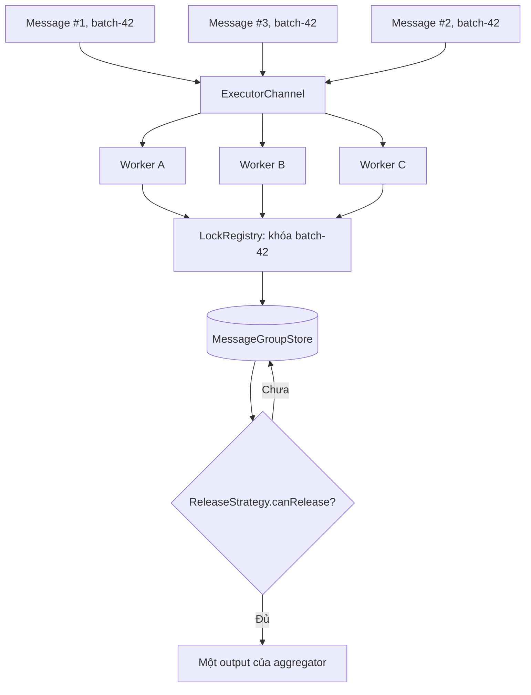
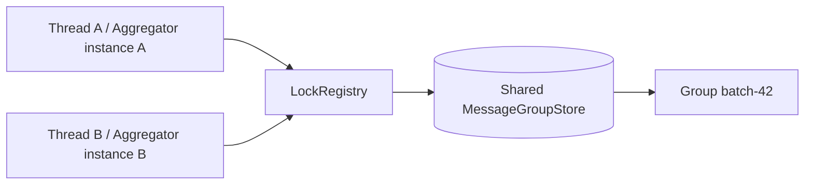
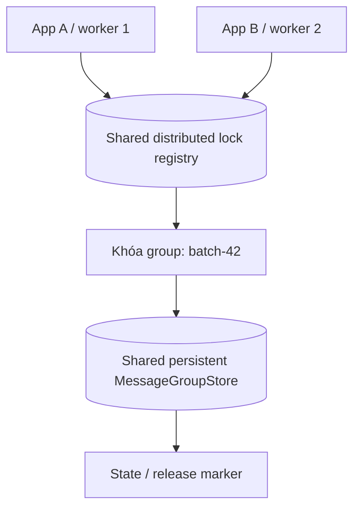
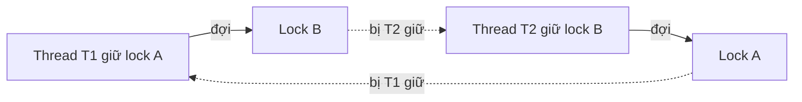

# Group state khi nhiều thread cập nhật trong Spring Integration

## 1. Bài toán: một nhóm nhận message cùng lúc từ nhiều thread

Trong Spring Integration, **aggregator** hoặc **resequencer** cần nhớ các message đến ở nhiều thời điểm. Một splitter có thể tạo 3 message có chung `correlationId`; những message này được đưa qua `ExecutorChannel` và xử lý song song. Kết quả có thể trở về cùng lúc, trong khi một poller hoặc tác vụ hết hạn nhóm cũng có thể thao tác trên state.

Ví dụ: một lô hàng `batch-42` gồm ba phần. Thread A nhận phần 1, B nhận phần 3, C nhận phần 2. Nếu tất cả đều cập nhật cùng một `MessageGroup` mà không được phối hợp, có thể xuất hiện:

- **Lost update**: hai worker cùng đọc kích thước 1, thêm một phần riêng và ghi đè trạng thái của nhau.
- **Double release**: hai worker cùng thấy nhóm đủ điều kiện và đều tạo một kết quả.
- **Release thiếu phần**: timeout và message cuối cùng cạnh tranh, dẫn đến kết quả partial ngoài dự kiến.
- **Đọc state không nhất quán**: `ReleaseStrategy` đánh giá trước khi một lần ghi khác hoàn tất.
- **Deadlock hoặc lock contention**: thread giữ khóa một nhóm nhưng đợi thao tác cần khóa nhóm khác.
- **Sai nghiệp vụ dù state hợp lệ**: message được giao lại sau retry tạo side effect trùng hoặc group ID trùng giữa những lần chạy.

Đây là bài **“Group state khi nhiều thread cập nhật”** trong chương **Correlation runtime** của module **SPRING_INTEGRATION_RUNTIME**. Mục tiêu là hiểu vòng đời message group, cơ chế khóa và transaction khi channel/endpoint/consumer/poller/executor cùng tham gia, rồi biết cách chẩn đoán hiệu năng và lỗi runtime.

> **Phạm vi bảo đảm:** Với cấu hình aggregator chuẩn, Spring Integration đã có khóa quanh cập nhật nhóm theo correlation key. Chúng ta cần hiểu và cấu hình khóa đúng, nhất là khi chạy **nhiều instance**, thay vì tự đồng bộ hóa từng danh sách payload bên ngoài framework.

## 2. MessageGroup là state gì?

Aggregator và resequencer là các **correlating message handler**. Chúng nhận message, tìm group key, thêm message vào `MessageGroupStore`, đánh giá `ReleaseStrategy` và có thể tạo output.



Một message group thường có các loại thông tin sau:

| Thành phần state | Vai trò | Nếu đồng thời cập nhật không đúng |
| --- | --- | --- |
| **Group ID / correlation key** | Xác định message thuộc cùng nhóm | Trộn nhóm hoặc tạo nhóm sai |
| Danh sách/tập message | Các message chưa release | Lost update, nhận duplicate |
| Dấu hoàn tất / released state | Phân biệt nhóm đã hoàn thành với nhóm đang mở | Double release, nhận late message sai |
| Timestamps: created/updated | Phục vụ timeout, expiry/reaper, giám sát | Nhóm hết hạn sớm hoặc bị giữ quá lâu |
| `condition` (nếu sử dụng) | Chuỗi trạng thái/điều kiện hỗ trợ release, từ Spring Integration 5.5 | Custom strategy quyết định sai |
| Sequence headers của từng message | `correlationId`, `sequenceNumber`, `sequenceSize` | Release sai điều kiện hoặc sai thứ tự |

Không nên coi `MessageGroup` là một `List` Java bình thường được nhiều worker tùy ý sửa. Nó là dữ liệu do framework quản lý qua `MessageGroupStore` và cơ chế khóa của correlation handler.

### Mối quan hệ giữa correlation và group

Với splitter thông thường, ba header quan trọng là:

- `IntegrationMessageHeaderAccessor.CORRELATION_ID`: khóa để tìm một nhóm.
- `IntegrationMessageHeaderAccessor.SEQUENCE_NUMBER`: vị trí message trong sequence.
- `IntegrationMessageHeaderAccessor.SEQUENCE_SIZE`: tổng số phần dự kiến.

Ví dụ:

```text
Message       correlationId    sequenceNumber    sequenceSize
part-A        batch-42         1                 3
part-C        batch-42         3                 3
part-B        batch-42         2                 3
other-X       batch-43         1                 2
```

Ba message của `batch-42` tác động lên **cùng group**; `other-X` dùng group khác và có thể được xử lý song song với chúng. Nếu mỗi group ID độc lập, thông lượng có thể tăng theo số nhóm đang hoạt động. Nếu 90% message cùng một correlation key, các thread có thể phải chờ khóa nhiều hơn dù pool rất lớn.

## 3. Một lần nhận message thay đổi group như thế nào?

Có thể hình dung đường đi logic của `AggregatingMessageHandler`:

```text
1. Consumer nhận Message<?> từ channel.
2. CorrelationStrategy xác định groupId.
3. LockRegistry lấy lock ứng với groupId.
4. MessageGroupStore tìm/tạo group và thêm message.
5. Cập nhật group metadata/condition nếu cấu hình.
6. ReleaseStrategy.canRelease(group) đánh giá nhóm.
7. Nếu release: tạo output, cập nhật/đánh dấu/loại message đã release.
8. Xử lý complete/expire/discard theo cấu hình.
9. Mở khóa ở điểm thích hợp; output được dispatch.
```

Danh sách trên là **mô hình khái niệm**; thứ tự chi tiết của `send`, release lock và cleanup phụ thuộc phiên bản, handler và các cờ cấu hình. Điểm phải bảo vệ là quá trình đọc/sửa group và quyết định release phải nhìn thấy state nhất quán.

Bảng timeline với ba worker vào cùng group:

| Thời điểm | Worker A | Worker B | Worker C | State có thể quan sát |
| --- | --- | --- | --- | --- |
| t0 | Nhận #1, giành khóa `batch-42` | Nhận #3, chờ khóa | Nhận #2, chờ khóa | Group chưa có |
| t1 | Lưu #1 → không release | Chờ | Chờ | `{1}` |
| t2 | Mở khóa | Lấy khóa, lưu #3 | Chờ | `{1,3}` |
| t3 | — | Không release, mở khóa | Lấy khóa, lưu #2 | `{1,3}` |
| t4 | — | — | Đủ #1,#2,#3 → release | Group hoàn thành |
| t5 | — | — | Hoàn tất xử lý theo policy | Một output kỳ vọng |

Thứ tự giành khóa không nhất thiết giống thứ tự gửi vào channel. `LockRegistry` đảm bảo loại trừ lẫn nhau cho khóa tương ứng, **không cam kết fairness hay thứ tự nghiệp vụ**.

### Aggregator và resequencer không tạo đầu ra giống nhau

- Aggregator thường phát **một message kết quả** khi nhóm đủ điều kiện.
- Resequencer giữ message để phát **các message thành phần theo thứ tự sequence**.

Cùng có group state và lock nhưng release semantics khác nhau. Nếu downstream yêu cầu thứ tự, đừng giả định một collection trả về từ aggregator mặc nhiên được sắp theo `sequenceNumber`; hãy sắp xếp tường minh hoặc dùng resequencer ở vị trí phù hợp.

## 4. LockRegistry: vì sao nhiều thread vẫn an toàn trong một JVM?

Spring Integration dùng `LockRegistry` để lấy khóa theo correlation key. Aggregator mặc định dùng một `DefaultLockRegistry` nội bộ, giúp các thao tác trên cùng group được tuần tự hóa **trong phạm vi ứng dụng/registry đó**.

```java
// Minh họa cách API lấy khóa được sử dụng.
// Aggregator của Spring Integration tự quản lý locking;
// đừng tự bọc lại toàn bộ handler khi không cần.
import java.util.concurrent.locks.Lock;
import org.springframework.integration.support.locks.LockRegistry;

Lock lock = lockRegistry.obtain("batch-42");
lock.lock();
try {
    // Một critical section liên quan tới group batch-42.
} finally {
    lock.unlock();
}
```

Một số điểm then chốt:

1. **Cùng key → cùng ngữ cảnh khóa:** hai worker cùng `batch-42` không được đồng thời thao tác một group khi đều sử dụng cơ chế khóa tương thích.
2. **Khác key → có thể chạy song song:** `batch-42` và `batch-43` có thể xử lý độc lập, mặc dù nội bộ implementation có thể dùng một số lượng lock hữu hạn hoặc gặp contention khác.
3. **Khóa chỉ đúng nơi dùng nó:** tự đọc `MessageGroupStore` rồi sửa metadata từ code ngoài handler mà bỏ qua khóa tương thích có thể phá giả định an toàn.
4. **Khóa không đảm bảo persistence:** `DefaultLockRegistry` nằm trong memory, không bảo vệ giữa các JVM trên hai máy.
5. **Khóa không đồng nghĩa transaction:** một worker có thể khóa đúng nhưng ghi DB thất bại, rollback hay crash; state cuối cùng còn phụ thuộc store và transaction.

Theo tài liệu Spring Integration, từ **phiên bản 6.5**, `AbstractMessageGroupStore` cũng có cơ chế khóa cho thao tác metadata của nhóm. Điều này không thay thế nhu cầu cấu hình đồng bộ liên instance khi dùng một persistent store chung.

## 5. Ví dụ Java DSL: nhiều worker cập nhật một aggregator

Ví dụ sau dùng **một JVM** và để framework khóa theo group key. `SimpleMessageStore` là store trong bộ nhớ phù hợp cho lab. Đối với restart hoặc nhiều instance, phần 8 sẽ thay bằng persistent store và distributed lock.

```java
import org.springframework.context.annotation.Bean;
import org.springframework.context.annotation.Configuration;
import org.springframework.core.task.TaskExecutor;
import org.springframework.integration.config.EnableIntegration;
import org.springframework.integration.dsl.IntegrationFlow;
import org.springframework.integration.dsl.MessageChannels;
import org.springframework.integration.store.MessageGroupStore;
import org.springframework.integration.store.SimpleMessageStore;
import org.springframework.integration.support.locks.DefaultLockRegistry;
import org.springframework.integration.support.locks.LockRegistry;
import org.springframework.scheduling.concurrent.ThreadPoolTaskExecutor;

@Configuration
@EnableIntegration
public class CorrelationFlowConfig {

    @Bean
    public MessageGroupStore groupStore() {
        return new SimpleMessageStore();
    }

    @Bean
    public LockRegistry aggregatorLockRegistry() {
        return new DefaultLockRegistry();
    }

    @Bean
    public TaskExecutor aggregationWorkers() {
        ThreadPoolTaskExecutor pool = new ThreadPoolTaskExecutor();
        pool.setCorePoolSize(4);
        pool.setMaxPoolSize(8);
        pool.setQueueCapacity(100);
        pool.setThreadNamePrefix("aggregate-worker-");
        return pool; // Spring quản lý lifecycle của bean.
    }

    @Bean
    public IntegrationFlow concurrentAggregation(
            TaskExecutor aggregationWorkers,
            MessageGroupStore groupStore,
            LockRegistry aggregatorLockRegistry) {

        return IntegrationFlow.from("partsIn")
                .channel(MessageChannels.executor(aggregationWorkers))
                .aggregate(a -> a
                        .messageStore(groupStore)
                        .lockRegistry(aggregatorLockRegistry)
                        .expireGroupsUponCompletion(false))
                .channel("groupResults")
                .get();
    }
}
```

Ở đây:

- `partsIn` là channel đầu vào; khi message được gửi đến `ExecutorChannel`, việc xử lý downstream có thể diễn ra trên worker khác thread gọi `send()`.
- `.aggregate(...)` tạo aggregator có khóa group; `LockRegistry` do ứng dụng cung cấp giúp kiểm soát rõ phạm vi đồng bộ.
- `.expireGroupsUponCompletion(false)` giữ lại thông tin nhóm hoàn thành để xử lý **late arrivals** theo policy của aggregator. Đây cũng là mặc định phổ biến, nhưng đặt tường minh để dễ đọc.
- `groupResults` nhận output mặc định của aggregator, thường chứa collection payload; nếu cần kết quả nghiệp vụ, hãy cấu hình output processor hoặc method `@Aggregator`.

Ví dụ là **một phần ứng dụng**: phải có consumer hoặc poller phù hợp ở `groupResults` nếu muốn quan sát output. Nếu channel output là `DirectChannel` mà không có subscriber, khi release có thể lỗi dispatch.

### Gửi ba message cùng lúc

Snippet dưới đây là phần minh họa chạy trong application context đã có `partsIn`:

```java
import java.util.List;
import java.util.concurrent.CompletableFuture;
import java.util.concurrent.ExecutorService;
import java.util.concurrent.Executors;

import org.springframework.integration.IntegrationMessageHeaderAccessor;
import org.springframework.messaging.MessageChannel;
import org.springframework.messaging.support.MessageBuilder;

MessageChannel channel =
        applicationContext.getBean("partsIn", MessageChannel.class);

ExecutorService senders = Executors.newFixedThreadPool(3);

try {
    String batchId = "batch-42";

    var sends = List.of(1, 3, 2).stream()
            .map(number -> CompletableFuture.runAsync(() -> {
                channel.send(MessageBuilder
                        .withPayload("part-" + number)
                        .setHeader(
                                IntegrationMessageHeaderAccessor.CORRELATION_ID,
                                batchId)
                        .setHeader(
                                IntegrationMessageHeaderAccessor.SEQUENCE_NUMBER,
                                number)
                        .setHeader(
                                IntegrationMessageHeaderAccessor.SEQUENCE_SIZE,
                                3)
                        .build());
            }, senders))
            .toArray(CompletableFuture[]::new);

    CompletableFuture.allOf(sends).join();
} finally {
    senders.shutdown();
}
```

Ba lệnh `send` được khởi tạo từ nhiều sender thread; sau `ExecutorChannel` còn có worker pool. **Chờ tất cả future của producer hoàn tất không bảo đảm output aggregator đã được xử lý xong**. Khi viết bài test, dùng một `QueueChannel` output và timeout hoặc `CountDownLatch` trong output consumer để xác minh kết quả, tránh dùng `Thread.sleep` tùy tiện.

Kỳ vọng: nếu cả ba message có header hợp lệ và không có duplicate/lỗi, aggregator tạo một output cho `batch-42`. Đừng kiểm tra theo thứ tự element trong collection nếu chưa tự định nghĩa ordering.

## 6. Mối quan hệ giữa `MessageGroupStore` và khóa

Group store là nơi lưu state; lock registry là công cụ điều phối thao tác. Hai trách nhiệm tách biệt:



Với một JVM, `SimpleMessageStore` + `DefaultLockRegistry` thường đủ cho nhiều worker dùng cùng aggregator. Với nhiều JVM, nếu cả hai node có `DefaultLockRegistry` riêng thì chúng có thể **đồng thời lấy khóa cùng tên trên hai máy**; về mặt logic hai khóa không liên hệ với nhau.

| Phạm vi | Store | Lock | Đánh giá |
| --- | --- | --- | --- |
| Một JVM, một aggregator | Memory store | `DefaultLockRegistry` | Phù hợp lab/single instance |
| Một JVM, nhiều worker | Memory/persistent store | Cùng registry của aggregator | Cùng correlation key được bảo vệ trong JVM |
| Hai JVM, chung JDBC store | Persistent `MessageGroupStore` | Hai `DefaultLockRegistry` riêng | **Chưa đủ** để phối hợp liên instance |
| Hai JVM, chung JDBC store | Persistent store | Shared/distributed `LockRegistry` | Cơ sở đúng để tuần tự hóa thao tác trên group |
| Hai aggregator độc lập | Store/group namespace riêng | Registry namespace riêng hợp lý | Giảm va chạm và tránh khóa lồng khó kiểm soát |

**Không nhầm thread-safe collection với transaction:** tự chuyển `ArrayList` thành `ConcurrentHashMap` không giải quyết tính nguyên tử của chuỗi *đọc group → thêm message → kiểm tra release → ghi trạng thái hoàn tất*.

### Khóa ở handler và khóa ở store

Trong các phiên bản mới, cả correlation handler và `AbstractMessageGroupStore` có thể tham gia locking để bảo vệ các mức thao tác khác nhau. Khi sử dụng store hoặc lock registry tùy biến, cần xem tài liệu API đúng phiên bản về khóa của handler và store để tránh một đường cập nhật bypass khóa hay hai lock registry bảo vệ không cùng group identity.

Đối với **một** correlating handler, đừng tự thêm vòng `synchronized(group)` quanh output processor rồi tin rằng đã giải quyết đa instance: object `group` trong hai JVM vốn không phải cùng tham chiếu.

## 7. Race condition quan trọng: message cuối cùng đến cùng lúc timeout

Một nhóm `batch-42` dự kiến ba phần. Hai phần đã vào; đúng thời điểm timeout, phần số 3 đến từ worker khác.

```text
t0: group có {#1,#2}, sequenceSize=3.
t1: scheduler kích hoạt expiry/group timeout.
t1: worker xử lý #3 và muốn thêm vào group.
t2: một tác vụ lấy khóa group trước, tác vụ còn lại chờ.
t3: tùy thứ tự thực tế:
    - Nhóm được hoàn tất bình thường với cả #3.
    - Nhóm bị expire/force release theo cấu hình khi mới có 2 phần;
      #3 trở thành late arrival/discard hoặc tạo nhóm mới theo policy.
```

Khóa làm các bước sửa group không chạy chồng chéo ngoài kiểm soát, **không thay thế chính sách nghiệp vụ** về kết quả đúng khi timeout.

Ví dụ nếu nghiệp vụ tạo hóa đơn cần đủ ba dòng thì **không** nên coi partial release là hóa đơn đầy đủ. Nếu nghiệp vụ cho phép kết quả một phần, output phải chứa cờ `partial=true`, số phần thiếu và khóa correlation để downstream biết.

Một số cơ chế cần phân biệt:

| Cơ chế | Khi nào chạy? | Điều cần xác định |
| --- | --- | --- |
| `ReleaseStrategy.canRelease(group)` | Khi group được cập nhật/đánh giá | Điều kiện đủ để release |
| `groupTimeout` / expression | Theo timeout được cấu hình | Group thiếu phần sẽ release partial hay discard? |
| `MessageGroupStoreReaper` | Tác vụ scheduler quét nhóm cũ | Thời điểm expiry và callback tác động thế nào |
| `sendPartialResultOnExpiry` | Khi expiry diễn ra theo cấu hình phù hợp | Có phát output partial không |
| `expireGroupsUponCompletion` | Khi group đã complete | Giữ metadata để reject late arrivals hay xóa để có thể tái dùng key |
| Discard/error channel | Khi message đến muộn hoặc không thể xử lý | Có lưu dấu vết và cảnh báo không |

Theo tài liệu, reaper quét theo lịch nên timeout **mang tính xấp xỉ**: nhóm được xem xét ở lần quét kế tiếp. Không coi nó là đồng hồ chính xác tới từng mili giây.

### Làm gì với message đến muộn?

Cấu hình phổ biến giữ metadata về nhóm hoàn thành sau release để phát hiện message đến muộn. Nếu bật `expireGroupsUponCompletion(true)`, group có thể bị xóa hoàn toàn; một message với correlation key cũ đến sau có thể bắt đầu một group **mới**, rất nguy hiểm khi key là mã đơn tái sử dụng.

Đối với workflow có retry/replay, nên phân biệt `orderId` với `groupId` có vòng đời rõ (ví dụ `orderId + revision + processingRunId`). Có thể giữ bảng trạng thái nghiệp vụ hoặc idempotency record lâu hơn thời gian group metadata tồn tại.

## 8. Group state trên nhiều instance: distributed LockRegistry

Khi hệ thống có hai hoặc nhiều application instance dùng chung `JdbcMessageStore`, khóa nội bộ trên từng JVM không đủ. Spring Integration cung cấp các lựa chọn distributed lock như **JDBC**, **Redis**, **ZooKeeper** và những integration khác tùy hệ sinh thái/phiên bản.

Sơ đồ:



Một ví dụ cấu hình bằng Java DSL nhận các bean store và registry đã được chuẩn bị:

```java
import org.springframework.context.annotation.Bean;
import org.springframework.integration.dsl.IntegrationFlow;
import org.springframework.integration.store.MessageGroupStore;
import org.springframework.integration.support.locks.LockRegistry;

@Bean
IntegrationFlow sharedAggregateFlow(
        MessageGroupStore persistentGroupStore,
        LockRegistry distributedLockRegistry) {

    return IntegrationFlow.from("remoteResults")
            .aggregate(a -> a
                    .messageStore(persistentGroupStore)
                    .lockRegistry(distributedLockRegistry)
                    .expireGroupsUponCompletion(false))
            .channel("completedBatches")
            .get();
}
```

Đây là **phần wiring**, không phải cấu hình DB/Redis/ZooKeeper đầy đủ. Trong production, cần cấu hình chính xác:

1. Cả các instance dùng **cùng** persistent group store hoặc partition tương thích.
2. Các instance dùng một distributed lock service/namespace chung cho **cùng một aggregator logic**.
3. Các instance thống nhất correlation strategy, release strategy, store region, group key format và serializer.
4. DB transaction/isolation phù hợp và xử lý được retry khi optimistic lock/conflict hoặc distributed lock timeout.
5. TTL/lease của khóa phân tán đủ cho critical section; khi mất mạng/crash, phải xác định cơ chế mất lease, retry và phục hồi.

Từ Spring Integration **7.0**, API distributed lock có bổ sung các thao tác TTL chuyên biệt và `LockRegistry` dùng kiểu generic ở mức interface. Những đoạn cấu hình này nên đối chiếu đúng API của Spring Integration và implementation registry trong dự án khi chuyển giữa 6.x và 7.x.

### Một khóa chung không giúp mọi thành phần an toàn

Một distributed lock bảo vệ group ID **chỉ khi mọi actor thay đổi cùng group đều dùng đúng registry/namespace**. Một batch job thao tác trực tiếp các bảng group, một script xóa row hoặc một instance cấu hình registry khác vẫn có thể làm hỏng state.

Ngược lại, dùng **chung một registry/key namespace cho hai aggregator khác nhau** có thể tạo lock contention vô ích hoặc deadlock khi aggregator 1 gửi output đồng bộ vào aggregator 2.

## 9. Deadlock: hai aggregator giữ khóa khi gửi output

Giả sử flow:

```text
... → aggregator A → DirectChannel → aggregator B → output
```

Tại một thời điểm, thread T1 giữ khóa group A và gửi kết quả qua `DirectChannel` vào B. Cùng lúc T2 giữ khóa B và, do route/phản hồi nào đó, cần khóa A. Ta có vòng đợi:



Reference chính thức của Spring Integration cảnh báo deadlock khi hai aggregator nối nhau và chia sẻ lock registry trong trường hợp đa luồng.

Các lựa chọn giảm rủi ro:

- **Tách lock registry/namespace theo từng aggregator** khi hai aggregator có logic/group ID riêng; registry có thể vẫn là shared/distributed giữa các instance của **cùng** aggregator.
- **Đặt async boundary** như `ExecutorChannel` hoặc `QueueChannel` giữa hai aggregator để output downstream không chạy ngay trong call stack giữ khóa của upstream. Khi dùng `QueueChannel`, cần poller phù hợp và xem lại độ bền.
- **Cấu hình `releaseLockBeforeSend=true`** cho aggregator ở các phiên bản hỗ trợ (từ 5.1.1) để mở khóa trước khi gửi output. Cần kiểm chứng tính đúng đắn của xử lý late messages/release metadata với quy trình nghiệp vụ cụ thể.

Các phương án không tự động tương đương. Chẳng hạn thêm `ExecutorChannel` thay đổi thread, error routing và transaction boundary; vì vậy phải kiểm thử lại lỗi, retry, thời điểm commit và thứ tự output.

**Quan sát deadlock:** Thread dump có thể hiện `java.util.concurrent.locks.ReentrantLock` và hai thread đợi nhau; executor active threads cao nhưng throughput bằng 0, queue backlog tăng. Đừng tăng kích thước pool để “chữa” deadlock vì có thể chỉ làm tăng số thread cùng kẹt.

## 10. ReleaseStrategy có thể bị gọi nhiều lần

Mỗi message đến có thể khiến `ReleaseStrategy` được hỏi lại. Với group gồm hàng nghìn message, việc liên tục sao chép payload để đánh giá release hoặc chạy truy vấn ngoài có thể gây chi phí lớn.

```java
import org.springframework.integration.aggregator.ReleaseStrategy;
import org.springframework.integration.store.MessageGroup;

public final class ExpectedCountReleaseStrategy implements ReleaseStrategy {

    private final int expectedCount;

    public ExpectedCountReleaseStrategy(int expectedCount) {
        this.expectedCount = expectedCount;
    }

    @Override
    public boolean canRelease(MessageGroup group) {
        return group.size() >= expectedCount;
    }
}
```

Đây là **ví dụ đơn giản** cho bài lab có đúng một group kích thước cố định, không có duplicate. Trong thực tế, `group.size() >= expectedCount` không chứng minh đủ các `sequenceNumber` nếu đã nhận message trùng hoặc thiếu một phần khác. Với split sequence chuẩn, nên để framework áp dụng strategy mặc định dựa trên sequence headers, hoặc xây chiến lược kiểm tra danh tính phần hợp lệ.

Một custom strategy tốt nên:

- **Không ghi thêm message vào cùng group trong `canRelease()`**; đây là hàm quyết định, không phải nơi gây side effect.
- Hạn chế gọi hệ thống từ xa hoặc truy vấn chậm khi đang giữ group lock.
- Không dựa vào biến field mutable không thread-safe để đếm phần đã đến. State cần được tính từ `MessageGroup`/store hoặc một nguồn dữ liệu được điều phối.
- Không giả định mọi group được release một lần trọn vẹn nếu bật partial release, timeout hoặc replay.
- Được kiểm thử khi nhiều message đến song song và khi service restart.

### Group condition để tránh quét message quá nhiều

Từ Spring Integration 5.5, `MessageGroup` có thuộc tính `condition` (chuỗi), và `MessageGroupStore` cung cấp `setGroupCondition(groupId, condition)`. Một correlating handler có thể dùng condition supplier cập nhật trạng thái nhóm, rồi `ReleaseStrategy` đọc condition khi quyết định release.

Ví dụ ứng dụng file splitter có thể ghi **số dòng dự kiến** khi end marker tới, không cần lặp mọi message mỗi lần. Khi nhiều thread cùng cập nhật, vẫn cần duy trì atomicity giữa message, metadata và điều kiện theo cơ chế locking/store của framework. Không biến `condition` thành một biến toàn cục độc lập ngoài transaction.

## 11. Duplicate, retry và correlation key trùng

**Lock không ngăn mọi duplicate**. Nó ngăn hai lần cập nhật đồng thời; nếu upstream giao lại cùng message ở t2 sau khi lần trước đã commit, lần t2 có thể hợp lệ về mặt locking nhưng không hợp lệ về mặt nghiệp vụ.

Nguồn duplicate có thể gồm:

- Worker nhận lại message khi transaction rollback hoặc broker redelivery.
- Retry advice gọi cùng handler nhiều lần sau exception.
- Người dùng gửi lại request với cùng business key.
- Timeout khiến nhóm partial release; phần đến trễ được re-deliver.
- Hai hệ thống tạo message có cùng `correlationId` nhưng thuộc hai business runs khác nhau.

Ví dụ có `sequenceSize=3` nhưng các message đến lần lượt `#1, #2, #2`. Nếu một custom release strategy chỉ đếm số message mà không kiểm tra định danh sequence hoặc business fragment, nó có thể release khi phần #3 chưa hề có.

**Thiết kế chống trùng nên có nhiều lớp:**

| Lớp | Trách nhiệm |
| --- | --- |
| Correlation key | Phân biệt đơn, revision, processing run/attempt |
| Message identity | Nhận diện message được giao lại so với message mới |
| Fragment/business key | Kiểm tra mỗi phần độc lập có mặt tối đa một lần |
| Release strategy | Chỉ release khi đủ các phần hợp lệ |
| Output idempotency | Ngăn hai lần tạo side effect nếu output được giao lại |
| Group completion metadata | Reject late message trong khoảng thời gian được quy định |

Thông thường khóa thích hợp có dạng `tenantId + batchId + revision + runId` thay vì chỉ `batchId`. Đừng đưa cả key dài/ID biến thiên vào nhãn metric; lưu trong log/tracing để phân tích.

## 12. Message store bền vững, transaction và crash

Nếu group tồn tại nhiều giây hoặc cần khôi phục sau restart, dùng một `MessageGroupStore` bền vững phù hợp, ví dụ `JdbcMessageStore`. Nhưng database persistence không tự giải quyết mọi race:

| Thời điểm lỗi | Có thể xảy ra | Thiết kế cần có |
| --- | --- | --- |
| Worker thêm message nhưng DB chưa commit | Restart mất cập nhật chưa commit | Transaction boundary phù hợp |
| Worker đã commit group đủ nhưng chưa gửi output | Khi restart có thể khó biết output đã gửi chưa | Idempotent output/outbox hoặc reconciliation |
| Output gửi đi nhưng đánh dấu completed chưa commit | Có thể release/gửi lại sau rollback | Idempotency consumer/output |
| Two nodes dùng một JDBC store nhưng local lock | Hai node cùng quyết định release | Shared distributed lock |
| Distributed lock lease hết giữa critical section | Node khác có thể giành lock khi node cũ còn chạy | TTL hợp lý, failover, fencing/idempotency theo yêu cầu |
| Group bị xóa ngay khi complete | Late message cùng key tạo group mới | Chính sách retain metadata hoặc key theo run |
| Group không bao giờ có đủ phần | State chiếm storage mãi | Expiry/reaper và partial/discard policy |

Đừng đánh đồng `transaction commit` với `unlock`. Khóa giúp kiểm soát thứ tự cập nhật; transaction quyết định cái gì được lưu/rollback. Với DB và broker trong cùng một flow, ranh giới transaction có thể nằm ở hai tài nguyên khác nhau.

### Error flow cũng phải bảo vệ trạng thái cuối

Nếu output processor hoặc send tới output channel ném exception, aggregator có thể giữ hoặc thay đổi group state tùy nơi exception xảy ra và transaction/configuration. Không nên suy luận “có lỗi thì group chắc chắn giữ nguyên”. Phải xem:

- Handler chạy qua `DirectChannel` hay `ExecutorChannel` / poller.
- `MessageGroupStore` persistent hay in-memory.
- Transaction có bao trùm add/release/send không.
- Release/expiry strategy có xử lý partial result không.
- Error handler/retry có ném lại exception hay đã recover rồi trả bình thường.

Đầu ra nên có `correlationId`/business outcome để trace tới group nguồn. Một `ErrorMessage` ở async error channel có thể chứa `failedMessage` nhưng không tự ghi lại đầy đủ toàn bộ group và các attempt. Với batch quan trọng, hãy ghi event nghiệp vụ ở điểm commit/release.

## 13. Khi MessageGroupStoreReaper làm việc đồng thời với consumer

`MessageGroupStoreReaper` chạy trên scheduler để expire nhóm quá cũ theo cấu hình. Tác vụ này có thể trùng thời điểm với một worker đang thêm message.

Cần kiểm thử rõ:

1. Worker đang giữ group lock, reaper chuẩn bị expire group.
2. Reaper expire trước, worker đến sau.
3. Worker thêm phần cuối trước, reaper chạy sau.
4. Có message được giao lại ngay sau lúc group đã hoàn thành.
5. Application restart khi group còn hai phần; reaper mới startup và phát hiện group cũ.

Việc reaper có tạo output partial, discard từng message hay đưa toàn nhóm sang discard channel phụ thuộc các thuộc tính cấu hình và phiên bản. Từ Spring Integration 6.5 có thêm tùy chọn discard cả nhóm trong một message khi expiry và không phát partial, cho một số tình huống; cần kiểm tra bản dùng thực tế.

**Lưu ý về shared store:** Không nên tùy tiện dùng **cùng một instance `MessageGroupStore` cho hai aggregator khác nhau** khi cần expiry. Mỗi correlation handler đăng ký callback xử lý group expiry; nếu dùng store không tách namespace, expiry có thể áp dụng sai handler. Hãy dùng store/region riêng hoặc cơ chế partition đúng theo hướng dẫn framework.

### Không đặt reaper timeout bằng SLA một cách máy móc

Nếu SLA là 30 giây nhưng reaper chỉ quét mỗi 5 phút, group có thể được xử lý muộn rất nhiều. Nếu chọn timeout ngắn hơn độ trễ trung bình của nhánh xử lý chậm nhất, số partial/discard sẽ tăng dù hệ thống vẫn “khỏe”.

Đo phân phối **thời gian từ message đầu tới message cuối** (p50/p95/p99), kết hợp retry/backoff và executor queue wait, rồi mới xác định timeout và quét reaper.

## 14. Threading và hiệu năng: khóa giải quyết correctness nhưng có giá

Một trong các hiện tượng đặc trưng của correlation flow là **hot group**: nhiều message cùng một key khiến worker phải chờ nhau.

| Triệu chứng | Nguyên nhân có thể | Điểm quan sát |
| --- | --- | --- |
| CPU thấp nhưng throughput giảm | Các thread chờ cùng group lock | Thread dump, blocked/waited time |
| Executor queue dài | Producer nhanh, aggregator chậm hoặc lock contention | Queue depth, active threads, task rejection |
| DB transaction thời gian dài | Lock giữ trong lúc query/processor/output chậm | DB lock wait, transaction duration |
| Một group rất lớn | Release thiếu điều kiện hoặc group key quá rộng | Group size, age, message count |
| Phần lớn nhóm nhỏ vẫn nhanh | Contention tập trung ở một hot key | Group ID trong logs (không đưa lên metric tags) |
| Deadlock giữa aggregator | Lock lồng và downstream gọi đồng bộ | Thread dump cho hai lock chờ vòng |
| Release nhiều output hơn dự kiến | Late/replay/duplicate, group completion cleanup | Audit theo business key và release event |
| Memory tăng mãi | Group hoàn thành metadata không được cleanup | Count completed groups, reaper policy |

### Thiết kế cho throughput

1. **Giảm hot key:** chia batch theo một khóa có ý nghĩa nghiệp vụ khi có thể, không làm thay đổi semantics của grouping.
2. **Giữ critical section ngắn:** tránh I/O không cần thiết trong release strategy; cân nhắc giải phóng khóa trước output nếu tương thích logic.
3. **Đừng tăng thread pool mù quáng:** nhiều worker hơn không làm cùng một group được cập nhật song song.
4. **Tách async boundary có chủ đích:** sau aggregator có thể dùng `ExecutorChannel` để tách downstream chậm, đồng thời thiết kế lại error/transaction handling.
5. **Theo dõi group age và release latency:** tăng queue depth với group age tăng là dấu hiệu phần nào đó không được giải phóng.
6. **Nếu nhiều instance:** đo lock acquisition latency, lease failures và DB wait; scale ngang chỉ có ích khi có nhiều group độc lập.

### Về metric cardinality

Nên dùng tag ổn định như `flow`, `endpoint`, `outcome`, `exceptionType`. Các giá trị `correlationId`, `batchId`, `tenantId` theo từng yêu cầu thường có cardinality cao; hãy ghi trong log/tracing có kiểm soát thay vì gắn trực tiếp vào mọi timer/counter.

Metrics hữu ích: số group đang mở, tuổi group lâu nhất, nhóm đã complete, expired, partial/rejected, thời gian từ phần đầu tới release, thời gian chờ lấy lock, số lần lock timeout, executor backlog và số output đã commit.

## 15. Thực hành: kiểm thử concurrency trong một JVM

Bài lab nên khởi tạo `concurrentAggregation` ở phần 5 cùng một output test channel có thể đợi kết quả.

**Kịch bản A: nhiều phần cùng group**

1. Tạo 100 group ID khác nhau; mỗi group có 3 phần, đủ `sequenceNumber=1,2,3`.
2. Dùng nhiều sender thread gửi tất cả phần theo thứ tự ngẫu nhiên.
3. Với mỗi group, chờ output trong giới hạn thời gian và kiểm tra đúng **một kết quả** có đủ ba phần.
4. Kiểm tra `groupStore` không còn message chưa release theo policy đã chọn.
5. Thử lặp nhiều lần với jitter ở worker để tăng khả năng lộ race.

**Kịch bản B: cùng group có duplicate**

1. Gửi `#1, #2, #2` nhưng không có `#3`.
2. Quan sát release strategy đang dùng; không giả định nó sẽ tự loại duplicate business fragment.
3. Gửi `#3`; xác nhận kết quả chỉ được tạo sau khi điều kiện hợp lệ thỏa.
4. Thiết kế idempotency/dedup ở đúng tầng nếu ứng dụng cần bảo đảm không lặp.

**Kịch bản C: timeout trùng phần cuối**

1. Tạo một group chưa đủ; chọn `groupTimeout` nhỏ nhưng đủ để lab điều phối.
2. Cho thread cuối gửi message đúng lúc scheduler xử lý timeout.
3. Kiểm tra có tối đa một terminal outcome theo chính sách: full result, partial result hoặc discard.
4. Log cả `groupId`, outcome và timestamp để biết thread nào thắng race; không bắt buộc luôn cùng một thread thắng.

**Kịch bản D: áp lực hot key**

1. Gửi hàng nghìn phần cùng một correlation key với release strategy được thiết kế cho bài test.
2. So sánh thời gian chờ khóa/throughput với số lượng phần tương tự nhưng chia ra nhiều group.
3. Thử tăng worker count; nếu lock contention là điểm nghẽn, throughput theo hot key có thể hầu như không tăng.
4. Nếu xuất hiện group rất lớn, đo chi phí đánh giá `ReleaseStrategy` và thời gian giữ lock.

### Tiêu chí PASS có ý nghĩa

| Khía cạnh | Kỳ vọng |
| --- | --- |
| Correctness | Không mất phần, không gộp nhầm key, không double terminal business result |
| Ordering | Resequencer giữ thứ tự; aggregator có quy tắc ordering rõ nếu cần |
| Concurrency | Nhiều group độc lập chạy được song song; cùng group không corrupt |
| Failure | Retry/replay không gây duplicate side effect |
| Timeout | Full/partial/discard đúng policy, có trace |
| Capacity | Group count, age, lock wait và queue depth không tăng vô hạn |

Không dùng một test “sleep 500 ms rồi assert queue rỗng” để kết luận concurrency đúng. Hãy dùng latch, future, poll có timeout và assertions trên group/business outcome.

## 16. Kiểm thử khi có hai ứng dụng dùng chung store

Cần integration test **hai JVM hoặc hai application instance** với store và lock backend thật để chứng minh cấu hình multi-instance. Unit test tạo hai `DefaultLockRegistry` trong cùng một JVM **không thay thế** kiểm thử distributed lock.

Kịch bản được khuyến nghị:

1. Chạy hai application instance cùng dùng `JdbcMessageStore` và distributed `LockRegistry`, cấu hình namespace khóa nhất quán.
2. Đẩy message có cùng correlation key qua hai instance đồng thời.
3. Ghi audit release theo business key có unique constraint; không chấp nhận hai kết quả terminal.
4. Restart một instance khi đang cập nhật group; xác minh instance còn lại tiếp tục đúng và không mất update đã commit.
5. Làm lock backend tạm thời unavailable hoặc cho lease hết hạn trong lab; xác nhận lỗi được quan sát và transaction rollback/retry theo policy.
6. Rolling deploy code mới thay đổi release strategy hoặc serializer; kiểm tra group tồn tại từ code cũ có tiếp tục hoàn thành được không.

Nếu cần giữ output tuyệt đối một lần ở bên ngoài, phải có cơ chế **idempotency hoặc transactional outbox**. Distributed lock chỉ xử lý quyền cập nhật nhóm tại một thời điểm; nó không làm lời gọi HTTP, gửi email hay commit broker trở thành transaction nguyên tử cùng group store.

## 17. Checklist chẩn đoán lỗi runtime

Khi thấy aggregator “đứng”, mất output hoặc tạo duplicate, hãy lần theo chuỗi:

- **Input:** Message có đủ `correlationId`, `sequenceNumber`, `sequenceSize`? Có reuse key giữa các runs không?
- **Channel:** Message đến qua `DirectChannel`, `ExecutorChannel` hay `QueueChannel`? Poller có đang chạy? Có thread pool reject?
- **Endpoint:** Có đúng một aggregator nhận nhóm này không? Có một handler khác đang dùng chung store/region ngoài ý muốn không?
- **Lock:** Có bao nhiêu thread đang đợi khóa? Lock registry là local hay distributed? Lease/timeout có lỗi không?
- **Store:** Group có bao nhiêu phần, condition/metadata và trạng thái complete? Transaction có commit không?
- **Release:** Strategy có thể release? Nếu đã complete, nhóm có bị xóa quá sớm và nhận late messages như nhóm mới?
- **Expiry:** Timeout/reaper có chạy? Có gửi partial/discard theo policy? Scheduler có lỗi?
- **Output:** Downstream đang chậm, không có subscriber hoặc ném exception? Output có idempotency?
- **Error:** Exception được đẩy về caller hay thành `ErrorMessage`? Có recovery đã hấp thụ lỗi không?
- **Observability:** Có thể ghép trace theo correlation ID và version/run ID từ ingress đến release/expiry không?

Có thể dùng thread dump hoặc profiler để xác định chờ lock; đối chiếu timestamp của group store và log để tái dựng race. Đừng dùng thao tác `MessageGroupStore.removeMessageGroup()` thủ công trên production chỉ để “giải phóng” một hot key mà chưa đánh giá hậu quả mất dữ liệu và release lại.

## 18. Kết luận

Khi nhiều thread cập nhật một `MessageGroup`, bài toán là **cập nhật state và quyết định release nhất quán theo correlation key**. Spring Integration cung cấp `LockRegistry` trong correlating handler để tuần tự hóa các thao tác cùng nhóm ở một JVM. Khi chia sẻ persistent `MessageGroupStore` trên nhiều instance, cần **distributed lock**, transaction phù hợp và chiến lược group identity nhất quán.

Locking là một phần của tính đúng đắn, nhưng chưa đủ: phải xử lý **duplicate, timeout, expiry, crash, retry, error flow và side effect ngoài transaction**. Muốn flow vừa an toàn vừa nhanh, hãy phân biệt các group độc lập có thể chạy song song với một hot group phải tuần tự, đo contention và kiểm thử những race thực tế giữa worker, reaper và output.

## Tài liệu tham khảo

- [Spring Integration Reference — Aggregator: Lock Registry, State, Deadlocks](https://docs.spring.io/spring-integration/reference/aggregator.html)
- [Spring Integration Reference — Message Store: LockRegistry và Group Condition](https://docs.spring.io/spring-integration/reference/message-store.html)
- [Spring Integration Reference — Distributed Locks](https://docs.spring.io/spring-integration/reference/distributed-locks.html)
- [Spring Integration Reference — Resequencer](https://docs.spring.io/spring-integration/reference/resequencer.html)
- [Spring Integration API — AggregatorSpec](https://docs.spring.io/spring-integration/api/org/springframework/integration/dsl/AggregatorSpec.html)

